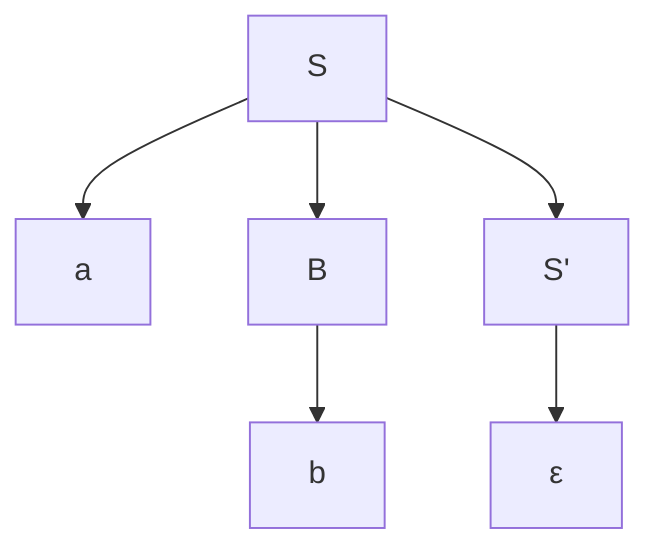

# Compiladores - Análisis sintáctico

## 3.3 Reconocimiento descendente.

---

El reconocimiento descendente (top-down parsing) es una estrategia de análisis sintáctico que construye el árbol de derivación desde la raíz hacia las hojas. Según Aho et al. (2007), este tipo de análisis intenta encontrar una derivación por la izquierda para la cadena de entrada, partiendo del símbolo inicial de la gramática.

### Fundamentos Teóricos

#### Derivación por la Izquierda

En una derivación por la izquierda, siempre se expande el no terminal más a la izquierda en cada paso. Para una gramática $G$ y una cadena $w$, el analizador busca una secuencia:

$$S \Rightarrow \alpha_1 \Rightarrow \alpha_2 \Rightarrow \cdots \Rightarrow w$$

donde $S$ es el símbolo inicial y cada $\alpha_i$ es una forma sentencial.

#### Predictores del Análisis Descendente

La predicción del siguiente token se basa en los conjuntos FIRST y FOLLOW:

- **FIRST(α)**: Conjunto de terminales que pueden aparecer al inicio de las cadenas derivadas desde α
- **FOLLOW(A)**: Conjunto de terminales que pueden aparecer inmediatamente después de A en alguna forma sentencial

### Tipos de Analizadores Descendentes

#### Análisis por Descenso Recursivo

Cada no terminal se implementa como una función o procedimiento que reconoce las cadenas generadas por ese no terminal.

```python
class RecursiveDescentParser:
    def __init__(self, tokens):
        self.tokens = tokens
        self.position = 0
        self.current_token = tokens[0] if tokens else None

    def consume(self, expected_type):
        if self.current_token and self.current_token.type == expected_type:
            self.position += 1
            if self.position < len(self.tokens):
                self.current_token = self.tokens[self.position]
            else:
                self.current_token = None
        else:
            raise SyntaxError(f"Se esperaba {expected_type}")

    def parse_E(self):
        # E → T E'
        node = self.parse_T()
        return self.parse_E_prime(node)

    def parse_E_prime(self, left_node):
        # E' → + T E' | ε
        if self.current_token and self.current_token.type == 'PLUS':
            self.consume('PLUS')
            right_node = self.parse_T()
            # Crear nodo de operación binaria
            new_node = BinaryOpNode('+', left_node, right_node)
            return self.parse_E_prime(new_node)
        return left_node

    def parse_T(self):
        # T → F T'
        node = self.parse_F()
        return self.parse_T_prime(node)

    def parse_T_prime(self, left_node):
        # T' → * F T' | ε
        if self.current_token and self.current_token.type == 'MULT':
            self.consume('MULT')
            right_node = self.parse_F()
            new_node = BinaryOpNode('*', left_node, right_node)
            return self.parse_T_prime(new_node)
        return left_node

    def parse_F(self):
        # F → ( E ) | id
        if self.current_token and self.current_token.type == 'LPAREN':
            self.consume('LPAREN')
            node = self.parse_E()
            self.consume('RPAREN')
            return node
        elif self.current_token and self.current_token.type == 'ID':
            node = IdentifierNode(self.current_token.value)
            self.consume('ID')
            return node
        else:
            raise SyntaxError("Token inesperado")
```

#### Analizadores LL(k)

Los analizadores LL(k) procesan la entrada de izquierda a derecha (Left-to-right) y construyen una derivación por la izquierda (Leftmost derivation), usando k tokens de lookahead.

**Condición LL(1)**: Para cada producción $A \rightarrow \alpha_1 | \alpha_2 | \cdots | \alpha_n$:

- $FIRST(\alpha_i) \cap FIRST(\alpha_j) = \emptyset$ para $i \neq j$
- Si $\alpha_i \Rightarrow^* \epsilon$, entonces $FIRST(\alpha_j) \cap FOLLOW(A) = \emptyset$ para $i \neq j$

### Tablas de Análisis LL(1)

#### Construcción de la Tabla LL(1)

Para cada producción $A \rightarrow \alpha$:

1. Para cada terminal $a$ en $FIRST(\alpha)$, añadir $A \rightarrow \alpha$ a $M[A, a]$
2. Si $\epsilon$ está en $FIRST(\alpha)$, para cada terminal $b$ en $FOLLOW(A)$, añadir $A \rightarrow \alpha$ a $M[A, b]$

### Algoritmo de Análisis LL(1)

```python
def ll1_parse(table, input_string):
    stack = ['$', 'E']  # Inicializar pila con símbolo inicial
    index = 0
    input_string.append('$')  # Añadir fin de entrada

    while stack:
        top = stack[-1]
        current_token = input_string[index]

        if top == current_token == '$':
            return True  # Análisis exitoso
        elif top == current_token:
            stack.pop()
            index += 1
        elif top in terminals:  # Error: terminal esperado
            raise SyntaxError(f"Se esperaba {top}")
        elif (top, current_token) not in table:
            raise SyntaxError(f"Error sintáctico en {current_token}")
        else:
            production = table[(top, current_token)]
            stack.pop()
            # Añadir símbolos de la producción en orden inverso
            if production != 'ε':  # No añadir nada para epsilon
                for symbol in reversed(production.split()):
                    stack.append(symbol)

    return False
```

### Ejemplo de Análisis Descendente

**Gramática**:

$$
S \rightarrow a B S' \mid b A S' \\
S' \rightarrow a B S' \mid \epsilon \\
A \rightarrow b A A' \mid a \\
A' \rightarrow a S \mid b A A' \\
B \rightarrow a B B' \mid b \\
B' \rightarrow b S \mid a B B'
$$

**Entrada**: `a b a`

**Análisis**:



### Recuperación de Errores en Análisis Descendente

#### Estrategias Comunes

1. **Modo pánico**: Saltar tokens hasta encontrar uno de sincronización
2. **Inserción de tokens**: Suponer tokens faltantes
3. **Corrección local**: Intentar corregir errores localmente

```python
def parse_with_error_recovery():
    try:
        return parse_expression()
    except SyntaxError as e:
        # Recuperación por modo pánico
        synchronize_tokens()
        # Intentar continuar con el análisis
        return parse_expression()
```

### Ejercicios Propuestos

1. Construya la tabla de análisis LL(1) para la siguiente gramática:

   $$
   S \rightarrow a A b \mid b B a \\
   A \rightarrow c A \mid d \\
   B \rightarrow c B \mid d
   $$

2. Implemente un analizador por descenso recursivo para la gramática:

   $$
   E \rightarrow T \mid E + T \\
   T \rightarrow F \mid T * F \\
   F \rightarrow ( E ) \mid id
   $$

   con recuperación de errores básica.

3. Demuestre si la siguiente gramática es LL(1):

   $$
   S \rightarrow A a \mid B b \\
   A \rightarrow c A \mid d \\
   B \rightarrow c B \mid e
   $$

4. Para la gramática:

   $$
   E \rightarrow T E' \\
   E' \rightarrow + T E' \mid \epsilon \\
   T \rightarrow F T' \\
   T' \rightarrow * F T' \mid \epsilon \\
   F \rightarrow ( E ) \mid id
   $$

   Calcule los conjuntos FIRST y FOLLOW para cada no terminal.

5. Extienda el analizador descendente recursivo para incluir operadores de comparación y lógicos.

### Limitaciones del Análisis Descendente

- No puede manejar gramáticas con recursión por la izquierda
- Requiere gramáticas LL(k) para análisis predictivo
- Dificultad con gramáticas ambiguas
- Limitaciones en la recuperación de errores para ciertas construcciones

### Referencias

#### Bibliografía Básica

1. Aho, A. V., Lam, M. S., Sethi, R., & Ullman, J. D. (2007). _Compilers: Principles, Techniques, and Tools_ (2nd ed.). Pearson Education. (Capítulo 4: Syntax Analysis)
2. Cooper, K. D., & Torczon, L. (2004). _Engineering a Compiler_. Morgan Kaufmann. (Capítulo 3: Parsing)
3. Scott, M. L. (2009). _Programming Language Pragmatics_. Morgan Kaufmann. (Capítulo 4: Semantic Analysis)

#### Bibliografía Complementaria

1. Grune, D., Bal, H. E., Jacobs, C. J. H., & Langendoen, K. G. (2000). _Modern Compiler Design_. John Wiley & Sons.
2. Wilhelm, R., & Maurer, D. (1995). _Compiler Design_. Addison-Wesley.

#### Términos Clave

- **Derivación por la izquierda**: Expansión del no terminal más a la izquierda en cada paso
- **Lookahead**: Tokens anticipados para la toma de decisiones
- **Recursión por la izquierda**: Producciones de la forma $A \rightarrow A\alpha$
- **Conjunto FIRST**: Terminales que pueden iniciar las derivaciones de una forma sentencial
- **Conjunto FOLLOW**: Terminales que pueden seguir a un no terminal en alguna derivación
