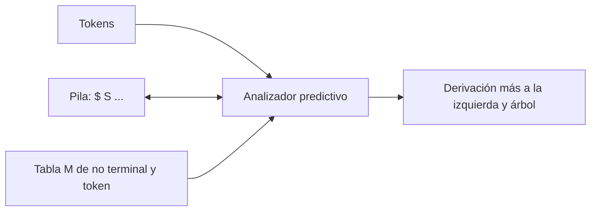

# Compiladores - Análisis sintáctico

## 3.3 Reconocimiento descendente.

---

Un analizador **descendente** construye el árbol de la raíz hacia las hojas: empieza con el símbolo inicial y, en cada paso, decide con qué producción expandir el no terminal de más a la izquierda, de modo que produce una derivación más a la izquierda. La decisión se toma mirando el siguiente token, y los conjuntos **FIRST** y **FOLLOW** dicen qué tokens corresponden a cada producción. Este tema presenta esos conjuntos, la condición LL(1), la tabla predictiva, el descenso recursivo, la recuperación de errores y los límites de la técnica.

### Los conjuntos FIRST y FOLLOW

Para una cadena de símbolos $\alpha,$ $\text{FIRST}(\alpha)$ es el conjunto de terminales con que empiezan las cadenas derivadas de $\alpha,$ y se dice que $\alpha$ es **anulable** si $\alpha \Rightarrow^* \varepsilon.$ Para un no terminal $A,$ $\text{FOLLOW}(A)$ es el conjunto de terminales que pueden aparecer inmediatamente después de $A$ en alguna forma sentencial, incluido el fin de la entrada, `$`, si $A$ puede quedar al final. Se calculan como el **menor punto fijo** de las reglas:

- si $A \to X_1 \cdots X_n,$ $\text{FIRST}(A)$ contiene $\text{FIRST}(X_i)$ siempre que $X_1, \ldots, X_{i-1}$ sean anulables, y $A$ es anulable si todos los $X_i$ lo son;
- el fin de la entrada está en el FOLLOW del símbolo inicial;
- si $A \to \alpha B \beta,$ $\text{FOLLOW}(B)$ contiene $\text{FIRST}(\beta),$ y, si $\beta$ es anulable, también $\text{FOLLOW}(A).$

Se empieza con todos los conjuntos vacíos y se aplican las reglas hasta que ninguno cambie; como los conjuntos solo crecen y están acotados por el número de terminales, el proceso termina.

### La condición LL(1)

El **conjunto de predicción** de una producción $A \to \alpha$ es $\text{FIRST}(\alpha),$ más $\text{FOLLOW}(A)$ si $\alpha$ es anulable. Una gramática es **LL(1)** si, para cada no terminal, los conjuntos de predicción de sus producciones son disjuntos: con un solo token se sabe qué producción usar. Equivalentemente, para cada par de alternativas $A \to \alpha \mid \beta:$

1. $\text{FIRST}(\alpha) \cap \text{FIRST}(\beta) = \varnothing;$
2. a lo más una de las dos es anulable;
3. si $\beta$ es anulable, $\text{FIRST}(\alpha) \cap \text{FOLLOW}(A) = \varnothing.$

Una gramática LL(1) no es ambigua ni recursiva por la izquierda: si $A \to A\alpha \mid \beta,$ todo lo que empieza a $\beta$ empieza también a $A\alpha,$ y la primera condición falla.

### La tabla predictiva y su analizador

La tabla $M[A, a]$ contiene, para cada no terminal y cada terminal, la producción que debe usarse: $A \to \alpha$ va en $M[A, a]$ para cada $a$ de su conjunto de predicción. La gramática es LL(1) exactamente cuando ninguna casilla tiene dos producciones. El analizador usa una pila, que empieza con `$` y el símbolo inicial:

1. si el tope es un terminal igual al token actual, ambos se consumen;
2. si es un no terminal $A,$ se reemplaza por el lado derecho de $M[A, a],$ apilado al revés, o se reporta un error si la casilla está vacía;
3. si el tope es `$` y la entrada terminó, se acepta.

Cada token se consume una vez y, entre dos consumos, el número de expansiones está acotado por una constante que depende de la gramática, así que el análisis es **lineal**.



### Descenso recursivo

El **descenso recursivo** implementa cada no terminal como un procedimiento que decide con el token actual qué alternativa seguir, y la pila es la de las llamadas. Es la forma más usada en los compiladores escritos a mano, como GCC, Clang, Go, Rust o TypeScript, porque es fácil de escribir y depurar, permite mensajes de error precisos y puede salirse de LL(1) donde haga falta: mirar más tokens, consultar la tabla de símbolos o **retroceder**. La recursión por la izquierda se reemplaza por ciclos, $E \to T\ \{ + T \},$ que además permiten construir el árbol con la asociatividad correcta. Una variante muy usada para las expresiones es la **precedencia de operadores** de Pratt, con un solo procedimiento para todos los niveles.

Las gramáticas LL(k) usan $k$ tokens de anticipación. ANTLR 4 generaliza la idea con **ALL(\*)**, que decide con tantos tokens como necesite, simulando las alternativas en paralelo, y los analizadores de **expresiones de análisis**, PEG, prueban las alternativas en orden con retroceso.

### Recuperación de errores

En el **modo de pánico**, al encontrar un error en el procedimiento de $A,$ el analizador descarta tokens hasta uno del conjunto de **sincronización**, típicamente $\text{FIRST}(A) \cup \text{FOLLOW}(A):$ si encuentra uno de FIRST, reintenta $A;$ si es de FOLLOW, abandona $A$ como si lo hubiera reconocido. En la **recuperación a nivel de frase**, inserta el token que falta, como un `)`, o elimina uno que sobra. Lo importante es avanzar siempre, para no ciclar, y no reportar errores en cascada.

### Implementación en Python

El programa usa el núcleo de gramáticas del tema 3.1, incluido al inicio. Para el ejercicio 1 construye la tabla LL(1) y analiza una cadena con traza; para el 2 implementa un descenso recursivo con modo de pánico guiado por FIRST y FOLLOW e inserción del paréntesis faltante; para el 3 detecta el conflicto, comprueba que la gramática es LR(1) y verifica una gramática LL(1) equivalente; para el 4 calcula los conjuntos, y para el 5 implementa los operadores lógicos y de comparación de dos formas, por niveles y con el método de Pratt, y comprueba que producen el mismo árbol en 2 000 expresiones aleatorias.

```python
# ===== Núcleo de gramáticas: FIRST y FOLLOW, LL(1), LR(0), SLR(1), LR(1), LALR(1) y transformaciones =====
FIN = "$"

class Gramatica:
    """Producciones en texto: 'E -> E + T | T', símbolos separados por espacios, ε para la cadena vacía.
    Los no terminales son los lados izquierdos; el inicial es el primero."""
    def __init__(self, texto=None, prods=None, inicial=None):
        if texto is not None:
            prods = []
            for linea in texto.strip().splitlines():
                if not linea.strip(): continue
                izq, der = linea.split("->")
                for alt in der.split("|"):
                    s = tuple(x for x in alt.split() if x != "ε")
                    prods.append((izq.strip(), s))
        self.prods = list(dict.fromkeys(prods))
        self.inicial = inicial or self.prods[0][0]
        self.nt = list(dict.fromkeys([a for a, _ in self.prods]))
        self.t = list(dict.fromkeys(x for _, d in self.prods for x in d if x not in self.nt))
        self._calcula()
    def __str__(self):
        return "\n".join(f"   {a} -> " + " | ".join(" ".join(d) or "ε" for b, d in self.prods if b == a) for a in self.nt)
    def de(self, a): return [d for b, d in self.prods if b == a]
    def _calcula(self):
        self.anulable = set(); self.first = {a: set() for a in self.nt}
        cambio = True
        while cambio:
            cambio = False
            for a, d in self.prods:
                if a not in self.anulable and all(x in self.anulable for x in d): self.anulable.add(a); cambio = True
                f = self.first_de(d)
                if not f <= self.first[a]: self.first[a] |= f; cambio = True
        self.follow = {a: set() for a in self.nt}; self.follow[self.inicial].add(FIN)
        cambio = True
        while cambio:
            cambio = False
            for a, d in self.prods:
                for i, x in enumerate(d):
                    if x not in self.nt: continue
                    resto = d[i + 1:]; f = self.first_de(resto)
                    if all(y in self.anulable for y in resto): f = f | self.follow[a]
                    if not f <= self.follow[x]: self.follow[x] |= f; cambio = True
    def first_de(self, sec):
        f = set()
        for x in sec:
            if x not in self.nt: f.add(x); return f
            f |= self.first.get(x, set())
            if x not in self.anulable: return f
        return f
    def anulable_sec(self, sec): return all(x in self.anulable for x in sec)
    def conjuntos(self):
        orden = lambda s: sorted(s, key=lambda x: (x == FIN, x))
        return "\n".join(f"   {a:8} FIRST = {{{', '.join(orden(self.first[a]))}}}{' + ε' if a in self.anulable else ''}"
                         f"   FOLLOW = {{{', '.join(orden(self.follow[a]))}}}" for a in self.nt)

# ---------- LL(1) ----------
def tabla_ll1(g):
    M = {}
    for a, d in g.prods:
        dest = set(g.first_de(d))
        if g.anulable_sec(d): dest |= g.follow[a]
        for x in dest: M.setdefault((a, x), []).append(d)
    conflictos = {k: v for k, v in M.items() if len(v) > 1}
    return M, conflictos

def muestra_ll1(g, M):
    cols = g.t + [FIN]; filas = [[""] + cols]
    for a in g.nt:
        filas.append([a] + [" / ".join(f"{a}->{' '.join(d) or 'ε'}" for d in M.get((a, c), [])) for c in cols])
    anchos = [max(len(f[i]) for f in filas) for i in range(len(cols) + 1)]
    return "\n".join("   " + " | ".join(x.ljust(w) for x, w in zip(f, anchos)) for f in filas)

def analiza_ll1(g, M, tokens, traza=False):
    """Analizador predictivo con pila. Devuelve (acepta, árbol, filas de la traza)."""
    entrada = list(tokens) + [FIN]; raiz = [g.inicial, []]; pila = [(FIN, None), (g.inicial, raiz)]; i = 0; filas = []
    while True:
        x, nodo = pila[-1]; a = entrada[i]
        estado = (" ".join(s for s, _ in pila), " ".join(entrada[i:]))
        if x == FIN and a == FIN: filas.append(estado + ("aceptar",)); return True, raiz, filas
        if x not in g.nt:
            if x != a: filas.append(estado + (f"error: se esperaba {x}",)); return False, raiz, filas
            filas.append(estado + (f"coincide {a}",)); pila.pop(); i += 1; continue
        ds = M.get((x, a))
        if not ds: filas.append(estado + (f"error: M[{x}, {a}] vacía",)); return False, raiz, filas
        d = ds[0]; filas.append(estado + (f"{x} -> {' '.join(d) or 'ε'}",)); pila.pop()
        hijos = [[s, []] for s in d] or [["ε", []]]; nodo[1].extend(hijos)
        for s, h in reversed(list(zip(d, hijos))): pila.append((s, h))

def muestra_traza(filas, anchos=(None, None)):
    a = anchos[0] or max(len(f[0]) for f in filas); b = anchos[1] or max(len(f[1]) for f in filas)
    return "\n".join(f"   {f[0]:>{a}} | {f[1]:>{b}} | {f[2]}" for f in filas)

def arbol_texto(nodo):
    s, hijos = nodo
    return s if not hijos else f"{s}(" + " ".join(arbol_texto(h) for h in hijos) + ")"

# ---------- LR: elementos, colecciones y tablas ----------
class LR:
    """metodo: 'LR0', 'SLR', 'LR1' o 'LALR'. Los estados se numeran en orden de descubrimiento."""
    def __init__(self, g, metodo="SLR", precedencia=None, yacc=False):
        """yacc=True resuelve los conflictos restantes como yacc: desplazar antes que reducir,
        y entre dos reducciones, la producción listada primero."""
        self.g, self.metodo, self.yacc = g, metodo, yacc
        self.aum = g.inicial + "'"
        while self.aum in g.nt: self.aum += "'"
        self.P = [(self.aum, (g.inicial,))] + g.prods
        self.prec = precedencia or {}
        if metodo in ("LR0", "SLR"): self._lr0()
        else: self._lr1()
        self._tabla()
    def texto_item(self, it):
        p, k = it[0], it[1]; a, d = self.P[p]
        s = f"{a} -> " + " ".join(list(d[:k]) + ["·"] + list(d[k:]))
        return s + (f", {'/'.join(sorted(it[2], key=lambda x: (x == FIN, x)))}" if len(it) > 2 else "")
    # LR(0)
    def cierre0(self, I):
        I = set(I); cambio = True
        while cambio:
            cambio = False
            for p, k in list(I):
                d = self.P[p][1]
                if k < len(d) and d[k] in self.g.nt:
                    for q, (a, _) in enumerate(self.P):
                        if a == d[k] and (q, 0) not in I: I.add((q, 0)); cambio = True
        return frozenset(I)
    def ir0(self, I, x):
        return self.cierre0({(p, k + 1) for p, k in I if k < len(self.P[p][1]) and self.P[p][1][k] == x})
    def _simbolos(self): return self.g.nt + self.g.t
    def _lr0(self):
        I0 = self.cierre0({(0, 0)}); self.estados = [I0]; self.ir = {}; num = {I0: 0}; k = 0
        while k < len(self.estados):
            I = self.estados[k]
            for x in self._siguientes(I):
                J = self.ir0(I, x)
                if J not in num: num[J] = len(self.estados); self.estados.append(J)
                self.ir[(k, x)] = num[J]
            k += 1
        self.items = [{(p, d): None for p, d in sorted(I)} for I in self.estados]
    def _siguientes(self, I):
        vistos = []
        for it in sorted(I, key=lambda t: (t[0], t[1])):
            d = self.P[it[0]][1]
            if it[1] < len(d) and d[it[1]] not in vistos: vistos.append(d[it[1]])
        return vistos
    # LR(1): un estado es un diccionario núcleo -> conjunto de símbolos de anticipación
    def cierre1(self, I):
        I = {k: set(v) for k, v in I.items()}; cambio = True
        while cambio:
            cambio = False
            for (p, k), la in list(I.items()):
                d = self.P[p][1]
                if k < len(d) and d[k] in self.g.nt:
                    beta = d[k + 1:]; f = self.g.first_de(beta)
                    nuevos = f | (la if self.g.anulable_sec(beta) else set())
                    for q, (a, _) in enumerate(self.P):
                        if a == d[k]:
                            actual = I.setdefault((q, 0), set())
                            if not nuevos <= actual: actual |= nuevos; cambio = True
        return I
    def _lr1(self):
        def clave(I): return frozenset((k, frozenset(v)) for k, v in I.items())
        def nucleo(I): return frozenset(I)
        I0 = self.cierre1({(0, 0): {FIN}}); est = [I0]; ir = {}; num = {clave(I0): 0}; k = 0
        while k < len(est):
            I = est[k]
            for x in self._siguientes(I):
                J = {}
                for (p, d), la in I.items():
                    rhs = self.P[p][1]
                    if d < len(rhs) and rhs[d] == x: J.setdefault((p, d + 1), set()).update(la)
                J = self.cierre1(J); c = clave(J)
                if c not in num: num[c] = len(est); est.append(J)
                ir[(k, x)] = num[c]
            k += 1
        self.n_lr1 = len(est)
        if self.metodo == "LALR":                     # fundir los estados con el mismo núcleo
            grupo, fusion = {}, []
            for i, I in enumerate(est):
                n = nucleo(I)
                if n not in grupo: grupo[n] = len(fusion); fusion.append({kk: set(v) for kk, v in I.items()})
                else:
                    for kk, v in I.items(): fusion[grupo[n]][kk] |= v
            mapa = {i: grupo[nucleo(I)] for i, I in enumerate(est)}
            est = fusion; ir = {(mapa[i], x): mapa[j] for (i, x), j in ir.items()}
        self.estados = [frozenset(I) for I in est]; self.ir = ir
        self.items = [{k: frozenset(v) for k, v in sorted(I.items())} for I in est]
    def _tabla(self):
        self.accion = {}; self.conflictos = []; self.resueltos = []
        for i, I in enumerate(self.items):
            for (p, k), la in I.items():
                a, d = self.P[p]
                if k < len(d):
                    x = d[k]
                    if x not in self.g.nt: self._pon(i, x, ("d", self.ir[(i, x)]))
                elif p == 0: self._pon(i, FIN, ("acc",))
                else:
                    if self.metodo == "LR0": dest = self.g.t + [FIN]
                    elif self.metodo == "SLR": dest = self.g.follow[a]
                    else: dest = la
                    for x in sorted(dest): self._pon(i, x, ("r", p))
        for (i, x), v in sorted(self.accion.items()):
            if len(v) > 1:
                self.conflictos.append((i, x, list(v)))
                if self.yacc:
                    gana = next((a for a in v if a[0] == "d"), None) or min(v, key=lambda a: a[1])
                    self.resueltos.append((i, x, self.texto_accion(gana))); v[:] = [gana]
    def _nivel(self, p):
        """Precedencia de una producción: la de su último terminal con precedencia, como en yacc."""
        for x in reversed(self.P[p][1]):
            if x in self.prec: return self.prec[x]
        return None
    def _pon(self, i, x, act):
        v = self.accion.setdefault((i, x), [])
        if act in v: return
        if v and self.prec:
            despl = next((a for a in v + [act] if a[0] == "d"), None); red = next((a for a in v + [act] if a[0] == "r"), None)
            if despl and red and x in self.prec and self._nivel(red[1]):
                (nt, at), (nr, _) = self.prec[x], self._nivel(red[1])
                gana = red if nr > nt or (nr == nt and at == "izq") else despl
                self.resueltos.append((i, x, gana[0])); v[:] = [gana]; return
        v.append(act)
    def texto_accion(self, a):
        return {"d": lambda: f"d{a[1]}", "r": lambda: f"r{a[1]}", "acc": lambda: "acc"}[a[0]]()
    def tabla(self):
        ts = self.g.t + [FIN]; ns = self.g.nt
        filas = [["estado"] + ts + ns]
        for i in range(len(self.estados)):
            filas.append([str(i)] + ["/".join(self.texto_accion(a) for a in self.accion.get((i, x), [])) for x in ts]
                         + [str(self.ir.get((i, x), "")) for x in ns])
        anchos = [max(len(f[c]) for f in filas) for c in range(len(filas[0]))]
        return "\n".join("   " + " | ".join(x.rjust(w) for x, w in zip(f, anchos)) for f in filas)
    def coleccion(self):
        res = []
        for i, I in enumerate(self.items):
            its = [(k + ((la,) if la is not None else ())) for k, la in I.items()]
            res.append(f"   I{i}: " + "; ".join(self.texto_item(it) for it in its))
        return "\n".join(res)
    def analiza(self, tokens, traza=False):
        entrada = list(tokens) + [FIN]; pila = [0]; simbolos = []; nodos = []; i = 0; filas = []
        while True:
            s, a = pila[-1], entrada[i]
            acts = self.accion.get((s, a))
            estado = (" ".join(str(x) for x in pila), " ".join(simbolos), " ".join(entrada[i:]))
            if not acts:
                esperados = sorted({x for (e, x) in self.accion if e == s}, key=lambda x: (x == FIN, x))
                filas.append(estado + (f"error: se esperaba {', '.join(esperados)}",)); return False, None, filas
            act = acts[0]
            if act[0] == "d":
                filas.append(estado + (f"desplazar {act[1]}",)); pila.append(act[1]); simbolos.append(a); nodos.append([a, []]); i += 1
            elif act[0] == "r":
                b, d = self.P[act[1]]; n = len(d)
                hijos = nodos[len(nodos) - n:] if n else [["ε", []]]
                if n: del pila[-n:]; del simbolos[-n:]; del nodos[-n:]
                pila.append(self.ir[(pila[-1], b)]); simbolos.append(b); nodos.append([b, hijos])
                filas.append(estado + (f"reducir {b} -> {' '.join(d) or 'ε'}",))
            else:
                filas.append(estado + ("aceptar",)); return True, nodos[-1], filas

def muestra_traza_lr(filas):
    a = max(len(f[0]) for f in filas); b = max(len(f[1]) for f in filas); c = max(len(f[2]) for f in filas)
    return "\n".join(f"   {f[0]:<{a}} | {f[1]:<{b}} | {f[2]:>{c}} | {f[3]}" for f in filas)

# ---------- Transformaciones ----------
def sin_recursion_izquierda(g, orden=None):
    """Algoritmo de Aho y otros 4.19: ordena los no terminales, sustituye y elimina la recursión inmediata."""
    orden = orden or g.nt; P = {a: [list(d) for d in g.de(a)] for a in g.nt}; nuevos = []
    for i, ai in enumerate(orden):
        for aj in orden[:i]:
            nuevas = []
            for d in P[ai]:
                if d and d[0] == aj: nuevas += [dj + d[1:] for dj in P[aj]]
                else: nuevas.append(d)
            P[ai] = nuevas
        rec = [d[1:] for d in P[ai] if d and d[0] == ai]; resto = [d for d in P[ai] if not d or d[0] != ai]
        if rec:
            ap = ai + "'"; P[ai] = [d + [ap] for d in resto]; P[ap] = [d + [ap] for d in rec] + [[]]; nuevos.append((ai, ap))
    lista = []
    for a in orden:
        lista += [(a, tuple(d)) for d in P[a]]
        for x, ap in nuevos:
            if x == a: lista += [(ap, tuple(d)) for d in P[ap]]
    return Gramatica(prods=lista, inicial=g.inicial)

def factoriza(g):
    P = {a: [tuple(d) for d in g.de(a)] for a in g.nt}; orden = list(g.nt); cambio = True
    while cambio:
        cambio = False
        for a in list(orden):
            grupos = {}
            for d in P[a]: grupos.setdefault(d[:1], []).append(d)
            for pre, ds in grupos.items():
                if not pre or len(ds) < 2: continue
                k = 1
                while all(len(d) > k for d in ds) and len({d[k] for d in ds}) == 1: k += 1
                comun = ds[0][:k]; nuevo = a + "'"
                while nuevo in P: nuevo += "'"
                P[a] = [d for d in P[a] if d not in ds] + [comun + (nuevo,)]
                P[nuevo] = [d[k:] for d in ds]; orden.insert(orden.index(a) + 1, nuevo); cambio = True; break
            if cambio: break
    return Gramatica(prods=[(a, d) for a in orden for d in P[a]], inicial=g.inicial)

def sin_inutiles(g):
    gen = set(); cambio = True
    while cambio:
        cambio = False
        for a, d in g.prods:
            if a not in gen and all(x in gen or x not in g.nt for x in d): gen.add(a); cambio = True
    prods = [(a, d) for a, d in g.prods if a in gen and all(x in gen or x not in g.nt for x in d)]
    alc = {g.inicial}; cambio = True
    while cambio:
        cambio = False
        for a, d in prods:
            if a in alc:
                for x in d:
                    if x in g.nt and x not in alc: alc.add(x); cambio = True
    prods = [(a, d) for a, d in prods if a in alc]
    return Gramatica(prods=prods, inicial=g.inicial), sorted(set(g.nt) - gen), sorted(gen - alc)

def chomsky(g):
    """Forma normal de Chomsky: inicial nuevo, sin ε, sin unitarias, terminales aislados y lados derechos binarios."""
    S0 = g.inicial + "0"; prods = [(S0, (g.inicial,))] + list(g.prods); nt = [S0] + g.nt
    anul = set(g.anulable)
    nuevas = set()
    for a, d in prods:
        pos = [i for i, x in enumerate(d) if x in anul]
        for m in range(1 << len(pos)):
            quita = {pos[j] for j in range(len(pos)) if m >> j & 1}
            e = tuple(x for i, x in enumerate(d) if i not in quita)
            if e or a == S0: nuevas.add((a, e))
    if g.inicial in anul: nuevas.add((S0, ()))
    prods = sorted(nuevas, key=lambda p: (nt.index(p[0]), p[1]))
    unit = {a: {a} for a in nt}; cambio = True
    while cambio:
        cambio = False
        for a, d in prods:
            if len(d) == 1 and d[0] in nt:
                for b in nt:
                    if a in unit[b] and d[0] not in unit[b]: unit[b].add(d[0]); cambio = True
    prods = sorted({(a, d) for a in nt for b in unit[a] for c, d in prods if c == b and not (len(d) == 1 and d[0] in nt)},
                   key=lambda p: (nt.index(p[0]), p[1]))
    term = {}; final = []; cont = [0]; pares = {}
    def nt_de(t):
        if t not in term: term[t] = f"T_{t}"; final.append((term[t], (t,)))
        return term[t]
    for a, d in prods:
        if len(d) >= 2: d = tuple(nt_de(x) if x not in nt else x for x in d)
        while len(d) > 2:
            par = d[-2:]
            if par not in pares: cont[0] += 1; pares[par] = f"X{cont[0]}"; final.append((pares[par], par))
            d = d[:-2] + (pares[par],)
        final.append((a, d))
    orden = {a: i for i, a in enumerate(nt)}
    final.sort(key=lambda p: (orden.get(p[0], len(nt)), p[0], p[1]))
    return Gramatica(prods=final, inicial=S0)

def cyk(g, w):
    """Reconocimiento con el algoritmo CYK para una gramática en forma normal de Chomsky: O(n^3 |G|)."""
    n = len(w)
    if n == 0: return (g.inicial, ()) in g.prods, {}
    T = {}
    for i, a in enumerate(w): T[(i, i)] = {b for b, d in g.prods if d == (a,)}
    for l in range(2, n + 1):
        for i in range(n - l + 1):
            j = i + l - 1; T[(i, j)] = set()
            for k in range(i, j):
                for b, d in g.prods:
                    if len(d) == 2 and d[0] in T[(i, k)] and d[1] in T[(k + 1, j)]: T[(i, j)].add(b)
    return g.inicial in T[(0, n - 1)], T

import random

def genera(g, n):
    """Todas las cadenas de longitud a lo más n, expandiendo el no terminal de más a la izquierda (sin producciones ε)."""
    res, pendientes, vistos = set(), [(g.inicial,)], set()
    while pendientes:
        f = pendientes.pop()
        if len(f) > n or f in vistos: continue
        vistos.add(f)
        k = next((i for i, x in enumerate(f) if x in g.nt), None)
        if k is None: res.add(" ".join(f)); continue
        for d in g.de(f[k]): pendientes.append(f[:k] + d + f[k + 1:])
    return res

# ---------- Ejercicio 1: tabla LL(1) ----------
G1 = Gramatica("""S -> a A b | b B a
A -> c A | d
B -> c B | d""")
M1, c1 = tabla_ll1(G1)
print("ejercicio 1:"); print(G1.conjuntos()); print(muestra_ll1(G1, M1)); print("   conflictos:", c1)
ok, arbol, filas = analiza_ll1(G1, M1, list("accdb")); print(muestra_traza(filas)); print("   árbol:", arbol_texto(arbol))

# ---------- Ejercicio 2: descenso recursivo con recuperación en modo de pánico ----------
class Recuperador:
    """E -> T { + T };  T -> F { * F };  F -> ( E ) | id.  Sincroniza con FIRST y FOLLOW de cada no terminal."""
    FIRST = {"E": {"(", "id"}, "T": {"(", "id"}, "F": {"(", "id"}}
    FOLLOW = {"E": {")", FIN}, "T": {"+", ")", FIN}, "F": {"*", "+", ")", FIN}}
    def __init__(self, tokens): self.t, self.i, self.errores = list(tokens) + [FIN], 0, []
    def mira(self): return self.t[self.i]
    def error(self, msg): self.errores.append(f"token {self.i + 1} ('{self.mira()}'): {msg}")
    def sincroniza(self, nt):
        """Descarta tokens hasta uno que pueda iniciar o seguir a nt."""
        while self.mira() not in self.FIRST[nt] | self.FOLLOW[nt]: self.i += 1
    def E(self):
        if self.mira() not in self.FIRST["E"]: self.error("se esperaba una expresión"); self.sincroniza("E")
        if self.mira() not in self.FIRST["E"]: return "?"
        r = self.T()
        while self.mira() == "+": self.i += 1; r = ("+", r, self.T())
        return r
    def T(self):
        r = self.F()
        while self.mira() == "*": self.i += 1; r = ("*", r, self.F())
        return r
    def F(self):
        if self.mira() == "id": self.i += 1; return "id"
        if self.mira() == "(":
            self.i += 1; r = self.E()
            if self.mira() == ")": self.i += 1
            else: self.error("falta ')': se inserta")            # corrección local: insertar el token
            return r
        self.error("se esperaba id o '('"); self.sincroniza("F")
        if self.mira() in self.FIRST["F"]: return self.F()
        return "?"                                             # el operando faltante queda marcado
    def programa(self):
        r = self.E()
        while self.mira() != FIN:
            self.error("sobra la entrada"); self.i += 1
            if self.mira() in self.FIRST["E"]: r = ("?", r, self.E())
        return r
for entrada in ["id + id * id", "id + * id", "( id + id * id", "id ) + id", "id + + ( id * ) id"]:
    p = Recuperador(entrada.split()); r = p.programa()
    print(f"ejercicio 2: {entrada!r:22} -> {r}", "| errores:", p.errores or "ninguno")

# ---------- Ejercicio 3: ¿es LL(1)? ----------
G3 = Gramatica("""S -> A a | B b
A -> c A | d
B -> c B | e""")
M3, c3 = tabla_ll1(G3)
print("ejercicio 3: FIRST(A a) =", sorted(G3.first_de(("A", "a"))), "FIRST(B b) =", sorted(G3.first_de(("B", "b"))),
      "| conflictos:", {k: [" ".join(d) for d in v] for k, v in c3.items()})
print("   LR(1) sin conflictos:", not LR(G3, "LR1").conflictos, "| LALR(1) sin conflictos:", not LR(G3, "LALR").conflictos)
G3b = Gramatica("S -> c S | d a | e b")
print("   alternativa LL(1): S -> c S | d a | e b; conflictos:", tabla_ll1(G3b)[1],
      "| mismo lenguaje hasta longitud 10:", genera(G3, 10) == genera(G3b, 10), f"({len(genera(G3, 10))} cadenas)")

# ---------- Ejercicio 4: FIRST y FOLLOW ----------
G4 = Gramatica("""E -> T E'
E' -> + T E' | ε
T -> F T'
T' -> * F T' | ε
F -> ( E ) | id""")
print("ejercicio 4:"); print(G4.conjuntos())

# ---------- Ejercicio 5: comparaciones y operadores lógicos, dos implementaciones ----------
NIVELES = [("or",), ("and",), ("==", "!=", "<", "<=", ">", ">="), ("+", "-"), ("*", "/")]
class PorNiveles:
    """Un procedimiento por nivel: or < and < not < comparación (no asociativa) < suma < producto < unario."""
    def __init__(self, toks): self.t, self.i = toks + [FIN], 0
    def mira(self): return self.t[self.i]
    def come(self): self.i += 1; return self.t[self.i - 1]
    def binario(self, nivel, siguiente):
        r = siguiente()
        while self.mira() in NIVELES[nivel]: op = self.come(); r = (op, r, siguiente())
        return r
    def o(self): return self.binario(0, self.y)
    def y(self): return self.binario(1, self.no)
    def no(self):
        if self.mira() == "not": self.come(); return ("not", self.no())
        return self.comparacion()
    def comparacion(self):
        r = self.suma()
        if self.mira() in NIVELES[2]:
            op = self.come(); r = (op, r, self.suma())
            if self.mira() in NIVELES[2]: raise SyntaxError(f"las comparaciones no se encadenan: segundo '{self.mira()}'")
        return r
    def suma(self): return self.binario(3, self.producto)
    def producto(self): return self.binario(4, self.unario)
    def unario(self):
        if self.mira() == "-": self.come(); return ("neg", self.unario())
        if self.mira() == "(":
            self.come(); r = self.o()
            if self.come() != ")": raise SyntaxError("falta ')'")
            return r
        x = self.come()
        if not x.isalnum() or x in ("and", "or", "not"): raise SyntaxError(f"token inesperado '{x}'")
        return x
    def analiza(self):
        r = self.o()
        if self.mira() != FIN: raise SyntaxError(f"sobra '{self.mira()}'")
        return r
PREC = {"or": 1, "and": 2, "==": 4, "!=": 4, "<": 4, "<=": 4, ">": 4, ">=": 4, "+": 5, "-": 5, "*": 6, "/": 6}
class Pratt:
    """Precedencia de operadores: un solo procedimiento que recibe la precedencia mínima."""
    def __init__(self, toks): self.t, self.i = toks + [FIN], 0
    def mira(self): return self.t[self.i]
    def come(self): self.i += 1; return self.t[self.i - 1]
    def prefijo(self, minimo):
        x = self.come()
        if x == "not":
            if minimo >= 3: raise SyntaxError("not no puede ser operando de una comparación o aritmética")
            return ("not", self.expr(2))            # su operando llega hasta and u or
        if x == "-": return ("neg", self.expr(7))
        if x == "(":
            r = self.expr(0)
            if self.come() != ")": raise SyntaxError("falta ')'")
            return r
        return x
    def expr(self, minimo):
        izq = self.prefijo(minimo)
        while self.mira() in PREC and PREC[self.mira()] > minimo:
            op = self.come(); p = PREC[op]
            izq = (op, izq, self.expr(p))           # p y no p - 1: asociatividad por la izquierda
            if p == 4 and self.mira() in PREC and PREC[self.mira()] == 4: raise SyntaxError("las comparaciones no se encadenan")
        return izq
    def analiza(self):
        r = self.expr(0)
        if self.mira() != FIN: raise SyntaxError(f"sobra '{self.mira()}'")
        return r
def texto(a): return a if isinstance(a, str) else f"({a[0]} {texto(a[1])})" if len(a) == 2 else f"({texto(a[1])} {a[0]} {texto(a[2])})"
for e in ["a + b * c < d and not e == f or g", "not a < b", "- a * b - c", "a < b < c"]:
    try: print(f"ejercicio 5: {e!r:36} -> {texto(PorNiveles(e.split()).analiza())}")
    except SyntaxError as err: print(f"ejercicio 5: {e!r:36} -> error, {err}")
random.seed(5)
def aleatoria(p):
    if p == 0: return random.choice("abcd")
    k = random.choice(["bin", "bin", "not", "neg", "par"])
    if k == "not": return f"not {aleatoria(p - 1)}"
    if k == "neg": return f"- {aleatoria(p - 1)}"
    if k == "par": return f"( {aleatoria(p - 1)} )"
    return f"{aleatoria(p - 1)} {random.choice(list(PREC))} {aleatoria(p - 1)}"
iguales = errores_iguales = total = 0
for _ in range(2000):
    e = aleatoria(4).split(); total += 1
    try: a = PorNiveles(e).analiza()
    except SyntaxError: a = "error"
    try: b = Pratt(e).analiza()
    except SyntaxError: b = "error"
    iguales += a == b; errores_iguales += a == b == "error"
print(f"   {total} expresiones aleatorias: mismo árbol en {iguales}, de ellas {errores_iguales} rechazadas por ambos")
```

Salida:

```text
ejercicio 1:
   S        FIRST = {a, b}   FOLLOW = {$}
   A        FIRST = {c, d}   FOLLOW = {b}
   B        FIRST = {c, d}   FOLLOW = {a}
     | a        | b        | c      | d    | $
   S | S->a A b | S->b B a |        |      |  
   A |          |          | A->c A | A->d |  
   B |          |          | B->c B | B->d |  
   conflictos: {}
       $ S | a c c d b $ | S -> a A b
   $ b A a | a c c d b $ | coincide a
     $ b A |   c c d b $ | A -> c A
   $ b A c |   c c d b $ | coincide c
     $ b A |     c d b $ | A -> c A
   $ b A c |     c d b $ | coincide c
     $ b A |       d b $ | A -> d
     $ b d |       d b $ | coincide d
       $ b |         b $ | coincide b
         $ |           $ | aceptar
   árbol: S(a A(c A(c A(d))) b)
ejercicio 2: 'id + id * id'         -> ('+', 'id', ('*', 'id', 'id')) | errores: ninguno
ejercicio 2: 'id + * id'            -> ('+', 'id', ('*', '?', 'id')) | errores: ["token 3 ('*'): se esperaba id o '('"]
ejercicio 2: '( id + id * id'       -> ('+', 'id', ('*', 'id', 'id')) | errores: ["token 7 ('$'): falta ')': se inserta"]
ejercicio 2: 'id ) + id'            -> ('?', 'id', 'id') | errores: ["token 2 (')'): sobra la entrada", "token 3 ('+'): sobra la entrada"]
ejercicio 2: 'id + + ( id * ) id'   -> ('+', ('+', 'id', '?'), ('*', 'id', '?')) | errores: ["token 3 ('+'): se esperaba id o '('", "token 7 (')'): se esperaba id o '('", "token 8 ('id'): sobra la entrada"]
ejercicio 3: FIRST(A a) = ['c', 'd'] FIRST(B b) = ['c', 'e'] | conflictos: {('S', 'c'): ['A a', 'B b']}
   LR(1) sin conflictos: True | LALR(1) sin conflictos: True
   alternativa LL(1): S -> c S | d a | e b; conflictos: {} | mismo lenguaje hasta longitud 10: True (18 cadenas)
ejercicio 4:
   E        FIRST = {(, id}   FOLLOW = {), $}
   E'       FIRST = {+} + ε   FOLLOW = {), $}
   T        FIRST = {(, id}   FOLLOW = {), +, $}
   T'       FIRST = {*} + ε   FOLLOW = {), +, $}
   F        FIRST = {(, id}   FOLLOW = {), *, +, $}
ejercicio 5: 'a + b * c < d and not e == f or g'  -> ((((a + (b * c)) < d) and (not (e == f))) or g)
ejercicio 5: 'not a < b'                          -> (not (a < b))
ejercicio 5: '- a * b - c'                        -> (((neg a) * b) - c)
ejercicio 5: 'a < b < c'                          -> error, las comparaciones no se encadenan: segundo '<'
   2000 expresiones aleatorias: mismo árbol en 2000, de ellas 1191 rechazadas por ambos
```

### Ejercicios Propuestos

1. **Tabla LL(1).** Construye la tabla de análisis LL(1) para la gramática:

    $$S \to a A b \mid b B a \qquad A \to c A \mid d \qquad B \to c B \mid d$$

2. **Descenso recursivo con recuperación.** Implementa un analizador por descenso recursivo, con recuperación de errores básica, para la gramática:

    $$E \to T \mid E + T \qquad T \to F \mid T * F \qquad F \to ( E ) \mid \mathbf{id}$$

3. **¿LL(1)?** Demuestra si la siguiente gramática es LL(1):

    $$S \to A a \mid B b \qquad A \to c A \mid d \qquad B \to c B \mid e$$

4. **FIRST y FOLLOW.** Para la gramática

    $$E \to T E' \qquad E' \to + T E' \mid \varepsilon \qquad T \to F T' \qquad T' \to * F T' \mid \varepsilon \qquad F \to ( E ) \mid \mathbf{id}$$

    calcula los conjuntos FIRST y FOLLOW de cada no terminal.

5. **Más operadores.** Extiende el analizador por descenso recursivo para incluir operadores de comparación y lógicos.

### Soluciones

**Ejercicio 1.** FIRST de las dos alternativas de $S$ son $\{a\}$ y $\{b\},$ y las de $A$ y $B$ empiezan con $c$ y con $d;$ ninguna es anulable, así que no hace falta FOLLOW y la tabla no tiene conflictos. Las casillas vacías son errores: por ejemplo, $M[S, c]$ indica que un programa no puede empezar con $c.$ La traza de `accdb` usa $S \to aAb,$ dos veces $A \to cA$ y $A \to d,$ y acepta en 10 pasos.

**Ejercicio 2.** El analizador reemplaza la recursión por la izquierda por ciclos y recupera los errores de dos formas. En el **modo de pánico**, el procedimiento de un no terminal que no encuentra un token de su FIRST reporta el error y descarta tokens hasta uno de su FIRST o su FOLLOW; si es de FIRST, reintenta, y si es de FOLLOW, devuelve un operando marcado con `?` para que el árbol quede completo. Si falta el `)`, lo **inserta**. En `id + * id` reporta un error en el `*`, sin descartar nada porque `*` está en el FOLLOW de $F,$ y continúa; en `( id + id * id` inserta el paréntesis al llegar al fin, y en `id + + ( id * ) id` reporta tres errores en una sola pasada. Ninguna entrada produce errores en cascada ni ciclos, porque cada recuperación consume al menos un token o abandona el no terminal.

**Ejercicio 3.** **No es LL(1):** $\text{FIRST}(Aa) = \{c, d\}$ y $\text{FIRST}(Bb) = \{c, e\}$ tienen en común a $c,$ y la casilla $M[S, c]$ tiene las dos producciones. Tampoco es LL(k) para ningún $k:$ las cadenas $c^k d a$ y $c^k e b$ tienen los mismos primeros $k$ tokens y deben empezar con producciones distintas. Sí es LR(1) y LALR(1), como comprueba el programa, porque un analizador ascendente decide después de ver la $d$ o la $e.$ El lenguaje es $\{c^n d a\} \cup \{c^n e b\},$ y la gramática $S \to cS \mid da \mid eb$ lo genera y es LL(1); el programa comprueba que ambas generan las mismas 18 cadenas de longitud hasta 10.

**Ejercicio 4.** Los conjuntos son:

| No terminal | FIRST | FOLLOW |
| ----------- | ----- | ------ |
| $E$ | `(`, `id` | `)`, `$` |
| $E'$ | `+`, $\varepsilon$ | `)`, `$` |
| $T$ | `(`, `id` | `+`, `)`, `$` |
| $T'$ | `*`, $\varepsilon$ | `+`, `)`, `$` |
| $F$ | `(`, `id` | `*`, `+`, `)`, `$` |

El razonamiento: FIRST de $E,$ $T$ y $F$ es el de $F,$ porque $E$ empieza con $T$ y $T$ con $F.$ FOLLOW de $E$ contiene el fin y el `)` de $F \to (E);$ el de $E'$ es el de $E,$ porque $E'$ está al final de las producciones de $E$ y de $E'.$ FOLLOW de $T$ contiene FIRST de $E',$ el `+`, y, como $E'$ es anulable, todo FOLLOW de $E'.$ El de $F$ agrega el `*` de $T'$ al de $T.$

**Ejercicio 5.** La precedencia, de menor a mayor, es `or`, `and`, `not`, las comparaciones, la suma y la resta, el producto y la división, y el menos unario; las comparaciones **no son asociativas**, de modo que `a < b < c` es un error, como en Rust, en lugar de significar $(a < b) < c$ como en C. La primera implementación tiene un procedimiento por nivel; la segunda, de Pratt, uno solo que recibe la precedencia mínima y llama recursivamente con la del operador, lo que da asociatividad por la izquierda. Las dos producen el mismo árbol, o ambas rechazan la expresión, en las 2 000 expresiones aleatorias; muchas de ellas se rechazan porque ponen un `not` como operando de una comparación o de una suma, lo que esta gramática no permite sin paréntesis, igual que Python.

En el material original, el ejemplo de análisis descendente usaba una gramática que **no es LL(1)**, porque $S'$ tiene un conflicto con $a,$ y su árbol para la entrada `a b a` solo cubría `a b`: la cadena `aba` no pertenece al lenguaje de esa gramática, como comprueba el analizador. El analizador recursivo no verificaba que la entrada terminara, de modo que aceptaba `id )`, y el analizador LL(1) apilaba siempre `E` como símbolo inicial, en lugar del de la gramática, y modificaba la lista de entrada.

### Referencias

1. Aho, A. V., Lam, M. S., Sethi, R., and Ullman, J. D., _Compilers: Principles, Techniques, and Tools_. 2a ed., Pearson, 2007. Sección 4.4.
2. Cooper, K. D., and Torczon, L., _Engineering a Compiler_. 3a ed., Morgan Kaufmann, 2022. Sección 3.3.
3. Pratt, V. R., Top down operator precedence. _POPL_, 1973.
4. Parr, T., Harwell, S., and Fisher, K., Adaptive LL(\*) parsing: the power of dynamic analysis. _OOPSLA_, 2014.
5. Ford, B., Parsing expression grammars: a recognition-based syntactic foundation. _POPL_, 2004.
6. Wirth, N., _Compiler Construction_. Addison-Wesley, 1996. Capítulos 4 y 5.
