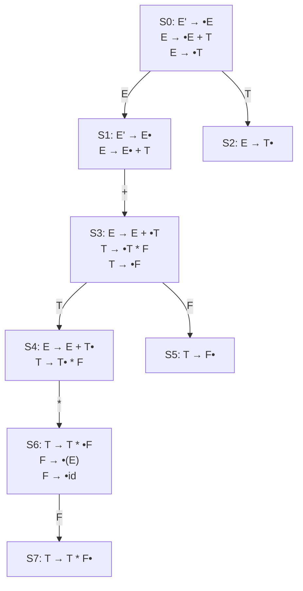
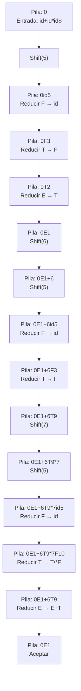

# Compiladores - Análisis sintáctico

## 3.4 Reconocimiento ascendente.

---

El reconocimiento ascendente (bottom-up parsing) es una estrategia de análisis sintáctico que construye el árbol de derivación desde las hojas hacia la raíz. Según Aho et al. (2007), este tipo de análisis es más potente que el descendente y puede manejar una clase más amplia de gramáticas, incluyendo todas las gramáticas libres de contexto.

### Fundamentos Teóricos

#### Derivación por la Derecha

En el análisis ascendente, se busca una derivación por la derecha en sentido inverso. Para una gramática $G$ y una cadena $w$, el analizador reconstruye:

$$S \Leftarrow \alpha_1 \Leftarrow \alpha_2 \Leftarrow \cdots \Leftarrow w$$

donde cada paso representa la reducción de una forma sentencial a un no terminal.

#### Reduce-Desplaza (Shift-Reduce)

El análisis ascendente se basa en dos operaciones fundamentales:

- **Desplazamiento (Shift)**: Mover un token de la entrada a la pila
- **Reducción (Reduce)**: Reemplazar un handle (asidero) en la parte superior de la pila por el no terminal correspondiente

### Analizadores LR

#### Tipos de Analizadores LR

| Tipo    | Lookahead | Potencia | Tamaño de Tabla |
| ------- | --------- | -------- | --------------- |
| LR(0)   | 0 tokens  | Básica   | Pequeño         |
| SLR(1)  | 1 token   | Moderada | Pequeño         |
| LR(1)   | 1 token   | Alta     | Grande          |
| LALR(1) | 1 token   | Alta     | Moderado        |

#### Estados LR(0)

Un estado LR(0) es un conjunto de items, donde un item es una producción con un punto que indica la posición del análisis:

$$A \rightarrow \alpha \bullet \beta$$

**Ejemplo**: Para la producción $E \rightarrow E + T$, los items posibles son:

- $E \rightarrow \bullet E + T$
- $E \rightarrow E \bullet + T$
- $E \rightarrow E + \bullet T$
- $E \rightarrow E + T \bullet$

### Autómata de Estados LR(0)



### Algoritmo de Análisis LR

```python
class LRParser:
    def __init__(self, action_table, goto_table):
        self.action_table = action_table
        self.goto_table = goto_table
        self.stack = [0]  # Pila de estados
        self.input_pos = 0

    def parse(self, tokens):
        tokens.append('$')  # Símbolo de fin de entrada
        while True:
            state = self.stack[-1]
            current_token = tokens[self.input_pos].type

            action = self.action_table[state].get(current_token)

            if action is None:
                raise SyntaxError(f"Error sintáctico en {current_token}")

            if action[0] == 's':  # Desplazamiento
                self.stack.append(int(action[1:]))
                self.input_pos += 1
                print(f"Desplazar a estado {action[1:]}")

            elif action[0] == 'r':  # Reducción
                prod_num = int(action[1:])
                production = productions[prod_num]
                lhs, rhs = production

                # Pop de la pila los símbolos de la producción
                for _ in range(len(rhs)):
                    self.stack.pop()

                # Obtener el nuevo estado
                state_after_pop = self.stack[-1]
                self.stack.append(self.goto_table[state_after_pop][lhs])

                print(f"Reducir por {lhs} → {' '.join(rhs)}")

            elif action == 'acc':  # Aceptar
                print("Análisis completado exitosamente")
                return True
```

### Tablas de Análisis SLR(1)

#### Construcción de Tablas SLR(1)

1. **Construir la colección canónica de estados LR(0)**
2. **Construir la tabla ACTION**:
   - Si hay un item $A \rightarrow \alpha \bullet a \beta$ en el estado $i$, entonces $ACTION[i, a] = desplazar j$
   - Si hay un item $A \rightarrow \alpha \bullet$ en el estado $i$, entonces $ACTION[i, a] = reducir A \rightarrow \alpha$ para todo $a \in FOLLOW(A)$
   - Si hay un item $S' \rightarrow S \bullet$ en el estado $i$, entonces $ACTION[i, \$] = aceptar$

3. **Construir la tabla GOTO**:
   - Si $GOTO[i, A] = j$, entonces $GOTO[i, A] = j$

### Ejemplo de Análisis Ascendente

**Entrada**: `id + id * id`

**Secuencia de acciones**:



### Conflictos en Análisis LR

#### Conflictos Desplazamiento-Reducción

Ocurre cuando para un mismo estado y símbolo de lookahead, el analizador puede tanto desplazar como reducir.

#### Conflictos Reducción-Reducción

Ocurre cuando para un mismo estado y símbolo de lookahead, el analizador puede reducir por dos producciones diferentes.

### Ejercicios Propuestos

1. Construya la colección canónica de estados LR(0) para la gramática:

   $$
   S \rightarrow A a \mid b A c \mid d c \mid b d a \\
   A \rightarrow d
   $$

2. Construya las tablas de análisis SLR(1) para la gramática:

   $$
   E \rightarrow E + T \mid T \\
   T \rightarrow T * F \mid F \\
   F \rightarrow ( E ) \mid id
   $$

3. Realice el análisis paso a paso para la entrada `(id + id) * id` usando las tablas SLR(1) del ejercicio anterior.

4. Identifique y resuelva los conflictos en la siguiente gramática:

   $$
   S \rightarrow i E t S \mid i E t S e S \mid a \\
   E \rightarrow b
   $$

5. Implemente un analizador LR(1) básico en Python que pueda manejar una gramática simple de expresiones aritméticas.

6. Explique la diferencia entre analizadores SLR(1), LR(1) y LALR(1) en términos de poder expresivo y tamaño de tablas.

### Ventajas y Desventajas

#### Ventajas del Análisis Ascendente

- Mayor poder expresivo que el análisis descendente
- Puede manejar más gramáticas, incluyendo recursión por izquierda
- Detección de errores más temprana en algunos casos

#### Desventajas

- Tablas de análisis más grandes y complejas
- Mayor dificultad en la implementación manual
- Mayor overhead computacional

### Referencias

#### Bibliografía Básica

1. Aho, A. V., Lam, M. S., Sethi, R., & Ullman, J. D. (2007). _Compilers: Principles, Techniques, and Tools_ (2nd ed.). Pearson Education. (Capítulo 4: Syntax Analysis)
2. Cooper, K. D., & Torczon, L. (2004). _Engineering a Compiler_. Morgan Kaufmann. (Capítulo 3: Parsing)
3. Scott, M. L. (2009). _Programming Language Pragmatics_. Morgan Kaufmann. (Capítulo 4: Semantic Analysis)

#### Bibliografía Complementaria

1. Grune, D., Bal, H. E., Jacobs, C. J. H., & Langendoen, K. G. (2000). _Modern Compiler Design_. John Wiley & Sons.
2. Wilhelm, R., & Maurer, D. (1995). _Compiler Design_. Addison-Wesley.

#### Términos Clave

- **Handle**: Subcadena que coincide con el lado derecho de una producción
- **Items LR**: Producciones con un punto que indica el progreso del análisis
- **Colección canónica**: Conjunto de todos los estados posibles del analizador
- **Conflicto desplazamiento-reducción**: Cuando el analizador puede tanto desplazar como reducir
- **Conflicto reducción-reducción**: Cuando el analizador puede reducir por múltiples producciones
