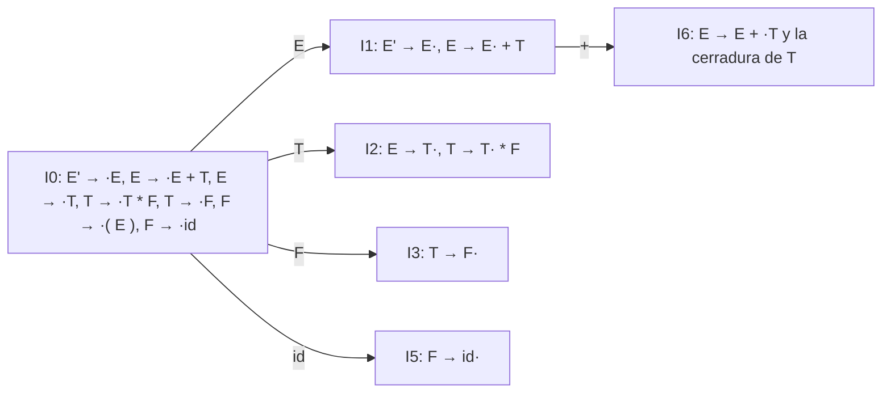

# Compiladores - Análisis sintáctico

## 3.4 Reconocimiento ascendente.

---

Un analizador **ascendente** construye el árbol de las hojas hacia la raíz: lee los tokens y los acumula en una pila hasta que el tope forma el lado derecho de una producción, que entonces **reduce** a su no terminal, hasta que la pila contiene solo el símbolo inicial. Así reconstruye una derivación más a la derecha en orden inverso. Los analizadores **LR**, que deciden con un autómata finito sobre la pila, son la técnica determinista más poderosa: reconocen todos los lenguajes deterministas libres de contexto, admiten la recursión por la izquierda y los generan yacc y bison. Este tema presenta el análisis por desplazamiento y reducción, los elementos LR(0), el autómata, las tablas SLR(1), los conflictos y la comparación entre las variantes.

### Desplazamiento y reducción

El analizador tiene una pila y la entrada, y en cada paso hace una de cuatro acciones:

- **desplazar:** mueve el siguiente token a la pila;
- **reducir** por $A \to \beta:$ el tope de la pila es $\beta,$ y se reemplaza por $A;$
- **aceptar:** la pila tiene solo el símbolo inicial y la entrada terminó;
- **error:** ninguna acción es válida.

La parte de la forma sentencial que se reduce en cada paso, el lado derecho de la producción en la posición correcta, es el **mango** o *handle*: si $S \Rightarrow^*_{rm} \alpha A w \Rightarrow_{rm} \alpha \beta w,$ entonces $\beta$ es el mango de $\alpha\beta w.$ Reducir siempre el mango recorre la derivación más a la derecha al revés. El problema es **reconocer el mango**, y para eso sirve el autómata LR.

### Elementos LR(0) y el autómata

Un **elemento** LR(0) es una producción con un punto, $A \to \alpha \cdot \beta,$ que indica que ya se vio $\alpha$ y se espera $\beta.$ La **cerradura** de un conjunto de elementos agrega, para cada $A \to \alpha \cdot B \beta,$ los elementos $B \to \cdot \gamma$ de todas las producciones de $B,$ y la transición $\text{ir}(I, X)$ toma los elementos con el punto antes de $X,$ lo mueve después de $X$ y calcula la cerradura. Con la gramática aumentada, que agrega $S' \to S,$ la **colección canónica** se obtiene partiendo de la cerradura de $\{S' \to \cdot S\}$ y aplicando $\text{ir}$ con cada símbolo hasta que no aparezcan estados nuevos.

**Teorema.** El conjunto de **prefijos viables**, los prefijos de formas sentenciales derechas que no van más allá del mango, es un lenguaje regular, y el autómata LR(0) lo reconoce: el estado al que llega con un prefijo viable $\gamma$ contiene exactamente los elementos válidos para $\gamma.$

Por eso un autómata finito basta para decidir: si el estado del tope contiene un elemento completo $A \to \beta \cdot,$ el tope puede ser un mango, y si contiene $A \to \alpha \cdot a \beta,$ hay que desplazar $a.$ El analizador guarda en la pila los **estados** del autómata, para no volver a recorrer la pila después de cada reducción.

Para las expresiones, el estado inicial y algunas transiciones son:



### Las tablas y el algoritmo

La tabla **ACCIÓN** dice, para cada estado y terminal, si se desplaza y a qué estado, se reduce y por qué producción, se acepta o hay un error; la tabla **IR A** dice a qué estado se pasa después de reducir a un no terminal. El algoritmo es el mismo para todas las variantes de LR:

1. sea $s$ el estado del tope y $a$ el token actual;
2. si $\text{ACCIÓN}[s, a]$ es desplazar $j,$ se apila $j$ y se avanza;
3. si es reducir $A \to \beta,$ se desapilan $|\beta|$ estados, y con el nuevo tope $t$ se apila $\text{IR A}[t, A];$
4. si es aceptar, termina; si está vacía, es un error.

Las variantes difieren en **cuándo** se reduce. En **SLR(1)**, por $A \to \beta \cdot$ se reduce con los terminales de $\text{FOLLOW}(A);$ en **LR(1)** y **LALR(1)**, con los de la anticipación del elemento, más precisa, como se ve en el tema 3.5.

### Conflictos

Si una casilla de ACCIÓN recibe dos acciones hay un **conflicto**, y la gramática no pertenece a la clase:

- **desplazamiento contra reducción:** el elemento $A \to \beta \cdot$ y uno $B \to \alpha \cdot a \gamma$ en el mismo estado, con $a$ en la anticipación de $A;$ el ejemplo clásico es el `else` colgante;
- **reducción contra reducción:** dos elementos completos con anticipaciones que se intersecan.

Una gramática ambigua siempre tiene conflictos. Yacc y bison los resuelven por omisión prefiriendo el desplazamiento y la producción listada primero, con un aviso, o con las declaraciones de **precedencia** y asociatividad: se compara la precedencia del token con la de la producción, que es la de su último terminal.

### Implementación en Python

El programa usa el núcleo de gramáticas del tema 3.1, incluido al inicio, que construye las colecciones LR(0) y LR(1), las tablas SLR(1), LR(1) y LALR(1) con su detección de conflictos y la resolución por precedencia, y el analizador con traza. Con él construye la colección del ejercicio 1, las tablas y la traza de los ejercicios 2 y 3, resuelve el `else` colgante de dos formas, construye el analizador LR(1) canónico y compara las tres variantes en cinco gramáticas.

```python
# ===== Núcleo de gramáticas: FIRST y FOLLOW, LL(1), LR(0), SLR(1), LR(1), LALR(1) y transformaciones =====
FIN = "$"

class Gramatica:
    """Producciones en texto: 'E -> E + T | T', símbolos separados por espacios, ε para la cadena vacía.
    Los no terminales son los lados izquierdos; el inicial es el primero."""
    def __init__(self, texto=None, prods=None, inicial=None):
        if texto is not None:
            prods = []
            for linea in texto.strip().splitlines():
                if not linea.strip(): continue
                izq, der = linea.split("->")
                for alt in der.split("|"):
                    s = tuple(x for x in alt.split() if x != "ε")
                    prods.append((izq.strip(), s))
        self.prods = list(dict.fromkeys(prods))
        self.inicial = inicial or self.prods[0][0]
        self.nt = list(dict.fromkeys([a for a, _ in self.prods]))
        self.t = list(dict.fromkeys(x for _, d in self.prods for x in d if x not in self.nt))
        self._calcula()
    def __str__(self):
        return "\n".join(f"   {a} -> " + " | ".join(" ".join(d) or "ε" for b, d in self.prods if b == a) for a in self.nt)
    def de(self, a): return [d for b, d in self.prods if b == a]
    def _calcula(self):
        self.anulable = set(); self.first = {a: set() for a in self.nt}
        cambio = True
        while cambio:
            cambio = False
            for a, d in self.prods:
                if a not in self.anulable and all(x in self.anulable for x in d): self.anulable.add(a); cambio = True
                f = self.first_de(d)
                if not f <= self.first[a]: self.first[a] |= f; cambio = True
        self.follow = {a: set() for a in self.nt}; self.follow[self.inicial].add(FIN)
        cambio = True
        while cambio:
            cambio = False
            for a, d in self.prods:
                for i, x in enumerate(d):
                    if x not in self.nt: continue
                    resto = d[i + 1:]; f = self.first_de(resto)
                    if all(y in self.anulable for y in resto): f = f | self.follow[a]
                    if not f <= self.follow[x]: self.follow[x] |= f; cambio = True
    def first_de(self, sec):
        f = set()
        for x in sec:
            if x not in self.nt: f.add(x); return f
            f |= self.first.get(x, set())
            if x not in self.anulable: return f
        return f
    def anulable_sec(self, sec): return all(x in self.anulable for x in sec)
    def conjuntos(self):
        orden = lambda s: sorted(s, key=lambda x: (x == FIN, x))
        return "\n".join(f"   {a:8} FIRST = {{{', '.join(orden(self.first[a]))}}}{' + ε' if a in self.anulable else ''}"
                         f"   FOLLOW = {{{', '.join(orden(self.follow[a]))}}}" for a in self.nt)

# ---------- LL(1) ----------
def tabla_ll1(g):
    M = {}
    for a, d in g.prods:
        dest = set(g.first_de(d))
        if g.anulable_sec(d): dest |= g.follow[a]
        for x in dest: M.setdefault((a, x), []).append(d)
    conflictos = {k: v for k, v in M.items() if len(v) > 1}
    return M, conflictos

def muestra_ll1(g, M):
    cols = g.t + [FIN]; filas = [[""] + cols]
    for a in g.nt:
        filas.append([a] + [" / ".join(f"{a}->{' '.join(d) or 'ε'}" for d in M.get((a, c), [])) for c in cols])
    anchos = [max(len(f[i]) for f in filas) for i in range(len(cols) + 1)]
    return "\n".join("   " + " | ".join(x.ljust(w) for x, w in zip(f, anchos)) for f in filas)

def analiza_ll1(g, M, tokens, traza=False):
    """Analizador predictivo con pila. Devuelve (acepta, árbol, filas de la traza)."""
    entrada = list(tokens) + [FIN]; raiz = [g.inicial, []]; pila = [(FIN, None), (g.inicial, raiz)]; i = 0; filas = []
    while True:
        x, nodo = pila[-1]; a = entrada[i]
        estado = (" ".join(s for s, _ in pila), " ".join(entrada[i:]))
        if x == FIN and a == FIN: filas.append(estado + ("aceptar",)); return True, raiz, filas
        if x not in g.nt:
            if x != a: filas.append(estado + (f"error: se esperaba {x}",)); return False, raiz, filas
            filas.append(estado + (f"coincide {a}",)); pila.pop(); i += 1; continue
        ds = M.get((x, a))
        if not ds: filas.append(estado + (f"error: M[{x}, {a}] vacía",)); return False, raiz, filas
        d = ds[0]; filas.append(estado + (f"{x} -> {' '.join(d) or 'ε'}",)); pila.pop()
        hijos = [[s, []] for s in d] or [["ε", []]]; nodo[1].extend(hijos)
        for s, h in reversed(list(zip(d, hijos))): pila.append((s, h))

def muestra_traza(filas, anchos=(None, None)):
    a = anchos[0] or max(len(f[0]) for f in filas); b = anchos[1] or max(len(f[1]) for f in filas)
    return "\n".join(f"   {f[0]:>{a}} | {f[1]:>{b}} | {f[2]}" for f in filas)

def arbol_texto(nodo):
    s, hijos = nodo
    return s if not hijos else f"{s}(" + " ".join(arbol_texto(h) for h in hijos) + ")"

# ---------- LR: elementos, colecciones y tablas ----------
class LR:
    """metodo: 'LR0', 'SLR', 'LR1' o 'LALR'. Los estados se numeran en orden de descubrimiento."""
    def __init__(self, g, metodo="SLR", precedencia=None, yacc=False):
        """yacc=True resuelve los conflictos restantes como yacc: desplazar antes que reducir,
        y entre dos reducciones, la producción listada primero."""
        self.g, self.metodo, self.yacc = g, metodo, yacc
        self.aum = g.inicial + "'"
        while self.aum in g.nt: self.aum += "'"
        self.P = [(self.aum, (g.inicial,))] + g.prods
        self.prec = precedencia or {}
        if metodo in ("LR0", "SLR"): self._lr0()
        else: self._lr1()
        self._tabla()
    def texto_item(self, it):
        p, k = it[0], it[1]; a, d = self.P[p]
        s = f"{a} -> " + " ".join(list(d[:k]) + ["·"] + list(d[k:]))
        return s + (f", {'/'.join(sorted(it[2], key=lambda x: (x == FIN, x)))}" if len(it) > 2 else "")
    # LR(0)
    def cierre0(self, I):
        I = set(I); cambio = True
        while cambio:
            cambio = False
            for p, k in list(I):
                d = self.P[p][1]
                if k < len(d) and d[k] in self.g.nt:
                    for q, (a, _) in enumerate(self.P):
                        if a == d[k] and (q, 0) not in I: I.add((q, 0)); cambio = True
        return frozenset(I)
    def ir0(self, I, x):
        return self.cierre0({(p, k + 1) for p, k in I if k < len(self.P[p][1]) and self.P[p][1][k] == x})
    def _simbolos(self): return self.g.nt + self.g.t
    def _lr0(self):
        I0 = self.cierre0({(0, 0)}); self.estados = [I0]; self.ir = {}; num = {I0: 0}; k = 0
        while k < len(self.estados):
            I = self.estados[k]
            for x in self._siguientes(I):
                J = self.ir0(I, x)
                if J not in num: num[J] = len(self.estados); self.estados.append(J)
                self.ir[(k, x)] = num[J]
            k += 1
        self.items = [{(p, d): None for p, d in sorted(I)} for I in self.estados]
    def _siguientes(self, I):
        vistos = []
        for it in sorted(I, key=lambda t: (t[0], t[1])):
            d = self.P[it[0]][1]
            if it[1] < len(d) and d[it[1]] not in vistos: vistos.append(d[it[1]])
        return vistos
    # LR(1): un estado es un diccionario núcleo -> conjunto de símbolos de anticipación
    def cierre1(self, I):
        I = {k: set(v) for k, v in I.items()}; cambio = True
        while cambio:
            cambio = False
            for (p, k), la in list(I.items()):
                d = self.P[p][1]
                if k < len(d) and d[k] in self.g.nt:
                    beta = d[k + 1:]; f = self.g.first_de(beta)
                    nuevos = f | (la if self.g.anulable_sec(beta) else set())
                    for q, (a, _) in enumerate(self.P):
                        if a == d[k]:
                            actual = I.setdefault((q, 0), set())
                            if not nuevos <= actual: actual |= nuevos; cambio = True
        return I
    def _lr1(self):
        def clave(I): return frozenset((k, frozenset(v)) for k, v in I.items())
        def nucleo(I): return frozenset(I)
        I0 = self.cierre1({(0, 0): {FIN}}); est = [I0]; ir = {}; num = {clave(I0): 0}; k = 0
        while k < len(est):
            I = est[k]
            for x in self._siguientes(I):
                J = {}
                for (p, d), la in I.items():
                    rhs = self.P[p][1]
                    if d < len(rhs) and rhs[d] == x: J.setdefault((p, d + 1), set()).update(la)
                J = self.cierre1(J); c = clave(J)
                if c not in num: num[c] = len(est); est.append(J)
                ir[(k, x)] = num[c]
            k += 1
        self.n_lr1 = len(est)
        if self.metodo == "LALR":                     # fundir los estados con el mismo núcleo
            grupo, fusion = {}, []
            for i, I in enumerate(est):
                n = nucleo(I)
                if n not in grupo: grupo[n] = len(fusion); fusion.append({kk: set(v) for kk, v in I.items()})
                else:
                    for kk, v in I.items(): fusion[grupo[n]][kk] |= v
            mapa = {i: grupo[nucleo(I)] for i, I in enumerate(est)}
            est = fusion; ir = {(mapa[i], x): mapa[j] for (i, x), j in ir.items()}
        self.estados = [frozenset(I) for I in est]; self.ir = ir
        self.items = [{k: frozenset(v) for k, v in sorted(I.items())} for I in est]
    def _tabla(self):
        self.accion = {}; self.conflictos = []; self.resueltos = []
        for i, I in enumerate(self.items):
            for (p, k), la in I.items():
                a, d = self.P[p]
                if k < len(d):
                    x = d[k]
                    if x not in self.g.nt: self._pon(i, x, ("d", self.ir[(i, x)]))
                elif p == 0: self._pon(i, FIN, ("acc",))
                else:
                    if self.metodo == "LR0": dest = self.g.t + [FIN]
                    elif self.metodo == "SLR": dest = self.g.follow[a]
                    else: dest = la
                    for x in sorted(dest): self._pon(i, x, ("r", p))
        for (i, x), v in sorted(self.accion.items()):
            if len(v) > 1:
                self.conflictos.append((i, x, list(v)))
                if self.yacc:
                    gana = next((a for a in v if a[0] == "d"), None) or min(v, key=lambda a: a[1])
                    self.resueltos.append((i, x, self.texto_accion(gana))); v[:] = [gana]
    def _nivel(self, p):
        """Precedencia de una producción: la de su último terminal con precedencia, como en yacc."""
        for x in reversed(self.P[p][1]):
            if x in self.prec: return self.prec[x]
        return None
    def _pon(self, i, x, act):
        v = self.accion.setdefault((i, x), [])
        if act in v: return
        if v and self.prec:
            despl = next((a for a in v + [act] if a[0] == "d"), None); red = next((a for a in v + [act] if a[0] == "r"), None)
            if despl and red and x in self.prec and self._nivel(red[1]):
                (nt, at), (nr, _) = self.prec[x], self._nivel(red[1])
                gana = red if nr > nt or (nr == nt and at == "izq") else despl
                self.resueltos.append((i, x, gana[0])); v[:] = [gana]; return
        v.append(act)
    def texto_accion(self, a):
        return {"d": lambda: f"d{a[1]}", "r": lambda: f"r{a[1]}", "acc": lambda: "acc"}[a[0]]()
    def tabla(self):
        ts = self.g.t + [FIN]; ns = self.g.nt
        filas = [["estado"] + ts + ns]
        for i in range(len(self.estados)):
            filas.append([str(i)] + ["/".join(self.texto_accion(a) for a in self.accion.get((i, x), [])) for x in ts]
                         + [str(self.ir.get((i, x), "")) for x in ns])
        anchos = [max(len(f[c]) for f in filas) for c in range(len(filas[0]))]
        return "\n".join("   " + " | ".join(x.rjust(w) for x, w in zip(f, anchos)) for f in filas)
    def coleccion(self):
        res = []
        for i, I in enumerate(self.items):
            its = [(k + ((la,) if la is not None else ())) for k, la in I.items()]
            res.append(f"   I{i}: " + "; ".join(self.texto_item(it) for it in its))
        return "\n".join(res)
    def analiza(self, tokens, traza=False):
        entrada = list(tokens) + [FIN]; pila = [0]; simbolos = []; nodos = []; i = 0; filas = []
        while True:
            s, a = pila[-1], entrada[i]
            acts = self.accion.get((s, a))
            estado = (" ".join(str(x) for x in pila), " ".join(simbolos), " ".join(entrada[i:]))
            if not acts:
                esperados = sorted({x for (e, x) in self.accion if e == s}, key=lambda x: (x == FIN, x))
                filas.append(estado + (f"error: se esperaba {', '.join(esperados)}",)); return False, None, filas
            act = acts[0]
            if act[0] == "d":
                filas.append(estado + (f"desplazar {act[1]}",)); pila.append(act[1]); simbolos.append(a); nodos.append([a, []]); i += 1
            elif act[0] == "r":
                b, d = self.P[act[1]]; n = len(d)
                hijos = nodos[len(nodos) - n:] if n else [["ε", []]]
                if n: del pila[-n:]; del simbolos[-n:]; del nodos[-n:]
                pila.append(self.ir[(pila[-1], b)]); simbolos.append(b); nodos.append([b, hijos])
                filas.append(estado + (f"reducir {b} -> {' '.join(d) or 'ε'}",))
            else:
                filas.append(estado + ("aceptar",)); return True, nodos[-1], filas

def muestra_traza_lr(filas):
    a = max(len(f[0]) for f in filas); b = max(len(f[1]) for f in filas); c = max(len(f[2]) for f in filas)
    return "\n".join(f"   {f[0]:<{a}} | {f[1]:<{b}} | {f[2]:>{c}} | {f[3]}" for f in filas)

# ---------- Transformaciones ----------
def sin_recursion_izquierda(g, orden=None):
    """Algoritmo de Aho y otros 4.19: ordena los no terminales, sustituye y elimina la recursión inmediata."""
    orden = orden or g.nt; P = {a: [list(d) for d in g.de(a)] for a in g.nt}; nuevos = []
    for i, ai in enumerate(orden):
        for aj in orden[:i]:
            nuevas = []
            for d in P[ai]:
                if d and d[0] == aj: nuevas += [dj + d[1:] for dj in P[aj]]
                else: nuevas.append(d)
            P[ai] = nuevas
        rec = [d[1:] for d in P[ai] if d and d[0] == ai]; resto = [d for d in P[ai] if not d or d[0] != ai]
        if rec:
            ap = ai + "'"; P[ai] = [d + [ap] for d in resto]; P[ap] = [d + [ap] for d in rec] + [[]]; nuevos.append((ai, ap))
    lista = []
    for a in orden:
        lista += [(a, tuple(d)) for d in P[a]]
        for x, ap in nuevos:
            if x == a: lista += [(ap, tuple(d)) for d in P[ap]]
    return Gramatica(prods=lista, inicial=g.inicial)

def factoriza(g):
    P = {a: [tuple(d) for d in g.de(a)] for a in g.nt}; orden = list(g.nt); cambio = True
    while cambio:
        cambio = False
        for a in list(orden):
            grupos = {}
            for d in P[a]: grupos.setdefault(d[:1], []).append(d)
            for pre, ds in grupos.items():
                if not pre or len(ds) < 2: continue
                k = 1
                while all(len(d) > k for d in ds) and len({d[k] for d in ds}) == 1: k += 1
                comun = ds[0][:k]; nuevo = a + "'"
                while nuevo in P: nuevo += "'"
                P[a] = [d for d in P[a] if d not in ds] + [comun + (nuevo,)]
                P[nuevo] = [d[k:] for d in ds]; orden.insert(orden.index(a) + 1, nuevo); cambio = True; break
            if cambio: break
    return Gramatica(prods=[(a, d) for a in orden for d in P[a]], inicial=g.inicial)

def sin_inutiles(g):
    gen = set(); cambio = True
    while cambio:
        cambio = False
        for a, d in g.prods:
            if a not in gen and all(x in gen or x not in g.nt for x in d): gen.add(a); cambio = True
    prods = [(a, d) for a, d in g.prods if a in gen and all(x in gen or x not in g.nt for x in d)]
    alc = {g.inicial}; cambio = True
    while cambio:
        cambio = False
        for a, d in prods:
            if a in alc:
                for x in d:
                    if x in g.nt and x not in alc: alc.add(x); cambio = True
    prods = [(a, d) for a, d in prods if a in alc]
    return Gramatica(prods=prods, inicial=g.inicial), sorted(set(g.nt) - gen), sorted(gen - alc)

def chomsky(g):
    """Forma normal de Chomsky: inicial nuevo, sin ε, sin unitarias, terminales aislados y lados derechos binarios."""
    S0 = g.inicial + "0"; prods = [(S0, (g.inicial,))] + list(g.prods); nt = [S0] + g.nt
    anul = set(g.anulable)
    nuevas = set()
    for a, d in prods:
        pos = [i for i, x in enumerate(d) if x in anul]
        for m in range(1 << len(pos)):
            quita = {pos[j] for j in range(len(pos)) if m >> j & 1}
            e = tuple(x for i, x in enumerate(d) if i not in quita)
            if e or a == S0: nuevas.add((a, e))
    if g.inicial in anul: nuevas.add((S0, ()))
    prods = sorted(nuevas, key=lambda p: (nt.index(p[0]), p[1]))
    unit = {a: {a} for a in nt}; cambio = True
    while cambio:
        cambio = False
        for a, d in prods:
            if len(d) == 1 and d[0] in nt:
                for b in nt:
                    if a in unit[b] and d[0] not in unit[b]: unit[b].add(d[0]); cambio = True
    prods = sorted({(a, d) for a in nt for b in unit[a] for c, d in prods if c == b and not (len(d) == 1 and d[0] in nt)},
                   key=lambda p: (nt.index(p[0]), p[1]))
    term = {}; final = []; cont = [0]; pares = {}
    def nt_de(t):
        if t not in term: term[t] = f"T_{t}"; final.append((term[t], (t,)))
        return term[t]
    for a, d in prods:
        if len(d) >= 2: d = tuple(nt_de(x) if x not in nt else x for x in d)
        while len(d) > 2:
            par = d[-2:]
            if par not in pares: cont[0] += 1; pares[par] = f"X{cont[0]}"; final.append((pares[par], par))
            d = d[:-2] + (pares[par],)
        final.append((a, d))
    orden = {a: i for i, a in enumerate(nt)}
    final.sort(key=lambda p: (orden.get(p[0], len(nt)), p[0], p[1]))
    return Gramatica(prods=final, inicial=S0)

def cyk(g, w):
    """Reconocimiento con el algoritmo CYK para una gramática en forma normal de Chomsky: O(n^3 |G|)."""
    n = len(w)
    if n == 0: return (g.inicial, ()) in g.prods, {}
    T = {}
    for i, a in enumerate(w): T[(i, i)] = {b for b, d in g.prods if d == (a,)}
    for l in range(2, n + 1):
        for i in range(n - l + 1):
            j = i + l - 1; T[(i, j)] = set()
            for k in range(i, j):
                for b, d in g.prods:
                    if len(d) == 2 and d[0] in T[(i, k)] and d[1] in T[(k + 1, j)]: T[(i, j)].add(b)
    return g.inicial in T[(0, n - 1)], T

def conflictos_texto(lr):
    return [f"estado {i}, {x}: " + " contra ".join(lr.texto_accion(a) for a in acts) for i, x, acts in lr.conflictos]

# ---------- Ejercicio 1: colección canónica LR(0) ----------
G1 = Gramatica("""S -> A a | b A c | d c | b d a
A -> d""")
l0 = LR(G1, "LR0")
print(f"ejercicio 1: {len(l0.estados)} estados LR(0)"); print(l0.coleccion())
print("   transiciones:", ", ".join(f"I{i} -{x}-> I{j}" for (i, x), j in sorted(l0.ir.items())))
print("   conflictos LR(0):", conflictos_texto(l0))
print("   FOLLOW(A) =", sorted(G1.follow["A"]), "| conflictos SLR(1):", conflictos_texto(LR(G1, "SLR")),
      "| LALR(1):", conflictos_texto(LR(G1, "LALR")))

# ---------- Ejercicio 2: tablas SLR(1) de las expresiones ----------
E = Gramatica("""E -> E + T | T
T -> T * F | F
F -> ( E ) | id""")
slr = LR(E, "SLR")
print("ejercicio 2: producciones:", ", ".join(f"{k}: {a} -> {' '.join(d)}" for k, (a, d) in enumerate(slr.P) if k))
print(slr.tabla()); print("   conflictos:", slr.conflictos)

# ---------- Ejercicio 3: análisis de ( id + id ) * id ----------
ok, arbol, filas = slr.analiza("( id + id ) * id".split())
print("ejercicio 3: pila de estados | símbolos | entrada | acción"); print(muestra_traza_lr(filas))
print("   árbol:", arbol_texto(arbol))

# ---------- Ejercicio 4: el else colgante ----------
G4 = Gramatica("""S -> i E t S | i E t S e S | a
E -> b""")
l4 = LR(G4, "SLR"); print("ejercicio 4: conflictos SLR:", conflictos_texto(l4))
l4p = LR(G4, "SLR", {"e": (2, "der"), "t": (1, "der")})
print("   con e de mayor precedencia que la regla S -> i E t S: resueltos", l4p.resueltos)
ok, arbol, _ = l4p.analiza("i b t i b t a e a".split()); print("   i b t i b t a e a ->", arbol_texto(arbol))
G4b = Gramatica("""S -> M | U
M -> i E t M e M | a
U -> i E t S | i E t M e U
E -> b""")
l4b = LR(G4b, "LALR"); print("   gramática sin ambigüedad: conflictos LALR(1):", l4b.conflictos)
print("   i b t i b t a e a ->", arbol_texto(l4b.analiza("i b t i b t a e a".split())[1]))

# ---------- Ejercicio 5: analizador LR(1) canónico ----------
lr1 = LR(E, "LR1")
print(f"ejercicio 5: LR(1) canónico de las expresiones: {len(lr1.estados)} estados, conflictos {lr1.conflictos}")
print("   un estado con anticipaciones:", lr1.coleccion().splitlines()[0].strip()[:150], "...")
for entrada in ["id * ( id + id )", "id + * id", "( id + id", "id id"]:
    ok, arbol, filas = lr1.analiza(entrada.split())
    print(f"   {entrada!r:18}", arbol_texto(arbol) if ok else filas[-1][3] + f" (con la entrada '{filas[-1][2]}')")

# ---------- Ejercicio 6: SLR(1), LR(1) y LALR(1) ----------
CASOS = {"expresiones": E,
         "S -> C C": Gramatica("""S -> C C
C -> c C | d"""),
         "L = R": Gramatica("""S -> L = R | R
L -> * R | id
R -> L"""),
         "ejercicio 1": G1,
         "LR(1) no LALR(1)": Gramatica("""S -> a A d | b B d | a B e | b A e
A -> c
B -> c""")}
print("ejercicio 6: gramática | estados SLR/LALR | estados LR(1) | conflictos SLR | LALR | LR(1)")
for nombre, g in CASOS.items():
    s, l, c = LR(g, "SLR"), LR(g, "LALR"), LR(g, "LR1")
    print(f"   {nombre:17} | {len(s.estados):3} | {len(c.estados):3} | {len(s.conflictos)} | {len(l.conflictos)} | {len(c.conflictos)}")
print("   conflicto LALR de la última:", conflictos_texto(LR(CASOS["LR(1) no LALR(1)"], "LALR")))
```

Salida:

```text
ejercicio 1: 11 estados LR(0)
   I0: S' -> · S; S -> · A a; S -> · b A c; S -> · d c; S -> · b d a; A -> · d
   I1: S' -> S ·
   I2: S -> A · a
   I3: S -> b · A c; S -> b · d a; A -> · d
   I4: S -> d · c; A -> d ·
   I5: S -> A a ·
   I6: S -> b A · c
   I7: S -> b d · a; A -> d ·
   I8: S -> d c ·
   I9: S -> b A c ·
   I10: S -> b d a ·
   transiciones: I0 -A-> I2, I0 -S-> I1, I0 -b-> I3, I0 -d-> I4, I2 -a-> I5, I3 -A-> I6, I3 -d-> I7, I4 -c-> I8, I6 -c-> I9, I7 -a-> I10
   conflictos LR(0): ['estado 4, c: d8 contra r5', 'estado 7, a: d10 contra r5']
   FOLLOW(A) = ['a', 'c'] | conflictos SLR(1): ['estado 4, c: d8 contra r5', 'estado 7, a: d10 contra r5'] | LALR(1): []
ejercicio 2: producciones: 1: E -> E + T, 2: E -> T, 3: T -> T * F, 4: T -> F, 5: F -> ( E ), 6: F -> id
   estado |  + |  * |  ( |   ) | id |   $ | E | T |  F
        0 |    |    | d4 |     | d5 |     | 1 | 2 |  3
        1 | d6 |    |    |     |    | acc |   |   |   
        2 | r2 | d7 |    |  r2 |    |  r2 |   |   |   
        3 | r4 | r4 |    |  r4 |    |  r4 |   |   |   
        4 |    |    | d4 |     | d5 |     | 8 | 2 |  3
        5 | r6 | r6 |    |  r6 |    |  r6 |   |   |   
        6 |    |    | d4 |     | d5 |     |   | 9 |  3
        7 |    |    | d4 |     | d5 |     |   |   | 10
        8 | d6 |    |    | d11 |    |     |   |   |   
        9 | r1 | d7 |    |  r1 |    |  r1 |   |   |   
       10 | r3 | r3 |    |  r3 |    |  r3 |   |   |   
       11 | r5 | r5 |    |  r5 |    |  r5 |   |   |   
   conflictos: []
ejercicio 3: pila de estados | símbolos | entrada | acción
   0         |          | ( id + id ) * id $ | desplazar 4
   0 4       | (        |   id + id ) * id $ | desplazar 5
   0 4 5     | ( id     |      + id ) * id $ | reducir F -> id
   0 4 3     | ( F      |      + id ) * id $ | reducir T -> F
   0 4 2     | ( T      |      + id ) * id $ | reducir E -> T
   0 4 8     | ( E      |      + id ) * id $ | desplazar 6
   0 4 8 6   | ( E +    |        id ) * id $ | desplazar 5
   0 4 8 6 5 | ( E + id |           ) * id $ | reducir F -> id
   0 4 8 6 3 | ( E + F  |           ) * id $ | reducir T -> F
   0 4 8 6 9 | ( E + T  |           ) * id $ | reducir E -> E + T
   0 4 8     | ( E      |           ) * id $ | desplazar 11
   0 4 8 11  | ( E )    |             * id $ | reducir F -> ( E )
   0 3       | F        |             * id $ | reducir T -> F
   0 2       | T        |             * id $ | desplazar 7
   0 2 7     | T *      |               id $ | desplazar 5
   0 2 7 5   | T * id   |                  $ | reducir F -> id
   0 2 7 10  | T * F    |                  $ | reducir T -> T * F
   0 2       | T        |                  $ | reducir E -> T
   0 1       | E        |                  $ | aceptar
   árbol: E(T(T(F(( E(E(T(F(id))) + T(F(id))) ))) * F(id)))
ejercicio 4: conflictos SLR: ['estado 7, e: r1 contra d8']
   con e de mayor precedencia que la regla S -> i E t S: resueltos [(7, 'e', 'd')]
   i b t i b t a e a -> S(i E(b) t S(i E(b) t S(a) e S(a)))
   gramática sin ambigüedad: conflictos LALR(1): []
   i b t i b t a e a -> S(U(i E(b) t S(M(i E(b) t M(a) e M(a)))))
ejercicio 5: LR(1) canónico de las expresiones: 22 estados, conflictos []
   un estado con anticipaciones: I0: E' -> · E, $; E -> · E + T, +/$; E -> · T, +/$; T -> · T * F, */+/$; T -> · F, */+/$; F -> · ( E ), */+/$; F -> · id, */+/$ ...
   'id * ( id + id )' E(T(T(F(id)) * F(( E(E(T(F(id))) + T(F(id))) ))))
   'id + * id'        error: se esperaba (, id (con la entrada '* id $')
   '( id + id'        error: se esperaba ), *, + (con la entrada '$')
   'id id'            error: se esperaba *, +, $ (con la entrada 'id $')
ejercicio 6: gramática | estados SLR/LALR | estados LR(1) | conflictos SLR | LALR | LR(1)
   expresiones       |  12 |  22 | 0 | 0 | 0
   S -> C C          |   7 |  10 | 0 | 0 | 0
   L = R             |  10 |  14 | 1 | 0 | 0
   ejercicio 1       |  11 |  11 | 2 | 0 | 0
   LR(1) no LALR(1)  |  13 |  14 | 2 | 2 | 0
   conflicto LALR de la última: ['estado 6, d: r5 contra r6', 'estado 6, e: r5 contra r6']
```

### Ejercicios Propuestos

1. **Colección LR(0).** Construye la colección canónica de estados LR(0) para la gramática:

    $$S \to A a \mid b A c \mid d c \mid b d a \qquad A \to d$$

2. **Tablas SLR(1).** Construye las tablas de análisis SLR(1) para la gramática:

    $$E \to E + T \mid T \qquad T \to T * F \mid F \qquad F \to ( E ) \mid \mathbf{id}$$

3. **Análisis paso a paso.** Analiza la entrada `(id + id) * id` con las tablas SLR(1) del ejercicio anterior.

4. **Conflictos.** Identifica y resuelve los conflictos de la gramática:

    $$S \to i E t S \mid i E t S e S \mid a \qquad E \to b$$

5. **Analizador LR(1).** Implementa un analizador LR(1) básico en Python para una gramática simple de expresiones aritméticas.

6. **Comparación.** Explica la diferencia entre los analizadores SLR(1), LR(1) y LALR(1) en términos de poder expresivo y tamaño de las tablas.

### Soluciones

**Ejercicio 1.** La colección tiene 11 estados. El inicial contiene, por la cerradura, las cuatro producciones de $S$ y $A \to \cdot d.$ Dos estados tienen conflictos LR(0): $I_4,$ al que se llega con `d`, contiene $S \to d \cdot c$ y $A \to d \cdot,$ y $I_7,$ al que se llega con `b d`, contiene $S \to b d \cdot a$ y $A \to d \cdot.$ SLR(1) no los resuelve, porque $\text{FOLLOW}(A) = \{a, c\}$ contiene tanto la $c$ de $I_4$ como la $a$ de $I_7.$ Sin embargo, en $I_4$ la $A$ solo puede ir seguida de $a,$ por $S \to Aa,$ y en $I_7$ solo de $c,$ por $S \to bAc:$ con las anticipaciones precisas, LALR(1) no tiene conflictos. Es el ejemplo clásico de una gramática LALR(1) que no es SLR(1).

**Ejercicio 2.** Con las producciones numeradas del 1 al 6, la tabla tiene 12 estados y ningún conflicto. Por ejemplo, en el estado 2, con $E \to T \cdot$ y $T \to T \cdot * F,$ se desplaza con `*` y se reduce por $E \to T$ con `+`, `)` y `$`, los elementos de $\text{FOLLOW}(E);$ esa diferencia implementa la mayor precedencia de `*`. En el estado 9, $E \to E + T \cdot$ se reduce con `+`, lo que implementa la asociatividad por la izquierda.

**Ejercicio 3.** La traza tiene 19 pasos. Los momentos importantes son: con `( E` en la pila y `+` en la entrada se desplaza; con `( E + T` y `)` se reduce por $E \to E + T,$ porque `)` está en FOLLOW de $E;$ después se desplaza el `)` y se reduce $F \to ( E ),$ y con `T` y `*` se desplaza en lugar de reducir $E \to T.$ Las reducciones, leídas al revés, forman la derivación más a la derecha de la cadena.

**Ejercicio 4.** La gramática es ambigua: `i b t i b t a e a` tiene un árbol en que el `else` pertenece al `if` interior y otro en que pertenece al exterior. En la tabla SLR(1) aparece como un conflicto en el estado que contiene $S \to i E t S \cdot$ y $S \to i E t S \cdot e S,$ con `e`, porque `e` está en FOLLOW de $S.$ Hay dos soluciones. La primera, la de yacc, es preferir el **desplazamiento**, declarando que `e` tiene mayor precedencia que la producción sin `else`: el `else` se asocia al `if` más cercano, como en C, Java y Pascal. La segunda es una gramática sin ambigüedad que distingue las sentencias **emparejadas**, $M,$ en que cada `if` tiene su `else`, de las **no emparejadas**, $U,$ y solo permite una sentencia emparejada antes de un `else`; es LALR(1) sin conflictos y produce el mismo árbol. Python, Go y Rust evitan el problema con la sangría o con llaves obligatorias.

**Ejercicio 5.** El analizador LR(1) canónico de las expresiones tiene 22 estados, contra 12 de SLR(1), porque estados con el mismo núcleo se distinguen por la anticipación: por ejemplo, los elementos dentro de los paréntesis llevan `)` como anticipación y los de fuera, `$`. Analiza correctamente las expresiones válidas y, en las inválidas, reporta en el primer token que no puede continuar un prefijo viable, con los tokens esperados, que salen de la fila del estado: tras `id +` espera `(` o `id`; con `( id + id` al final espera `)`, `*` o `+`.

**Ejercicio 6.** Las clases forman una jerarquía estricta, $\text{LR}(0) \subset \text{SLR}(1) \subset \text{LALR}(1) \subset \text{LR}(1),$ y LL(1) está contenida en LR(1) pero no en LALR(1):

| Variante | Estados | Reducción con | Poder |
| -------- | ------- | ------------- | ----- |
| SLR(1) | los de LR(0) | FOLLOW del no terminal | el menor; falla con `L = R` y con el ejercicio 1 |
| LALR(1) | los de LR(0) | anticipación fundida por núcleo | casi todos los lenguajes de programación; lo usan yacc y bison |
| LR(1) | hasta varias veces más | anticipación exacta | todas las gramáticas LR(1) |

En las cinco gramáticas del programa, SLR(1) y LALR(1) tienen el mismo número de estados, el de LR(0), y LR(1) puede tener más. La gramática de `L = R`, de asignaciones con apuntadores, no es SLR(1) pero sí LALR(1). La última es LR(1) pero no LALR(1): al fundir los dos estados con los elementos $A \to c \cdot$ y $B \to c \cdot,$ uno con anticipaciones $d$ y $e$ y el otro con $e$ y $d,$ aparece un conflicto de **reducción contra reducción** que no existía. Fundir estados nunca crea conflictos de desplazamiento contra reducción, solo de reducción contra reducción. Para los lenguajes reales, la diferencia de tamaño es grande: en un lenguaje como C, LR(1) canónico puede tener miles de estados más que LALR(1); el algoritmo IELR de bison, o el LR(1) mínimo de Pager, obtienen el poder de LR(1) con un tamaño cercano al de LALR(1).

En el material original, la tabla de variantes asignaba a LALR(1) el mismo poder que a LR(1), cuando es estrictamente menor; el diagrama del autómata omitía en los estados las cerraduras de $T$ y $F,$ y el paso 3 de la construcción definía la tabla IR A en términos de sí misma, al decir que si $\text{GOTO}[i, A] = j$ entonces vale $j,$ en lugar de tomarla de las transiciones del autómata. El analizador agregaba la cadena `'$'` a una lista de tokens y después leía su atributo `.type`, que las cadenas no tienen.

### Referencias

1. Aho, A. V., Lam, M. S., Sethi, R., and Ullman, J. D., _Compilers: Principles, Techniques, and Tools_. 2a ed., Pearson, 2007. Secciones 4.5 a 4.8.
2. Knuth, D. E., On the translation of languages from left to right. _Information and Control_ 8(6), 1965.
3. DeRemer, F. L., Simple LR(k) grammars. _Communications of the ACM_ 14(7), 1971.
4. Cooper, K. D., and Torczon, L., _Engineering a Compiler_. 3a ed., Morgan Kaufmann, 2022. Sección 3.4.
5. Denny, J. E., and Malloy, B. A., The IELR(1) algorithm for generating minimal LR(1) parser tables for non-LR(1) grammars with conflict resolution. _Science of Computer Programming_ 75(11), 2010.
