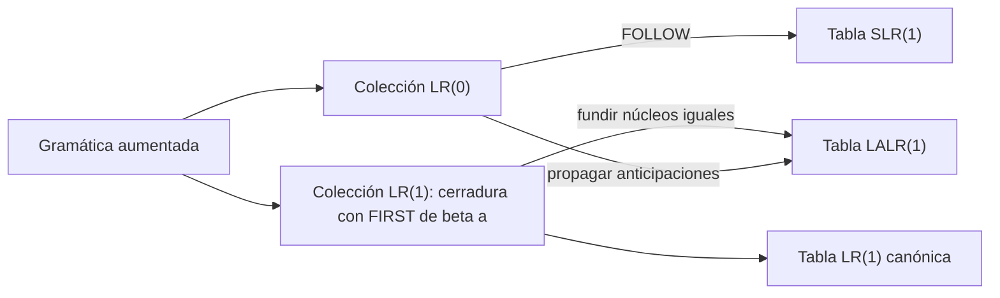

# Compiladores - Análisis sintáctico

## 3.5 Construcción de tablas LR(1).

---

El análisis SLR(1) decide cuándo reducir con el conjunto FOLLOW, que reúne todo lo que puede seguir a un no terminal en **cualquier** contexto; por eso reporta conflictos en gramáticas que no son ambiguas. El análisis **LR(1)** canónico, de Knuth, agrega a cada elemento el terminal que puede seguirlo en **ese** contexto, la **anticipación**, y reduce solo con él. Es el más poderoso de los analizadores LR con un token de anticipación, a costa de tablas más grandes; **LALR(1)** funde los estados con el mismo núcleo y obtiene casi el mismo poder con las tablas de SLR(1). Este tema presenta los elementos LR(1), la cerradura y la colección canónica, la construcción de las tablas, la fusión LALR(1) y sus consecuencias.

### Elementos LR(1)

Un **elemento LR(1)** es un par $[A \to \alpha \cdot \beta, a],$ donde $A \to \alpha \cdot \beta$ es un elemento LR(0) y $a$ es un terminal o el fin de la entrada. El elemento es **válido** para un prefijo viable $\gamma$ si existe una derivación más a la derecha $S \Rightarrow^*_{rm} \delta A w \Rightarrow_{rm} \delta \alpha \beta w$ con $\gamma = \delta\alpha$ y $a$ el primer símbolo de $w,$ o el fin si $w$ es vacía. La anticipación solo importa en los elementos completos: $[A \to \alpha \cdot, a]$ indica reducir **solo** si el siguiente token es $a.$

### Cerradura e ir

La **cerradura** agrega, para cada $[A \to \alpha \cdot B \beta, a]$ del conjunto, los elementos $[B \to \cdot \gamma, b]$ para cada producción $B \to \gamma$ y cada $b \in \text{FIRST}(\beta a):$

$$\text{cerradura}(I) = I \cup \{[B \to \cdot \gamma, b] : [A \to \alpha \cdot B \beta, a] \in \text{cerradura}(I),\ B \to \gamma \in P,\ b \in \text{FIRST}(\beta a)\}$$

La justificación: después de reconocer $B,$ lo que sigue es $\beta$ y, si $\beta$ es anulable, lo que seguía a $A,$ que es $a.$ La función $\text{ir}(I, X)$ mueve el punto sobre $X$ en los elementos que lo tienen antes de $X,$ conservando la anticipación, y toma la cerradura. La colección canónica se construye como la de LR(0), partiendo de $\text{cerradura}(\{[S' \to \cdot S, \$]\}).$

### Las tablas

Para cada estado $I_i:$

1. si $[A \to \alpha \cdot a \beta, b] \in I_i$ y $\text{ir}(I_i, a) = I_j,$ $\text{ACCIÓN}[i, a] =$ desplazar $j;$
2. si $[A \to \alpha \cdot, a] \in I_i$ y $A \ne S',$ $\text{ACCIÓN}[i, a] =$ reducir $A \to \alpha;$
3. si $[S' \to S \cdot, \$] \in I_i,$ $\text{ACCIÓN}[i, \$] =$ aceptar;
4. si $\text{ir}(I_i, A) = I_j$ para un no terminal $A,$ $\text{IR A}[i, A] = j.$

La gramática es **LR(1)** si ninguna casilla recibe dos acciones. Toda gramática LR(1) es no ambigua, y los lenguajes que generan son exactamente los **lenguajes libres de contexto deterministas**, los que reconoce un autómata de pila determinista.

### LALR(1)

El **núcleo** de un estado LR(1) es su conjunto de elementos sin las anticipaciones. Muchos estados LR(1) tienen el mismo núcleo y difieren solo en las anticipaciones; **LALR(1)** los funde en uno, uniendo las anticipaciones. El resultado tiene exactamente los estados de LR(0), con anticipaciones más precisas que FOLLOW. Fundir estados:

- **nunca** crea un conflicto de desplazamiento contra reducción: si el estado fundido reduce $A \to \alpha \cdot$ con $a$ y desplaza $a,$ alguno de los estados originales tenía el mismo núcleo, y por tanto el elemento que desplaza $a,$ y también la reducción con $a,$ y ya tenía el conflicto;
- **puede** crear conflictos de reducción contra reducción, cuando dos estados con elementos completos $[A \to c \cdot, x], [B \to c \cdot, y]$ y $[A \to c \cdot, y], [B \to c \cdot, x]$ se funden.

En la práctica, LALR(1) se calcula sin construir la colección LR(1), propagando las anticipaciones sobre el autómata LR(0), con el algoritmo de DeRemer y Pennello, como hacen yacc y bison.



### Implementación en Python

El programa usa el núcleo de gramáticas del tema 3.1, incluido al inicio, cuya clase `LR` construye la colección LR(1) con la cerradura de anticipaciones, la tabla canónica y la fusión LALR(1), y resuelve conflictos con la política de yacc. Con ella construye la colección y la tabla de los ejercicios 1 y 2, analiza el `else` colgante del ejercicio 3, implementa por separado la cerradura LR(1) del ejercicio 4 mostrando de dónde sale cada anticipación, y compara los tamaños y los conflictos de las tablas en los ejercicios 5 y 6.

```python
# ===== Núcleo de gramáticas: FIRST y FOLLOW, LL(1), LR(0), SLR(1), LR(1), LALR(1) y transformaciones =====
FIN = "$"

class Gramatica:
    """Producciones en texto: 'E -> E + T | T', símbolos separados por espacios, ε para la cadena vacía.
    Los no terminales son los lados izquierdos; el inicial es el primero."""
    def __init__(self, texto=None, prods=None, inicial=None):
        if texto is not None:
            prods = []
            for linea in texto.strip().splitlines():
                if not linea.strip(): continue
                izq, der = linea.split("->")
                for alt in der.split("|"):
                    s = tuple(x for x in alt.split() if x != "ε")
                    prods.append((izq.strip(), s))
        self.prods = list(dict.fromkeys(prods))
        self.inicial = inicial or self.prods[0][0]
        self.nt = list(dict.fromkeys([a for a, _ in self.prods]))
        self.t = list(dict.fromkeys(x for _, d in self.prods for x in d if x not in self.nt))
        self._calcula()
    def __str__(self):
        return "\n".join(f"   {a} -> " + " | ".join(" ".join(d) or "ε" for b, d in self.prods if b == a) for a in self.nt)
    def de(self, a): return [d for b, d in self.prods if b == a]
    def _calcula(self):
        self.anulable = set(); self.first = {a: set() for a in self.nt}
        cambio = True
        while cambio:
            cambio = False
            for a, d in self.prods:
                if a not in self.anulable and all(x in self.anulable for x in d): self.anulable.add(a); cambio = True
                f = self.first_de(d)
                if not f <= self.first[a]: self.first[a] |= f; cambio = True
        self.follow = {a: set() for a in self.nt}; self.follow[self.inicial].add(FIN)
        cambio = True
        while cambio:
            cambio = False
            for a, d in self.prods:
                for i, x in enumerate(d):
                    if x not in self.nt: continue
                    resto = d[i + 1:]; f = self.first_de(resto)
                    if all(y in self.anulable for y in resto): f = f | self.follow[a]
                    if not f <= self.follow[x]: self.follow[x] |= f; cambio = True
    def first_de(self, sec):
        f = set()
        for x in sec:
            if x not in self.nt: f.add(x); return f
            f |= self.first.get(x, set())
            if x not in self.anulable: return f
        return f
    def anulable_sec(self, sec): return all(x in self.anulable for x in sec)
    def conjuntos(self):
        orden = lambda s: sorted(s, key=lambda x: (x == FIN, x))
        return "\n".join(f"   {a:8} FIRST = {{{', '.join(orden(self.first[a]))}}}{' + ε' if a in self.anulable else ''}"
                         f"   FOLLOW = {{{', '.join(orden(self.follow[a]))}}}" for a in self.nt)

# ---------- LL(1) ----------
def tabla_ll1(g):
    M = {}
    for a, d in g.prods:
        dest = set(g.first_de(d))
        if g.anulable_sec(d): dest |= g.follow[a]
        for x in dest: M.setdefault((a, x), []).append(d)
    conflictos = {k: v for k, v in M.items() if len(v) > 1}
    return M, conflictos

def muestra_ll1(g, M):
    cols = g.t + [FIN]; filas = [[""] + cols]
    for a in g.nt:
        filas.append([a] + [" / ".join(f"{a}->{' '.join(d) or 'ε'}" for d in M.get((a, c), [])) for c in cols])
    anchos = [max(len(f[i]) for f in filas) for i in range(len(cols) + 1)]
    return "\n".join("   " + " | ".join(x.ljust(w) for x, w in zip(f, anchos)) for f in filas)

def analiza_ll1(g, M, tokens, traza=False):
    """Analizador predictivo con pila. Devuelve (acepta, árbol, filas de la traza)."""
    entrada = list(tokens) + [FIN]; raiz = [g.inicial, []]; pila = [(FIN, None), (g.inicial, raiz)]; i = 0; filas = []
    while True:
        x, nodo = pila[-1]; a = entrada[i]
        estado = (" ".join(s for s, _ in pila), " ".join(entrada[i:]))
        if x == FIN and a == FIN: filas.append(estado + ("aceptar",)); return True, raiz, filas
        if x not in g.nt:
            if x != a: filas.append(estado + (f"error: se esperaba {x}",)); return False, raiz, filas
            filas.append(estado + (f"coincide {a}",)); pila.pop(); i += 1; continue
        ds = M.get((x, a))
        if not ds: filas.append(estado + (f"error: M[{x}, {a}] vacía",)); return False, raiz, filas
        d = ds[0]; filas.append(estado + (f"{x} -> {' '.join(d) or 'ε'}",)); pila.pop()
        hijos = [[s, []] for s in d] or [["ε", []]]; nodo[1].extend(hijos)
        for s, h in reversed(list(zip(d, hijos))): pila.append((s, h))

def muestra_traza(filas, anchos=(None, None)):
    a = anchos[0] or max(len(f[0]) for f in filas); b = anchos[1] or max(len(f[1]) for f in filas)
    return "\n".join(f"   {f[0]:>{a}} | {f[1]:>{b}} | {f[2]}" for f in filas)

def arbol_texto(nodo):
    s, hijos = nodo
    return s if not hijos else f"{s}(" + " ".join(arbol_texto(h) for h in hijos) + ")"

# ---------- LR: elementos, colecciones y tablas ----------
class LR:
    """metodo: 'LR0', 'SLR', 'LR1' o 'LALR'. Los estados se numeran en orden de descubrimiento."""
    def __init__(self, g, metodo="SLR", precedencia=None, yacc=False):
        """yacc=True resuelve los conflictos restantes como yacc: desplazar antes que reducir,
        y entre dos reducciones, la producción listada primero."""
        self.g, self.metodo, self.yacc = g, metodo, yacc
        self.aum = g.inicial + "'"
        while self.aum in g.nt: self.aum += "'"
        self.P = [(self.aum, (g.inicial,))] + g.prods
        self.prec = precedencia or {}
        if metodo in ("LR0", "SLR"): self._lr0()
        else: self._lr1()
        self._tabla()
    def texto_item(self, it):
        p, k = it[0], it[1]; a, d = self.P[p]
        s = f"{a} -> " + " ".join(list(d[:k]) + ["·"] + list(d[k:]))
        return s + (f", {'/'.join(sorted(it[2], key=lambda x: (x == FIN, x)))}" if len(it) > 2 else "")
    # LR(0)
    def cierre0(self, I):
        I = set(I); cambio = True
        while cambio:
            cambio = False
            for p, k in list(I):
                d = self.P[p][1]
                if k < len(d) and d[k] in self.g.nt:
                    for q, (a, _) in enumerate(self.P):
                        if a == d[k] and (q, 0) not in I: I.add((q, 0)); cambio = True
        return frozenset(I)
    def ir0(self, I, x):
        return self.cierre0({(p, k + 1) for p, k in I if k < len(self.P[p][1]) and self.P[p][1][k] == x})
    def _simbolos(self): return self.g.nt + self.g.t
    def _lr0(self):
        I0 = self.cierre0({(0, 0)}); self.estados = [I0]; self.ir = {}; num = {I0: 0}; k = 0
        while k < len(self.estados):
            I = self.estados[k]
            for x in self._siguientes(I):
                J = self.ir0(I, x)
                if J not in num: num[J] = len(self.estados); self.estados.append(J)
                self.ir[(k, x)] = num[J]
            k += 1
        self.items = [{(p, d): None for p, d in sorted(I)} for I in self.estados]
    def _siguientes(self, I):
        vistos = []
        for it in sorted(I, key=lambda t: (t[0], t[1])):
            d = self.P[it[0]][1]
            if it[1] < len(d) and d[it[1]] not in vistos: vistos.append(d[it[1]])
        return vistos
    # LR(1): un estado es un diccionario núcleo -> conjunto de símbolos de anticipación
    def cierre1(self, I):
        I = {k: set(v) for k, v in I.items()}; cambio = True
        while cambio:
            cambio = False
            for (p, k), la in list(I.items()):
                d = self.P[p][1]
                if k < len(d) and d[k] in self.g.nt:
                    beta = d[k + 1:]; f = self.g.first_de(beta)
                    nuevos = f | (la if self.g.anulable_sec(beta) else set())
                    for q, (a, _) in enumerate(self.P):
                        if a == d[k]:
                            actual = I.setdefault((q, 0), set())
                            if not nuevos <= actual: actual |= nuevos; cambio = True
        return I
    def _lr1(self):
        def clave(I): return frozenset((k, frozenset(v)) for k, v in I.items())
        def nucleo(I): return frozenset(I)
        I0 = self.cierre1({(0, 0): {FIN}}); est = [I0]; ir = {}; num = {clave(I0): 0}; k = 0
        while k < len(est):
            I = est[k]
            for x in self._siguientes(I):
                J = {}
                for (p, d), la in I.items():
                    rhs = self.P[p][1]
                    if d < len(rhs) and rhs[d] == x: J.setdefault((p, d + 1), set()).update(la)
                J = self.cierre1(J); c = clave(J)
                if c not in num: num[c] = len(est); est.append(J)
                ir[(k, x)] = num[c]
            k += 1
        self.n_lr1 = len(est)
        if self.metodo == "LALR":                     # fundir los estados con el mismo núcleo
            grupo, fusion = {}, []
            for i, I in enumerate(est):
                n = nucleo(I)
                if n not in grupo: grupo[n] = len(fusion); fusion.append({kk: set(v) for kk, v in I.items()})
                else:
                    for kk, v in I.items(): fusion[grupo[n]][kk] |= v
            mapa = {i: grupo[nucleo(I)] for i, I in enumerate(est)}
            est = fusion; ir = {(mapa[i], x): mapa[j] for (i, x), j in ir.items()}
        self.estados = [frozenset(I) for I in est]; self.ir = ir
        self.items = [{k: frozenset(v) for k, v in sorted(I.items())} for I in est]
    def _tabla(self):
        self.accion = {}; self.conflictos = []; self.resueltos = []
        for i, I in enumerate(self.items):
            for (p, k), la in I.items():
                a, d = self.P[p]
                if k < len(d):
                    x = d[k]
                    if x not in self.g.nt: self._pon(i, x, ("d", self.ir[(i, x)]))
                elif p == 0: self._pon(i, FIN, ("acc",))
                else:
                    if self.metodo == "LR0": dest = self.g.t + [FIN]
                    elif self.metodo == "SLR": dest = self.g.follow[a]
                    else: dest = la
                    for x in sorted(dest): self._pon(i, x, ("r", p))
        for (i, x), v in sorted(self.accion.items()):
            if len(v) > 1:
                self.conflictos.append((i, x, list(v)))
                if self.yacc:
                    gana = next((a for a in v if a[0] == "d"), None) or min(v, key=lambda a: a[1])
                    self.resueltos.append((i, x, self.texto_accion(gana))); v[:] = [gana]
    def _nivel(self, p):
        """Precedencia de una producción: la de su último terminal con precedencia, como en yacc."""
        for x in reversed(self.P[p][1]):
            if x in self.prec: return self.prec[x]
        return None
    def _pon(self, i, x, act):
        v = self.accion.setdefault((i, x), [])
        if act in v: return
        if v and self.prec:
            despl = next((a for a in v + [act] if a[0] == "d"), None); red = next((a for a in v + [act] if a[0] == "r"), None)
            if despl and red and x in self.prec and self._nivel(red[1]):
                (nt, at), (nr, _) = self.prec[x], self._nivel(red[1])
                gana = red if nr > nt or (nr == nt and at == "izq") else despl
                self.resueltos.append((i, x, gana[0])); v[:] = [gana]; return
        v.append(act)
    def texto_accion(self, a):
        return {"d": lambda: f"d{a[1]}", "r": lambda: f"r{a[1]}", "acc": lambda: "acc"}[a[0]]()
    def tabla(self):
        ts = self.g.t + [FIN]; ns = self.g.nt
        filas = [["estado"] + ts + ns]
        for i in range(len(self.estados)):
            filas.append([str(i)] + ["/".join(self.texto_accion(a) for a in self.accion.get((i, x), [])) for x in ts]
                         + [str(self.ir.get((i, x), "")) for x in ns])
        anchos = [max(len(f[c]) for f in filas) for c in range(len(filas[0]))]
        return "\n".join("   " + " | ".join(x.rjust(w) for x, w in zip(f, anchos)) for f in filas)
    def coleccion(self):
        res = []
        for i, I in enumerate(self.items):
            its = [(k + ((la,) if la is not None else ())) for k, la in I.items()]
            res.append(f"   I{i}: " + "; ".join(self.texto_item(it) for it in its))
        return "\n".join(res)
    def analiza(self, tokens, traza=False):
        entrada = list(tokens) + [FIN]; pila = [0]; simbolos = []; nodos = []; i = 0; filas = []
        while True:
            s, a = pila[-1], entrada[i]
            acts = self.accion.get((s, a))
            estado = (" ".join(str(x) for x in pila), " ".join(simbolos), " ".join(entrada[i:]))
            if not acts:
                esperados = sorted({x for (e, x) in self.accion if e == s}, key=lambda x: (x == FIN, x))
                filas.append(estado + (f"error: se esperaba {', '.join(esperados)}",)); return False, None, filas
            act = acts[0]
            if act[0] == "d":
                filas.append(estado + (f"desplazar {act[1]}",)); pila.append(act[1]); simbolos.append(a); nodos.append([a, []]); i += 1
            elif act[0] == "r":
                b, d = self.P[act[1]]; n = len(d)
                hijos = nodos[len(nodos) - n:] if n else [["ε", []]]
                if n: del pila[-n:]; del simbolos[-n:]; del nodos[-n:]
                pila.append(self.ir[(pila[-1], b)]); simbolos.append(b); nodos.append([b, hijos])
                filas.append(estado + (f"reducir {b} -> {' '.join(d) or 'ε'}",))
            else:
                filas.append(estado + ("aceptar",)); return True, nodos[-1], filas

def muestra_traza_lr(filas):
    a = max(len(f[0]) for f in filas); b = max(len(f[1]) for f in filas); c = max(len(f[2]) for f in filas)
    return "\n".join(f"   {f[0]:<{a}} | {f[1]:<{b}} | {f[2]:>{c}} | {f[3]}" for f in filas)

# ---------- Transformaciones ----------
def sin_recursion_izquierda(g, orden=None):
    """Algoritmo de Aho y otros 4.19: ordena los no terminales, sustituye y elimina la recursión inmediata."""
    orden = orden or g.nt; P = {a: [list(d) for d in g.de(a)] for a in g.nt}; nuevos = []
    for i, ai in enumerate(orden):
        for aj in orden[:i]:
            nuevas = []
            for d in P[ai]:
                if d and d[0] == aj: nuevas += [dj + d[1:] for dj in P[aj]]
                else: nuevas.append(d)
            P[ai] = nuevas
        rec = [d[1:] for d in P[ai] if d and d[0] == ai]; resto = [d for d in P[ai] if not d or d[0] != ai]
        if rec:
            ap = ai + "'"; P[ai] = [d + [ap] for d in resto]; P[ap] = [d + [ap] for d in rec] + [[]]; nuevos.append((ai, ap))
    lista = []
    for a in orden:
        lista += [(a, tuple(d)) for d in P[a]]
        for x, ap in nuevos:
            if x == a: lista += [(ap, tuple(d)) for d in P[ap]]
    return Gramatica(prods=lista, inicial=g.inicial)

def factoriza(g):
    P = {a: [tuple(d) for d in g.de(a)] for a in g.nt}; orden = list(g.nt); cambio = True
    while cambio:
        cambio = False
        for a in list(orden):
            grupos = {}
            for d in P[a]: grupos.setdefault(d[:1], []).append(d)
            for pre, ds in grupos.items():
                if not pre or len(ds) < 2: continue
                k = 1
                while all(len(d) > k for d in ds) and len({d[k] for d in ds}) == 1: k += 1
                comun = ds[0][:k]; nuevo = a + "'"
                while nuevo in P: nuevo += "'"
                P[a] = [d for d in P[a] if d not in ds] + [comun + (nuevo,)]
                P[nuevo] = [d[k:] for d in ds]; orden.insert(orden.index(a) + 1, nuevo); cambio = True; break
            if cambio: break
    return Gramatica(prods=[(a, d) for a in orden for d in P[a]], inicial=g.inicial)

def sin_inutiles(g):
    gen = set(); cambio = True
    while cambio:
        cambio = False
        for a, d in g.prods:
            if a not in gen and all(x in gen or x not in g.nt for x in d): gen.add(a); cambio = True
    prods = [(a, d) for a, d in g.prods if a in gen and all(x in gen or x not in g.nt for x in d)]
    alc = {g.inicial}; cambio = True
    while cambio:
        cambio = False
        for a, d in prods:
            if a in alc:
                for x in d:
                    if x in g.nt and x not in alc: alc.add(x); cambio = True
    prods = [(a, d) for a, d in prods if a in alc]
    return Gramatica(prods=prods, inicial=g.inicial), sorted(set(g.nt) - gen), sorted(gen - alc)

def chomsky(g):
    """Forma normal de Chomsky: inicial nuevo, sin ε, sin unitarias, terminales aislados y lados derechos binarios."""
    S0 = g.inicial + "0"; prods = [(S0, (g.inicial,))] + list(g.prods); nt = [S0] + g.nt
    anul = set(g.anulable)
    nuevas = set()
    for a, d in prods:
        pos = [i for i, x in enumerate(d) if x in anul]
        for m in range(1 << len(pos)):
            quita = {pos[j] for j in range(len(pos)) if m >> j & 1}
            e = tuple(x for i, x in enumerate(d) if i not in quita)
            if e or a == S0: nuevas.add((a, e))
    if g.inicial in anul: nuevas.add((S0, ()))
    prods = sorted(nuevas, key=lambda p: (nt.index(p[0]), p[1]))
    unit = {a: {a} for a in nt}; cambio = True
    while cambio:
        cambio = False
        for a, d in prods:
            if len(d) == 1 and d[0] in nt:
                for b in nt:
                    if a in unit[b] and d[0] not in unit[b]: unit[b].add(d[0]); cambio = True
    prods = sorted({(a, d) for a in nt for b in unit[a] for c, d in prods if c == b and not (len(d) == 1 and d[0] in nt)},
                   key=lambda p: (nt.index(p[0]), p[1]))
    term = {}; final = []; cont = [0]; pares = {}
    def nt_de(t):
        if t not in term: term[t] = f"T_{t}"; final.append((term[t], (t,)))
        return term[t]
    for a, d in prods:
        if len(d) >= 2: d = tuple(nt_de(x) if x not in nt else x for x in d)
        while len(d) > 2:
            par = d[-2:]
            if par not in pares: cont[0] += 1; pares[par] = f"X{cont[0]}"; final.append((pares[par], par))
            d = d[:-2] + (pares[par],)
        final.append((a, d))
    orden = {a: i for i, a in enumerate(nt)}
    final.sort(key=lambda p: (orden.get(p[0], len(nt)), p[0], p[1]))
    return Gramatica(prods=final, inicial=S0)

def cyk(g, w):
    """Reconocimiento con el algoritmo CYK para una gramática en forma normal de Chomsky: O(n^3 |G|)."""
    n = len(w)
    if n == 0: return (g.inicial, ()) in g.prods, {}
    T = {}
    for i, a in enumerate(w): T[(i, i)] = {b for b, d in g.prods if d == (a,)}
    for l in range(2, n + 1):
        for i in range(n - l + 1):
            j = i + l - 1; T[(i, j)] = set()
            for k in range(i, j):
                for b, d in g.prods:
                    if len(d) == 2 and d[0] in T[(i, k)] and d[1] in T[(k + 1, j)]: T[(i, j)].add(b)
    return g.inicial in T[(0, n - 1)], T

def conflictos_texto(lr):
    return [f"estado {i}, {x}: " + " contra ".join(lr.texto_accion(a) for a in acts) for i, x, acts in lr.conflictos]
def tamano(lr):
    ts = lr.g.t + [FIN]
    llenas = sum(1 for (i, x) in lr.accion if x in ts) + len(lr.ir) - sum(1 for (i, x) in lr.ir if x in ts)
    return len(lr.estados), len(lr.estados) * (len(ts) + len(lr.g.nt)), llenas

# ---------- Ejercicios 1 y 2: colección y tablas LR(1) ----------
G1 = Gramatica("""S -> a A d | b B d | a B e | b A e
A -> c
B -> c""")
lr1 = LR(G1, "LR1")
print(f"ejercicio 1: {len(lr1.estados)} estados LR(1)"); print(lr1.coleccion())
print("ejercicio 2: producciones:", ", ".join(f"{k}: {a} -> {' '.join(d)}" for k, (a, d) in enumerate(lr1.P) if k))
print(lr1.tabla()); print("   conflictos LR(1):", lr1.conflictos)
for w in ["a c d", "b c d", "a c e", "b c e", "a c c"]:
    ok, arbol, filas = lr1.analiza(w.split()); print(f"   {w}:", arbol_texto(arbol) if ok else filas[-1][3])

# ---------- Ejercicio 3: else colgante con S' ----------
G3 = Gramatica("""S -> i E t S S' | a
S' -> e S | ε
E -> b""")
l3 = LR(G3, "LR1")
print("ejercicio 3: conflictos LR(1):", conflictos_texto(l3))
estado = l3.conflictos[0][0]
print(f"   elementos del estado {estado}:", "; ".join(l3.texto_item(k + (la,)) for k, la in l3.items[estado].items()))
l3p = LR(G3, "LR1", yacc=True); print("   resolución de yacc:", l3p.resueltos)
ok, arbol, _ = l3p.analiza("i b t i b t a e a".split())
print("   preferir el desplazamiento: i b t i b t a e a ->", arbol_texto(arbol))

# ---------- Ejercicio 4: la cerradura LR(1), paso a paso ----------
def clausura(g, P, items):
    """items: conjunto de (producción, punto, anticipación). Agrega [B -> ·γ, b] para cada b en FIRST(β a)."""
    I = set(items); pendientes = list(items); pasos = []
    while pendientes:
        p, k, a = pendientes.pop(0); d = P[p][1]
        if k < len(d) and d[k] in g.nt:
            beta = d[k + 1:]
            for b in sorted(g.first_de(beta) | ({a} if g.anulable_sec(beta) else set())):
                for q, (izq, _) in enumerate(P):
                    if izq == d[k] and (q, 0, b) not in I:
                        I.add((q, 0, b)); pendientes.append((q, 0, b)); pasos.append((P[p], k, a, P[q], b))
    return I, pasos
G4 = Gramatica("""S -> C C
C -> c C | d""")
P4 = [("S'", ("S",))] + G4.prods
I, pasos = clausura(G4, P4, {(0, 0, FIN)})
def item(p, k, a): izq, d = P4[p]; return f"[{izq} -> {' '.join(list(d[:k]) + ['·'] + list(d[k:]))}, {a}]"
print("ejercicio 4: cerradura de [S' -> · S, $]")
for (izq, d), k, a, (bi, bd), b in pasos:
    print(f"   de [{izq} -> {' '.join(list(d[:k]) + ['·'] + list(d[k:]))}, {a}]: FIRST({' '.join(d[k+1:] + (a,))}) da {b}, se agrega [{bi} -> · {' '.join(bd)}, {b}]")
print("   resultado:", " ".join(item(*t) for t in sorted(I)))
ref = LR(G4, "LR1").items[0]
print("   igual al estado 0 del núcleo:", {(p, k, a) for (p, k), las in ref.items() for a in las} == I)

# ---------- Ejercicio 5: tamaño de LR(1) contra LALR(1) ----------
G5 = Gramatica("""S -> A a | b A c | B c | b B a
A -> d
B -> d""")
for metodo in ["LR1", "LALR", "SLR"]:
    l = LR(G5, metodo); n, celdas, llenas = tamano(l)
    print(f"ejercicio 5: {metodo:4} {n:2} estados, {celdas} casillas, {llenas} ocupadas, conflictos {conflictos_texto(l)}")
G5e = Gramatica("""E -> E + T | T
T -> T * F | F
F -> ( E ) | id""")
print("   expresiones:", {m: tamano(LR(G5e, m))[:2] for m in ["LR1", "LALR"]})

# ---------- Ejercicio 6: ¿LR(1) pero no LALR(1)? ----------
G6 = Gramatica("""S -> A a | b A c | d c | b d a
A -> d""")
print("ejercicio 6:", {m: len(LR(G6, m).conflictos) for m in ["SLR", "LALR", "LR1"]}, "conflictos;",
      "estados", {m: len(LR(G6, m).estados) for m in ["LALR", "LR1"]})
l6 = LR(G6, "LALR")
for i, I in enumerate(l6.items):
    for (p, k), la in I.items():
        if l6.P[p][0] == "A" and k == 1: print(f"   estado {i}: [A -> d ·, {'/'.join(sorted(la))}] junto a",
                                              "; ".join(l6.texto_item(kk) for kk in I if kk != (p, k)))
```

Salida:

```text
ejercicio 1: 14 estados LR(1)
   I0: S' -> · S, $; S -> · a A d, $; S -> · b B d, $; S -> · a B e, $; S -> · b A e, $
   I1: S' -> S ·, $
   I2: S -> a · A d, $; S -> a · B e, $; A -> · c, d; B -> · c, e
   I3: S -> b · B d, $; S -> b · A e, $; A -> · c, e; B -> · c, d
   I4: S -> a A · d, $
   I5: S -> a B · e, $
   I6: A -> c ·, d; B -> c ·, e
   I7: S -> b B · d, $
   I8: S -> b A · e, $
   I9: A -> c ·, e; B -> c ·, d
   I10: S -> a A d ·, $
   I11: S -> a B e ·, $
   I12: S -> b B d ·, $
   I13: S -> b A e ·, $
ejercicio 2: producciones: 1: S -> a A d, 2: S -> b B d, 3: S -> a B e, 4: S -> b A e, 5: A -> c, 6: B -> c
   estado |  a |   d |  b |   e |  c |   $ | S | A | B
        0 | d2 |     | d3 |     |    |     | 1 |   |  
        1 |    |     |    |     |    | acc |   |   |  
        2 |    |     |    |     | d6 |     |   | 4 | 5
        3 |    |     |    |     | d9 |     |   | 8 | 7
        4 |    | d10 |    |     |    |     |   |   |  
        5 |    |     |    | d11 |    |     |   |   |  
        6 |    |  r5 |    |  r6 |    |     |   |   |  
        7 |    | d12 |    |     |    |     |   |   |  
        8 |    |     |    | d13 |    |     |   |   |  
        9 |    |  r6 |    |  r5 |    |     |   |   |  
       10 |    |     |    |     |    |  r1 |   |   |  
       11 |    |     |    |     |    |  r3 |   |   |  
       12 |    |     |    |     |    |  r2 |   |   |  
       13 |    |     |    |     |    |  r4 |   |   |  
   conflictos LR(1): []
   a c d: S(a A(c) d)
   b c d: S(b B(c) d)
   a c e: S(a B(c) e)
   b c e: S(b A(c) e)
   a c c: error: se esperaba d, e
ejercicio 3: conflictos LR(1): ['estado 15, e: d17 contra r4']
   elementos del estado 15: S -> i E t S · S', e/$; S' -> · e S, e/$; S' -> ·, e/$
   resolución de yacc: [(15, 'e', 'd17')]
   preferir el desplazamiento: i b t i b t a e a -> S(i E(b) t S(i E(b) t S(a) S'(e S(a))) S'(ε))
ejercicio 4: cerradura de [S' -> · S, $]
   de [S' -> · S, $]: FIRST($) da $, se agrega [S -> · C C, $]
   de [S -> · C C, $]: FIRST(C $) da c, se agrega [C -> · c C, c]
   de [S -> · C C, $]: FIRST(C $) da c, se agrega [C -> · d, c]
   de [S -> · C C, $]: FIRST(C $) da d, se agrega [C -> · c C, d]
   de [S -> · C C, $]: FIRST(C $) da d, se agrega [C -> · d, d]
   resultado: [S' -> · S, $] [S -> · C C, $] [C -> · c C, c] [C -> · c C, d] [C -> · d, c] [C -> · d, d]
   igual al estado 0 del núcleo: True
ejercicio 5: LR1  13 estados, 104 casillas, 21 ocupadas, conflictos []
ejercicio 5: LALR 12 estados, 96 casillas, 19 ocupadas, conflictos ['estado 5, a: r5 contra r6', 'estado 5, c: r5 contra r6']
ejercicio 5: SLR  12 estados, 96 casillas, 19 ocupadas, conflictos ['estado 5, a: r5 contra r6', 'estado 5, c: r5 contra r6']
   expresiones: {'LR1': (22, 198), 'LALR': (12, 108)}
ejercicio 6: {'SLR': 2, 'LALR': 0, 'LR1': 0} conflictos; estados {'LALR': 11, 'LR1': 11}
   estado 4: [A -> d ·, a] junto a S -> d · c
   estado 7: [A -> d ·, c] junto a S -> b d · a
```

### Ejercicios Propuestos

1. **Colección LR(1).** Construye la colección canónica de estados LR(1) para la gramática:

    $$S' \to S \qquad S \to a A d \mid b B d \mid a B e \mid b A e \qquad A \to c \qquad B \to c$$

2. **Tablas.** Para la gramática del ejercicio anterior, construye las tablas ACCIÓN e IR A de LR(1).

3. **Conflictos.** Identifica y resuelve los conflictos de la gramática:

    $$S \to i E t S S' \mid a \qquad S' \to e S \mid \varepsilon \qquad E \to b$$

4. **Cerradura.** Implementa en Python el algoritmo de cerradura LR(1) para una gramática dada.

5. **Tamaños.** Compara el tamaño de las tablas LR(1) y LALR(1) para la gramática:

    $$S \to A a \mid b A c \mid B c \mid b B a \qquad A \to d \qquad B \to d$$

6. **LALR(1) contra LR(1).** Determina a qué clases pertenece la gramática:

    $$S \to A a \mid b A c \mid d c \mid b d a \qquad A \to d$$

### Soluciones

**Ejercicio 1.** La colección tiene 14 estados. Los importantes son $I_6$ e $I_9,$ a los que se llega leyendo `c` después de `a` y después de `b`: ambos contienen $A \to c \cdot$ y $B \to c \cdot,$ pero en $I_6$ las anticipaciones son $d$ para $A$ y $e$ para $B,$ porque después de `a` la $A$ va seguida de $d$ y la $B$ de $e,$ y en $I_9$ es al revés. Las anticipaciones distinguen las dos reducciones.

**Ejercicio 2.** Con las producciones numeradas del 1 al 6, la tabla no tiene conflictos: en el estado 6 se reduce por $A \to c$ con `d` y por $B \to c$ con `e`, y en el 9 al revés. Las cuatro cadenas del lenguaje se analizan con el árbol correcto, y `a c c` se rechaza en el segundo `c`, esperando `d` o `e`.

**Ejercicio 3.** La gramática es ambigua, por el `else` colgante, así que tiene un conflicto incluso en LR(1): en el estado que contiene $[S \to i E t S \cdot S', e]$ hay a la vez $[S' \to \cdot e S, e]$ y $[S' \to \cdot, e],$ porque `e` puede seguir a $S'$ cuando este `if` está dentro de otro. Se resuelve como yacc, prefiriendo el **desplazamiento**, que asocia el `else` al `if` más cercano: en `i b t i b t a e a`, el `else` queda en el $S'$ del `if` interior, y el exterior recibe $S' \to \varepsilon.$ Una gramática con sentencias emparejadas y no emparejadas, como la del tema 3.4, elimina la ambigüedad.

**Ejercicio 4.** La implementación del programa usa una cola de elementos pendientes: para cada $[A \to \alpha \cdot B \beta, a]$ calcula $\text{FIRST}(\beta a),$ que es $\text{FIRST}(\beta)$ más $a$ si $\beta$ es anulable, y agrega los elementos de $B$ con cada uno de esos terminales. Para $S \to CC,$ $C \to cC \mid d,$ la cerradura de $[S' \to \cdot S, \$]$ agrega $[S \to \cdot CC, \$],$ y como después de la primera $C$ viene otra $C,$ las anticipaciones de los elementos de $C$ son $\text{FIRST}(C\$) = \{c, d\}:$ en total 6 elementos, que coinciden con el estado inicial del núcleo. Como cada elemento se agrega a lo más una vez y el número de elementos posibles es finito, $|P| \cdot (\text{longitud máxima} + 1) \cdot |T \cup \{\$\}|,$ el algoritmo termina.

**Ejercicio 5.** La gramática es LR(1), con 13 estados y 104 casillas, de las que 21 están ocupadas. LALR(1) tiene 12 estados, pero al fundir los dos estados que contienen $A \to d \cdot$ y $B \to d \cdot,$ uno con anticipaciones $a$ para $A$ y $c$ para $B$ y otro al revés, aparecen dos conflictos de **reducción contra reducción**: la gramática no es LALR(1), y SLR(1) tiene los mismos conflictos. En gramáticas reales la diferencia de tamaño es mayor: para las expresiones, LR(1) tiene 22 estados y LALR(1) 12, y para un lenguaje como C o Java, cientos contra miles.

**Ejercicio 6.** La gramática es **LALR(1) y LR(1)**, pero no SLR(1): con $\text{FOLLOW}(A) = \{a, c\}$ hay conflictos en los estados de `d` y de `b d`, que las anticipaciones resuelven, porque en el primero $A \to d \cdot$ solo se reduce con $a$ y en el segundo solo con $c,$ como muestra el programa. Aquí LALR(1) y LR(1) tienen los mismos 11 estados, porque ningún núcleo se repite. Lo que no puede ocurrir es que una gramática sea LALR(1) sin ser LR(1): la tabla LALR(1) se obtiene fundiendo estados de la LR(1), y si la LR(1) tuviera un conflicto, el estado fundido lo heredaría. La jerarquía es $\text{SLR}(1) \subset \text{LALR}(1) \subset \text{LR}(1),$ con inclusiones estrictas: la gramática del ejercicio 5 es LR(1) y no LALR(1), y esta es LALR(1) y no SLR(1).

En el material original, el ejercicio 6 pedía demostrar que esta gramática "no es LR(1) pero sí LALR(1)", lo que es imposible por la inclusión anterior; la gramática es LALR(1), y lo que no es es SLR(1). La tabla LR(1) de la gramática `L = R` tenía 12 estados, cuando la colección canónica tiene 14; incluía la acción `s10` con `=` en el estado 5, después de un `*`, donde un `=` es un error, y su encabezado no correspondía a las columnas. El diagrama de estados etiquetaba la reducción `r2` como $R \to L,$ cuando la producción 2 es $S \to R.$

### Referencias

1. Knuth, D. E., On the translation of languages from left to right. _Information and Control_ 8(6), 1965.
2. Aho, A. V., Lam, M. S., Sethi, R., and Ullman, J. D., _Compilers: Principles, Techniques, and Tools_. 2a ed., Pearson, 2007. Secciones 4.7 y 4.8.
3. DeRemer, F. L., and Pennello, T., Efficient computation of LALR(1) look-ahead sets. _ACM TOPLAS_ 4(4), 1982.
4. Pager, D., A practical general method for constructing LR(k) parsers. _Acta Informatica_ 7(3), 1977.
5. Grune, D., and Jacobs, C. J. H., _Parsing Techniques: A Practical Guide_. 2a ed., Springer, 2008. Capítulo 9.
