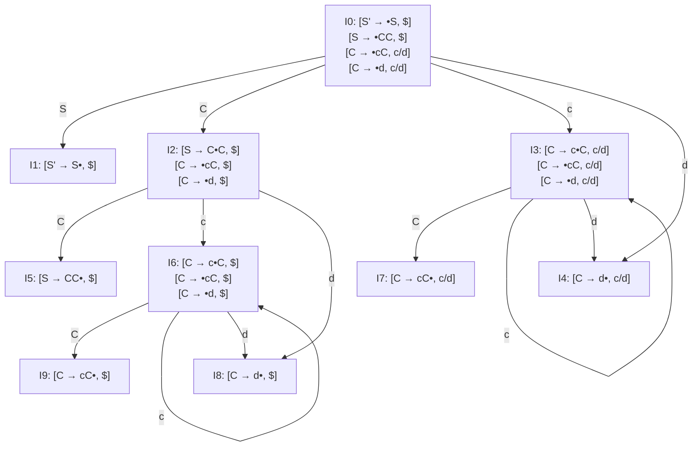
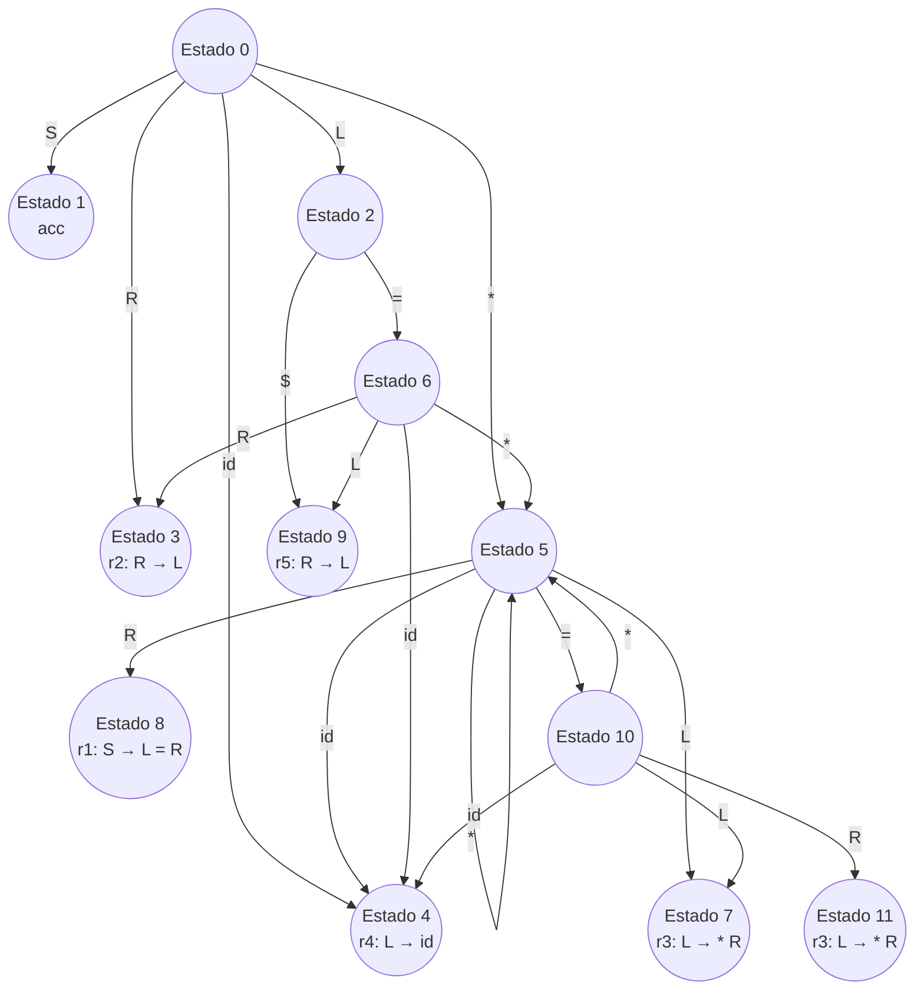

# Compiladores - Análisis sintáctico

## 3.5 Construcción de tablas LR(1).

---

Las tablas LR(1) representan el método más general de análisis sintáctico ascendente para gramáticas libres de contexto. Según Aho et al. (2007), un analizador LR(1) utiliza un lookahead de un token para tomar decisiones de análisis, lo que le permite manejar una clase más amplia de gramáticas que los métodos SLR(1).

### Fundamentos Teóricos

#### Items LR(1)

Un item LR(1) es una producción aumentada con un punto de posición y un símbolo de lookahead:

$$[A \rightarrow \alpha \bullet \beta, a]$$

donde:

- $A \rightarrow \alpha \beta$ es una producción
- $\bullet$ indica la posición del análisis
- $a$ es el símbolo de lookahead (terminal)

#### Clausura de Items LR(1)

La operación de clausura se define como:

$$CLOSURE(I) = I \cup \{[B \rightarrow \bullet \gamma, b] \mid [A \rightarrow \alpha \bullet B \beta, a] \in CLOSURE(I) \text{ y } b \in FIRST(\beta a)\}$$

```python
def closure(items, grammar):
    closure_set = set(items)
    changed = True
    while changed:
        changed = False
        for item in list(closure_set):
            # Item de forma [A → α•Bβ, a]
            if not at_end(item) and next_symbol(item) in grammar.non_terminals:
                B = next_symbol(item)
                for production in grammar.productions[B]:
                    # Calcular FIRST(βa)
                    beta = item.rhs[item.pos + 1:]
                    lookaheads = first(beta + [item.lookahead], grammar)
                    for b in lookaheads:
                        new_item = Item(B, production, 0, b)
                        if new_item not in closure_set:
                            closure_set.add(new_item)
                            changed = True
    return closure_set
```

### Construcción de la Colección Canónica LR(1)

#### Algoritmo de Construcción

```python
def build_lr1_collection(grammar):
    # Augmentar la gramática
    start_production = grammar.augment()

    # Estado inicial
    initial_item = Item(start_production.lhs, start_production.rhs, 0, '$')
    initial_state = closure({initial_item}, grammar)

    states = [initial_state]
    transitions = {}

    while True:
        new_states_added = False
        for i, state in enumerate(states):
            # Agrupar items por símbolo siguiente
            symbols = set()
            for item in state:
                if not item.at_end():
                    symbols.add(item.next_symbol())

            for symbol in symbols:
                goto_set = set()
                for item in state:
                    if not item.at_end() and item.next_symbol() == symbol:
                        new_item = Item(item.lhs, item.rhs, item.pos + 1, item.lookahead)
                        goto_set.add(new_item)

                new_state = closure(goto_set, grammar)

                # Verificar si el estado ya existe
                if new_state not in states:
                    states.append(new_state)
                    new_states_added = True
                    j = len(states) - 1
                else:
                    j = states.index(new_state)

                transitions[(i, symbol)] = j

        if not new_states_added:
            break

    return states, transitions
```

### Autómata LR(1)

#### Ejemplo de Autómata para Gramática Simple

**Gramática**:

$$ S' \rightarrow S \\\ S \rightarrow C C \\\ C \rightarrow c C \mid d $$



### Construcción de Tablas ACTION y GOTO

#### Algoritmo de Construcción de Tablas

```python
def build_lr1_tables(states, transitions, grammar):
    action_table = [{} for _ in range(len(states))]
    goto_table = [{} for _ in range(len(states))]

    for i, state in enumerate(states):
        for item in state:
            if item.at_end():
                if item.lhs == grammar.start_symbol and item.lookahead == '$':
                    action_table[i]['$'] = 'acc'  # Aceptar
                else:
                    # Reducción por A → α
                    production = (item.lhs, item.rhs)
                    action_table[i][item.lookahead] = f'r{production}'
            else:
                symbol = item.next_symbol()
                if symbol in grammar.terminals:
                    j = transitions.get((i, symbol))
                    if j is not None:
                        action_table[i][symbol] = f's{j}'  # Desplazar

        # Llenar tabla GOTO para no terminales
        for nt in grammar.non_terminals:
            j = transitions.get((i, nt))
            if j is not None:
                goto_table[i][nt] = j

    return action_table, goto_table
```

### Ejemplo Completo de Tabla LR(1)

**Gramática**:

$$ S' \rightarrow S \\\ S \rightarrow L = R \mid R \\\ L \rightarrow * R \mid id \\\ R \rightarrow L $$

**Tabla LR(1) resultante**:

**Gramática aumentada:**

```
(0) S' → S
(1) S → L = R
(2) S → R
(3) L → * R
(4) L → id
(5) R → L
```

**Tabla de Análisis LR(1):**

| Estado | ACTION |     |     | GOTO |       |
| ------ | ------ | --- | --- | ---- | ----- |
|        | id     | =   | *   | $    | S L R |
| **0**  | s4     |     | s5  |      | 1 2 3 |
| **1**  |        |     |     | acc  |       |
| **2**  |        | s6  |     | r5   |       |
| **3**  |        |     |     | r2   |       |
| **4**  |        | r4  |     | r4   |       |
| **5**  | s4     | s10 | s5  |      | 7 8   |
| **6**  | s4     |     | s5  |      | 9 3   |
| **7**  |        | r3  |     | r3   |       |
| **8**  |        |     |     | r1   |       |
| **9**  |        |     |     | r5   |       |
| **10** | s4     |     | s5  |      | 7 11  |
| **11** |        |     |     | r3   |       |

**Leyenda:**

- `sN`: Desplazar e ir al estado N
- `rN`: Reducir usando la producción N
- `acc`: Aceptar
- Número en GOTO: Ir al estado N

#### Explicación de la Tabla:

La tabla muestra las acciones del analizador LR(1) para cada estado (filas) y cada símbolo de entrada (columnas de ACTION) o no terminal (columnas de GOTO). Por ejemplo:

- En el **estado 0**, con el token `id`, la acción es `s4` (desplazar al estado 4).
- En el **estado 2**, con el token `=`, la acción es `s6` (desplazar al estado 6).
- En el **estado 4**, con el token `=`, la acción es `r4` (reducir por la producción 4: `L → id`).

Esta tabla permite al analizador tomar decisiones de desplazamiento y reducción de manera determinista para cada posible configuración (estado + token de lookahead).

#### Representación Alternativa en Mermaid (Gráfico de Estados):

Para una visualización más intuitiva de los estados y transiciones, podríamos usar un diagrama de flujo:



### Conflictos y su Resolución

#### Tipos de Conflictos

1. **Desplazamiento-Reducción**: Para el mismo estado y símbolo, es posible desplazar y reducir
2. **Reducción-Reducción**: Para el mismo estado y símbolo, es posible reducir por múltiples producciones

#### Estrategias de Resolución

```python
def resolve_conflicts(action_table, grammar):
    for state in range(len(action_table)):
        for terminal in grammar.terminals + ['$']:
            actions = action_table[state].get(terminal, [])
            if len(actions) > 1:
                # Resolver conflicto desplazamiento-reducción
                shift_actions = [a for a in actions if a.startswith('s')]
                reduce_actions = [a for a in actions if a.startswith('r')]

                if shift_actions and reduce_actions:
                    # Preferir desplazamiento sobre reducción
                    action_table[state][terminal] = shift_actions[0]

                elif len(reduce_actions) > 1:
                    # Resolver conflicto reducción-reducción
                    # Preferir la producción más larga o específica
                    selected = resolve_reduce_reduce(reduce_actions, grammar)
                    action_table[state][terminal] = selected
```

### Optimizaciones para Tablas LALR(1)

#### Fusión de Estados

Las tablas LALR(1) se construyen fusionando estados LR(1) que tienen los mismos items LR(0):

```python
def build_lalr1_states(lr1_states):
    # Agrupar estados por núcleo LR(0)
    core_groups = {}
    for i, state in enumerate(lr1_states):
        core = frozenset((item.lhs, item.rhs, item.pos) for item in state)
        if core not in core_groups:
            core_groups[core] = []
        core_groups[core].append(i)

    # Fusionar estados con el mismo núcleo
    lalr_states = []
    state_mapping = {}

    for core, state_indices in core_groups.items():
        merged_state = set()
        for i in state_indices:
            merged_state.update(lr1_states[i])
            state_mapping[i] = len(lalr_states)
        lalr_states.append(merged_state)

    return lalr_states, state_mapping
```

### Ejercicios Propuestos

1. Construya la colección canónica de estados LR(1) para la gramática:

   $$ S' \rightarrow S \\\ S \rightarrow a A d \mid b B d \mid a B e \mid b A e \\\ A \rightarrow c \\\ B \rightarrow c $$

2. Para la gramática del ejercicio anterior, construya las tablas ACTION y GOTO LR(1).

3. Identifique y resuelva los conflictos en la siguiente gramática:

   $$ S \rightarrow i E t S S' \mid a \\\ S' \rightarrow e S \mid \epsilon \\\ E \rightarrow b $$

4. Implemente en Python el algoritmo de clausura LR(1) para una gramática dada.

5. Compare el tamaño de las tablas LR(1) y LALR(1) para la gramática:

   $$ S \rightarrow A a \mid b A c \mid B c \mid b B a \\\ A \rightarrow d \\\ B \rightarrow d $$

6. Demuestre por qué la siguiente gramática no es LR(1) pero sí LALR(1):
   
   $$ S \rightarrow A a \mid b A c \mid d c \mid b d a \\\ A \rightarrow d $$

### Consideraciones Prácticas

#### Implementación Eficiente

```python
class LR1ParserGenerator:
    def __init__(self, grammar):
        self.grammar = grammar
        self.states = []
        self.transitions = {}
        self.action_table = []
        self.goto_table = []

    def generate(self):
        self._build_collection()
        self._build_tables()
        self._resolve_conflicts()
        return self.action_table, self.goto_table

    def _build_collection(self):
        # Implementación de la construcción de la colección canónica
        pass

    def _build_tables(self):
        # Implementación de la construcción de tablas
        pass

    def _optimize_tables(self):
        # Compresión de tablas y optimizaciones
        pass
```

### Referencias

#### Bibliografía Básica

1. Aho, A. V., Lam, M. S., Sethi, R., & Ullman, J. D. (2007). _Compilers: Principles, Techniques, and Tools_ (2nd ed.). Pearson Education. (Capítulo 4: Syntax Analysis)
2. Cooper, K. D., & Torczon, L. (2004). _Engineering a Compiler_. Morgan Kaufmann. (Capítulo 3: Parsing)

#### Bibliografía Complementaria

1. Grune, D., Bal, H. E., Jacobs, C. J. H., & Langendoen, K. G. (2000). _Modern Compiler Design_. John Wiley & Sons.
2. Wilhelm, R., & Maurer, D. (1995). _Compiler Design_. Addison-Wesley.

#### Términos Clave

- **Item LR(1)**: Producción con punto de posición y símbolo de lookahead
- **Clausura LR(1)**: Operación para expandir un conjunto de items
- **Colección canónica**: Conjunto completo de estados LR(1)
- **Núcleo LR(0)**: Parte del item sin el lookahead
- **Fusión de estados**: Técnica para crear tablas LALR(1) a partir de LR(1)
