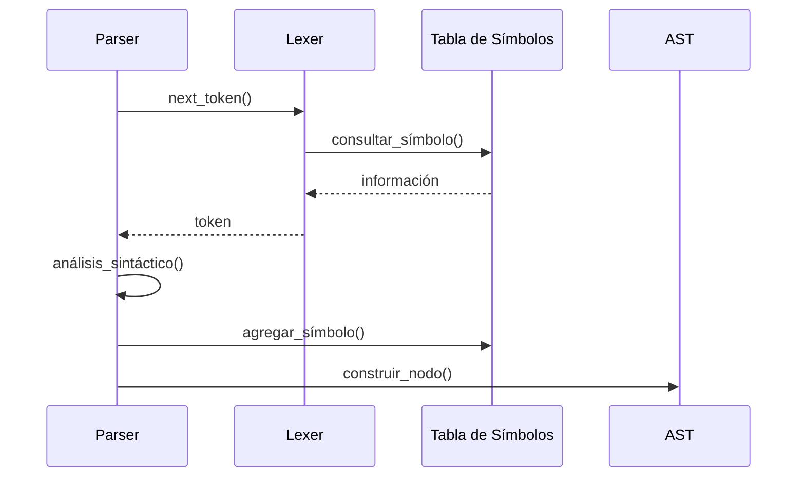

# Compiladores - Análisis sintáctico

## 3.6 Aspectos prácticos.

---

El análisis sintáctico en compiladores reales involucra consideraciones prácticas que van más allá de los algoritmos teóricos. Según Cooper y Torczon (2004), la implementación eficiente de analizadores sintácticos requiere abordar desafíos como el manejo de errores, la generación automática de analizadores y la integración con otras fases del compilador.

### Generadores de Analizadores Sintácticos

#### Herramientas Comunes

| Herramienta | Tipo    | Gramáticas | Características                   |
| ----------- | ------- | ---------- | --------------------------------- |
| Yacc/Bison  | LALR(1) | LR         | Ampliamente utilizada, madura     |
| ANTLR       | ALL(*)  | LL         | Soporta múltiples lenguajes       |
| JavaCC      | LL(k)   | LL         | Específica para Java              |
| SableCC     | LALR(1) | LR         | Genera código orientado a objetos |

#### Ejemplo de Gramática Yacc/Bison

```yacc
%{
#include <stdio.h>
#include <stdlib.h>
%}

%token NUMBER ID
%left '+' '-'
%left '*' '/'

%%

input:    /* empty */
        | input line
        ;

line:     '\n'
        | expr '\n'    { printf("Resultado: %d\n", $1); }
        ;

expr:     expr '+' expr   { $$ = $1 + $3; }
        | expr '-' expr   { $$ = $1 - $3; }
        | expr '*' expr   { $$ = $1 * $3; }
        | expr '/' expr   { $$ = $1 / $3; }
        | '(' expr ')'    { $$ = $2; }
        | NUMBER          { $$ = $1; }
        | ID              { $$ = lookup_variable($1); }
        ;

%%

// Función principal y manejo de errores
int main() {
    yyparse();
    return 0;
}

void yyerror(const char *s) {
    fprintf(stderr, "Error: %s\n", s);
}
```

### Manejo de Errores Sintácticos

#### Estrategias de Recuperación

```python
class ParserErrorHandler:
    def __init__(self, parser):
        self.parser = parser
        self.error_count = 0
        self.max_errors = 10

    def handle_error(self, token, expected):
        self.error_count += 1
        if self.error_count > self.max_errors:
            raise TooManyErrorsException("Demasiados errores sintácticos")

        # Modo pánico: saltar tokens hasta encontrar uno de sincronización
        self.panic_mode_recovery(token)

        # Inserción de tokens: intentar continuar asumiendo tokens faltantes
        if self.try_token_insertion(expected, token):
            return True

        return False

    def panic_mode_recovery(self, current_token):
        # Saltar tokens hasta encontrar uno de los símbolos de sincronización
        sync_tokens = {';', '}', 'end', 'else', 'then'}
        while (current_token and
               current_token.type not in sync_tokens and
               current_token.type != 'EOF'):
            current_token = self.parser.next_token()

        # Recuperar el estado del parser
        self.parser.synchronize_state()

    def try_token_insertion(self, expected, current_token):
        # Intentar insertar tokens faltantes basado en el contexto
        insertable = self.get_insertable_tokens(expected, current_token)
        for token_type in insertable:
            if self.is_plausible_insertion(token_type, current_token):
                self.parser.insert_token(token_type)
                return True
        return False
```

### Integración con el Análisis Léxico

#### Comunicación Parser-Lexer



#### Implementación de Lookahead

```python
class LookaheadLexer:
    def __init__(self, lexer, k=2):
        self.lexer = lexer
        self.lookahead_buffer = []
        self.k = k
        self._fill_buffer()

    def next_token(self):
        if not self.lookahead_buffer:
            return None
        token = self.lookahead_buffer.pop(0)
        self._fill_buffer()
        return token

    def peek(self, n=0):
        if n < len(self.lookahead_buffer):
            return self.lookahead_buffer[n]
        return None

    def _fill_buffer(self):
        while len(self.lookahead_buffer) < self.k:
            token = self.lexer.next_token()
            if token:
                self.lookahead_buffer.append(token)
            else:
                break
```

### Construcción del Árbol de Sintaxis Abstracta (AST)

#### Diseño de Nodos del AST

```python
class ASTNode:
    def __init__(self, node_type, children=None, value=None, token=None):
        self.node_type = node_type
        self.children = children or []
        self.value = value
        self.token = token
        self.data_type = None  # Para análisis semántico

    def add_child(self, child):
        self.children.append(child)

    def __str__(self, level=0):
        ret = "  " * level + f"{self.node_type}"
        if self.value is not None:
            ret += f": {self.value}"
        ret += "\n"
        for child in self.children:
            ret += child.__str__(level + 1)
        return ret

# Tipos específicos de nodos
class BinaryOpNode(ASTNode):
    def __init__(self, op, left, right, token=None):
        super().__init__("BINARY_OP", [left, right], op, token)
        self.op = op
        self.left = left
        self.right = right

class VariableNode(ASTNode):
    def __init__(self, name, token=None):
        super().__init__("VARIABLE", [], name, token)
        self.name = name
```

#### Generación del AST en el Parser

```python
class ASTBuilderParser:
    def __init__(self, lexer):
        self.lexer = LookaheadLexer(lexer)
        self.current_token = self.lexer.next_token()

    def parse_expression(self):
        # Implementación recursiva descendente con construcción de AST
        left = self.parse_term()
        while self.current_token and self.current_token.type in ['PLUS', 'MINUS']:
            op_token = self.current_token
            self.consume(op_token.type)
            right = self.parse_term()
            left = BinaryOpNode(op_token.value, left, right, op_token)
        return left

    def parse_term(self):
        left = self.parse_factor()
        while self.current_token and self.current_token.type in ['MULT', 'DIV']:
            op_token = self.current_token
            self.consume(op_token.type)
            right = self.parse_factor()
            left = BinaryOpNode(op_token.value, left, right, op_token)
        return left

    def parse_factor(self):
        token = self.current_token
        if token.type == 'LPAREN':
            self.consume('LPAREN')
            node = self.parse_expression()
            self.consume('RPAREN')
            return node
        elif token.type == 'ID':
            self.consume('ID')
            return VariableNode(token.value, token)
        elif token.type == 'NUMBER':
            self.consume('NUMBER')
            return NumberNode(token.value, token)
        else:
            self.error("Factor esperado")
```

### Optimizaciones Prácticas

#### Tablas de Análisis Comprimidas

```python
class CompressedActionTable:
    def __init__(self, action_table):
        self.default_actions = self._compute_defaults(action_table)
        self.base_table = []
        self.check_table = []
        self._compress_table(action_table)

    def _compress_table(self, action_table):
        # Algoritmo de compresión para tablas LR
        # Usando técnica de offset coding
        for state in range(len(action_table)):
            for symbol, action in action_table[state].items():
                index = self._find_index(state, symbol)
                self.base_table[index] = action
                self.check_table[index] = state

    def get_action(self, state, symbol):
        index = self._hash(state, symbol)
        if self.check_table[index] == state:
            return self.base_table[index]
        return self.default_actions.get(symbol, 'error')
```

#### Memoización en Análisis Descendente

```python
class MemoizingParser:
    def __init__(self, lexer):
        self.lexer = LookaheadLexer(lexer)
        self.memo = {}  # (position, non_terminal) -> (result, end_position)

    def parse_non_terminal(self, non_terminal, position):
        key = (position, non_terminal)
        if key in self.memo:
            return self.memo[key]

        # Guardar posición actual
        start_pos = self.lexer.get_position()
        self.lexer.set_position(position)

        # Intentar parsear
        result = getattr(self, f'parse_{non_terminal.lower()}')()
        end_pos = self.lexer.get_position()

        # Memoizar resultado
        self.memo[key] = (result, end_pos)
        return result, end_pos
```

### Ejercicios Propuestos

1. Implemente un analizador descendente recursivo con recuperación de errores para la gramática:

   ```
   S → if E then S else S | while E do S | begin L end | id := E
   L → S ; L | S
   E → E + T | E - T | T
   T → T * F | T / F | F
   F → ( E ) | id | num
   ```

2. Cree una gramática Yacc/Bison para un subconjunto de Python que incluya:
   - Asignaciones
   - Estructuras if-else
   - Bucles while
   - Expresiones aritméticas básicas

3. Implemente un sistema de memoización para un parser descendente que evite recomputación en análisis ambiguos.

4. Diseñe un algoritmo de compresión para tablas LR que reduzca el espacio en al menos 50%.

5. Cree un sistema de reporte de errores que muestre:
   - Línea y columna del error
   - Contexto alrededor del error
   - Sugerencias de corrección

6. Implemente la construcción incremental del AST durante el análisis sintáctico.

### Consideraciones de Rendimiento

#### Técnicas de Optimización

```python
class OptimizedParser:
    def __init__(self):
        # Pool de objetos para reducir allocaciones
        self.node_pool = NodeObjectPool()

        # Cache de primeros símbolos
        self.first_cache = {}

        # Análisis predictivo optimizado
        self.predictive_table = self._build_predictive_table()

    def parse(self):
        # Usar arrays en lugar de listas para mejor performance
        self.stack = array.array('I')  # Array de enteros sin signo
        self.state_stack = array.array('I')

        # Loop principal optimizado
        while True:
            state = self.state_stack[-1]
            token_type = self.current_token.type

            # Acceso directo a la tabla (optimizado)
            action = self.action_table[state * self.symbol_count + token_type]

            if action > 0:  # Desplazamiento
                self._shift_action(action)
            elif action < 0:  # Reducción
                self._reduce_action(-action)
            else:  # Aceptar o error
                break
```

### Referencias

#### Bibliografía Básica

1. Aho, A. V., Lam, M. S., Sethi, R., & Ullman, J. D. (2007). _Compilers: Principles, Techniques, and Tools_ (2nd ed.). Pearson Education. (Capítulo 4: Syntax Analysis)
2. Cooper, K. D., & Torczon, L. (2004). _Engineering a Compiler_. Morgan Kaufmann. (Capítulo 3: Parsing)
3. Scott, M. L. (2009). _Programming Language Pragmatics_. Morgan Kaufmann. (Capítulo 4: Semantic Analysis)

#### Bibliografía Complementaria

1. Grune, D., Bal, H. E., Jacobs, C. J. H., & Langendoen, K. G. (2000). _Modern Compiler Design_. John Wiley & Sons.
2. Wilhelm, R., & Maurer, D. (1995). _Compiler Design_. Addison-Wesley.

#### Herramientas y Recursos

- **Bison**: Generador de analizadores LALR(1) - https://www.gnu.org/software/bison/
- **ANTLR**: Herramienta de análisis LL(*) - https://www.antlr.org/
- **JavaCC**: Generador de analizadores para Java - https://javacc.github.io/javacc/

#### Términos Clave

- **Generador de parsers**: Herramienta que crea analizadores sintácticos a partir de gramáticas
- **Recuperación de errores**: Mecanismo para continuar el análisis después de errores
- **Árbol de sintaxis abstracta**: Representación simplificada de la estructura del programa
- **Lookahead**: Mecanismo para anticipar tokens futuros
- **Memoización**: Técnica para almacenar resultados de análisis previos
- **Compresión de tablas**: Métodos para reducir el tamaño de tablas de análisis
