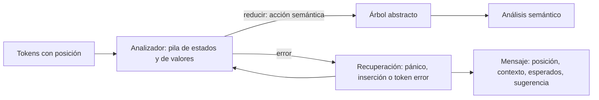

# Compiladores - Análisis sintáctico

## 3.6 Aspectos prácticos.

---

Un analizador sintáctico de producción hace mucho más que aceptar o rechazar: se genera con una herramienta o se escribe a mano, construye el árbol abstracto mientras analiza, reporta los errores con mensajes útiles y se recupera de ellos, y usa tablas compactas. Este tema presenta los generadores de analizadores, el uso de bison con su resolución de conflictos, la recuperación de errores en los analizadores descendentes y ascendentes, los mensajes de error, la memoización, la compresión de las tablas LR y la construcción del árbol abstracto con acciones semánticas.

### Generadores de analizadores

| Herramienta | Algoritmo | Lenguajes que genera | Características |
| ----------- | --------- | -------------------- | --------------- |
| yacc, bison | LALR(1); bison también IELR(1), LR(1) canónico y GLR | C, C++, Java, D | declaraciones de precedencia; token `error` para la recuperación |
| ANTLR 4 | ALL(\*), descendente | Java, Python, C#, JavaScript, Go y otros | árboles y visitantes automáticos; recuperación de errores incorporada |
| JavaCC | LL(k) | Java | anticipación sintáctica y semántica |
| Menhir | LR(1) | OCaml | mensajes de error por estado; lo usa el compilador de Coq |
| tree-sitter | GLR | C, con enlaces a muchos lenguajes | análisis incremental para editores |
| Lark, PLY | Earley, LALR(1) | Python | gramáticas en el propio programa |

Muchos compiladores importantes, como GCC desde la versión 4, Clang, Go, Rust y TypeScript, usan analizadores **escritos a mano** por descenso recursivo, por los mensajes de error y por la flexibilidad para resolver las ambigüedades del lenguaje con información semántica.

### Bison: acciones, atributos y precedencia

Cada producción de bison puede tener una **acción** en C que se ejecuta al reducir. En la acción, `$1`, `$2`, ... son los **valores** de los símbolos del lado derecho, y el del lado izquierdo se escribe con dos signos `$` seguidos; el tipo de cada valor se declara con `%union` y `%type`. Bison mantiene una **pila de valores** paralela a la de estados: al reducir por $A \to X_1 \cdots X_n,$ desapila los $n$ valores, ejecuta la acción y apila el valor del lado izquierdo. Así se construye el árbol abstracto o se evalúa directamente.

Las declaraciones `%left`, `%right`, `%nonassoc` y `%precedence` asignan precedencia a los tokens, en orden creciente por línea; una producción toma la del último terminal de su lado derecho, o la de `%prec`. Un conflicto de desplazamiento contra reducción se resuelve comparando la precedencia del token con la de la producción: si la producción es mayor, se reduce; si el token es mayor, se desplaza, y si son iguales decide la asociatividad. Sin declaraciones, bison reporta los conflictos y desplaza.

### Recuperación de errores

- **Descendente:** modo de pánico con los conjuntos de sincronización FIRST y FOLLOW de cada no terminal, inserción del token que falta, como `;` o `)`, y reemplazo de tokens confundidos con frecuencia, como `=` por `:=`.
- **Ascendente, con el token `error` de yacc:** una producción como `sentencia : error ';'` indica dónde recuperarse; al detectar un error, el analizador desapila estados hasta uno que pueda desplazar `error`, lo desplaza y descarta tokens hasta uno que pueda seguir, y no reporta errores nuevos hasta desplazar tres tokens.
- **Corrección local con costo mínimo:** probar inserciones, eliminaciones y reemplazos de un token y quedarse con el que permite avanzar más, como hacen algunos generadores de Burke y Fisher o de Menhir.

### Mensajes de error

Un buen mensaje tiene la **posición**, en línea y columna; el **contexto**, con la línea del programa y una marca bajo el token; **qué se esperaba**, que en un analizador LR son los terminales con acción en el estado actual, y, si se puede, una **sugerencia**, como una palabra reservada parecida al identificador encontrado, por distancia de edición. Los analizadores LR con **reducciones por omisión** pueden reducir antes de detectar el error, y los terminales esperados del estado final pueden ser menos que los del estado donde se cometió; por eso bison ofrece `%define lr.default-reduction accepting` y `%define parse.error detailed`.

### Memoización y análisis con retroceso

Un analizador con **retroceso** prueba una alternativa y, si falla, vuelve a la posición de partida y prueba otra. Puede ser exponencial, porque analiza muchas veces el mismo no terminal en la misma posición. La **memoización**, que guarda el resultado de cada par de regla y posición, lo vuelve lineal en el número de tokens para las gramáticas de expresiones de análisis, PEG: es el análisis **packrat** de Ford, que paga con memoria proporcional a la entrada por el número de reglas.

### Compresión de las tablas LR

Una tabla ACCIÓN densa tiene $|Q| \cdot |T|$ casillas, casi todas vacías. Las técnicas clásicas son:

- **reducciones por omisión:** un estado cuyas acciones son todas la misma reducción no necesita fila, solo esa acción; los errores se detectan después, al intentar desplazar, sin desplazar nunca un token incorrecto;
- **desplazamiento de filas** o vector peine: las filas se superponen en un solo arreglo `valor`, cada una desplazada por una **base** elegida para que sus casillas ocupadas no choquen con las de otras, y un arreglo `dueño` dice a qué fila pertenece cada posición; la consulta es $\text{valor}[\text{base}[s] + a]$ si $\text{dueño}[\text{base}[s] + a] = s,$ en tiempo constante, como en yacc y bison;
- **filas iguales** compartidas y codificación por **listas** para las filas muy dispersas.



### Implementación en Python

El programa usa el núcleo de gramáticas del tema 3.1, incluido al inicio. Para los ejercicios 1 y 5 implementa un analizador por descenso recursivo con modo de pánico, inserción y reemplazo de tokens, y mensajes con posición, contexto, marca y sugerencias. Para el 2 genera con flex y bison 3.8 un intérprete de un subconjunto de Python y lo ejecuta; para el 3 compara un analizador con retroceso con y sin memoización; para el 4 comprime la tabla LALR(1) de la gramática del ejercicio 1 y analiza con la tabla comprimida, y para el 6 construye el árbol abstracto con acciones semánticas en la pila de valores.

```python
# ===== Núcleo de gramáticas: FIRST y FOLLOW, LL(1), LR(0), SLR(1), LR(1), LALR(1) y transformaciones =====
FIN = "$"

class Gramatica:
    """Producciones en texto: 'E -> E + T | T', símbolos separados por espacios, ε para la cadena vacía.
    Los no terminales son los lados izquierdos; el inicial es el primero."""
    def __init__(self, texto=None, prods=None, inicial=None):
        if texto is not None:
            prods = []
            for linea in texto.strip().splitlines():
                if not linea.strip(): continue
                izq, der = linea.split("->")
                for alt in der.split("|"):
                    s = tuple(x for x in alt.split() if x != "ε")
                    prods.append((izq.strip(), s))
        self.prods = list(dict.fromkeys(prods))
        self.inicial = inicial or self.prods[0][0]
        self.nt = list(dict.fromkeys([a for a, _ in self.prods]))
        self.t = list(dict.fromkeys(x for _, d in self.prods for x in d if x not in self.nt))
        self._calcula()
    def __str__(self):
        return "\n".join(f"   {a} -> " + " | ".join(" ".join(d) or "ε" for b, d in self.prods if b == a) for a in self.nt)
    def de(self, a): return [d for b, d in self.prods if b == a]
    def _calcula(self):
        self.anulable = set(); self.first = {a: set() for a in self.nt}
        cambio = True
        while cambio:
            cambio = False
            for a, d in self.prods:
                if a not in self.anulable and all(x in self.anulable for x in d): self.anulable.add(a); cambio = True
                f = self.first_de(d)
                if not f <= self.first[a]: self.first[a] |= f; cambio = True
        self.follow = {a: set() for a in self.nt}; self.follow[self.inicial].add(FIN)
        cambio = True
        while cambio:
            cambio = False
            for a, d in self.prods:
                for i, x in enumerate(d):
                    if x not in self.nt: continue
                    resto = d[i + 1:]; f = self.first_de(resto)
                    if all(y in self.anulable for y in resto): f = f | self.follow[a]
                    if not f <= self.follow[x]: self.follow[x] |= f; cambio = True
    def first_de(self, sec):
        f = set()
        for x in sec:
            if x not in self.nt: f.add(x); return f
            f |= self.first.get(x, set())
            if x not in self.anulable: return f
        return f
    def anulable_sec(self, sec): return all(x in self.anulable for x in sec)
    def conjuntos(self):
        orden = lambda s: sorted(s, key=lambda x: (x == FIN, x))
        return "\n".join(f"   {a:8} FIRST = {{{', '.join(orden(self.first[a]))}}}{' + ε' if a in self.anulable else ''}"
                         f"   FOLLOW = {{{', '.join(orden(self.follow[a]))}}}" for a in self.nt)

# ---------- LL(1) ----------
def tabla_ll1(g):
    M = {}
    for a, d in g.prods:
        dest = set(g.first_de(d))
        if g.anulable_sec(d): dest |= g.follow[a]
        for x in dest: M.setdefault((a, x), []).append(d)
    conflictos = {k: v for k, v in M.items() if len(v) > 1}
    return M, conflictos

def muestra_ll1(g, M):
    cols = g.t + [FIN]; filas = [[""] + cols]
    for a in g.nt:
        filas.append([a] + [" / ".join(f"{a}->{' '.join(d) or 'ε'}" for d in M.get((a, c), [])) for c in cols])
    anchos = [max(len(f[i]) for f in filas) for i in range(len(cols) + 1)]
    return "\n".join("   " + " | ".join(x.ljust(w) for x, w in zip(f, anchos)) for f in filas)

def analiza_ll1(g, M, tokens, traza=False):
    """Analizador predictivo con pila. Devuelve (acepta, árbol, filas de la traza)."""
    entrada = list(tokens) + [FIN]; raiz = [g.inicial, []]; pila = [(FIN, None), (g.inicial, raiz)]; i = 0; filas = []
    while True:
        x, nodo = pila[-1]; a = entrada[i]
        estado = (" ".join(s for s, _ in pila), " ".join(entrada[i:]))
        if x == FIN and a == FIN: filas.append(estado + ("aceptar",)); return True, raiz, filas
        if x not in g.nt:
            if x != a: filas.append(estado + (f"error: se esperaba {x}",)); return False, raiz, filas
            filas.append(estado + (f"coincide {a}",)); pila.pop(); i += 1; continue
        ds = M.get((x, a))
        if not ds: filas.append(estado + (f"error: M[{x}, {a}] vacía",)); return False, raiz, filas
        d = ds[0]; filas.append(estado + (f"{x} -> {' '.join(d) or 'ε'}",)); pila.pop()
        hijos = [[s, []] for s in d] or [["ε", []]]; nodo[1].extend(hijos)
        for s, h in reversed(list(zip(d, hijos))): pila.append((s, h))

def muestra_traza(filas, anchos=(None, None)):
    a = anchos[0] or max(len(f[0]) for f in filas); b = anchos[1] or max(len(f[1]) for f in filas)
    return "\n".join(f"   {f[0]:>{a}} | {f[1]:>{b}} | {f[2]}" for f in filas)

def arbol_texto(nodo):
    s, hijos = nodo
    return s if not hijos else f"{s}(" + " ".join(arbol_texto(h) for h in hijos) + ")"

# ---------- LR: elementos, colecciones y tablas ----------
class LR:
    """metodo: 'LR0', 'SLR', 'LR1' o 'LALR'. Los estados se numeran en orden de descubrimiento."""
    def __init__(self, g, metodo="SLR", precedencia=None, yacc=False):
        """yacc=True resuelve los conflictos restantes como yacc: desplazar antes que reducir,
        y entre dos reducciones, la producción listada primero."""
        self.g, self.metodo, self.yacc = g, metodo, yacc
        self.aum = g.inicial + "'"
        while self.aum in g.nt: self.aum += "'"
        self.P = [(self.aum, (g.inicial,))] + g.prods
        self.prec = precedencia or {}
        if metodo in ("LR0", "SLR"): self._lr0()
        else: self._lr1()
        self._tabla()
    def texto_item(self, it):
        p, k = it[0], it[1]; a, d = self.P[p]
        s = f"{a} -> " + " ".join(list(d[:k]) + ["·"] + list(d[k:]))
        return s + (f", {'/'.join(sorted(it[2], key=lambda x: (x == FIN, x)))}" if len(it) > 2 else "")
    # LR(0)
    def cierre0(self, I):
        I = set(I); cambio = True
        while cambio:
            cambio = False
            for p, k in list(I):
                d = self.P[p][1]
                if k < len(d) and d[k] in self.g.nt:
                    for q, (a, _) in enumerate(self.P):
                        if a == d[k] and (q, 0) not in I: I.add((q, 0)); cambio = True
        return frozenset(I)
    def ir0(self, I, x):
        return self.cierre0({(p, k + 1) for p, k in I if k < len(self.P[p][1]) and self.P[p][1][k] == x})
    def _simbolos(self): return self.g.nt + self.g.t
    def _lr0(self):
        I0 = self.cierre0({(0, 0)}); self.estados = [I0]; self.ir = {}; num = {I0: 0}; k = 0
        while k < len(self.estados):
            I = self.estados[k]
            for x in self._siguientes(I):
                J = self.ir0(I, x)
                if J not in num: num[J] = len(self.estados); self.estados.append(J)
                self.ir[(k, x)] = num[J]
            k += 1
        self.items = [{(p, d): None for p, d in sorted(I)} for I in self.estados]
    def _siguientes(self, I):
        vistos = []
        for it in sorted(I, key=lambda t: (t[0], t[1])):
            d = self.P[it[0]][1]
            if it[1] < len(d) and d[it[1]] not in vistos: vistos.append(d[it[1]])
        return vistos
    # LR(1): un estado es un diccionario núcleo -> conjunto de símbolos de anticipación
    def cierre1(self, I):
        I = {k: set(v) for k, v in I.items()}; cambio = True
        while cambio:
            cambio = False
            for (p, k), la in list(I.items()):
                d = self.P[p][1]
                if k < len(d) and d[k] in self.g.nt:
                    beta = d[k + 1:]; f = self.g.first_de(beta)
                    nuevos = f | (la if self.g.anulable_sec(beta) else set())
                    for q, (a, _) in enumerate(self.P):
                        if a == d[k]:
                            actual = I.setdefault((q, 0), set())
                            if not nuevos <= actual: actual |= nuevos; cambio = True
        return I
    def _lr1(self):
        def clave(I): return frozenset((k, frozenset(v)) for k, v in I.items())
        def nucleo(I): return frozenset(I)
        I0 = self.cierre1({(0, 0): {FIN}}); est = [I0]; ir = {}; num = {clave(I0): 0}; k = 0
        while k < len(est):
            I = est[k]
            for x in self._siguientes(I):
                J = {}
                for (p, d), la in I.items():
                    rhs = self.P[p][1]
                    if d < len(rhs) and rhs[d] == x: J.setdefault((p, d + 1), set()).update(la)
                J = self.cierre1(J); c = clave(J)
                if c not in num: num[c] = len(est); est.append(J)
                ir[(k, x)] = num[c]
            k += 1
        self.n_lr1 = len(est)
        if self.metodo == "LALR":                     # fundir los estados con el mismo núcleo
            grupo, fusion = {}, []
            for i, I in enumerate(est):
                n = nucleo(I)
                if n not in grupo: grupo[n] = len(fusion); fusion.append({kk: set(v) for kk, v in I.items()})
                else:
                    for kk, v in I.items(): fusion[grupo[n]][kk] |= v
            mapa = {i: grupo[nucleo(I)] for i, I in enumerate(est)}
            est = fusion; ir = {(mapa[i], x): mapa[j] for (i, x), j in ir.items()}
        self.estados = [frozenset(I) for I in est]; self.ir = ir
        self.items = [{k: frozenset(v) for k, v in sorted(I.items())} for I in est]
    def _tabla(self):
        self.accion = {}; self.conflictos = []; self.resueltos = []
        for i, I in enumerate(self.items):
            for (p, k), la in I.items():
                a, d = self.P[p]
                if k < len(d):
                    x = d[k]
                    if x not in self.g.nt: self._pon(i, x, ("d", self.ir[(i, x)]))
                elif p == 0: self._pon(i, FIN, ("acc",))
                else:
                    if self.metodo == "LR0": dest = self.g.t + [FIN]
                    elif self.metodo == "SLR": dest = self.g.follow[a]
                    else: dest = la
                    for x in sorted(dest): self._pon(i, x, ("r", p))
        for (i, x), v in sorted(self.accion.items()):
            if len(v) > 1:
                self.conflictos.append((i, x, list(v)))
                if self.yacc:
                    gana = next((a for a in v if a[0] == "d"), None) or min(v, key=lambda a: a[1])
                    self.resueltos.append((i, x, self.texto_accion(gana))); v[:] = [gana]
    def _nivel(self, p):
        """Precedencia de una producción: la de su último terminal con precedencia, como en yacc."""
        for x in reversed(self.P[p][1]):
            if x in self.prec: return self.prec[x]
        return None
    def _pon(self, i, x, act):
        v = self.accion.setdefault((i, x), [])
        if act in v: return
        if v and self.prec:
            despl = next((a for a in v + [act] if a[0] == "d"), None); red = next((a for a in v + [act] if a[0] == "r"), None)
            if despl and red and x in self.prec and self._nivel(red[1]):
                (nt, at), (nr, _) = self.prec[x], self._nivel(red[1])
                gana = red if nr > nt or (nr == nt and at == "izq") else despl
                self.resueltos.append((i, x, gana[0])); v[:] = [gana]; return
        v.append(act)
    def texto_accion(self, a):
        return {"d": lambda: f"d{a[1]}", "r": lambda: f"r{a[1]}", "acc": lambda: "acc"}[a[0]]()
    def tabla(self):
        ts = self.g.t + [FIN]; ns = self.g.nt
        filas = [["estado"] + ts + ns]
        for i in range(len(self.estados)):
            filas.append([str(i)] + ["/".join(self.texto_accion(a) for a in self.accion.get((i, x), [])) for x in ts]
                         + [str(self.ir.get((i, x), "")) for x in ns])
        anchos = [max(len(f[c]) for f in filas) for c in range(len(filas[0]))]
        return "\n".join("   " + " | ".join(x.rjust(w) for x, w in zip(f, anchos)) for f in filas)
    def coleccion(self):
        res = []
        for i, I in enumerate(self.items):
            its = [(k + ((la,) if la is not None else ())) for k, la in I.items()]
            res.append(f"   I{i}: " + "; ".join(self.texto_item(it) for it in its))
        return "\n".join(res)
    def analiza(self, tokens, traza=False):
        entrada = list(tokens) + [FIN]; pila = [0]; simbolos = []; nodos = []; i = 0; filas = []
        while True:
            s, a = pila[-1], entrada[i]
            acts = self.accion.get((s, a))
            estado = (" ".join(str(x) for x in pila), " ".join(simbolos), " ".join(entrada[i:]))
            if not acts:
                esperados = sorted({x for (e, x) in self.accion if e == s}, key=lambda x: (x == FIN, x))
                filas.append(estado + (f"error: se esperaba {', '.join(esperados)}",)); return False, None, filas
            act = acts[0]
            if act[0] == "d":
                filas.append(estado + (f"desplazar {act[1]}",)); pila.append(act[1]); simbolos.append(a); nodos.append([a, []]); i += 1
            elif act[0] == "r":
                b, d = self.P[act[1]]; n = len(d)
                hijos = nodos[len(nodos) - n:] if n else [["ε", []]]
                if n: del pila[-n:]; del simbolos[-n:]; del nodos[-n:]
                pila.append(self.ir[(pila[-1], b)]); simbolos.append(b); nodos.append([b, hijos])
                filas.append(estado + (f"reducir {b} -> {' '.join(d) or 'ε'}",))
            else:
                filas.append(estado + ("aceptar",)); return True, nodos[-1], filas

def muestra_traza_lr(filas):
    a = max(len(f[0]) for f in filas); b = max(len(f[1]) for f in filas); c = max(len(f[2]) for f in filas)
    return "\n".join(f"   {f[0]:<{a}} | {f[1]:<{b}} | {f[2]:>{c}} | {f[3]}" for f in filas)

# ---------- Transformaciones ----------
def sin_recursion_izquierda(g, orden=None):
    """Algoritmo de Aho y otros 4.19: ordena los no terminales, sustituye y elimina la recursión inmediata."""
    orden = orden or g.nt; P = {a: [list(d) for d in g.de(a)] for a in g.nt}; nuevos = []
    for i, ai in enumerate(orden):
        for aj in orden[:i]:
            nuevas = []
            for d in P[ai]:
                if d and d[0] == aj: nuevas += [dj + d[1:] for dj in P[aj]]
                else: nuevas.append(d)
            P[ai] = nuevas
        rec = [d[1:] for d in P[ai] if d and d[0] == ai]; resto = [d for d in P[ai] if not d or d[0] != ai]
        if rec:
            ap = ai + "'"; P[ai] = [d + [ap] for d in resto]; P[ap] = [d + [ap] for d in rec] + [[]]; nuevos.append((ai, ap))
    lista = []
    for a in orden:
        lista += [(a, tuple(d)) for d in P[a]]
        for x, ap in nuevos:
            if x == a: lista += [(ap, tuple(d)) for d in P[ap]]
    return Gramatica(prods=lista, inicial=g.inicial)

def factoriza(g):
    P = {a: [tuple(d) for d in g.de(a)] for a in g.nt}; orden = list(g.nt); cambio = True
    while cambio:
        cambio = False
        for a in list(orden):
            grupos = {}
            for d in P[a]: grupos.setdefault(d[:1], []).append(d)
            for pre, ds in grupos.items():
                if not pre or len(ds) < 2: continue
                k = 1
                while all(len(d) > k for d in ds) and len({d[k] for d in ds}) == 1: k += 1
                comun = ds[0][:k]; nuevo = a + "'"
                while nuevo in P: nuevo += "'"
                P[a] = [d for d in P[a] if d not in ds] + [comun + (nuevo,)]
                P[nuevo] = [d[k:] for d in ds]; orden.insert(orden.index(a) + 1, nuevo); cambio = True; break
            if cambio: break
    return Gramatica(prods=[(a, d) for a in orden for d in P[a]], inicial=g.inicial)

def sin_inutiles(g):
    gen = set(); cambio = True
    while cambio:
        cambio = False
        for a, d in g.prods:
            if a not in gen and all(x in gen or x not in g.nt for x in d): gen.add(a); cambio = True
    prods = [(a, d) for a, d in g.prods if a in gen and all(x in gen or x not in g.nt for x in d)]
    alc = {g.inicial}; cambio = True
    while cambio:
        cambio = False
        for a, d in prods:
            if a in alc:
                for x in d:
                    if x in g.nt and x not in alc: alc.add(x); cambio = True
    prods = [(a, d) for a, d in prods if a in alc]
    return Gramatica(prods=prods, inicial=g.inicial), sorted(set(g.nt) - gen), sorted(gen - alc)

def chomsky(g):
    """Forma normal de Chomsky: inicial nuevo, sin ε, sin unitarias, terminales aislados y lados derechos binarios."""
    S0 = g.inicial + "0"; prods = [(S0, (g.inicial,))] + list(g.prods); nt = [S0] + g.nt
    anul = set(g.anulable)
    nuevas = set()
    for a, d in prods:
        pos = [i for i, x in enumerate(d) if x in anul]
        for m in range(1 << len(pos)):
            quita = {pos[j] for j in range(len(pos)) if m >> j & 1}
            e = tuple(x for i, x in enumerate(d) if i not in quita)
            if e or a == S0: nuevas.add((a, e))
    if g.inicial in anul: nuevas.add((S0, ()))
    prods = sorted(nuevas, key=lambda p: (nt.index(p[0]), p[1]))
    unit = {a: {a} for a in nt}; cambio = True
    while cambio:
        cambio = False
        for a, d in prods:
            if len(d) == 1 and d[0] in nt:
                for b in nt:
                    if a in unit[b] and d[0] not in unit[b]: unit[b].add(d[0]); cambio = True
    prods = sorted({(a, d) for a in nt for b in unit[a] for c, d in prods if c == b and not (len(d) == 1 and d[0] in nt)},
                   key=lambda p: (nt.index(p[0]), p[1]))
    term = {}; final = []; cont = [0]; pares = {}
    def nt_de(t):
        if t not in term: term[t] = f"T_{t}"; final.append((term[t], (t,)))
        return term[t]
    for a, d in prods:
        if len(d) >= 2: d = tuple(nt_de(x) if x not in nt else x for x in d)
        while len(d) > 2:
            par = d[-2:]
            if par not in pares: cont[0] += 1; pares[par] = f"X{cont[0]}"; final.append((pares[par], par))
            d = d[:-2] + (pares[par],)
        final.append((a, d))
    orden = {a: i for i, a in enumerate(nt)}
    final.sort(key=lambda p: (orden.get(p[0], len(nt)), p[0], p[1]))
    return Gramatica(prods=final, inicial=S0)

def cyk(g, w):
    """Reconocimiento con el algoritmo CYK para una gramática en forma normal de Chomsky: O(n^3 |G|)."""
    n = len(w)
    if n == 0: return (g.inicial, ()) in g.prods, {}
    T = {}
    for i, a in enumerate(w): T[(i, i)] = {b for b, d in g.prods if d == (a,)}
    for l in range(2, n + 1):
        for i in range(n - l + 1):
            j = i + l - 1; T[(i, j)] = set()
            for k in range(i, j):
                for b, d in g.prods:
                    if len(d) == 2 and d[0] in T[(i, k)] and d[1] in T[(k + 1, j)]: T[(i, j)].add(b)
    return g.inicial in T[(0, n - 1)], T

import re, difflib, os, subprocess, tempfile

# ---------- Ejercicios 1 y 5: descenso recursivo con recuperación y mensajes con contexto ----------
RESERVADAS = {"if", "then", "else", "while", "do", "begin", "end"}
def lexico(texto):
    toks = []
    for m in re.finditer(r"(?P<num>\d+)|(?P<id>[A-Za-z_]\w*)|(?P<op>:=|[-+*/();])|(?P<sp>\s+)|(?P<mal>.)", texto):
        if m.lastgroup == "sp": continue
        linea = texto.count("\n", 0, m.start()) + 1; col = m.start() - (texto.rfind("\n", 0, m.start()) + 1) + 1
        v = m.group(); clase = v if (m.lastgroup == "id" and v in RESERVADAS) or m.lastgroup in ("op", "mal") else m.lastgroup
        toks.append((clase, v, linea, col))
    toks.append((FIN, "fin del archivo", texto.count("\n") + 1, len(texto.split("\n")[-1]) + 1))
    return toks
class Analizador:
    """S -> if E then S else S | while E do S | begin L end | id := E;  L -> S { ; S };  E, T, F con ciclos."""
    SINCRONIZA = {";", "end", "else", FIN}
    INICIO_S = {"if", "while", "begin", "id"}
    def __init__(self, texto): self.texto, self.t, self.i, self.errores = texto, lexico(texto), 0, []
    def mira(self): return self.t[self.i][0]
    def avanza(self): self.i += 1; return self.t[self.i - 1]
    def reporta(self, esperado, sugerencia=None):
        clase, v, l, c = self.t[self.i]
        msg = f"{l}:{c}: se esperaba {esperado} y llegó '{v}'"
        if sugerencia: msg += f"; ¿quisiste escribir '{sugerencia}'?"
        elif clase == "id":
            parecida = difflib.get_close_matches(v, sorted(RESERVADAS), n=1, cutoff=0.6)
            if parecida: msg += f"; ¿quisiste escribir '{parecida[0]}'?"
        linea = self.texto.split("\n")[l - 1]
        self.errores.append(f"{msg}\n      {linea}\n      {' ' * (c - 1)}^")
    def espera(self, x):
        if self.mira() == x: return self.avanza()
        if x == ":=" and self.mira() == "=":                          # error frecuente: se reemplaza el token
            self.reporta("':='", sugerencia=":="); return self.avanza()
        self.reporta(f"'{x}'")
        if x in (")", "then", "do", "end", ":="): return None       # se supone insertado
        while self.mira() not in self.SINCRONIZA | {x}: self.avanza()
        if self.mira() == x: return self.avanza()
    def S(self):
        x = self.mira()
        if x == "if":
            self.avanza(); c = self.E(); self.espera("then"); a = self.S(); self.espera("else"); return ("if", c, a, self.S())
        if x == "while":
            self.avanza(); c = self.E(); self.espera("do"); return ("while", c, self.S())
        if x == "begin":
            self.avanza(); l = self.L(); self.espera("end"); return ("bloque", l)
        if x == "id":
            v = self.avanza()[1]; self.espera(":="); return (":=", v, self.E())
        self.reporta("una sentencia")
        while self.mira() not in self.SINCRONIZA | self.INICIO_S: self.avanza()
        return ("error",)
    def L(self):
        l = [self.S()]
        while self.mira() not in ("end", "else", FIN):
            if self.mira() == ";": self.avanza()
            elif self.mira() in self.INICIO_S: self.reporta("';'")      # falta el punto y coma: se inserta
            else:                                                     # modo de pánico hasta otra sentencia
                self.reporta("';' o 'end'")
                while self.mira() not in self.SINCRONIZA | self.INICIO_S: self.avanza()
                if self.mira() not in self.INICIO_S: continue                 # sin reportar el ';' que falta
            l.append(self.S())
        return l
    def E(self):
        r = self.T()
        while self.mira() in "+-" and self.mira() != FIN: op = self.avanza()[0]; r = (op, r, self.T())
        return r
    def T(self):
        r = self.F()
        while self.mira() in ("*", "/"): op = self.avanza()[0]; r = (op, r, self.F())
        return r
    def F(self):
        x = self.mira()
        if x in ("id", "num"): return self.avanza()[1]
        if x == "(":
            self.avanza(); r = self.E(); self.espera(")"); return r
        self.reporta("un operando"); return "?"
    def programa(self):
        s = self.S()
        if self.mira() != FIN: self.reporta("el fin del programa")
        return s
correcto = "begin\n  x := 10;\n  while x do\n    begin s := s + x * 2; x := x - 1 end;\n  if s then y := s / (x + 1) else y := 0\nend"
p = Analizador(correcto); arbol = p.programa()
print("ejercicio 1:", arbol, "| errores:", len(p.errores))
con_errores = "begin\n  x := 10\n  whille x do x := x - ;\n  if x then y := (x + 1 else y := 0;\n  z = 3\nend"
p = Analizador(con_errores); arbol = p.programa()
print(f"ejercicio 5: {len(p.errores)} errores en una pasada")
for e in p.errores: print("   " + e)
print("   árbol recuperado:", arbol)

# ---------- Ejercicio 2: un subconjunto de Python con flex y bison ----------
LEX = r'''
%option noyywrap nounput noinput
%{
#include "py.tab.h"
static int pila[64] = {0}, tope = 0, pendientes = 0, parens = 0;
%}
%x INICIO
%%
<INICIO>[ ]*\n            ;
<INICIO>[ ]*[^ \n]        { yyless(yyleng - 1); BEGIN(INITIAL);
                            if (yyleng > pila[tope]) { pila[++tope] = yyleng; return INDENT; }
                            while (yyleng < pila[tope]) { tope--; pendientes++; }
                            if (pendientes) { pendientes--; if (pendientes) { yyless(0); BEGIN(INICIO); pila[++tope] = 1000; tope--; } return DEDENT; } }
\n                        { if (!parens) { BEGIN(INICIO); return NEWLINE; } }
[ \t]+                    ;
"#"[^\n]*                 ;
"if"                      { return IF; }
"else"                    { return ELSE; }
"while"                   { return WHILE; }
"print"                   { return PRINT; }
[0-9]+                    { yylval.num = atoi(yytext); return NUMBER; }
[A-Za-z_][A-Za-z0-9_]*    { yylval.nombre = strdup(yytext); return NAME; }
"=="                      { return EQ; }
"!="                      { return NE; }
"<="                      { return LE; }
">="                      { return GE; }
"("                       { parens++; return '('; }
")"                       { parens--; return ')'; }
[-+*/%<>=:]               { return yytext[0]; }
.                         { fprintf(stderr, "carácter ilegal '%s'\n", yytext); }
<INITIAL,INICIO><<EOF>>   { if (tope > 0) { tope--; return DEDENT; } return 0; }
%%
'''
YACC = r'''
%{
#include <stdio.h>
#include <stdlib.h>
#include <string.h>
int yylex(void);
void yyerror(const char *s);
extern int yylineno;
typedef struct Nodo { int tipo, valor; char *nombre; struct Nodo *a, *b, *c; } Nodo;
static Nodo *nodo(int tipo, Nodo *a, Nodo *b, Nodo *c) {
    Nodo *n = calloc(1, sizeof *n); n->tipo = tipo; n->a = a; n->b = b; n->c = c; return n; }
static char *nombres[64]; static int valores[64], nvars = 0;
static int *variable(const char *s) {
    for (int i = 0; i < nvars; i++) if (!strcmp(nombres[i], s)) return &valores[i];
    nombres[nvars] = strdup(s); valores[nvars] = 0; return &valores[nvars++]; }
static int eval(Nodo *n);
static void ejecuta(Nodo *n) {
    for (; n; n = n->c) switch (n->tipo) {      /* las sentencias forman una lista ligada por c */
        case '=': *variable(n->nombre) = eval(n->a); break;
        case 'p': printf("%d\n", eval(n->a)); break;
        case 'i': if (eval(n->a)) ejecuta(n->b); else ejecuta(n->a->c); break;
        case 'w': while (eval(n->a)) ejecuta(n->b); break; }
}
static int eval(Nodo *n) {
    switch (n->tipo) {
        case 'n': return n->valor;
        case 'v': return *variable(n->nombre);
        case '+': return eval(n->a) + eval(n->b);  case '-': return eval(n->a) - eval(n->b);
        case '*': return eval(n->a) * eval(n->b);  case '/': return eval(n->a) / eval(n->b);
        case '%': return eval(n->a) % eval(n->b);  case '<': return eval(n->a) < eval(n->b);
        case '>': return eval(n->a) > eval(n->b);  case 'E': return eval(n->a) == eval(n->b);
        case 'N': return eval(n->a) != eval(n->b); case 'L': return eval(n->a) <= eval(n->b);
        case 'G': return eval(n->a) >= eval(n->b); case 'u': return -eval(n->a); }
    return 0;
}
static Nodo *programa;
static Nodo *encadena(Nodo *lista, Nodo *s) { if (!lista) return s; Nodo *p = lista; while (p->c) p = p->c; p->c = s; return lista; }
%}
%union { int num; char *nombre; struct Nodo *nodo; }
%token <num> NUMBER
%token <nombre> NAME
%token IF ELSE WHILE PRINT NEWLINE INDENT DEDENT EQ NE LE GE
%type <nodo> sentencias sentencia bloque expr
%nonassoc EQ NE '<' '>' LE GE
%left '+' '-'
%left '*' '/' '%'
%precedence UMENOS
%%
archivo    : sentencias                      { programa = $1; } ;
sentencias : sentencia                       { $$ = $1; }
           | sentencias sentencia            { $$ = encadena($1, $2); } ;
sentencia  : NAME '=' expr NEWLINE           { $$ = nodo('=', $3, 0, 0); $$->nombre = $1; }
           | PRINT '(' expr ')' NEWLINE      { $$ = nodo('p', $3, 0, 0); }
           | IF expr ':' bloque              { $$ = nodo('i', $2, $4, 0); $2->c = 0; }
           | IF expr ':' bloque ELSE ':' bloque { $$ = nodo('i', $2, $4, 0); $2->c = $7; }
           | WHILE expr ':' bloque           { $$ = nodo('w', $2, $4, 0); } ;
bloque     : NEWLINE INDENT sentencias DEDENT { $$ = $3; } ;
expr       : NUMBER                          { $$ = nodo('n', 0, 0, 0); $$->valor = $1; }
           | NAME                            { $$ = nodo('v', 0, 0, 0); $$->nombre = $1; }
           | '(' expr ')'                    { $$ = $2; }
           | '-' expr %prec UMENOS           { $$ = nodo('u', $2, 0, 0); }
           | expr '+' expr { $$ = nodo('+', $1, $3, 0); } | expr '-' expr { $$ = nodo('-', $1, $3, 0); }
           | expr '*' expr { $$ = nodo('*', $1, $3, 0); } | expr '/' expr { $$ = nodo('/', $1, $3, 0); }
           | expr '%' expr { $$ = nodo('%', $1, $3, 0); } | expr '<' expr { $$ = nodo('<', $1, $3, 0); }
           | expr '>' expr { $$ = nodo('>', $1, $3, 0); } | expr EQ expr  { $$ = nodo('E', $1, $3, 0); }
           | expr NE expr  { $$ = nodo('N', $1, $3, 0); } | expr LE expr  { $$ = nodo('L', $1, $3, 0); }
           | expr GE expr  { $$ = nodo('G', $1, $3, 0); } ;
%%
void yyerror(const char *s) { fprintf(stderr, "error de sintaxis: %s\n", s); }
int main(void) {
    if (yyparse()) return 1;
    ejecuta(programa);
    for (int i = 0; i < nvars; i++) printf("%s = %d\n", nombres[i], valores[i]);
    return 0;
}
'''
PY = """n = 10
a = 0
b = 1
i = 0
while i < n:
    t = a + b
    a = b
    b = t
    i = i + 1
if a % 2 == 0:
    print(a)
else:
    print(-a)
    if a > 50:
        print(a / 11)
"""
tmp = tempfile.mkdtemp()
open(os.path.join(tmp, "py.l"), "w").write(LEX); open(os.path.join(tmp, "py.y"), "w").write(YACC)
def corre(cmd, entrada=None):
    r = subprocess.run(cmd, cwd=tmp, input=entrada, capture_output=True, text=True); return r.stdout, r.stderr, r.returncode
_, err, rc = corre(["bison", "-d", "-Wall", "-Wcounterexamples", "py.y"]); print("ejercicio 2: bison -Wall:", "sin avisos ni conflictos" if not err else err.strip(), "| código", rc)
_, err, rc = corre(["flex", "-o", "lex.yy.c", "py.l"]); assert rc == 0, err
_, err, rc = corre(["gcc", "-O2", "-o", "py", "py.tab.c", "lex.yy.c"]); assert rc == 0, err
out, err, rc = corre(["./py"], PY); print("   salida del intérprete:", out.split("\n")[:-1], err.strip())
out, err, rc = corre(["./py"], "x = 3 +\ny = 2\n"); print("   'x = 3 +':", err.strip(), "| código", rc)
sin = re.sub(r"%nonassoc.*\n%left.*\n%left.*\n%precedence UMENOS\n", "", YACC).replace("%prec UMENOS", "")
open(os.path.join(tmp, "sinprec.y"), "w").write(sin)
_, err, _ = corre(["bison", "-Wall", "-o", "sinprec.c", "sinprec.y"])
print("   sin las declaraciones de precedencia:", [l.split("warning: ")[1] for l in err.splitlines() if "conflicts" in l])

# ---------- Ejercicio 3: memoización en un analizador con retroceso ----------
class PEG:
    """E <- T '+' E / T;  T <- F '*' T / F;  F <- '(' E ')' / id.  Elección ordenada con retroceso."""
    def __init__(self, toks, memo): self.t, self.memo, self.llamadas, self.tabla = toks, memo, 0, {}
    def regla(self, nombre, i):
        if self.memo and (nombre, i) in self.tabla: return self.tabla[(nombre, i)]
        self.llamadas += 1; r = getattr(self, nombre)(i)
        if self.memo: self.tabla[(nombre, i)] = r
        return r
    def lit(self, x, i): return i + 1 if i < len(self.t) and self.t[i] == x else None
    def E(self, i):
        j = self.regla("T", i)
        if j is not None and (k := self.lit("+", j)) is not None and (m := self.regla("E", k)) is not None: return m
        return self.regla("T", i)                              # retrocede y prueba la segunda alternativa
    def T(self, i):
        j = self.regla("F", i)
        if j is not None and (k := self.lit("*", j)) is not None and (m := self.regla("T", k)) is not None: return m
        return self.regla("F", i)
    def F(self, i):
        if (j := self.lit("(", i)) is not None and (k := self.regla("E", j)) is not None and (m := self.lit(")", k)) is not None: return m
        return self.lit("id", i)
print("ejercicio 3: llamadas a reglas para (( ... ( id ) ... )) con n paréntesis")
for n in [2, 4, 6, 8, 10]:
    toks = ["("] * n + ["id"] + [")"] * n
    sin, con = PEG(toks, False), PEG(toks, True)
    assert sin.regla("E", 0) == con.regla("E", 0) == len(toks)
    print(f"   n={n:2}: sin memoización {sin.llamadas:8} | con memoización {con.llamadas:3}")

# ---------- Ejercicio 4: compresión de la tabla LR con reducciones por omisión y desplazamiento de filas ----------
G = Gramatica("""S -> if E then S else S | while E do S | begin L end | id := E
L -> S ; L | S
E -> E + T | E - T | T
T -> T * F | T / F | F
F -> ( E ) | id | num""")
lr = LR(G, "LALR"); cols = G.t + [FIN]; n = len(lr.estados)
densa = {(i, x): lr.accion[(i, x)][0] for (i, x) in lr.accion}
omision = {}
for i in range(n):                                   # si un estado solo reduce por una producción, esa es su acción por omisión
    red = {a for (e, x), a in densa.items() if e == i and a[0] == "r"}
    if len(red) == 1 and not any(a[0] == "d" for (e, x), a in densa.items() if e == i): omision[i] = red.pop()
resto = {(i, x): a for (i, x), a in densa.items() if i not in omision}
col = {x: k for k, x in enumerate(cols)}; base, valor, dueño = {}, {}, {}
for i in sorted({i for i, _ in resto}, key=lambda i: -sum(1 for e, _ in resto if e == i)):
    fila = [col[x] for (e, x) in resto if e == i]; b = 0
    while any((b + c) in dueño for c in fila): b += 1                 # primer desplazamiento sin choques
    base[i] = b
    for (e, x), a in resto.items():
        if e == i: valor[b + col[x]] = a; dueño[b + col[x]] = i
def accion(i, x):
    if i in omision: return omision[i]
    k = base.get(i, 0) + col[x]
    return valor[k] if dueño.get(k) == i else None
celdas_densas = n * len(cols); comprimidas = len(omision) + len(base) + 2 * (max(dueño) + 1)
iguales = all(accion(i, x) == densa.get((i, x)) for i in range(n) for x in cols if i not in omision)
print(f"ejercicio 4: {n} estados x {len(cols)} terminales = {celdas_densas} casillas; {len(omision)} estados con reducción por omisión;",
      f"vector de {max(dueño) + 1} posiciones más bases: {comprimidas} enteros, {100 - 100 * comprimidas // celdas_densas}% menos;",
      "mismas acciones fuera de las omisiones:", iguales)
def analiza_comprimida(toks):
    entrada = toks + [FIN]; pila = [0]; i = 0
    while True:
        a = accion(pila[-1], entrada[i])
        if a is None: return f"error en el token {i + 1} ('{entrada[i]}')"
        if a[0] == "d": pila.append(a[1]); i += 1
        elif a[0] == "r":
            b, d = lr.P[a[1]]
            if d: del pila[-len(d):]
            pila.append(lr.ir[(pila[-1], b)])
        else: return "acepta"
for e in ["begin id := num ; while id do id := id * ( num - id ) end", "begin id := num + end", "id := ( num"]:
    original = lr.analiza(e.split())
    print(f"   {e!r:60} comprimida: {analiza_comprimida(e.split()):26} | original: {'acepta' if original[0] else 'error en el token ' + str(len(e.split()) - len(original[2][-1][2].split()) + 2)}")

# ---------- Ejercicio 6: construcción del árbol abstracto durante el análisis LR ----------
EXPR = Gramatica("""E -> E + T | E - T | T
T -> T * F | T / F | F
F -> ( E ) | - F | num""")
lre = LR(EXPR, "SLR")
ACCIONES = {1: lambda s: ("+", s[0], s[2]), 2: lambda s: ("-", s[0], s[2]), 3: lambda s: s[0], 4: lambda s: ("*", s[0], s[2]),
            5: lambda s: ("/", s[0], s[2]), 6: lambda s: s[0], 7: lambda s: s[1], 8: lambda s: ("neg", s[1]), 9: lambda s: int(s[0])}
def analiza_con_acciones(lr, lexemas, clases):
    """Una pila de valores paralela a la de estados: al reducir se ejecuta la acción con los valores del lado derecho."""
    entrada = list(zip(clases, lexemas)) + [(FIN, None)]; estados = [0]; valores = [None]; i = 0; nodos = 0
    while True:
        a = lr.accion.get((estados[-1], entrada[i][0]))
        if not a: return None, nodos
        a = a[0]
        if a[0] == "d": estados.append(a[1]); valores.append(entrada[i][1]); i += 1
        elif a[0] == "r":
            b, d = lr.P[a[1]]; vals = valores[-len(d):]; del estados[-len(d):]; del valores[-len(d):]
            v = ACCIONES[a[1]](vals); nodos += isinstance(v, tuple)
            estados.append(lr.ir[(estados[-1], b)]); valores.append(v)
        else: return valores[-1], nodos
def evalua(a):
    if isinstance(a, int): return a
    if a[0] == "neg": return -evalua(a[1])
    x, y = evalua(a[1]), evalua(a[2]); return {"+": x + y, "-": x - y, "*": x * y, "/": x // y}[a[0]]
lex = "( 7 - - 2 ) * 3 - 8 / 4".split()
arbol, nodos = analiza_con_acciones(lre, lex, ["num" if x.isdigit() else x for x in lex])
print("ejercicio 6:", " ".join(lex), "->", arbol, f"| {nodos} nodos | vale {evalua(arbol)}; Python: {(7 - -2) * 3 - 8 // 4}")
```

Salida, con flex 2.6, bison 3.8 y gcc 13:

```text
ejercicio 1: ('bloque', [(':=', 'x', '10'), ('while', 'x', ('bloque', [(':=', 's', ('+', 's', ('*', 'x', '2'))), (':=', 'x', ('-', 'x', '1'))])), ('if', 's', (':=', 'y', ('/', 's', ('+', 'x', '1'))), (':=', 'y', '0'))]) | errores: 0
ejercicio 5: 6 errores en una pasada
   3:3: se esperaba ';' y llegó 'whille'; ¿quisiste escribir 'while'?
        whille x do x := x - ;
        ^
   3:10: se esperaba ':=' y llegó 'x'
        whille x do x := x - ;
               ^
   3:12: se esperaba ';' o 'end' y llegó 'do'
        whille x do x := x - ;
                 ^
   3:24: se esperaba un operando y llegó ';'
        whille x do x := x - ;
                             ^
   4:25: se esperaba ')' y llegó 'else'
        if x then y := (x + 1 else y := 0;
                              ^
   5:5: se esperaba ':=' y llegó '='; ¿quisiste escribir ':='?
        z = 3
          ^
   árbol recuperado: ('bloque', [(':=', 'x', '10'), (':=', 'whille', 'x'), (':=', 'x', ('-', 'x', '?')), ('if', 'x', (':=', 'y', ('+', 'x', '1')), (':=', 'y', '0')), (':=', 'z', '3')])
ejercicio 2: bison -Wall: sin avisos ni conflictos | código 0
   salida del intérprete: ['-55', '5', 'n = 10', 'a = 55', 'b = 89', 'i = 10', 't = 89'] 
   'x = 3 +': error de sintaxis: syntax error | código 1
   sin las declaraciones de precedencia: ['132 shift/reduce conflicts [-Wconflicts-sr]']
ejercicio 3: llamadas a reglas para (( ... ( id ) ... )) con n paréntesis
   n= 2: sin memoización      147 | con memoización   9
   n= 4: sin memoización     2387 | con memoización  15
   n= 6: sin memoización    38227 | con memoización  21
   n= 8: sin memoización   611667 | con memoización  27
   n=10: sin memoización  9786707 | con memoización  33
ejercicio 4: 36 estados x 18 terminales = 648 casillas; 10 estados con reducción por omisión; vector de 123 posiciones más bases: 282 enteros, 57% menos; mismas acciones fuera de las omisiones: True
   'begin id := num ; while id do id := id * ( num - id ) end'  comprimida: acepta                     | original: acepta
   'begin id := num + end'                                      comprimida: error en el token 6 ('end') | original: error en el token 6
   'id := ( num'                                                comprimida: error en el token 5 ('$')  | original: error en el token 5
ejercicio 6: ( 7 - - 2 ) * 3 - 8 / 4 -> ('-', ('*', ('-', 7, ('neg', 2)), 3), ('/', 8, 4)) | 9 nodos | vale 25; Python: 25
```

### Ejercicios Propuestos

1. **Recuperación de errores.** Implementa un analizador por descenso recursivo con recuperación de errores para la gramática:

    ```text
    S → if E then S else S | while E do S | begin L end | id := E
    L → S ; L | S
    E → E + T | E - T | T
    T → T * F | T / F | F
    F → ( E ) | id | num
    ```

2. **Bison.** Crea una gramática de yacc o bison para un subconjunto de Python que incluya asignaciones, estructuras if-else, ciclos while y expresiones aritméticas básicas.

3. **Memoización.** Implementa la memoización en un analizador descendente para evitar los cálculos repetidos causados por el retroceso.

4. **Compresión.** Diseña un algoritmo de compresión para las tablas LR que reduzca el espacio en al menos 50%.

5. **Mensajes de error.** Crea un sistema de reporte de errores que muestre la línea y la columna del error, el contexto y sugerencias de corrección.

6. **Árbol abstracto.** Implementa la construcción del árbol abstracto durante el análisis sintáctico.

### Soluciones

**Ejercicio 1.** El analizador sigue la gramática con la recursión por la izquierda reemplazada por ciclos y $L$ como una lista separada por `;`. Recupera los errores de tres formas: el **modo de pánico**, que descarta tokens hasta uno de sincronización, `;`, `end`, `else` o el fin, o hasta el inicio de una sentencia; la **inserción** de los tokens que suelen faltar, como `;`, `then`, `do`, `end` o `)`, y el **reemplazo** de `=` por `:=`. El programa correcto produce su árbol sin errores, con la precedencia y los bloques anidados.

**Ejercicio 2.** El analizador léxico de flex genera `INDENT` y `DEDENT` con una pila de sangrías, como en el tema 2.6, y el sintáctico de bison tiene sentencias de asignación, `print`, `if` con o sin `else` y `while`, con bloques de la forma `: NEWLINE INDENT sentencias DEDENT`. Las acciones construyen el árbol abstracto en C, que después se **interpreta**. El programa de prueba calcula el décimo número de Fibonacci, 55, e imprime $-55$ y $55 / 11 = 5$ por las ramas del `if`. La gramática de expresiones es ambigua, y las declaraciones `%nonassoc`, `%left` y `%precedence`, con `%prec` para el menos unario, resuelven sus conflictos: bison la acepta sin avisos con `-Wall`, y sin ellas reporta 132 conflictos de desplazamiento contra reducción. El `if` sin `else` no produce el conflicto del `else` colgante, porque cada bloque termina con `DEDENT`.

**Ejercicio 3.** La gramática con elección ordenada $E \leftarrow T + E \,/\, T$ retrocede cada vez que la primera alternativa falla, y entonces vuelve a analizar $T$ desde la misma posición. Con $n$ paréntesis anidados, cada nivel analiza dos veces el interior en $E$ y dos en $T,$ y el número de llamadas se multiplica por 4 con cada nivel, como $4^n:$ casi 10 millones con $n = 10.$ Con la memoización, cada par de regla y posición se calcula una sola vez, y el número de llamadas es $3n + 3,$ lineal. La memoización no cambia el resultado, como comprueba el programa con `assert`. Una alternativa es factorizar la gramática, $E \leftarrow T\ (+\, E)?,$ que elimina el retroceso.

**Ejercicio 4.** La tabla LALR(1) de la gramática del ejercicio 1 tiene 36 estados y 18 terminales, 648 casillas. Diez estados solo reducen, y con la **reducción por omisión** no necesitan fila. Las 26 filas restantes se superponen con el **desplazamiento de filas** en un vector de 123 posiciones, que con sus bases, el arreglo `dueño` y las reducciones por omisión ocupan 282 enteros: 57% menos, con acceso en tiempo constante. Fuera de los estados con omisión, todas las acciones coinciden con las de la tabla densa, y el analizador con la tabla comprimida acepta y rechaza las mismas entradas, detectando el error en el mismo token. Con tablas más grandes la ganancia es mayor: en un lenguaje real, la tabla densa tiene más de 95% de casillas vacías.

**Ejercicio 5.** Cada error se reporta con la línea y la columna, la línea del programa con una marca `^` bajo el token, lo que se esperaba y, cuando el token es un identificador parecido a una palabra reservada, una sugerencia calculada con `difflib`, como `whille` por `while`. El programa con errores produce 6 mensajes en una sola pasada y un árbol con las partes que se pudieron reconocer, con `?` en los operandos que faltan. El primer error es el `;` que falta al final de la línea 2, que se detecta en el primer token de la línea 3: el mensaje sería todavía mejor señalando el final de la línea anterior, como hace Clang.

**Ejercicio 6.** El analizador LR mantiene una **pila de valores** paralela a la de estados: al desplazar apila el lexema, y al reducir por la producción $k$ desapila los valores del lado derecho y apila el resultado de la acción $k,$ que construye un nodo, como `("+", $1, $3)`, o pasa un valor, como en $E \to T$ o $F \to ( E ).$ Así el árbol abstracto se construye **de abajo arriba** durante el análisis, sin construir antes el árbol de análisis: para `( 7 - - 2 ) * 3 - 8 / 4`, el resultado tiene 9 nodos, sin paréntesis ni no terminales intermedios, y vale 25, como en Python. Es exactamente lo que hacen las acciones de bison que asignan el valor del lado izquierdo.

En el material original, el ejemplo de bison llamaba a `lookup_variable` y a `yylex` sin declararlas ni definirlas, y usaba `yyerror` antes de declararla, de modo que no compilaba con gcc moderno, y no tenía menos unario; la clase de la tabla comprimida escribía en listas vacías, con un error de índice, llamaba a métodos que no existían, como `_find_index` y `_hash`, y guardaba las acciones por omisión por símbolo, cuando son por estado.

### Referencias

1. Levine, J. R., _flex & bison_. O'Reilly, 2009.
2. Donnelly, C., and Stallman, R., _Bison: The Yacc-compatible Parser Generator_. Manual de GNU Bison 3.8.
3. Aho, A. V., Lam, M. S., Sethi, R., and Ullman, J. D., _Compilers: Principles, Techniques, and Tools_. 2a ed., Pearson, 2007. Secciones 4.1.3, 4.8 y 4.9.
4. Ford, B., Packrat parsing: simple, powerful, lazy, linear time. _ICFP_, 2002.
5. Tarjan, R. E., and Yao, A. C., Storing a sparse table. _Communications of the ACM_ 22(11), 1979.
6. Jeffery, C. L., Generating LR syntax error messages from examples. _ACM TOPLAS_ 25(5), 2003.
