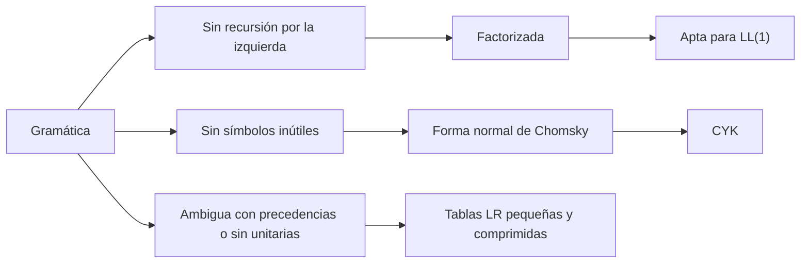

# Compiladores - Análisis sintáctico

## 3.7 Manipulación de gramáticas (optimización y reducción del tamaño de tablas).

---

Una gramática puede transformarse en otra que genera el mismo lenguaje pero se adapta mejor a una técnica de análisis: sin recursión por la izquierda y factorizada para el análisis descendente, sin símbolos inútiles para cualquier técnica, en forma normal de Chomsky para el algoritmo CYK, o con menos producciones unitarias para que el analizador LR haga menos reducciones. Además, las tablas que se generan pueden comprimirse mucho sin perder el acceso en tiempo constante. Este tema presenta esas transformaciones, sus algoritmos y demostraciones, la equivalencia de gramáticas y la compresión de las tablas LR.

### Eliminación de la recursión por la izquierda

**Recursión directa.** Las producciones $A \to A\alpha_1 \mid \cdots \mid A\alpha_m \mid \beta_1 \mid \cdots \mid \beta_n,$ donde ningún $\beta_j$ empieza con $A,$ se reemplazan por

$$A \to \beta_1 A' \mid \cdots \mid \beta_n A' \qquad A' \to \alpha_1 A' \mid \cdots \mid \alpha_m A' \mid \varepsilon$$

Ambas generan las cadenas $\beta_j$ seguidas de cualquier número de $\alpha_i;$ la primera las construye de derecha a izquierda y la segunda de izquierda a derecha.

**Recursión indirecta**, como $S \to Aa,$ $A \to Sd:$ se ordenan los no terminales $A_1, \ldots, A_n$ y, para cada $A_i,$ se sustituyen las producciones $A_i \to A_j \gamma$ con $j < i$ por las de $A_j,$ y después se elimina la recursión directa de $A_i.$ Al terminar, toda producción $A_i \to A_j \gamma$ cumple $j > i,$ así que no hay ciclos por la izquierda. El algoritmo requiere que la gramática no tenga ciclos $A \Rightarrow^+ A;$ con producciones $\varepsilon,$ la recursión puede quedar oculta, como en $A \to BA,$ $B \to \varepsilon,$ y conviene eliminarlas antes.

### Factorización por la izquierda

Si dos alternativas de $A$ empiezan con el mismo prefijo $\alpha,$ un analizador LL(1) no puede elegir entre ellas. La factorización las reemplaza por $A \to \alpha A'$ y $A' \to \beta_1 \mid \cdots \mid \beta_n,$ con el **prefijo común más largo**, y se repite, incluido sobre los no terminales nuevos, hasta que ningún par de alternativas comparta el primer símbolo.

### Símbolos inútiles

Un símbolo es **útil** si aparece en alguna derivación $S \Rightarrow^* \alpha X \beta \Rightarrow^* w$ de una cadena de terminales. Se eliminan en dos pasos, **en este orden**:

1. los **no generadores**, que no derivan ninguna cadena de terminales: se calcula el conjunto de los generadores como punto fijo, empezando con los terminales y agregando $A$ si tiene una producción con todos sus símbolos generadores, y se borran las producciones con algún símbolo fuera del conjunto;
2. los **inalcanzables** desde $S$ en la gramática que queda.

El orden importa: en $S \to AB \mid a,$ $A \to a,$ si primero se eliminan los inalcanzables no se elimina nada, y después de quitar $B,$ que no genera, $A$ queda inalcanzable.

### Forma normal de Chomsky

Una gramática está en **forma normal de Chomsky** si todas sus producciones son $A \to BC$ o $A \to a,$ más $S_0 \to \varepsilon$ si el lenguaje contiene la cadena vacía, con $S_0$ fuera de todo lado derecho. Toda gramática libre de contexto tiene una equivalente en esa forma, que se obtiene con cinco pasos: un símbolo inicial nuevo $S_0 \to S;$ eliminar las producciones $\varepsilon,$ agregando para cada producción las versiones sin cada subconjunto de símbolos anulables; eliminar las **unitarias** $A \to B,$ reemplazándolas por las producciones no unitarias de todos los $B$ alcanzables por cadenas unitarias; reemplazar los terminales de los lados derechos largos por no terminales $T_a \to a,$ y partir los lados derechos de más de dos símbolos con no terminales nuevos. En esta forma, una cadena de longitud $n \ge 1$ tiene derivaciones de exactamente $2n - 1$ pasos, y el algoritmo **CYK** decide la pertenencia en $O(n^3 |G|)$ con programación dinámica.

### Equivalencia de gramáticas

Decidir si dos gramáticas libres de contexto generan el mismo lenguaje es **indecidible** en general, a diferencia de las expresiones regulares. Para casos concretos, la equivalencia se **demuestra** por inducción, y la no equivalencia con un **contraejemplo**, que puede buscarse generando todas las cadenas hasta cierta longitud y decidiéndolas con CYK, como hace el programa.

### Gramáticas para análisis LR más eficiente

Las producciones **unitarias**, como $E \to T$ y $T \to F,$ cuestan una reducción cada una por cada operando. Una gramática ambigua con declaraciones de precedencia, como la de yacc, tiene menos estados y menos reducciones que la gramática por niveles; el algoritmo de **eliminación de reducciones unitarias** obtiene el mismo efecto sobre la tabla sin cambiar la gramática.

### Compresión de las tablas LR

- **Reducciones por omisión:** en cada estado, la reducción más frecuente se convierte en la acción de las casillas vacías. El analizador puede reducir antes de detectar un error, pero nunca **desplaza** un token incorrecto, así que el error se detecta antes de consumir otro token.
- **Filas compartidas:** después de las omisiones, muchas filas son iguales y se guardan una sola vez, con un arreglo que da la fila de cada estado.
- **IR A por columnas:** para cada no terminal, el destino más frecuente es la omisión, y los demás se guardan como excepciones.
- **Desplazamiento de filas:** el vector peine del tema 3.6.



### Implementación en Python

El programa usa el núcleo de gramáticas del tema 3.1, incluido al inicio, con sus transformaciones: la eliminación de la recursión por la izquierda, directa e indirecta, la factorización repetida, la eliminación de símbolos inútiles en el orden correcto y la conversión a la forma normal de Chomsky. Para verificar cada transformación compara los lenguajes de las dos gramáticas hasta cierta longitud, decidiendo cada cadena con CYK. Comprime las tablas de una gramática de sentencias y comprueba que la tabla comprimida decide igual en 600 programas, y compara tres gramáticas de expresiones para LR.

```python
# ===== Núcleo de gramáticas: FIRST y FOLLOW, LL(1), LR(0), SLR(1), LR(1), LALR(1) y transformaciones =====
FIN = "$"

class Gramatica:
    """Producciones en texto: 'E -> E + T | T', símbolos separados por espacios, ε para la cadena vacía.
    Los no terminales son los lados izquierdos; el inicial es el primero."""
    def __init__(self, texto=None, prods=None, inicial=None):
        if texto is not None:
            prods = []
            for linea in texto.strip().splitlines():
                if not linea.strip(): continue
                izq, der = linea.split("->")
                for alt in der.split("|"):
                    s = tuple(x for x in alt.split() if x != "ε")
                    prods.append((izq.strip(), s))
        self.prods = list(dict.fromkeys(prods))
        self.inicial = inicial or self.prods[0][0]
        self.nt = list(dict.fromkeys([a for a, _ in self.prods]))
        self.t = list(dict.fromkeys(x for _, d in self.prods for x in d if x not in self.nt))
        self._calcula()
    def __str__(self):
        return "\n".join(f"   {a} -> " + " | ".join(" ".join(d) or "ε" for b, d in self.prods if b == a) for a in self.nt)
    def de(self, a): return [d for b, d in self.prods if b == a]
    def _calcula(self):
        self.anulable = set(); self.first = {a: set() for a in self.nt}
        cambio = True
        while cambio:
            cambio = False
            for a, d in self.prods:
                if a not in self.anulable and all(x in self.anulable for x in d): self.anulable.add(a); cambio = True
                f = self.first_de(d)
                if not f <= self.first[a]: self.first[a] |= f; cambio = True
        self.follow = {a: set() for a in self.nt}; self.follow[self.inicial].add(FIN)
        cambio = True
        while cambio:
            cambio = False
            for a, d in self.prods:
                for i, x in enumerate(d):
                    if x not in self.nt: continue
                    resto = d[i + 1:]; f = self.first_de(resto)
                    if all(y in self.anulable for y in resto): f = f | self.follow[a]
                    if not f <= self.follow[x]: self.follow[x] |= f; cambio = True
    def first_de(self, sec):
        f = set()
        for x in sec:
            if x not in self.nt: f.add(x); return f
            f |= self.first.get(x, set())
            if x not in self.anulable: return f
        return f
    def anulable_sec(self, sec): return all(x in self.anulable for x in sec)
    def conjuntos(self):
        orden = lambda s: sorted(s, key=lambda x: (x == FIN, x))
        return "\n".join(f"   {a:8} FIRST = {{{', '.join(orden(self.first[a]))}}}{' + ε' if a in self.anulable else ''}"
                         f"   FOLLOW = {{{', '.join(orden(self.follow[a]))}}}" for a in self.nt)

# ---------- LL(1) ----------
def tabla_ll1(g):
    M = {}
    for a, d in g.prods:
        dest = set(g.first_de(d))
        if g.anulable_sec(d): dest |= g.follow[a]
        for x in dest: M.setdefault((a, x), []).append(d)
    conflictos = {k: v for k, v in M.items() if len(v) > 1}
    return M, conflictos

def muestra_ll1(g, M):
    cols = g.t + [FIN]; filas = [[""] + cols]
    for a in g.nt:
        filas.append([a] + [" / ".join(f"{a}->{' '.join(d) or 'ε'}" for d in M.get((a, c), [])) for c in cols])
    anchos = [max(len(f[i]) for f in filas) for i in range(len(cols) + 1)]
    return "\n".join("   " + " | ".join(x.ljust(w) for x, w in zip(f, anchos)) for f in filas)

def analiza_ll1(g, M, tokens, traza=False):
    """Analizador predictivo con pila. Devuelve (acepta, árbol, filas de la traza)."""
    entrada = list(tokens) + [FIN]; raiz = [g.inicial, []]; pila = [(FIN, None), (g.inicial, raiz)]; i = 0; filas = []
    while True:
        x, nodo = pila[-1]; a = entrada[i]
        estado = (" ".join(s for s, _ in pila), " ".join(entrada[i:]))
        if x == FIN and a == FIN: filas.append(estado + ("aceptar",)); return True, raiz, filas
        if x not in g.nt:
            if x != a: filas.append(estado + (f"error: se esperaba {x}",)); return False, raiz, filas
            filas.append(estado + (f"coincide {a}",)); pila.pop(); i += 1; continue
        ds = M.get((x, a))
        if not ds: filas.append(estado + (f"error: M[{x}, {a}] vacía",)); return False, raiz, filas
        d = ds[0]; filas.append(estado + (f"{x} -> {' '.join(d) or 'ε'}",)); pila.pop()
        hijos = [[s, []] for s in d] or [["ε", []]]; nodo[1].extend(hijos)
        for s, h in reversed(list(zip(d, hijos))): pila.append((s, h))

def muestra_traza(filas, anchos=(None, None)):
    a = anchos[0] or max(len(f[0]) for f in filas); b = anchos[1] or max(len(f[1]) for f in filas)
    return "\n".join(f"   {f[0]:>{a}} | {f[1]:>{b}} | {f[2]}" for f in filas)

def arbol_texto(nodo):
    s, hijos = nodo
    return s if not hijos else f"{s}(" + " ".join(arbol_texto(h) for h in hijos) + ")"

# ---------- LR: elementos, colecciones y tablas ----------
class LR:
    """metodo: 'LR0', 'SLR', 'LR1' o 'LALR'. Los estados se numeran en orden de descubrimiento."""
    def __init__(self, g, metodo="SLR", precedencia=None, yacc=False):
        """yacc=True resuelve los conflictos restantes como yacc: desplazar antes que reducir,
        y entre dos reducciones, la producción listada primero."""
        self.g, self.metodo, self.yacc = g, metodo, yacc
        self.aum = g.inicial + "'"
        while self.aum in g.nt: self.aum += "'"
        self.P = [(self.aum, (g.inicial,))] + g.prods
        self.prec = precedencia or {}
        if metodo in ("LR0", "SLR"): self._lr0()
        else: self._lr1()
        self._tabla()
    def texto_item(self, it):
        p, k = it[0], it[1]; a, d = self.P[p]
        s = f"{a} -> " + " ".join(list(d[:k]) + ["·"] + list(d[k:]))
        return s + (f", {'/'.join(sorted(it[2], key=lambda x: (x == FIN, x)))}" if len(it) > 2 else "")
    # LR(0)
    def cierre0(self, I):
        I = set(I); cambio = True
        while cambio:
            cambio = False
            for p, k in list(I):
                d = self.P[p][1]
                if k < len(d) and d[k] in self.g.nt:
                    for q, (a, _) in enumerate(self.P):
                        if a == d[k] and (q, 0) not in I: I.add((q, 0)); cambio = True
        return frozenset(I)
    def ir0(self, I, x):
        return self.cierre0({(p, k + 1) for p, k in I if k < len(self.P[p][1]) and self.P[p][1][k] == x})
    def _simbolos(self): return self.g.nt + self.g.t
    def _lr0(self):
        I0 = self.cierre0({(0, 0)}); self.estados = [I0]; self.ir = {}; num = {I0: 0}; k = 0
        while k < len(self.estados):
            I = self.estados[k]
            for x in self._siguientes(I):
                J = self.ir0(I, x)
                if J not in num: num[J] = len(self.estados); self.estados.append(J)
                self.ir[(k, x)] = num[J]
            k += 1
        self.items = [{(p, d): None for p, d in sorted(I)} for I in self.estados]
    def _siguientes(self, I):
        vistos = []
        for it in sorted(I, key=lambda t: (t[0], t[1])):
            d = self.P[it[0]][1]
            if it[1] < len(d) and d[it[1]] not in vistos: vistos.append(d[it[1]])
        return vistos
    # LR(1): un estado es un diccionario núcleo -> conjunto de símbolos de anticipación
    def cierre1(self, I):
        I = {k: set(v) for k, v in I.items()}; cambio = True
        while cambio:
            cambio = False
            for (p, k), la in list(I.items()):
                d = self.P[p][1]
                if k < len(d) and d[k] in self.g.nt:
                    beta = d[k + 1:]; f = self.g.first_de(beta)
                    nuevos = f | (la if self.g.anulable_sec(beta) else set())
                    for q, (a, _) in enumerate(self.P):
                        if a == d[k]:
                            actual = I.setdefault((q, 0), set())
                            if not nuevos <= actual: actual |= nuevos; cambio = True
        return I
    def _lr1(self):
        def clave(I): return frozenset((k, frozenset(v)) for k, v in I.items())
        def nucleo(I): return frozenset(I)
        I0 = self.cierre1({(0, 0): {FIN}}); est = [I0]; ir = {}; num = {clave(I0): 0}; k = 0
        while k < len(est):
            I = est[k]
            for x in self._siguientes(I):
                J = {}
                for (p, d), la in I.items():
                    rhs = self.P[p][1]
                    if d < len(rhs) and rhs[d] == x: J.setdefault((p, d + 1), set()).update(la)
                J = self.cierre1(J); c = clave(J)
                if c not in num: num[c] = len(est); est.append(J)
                ir[(k, x)] = num[c]
            k += 1
        self.n_lr1 = len(est)
        if self.metodo == "LALR":                     # fundir los estados con el mismo núcleo
            grupo, fusion = {}, []
            for i, I in enumerate(est):
                n = nucleo(I)
                if n not in grupo: grupo[n] = len(fusion); fusion.append({kk: set(v) for kk, v in I.items()})
                else:
                    for kk, v in I.items(): fusion[grupo[n]][kk] |= v
            mapa = {i: grupo[nucleo(I)] for i, I in enumerate(est)}
            est = fusion; ir = {(mapa[i], x): mapa[j] for (i, x), j in ir.items()}
        self.estados = [frozenset(I) for I in est]; self.ir = ir
        self.items = [{k: frozenset(v) for k, v in sorted(I.items())} for I in est]
    def _tabla(self):
        self.accion = {}; self.conflictos = []; self.resueltos = []
        for i, I in enumerate(self.items):
            for (p, k), la in I.items():
                a, d = self.P[p]
                if k < len(d):
                    x = d[k]
                    if x not in self.g.nt: self._pon(i, x, ("d", self.ir[(i, x)]))
                elif p == 0: self._pon(i, FIN, ("acc",))
                else:
                    if self.metodo == "LR0": dest = self.g.t + [FIN]
                    elif self.metodo == "SLR": dest = self.g.follow[a]
                    else: dest = la
                    for x in sorted(dest): self._pon(i, x, ("r", p))
        for (i, x), v in sorted(self.accion.items()):
            if len(v) > 1:
                self.conflictos.append((i, x, list(v)))
                if self.yacc:
                    gana = next((a for a in v if a[0] == "d"), None) or min(v, key=lambda a: a[1])
                    self.resueltos.append((i, x, self.texto_accion(gana))); v[:] = [gana]
    def _nivel(self, p):
        """Precedencia de una producción: la de su último terminal con precedencia, como en yacc."""
        for x in reversed(self.P[p][1]):
            if x in self.prec: return self.prec[x]
        return None
    def _pon(self, i, x, act):
        v = self.accion.setdefault((i, x), [])
        if act in v: return
        if v and self.prec:
            despl = next((a for a in v + [act] if a[0] == "d"), None); red = next((a for a in v + [act] if a[0] == "r"), None)
            if despl and red and x in self.prec and self._nivel(red[1]):
                (nt, at), (nr, _) = self.prec[x], self._nivel(red[1])
                gana = red if nr > nt or (nr == nt and at == "izq") else despl
                self.resueltos.append((i, x, gana[0])); v[:] = [gana]; return
        v.append(act)
    def texto_accion(self, a):
        return {"d": lambda: f"d{a[1]}", "r": lambda: f"r{a[1]}", "acc": lambda: "acc"}[a[0]]()
    def tabla(self):
        ts = self.g.t + [FIN]; ns = self.g.nt
        filas = [["estado"] + ts + ns]
        for i in range(len(self.estados)):
            filas.append([str(i)] + ["/".join(self.texto_accion(a) for a in self.accion.get((i, x), [])) for x in ts]
                         + [str(self.ir.get((i, x), "")) for x in ns])
        anchos = [max(len(f[c]) for f in filas) for c in range(len(filas[0]))]
        return "\n".join("   " + " | ".join(x.rjust(w) for x, w in zip(f, anchos)) for f in filas)
    def coleccion(self):
        res = []
        for i, I in enumerate(self.items):
            its = [(k + ((la,) if la is not None else ())) for k, la in I.items()]
            res.append(f"   I{i}: " + "; ".join(self.texto_item(it) for it in its))
        return "\n".join(res)
    def analiza(self, tokens, traza=False):
        entrada = list(tokens) + [FIN]; pila = [0]; simbolos = []; nodos = []; i = 0; filas = []
        while True:
            s, a = pila[-1], entrada[i]
            acts = self.accion.get((s, a))
            estado = (" ".join(str(x) for x in pila), " ".join(simbolos), " ".join(entrada[i:]))
            if not acts:
                esperados = sorted({x for (e, x) in self.accion if e == s}, key=lambda x: (x == FIN, x))
                filas.append(estado + (f"error: se esperaba {', '.join(esperados)}",)); return False, None, filas
            act = acts[0]
            if act[0] == "d":
                filas.append(estado + (f"desplazar {act[1]}",)); pila.append(act[1]); simbolos.append(a); nodos.append([a, []]); i += 1
            elif act[0] == "r":
                b, d = self.P[act[1]]; n = len(d)
                hijos = nodos[len(nodos) - n:] if n else [["ε", []]]
                if n: del pila[-n:]; del simbolos[-n:]; del nodos[-n:]
                pila.append(self.ir[(pila[-1], b)]); simbolos.append(b); nodos.append([b, hijos])
                filas.append(estado + (f"reducir {b} -> {' '.join(d) or 'ε'}",))
            else:
                filas.append(estado + ("aceptar",)); return True, nodos[-1], filas

def muestra_traza_lr(filas):
    a = max(len(f[0]) for f in filas); b = max(len(f[1]) for f in filas); c = max(len(f[2]) for f in filas)
    return "\n".join(f"   {f[0]:<{a}} | {f[1]:<{b}} | {f[2]:>{c}} | {f[3]}" for f in filas)

# ---------- Transformaciones ----------
def sin_recursion_izquierda(g, orden=None):
    """Algoritmo de Aho y otros 4.19: ordena los no terminales, sustituye y elimina la recursión inmediata."""
    orden = orden or g.nt; P = {a: [list(d) for d in g.de(a)] for a in g.nt}; nuevos = []
    for i, ai in enumerate(orden):
        for aj in orden[:i]:
            nuevas = []
            for d in P[ai]:
                if d and d[0] == aj: nuevas += [dj + d[1:] for dj in P[aj]]
                else: nuevas.append(d)
            P[ai] = nuevas
        rec = [d[1:] for d in P[ai] if d and d[0] == ai]; resto = [d for d in P[ai] if not d or d[0] != ai]
        if rec:
            ap = ai + "'"; P[ai] = [d + [ap] for d in resto]; P[ap] = [d + [ap] for d in rec] + [[]]; nuevos.append((ai, ap))
    lista = []
    for a in orden:
        lista += [(a, tuple(d)) for d in P[a]]
        for x, ap in nuevos:
            if x == a: lista += [(ap, tuple(d)) for d in P[ap]]
    return Gramatica(prods=lista, inicial=g.inicial)

def factoriza(g):
    P = {a: [tuple(d) for d in g.de(a)] for a in g.nt}; orden = list(g.nt); cambio = True
    while cambio:
        cambio = False
        for a in list(orden):
            grupos = {}
            for d in P[a]: grupos.setdefault(d[:1], []).append(d)
            for pre, ds in grupos.items():
                if not pre or len(ds) < 2: continue
                k = 1
                while all(len(d) > k for d in ds) and len({d[k] for d in ds}) == 1: k += 1
                comun = ds[0][:k]; nuevo = a + "'"
                while nuevo in P: nuevo += "'"
                P[a] = [d for d in P[a] if d not in ds] + [comun + (nuevo,)]
                P[nuevo] = [d[k:] for d in ds]; orden.insert(orden.index(a) + 1, nuevo); cambio = True; break
            if cambio: break
    return Gramatica(prods=[(a, d) for a in orden for d in P[a]], inicial=g.inicial)

def sin_inutiles(g):
    gen = set(); cambio = True
    while cambio:
        cambio = False
        for a, d in g.prods:
            if a not in gen and all(x in gen or x not in g.nt for x in d): gen.add(a); cambio = True
    prods = [(a, d) for a, d in g.prods if a in gen and all(x in gen or x not in g.nt for x in d)]
    alc = {g.inicial}; cambio = True
    while cambio:
        cambio = False
        for a, d in prods:
            if a in alc:
                for x in d:
                    if x in g.nt and x not in alc: alc.add(x); cambio = True
    prods = [(a, d) for a, d in prods if a in alc]
    return Gramatica(prods=prods, inicial=g.inicial), sorted(set(g.nt) - gen), sorted(gen - alc)

def chomsky(g):
    """Forma normal de Chomsky: inicial nuevo, sin ε, sin unitarias, terminales aislados y lados derechos binarios."""
    S0 = g.inicial + "0"; prods = [(S0, (g.inicial,))] + list(g.prods); nt = [S0] + g.nt
    anul = set(g.anulable)
    nuevas = set()
    for a, d in prods:
        pos = [i for i, x in enumerate(d) if x in anul]
        for m in range(1 << len(pos)):
            quita = {pos[j] for j in range(len(pos)) if m >> j & 1}
            e = tuple(x for i, x in enumerate(d) if i not in quita)
            if e or a == S0: nuevas.add((a, e))
    if g.inicial in anul: nuevas.add((S0, ()))
    prods = sorted(nuevas, key=lambda p: (nt.index(p[0]), p[1]))
    unit = {a: {a} for a in nt}; cambio = True
    while cambio:
        cambio = False
        for a, d in prods:
            if len(d) == 1 and d[0] in nt:
                for b in nt:
                    if a in unit[b] and d[0] not in unit[b]: unit[b].add(d[0]); cambio = True
    prods = sorted({(a, d) for a in nt for b in unit[a] for c, d in prods if c == b and not (len(d) == 1 and d[0] in nt)},
                   key=lambda p: (nt.index(p[0]), p[1]))
    term = {}; final = []; cont = [0]; pares = {}
    def nt_de(t):
        if t not in term: term[t] = f"T_{t}"; final.append((term[t], (t,)))
        return term[t]
    for a, d in prods:
        if len(d) >= 2: d = tuple(nt_de(x) if x not in nt else x for x in d)
        while len(d) > 2:
            par = d[-2:]
            if par not in pares: cont[0] += 1; pares[par] = f"X{cont[0]}"; final.append((pares[par], par))
            d = d[:-2] + (pares[par],)
        final.append((a, d))
    orden = {a: i for i, a in enumerate(nt)}
    final.sort(key=lambda p: (orden.get(p[0], len(nt)), p[0], p[1]))
    return Gramatica(prods=final, inicial=S0)

def cyk(g, w):
    """Reconocimiento con el algoritmo CYK para una gramática en forma normal de Chomsky: O(n^3 |G|)."""
    n = len(w)
    if n == 0: return (g.inicial, ()) in g.prods, {}
    T = {}
    for i, a in enumerate(w): T[(i, i)] = {b for b, d in g.prods if d == (a,)}
    for l in range(2, n + 1):
        for i in range(n - l + 1):
            j = i + l - 1; T[(i, j)] = set()
            for k in range(i, j):
                for b, d in g.prods:
                    if len(d) == 2 and d[0] in T[(i, k)] and d[1] in T[(k + 1, j)]: T[(i, j)].add(b)
    return g.inicial in T[(0, n - 1)], T

import itertools, random

def lenguaje(g, alfabeto, n):
    """Cadenas de longitud a lo más n generadas por g, decidiendo cada una con CYK sobre la forma normal de Chomsky."""
    c = chomsky(g); res = set()
    for k in range(n + 1):
        for w in itertools.product(alfabeto, repeat=k):
            if cyk(c, list(w))[0]: res.add("".join(w))
    return res
def muestra(conj, k=8): return sorted(conj, key=lambda w: (len(w), w))[:k]

# ---------- Ejercicio 1: recursión por la izquierda ----------
G1 = Gramatica("S -> S a | S b | c | d")
G1b = sin_recursion_izquierda(G1)
print("ejercicio 1:"); print(G1b)
print("   LL(1):", not tabla_ll1(G1b)[1], "| mismo lenguaje hasta longitud 6:", lenguaje(G1, "abcd", 6) == lenguaje(G1b, "abcd", 6),
      "| primeras cadenas:", muestra(lenguaje(G1b, "abcd", 3)))
GI = Gramatica("""S -> A a | b
A -> A c | S d | ε""")
print("   recursión indirecta S -> A a, A -> S d, con el orden S, A:"); print(sin_recursion_izquierda(GI))

# ---------- Ejercicio 2: factorización por la izquierda ----------
G2 = Gramatica("A -> a b c | a b d | a c e | d f g")
G2b = factoriza(G2)
print("ejercicio 2:"); print(G2b)
print("   conflictos LL(1) antes:", len(tabla_ll1(G2)[1]), "después:", len(tabla_ll1(G2b)[1]),
      "| mismo lenguaje:", lenguaje(G2, "abcdefg", 3) == lenguaje(G2b, "abcdefg", 3))

# ---------- Ejercicio 3: símbolos inútiles ----------
G3 = Gramatica("""S -> A B | C
A -> a A | a
B -> b B c | b c
C -> c C
D -> d D | d""")
G3b, no_gen, inalc = sin_inutiles(G3)
print("ejercicio 3: no generadores:", no_gen, "| inalcanzables después de quitarlos:", inalc); print(G3b)
print("   mismo lenguaje hasta longitud 7:", lenguaje(G3, "abcd", 7) == lenguaje(G3b, "abcd", 7), "| ejemplos:", muestra(lenguaje(G3b, "abc", 6), 6))

# ---------- Ejercicio 4: forma normal de Chomsky ----------
G4 = Gramatica("""S -> A S B | ε
A -> a A | a
B -> b B c | b c""")
C4 = chomsky(G4)
print("ejercicio 4:"); print(C4)
binarias = all(len(d) == 2 and all(x in C4.nt for x in d) or len(d) == 1 and d[0] not in C4.nt or (a == C4.inicial and not d)
               for a, d in C4.prods)
print("   todas las producciones son A -> B C, A -> a o S0 -> ε:", binarias,
      "| mismo lenguaje hasta longitud 8:", lenguaje(G4, "abc", 8) == {w for w in lenguaje(C4, "abc", 8)},
      "| ejemplos:", muestra(lenguaje(G4, "abc", 6), 6))

# ---------- Ejercicio 5: compresión de las tablas ACCIÓN e IR A con acceso constante ----------
G5 = Gramatica("""P -> D S
D -> D T id ; | ε
T -> int | float
S -> S ; I | I
I -> id = E | if E then I else I | while E do I | { S }
E -> E + M | E - M | M
M -> M * F | M / F | F
F -> ( E ) | id | num""")
lr = LR(G5, "LALR"); ts = G5.t + [FIN]; n = len(lr.estados)
densa = {(i, x): lr.accion[(i, x)][0] for (i, x) in lr.accion}
omision = {}
for i in range(n):
    reds = [a for (e, x), a in densa.items() if e == i and a[0] == "r"]
    if reds: omision[i] = max(sorted(set(reds)), key=reds.count)   # como yacc: la reducción más frecuente de la fila
filas = {}
for i in range(n):
    fila = tuple(densa.get((i, x)) if densa.get((i, x)) != omision.get(i) else None for x in ts)
    filas.setdefault(fila, []).append(i)
fila_de = {i: k for k, (f, est) in enumerate(filas.items()) for i in est}
unicas = [f for f in filas]
ir_omision = {A: max((j for (i, x), j in lr.ir.items() if x == A), key=list(lr.ir.values()).count) for A in G5.nt}
ir_excep = {(i, A): j for (i, A), j in lr.ir.items() if A in G5.nt and j != ir_omision[A]}
def accion(i, x):
    a = unicas[fila_de[i]][ts.index(x)]
    return a if a is not None else omision.get(i)
def ir_a(i, A): return ir_excep.get((i, A), ir_omision[A])
densas = n * len(ts) + n * len(G5.nt)
comprimidas = len(unicas) * len(ts) + n + n + len(G5.nt) + 3 * len(ir_excep)
print(f"ejercicio 5: {n} estados; ACCIÓN {n}x{len(ts)} e IR A {n}x{len(G5.nt)} = {densas} casillas")
print(f"   {len(unicas)} filas distintas de ACCIÓN tras las reducciones por omisión; IR A con omisión por columna y {len(ir_excep)} excepciones")
print(f"   total comprimido {comprimidas} enteros: {100 * (densas - comprimidas) // densas}% menos, cada consulta con un acceso a arreglo y uno a tabla")
random.seed(2)
def aleatoria(simbolo, prof):
    if simbolo not in G5.nt: return [simbolo]
    ops = G5.de(simbolo)
    if prof > 6: ops = sorted(ops, key=lambda d: sum(x in G5.nt for x in d))[:1]
    return [t for x in random.choice(ops) for t in aleatoria(x, prof + 1)]
def analiza_compr(toks):
    entrada = toks + [FIN]; pila = [0]; k = 0
    while True:
        a = accion(pila[-1], entrada[k])
        if a is None: return False
        if a[0] == "d": pila.append(a[1]); k += 1
        elif a[0] == "r":
            b, d = lr.P[a[1]]
            if d: del pila[-len(d):]
            pila.append(ir_a(pila[-1], b))
        else: return True
validas = [aleatoria("P", 0) for _ in range(300)]
invalidas = []
for w in validas[:300]:
    w = list(w); j = random.randrange(len(w)); w[j:j + 1] = random.choice([[], [random.choice(G5.t)], [w[j], random.choice(G5.t)]]); invalidas.append(w)
coinciden = sum(analiza_compr(w) == lr.analiza(w)[0] for w in validas + invalidas)
print(f"   600 programas, 300 válidos y 300 alterados: la tabla comprimida decide igual en {coinciden};",
      f"válidos aceptados: {sum(analiza_compr(w) for w in validas)}")

# ---------- Ejercicio 6: ¿son equivalentes? ----------
G6a, G6b = Gramatica("S -> a S b | ε"), Gramatica("S -> a b | a S b")
L1, L2 = lenguaje(G6a, "ab", 10), lenguaje(G6b, "ab", 10)
print("ejercicio 6: L(G1) hasta 10:", muestra(L1, 6), "| L(G2):", muestra(L2, 5))
print("   diferencia:", sorted(L1 - L2), "| L(G1) = L(G2) más la cadena vacía:", L1 == L2 | {""})

# ---------- Ejercicio 7: optimizar E -> E + E | E * E | ( E ) | id para LR ----------
AMB = Gramatica("E -> E + E | E * E | ( E ) | id")
NIV = Gramatica("""E -> E + T | T
T -> T * F | F
F -> ( E ) | id""")
expr = ("id + id * ( id + id ) * id + " * 5 + "id").split()
print("ejercicio 7: variante | estados | conflictos | casillas ocupadas | pasos y reducciones para", len(expr), "tokens")
for nombre, lr7 in [("ambigua, sin precedencia", LR(AMB, "LALR")),
                    ("ambigua con %left + y %left *", LR(AMB, "LALR", {"+": (1, "izq"), "*": (2, "izq")})),
                    ("por niveles", LR(NIV, "LALR"))]:
    ok, arbol, filas = lr7.analiza(expr) if not lr7.conflictos else (None, None, [])
    reds = sum(1 for f in filas if f[3].startswith("reducir"))
    ocupadas = len(lr7.accion) + len(lr7.ir)
    print(f"   {nombre:30} | {len(lr7.estados):2} | {len(lr7.conflictos)} | {ocupadas:3} |", f"{len(filas)} pasos, {reds} reducciones" if filas else "-")
```

Salida:

```text
ejercicio 1:
   S -> c S' | d S'
   S' -> a S' | b S' | ε
   LL(1): True | mismo lenguaje hasta longitud 6: True | primeras cadenas: ['c', 'd', 'ca', 'cb', 'da', 'db', 'caa', 'cab']
   recursión indirecta S -> A a, A -> S d, con el orden S, A:
   S -> A a | b
   A -> b d A' | A'
   A' -> c A' | a d A' | ε
ejercicio 2:
   A -> d f g | a A'
   A' -> c e | b A''
   A'' -> c | d
   conflictos LL(1) antes: 1 después: 0 | mismo lenguaje: True
ejercicio 3: no generadores: ['C'] | inalcanzables después de quitarlos: ['D']
   S -> A B
   A -> a A | a
   B -> b B c | b c
   mismo lenguaje hasta longitud 7: True | ejemplos: ['abc', 'aabc', 'aaabc', 'abbcc', 'aaaabc', 'aabbcc']
ejercicio 4:
   S0 -> ε | A B | A X1
   S -> A B | A X1
   A -> T_a A | a
   B -> T_b T_c | T_b X2
   T_a -> a
   T_b -> b
   T_c -> c
   X1 -> S B
   X2 -> B T_c
   todas las producciones son A -> B C, A -> a o S0 -> ε: True | mismo lenguaje hasta longitud 8: True | ejemplos: ['', 'abc', 'aabc', 'aaabc', 'abbcc', 'aaaabc']
ejercicio 5: 43 estados; ACCIÓN 43x20 e IR A 43x8 = 1204 casillas
   16 filas distintas de ACCIÓN tras las reducciones por omisión; IR A con omisión por columna y 12 excepciones
   total comprimido 450 enteros: 62% menos, cada consulta con un acceso a arreglo y uno a tabla
   600 programas, 300 válidos y 300 alterados: la tabla comprimida decide igual en 600; válidos aceptados: 300
ejercicio 6: L(G1) hasta 10: ['', 'ab', 'aabb', 'aaabbb', 'aaaabbbb', 'aaaaabbbbb'] | L(G2): ['ab', 'aabb', 'aaabbb', 'aaaabbbb', 'aaaaabbbbb']
   diferencia: [''] | L(G1) = L(G2) más la cadena vacía: True
ejercicio 7: variante | estados | conflictos | casillas ocupadas | pasos y reducciones para 61 tokens
   ambigua, sin precedencia       | 10 | 4 |  51 | -
   ambigua con %left + y %left *  | 10 | 0 |  51 | 118 pasos, 56 reducciones
   por niveles                    | 12 | 0 |  58 | 145 pasos, 83 reducciones
```

### Ejercicios Propuestos

1. **Recursión por la izquierda.** Elimina la recursión por la izquierda de la gramática $S \to S a \mid S b \mid c \mid d.$

2. **Factorización.** Factoriza por la izquierda la gramática $A \to a b c \mid a b d \mid a c e \mid d f g.$

3. **Símbolos inútiles.** Elimina los símbolos inútiles de la gramática:

    $$S \to A B \mid C \qquad A \to a A \mid a \qquad B \to b B c \mid b c \qquad C \to c C \qquad D \to d D \mid d$$

4. **Forma normal de Chomsky.** Convierte a la forma normal de Chomsky la gramática:

    $$S \to A S B \mid \varepsilon \qquad A \to a A \mid a \qquad B \to b B c \mid b c$$

5. **Compresión.** Implementa un algoritmo de compresión de tablas LR que reduzca el tamaño en al menos 40%, manteniendo el tiempo de acceso.

6. **Equivalencia.** Determina si son equivalentes las gramáticas $G_1: S \to a S b \mid \varepsilon$ y $G_2: S \to a b \mid a S b.$

7. **Optimización para LR.** Optimiza para el análisis LR la gramática $E \to E + E \mid E * E \mid ( E ) \mid \mathbf{id}.$

### Soluciones

**Ejercicio 1.** Con $\alpha_1 = a,$ $\alpha_2 = b,$ $\beta_1 = c$ y $\beta_2 = d:$

$$S \to c S' \mid d S' \qquad S' \to a S' \mid b S' \mid \varepsilon$$

Ambas generan $(c \mid d)(a \mid b)^*,$ como comprueba el programa hasta longitud 6, y la nueva es LL(1). El programa también elimina una recursión **indirecta**, la del ejemplo 4.20 de Aho y otros: al sustituir $S$ en $A \to Sd$ aparece $A \to Aad,$ recursiva directa, que después se elimina.

**Ejercicio 2.** El primer paso agrupa las tres alternativas que empiezan con $a,$ cuyo prefijo común más largo es solo $a:$ $A \to dfg \mid aA'$ con $A' \to bc \mid bd \mid ce.$ Pero $A'$ tiene dos alternativas con $b,$ y el segundo paso da $A' \to ce \mid bA''$ y $A'' \to c \mid d.$ La gramática resultante es LL(1) y genera las mismas cuatro cadenas.

**Ejercicio 3.** Primero se eliminan los **no generadores**: $C \to cC$ nunca termina, así que $C$ no genera ninguna cadena, y se borran $C \to cC$ y $S \to C.$ Después, los **inalcanzables**: $D$ genera, pero ninguna producción de $S$ lo alcanza. Queda $S \to AB,$ $A \to aA \mid a,$ $B \to bBc \mid bc,$ que genera $\{a^i b^j c^j : i, j \ge 1\},$ el mismo lenguaje que la original.

**Ejercicio 4.** Los pasos son:

1. el inicial nuevo $S_0 \to S;$
2. como $S$ es anulable, cada producción con $S$ se duplica sin ella: $S \to ASB \mid AB,$ y $S_0 \to S \mid \varepsilon;$
3. la unitaria $S_0 \to S$ se reemplaza por las producciones de $S;$
4. los terminales en lados derechos largos se reemplazan por $T_a,$ $T_b$ y $T_c;$
5. los lados derechos de tres símbolos se parten: $ASB$ se convierte en $A X_1$ con $X_1 \to SB,$ y $T_b B T_c$ en $T_b X_2$ con $X_2 \to B T_c.$

El resultado tiene solo producciones de la forma $A \to BC$ o $A \to a,$ más $S_0 \to \varepsilon,$ y genera el mismo lenguaje hasta longitud 8.

**Ejercicio 5.** La gramática de sentencias del programa tiene una tabla LALR(1) de 43 estados con 20 terminales y 8 no terminales, 1 204 casillas. Con las **reducciones por omisión**, muchas filas quedan iguales, en particular todas las de los estados que solo reducen, y bastan 16 filas distintas; la tabla IR A se reemplaza por un destino por omisión para cada no terminal y 12 excepciones. En total se guardan 450 enteros, 62% menos, y cada consulta sigue siendo un acceso a un arreglo y uno a una tabla, en tiempo constante. En 300 programas generados al azar y 300 alterados con un token de más, de menos o cambiado, la tabla comprimida acepta y rechaza exactamente los mismos que la original.

**Ejercicio 6.** **No son equivalentes:** $L(G_1) = \{a^n b^n : n \ge 0\}$ y $L(G_2) = \{a^n b^n : n \ge 1\}.$ La cadena vacía está en $L(G_1)$ por $S \to \varepsilon,$ y no en $L(G_2),$ cuyas dos producciones generan al menos una $a.$ Las demás cadenas coinciden: por inducción sobre $n,$ $a^n b^n$ con $n \ge 1$ se deriva en $G_1$ como $S \Rightarrow aSb \Rightarrow^* a^n S b^n \Rightarrow a^n b^n,$ y en $G_2$ con $n - 1$ veces $S \to aSb$ y una vez $S \to ab;$ y ninguna de las dos genera otra cosa, porque cada producción agrega el mismo número de $a$ que de $b,$ con las $a$ antes. El programa encuentra el contraejemplo, la cadena vacía, y comprueba que $L(G_1) = L(G_2) \cup \{\varepsilon\}.$

**Ejercicio 7.** La gramática es ambigua y tiene 4 conflictos LALR(1). Hay dos formas de optimizarla:

- **gramática por niveles**, sin ambigüedad: 12 estados y ningún conflicto, pero con las producciones unitarias $E \to T$ y $T \to F,$ que agregan reducciones;
- **declaraciones de precedencia**, `%left '+'` y `%left '*'`, en orden creciente: 10 estados, ningún conflicto y menos casillas, porque cada operando se reduce directamente a $E.$

Para una expresión de 61 tokens, la versión con precedencias hace 118 pasos y 56 reducciones, y la de niveles 145 pasos y 83 reducciones. Por eso yacc y bison recomiendan la gramática ambigua con precedencias para las expresiones, que además es más fácil de leer y de extender con nuevos operadores.

En el material original, el ejercicio 6 pedía demostrar que dos gramáticas son equivalentes cuando no lo son, porque solo $G_1$ genera la cadena vacía. La factorización solo hacía un paso, sin repetirla sobre los no terminales nuevos, y daba el mismo nombre $A'$ a todos los grupos de un mismo no terminal; la compresión por omisión elegía la acción más frecuente de cada fila aunque fuera un **desplazamiento**, lo que haría desplazar tokens incorrectos, y la "minimización de estados LR" fundía estados según si tenían la acción de aceptar, lo que mezcla estados con reducciones distintas: el autómata LR(0) no se minimiza como un autómata finito, porque sus estados representan conjuntos de elementos distintos. La eliminación de la recursión por la izquierda no advertía que requiere una gramática sin ciclos ni producciones $\varepsilon.$

### Referencias

1. Aho, A. V., Lam, M. S., Sethi, R., and Ullman, J. D., _Compilers: Principles, Techniques, and Tools_. 2a ed., Pearson, 2007. Secciones 4.3 y 4.7.
2. Hopcroft, J. E., Motwani, R., and Ullman, J. D., _Introduction to Automata Theory, Languages, and Computation_. 3a ed., Pearson, 2006. Secciones 7.1 y 7.4.
3. Dencker, P., Dürre, K., and Heuft, J., Optimization of parser tables for portable compilers. _ACM TOPLAS_ 6(4), 1984.
4. Pager, D., Eliminating unit productions from LR parsers. _Acta Informatica_ 9(1), 1977.
5. Sippu, S., and Soisalon-Soininen, E., _Parsing Theory, Volume II: LR(k) and LL(k) Parsing_. Springer, 1990.
