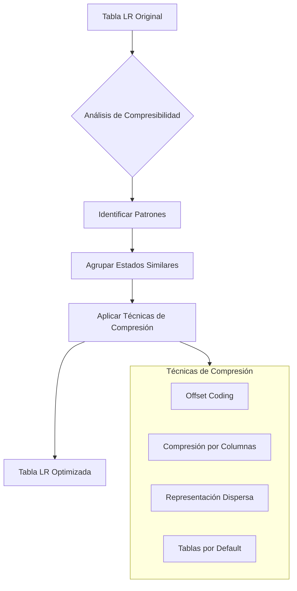

# Compiladores - Análisis sintáctico

## 3.7 Manipulación de gramáticas (optimización y reducción del tamaño de tablas).

---

La manipulación de gramáticas es esencial para optimizar el análisis sintáctico. Según Aho et al. (2007), las transformaciones gramaticales permiten reducir el tamaño de las tablas de análisis, eliminar ambigüedades y mejorar la eficiencia de los analizadores sintácticos.

### Eliminación de Recursión por la Izquierda

#### Recursión por la Izquierda Directa

Una gramática tiene recursión por la izquierda directa si contiene producciones de la forma:

$$A \rightarrow A\alpha \mid \beta$$

donde $\beta$ no comienza con $A$.

**Algoritmo de eliminación**:

1. Agrupar producciones: $A \rightarrow A\alpha_1 \mid A\alpha_2 \mid \cdots \mid A\alpha_m \mid \beta_1 \mid \beta_2 \mid \cdots \mid \beta_n$
2. Transformar a:

   $$A \rightarrow \beta_1 A' \mid \beta_2 A' \mid \cdots \mid \beta_n A'$$

   $$A' \rightarrow \alpha_1 A' \mid \alpha_2 A' \mid \cdots \mid \alpha_m A' \mid \epsilon$$

```python
def remove_left_recursion(grammar):
    non_terminals = list(grammar.keys())
    new_grammar = grammar.copy()

    for i, A in enumerate(non_terminals):
        for j in range(i):
            B = non_terminals[j]
            # Reemplazar A → Bα con A → βα donde B → β
            new_productions = []
            for production in new_grammar[A]:
                if production and production[0] == B:
                    for beta in new_grammar[B]:
                        new_productions.append(beta + production[1:])
                else:
                    new_productions.append(production)
            new_grammar[A] = new_productions

        # Eliminar recursión directa por la izquierda
        alpha_productions = []
        beta_productions = []

        for production in new_grammar[A]:
            if production and production[0] == A:
                alpha_productions.append(production[1:])
            else:
                beta_productions.append(production)

        if alpha_productions:
            A_prime = A + "'"
            new_grammar[A] = [beta + [A_prime] for beta in beta_productions]
            new_grammar[A_prime] = [alpha + [A_prime] for alpha in alpha_productions] + [['ε']]

    return new_grammar
```

#### Ejemplo de Eliminación

**Gramática original**:

$$ E \rightarrow E + T \mid T \\\ T \rightarrow T * F \mid F \\\ F \rightarrow ( E ) \mid id $$

**Gramática transformada**:

$$ E \rightarrow T E' \\\ E' \rightarrow + T E' \mid \epsilon \\\ T \rightarrow F T' \\\ T' \rightarrow * F T' \mid \epsilon \\\ F \rightarrow ( E ) \mid id $$

### Factorización por la Izquierda

#### Factorización de Gramáticas

La factorización resuelve conflictos en analizadores predictivos cuando múltiples producciones comparten prefijos comunes.

**Algoritmo de factorización**:
Para producciones $A \rightarrow \alpha\beta_1 \mid \alpha\beta_2 \mid \cdots \mid \alpha\beta_n \mid \gamma_1 \mid \gamma_2 \mid \cdots \mid \gamma_m$,
transformar a:

$$A \rightarrow \alpha A' \mid \gamma_1 \mid \gamma_2 \mid \cdots \mid \gamma_m$$

$$A' \rightarrow \beta_1 \mid \beta_2 \mid \cdots \mid \beta_n$$

```python
def left_factor(grammar):
    new_grammar = {}
    for non_terminal, productions in grammar.items():
        # Agrupar producciones por prefijo común
        prefix_groups = {}
        for production in productions:
            if production:  # Producción no vacía
                first_symbol = production[0]
                if first_symbol not in prefix_groups:
                    prefix_groups[first_symbol] = []
                prefix_groups[first_symbol].append(production)

        new_productions = []
        for prefix, group in prefix_groups.items():
            if len(group) > 1:
                # Encontrar prefijo común más largo
                common_prefix = find_longest_common_prefix(group)
                if len(common_prefix) > 0:
                    new_non_terminal = non_terminal + "'"
                    # A → αA'
                    new_productions.append(common_prefix + [new_non_terminal])
                    # A' → β1 | β2 | ... | βn
                    new_grammar[new_non_terminal] = [
                        prod[len(common_prefix):] if len(prod) > len(common_prefix) else ['ε']
                        for prod in group
                    ]
                else:
                    new_productions.extend(group)
            else:
                new_productions.extend(group)

        new_grammar[non_terminal] = new_productions

    return new_grammar
```

### Eliminación de Símbolos Inútiles

#### Símbolos No Generativos

Un símbolo $X$ es generativo si $X \Rightarrow^* w$ para alguna cadena $w$ de terminales.

```python
def remove_non_generating(grammar):
    generating = set()
    # Terminales siempre son generativos
    generating.update(get_terminals(grammar))

    changed = True
    while changed:
        changed = False
        for non_terminal, productions in grammar.items():
            if non_terminal not in generating:
                for production in productions:
                    if all(symbol in generating for symbol in production):
                        generating.add(non_terminal)
                        changed = True
                        break

    # Filtrar gramática
    new_grammar = {}
    for non_terminal, productions in grammar.items():
        if non_terminal in generating:
            new_productions = []
            for production in productions:
                if all(symbol in generating for symbol in production):
                    new_productions.append(production)
            if new_productions:
                new_grammar[non_terminal] = new_productions

    return new_grammar
```

#### Símbolos Inalcanzables

Un símbolo $X$ es alcanzable si $S \Rightarrow^* \alpha X \beta$ para algunas $\alpha, \beta$.

```python
def remove_unreachable(grammar, start_symbol):
    reachable = {start_symbol}
    changed = True
    while changed:
        changed = False
        for non_terminal in list(reachable):
            if non_terminal in grammar:
                for production in grammar[non_terminal]:
                    for symbol in production:
                        if symbol not in reachable and symbol in grammar:
                            reachable.add(symbol)
                            changed = True

    # Filtrar gramática
    new_grammar = {}
    for non_terminal in reachable:
        if non_terminal in grammar:
            new_grammar[non_terminal] = grammar[non_terminal]

    return new_grammar
```

### Optimización de Tablas LR

#### Compresión de Tablas de Análisis



#### Algoritmo de Compresión por Default

```python
class CompressedLRTable:
    def __init__(self, action_table, goto_table):
        self.action_defaults = self._compute_default_actions(action_table)
        self.goto_defaults = self._compute_default_gotos(goto_table)
        self.action_exceptions = self._find_action_exceptions(action_table)
        self.goto_exceptions = self._find_goto_exceptions(goto_table)

    def _compute_default_actions(self, action_table):
        defaults = {}
        for state in range(len(action_table)):
            # Encontrar la acción más común para este estado
            action_counts = {}
            for symbol, action in action_table[state].items():
                action_counts[action] = action_counts.get(action, 0) + 1

            if action_counts:
                default_action = max(action_counts.items(), key=lambda x: x[1])[0]
                defaults[state] = default_action

        return defaults

    def get_action(self, state, symbol):
        # Buscar en excepciones primero
        if (state, symbol) in self.action_exceptions:
            return self.action_exceptions[(state, symbol)]
        # Devolver acción por defecto
        return self.action_defaults.get(state, 'error')
```

### Gramáticas Equivalentes y Minimización

#### Equivalencia de Gramáticas

Dos gramáticas $G_1$ y $G_2$ son equivalentes si $L(G_1) = L(G_2)$.

**Teorema**: Toda gramática libre de contexto puede transformarse en una forma normal de Chomsky (CNF) o forma normal de Greibach (GNF).

#### Forma Normal de Chomsky (CNF)

Una gramática está en CNF si todas las producciones son de la forma:

- $A \rightarrow BC$ (donde $B$ y $C$ son no terminales)
- $A \rightarrow a$ (donde $a$ es un terminal)
- $S \rightarrow \epsilon$ (solo si $\epsilon$ está en el lenguaje)

**Algoritmo de conversión a CNF**:

1. Eliminar recursión por la izquierda
2. Realizar factorización por la izquierda
3. Eliminar símbolos inútiles
4. Convertir producciones a formas apropiadas

```python
def to_cnf(grammar):
    # Paso 1: Eliminar producciones ε (excepto posiblemente S → ε)
    # Paso 2: Eliminar producciones unitarias
    # Paso 3: Convertir producciones largas
    new_grammar = {}

    # Para cada producción A → X1X2...Xn con n > 2
    for non_terminal, productions in grammar.items():
        new_productions = []
        for production in productions:
            if len(production) == 1 and production[0] in get_terminals(grammar):
                # A → a (ya está en forma correcta)
                new_productions.append(production)
            elif len(production) == 2 and all(sym in get_non_terminals(grammar) for sym in production):
                # A → BC (ya está en forma correcta)
                new_productions.append(production)
            else:
                # Convertir producción larga
                current = non_terminal
                for i in range(len(production) - 1):
                    new_non_terminal = f"{non_terminal}_{i}"
                    if i == len(production) - 2:
                        # Último par
                        new_grammar[new_non_terminal] = [production[i:i+2]]
                    else:
                        new_grammar[new_non_terminal] = [[production[i], f"{non_terminal}_{i+1}"]]
                    current = new_non_terminal
                new_productions.append([production[0], f"{non_terminal}_0"])

        new_grammar[non_terminal] = new_productions

    return new_grammar
```

### Ejercicios Propuestos

1. Elimine la recursión por la izquierda de la gramática:

   $$ S \rightarrow S a \mid S b \mid c \mid d $$

2. Realice la factorización por la izquierda de la gramática:

   $$ A \rightarrow a b c \mid a b d \mid a c e \mid d f g $$

3. Elimine los símbolos inútiles de la gramática:

   $$ S \rightarrow A B \mid C \\\ A \rightarrow a A \mid a \\\ B \rightarrow b B c \mid b c \\\ C \rightarrow c C \\\ D \rightarrow d D \mid d $$

4. Convierta la siguiente gramática a Forma Normal de Chomsky:

   $$ S \rightarrow A S B \mid \epsilon \\\ A \rightarrow a A \mid a \\\ B \rightarrow b B c \mid b c $$

5. Implemente un algoritmo de compresión de tablas LR que reduzca el tamaño en al menos un 40% manteniendo el mismo tiempo de acceso.

6. Demuestre que las siguientes gramáticas son equivalentes:

   $$ G_1: S \rightarrow a S b \mid \epsilon \\\ G_2: S \rightarrow a b \mid a S b $$

7. Optimice la siguiente gramática para análisis LR:

   $$ E \rightarrow E + E \mid E * E \mid ( E ) \mid id $$

### Técnicas Avanzadas de Optimización

#### Minimización de Estados LR

```python
def minimize_lr_states(states):
    # Algoritmo de minimización de estados
    # Basado en particionamiento de estados indistinguibles

    # Inicializar partición: estados de aceptación vs no aceptación
    partitions = [set(), set()]
    for i, state in enumerate(states):
        if has_accept_action(state):
            partitions[0].add(i)
        else:
            partitions[1].add(i)

    changed = True
    while changed:
        changed = False
        new_partitions = []

        for partition in partitions:
            # Dividir la partición basado en transiciones
            split_dict = {}
            for state in partition:
                key = tuple()
                for symbol in get_all_symbols():
                    target = get_transition(state, symbol)
                    # Encontrar la partición del estado objetivo
                    for j, p in enumerate(partitions):
                        if target in p:
                            key += (j,)
                            break

                if key not in split_dict:
                    split_dict[key] = set()
                split_dict[key].add(state)

            if len(split_dict) > 1:
                changed = True
                new_partitions.extend(split_dict.values())
            else:
                new_partitions.append(partition)

        partitions = new_partitions

    return partitions
```

### Referencias

#### Bibliografía Básica

1. Aho, A. V., Lam, M. S., Sethi, R., & Ullman, J. D. (2007). _Compilers: Principles, Techniques, and Tools_ (2nd ed.). Pearson Education. (Capítulo 4: Syntax Analysis)
2. Cooper, K. D., & Torczon, L. (2004). _Engineering a Compiler_. Morgan Kaufmann. (Capítulo 3: Parsing)

#### Bibliografía Complementaria

1. Grune, D., Bal, H. E., Jacobs, C. J. H., & Langendoen, K. G. (2000). _Modern Compiler Design_. John Wiley & Sons.
2. Sippu, S., & Soisalon-Soininen, E. (1990). _Parsing Theory: Volume II: LR(k) and LL(k) Parsing_. Springer-Verlag.

#### Términos Clave

- **Recursión por la izquierda**: Producciones de la forma $A \rightarrow A\alpha$
- **Factorización por la izquierda**: Extracción de prefijos comunes de producciones
- **Símbolos inútiles**: Símbolos que no contribuyen a la generación de cadenas
- **Forma normal de Chomsky**: Forma estandarizada para gramáticas libres de contexto
- **Compresión de tablas**: Técnicas para reducir el tamaño de tablas de análisis
- **Estados equivalentes**: Estados que tienen el mismo comportamiento de análisis
