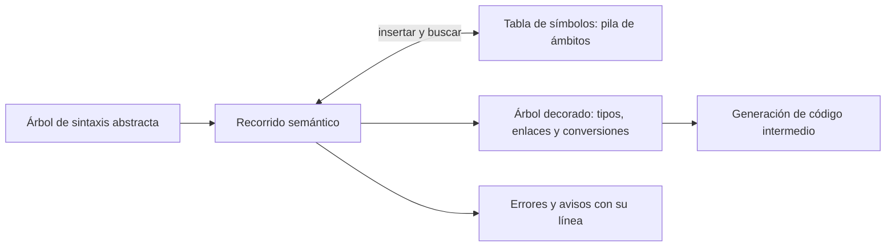

# Compiladores - Análisis dependiente del contexto

## 4.1 Introducción.

---

El analizador sintáctico verifica que el programa tenga la **forma** correcta, pero muchas reglas de un lenguaje no son de forma: que una variable esté declarada antes de usarse, que no se declare dos veces en el mismo ámbito, que los operandos de una suma tengan tipos compatibles o que una función devuelva el tipo que promete. Estas reglas dependen del **contexto** en que aparece cada construcción, y las verifica el **análisis semántico**, o análisis dependiente del contexto. Este tema presenta por qué la gramática no basta, qué hace el análisis semántico, la tabla de símbolos con sus ámbitos, los atributos y las comprobaciones habituales, con un comprobador de un C pequeño que se reutiliza en el capítulo.

### Los límites de la gramática libre de contexto

En el programa

```c
int main() {
    int a = 5;
    resultado = a + b;
    return 0;
}
```

la segunda sentencia es sintácticamente correcta, pero usa `resultado` y `b` sin declararlas. La regla "todo identificador se declara antes de usarse" no puede expresarse con una gramática libre de contexto: el lenguaje $\{w c w : w \in \{a, b\}^*\},$ que abstrae una declaración $w$ seguida de un uso del mismo nombre, no es libre de contexto, como se demuestra con el lema del bombeo. Las gramáticas sensibles al contexto sí podrían expresarla, pero su análisis es demasiado costoso; en la práctica se usa una gramática libre de contexto para la forma y un recorrido del árbol para el contexto.

### Qué hace el análisis semántico

Recibe el árbol de sintaxis abstracta y lo devuelve **decorado**: cada uso de un nombre enlazado con su declaración, cada expresión con su tipo y cada conversión implícita explícita en el árbol. Además construye la **tabla de símbolos** completa y reporta los errores. Las comprobaciones habituales son:

1. **declaraciones:** todo nombre usado está declarado y visible;
2. **unicidad:** ningún nombre se declara dos veces en el mismo ámbito;
3. **tipos:** los operandos de cada operador, el valor de cada asignación, los argumentos de cada llamada y el valor de cada `return` tienen tipos compatibles, insertando las conversiones permitidas;
4. **flujo de control:** `break` y `continue` dentro de un ciclo, toda rama de una función que no es `void` termina con `return`;
5. **otras reglas del lenguaje:** constantes que no se modifican, etiquetas de `case` distintas, accesos a miembros privados.

### La tabla de símbolos

Guarda, para cada nombre declarado, su **clase**, como variable, parámetro o función; su **tipo**; su **ámbito**, y la información para generar código, como su desplazamiento en el registro de activación. Con **alcance léxico**, los ámbitos se anidan como los bloques del programa y se representan con una **pila**: al entrar en una función o un bloque se apila un ámbito vacío y al salir se desapila. Insertar busca solo en el ámbito del tope, para detectar redeclaraciones, y buscar recorre la pila del tope hacia la base, de modo que la declaración más interna **oculta** a las exteriores. Con una tabla de dispersión por ámbito, ambas operaciones cuestan $O(1)$ en promedio por nivel; los compiladores grandes usan una sola tabla de dispersión con una lista de declaraciones por nombre, que se limpia al cerrar cada ámbito.



### Atributos

La forma de especificar el análisis semántico es asociar **atributos** a los símbolos de la gramática y **reglas semánticas** a las producciones, una **gramática de atributos**, que se estudia en el tema 4.3. Un atributo **sintetizado** se calcula con los de los hijos, como el tipo de una expresión; uno **heredado**, con los del padre y los hermanos, como el tipo declarado que se propaga a una lista de nombres. Por ejemplo, el tipo de una suma se sintetiza con $E.\text{tipo} = \text{promueve}(E_1.\text{tipo}, T.\text{tipo}),$ donde la promoción de C convierte `char` en `int` y `int` en `float`.

### Implementación en Python

El programa usa un núcleo semántico que se reutiliza en los temas siguientes y se incluye al inicio: un analizador por descenso recursivo de un C pequeño con funciones, bloques, declaraciones, `if`, `while`, `return`, llamadas y expresiones; una tabla de símbolos con pila de ámbitos, y un comprobador de tipos con las reglas de promoción de C, que decora el árbol y reporta errores y avisos. Con él analiza el código del ejercicio 1 y lo compara con los diagnósticos reales de gcc, evalúa la gramática de atributos del ejercicio 2 y toma fotografías de la pila de ámbitos en los puntos del ejercicio 3.

```python
# ===== Núcleo semántico: analizador de un C pequeño, tabla de símbolos con ámbitos y comprobación de tipos =====
import re

TIPOS = ("int", "float", "char", "bool", "void")
class Nodo:
    def __init__(self, clase, linea, **campos): self.clase, self.linea, self.tipo = clase, linea, None; self.__dict__.update(campos)
    def __repr__(self): return f"{self.clase}@{self.linea}"

def tokens_c(texto):
    patron = r"""(?P<punto>//\s*Punto\s*\d+)|(?P<com>//[^\n]*)|(?P<real>\d+\.\d+)|(?P<num>\d+)|(?P<car>'(?:\\.|[^'])')|(?P<cad>"[^"]*")|(?P<id>[A-Za-z_]\w*)|(?P<op>==|!=|<=|>=|&&|\|\||[-+*/%<>=!(){};,\[\]])|(?P<nl>\n)|(?P<sp>[ \t]+)"""
    linea, res = 1, []
    for m in re.finditer(patron, texto):
        k, v = m.lastgroup, m.group()
        if k == "nl": linea += 1; continue
        if k in ("sp", "com"): continue
        if k == "punto": res.append(("PUNTO", int(v.split()[-1]), linea)); continue
        res.append((v if k in ("op",) or (k == "id" and v in TIPOS + ("if", "else", "while", "return")) else k, v, linea))
    res.append(("$", "$", linea)); return res

class ParserC:
    def __init__(self, texto): self.t, self.i = tokens_c(texto), 0
    def mira(self, k=0): return self.t[self.i + k][0]
    def come(self, x=None):
        tok = self.t[self.i]
        if x and tok[0] != x: raise SyntaxError(f"línea {tok[2]}: se esperaba '{x}' y llegó '{tok[1]}'")
        self.i += 1; return tok
    def programa(self):
        decls = []
        while self.mira() != "$":
            if self.mira() in TIPOS and self.mira(1) == "id" and self.mira(2) == "(": decls.append(self.funcion())
            else: decls.append(self.declaracion())
        return Nodo("programa", 1, decls=decls)
    def funcion(self):
        tipo = self.come()[0]; _, nombre, l = self.come("id"); self.come("("); params = []
        while self.mira() != ")":
            tp = self.come()[0]; params.append((tp, self.come("id")[1]))
            if self.mira() == ",": self.come()
        self.come(")"); punto = None
        if self.mira() == "PUNTO": punto = self.come()[1]
        cuerpo = self.bloque()
        if punto is not None: cuerpo.items.insert(0, Nodo("punto", l, n=punto))
        return Nodo("funcion", l, tipo_ret=tipo, nombre=nombre, params=params, cuerpo=cuerpo)
    def declaracion(self):
        tipo, _, l = self.come(); nombre = self.come("id")[1]; ini = None
        if self.mira() == "=": self.come(); ini = self.expr()
        self.come(";"); return Nodo("decl", l, tipo_decl=tipo, nombre=nombre, ini=ini)
    def bloque(self):
        l = self.come("{")[2]; items = []
        while self.mira() != "}": items.append(self.declaracion() if self.mira() in TIPOS else self.sentencia())
        self.come("}"); return Nodo("bloque", l, items=items)
    def sentencia(self):
        x = self.mira(); l = self.t[self.i][2]
        if x == "PUNTO": return Nodo("punto", l, n=self.come()[1])
        if x == "{": return self.bloque()
        if x == "return":
            self.come(); e = None if self.mira() == ";" else self.expr(); self.come(";"); return Nodo("return", l, e=e)
        if x in ("if", "while"):
            self.come(); self.come("("); c = self.expr(); self.come(")"); s = self.sentencia(); o = None
            if x == "if" and self.mira() == "else": self.come(); o = self.sentencia()
            return Nodo(x, l, c=c, s=s, o=o)
        if x == "id" and self.mira(1) == "=":
            n = self.come()[1]; self.come("="); e = self.expr(); self.come(";"); return Nodo("asigna", l, nombre=n, e=e)
        e = self.expr(); self.come(";"); return Nodo("expr", l, e=e)
    NIVELES = [("||",), ("&&",), ("==", "!="), ("<", "<=", ">", ">="), ("+", "-"), ("*", "/", "%")]
    def expr(self, k=0):
        if k == len(self.NIVELES): return self.unario()
        izq = self.expr(k + 1)
        while self.mira() in self.NIVELES[k]:
            op, _, l = self.come(); izq = Nodo("bin", l, op=op, a=izq, b=self.expr(k + 1))
        return izq
    def unario(self):
        if self.mira() in ("-", "!"): op, _, l = self.come(); return Nodo("un", l, op=op, a=self.unario())
        k, v, l = self.come()
        if k == "num": return Nodo("lit", l, valor=int(v), tipo_lit="int")
        if k == "real": return Nodo("lit", l, valor=float(v), tipo_lit="float")
        if k == "car": return Nodo("lit", l, valor=v, tipo_lit="char")
        if k == "cad": return Nodo("lit", l, valor=v, tipo_lit="char*")
        if k == "(": e = self.expr(); self.come(")"); return e
        if k == "id":
            if self.mira() == "(":
                self.come(); args = []
                while self.mira() != ")":
                    args.append(self.expr())
                    if self.mira() == ",": self.come()
                self.come(")"); return Nodo("llamada", l, nombre=v, args=args)
            return Nodo("var", l, nombre=v)
        raise SyntaxError(f"línea {l}: token inesperado '{v}'")

class TablaSimbolos:
    """Pila de ámbitos; cada ámbito es un diccionario nombre -> atributos."""
    def __init__(self): self.pila = [("global", {})]
    def entra(self, nombre): self.pila.append((nombre, {}))
    def sale(self): self.pila.pop()
    def inserta(self, nombre, **attrs):
        ambito = self.pila[-1][1]
        if nombre in ambito: return False
        ambito[nombre] = attrs; return True
    def busca(self, nombre):
        for amb, tabla in reversed(self.pila):
            if nombre in tabla: return amb, tabla[nombre]
        return None, None
    def oculta(self, nombre):
        return any(nombre in t for _, t in self.pila[:-1])
    def foto(self):
        return " | ".join(f"{a}: " + (", ".join(f"{n}:{d.get('tipo')}" for n, d in t.items()) or "-") for a, t in self.pila)

RANGO = {"char": 0, "int": 1, "float": 2}
class Comprobador:
    """Comprobación de tipos con las reglas de C: promoción aritmética char < int < float, comparaciones de tipo int."""
    def __init__(self, avisos_conversion=True): self.ts, self.diag, self.fotos, self.func = TablaSimbolos(), [], {}, None; self.av = avisos_conversion
    def error(self, l, m): self.diag.append(f"línea {l}: error: {m}")
    def aviso(self, l, m): self.diag.append(f"línea {l}: aviso: {m}")
    def analiza(self, prog):
        for d in prog.decls: self.visita(d)
        return self.diag
    def visita(self, n):
        getattr(self, "v_" + n.clase)(n)
    def v_funcion(self, n):
        if not self.ts.inserta(n.nombre, clase="función", tipo=f"{n.tipo_ret}({', '.join(t for t, _ in n.params)})", ret=n.tipo_ret, params=[t for t, _ in n.params]):
            self.error(n.linea, f"redefinición de '{n.nombre}'")
        self.ts.entra(n.nombre); self.func = n
        for t, p in n.params: self.ts.inserta(p, clase="parámetro", tipo=t)
        for it in n.cuerpo.items: self.visita(it)
        self.ts.sale(); self.func = None
    def v_decl(self, n):
        if self.ts.oculta(n.nombre) and len(self.ts.pila) > 1: self.aviso(n.linea, f"'{n.nombre}' oculta una declaración de un ámbito exterior")
        if n.ini is not None: self.asignable(n.tipo_decl, self.tipo(n.ini), n.linea, f"inicializar '{n.nombre}'")
        if not self.ts.inserta(n.nombre, clase="variable", tipo=n.tipo_decl): self.error(n.linea, f"'{n.nombre}' ya está declarada en este ámbito")
    def v_bloque(self, n):
        self.ts.entra("bloque")
        for it in n.items: self.visita(it)
        self.ts.sale()
    def v_punto(self, n): self.fotos[n.n] = self.ts.foto()
    def v_asigna(self, n):
        amb, s = self.ts.busca(n.nombre); t = self.tipo(n.e)
        if s is None: self.error(n.linea, f"'{n.nombre}' no está declarada"); return
        self.asignable(s["tipo"], t, n.linea, f"asignar a '{n.nombre}'")
    def v_return(self, n):
        t = self.tipo(n.e) if n.e else "void"
        self.asignable(self.func.tipo_ret, t, n.linea, f"devolver de '{self.func.nombre}'")
    def v_if(self, n):
        self.condicion(n.c); self.visita(n.s)
        if n.o: self.visita(n.o)
    v_while = v_if
    def v_expr(self, n): self.tipo(n.e)
    def condicion(self, c):
        t = self.tipo(c)
        if t not in RANGO and t != "bool" and t != "error": self.error(c.linea, f"la condición tiene tipo {t}, no escalar")
    def asignable(self, destino, origen, l, que):
        if "error" in (destino, origen): return
        if destino == origen: return
        if destino in RANGO and origen in RANGO:
            if RANGO[origen] > RANGO[destino] and self.av: self.aviso(l, f"conversión de {origen} a {destino} al {que}: puede perder información")
            return
        self.error(l, f"tipos incompatibles al {que}: se esperaba {destino} y la expresión es {origen}")
    def tipo(self, e):
        e.tipo = self._tipo(e); return e.tipo
    def _tipo(self, e):
        if e.clase == "lit": return e.tipo_lit
        if e.clase == "var":
            amb, s = self.ts.busca(e.nombre)
            if s is None: self.error(e.linea, f"'{e.nombre}' no está declarada"); return "error"
            e.ambito = amb; return s["tipo"]
        if e.clase == "un":
            t = self.tipo(e.a)
            if t == "error": return t
            if t not in RANGO: self.error(e.linea, f"'{e.op}' no se aplica a {t}"); return "error"
            return "int" if e.op == "!" else ("int" if t == "char" else t)
        if e.clase == "llamada":
            amb, s = self.ts.busca(e.nombre)
            ts_ = [self.tipo(a) for a in e.args]
            if s is None or s.get("clase") != "función": self.error(e.linea, f"'{e.nombre}' no es una función declarada"); return "error"
            if len(ts_) != len(s["params"]): self.error(e.linea, f"'{e.nombre}' espera {len(s['params'])} argumentos y recibe {len(ts_)}"); return s["ret"]
            for k, (p, a) in enumerate(zip(s["params"], ts_)): self.asignable(p, a, e.linea, f"pasar el argumento {k + 1} de '{e.nombre}'")
            return s["ret"]
        a, b = self.tipo(e.a), self.tipo(e.b)
        if "error" in (a, b): return "error"
        if a not in RANGO or b not in RANGO: self.error(e.linea, f"'{e.op}' no se aplica a {a} y {b}"); return "error"
        if e.op in ("==", "!=", "<", "<=", ">", ">=", "&&", "||"): return "int"
        if e.op == "%" and "float" in (a, b): self.error(e.linea, "'%' requiere operandos enteros"); return "error"
        return max(a, b, "int", key=lambda t: RANGO[t])          # promoción: char se convierte en int

import subprocess, tempfile, os

# ---------- Ejercicio 1: errores semánticos, con el comprobador y con gcc ----------
EJ1 = '''int main() {
    int a = 10;
    {
        float a = 5.5;
        int b = a * 2;
    }
    b = 20;
    return "éxito";
}
'''
c = Comprobador(); diag = c.analiza(ParserC(EJ1).programa())
print("ejercicio 1, comprobador:"); [print("   ", d) for d in diag]
with tempfile.TemporaryDirectory() as tmp:
    ruta = os.path.join(tmp, "ej1.c"); open(ruta, "w").write(EJ1)
    r = subprocess.run(["gcc", "-fsyntax-only", "-Wall", "-Wshadow", "-Wconversion", "ej1.c"], cwd=tmp, capture_output=True, text=True,
                       env={**os.environ, "LC_ALL": "C"})
print("ejercicio 1, gcc 13:")
for l in r.stderr.splitlines():
    if re.match(r"ej1\.c:\d+:\d+: (error|warning|note)", l): print("   ", l.replace("ej1.c:", "línea "))
print("   valor de b en el bloque: (int)(5.5 * 2) =", int(5.5 * 2))

# ---------- Ejercicio 2: gramática atribuida para las dimensiones de un arreglo ----------
class Arreglo:
    """D -> array [ N ] of T con N -> N + M | M, M -> M * P | P, P -> numero (la versión sin ambigüedad).
    Atributo sintetizado valor; la regla de D comprueba N.valor > 0."""
    def __init__(self, texto): self.t = texto.replace("[", " [ ").replace("]", " ] ").split() + ["$"]; self.i = 0; self.traza = []
    def come(self, x=None):
        v = self.t[self.i]
        if x and v != x: raise SyntaxError(f"se esperaba {x} y llegó {v}")
        self.i += 1; return v
    def D(self):
        self.come("array"); self.come("["); n = self.N(); self.come("]"); self.come("of"); tipo = self.come()
        ok = n > 0; self.traza.append(f"D: N.valor = {n} > 0? {ok}")
        return (tipo, n) if ok else f"error: la dimensión {n} no es positiva"
    def N(self):
        v = self.M()
        while self.t[self.i] == "+": self.come(); m = self.M(); self.traza.append(f"N.valor = {v} + {m} = {v + m}"); v += m
        return v
    def M(self):
        v = self.P()
        while self.t[self.i] == "*": self.come(); p = self.P(); self.traza.append(f"M.valor = {v} * {p} = {v * p}"); v *= p
        return v
    def P(self):
        x = self.come()
        if x == "-": v = -self.P(); self.traza.append(f"P.valor = -{-v}"); return v
        return int(x)
for e in ["array [ 2 * 3 + 1 ] of int", "array [ 0 * 5 ] of float", "array [ 4 + - 7 ] of char"]:
    a = Arreglo(e); r = a.D(); print(f"ejercicio 2: {e!r:30} -> {r} | {'; '.join(a.traza)}")
print("   con la gramática ambigua N -> N + N | N * N, 2 + 3 * 4 vale", (2 + 3) * 4, "o", 2 + 3 * 4, "según el árbol")

# ---------- Ejercicio 3: la pila de tablas de símbolos ----------
EJ3 = '''int global = 1;
void func(int param) { // Punto 1
    int local = 2;
    if (param > 0) {
        int temp = local;
        local = param; // Punto 2
    }
}
'''
c = Comprobador(); diag = c.analiza(ParserC(EJ3).programa())
print("ejercicio 3: diagnósticos:", diag or "ninguno")
for k in sorted(c.fotos): print(f"   punto {k}: {c.fotos[k]}")
```

Salida, con gcc 13:

```text
ejercicio 1, comprobador:
    línea 4: aviso: 'a' oculta una declaración de un ámbito exterior
    línea 5: aviso: conversión de float a int al inicializar 'b': puede perder información
    línea 7: error: 'b' no está declarada
    línea 8: error: tipos incompatibles al devolver de 'main': se esperaba int y la expresión es char*
ejercicio 1, gcc 13:
    línea 4:15: warning: declaration of 'a' shadows a previous local [-Wshadow]
    línea 2:9: note: shadowed declaration is here
    línea 5:17: warning: conversion from 'float' to 'int' may change value [-Wfloat-conversion]
    línea 5:13: warning: unused variable 'b' [-Wunused-variable]
    línea 7:5: error: 'b' undeclared (first use in this function)
    línea 7:5: note: each undeclared identifier is reported only once for each function it appears in
    línea 8:12: warning: returning 'char *' from a function with return type 'int' makes integer from pointer without a cast [-Wint-conversion]
    línea 2:9: warning: unused variable 'a' [-Wunused-variable]
   valor de b en el bloque: (int)(5.5 * 2) = 11
ejercicio 2: 'array [ 2 * 3 + 1 ] of int'   -> ('int', 7) | M.valor = 2 * 3 = 6; N.valor = 6 + 1 = 7; D: N.valor = 7 > 0? True
ejercicio 2: 'array [ 0 * 5 ] of float'     -> error: la dimensión 0 no es positiva | M.valor = 0 * 5 = 0; D: N.valor = 0 > 0? False
ejercicio 2: 'array [ 4 + - 7 ] of char'    -> error: la dimensión -3 no es positiva | P.valor = -7; N.valor = 4 + -7 = -3; D: N.valor = -3 > 0? False
   con la gramática ambigua N -> N + N | N * N, 2 + 3 * 4 vale 20 o 14 según el árbol
ejercicio 3: diagnósticos: ninguno
   punto 1: global: global:int, func:void(int) | func: param:int
   punto 2: global: global:int, func:void(int) | func: param:int, local:int | bloque: temp:int
```

### Ejercicios Propuestos

1. **Detección de errores.** Identifica todos los errores semánticos en el siguiente código C, suponiendo que no hay declaraciones previas de `a` ni de `b`:

    ```c
    int main() {
        int a = 10;
        {
            float a = 5.5; // ¿Error?
            int b = a * 2; // ¿Qué valor de 'a' se usa?
        }
        b = 20; // ¿Error?
        return "éxito"; // ¿Error?
    }
    ```

2. **Gramática atribuida.** Diseña una gramática atribuida que verifique que las dimensiones de un arreglo son positivas, con el atributo sintetizado `valor` para el número:

    ```text
    DeclaracionArreglo -> 'array' '[' Num ']' 'of' Tipo
    Num -> Num '+' Num | Num '*' Num | 'numero'
    ```

3. **Tabla de símbolos.** Describe el estado de la pila de tablas de símbolos, con los nombres y tipos de cada ámbito, en los puntos marcados `// Punto 1` y `// Punto 2`:

    ```java
    int global = 1;
    void func(int param) { // Punto 1
        int local = 2;
        if (param > 0) {
            int temp = local;
            local = param; // Punto 2
        }
    }
    ```

### Soluciones

**Ejercicio 1.** Línea por línea:

- `float a = 5.5;` **no es un error**: el bloque abre un ámbito nuevo, y declarar ahí otra `a` está permitido; la nueva **oculta** a la exterior hasta el fin del bloque. Es una práctica peligrosa, y gcc la señala con `-Wshadow`.
- `int b = a * 2;` usa la `a` **interior**, la de tipo `float`, porque la búsqueda empieza en el ámbito más interno: $5.5 \cdot 2 = 11.0,$ que se convierte implícitamente a `int`, 11. No es un error, pero la conversión de `float` a `int` puede perder información, y gcc la advierte con `-Wconversion`.
- `b = 20;` **es un error**: la `b` del bloque dejó de existir al cerrarse, y en el ámbito de `main` no hay ninguna `b`.
- `return "éxito";` **es un error de tipos**: `main` devuelve `int` y la expresión es un `char *`. gcc 13 lo acepta con el aviso `-Wint-conversion`, convirtiendo la dirección en entero, y gcc 14 lo rechaza como error, como exige el estándar sin una conversión explícita.

El comprobador del programa reporta los mismos dos errores y los mismos dos avisos que gcc. Los otros avisos de gcc, sobre variables sin usar, requieren un análisis que el comprobador no hace.

**Ejercicio 2.** La gramática del enunciado es **ambigua**, y con ella el valor no está bien definido: `2 + 3 * 4` vale 20 o 14 según el árbol. Con la versión por niveles, el atributo sintetizado `valor` se calcula con las reglas:

| Producción | Regla semántica |
| ---------- | --------------- |
| $D \to \mathbf{array}\ [\ N\ ]\ \mathbf{of}\ T$ | si $N.\text{valor} \le 0,$ error; si no, $D.\text{tipo} = \text{arreglo}(N.\text{valor}, T.\text{tipo})$ |
| $N \to N_1 + M$ | $N.\text{valor} = N_1.\text{valor} + M.\text{valor}$ |
| $N \to M$ | $N.\text{valor} = M.\text{valor}$ |
| $M \to M_1 * P$ | $M.\text{valor} = M_1.\text{valor} \cdot P.\text{valor}$ |
| $M \to P$ | $M.\text{valor} = P.\text{valor}$ |
| $P \to \mathbf{numero}$ | $P.\text{valor} = \mathbf{numero}.\text{lexval}$ |

Todos los atributos son sintetizados, así que la gramática es **S-atribuida** y se evalúa en un recorrido en postorden o durante un análisis ascendente. El programa agrega el menos unario para probar una dimensión negativa: `2 * 3 + 1` da 7 y se acepta, mientras que `0 * 5` y `4 + -7` se rechazan, con la traza de los atributos calculados. Un lenguaje real además exigiría que la expresión sea **constante**, es decir, calculable al compilar, otro atributo sintetizado.

**Ejercicio 3.** En el **punto 1**, al entrar en el cuerpo de `func`, la pila tiene el ámbito global, con `global: int` y `func: void(int)`, y el de la función, con `param: int`. En el **punto 2**, dentro del `if`, tiene además `local: int` en el ámbito de la función y un tercer ámbito, el del bloque, con `temp: int`. La asignación `local = param` encuentra `local` en el ámbito de la función y `param` en el mismo, después de no encontrarlos en el del bloque. Al salir del `if` se desapila el ámbito con `temp`, y al salir de `func`, el de la función. El nombre de la función se inserta en el ámbito global **antes** de analizar su cuerpo, para permitir la recursión.

En el material original, el ejercicio 2 daba una gramática ambigua para `Num`, con la que el atributo `valor` no queda bien definido, y su diagrama de flujo usaba el identificador `D` para un nodo y para el subgrafo que lo detalla, lo que Mermaid no admite; el ejemplo de comprobación de tipos usaba `max` para combinar dos tipos sin definir el orden entre ellos.

### Referencias

1. Aho, A. V., Lam, M. S., Sethi, R., and Ullman, J. D., _Compilers: Principles, Techniques, and Tools_. 2a ed., Pearson, 2007. Secciones 2.7, 5.1 y 6.5.
2. Cooper, K. D., and Torczon, L., _Engineering a Compiler_. 3a ed., Morgan Kaufmann, 2022. Capítulos 4 y 5.
3. Appel, A. W., _Modern Compiler Implementation in Java_. 2a ed., Cambridge University Press, 2002. Capítulo 5.
4. ISO/IEC 9899:2018, _Programming languages — C_. Secciones 6.2.1, alcance de los identificadores, y 6.3, conversiones.
5. Free Software Foundation, _Using the GNU Compiler Collection_, opciones de avisos.
