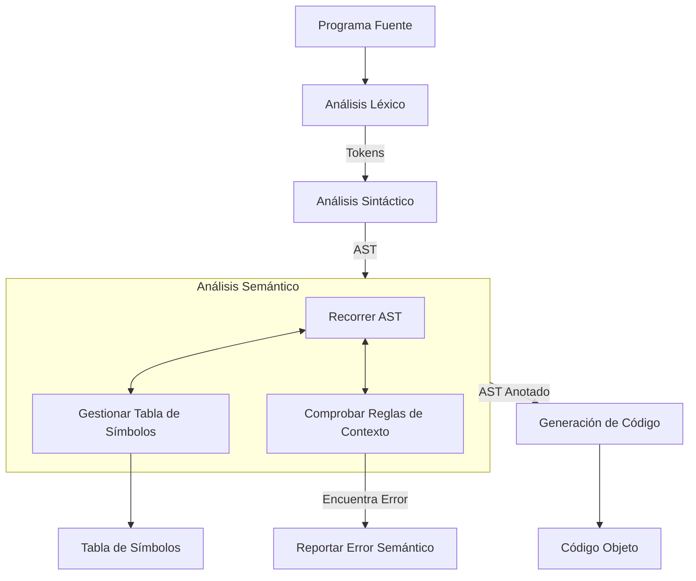

# Compiladores - Análisis dependiente del contexto

## 4.1 Introducción.

---

### Límites del Análisis Sintáctico

El análisis sintáctico (o _parsing_), realizado típicamente por un analizador descendente (LL) o ascendente (LR), se encarga de verificar que la secuencia de tokens de un programa fuente cumple con las reglas de una gramática libre de contexto (GLC). Su salida es un **Árbol de Sintaxis Abstracta (AST)**.

Sin embargo, las GLCs son insuficientes para expresar todas las reglas de un lenguaje de programación. Considera el siguiente ejemplo:

```c
int main() {
    int a = 5;
    resultado = a + b; // ¿Error?
    return 0;
}
```

Un parser con la gramática adecuada reconocería `int a = 5;` como una declaración válida y `resultado = a + b;` como una sentencia de asignación válida. Desde un punto de vista puramente sintáctico, esa línea es correcta. Pero desde un punto de vista semántico, presenta al menos dos errores:

1.  La variable `b` no ha sido declarada.
2.  La variable `resultado` no ha sido declarada.

Estas reglas, que dependen del **contexto** en el que aparecen los identificadores (su ámbito, su tipo, su declaración previa), no pueden ser descritas por una GLC. Requieren de un análisis más profundo: el **Análisis Dependiente del Contexto**, también conocido como **Análisis Semántico**.

### ¿Qué es el Análisis Semántico?

El análisis semántico es la fase de un compilador que se encarga de verificar que el programa fuente cumple con las reglas de **contexto** o **significado** del lenguaje, aquellas que no pueden ser especificadas por la gramática libre de contexto.

Su función principal es **rechazar programas sintácticamente correctos pero semánticamente erróneos** y **preparar la información necesaria** para la generación de código.

**Entrada:** Un Árbol de Sintaxis Abstracta (AST).
**Salida:** Un AST **decorado** o **anotado** con información semántica (p.ej., tipos de datos, enlaces a declaraciones) y una **Tabla de Símbolos** completa y validada. Además, reporta todos los errores semánticos encontrados.

### La Tabla de Símbolos

La tabla de símbolos es la estructura de datos central del análisis semántico. Es un diccionario que almacena información (atributos) sobre las entidades declaradas en el programa (variables, funciones, clases, etc.). Cada entrada típicamente contiene:

- **Nombre** del identificador.
- **Categoría:** variable, función, clase, etc.
- **Tipo de dato:** `int`, `float`, `char*`, etc.
- **Ámbito** (scope): dónde es visible (global, local a una función, etc.).
- **Dirección de memoria** o offset (para la fase de generación de código).

Las operaciones básicas sobre la tabla de símbolos son:

- `insertar(nombre, atributos)`: Añade un nuevo símbolo.
- `buscar(nombre)`: Busca un símbolo en el ámbito actual.
- `buscar_globalmente(nombre)`: Busca un símbolo en todos los ámbitos abiertos.

La gestión de **ámbitos** (scopes) es crucial. Un ámbito se suele representar con una nueva "capa" o "nivel" en la tabla de símbolos. Se utiliza una pila de tablas de símbolos para manejar los ámbitos anidados.

```python
# Ejemplo simplificado de una pila de tablas de símbolos
pila_de_tablas = [{}]  # Comienza con el ámbito global

def insertar_simbolo(nombre, atributos):
    ambito_actual = pila_de_tablas[-1]  # Tope de la pila
    if nombre in ambito_actual:
        raise ErrorSemantico(f"'{nombre}' ya está declarado en este ámbito")
    else:
        ambito_actual[nombre] = atributos

def buscar_simbolo(nombre):
    # Busca desde el ámbito más interno al más externo
    for tabla in reversed(pila_de_tablas):
        if nombre in tabla:
            return tabla[nombre]
    return None  # No encontrado

def entrar_ambito():
    pila_de_tablas.append({})  # Abre un nuevo ámbito (p.ej., entra a una función)

def salir_ambito():
    if len(pila_de_tablas) > 1:
        pila_de_tablas.pop()   # Cierra el ámbito actual (p.ej., sale de una función)
```

### Atributos y Gramáticas Atribuidas

Para formalizar el análisis semántico, se utilizan **Gramáticas Atribuidas**. Una gramática atribuida extiende una GLC asociando **atributos** a los símbolos gramaticales (tanto terminales como no terminales) y **reglas semánticas** a las producciones de la gramática.

Existen dos tipos de atributos:

- **Atributos Sintetizados:** Su valor se calcula a partir de los atributos de los hijos de su nodo en el AST. Fluyen de abajo hacia arriba.
- **Atributos Heredados:** Su valor se calcula a partir de los atributos del padre y/o hermanos de su nodo en el AST. Fluyen de arriba hacia abajo o lateralmente.

Una gramática atribuida bien definida donde los atributos solo se sintetizan se llama **Gramática S-Attributed** y es muy fácil de evaluar durante un recorrido post-order del AST (o incluso durante el parsing ascendente).

**Ejemplo: Verificación de tipos en una expresión simple.**

```
Producción                          Regla Semántica
---------------------------------------------------
E -> E1 '+' T                      E.tipo = max(E1.tipo, T.tipo)
                                  // Si 'max' no está definido para los tipos, es un error.
E -> T                             E.tipo = T.tipo
T -> 'id'                          T.tipo = buscar_tipo(id.entrada) // Busca el tipo en la tabla de símbolos
T -> 'num'                         T.tipo = 'entero'
```

### Comprobaciones Semánticas Comunes

1.  **Comprobación de Declaraciones:** Verificar que todo identificador usado ha sido previamente declarado.
2.  **Comprobación de Tipos:** Verificar que los operandos de un operador son de tipos compatibles, que el tipo de una expresión asignada a una variable coincide con el tipo de la variable, y que los argumentos de una función coinciden con los parámetros formales.
    - Fórmula común para operadores aritméticos: $tipo\_resultado = promover(tipo\_op1, tipo\_op2)$
3.  **Comprobación de Unicidad:** Verificar que no hay declaraciones duplicadas en un mismo ámbito (p.ej., dos variables con el mismo nombre).
4.  **Comprobación de Ámbitos:** Aplicar correctamente las reglas de visibilidad de identificadores.
5.  **Comprobación de Flujo de Control:** Verificar que las sentencias `break` o `continue` aparecen dentro de un bucle, o que un `return` devuelve un valor del tipo correcto.

### Ejemplo Integrado

Analicemos el siguiente fragmento de código:

```c
float calcular(int x, int y) {
    float z;
    z = x + y;
    return z;
}
```

1.  **Análisis Léxico/Sintáctico:** Genera un AST para la función.
2.  **Análisis Semántico:**
    - **Paso 1:** `insertar_simbolo("calcular", {categoria: funcion, tipo_retorno: float, parametros: [(x, int), (y, int)]})`
    - **Paso 2:** `entrar_ambito()` (ámbito de la función).
    - **Paso 3:** `insertar_simbolo("x", {categoria: parametro, tipo: int})`
    - **Paso 4:** `insertar_simbolo("y", {categoria: parametro, tipo: int})`
    - **Paso 5:** `insertar_simbolo("z", {categoria: variable, tipo: float})`
    - **Paso 6:** Al encontrar `z = x + y;`:
      - Busca `z` -> tipo `float`.
      - Busca `x` -> tipo `int`.
      - Busca `y` -> tipo `int`.
      - Comprueba la expresión `x + y`: `max(int, int)` -> `int`.
      - Comprueba la asignación: `float := int` -> **VÁLIDO** (conversión implícita o _coercion_).
    - **Paso 7:** Al encontrar `return z;`:
      - Busca `z` -> tipo `float`.
      - Comprueba que el tipo de la expresión (`float`) coincide con el tipo de retorno de la función (`float`) -> **VÁLIDO**.
    - **Paso 8:** `salir_ambito()`.

### Ejercicios Propuestos

1.  **Detección de Errores:** Identifica todos los errores semánticos en el siguiente código C. Asume que no hay declaraciones previas de `a` o `b`.

    ```c
    int main() {
        int a = 10;
        {
            float a = 5.5; // ¿Error?
            int b = a * 2; // ¿Qué valor de 'a' se usa?
        }
        b = 20; // ¿Error?
        return "éxito"; // ¿Error?
    }
    ```

2.  **Gramática Atribuida:** Diseña una gramática atribuida para la siguiente producción que verifique que las dimensiones de un arreglo son positivas. Usa el atributo sintetizado `valor` para el número.

    ```
    DeclaracionArreglo -> 'array' '[' Num ']' 'of' Tipo
    Num -> Num '+' Num | Num '*' Num | 'numero'
    ```

3.  **Tabla de Símbolos:** Describe el estado de la pila de tablas de símbolos (los nombres y tipos de los símbolos en cada ámbito) en los puntos marcados `// Punto 1` y `// Punto 2` del siguiente código.
    ```java
    int global = 1;
    void func(int param) { // Punto 1
        int local = 2;
        if (param > 0) {
            int temp = local;
            local = param; // Punto 2
        }
    }
    ```

### Diagrama de Flujo del Análisis Semántico

El siguiente diagrama ilustra el proceso integrado con las otras fases del compilador y el rol central de la Tabla de Símbolos.



### Referencias

#### Bibliografía Básica

1.  Aho, Lam, Sethi y Ullman. _Compilers: Principles, Techniques, and Tools, 2nd Edition (El Libro del Dragón)_. Pearson Education, 2007. **(Capítulo 5 - Análisis Semántico)**
2.  Keith D. Cooper y Linda Torczon. _Engineering a Compiler_. Morgan Kaufmann, 2004. **(Capítulo 4 - Análisis Semántico)**.
3.  Michael Lee Scott. _Programming Language Pragmatics, 3rd Edition_. Morgan Kaufmann, 2009. **(Capítulo 4 - Análisis Semántico y 6 - Verificación de Tipos)**.

#### Bibliografía Complementaria

1.  Reinhard Wilhelm y Dieter Maurer. _Compiler Design_. Addison-Wesley, 1995. **(Ofrece una perspectiva más teórica y formal)**.
2.  Grune, Bal, Jacobs y Langendoen. _Modern Compiler Design_. John Wiley & Sons, 2000. **(Aborda el diseño de compiladores con un enfoque práctico y moderno)**.
