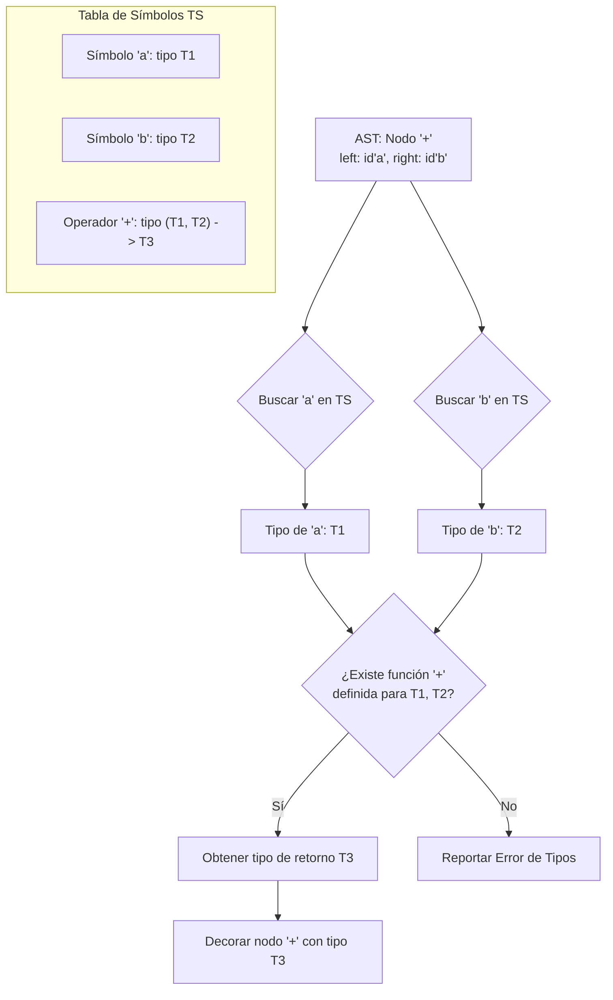

# Compiladores - Análisis dependiente del contexto

## 4.2 Sistemas de tipos.

---

### Definición y Propósito

Un **sistema de tipos** es un conjunto de reglas que asignan una propiedad llamada **tipo** (como `entero`, `real`, `booleano`) a los diversos elementos de un programa (variables, expresiones, funciones, etc.). Su propósito principal es **reducir los bugs** mediante la verificación de la corrección de los programas, asegurando que las operaciones se realizan sobre datos de tipos válidos y compatibles.

La **comprobación de tipos** es el proceso que aplica estas reglas y es el núcleo del análisis semántico. Un programa que pasa esta comprobación se dice que está **bien tipado**.

### Componentes de un Sistema de Tipos

1.  **Tipos Base (o Primitivos):** Tipos fundamentales definidos por el lenguaje.
    - Ejemplos: `boolean`, `char`, `int`, `float`, `double`, `string`, `void`.

2.  **Constructores de Tipos:** Mecanismos para crear tipos complejos a partir de tipos simples u otros complejos.
    - **Arreglos:** `array[T]` de un tipo `T` y una dimensión.
      - Ejemplo: `int[10]` (arreglo de 10 enteros).
    - **Registros (Structs):** Agrupación de elementos (campos) de posiblemente diferentes tipos.
      - Ejemplo: `struct Punto { float x; float y; }`.
    - **Punteros (Referencias):** Referencia a una ubicación en memoria que contiene un valor de un tipo específico.
      - Ejemplo: `int*` (puntero a un entero).
    - **Funciones:** Tipo que describe los argumentos y el tipo de retorno.
      - Ejemplo: `(int, int) -> int` (función que toma dos enteros y devuelve un entero).

3.  **Mecanismos de Definición de Tipos:**
    - **Sinónimos de Tipos (`typedef`):** Crear un alias para un tipo existente.
      - Ejemplo (C): `typedef int Entero;` (`Entero` es equivalente a `int`).
    - **Tipos Abstractos de Datos (Clases/Interfaces):** Definir un nuevo tipo encapsulando datos y operaciones.

### Clasificación de los Sistemas de Tipos

| Criterio                    | Tipo                          | Descripción                                                     | Ejemplos                            |
| :-------------------------- | :---------------------------- | :-------------------------------------------------------------- | :---------------------------------- |
| **Momento de Verificación** | **Estático**                  | Los tipos se verifican en **tiempo de compilación**.            | Java, C++, C#, Rust, Go             |
|                             | **Dinámico**                  | Los tipos se verifican en **tiempo de ejecución**.              | Python, JavaScript, Ruby, PHP       |
| **Seguridad**               | **Fuerte/Fuertemente Tipado** | No se permiten operaciones sobre tipos incompatibles.           | Python, Java, Haskell               |
|                             | **Débil/Débilmente Tipado**   | Se permiten conversiones implícitas entre tipos no compatibles. | C, C++ (con `void*`, casts)         |
| **Explícitud**              | **Explícito**                 | El programador debe declarar el tipo de cada variable.          | Java, C, C++                        |
|                             | **Implícito (Inferido)**      | El compilador deduce el tipo de una expresión/variable.         | `var` en C#, `auto` in C++, Haskell |

> **Nota:** Un lenguaje puede ser Estático y Fuertemente tipado (Java), o Dinámico y Fuertemente tipado (Python). "Débilmente tipado" a menudo se refiere a la facilidad para reinterpretar bits en memoria (como en C), no a la falta de verificación.

### Operaciones Esenciales: Equivalencia y Compatibilidad

#### 1. Equivalencia de Tipos

Determina si dos definiciones de tipo se refieren al **mismo tipo**. Existen dos enfoques principales:

- **Equivalencia Estructural:** Dos tipos son equivalentes si tienen la **misma estructura** (mismos componentes, en mismo orden).
  ```c
  struct Punto1 { float x; float y; };
  struct Punto2 { float x; float y; };
  // Punto1 y Punto2 son estructuralmente equivalentes.
  ```
- **Equivalencia Nominal:** Dos tipos son equivalentes solo si tienen el **mismo nombre**.
  ```java
  class Punto1 { float x; float y; }
  class Punto2 { float x; float y; }
  // Punto1 y Punto2 NO son equivalentes nominalmente.
  ```

#### 2. Compatibilidad de Tipos

Es una relación más débil que la equivalencia. Un tipo $T_1$ es compatible con un tipo $T_2$ si un valor de tipo $T_1$ es **legalmente permitido** en un contexto que espera un tipo $T_2$ (p.ej., en una asignación o como argumento de función). La compatibilidad a menudo se basa en la equivalencia estructural o en reglas de conversión implícita.

La regla fundamental para la asignación es:

$$ \text{Si tipo\_variable = T y tipo\_expresión = U}, \text{ entonces la asignación es válida si } U \text{ es compatible con } T. $$

### Conversión de Tipos (Coercion)

Es el proceso automático (implícito) o manual (explícito) de convertir un valor de un tipo a otro.

- **Conversión Implícita (Coerción):** La realiza automáticamente el compilador cuando los tipos son compatibles.
  - Ejemplo: `int i = 5; double d = i;` (promoción de `int` a `double`).
- **Conversión Explícita (Cast):** La solicita explícitamente el programador, incluso entre tipos potencialmente incompatibles.
  - Ejemplo (C++): `double d = 5.7; int i = (int)d;` (truncamiento a `int`).

Las reglas de conversión suelen definirse mediante un grafo o una tabla de promociones numéricas. Una promoción común es:

$$ \text{char} \rightarrow \text{short} \rightarrow \text{int} \rightarrow \text{long} \rightarrow \text{float} \rightarrow \text{double} $$

### Inferencia de Tipos

Es la capacidad del compilador de **deducir automáticamente** el tipo de una expresión o variable sin una declaración explícita. Es fundamental en lenguajes funcionales como Haskell y ML, y está presente en muchos lenguajes modernos (`var`, `auto`).

**Ejemplo en C++:**

```cpp
auto x = 42;        // El compilador infiere que x es de tipo int
auto y = 3.14;      // Infiere double
auto z = fun(10);   // Infiere el tipo de retorno de la función 'fun'
```

El algoritmo clásico de inferencia es el **algoritmo de unificación de Hindley-Milner**, usado en lenguajes como Haskell.

### Polimorfismo

Es la propiedad que permite que un mismo fragmento de código (función, clase, etc.) pueda operar sobre datos de **diferentes tipos**.

- **Polimorfismo Paramétrico (Genéricos/Plantillas):** El código se escribe de forma genérica, sin especificar un tipo concreto. El tipo se parameteriza.
  - Ejemplo (Java): `List<T>`, `public <T> T miMetodo(T param) { ... }`
  - Ejemplo (C++): `template <typename T> T max(T a, T b) { return (a > b) ? a : b; }`
- **Polimorfismo Ad-hoc (Sobrecarga):** Múltiples funciones con el mismo nombre pero diferentes tipos o número de parámetros. El compilador elige la correcta basándose en los argumentos.
  - Ejemplo: `int suma(int a, int b)` y `float suma(float a, float b)`.
- **Polimorfismo de Subtipos (Herencia):** Un valor de un tipo derivado (subclase) puede ser usado donde se espera un valor de su tipo base (superclase). La llamada a un método se resuelve en tiempo de ejecución (**despacho dinámico**).
  - Ejemplo (Java): `Animal miAnimal = new Perro(); miAnimal.hacerSonido(); // Llama a Perro.hacerSonido()`

### Ejercicios Propuestos

1.  **Clasificación:** Para cada lenguaje (C, Python, Java, JavaScript), indica su clasificación respecto a: Estático/Dinámico, Fuerte/Débil, Explícito/Implícito. Justifica brevemente.

2.  **Equivalencia y Compatibilidad:**

    ```c
    typedef int Entero;
    Entero a;
    int b;
    struct Punto { int x; int y; };
    struct Punto p;
    struct Coordenada { int x; int y; };
    struct Coordenada c;
    ```

    Asumiendo equivalencia nominal, ¿son equivalentes `a` y `b`? ¿Y `p` y `c`? ¿Son compatibles para una asignación `p = c;` en C?

3.  **Comprobación de Tipos:** Dadas las siguientes declaraciones en un lenguaje similar a C: `int a; float b; char c;`. Indica el tipo resultante de cada expresión y si la comprobación de tipos generaría un error.
    - `a + 5`
    - `b * 2.0`
    - `a + b`
    - `c = 'X'`
    - `a = c`
    - `a = b + c`

4.  **Inferencia de Tipos:** Supón un lenguaje con inferencia y los siguientes tipos base: `int`, `float`, `string`, `bool`. Infiere el tipo de las siguientes variables:
    - `x = 10`
    - `y = 3.14 + 2.0`
    - `z = "Hola" + "Mundo"`
    - `w = (x > 5)`

### Diagrama: Comprobación de Tipos en una Expresión

El siguiente diagrama describe el proceso de comprobación de tipos para una expresión binaria simple (`a + b`) durante el recorrido de un AST.



### Referencias

#### Bibliografía Básica

1.  Aho, Lam, Sethi y Ullman. _Compilers: Principles, Techniques, and Tools, 2nd Edition_. Pearson Education, 2007. **(Capítulo 6 - Verificación de Tipos)**.
2.  Michael Lee Scott. _Programming Language Pragmatics, 4th Edition_. Morgan Kaufmann, 2015. **(Capítulo 7 - Tipos de Datos, Capítulo 9 - Verificación de Tipos)**. _(Nota: La 3ra edición también es válida)_.

#### Bibliografía Complementaria

1.  Benjamin C. Pierce. _Types and Programming Languages_. The MIT Press, 2002. **(El libro de referencia definitivo sobre la teoría de tipos)**.
2.  Keith D. Cooper y Linda Torczon. _Engineering a Compiler, 2nd Edition_. Morgan Kaufmann, 2011. **(Capítulo 5 - Representación Intermedia y Capítulo 6 - Verificación de Tipos, con un enfoque práctico)**.
