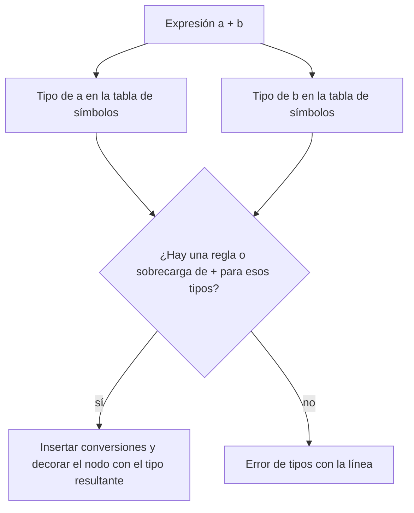

# Compiladores - Análisis dependiente del contexto

## 4.2 Sistemas de tipos.

---

Un **sistema de tipos** asigna un **tipo** a cada expresión del programa y define reglas que deben cumplir las operaciones según esos tipos. Su propósito es descartar, antes o durante la ejecución, operaciones sin sentido, como sumar un número con una función o llamar a un entero, y dar al compilador la información para elegir las instrucciones y la representación de cada valor. Este tema presenta los componentes de un sistema de tipos, las reglas de tipificación, la clasificación de los lenguajes, la equivalencia y la compatibilidad de tipos, las conversiones, la inferencia y el polimorfismo, comprobando cada afirmación con compiladores e intérpretes reales.

### Expresiones de tipos

Los tipos se describen con **expresiones de tipos**:

- **tipos básicos:** `bool`, `char`, `int`, `float`, `double`, `void`;
- **constructores:** arreglos, $\text{array}(n, T);$ registros, $\text{record}(c_1 : T_1, \ldots, c_k : T_k);$ apuntadores, $\text{pointer}(T);$ funciones, $T_1 \times \cdots \times T_n \to T,$ y productos;
- **nombres de tipos**, como los de `typedef` o los de las clases, y **variables de tipo**, como la `T` de `List<T>`, que representan un tipo cualquiera.

### Reglas de tipificación

Las reglas se escriben como **juicios** $\Gamma \vdash e : T,$ que se leen como en el entorno $\Gamma$ la expresión $e$ tiene tipo $T,$ con reglas de inferencia en las que las premisas van arriba y la conclusión abajo:

$$\frac{\Gamma \vdash e_1 : \text{int} \qquad \Gamma \vdash e_2 : \text{int}}{\Gamma \vdash e_1 + e_2 : \text{int}} \qquad \frac{x : T \in \Gamma}{\Gamma \vdash x : T} \qquad \frac{\Gamma \vdash f : T_1 \to T_2 \qquad \Gamma \vdash e : T_1}{\Gamma \vdash f(e) : T_2}$$

El comprobador de tipos es un recorrido del árbol que aplica estas reglas de abajo arriba; el entorno $\Gamma$ es la tabla de símbolos. Un sistema de tipos es **seguro**, *sound*, si los programas que acepta no producen errores de tipos al ejecutarse: el teorema de seguridad se demuestra con el **progreso**, un programa bien tipado no se atasca, y la **preservación**, cada paso de la ejecución conserva el tipo.

### Clasificación

- **Estático o dinámico:** si los tipos se comprueban al compilar, como en C, Java, Rust o Haskell, o al ejecutar, sobre los valores, como en Python, JavaScript o Ruby. Muchos lenguajes combinan ambos: Java comprueba en ejecución las conversiones de clases y los índices de los arreglos.
- **Fuerte o débil:** no tiene una definición única. Usualmente, un lenguaje es **débil** si permite operaciones sobre valores de tipo incompatible, convirtiéndolos implícitamente o reinterpretando sus bits, como JavaScript con `1 + "2"` o C con un entero inicializado con un apuntador, y **fuerte** si las rechaza, como Python o Java.
- **Explícito o implícito:** si las declaraciones deben dar los tipos, como en C o Java tradicional, o el compilador los **infiere**, como en Haskell, OCaml, o en C++ con `auto`, Java con `var` y Rust con `let`.

### Equivalencia y compatibilidad

Dos tipos son **estructuralmente equivalentes** si tienen la misma estructura, construida con los mismos constructores a partir de los mismos tipos básicos, y **nominalmente equivalentes** si tienen el mismo nombre. C usa equivalencia estructural para todo salvo las estructuras y uniones, que dentro de una unidad de traducción son distintas si su etiqueta es distinta; `typedef` solo crea un **sinónimo**. Java, C# y Rust usan equivalencia nominal para las clases; TypeScript y Go, para las interfaces, usan una estructural.

La **compatibilidad** es más débil que la equivalencia: un valor de tipo $U$ es compatible con un contexto que espera $T$ si las reglas lo permiten, con o sin conversión, como un `int` donde se espera un `double`, o un objeto de una subclase donde se espera la clase, que es la **subtipificación**.

### Conversiones

Una conversión **implícita**, o **coerción**, la inserta el compilador; una **explícita**, o **molde**, la escribe el programador. En las expresiones aritméticas, C aplica las **conversiones aritméticas habituales**: los operandos de rango menor que `int` se promueven a `int`, y si los operandos tienen tipos distintos, el de menor rango se convierte al del mayor, en el orden `int`, `long`, `long long`, `float`, `double`, `long double`. Una conversión de **ensanchamiento**, como de `int` a `double`, conserva el valor; una de **estrechamiento**, como de `float` a `int`, puede perderlo, y por eso C++ prohíbe las segundas en la inicialización con llaves y gcc las advierte con `-Wconversion`. Incluso de `int` a `float` se puede perder información, porque un `float` tiene 24 bits de mantisa.

### Inferencia y polimorfismo

La **inferencia de tipos** deduce los tipos que el programador omitió. La inferencia **local**, como `auto` en C++, toma el tipo del inicializador; la **global**, el algoritmo de Hindley y Milner de ML y Haskell, resuelve un sistema de ecuaciones entre tipos con unificación, como se ve en el tema 4.5.

El **polimorfismo** permite que un mismo código opere con varios tipos:

- **paramétrico:** el código no depende del tipo, como `List<T>` en Java o las funciones de ML; en C++ las plantillas se **instancian** para cada tipo;
- **de subtipos:** un objeto de una subclase se usa donde se espera la superclase, con despacho dinámico de los métodos;
- **ad hoc:** la **sobrecarga**, varias funciones con el mismo nombre y tipos distintos, como `+` para enteros y cadenas, que el compilador resuelve según los tipos de los argumentos.



### Implementación en Python

El programa comprueba cada respuesta con herramientas reales: ejecuta las mismas operaciones en Python 3.13 y Node.js 22 y las compila con javac 21 y gcc 13 para el ejercicio 1; compila las asignaciones del ejercicio 2; para el ejercicio 3 compara el comprobador del núcleo semántico del tema 4.1, que se incluye al inicio, con el tipo que C11 asigna a cada expresión, obtenido con `_Generic`, y con los avisos de `-Wconversion`, y para el ejercicio 4 implementa una inferencia local y la verifica con `auto` y `static_assert` en g++ 13.

```python
# ===== Núcleo semántico: analizador de un C pequeño, tabla de símbolos con ámbitos y comprobación de tipos =====
import re

TIPOS = ("int", "float", "char", "bool", "void")
class Nodo:
    def __init__(self, clase, linea, **campos): self.clase, self.linea, self.tipo = clase, linea, None; self.__dict__.update(campos)
    def __repr__(self): return f"{self.clase}@{self.linea}"

def tokens_c(texto):
    patron = r"""(?P<punto>//\s*Punto\s*\d+)|(?P<com>//[^\n]*)|(?P<real>\d+\.\d+)|(?P<num>\d+)|(?P<car>'(?:\\.|[^'])')|(?P<cad>"[^"]*")|(?P<id>[A-Za-z_]\w*)|(?P<op>==|!=|<=|>=|&&|\|\||[-+*/%<>=!(){};,\[\]])|(?P<nl>\n)|(?P<sp>[ \t]+)"""
    linea, res = 1, []
    for m in re.finditer(patron, texto):
        k, v = m.lastgroup, m.group()
        if k == "nl": linea += 1; continue
        if k in ("sp", "com"): continue
        if k == "punto": res.append(("PUNTO", int(v.split()[-1]), linea)); continue
        res.append((v if k in ("op",) or (k == "id" and v in TIPOS + ("if", "else", "while", "return")) else k, v, linea))
    res.append(("$", "$", linea)); return res

class ParserC:
    def __init__(self, texto): self.t, self.i = tokens_c(texto), 0
    def mira(self, k=0): return self.t[self.i + k][0]
    def come(self, x=None):
        tok = self.t[self.i]
        if x and tok[0] != x: raise SyntaxError(f"línea {tok[2]}: se esperaba '{x}' y llegó '{tok[1]}'")
        self.i += 1; return tok
    def programa(self):
        decls = []
        while self.mira() != "$":
            if self.mira() in TIPOS and self.mira(1) == "id" and self.mira(2) == "(": decls.append(self.funcion())
            else: decls.append(self.declaracion())
        return Nodo("programa", 1, decls=decls)
    def funcion(self):
        tipo = self.come()[0]; _, nombre, l = self.come("id"); self.come("("); params = []
        while self.mira() != ")":
            tp = self.come()[0]; params.append((tp, self.come("id")[1]))
            if self.mira() == ",": self.come()
        self.come(")"); punto = None
        if self.mira() == "PUNTO": punto = self.come()[1]
        cuerpo = self.bloque()
        if punto is not None: cuerpo.items.insert(0, Nodo("punto", l, n=punto))
        return Nodo("funcion", l, tipo_ret=tipo, nombre=nombre, params=params, cuerpo=cuerpo)
    def declaracion(self):
        tipo, _, l = self.come(); nombre = self.come("id")[1]; ini = None
        if self.mira() == "=": self.come(); ini = self.expr()
        self.come(";"); return Nodo("decl", l, tipo_decl=tipo, nombre=nombre, ini=ini)
    def bloque(self):
        l = self.come("{")[2]; items = []
        while self.mira() != "}": items.append(self.declaracion() if self.mira() in TIPOS else self.sentencia())
        self.come("}"); return Nodo("bloque", l, items=items)
    def sentencia(self):
        x = self.mira(); l = self.t[self.i][2]
        if x == "PUNTO": return Nodo("punto", l, n=self.come()[1])
        if x == "{": return self.bloque()
        if x == "return":
            self.come(); e = None if self.mira() == ";" else self.expr(); self.come(";"); return Nodo("return", l, e=e)
        if x in ("if", "while"):
            self.come(); self.come("("); c = self.expr(); self.come(")"); s = self.sentencia(); o = None
            if x == "if" and self.mira() == "else": self.come(); o = self.sentencia()
            return Nodo(x, l, c=c, s=s, o=o)
        if x == "id" and self.mira(1) == "=":
            n = self.come()[1]; self.come("="); e = self.expr(); self.come(";"); return Nodo("asigna", l, nombre=n, e=e)
        e = self.expr(); self.come(";"); return Nodo("expr", l, e=e)
    NIVELES = [("||",), ("&&",), ("==", "!="), ("<", "<=", ">", ">="), ("+", "-"), ("*", "/", "%")]
    def expr(self, k=0):
        if k == len(self.NIVELES): return self.unario()
        izq = self.expr(k + 1)
        while self.mira() in self.NIVELES[k]:
            op, _, l = self.come(); izq = Nodo("bin", l, op=op, a=izq, b=self.expr(k + 1))
        return izq
    def unario(self):
        if self.mira() in ("-", "!"): op, _, l = self.come(); return Nodo("un", l, op=op, a=self.unario())
        k, v, l = self.come()
        if k == "num": return Nodo("lit", l, valor=int(v), tipo_lit="int")
        if k == "real": return Nodo("lit", l, valor=float(v), tipo_lit="float")
        if k == "car": return Nodo("lit", l, valor=v, tipo_lit="char")
        if k == "cad": return Nodo("lit", l, valor=v, tipo_lit="char*")
        if k == "(": e = self.expr(); self.come(")"); return e
        if k == "id":
            if self.mira() == "(":
                self.come(); args = []
                while self.mira() != ")":
                    args.append(self.expr())
                    if self.mira() == ",": self.come()
                self.come(")"); return Nodo("llamada", l, nombre=v, args=args)
            return Nodo("var", l, nombre=v)
        raise SyntaxError(f"línea {l}: token inesperado '{v}'")

class TablaSimbolos:
    """Pila de ámbitos; cada ámbito es un diccionario nombre -> atributos."""
    def __init__(self): self.pila = [("global", {})]
    def entra(self, nombre): self.pila.append((nombre, {}))
    def sale(self): self.pila.pop()
    def inserta(self, nombre, **attrs):
        ambito = self.pila[-1][1]
        if nombre in ambito: return False
        ambito[nombre] = attrs; return True
    def busca(self, nombre):
        for amb, tabla in reversed(self.pila):
            if nombre in tabla: return amb, tabla[nombre]
        return None, None
    def oculta(self, nombre):
        return any(nombre in t for _, t in self.pila[:-1])
    def foto(self):
        return " | ".join(f"{a}: " + (", ".join(f"{n}:{d.get('tipo')}" for n, d in t.items()) or "-") for a, t in self.pila)

RANGO = {"char": 0, "int": 1, "float": 2}
class Comprobador:
    """Comprobación de tipos con las reglas de C: promoción aritmética char < int < float, comparaciones de tipo int."""
    def __init__(self, avisos_conversion=True): self.ts, self.diag, self.fotos, self.func = TablaSimbolos(), [], {}, None; self.av = avisos_conversion
    def error(self, l, m): self.diag.append(f"línea {l}: error: {m}")
    def aviso(self, l, m): self.diag.append(f"línea {l}: aviso: {m}")
    def analiza(self, prog):
        for d in prog.decls: self.visita(d)
        return self.diag
    def visita(self, n):
        getattr(self, "v_" + n.clase)(n)
    def v_funcion(self, n):
        if not self.ts.inserta(n.nombre, clase="función", tipo=f"{n.tipo_ret}({', '.join(t for t, _ in n.params)})", ret=n.tipo_ret, params=[t for t, _ in n.params]):
            self.error(n.linea, f"redefinición de '{n.nombre}'")
        self.ts.entra(n.nombre); self.func = n
        for t, p in n.params: self.ts.inserta(p, clase="parámetro", tipo=t)
        for it in n.cuerpo.items: self.visita(it)
        self.ts.sale(); self.func = None
    def v_decl(self, n):
        if self.ts.oculta(n.nombre) and len(self.ts.pila) > 1: self.aviso(n.linea, f"'{n.nombre}' oculta una declaración de un ámbito exterior")
        if n.ini is not None: self.asignable(n.tipo_decl, self.tipo(n.ini), n.linea, f"inicializar '{n.nombre}'")
        if not self.ts.inserta(n.nombre, clase="variable", tipo=n.tipo_decl): self.error(n.linea, f"'{n.nombre}' ya está declarada en este ámbito")
    def v_bloque(self, n):
        self.ts.entra("bloque")
        for it in n.items: self.visita(it)
        self.ts.sale()
    def v_punto(self, n): self.fotos[n.n] = self.ts.foto()
    def v_asigna(self, n):
        amb, s = self.ts.busca(n.nombre); t = self.tipo(n.e)
        if s is None: self.error(n.linea, f"'{n.nombre}' no está declarada"); return
        self.asignable(s["tipo"], t, n.linea, f"asignar a '{n.nombre}'")
    def v_return(self, n):
        t = self.tipo(n.e) if n.e else "void"
        self.asignable(self.func.tipo_ret, t, n.linea, f"devolver de '{self.func.nombre}'")
    def v_if(self, n):
        self.condicion(n.c); self.visita(n.s)
        if n.o: self.visita(n.o)
    v_while = v_if
    def v_expr(self, n): self.tipo(n.e)
    def condicion(self, c):
        t = self.tipo(c)
        if t not in RANGO and t != "bool" and t != "error": self.error(c.linea, f"la condición tiene tipo {t}, no escalar")
    def asignable(self, destino, origen, l, que):
        if "error" in (destino, origen): return
        if destino == origen: return
        if destino in RANGO and origen in RANGO:
            if RANGO[origen] > RANGO[destino] and self.av: self.aviso(l, f"conversión de {origen} a {destino} al {que}: puede perder información")
            return
        self.error(l, f"tipos incompatibles al {que}: se esperaba {destino} y la expresión es {origen}")
    def tipo(self, e):
        e.tipo = self._tipo(e); return e.tipo
    def _tipo(self, e):
        if e.clase == "lit": return e.tipo_lit
        if e.clase == "var":
            amb, s = self.ts.busca(e.nombre)
            if s is None: self.error(e.linea, f"'{e.nombre}' no está declarada"); return "error"
            e.ambito = amb; return s["tipo"]
        if e.clase == "un":
            t = self.tipo(e.a)
            if t == "error": return t
            if t not in RANGO: self.error(e.linea, f"'{e.op}' no se aplica a {t}"); return "error"
            return "int" if e.op == "!" else ("int" if t == "char" else t)
        if e.clase == "llamada":
            amb, s = self.ts.busca(e.nombre)
            ts_ = [self.tipo(a) for a in e.args]
            if s is None or s.get("clase") != "función": self.error(e.linea, f"'{e.nombre}' no es una función declarada"); return "error"
            if len(ts_) != len(s["params"]): self.error(e.linea, f"'{e.nombre}' espera {len(s['params'])} argumentos y recibe {len(ts_)}"); return s["ret"]
            for k, (p, a) in enumerate(zip(s["params"], ts_)): self.asignable(p, a, e.linea, f"pasar el argumento {k + 1} de '{e.nombre}'")
            return s["ret"]
        a, b = self.tipo(e.a), self.tipo(e.b)
        if "error" in (a, b): return "error"
        if a not in RANGO or b not in RANGO: self.error(e.linea, f"'{e.op}' no se aplica a {a} y {b}"); return "error"
        if e.op in ("==", "!=", "<", "<=", ">", ">=", "&&", "||"): return "int"
        if e.op == "%" and "float" in (a, b): self.error(e.linea, "'%' requiere operandos enteros"); return "error"
        return max(a, b, "int", key=lambda t: RANGO[t])          # promoción: char se convierte en int

import subprocess, tempfile, os
TMP = tempfile.mkdtemp()
ENV = {**os.environ, "LC_ALL": "C"}
def corre(cmd, archivo=None, texto=None):
    if archivo: open(os.path.join(TMP, archivo), "w").write(texto)
    r = subprocess.run(cmd, cwd=TMP, capture_output=True, text=True, env=ENV)
    err = "\n".join(l for l in r.stderr.splitlines() if not l.startswith("Picked up"))
    return r.stdout.strip(), err, r.returncode
def primera(err, patron=r"(error|warning):"):
    return next((re.sub(r"^\S+?:\d+(:\d+)?: ", "", l) for l in err.splitlines() if re.search(patron, l)), "sin diagnósticos")

# ---------- Ejercicio 1: clasificación, comprobada con cada lenguaje ----------
print("ejercicio 1: la misma operación, 1 + \"2\", y una asignación de una cadena a un entero")
out, err, _ = corre(["python3", "-c", "x = 5\nx = 'cinco'\nprint(type(x).__name__)\ntry:\n  print(1 + '2')\nexcept TypeError as e:\n  print('TypeError:', e)"])
print("   Python:", out.replace("\n", " | "))
out, err, _ = corre(["node", "-e", "let x = 5; x = 'cinco'; console.log(typeof x, '|', 1 + '2', '|', '3' * '4', '|', [] + {})"])
print("   JavaScript:", out)
_, err, rc = corre(["javac", "-d", ".", "T.java"], "T.java", 'class T { void f() { int x = "cinco"; String s = 1 + "2"; } }')
print("   Java: javac", "rechaza" if rc else "acepta", "->", primera(err, "error:"), "| y 1 + \"2\" es \"12\" por la regla de concatenación")
_, err, rc = corre(["gcc", "-fsyntax-only", "t.c"], "t.c", 'int f(void) { int x = "cinco"; float y = 7; return x + y; }')
print("   C: gcc", "rechaza" if rc else "acepta", "->", primera(err))

# ---------- Ejercicio 2: typedef y estructuras ----------
C2 = '''typedef int Entero;
Entero a;
int b;
struct Punto { int x; int y; };
struct Punto p;
struct Coordenada { int x; int y; };
struct Coordenada c;
void f(void) { a = b; b = a; p = c; }
'''
_, err, rc = corre(["gcc", "-fsyntax-only", "e.c"], "e.c", C2)
print("ejercicio 2: a = b y b = a sin diagnóstico; p = c ->", primera(err))
print("   con un molde: p = *(struct Punto *)&c ->", primera(corre(["gcc", "-fsyntax-only", "e2.c"], "e2.c", C2.replace("p = c;", "p = *(struct Punto *)&c;"))[1]))

# ---------- Ejercicio 3: tipos de las expresiones ----------
DECL = "int a; float b; char c;\n"
EXPRS = ["a + 5", "b * 2.0", "a + b", "c = 'X'", "a = c", "a = b + c"]
prog = DECL + "int main() {\n" + "".join(f"    {e};\n" for e in EXPRS) + "    return 0;\n}\n"
comp = Comprobador(); arbol = ParserC(prog).programa(); comp.analiza(arbol)
cuerpo = arbol.decls[3].cuerpo.items
tipos_c = [it.e.tipo if it.clase == "expr" else comp.ts.pila[0][1].get(it.nombre, {}).get("tipo") for it in cuerpo[:-1]]
GEN = '''#include <stdio.h>
#define TIPO(x) _Generic((x), int: "int", float: "float", double: "double", char: "char", default: "otro")
int a; float b; char c;
int main(void) {
''' + "".join(f'    printf("%s\\n", TIPO({e}));\n' for e in EXPRS) + "    return 0;\n}\n"
corre(["gcc", "-std=c11", "-Wall", "-Wconversion", "-o", "g", "g.c"], "g.c", GEN)
_, avisos, _ = corre(["gcc", "-Wconversion", "-fsyntax-only", "p.c"], "p.c", prog)
reales = corre(["./g"])[0].split("\n")
print("ejercicio 3: expresión | comprobador | tipo en C11 según _Generic")
for e, t, r in zip(EXPRS, tipos_c, reales): print(f"   {e:10} | {t:6} | {r}")
print("   diagnósticos del comprobador:", comp.diag or "ninguno")
print("   gcc -Wconversion sobre las mismas sentencias:", [re.sub(r"^\S+:(\d+):\d+: warning: ", r"línea \1: ", l) for l in avisos.splitlines() if "warning" in l])

# ---------- Ejercicio 4: inferencia local de tipos ----------
def infiere(asignaciones):
    entorno = {}
    def tipo(e):
        e = e.strip()
        if e.startswith("(") and e.endswith(")"): return tipo(e[1:-1])
        for op, regla in [(">", "comparación"), ("+", "suma")]:
            if op in e and not (e.startswith('"') and e.count('"') == 2):
                izq, der = e.split(op, 1); a, b = tipo(izq), tipo(der)
                if regla == "comparación": return "bool" if a in ("int", "float") and b in ("int", "float") else "error"
                if a == b == "string": return "string"
                if {a, b} <= {"int", "float"}: return "float" if "float" in (a, b) else "int"
                return "error"
        if e.startswith('"'): return "string"
        if re.fullmatch(r"\d+\.\d+", e): return "float"
        if re.fullmatch(r"\d+", e): return "int"
        if e in ("true", "false"): return "bool"
        return entorno.get(e, "error")
    for linea in asignaciones:
        v, e = linea.split("=", 1); entorno[v.strip()] = tipo(e)
    return entorno
ASIG = ["x = 10", "y = 3.14 + 2.0", 'z = "Hola" + "Mundo"', "w = (x > 5)", 'm = x + "a"']
print("ejercicio 4:", infiere(ASIG))
CPP = '''#include <string>
#include <type_traits>
using namespace std::string_literals;
auto x = 10;
auto y = 3.14 + 2.0;
auto z = "Hola"s + "Mundo"s;
auto w = (x > 5);
static_assert(std::is_same_v<decltype(x), int> && std::is_same_v<decltype(y), double>);
static_assert(std::is_same_v<decltype(z), std::string> && std::is_same_v<decltype(w), bool>);
'''
_, err, rc = corre(["g++", "-std=c++17", "-fsyntax-only", "i.cpp"], "i.cpp", CPP)
print("   C++17 con auto: las cuatro afirmaciones de tipo se cumplen:", rc == 0)
_, err, rc = corre(["g++", "-std=c++17", "-fsyntax-only", "j.cpp"], "j.cpp", 'auto z = "Hola" + "Mundo";')
print('   sin el sufijo s, "Hola" + "Mundo" ->', primera(err, "error:"))
```

Salida:

```text
ejercicio 1: la misma operación, 1 + "2", y una asignación de una cadena a un entero
   Python: str | TypeError: unsupported operand type(s) for +: 'int' and 'str'
   JavaScript: string | 12 | 12 | [object Object]
   Java: javac rechaza -> error: incompatible types: String cannot be converted to int | y 1 + "2" es "12" por la regla de concatenación
   C: gcc acepta -> warning: initialization of 'int' from 'char *' makes integer from pointer without a cast [-Wint-conversion]
ejercicio 2: a = b y b = a sin diagnóstico; p = c -> error: incompatible types when assigning to type 'struct Punto' from type 'struct Coordenada'
   con un molde: p = *(struct Punto *)&c -> sin diagnósticos
ejercicio 3: expresión | comprobador | tipo en C11 según _Generic
   a + 5      | int    | int
   b * 2.0    | float  | double
   a + b      | float  | float
   c = 'X'    | char   | char
   a = c      | int    | int
   a = b + c  | int    | int
   diagnósticos del comprobador: ["línea 8: aviso: conversión de float a int al asignar a 'a': puede perder información"]
   gcc -Wconversion sobre las mismas sentencias: ["línea 5: conversion from 'int' to 'float' may change value [-Wconversion]", "línea 8: conversion from 'float' to 'int' may change value [-Wfloat-conversion]"]
ejercicio 4: {'x': 'int', 'y': 'float', 'z': 'string', 'w': 'bool', 'm': 'error'}
   C++17 con auto: las cuatro afirmaciones de tipo se cumplen: True
   sin el sufijo s, "Hola" + "Mundo" -> error: invalid operands of types 'const char [5]' and 'const char [6]' to binary 'operator+'
```

### Ejercicios Propuestos

1. **Clasificación.** Clasifica C, Python, Java y JavaScript como estáticos o dinámicos, fuertes o débiles y explícitos o implícitos, y justifica.

2. **Equivalencia y compatibilidad.** Con las declaraciones

    ```c
    typedef int Entero;
    Entero a;
    int b;
    struct Punto { int x; int y; };
    struct Punto p;
    struct Coordenada { int x; int y; };
    struct Coordenada c;
    ```

    y suponiendo equivalencia nominal, ¿son equivalentes `a` y `b`? ¿Y `p` y `c`? ¿Es válida en C la asignación `p = c;`?

3. **Comprobación de tipos.** Con las declaraciones `int a; float b; char c;` de un lenguaje parecido a C, indica el tipo de cada expresión y si la comprobación de tipos produce un error: `a + 5`, `b * 2.0`, `a + b`, `c = 'X'`, `a = c`, `a = b + c`.

4. **Inferencia.** En un lenguaje con inferencia y los tipos básicos `int`, `float`, `string` y `bool`, infiere el tipo de `x = 10`, `y = 3.14 + 2.0`, `z = "Hola" + "Mundo"` y `w = (x > 5)`.

### Soluciones

**Ejercicio 1.** Las ejecuciones del programa muestran las diferencias:

| Lenguaje | Comprobación | Fuerza | Declaraciones |
| -------- | ------------ | ------ | ------------- |
| C | estática | débil: acepta inicializar un `int` con un apuntador, con solo un aviso, y los moldes reinterpretan la memoria | explícitas |
| Python | dinámica: la misma variable recibe un entero y una cadena | fuerte: `1 + "2"` produce `TypeError` | implícitas; las anotaciones de tipo son opcionales y el intérprete no las comprueba |
| Java | estática: javac rechaza `int x = "cinco"` | fuerte, aunque `1 + "2"` es `"12"` porque `+` con una cadena es concatenación, una sobrecarga definida | explícitas, con inferencia local con `var` desde Java 10 |
| JavaScript | dinámica | débil: `1 + "2"` es `"12"`, `"3" * "4"` es 12 y `[] + {}` es una cadena | implícitas |

**Ejercicio 2.** Con equivalencia **nominal estricta**, `a` y `b` no serían equivalentes, porque `Entero` e `int` son nombres distintos; pero en C `typedef` no crea un tipo, solo un sinónimo, así que `a = b` y `b = a` son válidas sin diagnóstico. `p` y `c` **no son equivalentes**, ni con equivalencia nominal, porque sus etiquetas son distintas, aunque su estructura sea idéntica: gcc rechaza `p = c` con "incompatible types when assigning to type 'struct Punto' from type 'struct Coordenada'". Se puede copiar con un molde de apuntadores, `p = *(struct Punto *)&c`, que funciona porque ambas tienen la misma disposición en memoria, pero el compilador ya no verifica nada. En C, dos estructuras de **distintas** unidades de traducción con la misma etiqueta y los mismos miembros sí son compatibles, una forma de equivalencia estructural.

**Ejercicio 3.** Según las conversiones aritméticas habituales:

| Expresión | Tipo | Comentario |
| --------- | ---- | ---------- |
| `a + 5` | `int` | sin conversiones |
| `b * 2.0` | `double` | la constante `2.0` es `double` en C, y `b` se convierte; el comprobador, que no tiene `double`, da `float`, y una constante `2.0f` daría `float` |
| `a + b` | `float` | `a` se convierte a `float`; gcc advierte que la conversión de `int` a `float` puede cambiar el valor |
| `c = 'X'` | `char` | la constante `'X'` es `int` en C, y se convierte a `char` sin pérdida porque cabe |
| `a = c` | `int` | ensanchamiento de `char` a `int` |
| `a = b + c` | `int` | `b + c` es `float`, y la asignación lo estrecha a `int`: el comprobador y gcc lo advierten |

Ninguna es un error en C: todas las conversiones entre tipos aritméticos son implícitas. Un lenguaje más estricto, como Java, rechazaría `a = b + c` sin un molde, y Rust rechazaría también `a + b`, porque no convierte implícitamente entre tipos numéricos.

**Ejercicio 4.** Con reglas locales, del inicializador a la variable: `x` es `int`, porque 10 es un entero; `y` es `float`, porque la suma de dos `float` es `float`; `z` es `string`, si `+` está sobrecargado como concatenación de cadenas, y `w` es `bool`, porque una comparación de números es booleana. Una expresión como `x + "a"` es un error de tipos si no hay una regla de `+` para `int` y `string`. En C++17, `auto` infiere lo mismo, con `double` en lugar de `float`, y las cuatro afirmaciones `static_assert` se cumplen, pero solo con el sufijo `s` de `std::string`: sin él, `"Hola" + "Mundo"` es un error, porque las constantes de cadena son arreglos de `char` y no se pueden sumar.

En el material original, la tabla de clasificación decía "`auto` in C++" en inglés y ponía a C++ como débil solo por `void*` y los moldes, cuando la conversión implícita de apuntadores a enteros ni siquiera es válida en C++; el ejercicio 3 no consideraba que `2.0` es `double` en C, y el ejercicio 2 suponía equivalencia nominal sin advertir que en C `typedef` es un sinónimo.

### Referencias

1. Pierce, B. C., _Types and Programming Languages_. MIT Press, 2002. Capítulos 8, 9 y 15.
2. Aho, A. V., Lam, M. S., Sethi, R., and Ullman, J. D., _Compilers: Principles, Techniques, and Tools_. 2a ed., Pearson, 2007. Sección 6.5.
3. Cardelli, L., and Wegner, P., On understanding types, data abstraction, and polymorphism. _ACM Computing Surveys_ 17(4), 1985.
4. ISO/IEC 9899:2018, _Programming languages — C_. Secciones 6.2.7 y 6.3.1.8.
5. Gosling, J., et al., _The Java Language Specification, Java SE 21 Edition_. Capítulo 5.
6. ECMA-262, _ECMAScript 2024 Language Specification_. Sección 13.15.3, el operador de suma.
