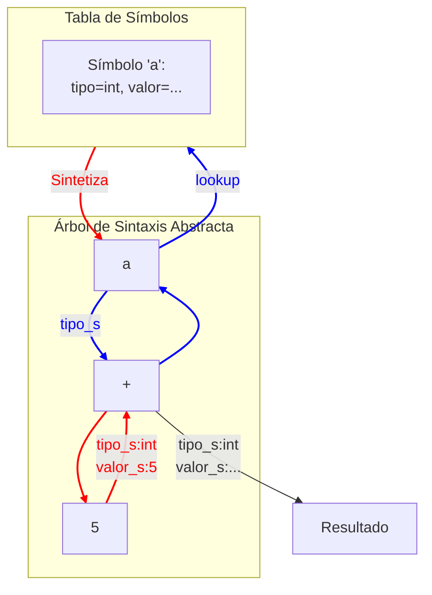

# Compiladores - Análisis dependiente del contexto

## 4.3 Gramáticas de atributos.

---

Una **Gramática de Atributos** es una extensión formal de una gramática libre de contexto (GLC) que permite especificar y mecanizar el **análisis semántico** de un lenguaje de programación. Asocia información adicional (atributos) a los símbolos gramaticales y define reglas para calcular y verificar estos atributos.

**Propósito principal:** Proporcionar un marco formal y declarativo para describir todas las reglas semánticas de un lenguaje (comprobación de tipos, control de flujo, gestión de ámbitos, etc.), más allá de lo que puede capturar la sintaxis alone.

### Componentes de una Gramática de Atributos

Una gramática de atributos se define como una tupla $AG = (G, A, R)$, donde:

1.  **$G$** es una gramática libre de contexto subyacente $(V_T, V_N, S, P)$, donde:
    - $V_T$: Conjunto de símbolos terminales.
    - $V_N$: Conjunto de símbolos no terminales.
    - $S$: Símbolo inicial $(S \in V_N)$.
    - $P$: Conjunto de producciones.
2.  **$A$** es una unión finita de conjuntos de atributos $A(X)$ para cada símbolo $X \in (V_T \cup V_N)$. Cada atributo $a \in A(X)$ tiene un **dominio de valores** (p.ej., `tipo`, `valor`, `nombre`).
3.  **$R$** es un conjunto finito de **reglas semánticas** asociadas a las producciones en $P$. Cada regla define el valor de un atributo en términos de otros atributos de los símbolos en la misma producción.

Para una producción $p: X_0 \to X_1 X_2 \ldots X_n$, una regla semántica tiene la forma:

$$ a_i = f(b_1, b_2, \ldots, b_k) $$

donde $a_i$ es un atributo de algún $X_j$ $(0 \leq j \leq n)$ y $b_1, \ldots, b_k$ son atributos de los símbolos en el lado derecho de $p$ (y a veces del propio $X_0$ en el lado izquierdo).

### Tipos de Atributos: Sintetizados y Heredados

Existen dos tipos fundamentales de atributos, definidos por su **dirección de flujo de información** en el árbol de análisis sintáctico (AST):

| Tipo            | Símbolo        | Dirección del Flujo                    | Definición                                                                                                                                                                 | Uso Típico                                                                 |
| :-------------- | :------------- | :------------------------------------- | :------------------------------------------------------------------------------------------------------------------------------------------------------------------------- | :------------------------------------------------------------------------- |
| **Sintetizado** | $s$ para $X.s$ | ↑ (De hijos al padre)                  | Un atributo sintetizado para un nodo no terminal $X$ se calcula a partir de los **atributos de sus hijos**.                                                                | Calcular el tipo o valor resultante de una expresión.                      |
| **Heredado**    | $i$ para $X.i$ | ↓ (De padre a hijos, o entre hermanos) | Un atributo heredado para un símbolo $X$ en el lado derecho de una producción se calcula a partir de los **atributos del padre $(X_0)$ o de sus hermanos a la izquierda**. | Propagación de información de contexto (tabla de símbolos, tipo esperado). |

**Definición Formal:**

- Para un no terminal $X$, $A(X) = S(X) \cup I(X)$, donde $S(X)$ son sus atributos sintetizados e $I(X)$ sus atributos heredados.
- El símbolo inicial $S$ **no puede tener atributos heredados**.
- Los símbolos terminales (tokens from the lexer) **solo tienen atributos sintetizados** (p.ej., `lexval`).

### Esquemas de Evaluación

Un **esquema de evaluación** es un algoritmo que determina el **orden** en el que se deben ejecutar las reglas semánticas para calcular todos los atributos en el AST. El orden debe ser tal que un atributo se compute solo después de que todos los atributos de los que depende hayan sido computados.

La dependencia entre atributos se puede representar con un **grafo de dependencias**. Una gramática de atributos está **bien definida** si este grafo es acíclico para every parse tree, permitiendo un orden de evaluación topológico.

### Gramáticas S-Attributed y L-Attributed

Dos clases importantes de gramáticas de atributos que garantizan una evaluación sencilla:

1.  **Gramáticas S-Attributed:**
    - **Definición:** Todas las reglas semánticas definen **atributos sintetizados**.
    - **Evaluación:** Se pueden evaluar eficientemente mediante un **recorrido en postorden (post-order traversal)** del AST. Son fáciles de implementar durante el **parsing ascendente** (LR), ya que los atributos se pueden almacenar y calcular en la pila del parser.

2.  **Gramáticas L-Attributed:**
    - **Definición:** Cada regla semántica puede calcular:
      1.  Un atributo sintetizado del no terminal en la cabeza de la producción.
      2.  Un atributo heredado de un símbolo en el lado **derecho** de la producción.
    - **Restricción clave (Flujo Left-to-Right):** Un atributo heredado de un símbolo $X_j$ en el lado derecho solo puede depender de:
      - Atributos heredados del no terminal de la cabeza $(X_0)$.
      - Atributos de los símbolos $X_1, X_2, ..., X_{j-1}$ (hermanos a la **izquierda**).
    - **Evaluación:** Se pueden evaluar mediante un **recorrido en profundidad (depth-first traversal)** del AST, visitando hijos de izquierda a derecha. Son ideales para el **parsing descendente** (LL/recursivo).

Toda gramática S-attributed es también L-attributed, pero no viceversa.

### Aplicación en Compiladores: Ejemplo Práctico

**Problema:** Verificar tipos y calcular el resultado de expresiones con variables enteras y reales.

**Gramática Libre de Contexto:**

```
1.  P -> D ; E
2.  D -> float id | int id
3.  E -> E + T | T
4.  T -> id | literal_entero | literal_real
```

**Gramática de Atributos Extendida:**

- Atributos: `.tipo` (sintetizado), `.valor` (sintetizado), `.ts` (heredado, tabla de símbolos)
- Funciones: `agregar(id, tipo, ts)`, `buscar(id, ts)`, `comprobar_asignacion(tipo_var, tipo_expr)`

```plaintext
Producción                          Reglas Semánticas
----------------------------------------------------------------------------------------------------------------
P -> D ; E                         E.ts = D.ts
                                   P.tipo = E.tipo
                                   P.valor = E.valor

D -> float id                      D.ts = agregar(id.nombre, float, D.ts_heredado)
D -> int id                        D.ts = agregar(id.nombre, int, D.ts_heredado)

E₁ -> E₂ + T                       E₂.ts = E₁.ts
                                   T.ts = E₁.ts
                                   // Comprobación de tipos y promoción
                                   si (E₂.tipo == float y T.tipo == int) entonces
                                        E₁.tipo = float
                                        E₁.valor = E₂.valor + float(T.valor)
                                   sino si (E₂.tipo == int y T.tipo == float) entonces
                                        E₁.tipo = float
                                        E₁.valor = float(E₂.valor) + T.valor
                                   sino si (E₂.tipo == T.tipo) entonces
                                        E₁.tipo = E₂.tipo
                                        E₁.valor = E₂.valor + T.valor
                                   sino
                                        error("Tipos incompatibles en +")

E -> T                             E.tipo = T.tipo
                                   E.valor = T.valor

T -> id                            entrada = buscar(id.nombre, T.ts)
                                   T.tipo = entrada.tipo
                                   T.valor = entrada.valor

T -> literal_entero                T.tipo = int
                                   T.valor = literal_entero.valor

T -> literal_real                  T.tipo = float
                                   T.valor = literal_real.valor
```

### Limitaciones y Consideraciones Prácticas

- **Poder Expresivo vs. Complejidad:** Las gramáticas de atributos son muy expresivas (Turing-completas), pero una especificación muy compleja puede ser difícil de analizar y evaluar eficientemente.
- **Evaluación Eficiente:** En la práctica, los compiladores no construyen el grafo de dependencias completo para cada nodo. En su lugar, se utilizan:
  - **Visitors:** Patrón de diseño que permite añadir fácilmente nuevas operaciones a un AST.
  - **Traducción Dirigida por Sintaxis:** Se intercalan acciones semánticas (fragmentos de código) dentro de las producciones de la gramática, que se ejecutan durante el parsing en un orden predefinido (e.g., Yacc/Bison).

### Ejercicios Propuestos

1.  **Identificación de Atributos:** Para la producción `DeclaracionFuncion -> tipo id ( ListaParametros ) { Cuerpo }`, lista al menos 5 atributos (sintetizados y heredados) que serían necesarios para su análisis semántico, describiendo su propósito.

2.  **Dependencias y Evaluación:** Dada la siguiente producción y reglas semánticas de una gramática L-attributed:

    ```
    A -> B C
        Reglas: B.i = A.i
                C.i = B.s
                A.s = f(C.s)
    ```

    Dibuja el grafo de dependencias para los atributos de esta producción. Propón un orden válido para evaluar las reglas.

3.  **Diseño de Gramática de Atributos:** Diseña una gramática de atributos para la siguiente producción que verifique que el tipo de la expresión de retorno de una función coincide con su tipo declarado. Usa los atributos `funcion.tipo_retorno` (heredado del contexto) y `expr.tipo` (sintetizado).

    ```
    SentenciaReturn -> return Expresion ;
    ```

4.  **S-Attributed vs. L-Attributed:** La siguiente gramática es S-attributed? ¿Es L-attributed? Justifica tu respuesta.
    ```
    Producción          Reglas Semánticas
    ------------------------------------
    A -> B C           A.s = B.s + C.s
    B -> b             B.s = 1
    C -> c             C.s = 2
    ```

### Diagrama: Flujo de Atributos en un AST

El siguiente diagrama muestra el flujo de atributos sintetizados (↑) y heredados (↓) en un AST para la expresión `a + 5`, asumiendo que `a` fue declarada como `int`.



### Referencias

#### Bibliografía Básica

1.  Aho, Lam, Sethi y Ullman. _Compilers: Principles, Techniques, and Tools, 2nd Edition_. Pearson Education, 2007. **(Capítulo 5 - Análisis Semántico, Sección 5.1 - Gramáticas con Atributos)**.
2.  Keith D. Cooper y Linda Torczon. _Engineering a Compiler, 2nd Edition_. Morgan Kaufmann, 2011. **(Capítulo 4 - Análisis Semántico)**.

#### Bibliografía Complementaria

1.  Reinhard Wilhelm y Dieter Maurer. _Compiler Design_. Addison-Wesley, 1995. **(Ofrece una cobertura extensa y formal sobre gramáticas de atributos y su evaluación)**.
2.  Alfred V. Aho, Jeffrey D. Ullman. _The Theory of Parsing, Translation, and Compiling, Vol. 1 & 2_. Prentice Hall, 1972. **(La base teórica clásica)**.
