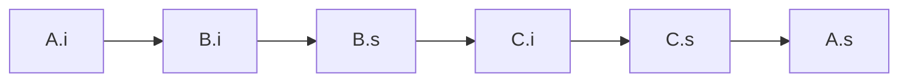

# Compiladores - Análisis dependiente del contexto

## 4.3 Gramáticas de atributos.

---

Una **gramática de atributos**, de Knuth, es una gramática libre de contexto en la que cada símbolo lleva **atributos** y cada producción **reglas semánticas** que los calculan. Es la forma declarativa de especificar el análisis semántico: el tipo de cada expresión, la tabla de símbolos visible en cada punto, el desplazamiento de cada variable o el código generado para cada construcción se definen como atributos, y un evaluador decide en qué orden calcularlos. Este tema presenta la definición formal, los atributos sintetizados y heredados, el grafo de dependencias, las clases S-atribuida y L-atribuida y su evaluación, con un evaluador general en Python.

### Definición

Una gramática de atributos es una terna $(G, A, R):$ una gramática libre de contexto $G;$ para cada símbolo $X,$ un conjunto finito de atributos $A(X),$ cada uno con un dominio de valores, y para cada producción $p: X_0 \to X_1 \cdots X_n,$ un conjunto de reglas de la forma

$$X_j.a = f(X_{k_1}.b_1, \ldots, X_{k_m}.b_m) \qquad 0 \le j, k_1, \ldots, k_m \le n$$

que definen cada atributo en términos de otros atributos de los símbolos de la **misma producción**. Los atributos de $X$ se dividen en dos conjuntos disjuntos:

- **sintetizados**, $S(X):$ los define una regla de una producción con $X$ en la **cabeza**; dependen de los hijos, y la información sube por el árbol;
- **heredados**, $I(X):$ los define una regla de una producción con $X$ en el **cuerpo**; dependen del padre y de los hermanos, y la información baja o se mueve de lado.

Los terminales solo tienen atributos sintetizados que da el analizador léxico, como `lexval`, y el símbolo inicial no tiene heredados, o los recibe como valores iniciales. Cada atributo de cada nodo debe definirse por exactamente una regla.

### El grafo de dependencias

Para un árbol de análisis, el **grafo de dependencias** tiene un vértice por cada instancia de atributo, $X.a$ en cada nodo, y una arista de $Y.b$ a $X.a$ si la regla que define $X.a$ usa $Y.b.$ Cualquier **orden topológico** del grafo es un orden válido de evaluación. La gramática está **bien definida** si el grafo de **todo** árbol posible es acíclico; esa propiedad es decidible, con el algoritmo de Knuth, pero en tiempo exponencial en el peor caso, y por eso se usan clases más restringidas que la garantizan por construcción.

### Gramáticas S-atribuidas y L-atribuidas

- **S-atribuida:** todos los atributos son sintetizados. Se evalúa con un recorrido en **postorden**, o durante el análisis **ascendente**, guardando los atributos en la pila de valores de bison.
- **L-atribuida:** cada atributo heredado de $X_j$ en $X_0 \to X_1 \cdots X_n$ depende solo de los atributos **heredados** de $X_0$ y de los atributos de $X_1, \ldots, X_{j-1},$ los hermanos de su **izquierda**. Se evalúa con un solo recorrido en **profundidad de izquierda a derecha**: al bajar a $X_j$ se calculan sus heredados, y al volver, sus sintetizados. Es exactamente el orden de un analizador **descendente**, en el que los heredados son parámetros de los procedimientos y los sintetizados sus valores de retorno.

Toda gramática S-atribuida es L-atribuida. Las dos condiciones de la definición L-atribuida garantizan que el grafo sea acíclico: cada heredado depende de cosas ya calculadas en un recorrido de izquierda a derecha.



### Gramáticas de atributos en los compiladores

Pocas herramientas de producción evalúan gramáticas de atributos completas; algunas son JastAdd, que extiende Java con gramáticas de atributos con referencias, y Silver. Los compiladores suelen implementar las mismas ideas a mano: un **recorrido del árbol** con visitantes, con los heredados como parámetros y un contexto, la tabla de símbolos, y los sintetizados como valores de retorno o campos del nodo. Bison implementa directamente las S-atribuidas, y las L-atribuidas con acciones en medio de las producciones, como se ve en el tema 4.4.

### Implementación en Python

El programa implementa un evaluador **general**: recibe las reglas de cada producción, numera las instancias de atributos de un árbol, construye el grafo de dependencias, lo recorre en orden topológico y detecta los ciclos, y clasifica la gramática como S-atribuida o L-atribuida. Con él resuelve los ejercicios 2 y 4; para los ejercicios 1 y 3 calcula los atributos de una declaración de función y la comprobación del tipo del `return` con el núcleo semántico del tema 4.1, que se incluye al inicio.

```python
# ===== Núcleo semántico: analizador de un C pequeño, tabla de símbolos con ámbitos y comprobación de tipos =====
import re

TIPOS = ("int", "float", "char", "bool", "void")
class Nodo:
    def __init__(self, clase, linea, **campos): self.clase, self.linea, self.tipo = clase, linea, None; self.__dict__.update(campos)
    def __repr__(self): return f"{self.clase}@{self.linea}"

def tokens_c(texto):
    patron = r"""(?P<punto>//\s*Punto\s*\d+)|(?P<com>//[^\n]*)|(?P<real>\d+\.\d+)|(?P<num>\d+)|(?P<car>'(?:\\.|[^'])')|(?P<cad>"[^"]*")|(?P<id>[A-Za-z_]\w*)|(?P<op>==|!=|<=|>=|&&|\|\||[-+*/%<>=!(){};,\[\]])|(?P<nl>\n)|(?P<sp>[ \t]+)"""
    linea, res = 1, []
    for m in re.finditer(patron, texto):
        k, v = m.lastgroup, m.group()
        if k == "nl": linea += 1; continue
        if k in ("sp", "com"): continue
        if k == "punto": res.append(("PUNTO", int(v.split()[-1]), linea)); continue
        res.append((v if k in ("op",) or (k == "id" and v in TIPOS + ("if", "else", "while", "return")) else k, v, linea))
    res.append(("$", "$", linea)); return res

class ParserC:
    def __init__(self, texto): self.t, self.i = tokens_c(texto), 0
    def mira(self, k=0): return self.t[self.i + k][0]
    def come(self, x=None):
        tok = self.t[self.i]
        if x and tok[0] != x: raise SyntaxError(f"línea {tok[2]}: se esperaba '{x}' y llegó '{tok[1]}'")
        self.i += 1; return tok
    def programa(self):
        decls = []
        while self.mira() != "$":
            if self.mira() in TIPOS and self.mira(1) == "id" and self.mira(2) == "(": decls.append(self.funcion())
            else: decls.append(self.declaracion())
        return Nodo("programa", 1, decls=decls)
    def funcion(self):
        tipo = self.come()[0]; _, nombre, l = self.come("id"); self.come("("); params = []
        while self.mira() != ")":
            tp = self.come()[0]; params.append((tp, self.come("id")[1]))
            if self.mira() == ",": self.come()
        self.come(")"); punto = None
        if self.mira() == "PUNTO": punto = self.come()[1]
        cuerpo = self.bloque()
        if punto is not None: cuerpo.items.insert(0, Nodo("punto", l, n=punto))
        return Nodo("funcion", l, tipo_ret=tipo, nombre=nombre, params=params, cuerpo=cuerpo)
    def declaracion(self):
        tipo, _, l = self.come(); nombre = self.come("id")[1]; ini = None
        if self.mira() == "=": self.come(); ini = self.expr()
        self.come(";"); return Nodo("decl", l, tipo_decl=tipo, nombre=nombre, ini=ini)
    def bloque(self):
        l = self.come("{")[2]; items = []
        while self.mira() != "}": items.append(self.declaracion() if self.mira() in TIPOS else self.sentencia())
        self.come("}"); return Nodo("bloque", l, items=items)
    def sentencia(self):
        x = self.mira(); l = self.t[self.i][2]
        if x == "PUNTO": return Nodo("punto", l, n=self.come()[1])
        if x == "{": return self.bloque()
        if x == "return":
            self.come(); e = None if self.mira() == ";" else self.expr(); self.come(";"); return Nodo("return", l, e=e)
        if x in ("if", "while"):
            self.come(); self.come("("); c = self.expr(); self.come(")"); s = self.sentencia(); o = None
            if x == "if" and self.mira() == "else": self.come(); o = self.sentencia()
            return Nodo(x, l, c=c, s=s, o=o)
        if x == "id" and self.mira(1) == "=":
            n = self.come()[1]; self.come("="); e = self.expr(); self.come(";"); return Nodo("asigna", l, nombre=n, e=e)
        e = self.expr(); self.come(";"); return Nodo("expr", l, e=e)
    NIVELES = [("||",), ("&&",), ("==", "!="), ("<", "<=", ">", ">="), ("+", "-"), ("*", "/", "%")]
    def expr(self, k=0):
        if k == len(self.NIVELES): return self.unario()
        izq = self.expr(k + 1)
        while self.mira() in self.NIVELES[k]:
            op, _, l = self.come(); izq = Nodo("bin", l, op=op, a=izq, b=self.expr(k + 1))
        return izq
    def unario(self):
        if self.mira() in ("-", "!"): op, _, l = self.come(); return Nodo("un", l, op=op, a=self.unario())
        k, v, l = self.come()
        if k == "num": return Nodo("lit", l, valor=int(v), tipo_lit="int")
        if k == "real": return Nodo("lit", l, valor=float(v), tipo_lit="float")
        if k == "car": return Nodo("lit", l, valor=v, tipo_lit="char")
        if k == "cad": return Nodo("lit", l, valor=v, tipo_lit="char*")
        if k == "(": e = self.expr(); self.come(")"); return e
        if k == "id":
            if self.mira() == "(":
                self.come(); args = []
                while self.mira() != ")":
                    args.append(self.expr())
                    if self.mira() == ",": self.come()
                self.come(")"); return Nodo("llamada", l, nombre=v, args=args)
            return Nodo("var", l, nombre=v)
        raise SyntaxError(f"línea {l}: token inesperado '{v}'")

class TablaSimbolos:
    """Pila de ámbitos; cada ámbito es un diccionario nombre -> atributos."""
    def __init__(self): self.pila = [("global", {})]
    def entra(self, nombre): self.pila.append((nombre, {}))
    def sale(self): self.pila.pop()
    def inserta(self, nombre, **attrs):
        ambito = self.pila[-1][1]
        if nombre in ambito: return False
        ambito[nombre] = attrs; return True
    def busca(self, nombre):
        for amb, tabla in reversed(self.pila):
            if nombre in tabla: return amb, tabla[nombre]
        return None, None
    def oculta(self, nombre):
        return any(nombre in t for _, t in self.pila[:-1])
    def foto(self):
        return " | ".join(f"{a}: " + (", ".join(f"{n}:{d.get('tipo')}" for n, d in t.items()) or "-") for a, t in self.pila)

RANGO = {"char": 0, "int": 1, "float": 2}
class Comprobador:
    """Comprobación de tipos con las reglas de C: promoción aritmética char < int < float, comparaciones de tipo int."""
    def __init__(self, avisos_conversion=True): self.ts, self.diag, self.fotos, self.func = TablaSimbolos(), [], {}, None; self.av = avisos_conversion
    def error(self, l, m): self.diag.append(f"línea {l}: error: {m}")
    def aviso(self, l, m): self.diag.append(f"línea {l}: aviso: {m}")
    def analiza(self, prog):
        for d in prog.decls: self.visita(d)
        return self.diag
    def visita(self, n):
        getattr(self, "v_" + n.clase)(n)
    def v_funcion(self, n):
        if not self.ts.inserta(n.nombre, clase="función", tipo=f"{n.tipo_ret}({', '.join(t for t, _ in n.params)})", ret=n.tipo_ret, params=[t for t, _ in n.params]):
            self.error(n.linea, f"redefinición de '{n.nombre}'")
        self.ts.entra(n.nombre); self.func = n
        for t, p in n.params: self.ts.inserta(p, clase="parámetro", tipo=t)
        for it in n.cuerpo.items: self.visita(it)
        self.ts.sale(); self.func = None
    def v_decl(self, n):
        if self.ts.oculta(n.nombre) and len(self.ts.pila) > 1: self.aviso(n.linea, f"'{n.nombre}' oculta una declaración de un ámbito exterior")
        if n.ini is not None: self.asignable(n.tipo_decl, self.tipo(n.ini), n.linea, f"inicializar '{n.nombre}'")
        if not self.ts.inserta(n.nombre, clase="variable", tipo=n.tipo_decl): self.error(n.linea, f"'{n.nombre}' ya está declarada en este ámbito")
    def v_bloque(self, n):
        self.ts.entra("bloque")
        for it in n.items: self.visita(it)
        self.ts.sale()
    def v_punto(self, n): self.fotos[n.n] = self.ts.foto()
    def v_asigna(self, n):
        amb, s = self.ts.busca(n.nombre); t = self.tipo(n.e)
        if s is None: self.error(n.linea, f"'{n.nombre}' no está declarada"); return
        self.asignable(s["tipo"], t, n.linea, f"asignar a '{n.nombre}'")
    def v_return(self, n):
        t = self.tipo(n.e) if n.e else "void"
        self.asignable(self.func.tipo_ret, t, n.linea, f"devolver de '{self.func.nombre}'")
    def v_if(self, n):
        self.condicion(n.c); self.visita(n.s)
        if n.o: self.visita(n.o)
    v_while = v_if
    def v_expr(self, n): self.tipo(n.e)
    def condicion(self, c):
        t = self.tipo(c)
        if t not in RANGO and t != "bool" and t != "error": self.error(c.linea, f"la condición tiene tipo {t}, no escalar")
    def asignable(self, destino, origen, l, que):
        if "error" in (destino, origen): return
        if destino == origen: return
        if destino in RANGO and origen in RANGO:
            if RANGO[origen] > RANGO[destino] and self.av: self.aviso(l, f"conversión de {origen} a {destino} al {que}: puede perder información")
            return
        self.error(l, f"tipos incompatibles al {que}: se esperaba {destino} y la expresión es {origen}")
    def tipo(self, e):
        e.tipo = self._tipo(e); return e.tipo
    def _tipo(self, e):
        if e.clase == "lit": return e.tipo_lit
        if e.clase == "var":
            amb, s = self.ts.busca(e.nombre)
            if s is None: self.error(e.linea, f"'{e.nombre}' no está declarada"); return "error"
            e.ambito = amb; return s["tipo"]
        if e.clase == "un":
            t = self.tipo(e.a)
            if t == "error": return t
            if t not in RANGO: self.error(e.linea, f"'{e.op}' no se aplica a {t}"); return "error"
            return "int" if e.op == "!" else ("int" if t == "char" else t)
        if e.clase == "llamada":
            amb, s = self.ts.busca(e.nombre)
            ts_ = [self.tipo(a) for a in e.args]
            if s is None or s.get("clase") != "función": self.error(e.linea, f"'{e.nombre}' no es una función declarada"); return "error"
            if len(ts_) != len(s["params"]): self.error(e.linea, f"'{e.nombre}' espera {len(s['params'])} argumentos y recibe {len(ts_)}"); return s["ret"]
            for k, (p, a) in enumerate(zip(s["params"], ts_)): self.asignable(p, a, e.linea, f"pasar el argumento {k + 1} de '{e.nombre}'")
            return s["ret"]
        a, b = self.tipo(e.a), self.tipo(e.b)
        if "error" in (a, b): return "error"
        if a not in RANGO or b not in RANGO: self.error(e.linea, f"'{e.op}' no se aplica a {a} y {b}"); return "error"
        if e.op in ("==", "!=", "<", "<=", ">", ">=", "&&", "||"): return "int"
        if e.op == "%" and "float" in (a, b): self.error(e.linea, "'%' requiere operandos enteros"); return "error"
        return max(a, b, "int", key=lambda t: RANGO[t])          # promoción: char se convierte en int

# ---------- Evaluador general de gramáticas de atributos con grafo de dependencias ----------
class GramaticaAtributos:
    """Cada producción tiene reglas (destino, fuentes, función); las posiciones son 0 para la cabeza y 1..n para el lado derecho."""
    def __init__(self, reglas, heredados):
        self.reglas, self.heredados = reglas, heredados          # heredados: {símbolo: {atributos}}
    def clasifica(self):
        s_atr = l_atr = True
        for prod, rs in self.reglas.items():
            for (dp, da), fuentes, _ in rs:
                if dp != 0: s_atr = False                       # define un atributo de un hijo: heredado
                if dp != 0:
                    for fp, fa in fuentes:
                        es_heredado_cabeza = fp == 0 and fa in self.heredados.get(prod[0], set())
                        if not (es_heredado_cabeza or 1 <= fp < dp): l_atr = False
        return s_atr, l_atr
    def evalua(self, arbol, iniciales):
        """arbol: (producción, [hijos]) o terminal (símbolo, valor). Devuelve los valores, el orden y las aristas."""
        nodos, ids = [], {}
        def numera(n, padre):
            k = len(nodos); nodos.append(n)
            if isinstance(n[1], list):
                for h in n[1]: numera(h, k)
            return k
        numera(arbol, None)
        instancias, aristas, reglas_de = {}, [], {}
        def recorre(k):
            n = nodos[k]
            if not isinstance(n[1], list): return k + 1
            prod, hijos = n; pos = [k]; sig = k + 1
            for h in hijos: pos.append(sig); sig = recorre(sig)
            for (dp, da), fuentes, f in self.reglas[prod]:
                destino = (pos[dp], da); orig = [(pos[fp], fa) for fp, fa in fuentes]
                reglas_de[destino] = (orig, f)
                for o in orig: aristas.append((o, destino))
            return sig
        recorre(0)
        valores = {}
        for k, n in enumerate(nodos):
            if not isinstance(n[1], list): valores[(k, "lexval")] = n[1]
        for (k, a), v in iniciales.items(): valores[(k, a)] = v
        pendientes = set(reglas_de); orden = []
        while pendientes:
            listos = sorted(d for d in pendientes if all(o in valores for o in reglas_de[d][0]))
            if not listos: return None, orden, aristas, sorted(pendientes)
            for d in listos:
                orig, f = reglas_de[d]; valores[d] = f(*[valores[o] for o in orig]); orden.append(d); pendientes.discard(d)
        return valores, orden, aristas, []
def nombre(nodos_simbolos, inst): return f"{nodos_simbolos[inst[0]]}.{inst[1]}"

# ---------- Ejercicio 2: A -> B C con B.i = A.i, C.i = B.s, A.s = f(C.s) ----------
AG = GramaticaAtributos({
    ("A", ("B", "C")): [((1, "i"), [(0, "i")], lambda x: x), ((2, "i"), [(1, "s")], lambda x: x), ((0, "s"), [(2, "s")], lambda x: x + 10)],
    ("B", ("b",)): [((0, "s"), [(0, "i")], lambda x: x + 1)],
    ("C", ("c",)): [((0, "s"), [(0, "i")], lambda x: 2 * x)]}, heredados={"A": {"i"}, "B": {"i"}, "C": {"i"}})
arbol = (("A", ("B", "C")), [(("B", ("b",)), [("b", "b")]), (("C", ("c",)), [("c", "c")])])
simbolos = ["A", "B", "b", "C", "c"]
valores, orden, aristas, ciclo = AG.evalua(arbol, {(0, "i"): 5})
print("ejercicio 2: aristas del grafo de dependencias:", ", ".join(f"{nombre(simbolos, o)} -> {nombre(simbolos, d)}" for o, d in aristas))
print("   orden topológico:", " ; ".join(f"{nombre(simbolos, d)} = {valores[d]}" for d in orden), "| S-atribuida, L-atribuida:", AG.clasifica())
CIRC = GramaticaAtributos({("A", ("B", "C")): [((1, "i"), [(2, "s")], lambda x: x), ((2, "i"), [(1, "s")], lambda x: x), ((0, "s"), [(2, "s")], lambda x: x)],
                           ("B", ("b",)): [((0, "s"), [(0, "i")], lambda x: x)], ("C", ("c",)): [((0, "s"), [(0, "i")], lambda x: x)]},
                          heredados={"B": {"i"}, "C": {"i"}})
v, orden, aristas, ciclo = CIRC.evalua(arbol, {})
print("   con B.i = C.s y C.i = B.s el grafo tiene un ciclo; quedan sin evaluar:", [nombre(simbolos, d) for d in ciclo],
      "| L-atribuida:", CIRC.clasifica()[1])

# ---------- Ejercicio 4: ¿S-atribuida? ¿L-atribuida? ----------
AG4 = GramaticaAtributos({("A", ("B", "C")): [((0, "s"), [(1, "s"), (2, "s")], lambda x, y: x + y)],
                          ("B", ("b",)): [((0, "s"), [], lambda: 1)], ("C", ("c",)): [((0, "s"), [], lambda: 2)]}, heredados={})
v, orden, _, _ = AG4.evalua(arbol, {})
print("ejercicio 4: S-atribuida, L-atribuida:", AG4.clasifica(), "| A.s =", v[(0, "s")], "| orden:", [nombre(simbolos, d) for d in orden])

# ---------- Ejercicio 1: atributos de una declaración de función ----------
FUN = '''float promedio(int n, float total) {
    int k = 0;
    float r = total / n;
    if (n > 0) { return r; }
    return 0.0;
}
'''
TAM = {"int": 4, "float": 4, "char": 1, "bool": 1}
f = ParserC(FUN).programa().decls[0]
firma = f"{f.tipo_ret}({', '.join(t for t, _ in f.params)})"                     # sintetizado
desplazamientos, d = {}, 0                                                     # heredado: el desplazamiento siguiente
for t, p in f.params: desplazamientos[p] = d; d += TAM[t]
def locales(n, d):
    for it in getattr(n, "items", []):
        if it.clase == "decl": desplazamientos[it.nombre] = d; d += TAM[it.tipo_decl]
        for hijo in ("s", "o"):
            if getattr(it, hijo, None) is not None: d = locales(getattr(it, hijo), d)
        if it.clase == "bloque": d = locales(it, d)
    return d
marco = locales(f.cuerpo, d)
def retornos(n):
    res = []
    for it in getattr(n, "items", []):
        if it.clase == "return": res.append(it)
        for hijo in ("s", "o"):
            if getattr(it, hijo, None) is not None: res += retornos(getattr(it, hijo)) if getattr(it, hijo).clase == "bloque" else ([getattr(it, hijo)] if getattr(it, hijo).clase == "return" else [])
        if it.clase == "bloque": res += retornos(it)
    return res
comp = Comprobador(avisos_conversion=False); comp.analiza(ParserC(FUN).programa())
print("ejercicio 1:")
for atr, clase, v in [("tipo.tipo", "sintetizado", f.tipo_ret), ("id.lexval", "sintetizado, del analizador léxico", f.nombre),
                      ("ListaParametros.lista", "sintetizado", f.params), ("DeclaracionFuncion.firma", "sintetizado", firma),
                      ("Cuerpo.tipo_retorno", "heredado del tipo declarado", f.tipo_ret),
                      ("Cuerpo.ambito", "heredado: tabla con la función y sus parámetros", "global + {" + ", ".join(p for _, p in f.params) + "}"),
                      ("Cuerpo.desplazamiento", "heredado; cada declaración lo hereda y sintetiza el siguiente", desplazamientos),
                      ("Cuerpo.tam_marco", "sintetizado", f"{marco} bytes"), ("Cuerpo.retornos", "sintetizado", len(retornos(f.cuerpo))),
                      ("Cuerpo.errores", "sintetizado", comp.diag or "ninguno")]:
    print(f"   {atr:26} {clase:58} {v}")

# ---------- Ejercicio 3: el tipo del return contra el declarado ----------
for codigo in ["int f(int x) { return x * 2; }", "int g(float x) { return x; }", "char h() { return \"no\"; }",
               "void k() { return 3; }", "float m(int a) { if (a) { return a; } return 1.5; }"]:
    c = Comprobador(); c.analiza(ParserC(codigo).programa())
    print(f"ejercicio 3: {codigo:52} ->", c.diag or "correcto")
```

Salida:

```text
ejercicio 2: aristas del grafo de dependencias: B.i -> B.s, C.i -> C.s, A.i -> B.i, B.s -> C.i, C.s -> A.s
   orden topológico: B.i = 5 ; B.s = 6 ; C.i = 6 ; C.s = 12 ; A.s = 22 | S-atribuida, L-atribuida: (False, True)
   con B.i = C.s y C.i = B.s el grafo tiene un ciclo; quedan sin evaluar: ['A.s', 'B.i', 'B.s', 'C.i', 'C.s'] | L-atribuida: False
ejercicio 4: S-atribuida, L-atribuida: (True, True) | A.s = 3 | orden: ['B.s', 'C.s', 'A.s']
ejercicio 1:
   tipo.tipo                  sintetizado                                                float
   id.lexval                  sintetizado, del analizador léxico                         promedio
   ListaParametros.lista      sintetizado                                                [('int', 'n'), ('float', 'total')]
   DeclaracionFuncion.firma   sintetizado                                                float(int, float)
   Cuerpo.tipo_retorno        heredado del tipo declarado                                float
   Cuerpo.ambito              heredado: tabla con la función y sus parámetros            global + {n, total}
   Cuerpo.desplazamiento      heredado; cada declaración lo hereda y sintetiza el siguiente {'n': 0, 'total': 4, 'k': 8, 'r': 12}
   Cuerpo.tam_marco           sintetizado                                                16 bytes
   Cuerpo.retornos            sintetizado                                                2
   Cuerpo.errores             sintetizado                                                ninguno
ejercicio 3: int f(int x) { return x * 2; }                       -> correcto
ejercicio 3: int g(float x) { return x; }                         -> ["línea 1: aviso: conversión de float a int al devolver de 'g': puede perder información"]
ejercicio 3: char h() { return "no"; }                            -> ["línea 1: error: tipos incompatibles al devolver de 'h': se esperaba char y la expresión es char*"]
ejercicio 3: void k() { return 3; }                               -> ["línea 1: error: tipos incompatibles al devolver de 'k': se esperaba void y la expresión es int"]
ejercicio 3: float m(int a) { if (a) { return a; } return 1.5; }  -> correcto
```

### Ejercicios Propuestos

1. **Atributos.** Para la producción `DeclaracionFuncion -> tipo id ( ListaParametros ) { Cuerpo }`, lista al menos cinco atributos, sintetizados y heredados, necesarios para su análisis semántico, y describe su propósito.

2. **Dependencias.** Para la producción $A \to B\, C$ con las reglas $B.i = A.i,$ $C.i = B.s$ y $A.s = f(C.s),$ dibuja el grafo de dependencias y propón un orden válido de evaluación.

3. **Diseño.** Diseña una gramática de atributos que verifique que el tipo de la expresión de un `return` coincide con el tipo declarado de la función, para la producción `SentenciaReturn -> return Expresion ;`.

4. **Clasificación.** ¿Es S-atribuida la siguiente gramática? ¿Es L-atribuida? Justifica.

    | Producción | Regla semántica |
    | ---------- | --------------- |
    | $A \to B\, C$ | $A.s = B.s + C.s$ |
    | $B \to b$ | $B.s = 1$ |
    | $C \to c$ | $C.s = 2$ |

### Soluciones

**Ejercicio 1.** Los atributos que calcula el programa para una función de ejemplo:

| Atributo | Clase | Propósito |
| -------- | ----- | --------- |
| `tipo.tipo` | sintetizado | el tipo de retorno declarado |
| `id.lexval` | sintetizado, del analizador léxico | el nombre de la función |
| `ListaParametros.lista` | sintetizado | los pares de tipo y nombre de los parámetros |
| `DeclaracionFuncion.firma` | sintetizado | el tipo de la función, como `float(int, float)`, que se registra en la tabla de símbolos para verificar las llamadas |
| `Cuerpo.tipo_retorno` | heredado | el tipo declarado, que necesita cada `return` del cuerpo |
| `Cuerpo.ambito` | heredado | la tabla de símbolos con la función, para permitir la recursión, y los parámetros |
| `Cuerpo.desplazamiento` | heredado, y sintetizado por cada declaración | el desplazamiento de cada variable en el registro de activación |
| `Cuerpo.tam_marco` | sintetizado | el tamaño del registro de activación, 16 bytes en el ejemplo |
| `Cuerpo.retornos` y `Cuerpo.errores` | sintetizados | para verificar que toda rama devuelve un valor y reportar errores |

El desplazamiento es un caso típico de atributo que se **hereda** por la izquierda y se **sintetiza** hacia la derecha: cada declaración recibe el desplazamiento siguiente, se lo asigna y devuelve el siguiente más su tamaño.

**Ejercicio 2.** El grafo tiene las aristas $A.i \to B.i,$ $B.i \to B.s,$ $B.s \to C.i,$ $C.i \to C.s$ y $C.s \to A.s,$ donde las de $B.i \to B.s$ y $C.i \to C.s$ vienen de las reglas de $B$ y de $C;$ es una cadena, y su único orden topológico es $B.i,$ $B.s,$ $C.i,$ $C.s,$ $A.s.$ El programa le da reglas concretas a $B$ y a $C,$ $B.s = B.i + 1$ y $C.s = 2\,C.i,$ con $f(x) = x + 10$ y $A.i = 5,$ y obtiene $A.s = 22.$ La gramática es L-atribuida, porque $C.i$ depende de $B,$ su hermano izquierdo, y no es S-atribuida, porque tiene heredados. Si en cambio $B.i$ dependiera de $C.s,$ el grafo tendría un ciclo y ningún orden sería válido: el evaluador lo detecta porque ningún atributo queda listo.

**Ejercicio 3.** El tipo declarado se **hereda** desde la función hasta cada `return`:

| Producción | Regla semántica |
| ---------- | --------------- |
| $F \to T\ \mathbf{id}\ (P)\ \{ C \}$ | $C.\text{tipo\_ret} = T.\text{tipo}$ |
| $C \to S\, C_1$ | $S.\text{tipo\_ret} = C.\text{tipo\_ret};$ $C_1.\text{tipo\_ret} = C.\text{tipo\_ret}$ |
| $S \to \mathbf{return}\ E\ ;$ | si no $\text{compatible}(E.\text{tipo}, S.\text{tipo\_ret}),$ error |
| $S \to \mathbf{return}\ ;$ | si $S.\text{tipo\_ret} \ne \text{void},$ error |

donde $E.\text{tipo}$ es sintetizado y $\text{compatible}$ admite las conversiones del lenguaje. La gramática es L-atribuida. El programa lo aplica a cinco funciones: acepta `return x * 2` en una función `int`, advierte la conversión de `float` a `int`, rechaza devolver una cadena desde una función `char` y un valor desde una función `void`, y acepta devolver un `int` desde una `float`, que es un ensanchamiento.

**Ejercicio 4.** **Es S-atribuida**, porque el único atributo, `s`, es sintetizado en las tres producciones, y por tanto **también es L-atribuida**, porque la condición sobre los heredados se cumple trivialmente. Se evalúa en postorden: $B.s = 1,$ $C.s = 2$ y $A.s = 3.$

En el material original, el texto mezclaba palabras en inglés, como "alone", "tokens from the lexer" y "every parse tree"; el ejemplo práctico usaba un atributo `D.ts_heredado` que ninguna regla definía, y la regla de $T \to \mathbf{id}$ tomaba un `valor` de la tabla de símbolos, cuando las declaraciones $D \to \mathbf{float}\ \mathbf{id}$ no asignan ningún valor. La definición de las reglas decía que dependen de atributos "del lado derecho y a veces del izquierdo", lo que no distingue los heredados de los sintetizados.

### Referencias

1. Knuth, D. E., Semantics of context-free languages. _Mathematical Systems Theory_ 2(2), 1968.
2. Aho, A. V., Lam, M. S., Sethi, R., and Ullman, J. D., _Compilers: Principles, Techniques, and Tools_. 2a ed., Pearson, 2007. Secciones 5.1 a 5.3.
3. Paakki, J., Attribute grammar paradigms: a high-level methodology in language implementation. _ACM Computing Surveys_ 27(2), 1995.
4. Ekman, T., and Hedin, G., The JastAdd extensible Java compiler. _OOPSLA_, 2007.
5. Cooper, K. D., and Torczon, L., _Engineering a Compiler_. 3a ed., Morgan Kaufmann, 2022. Sección 4.3.
