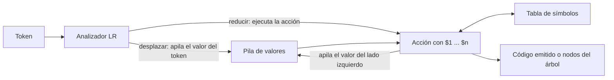

# Compiladores - Análisis dependiente del contexto

## 4.4 Traducción emph{ad-hoc} dirigida por la sintaxis.

---

La **traducción *ad hoc* dirigida por la sintaxis** abandona la formalidad de las gramáticas de atributos: en lugar de reglas que definen atributos y un evaluador que decide el orden, se incrustan **acciones**, fragmentos de código, en las producciones, y el propio analizador las ejecuta en un momento preciso del análisis. Las acciones pueden calcular valores, consultar y actualizar la tabla de símbolos, reportar errores o emitir código. Es la técnica de yacc y bison, de ANTLR y de casi todos los analizadores escritos a mano. Este tema presenta cuándo se ejecutan las acciones en los analizadores ascendentes y descendentes, cómo se comunican los valores, las acciones en medio de una producción y su relación con las gramáticas de atributos.

### Gramáticas de atributos y traducción *ad hoc*

| | Gramática de atributos | Traducción *ad hoc* |
| - | ---------------------- | ------------------- |
| Especificación | reglas que definen atributos, sin efectos secundarios | código arbitrario en las producciones |
| Orden de evaluación | el grafo de dependencias | el del analizador: al reducir en LR, al pasar por la acción en LL |
| Estado global | no lo hay | tabla de símbolos, contadores de temporales y etiquetas, código emitido |
| Verificación | se puede comprobar que la gramática está bien definida | la corrección depende del programador |

Un **esquema de traducción** es una gramática con acciones entre llaves en posiciones precisas del lado derecho. Un esquema que ejecuta cada acción después de los símbolos que la preceden implementa una gramática L-atribuida: los heredados se calculan en acciones **antes** del símbolo que los usa y los sintetizados en acciones **al final**.

### Acciones en un analizador ascendente

En yacc y bison, la acción al final de una producción se ejecuta al **reducir**. El analizador mantiene una **pila de valores** paralela a la de estados: `$1`, ..., `$n` son los valores de los símbolos del lado derecho, que están en el tope de la pila, y el valor que se asigna al símbolo del lado izquierdo, que se escribe con dos signos `$` seguidos, sustituye a los $n$ valores al reducir. Los atributos **sintetizados** se implementan directamente. Los **heredados** son más difíciles, porque al analizar un símbolo todavía no se sabe en qué producción está; bison ofrece dos mecanismos:

- **acciones en medio de una producción**: bison las convierte en un no terminal vacío nuevo, `$@1 → ε`, con la acción, y lo coloca en su lugar; al reducirlo se ejecuta la acción. Como agregan una reducción, pueden crear conflictos que no existían;
- **valores debajo de la producción**, `$0` o `$-1`: los de los símbolos que están en la pila antes del lado derecho, con los que se implementa, por ejemplo, la propagación del tipo en `D → T L`.

### Acciones en un analizador descendente

En un descenso recursivo, cada no terminal es un procedimiento: los **heredados** son sus **parámetros**, los **sintetizados** sus **valores de retorno**, y las acciones pueden ir en cualquier punto del cuerpo, porque el analizador ya decidió qué producción usa antes de empezar a reconocerla. ANTLR permite lo mismo con acciones y argumentos en las reglas, aunque recomienda analizar primero y recorrer después el árbol con visitantes.



### Implementación en Python

El programa genera con bison 3.8 y compila con gcc 13 el traductor de números binarios del ejercicio 1; implementa un analizador descendente que traduce `if-else` a código de tres direcciones con acciones en seis puntos de la producción para el ejercicio 2; prueba con bison cuándo una acción en medio de una producción provoca conflictos para el ejercicio 3, e implementa la declaración con inserción en la tabla de símbolos del ejercicio 4.

```python
import os, re, subprocess, tempfile
TMP = tempfile.mkdtemp()
def corre(cmd, entrada=None):
    r = subprocess.run(cmd, cwd=TMP, input=entrada, capture_output=True, text=True, env={**os.environ, "LC_ALL": "C"})
    return r.stdout, r.stderr, r.returncode
def escribe(nombre, texto): open(os.path.join(TMP, nombre), "w").write(texto)

# ---------- Ejercicio 1: números binarios con acciones de bison ----------
BIN = r'''
%{
#include <stdio.h>
#include <ctype.h>
int yylex(void); void yyerror(const char *s);
%}
%%
linea : B '\n'        { printf("%d\n", $1); }
      ;
B     : B '0'         { $$ = 2 * $1; }
      | B '1'         { $$ = 2 * $1 + 1; }
      | '1'           { $$ = 1; }
      ;
%%
int yylex(void) { int c = getchar(); return c == EOF ? 0 : c; }
void yyerror(const char *s) { printf("error: %s\n", s); }
int main(void) { return yyparse(); }
'''
escribe("bin.y", BIN)
_, err, rc = corre(["bison", "-Wall", "-o", "bin.c", "bin.y"]); assert rc == 0, err
_, err, rc = corre(["gcc", "-o", "bin", "bin.c"]); assert rc == 0, err
print("ejercicio 1: bison", "sin avisos" if not err else err)
for w in ["1", "101", "1011", "11111111", "0101"]:
    out, _, _ = corre(["./bin"], w + "\n"); print(f"   {w:9} -> {out.strip()}", f"(Python: {int(w, 2)})" if w[0] == "1" else "")

# ---------- Ejercicio 2: acciones para if-else en un analizador descendente ----------
class Traductor:
    """If -> if ( Exp ) Stm else Stm, traducido a código de tres direcciones mientras se analiza."""
    def __init__(self, texto, tipos):
        self.t = re.findall(r"\d+\.\d+|\d+|[A-Za-z_]\w*|[<>=!]=|[-+*/<>=(){};]", texto) + ["$"]; self.i = 0
        self.tipos, self.codigo, self.temp, self.etq, self.errores = tipos, [], 0, 0, []
    def mira(self): return self.t[self.i]
    def come(self, x=None):
        v = self.t[self.i]
        if x and v != x: raise SyntaxError(f"se esperaba {x} y llegó {v}")
        self.i += 1; return v
    def nueva_temp(self): self.temp += 1; return f"t{self.temp}"
    def nueva_etq(self): self.etq += 1; return f"L{self.etq}"
    def emite(self, s): self.codigo.append(s)
    def Stm(self):
        if self.mira() == "if":
            self.come("if"); self.come("(")
            cond, tipo = self.Exp()                                  # acción 1: comprobar que la condición es booleana
            if tipo != "bool": self.errores.append(f"la condición del if es {tipo}, no bool")
            self.come(")")
            l_sino, l_fin = self.nueva_etq(), self.nueva_etq()       # acción 2: crear las etiquetas
            self.emite(f"ifFalse {cond} goto {l_sino}")              # acción 3: salto si la condición es falsa
            self.Stm()
            self.emite(f"goto {l_fin}")                              # acción 4: saltar el else
            self.come("else"); self.emite(f"{l_sino}:")              # acción 5: etiqueta del else
            self.Stm()
            self.emite(f"{l_fin}:")                                  # acción 6: etiqueta de salida
        elif self.mira() == "{":
            self.come("{")
            while self.mira() != "}": self.Stm()
            self.come("}")
        else:
            x = self.come(); self.come("="); v, t = self.Exp(); self.come(";")
            if self.tipos.get(x) != t: self.errores.append(f"se asigna {t} a {x}, de tipo {self.tipos.get(x)}")
            self.emite(f"{x} = {v}")
    def Exp(self):
        a, ta = self.Suma()
        if self.mira() in ("<", ">", "<=", ">=", "==", "!="):
            op = self.come(); b, tb = self.Suma(); t = self.nueva_temp(); self.emite(f"{t} = {a} {op} {b}")
            return t, ("bool" if ta == tb else "error")
        return a, ta
    def Suma(self):
        a, ta = self.Factor()
        while self.mira() in "+-":
            op = self.come(); b, tb = self.Factor(); t = self.nueva_temp(); self.emite(f"{t} = {a} {op} {b}"); a = t
            ta = ta if ta == tb else "error"
        return a, ta
    def Factor(self):
        x = self.come()
        if x == "(": v = self.Exp(); self.come(")"); return v
        if x.isdigit(): return x, "int"
        return x, self.tipos.get(x, "error")
tr = Traductor("if (x < y + 1) { m = y; } else if (x == y) m = 0; else m = x - y;", {"x": "int", "y": "int", "m": "int"})
tr.Stm(); print("ejercicio 2:", " ; ".join(tr.codigo), "| errores:", tr.errores or "ninguno")
tr = Traductor("if (x + 1) m = 1; else m = 2;", {"x": "int", "m": "int"}); tr.Stm(); print("   if (x + 1):", tr.errores)

# ---------- Ejercicio 3: acciones en medio de una producción en bison ----------
def gramatica(con_otra, con_accion):
    otra = "| FOR '(' ID ':' ID ')' sent" if con_otra else ""
    accion = "{ printf(\"inicio\\n\"); }" if con_accion else ""
    return f'''
%{{
int yylex(void); void yyerror(const char *s);
#include <stdio.h>
%}}
%token FOR ID
%%
sent : FOR '(' {accion} ID ';' ID ';' ID ')' sent
     {otra}
     | ID ';'
     ;
%%
'''
print("ejercicio 3: acción en medio | segunda alternativa for ( ID : ID ) | resultado de bison")
for otra in (False, True):
    for accion in (True, False):
        escribe("f.y", gramatica(otra, accion)); _, err, rc = corre(["bison", "-Wall", "-o", "f.c", "f.y"])
        conf = [l.split("warning: ")[1] for l in err.splitlines() if "conflict" in l and "warning:" in l]
        print(f"   {'sí' if accion else 'no':2} | {'sí' if otra else 'no':2} |", conf or "sin conflictos")
escribe("f.y", gramatica(False, True)); corre(["bison", "-o", "f.c", "-v", "f.y"])
salida = open(os.path.join(TMP, "f.output")).read()
print("   bison crea la regla vacía:", re.search(r"\$@1: %empty", salida).group())

# ---------- Ejercicio 4: declaration -> FLOAT ID con inserción en la tabla de símbolos ----------
class Declaraciones:
    def __init__(self, texto): self.t = texto.replace(";", " ; ").split() + ["$"]; self.i = 0; self.tabla = {}; self.errores = []
    def come(self, x=None):
        v = self.t[self.i]
        if x and v != x: raise SyntaxError(f"se esperaba {x} y llegó {v}")
        self.i += 1; return v
    def declaration(self):
        tipo = self.come("float")                                  # FLOAT
        nombre = self.come()                                       # ID
        if not nombre.isidentifier(): raise SyntaxError(f"'{nombre}' no es un identificador")
        if nombre in self.tabla:                                   # acción: comprobar la unicidad
            self.errores.append(f"'{nombre}' ya fue declarada como {self.tabla[nombre]['tipo']}")
        else:                                                      # acción: insertar con su desplazamiento
            self.tabla[nombre] = {"tipo": tipo, "desplazamiento": 4 * len(self.tabla)}
        self.come(";")
    def programa(self):
        while self.t[self.i] != "$": self.declaration()
        return self.tabla
d = Declaraciones("float a; float b; float a; float suma;")
print("ejercicio 4:", d.programa(), "| errores:", d.errores)
```

Salida:

```text
ejercicio 1: bison sin avisos
   1         -> 1 (Python: 1)
   101       -> 5 (Python: 5)
   1011      -> 11 (Python: 11)
   11111111  -> 255 (Python: 255)
   0101      -> error: syntax error 
ejercicio 2: t1 = y + 1 ; t2 = x < t1 ; ifFalse t2 goto L1 ; m = y ; goto L2 ; L1: ; t3 = x == y ; ifFalse t3 goto L3 ; m = 0 ; goto L4 ; L3: ; t4 = x - y ; m = t4 ; L4: ; L2: | errores: ninguno
   if (x + 1): ['la condición del if es int, no bool']
ejercicio 3: acción en medio | segunda alternativa for ( ID : ID ) | resultado de bison
   sí | no | sin conflictos
   no | no | sin conflictos
   sí | sí | ['1 shift/reduce conflict [-Wconflicts-sr]', 'rule useless in parser due to conflicts [-Wother]']
   no | sí | sin conflictos
   bison crea la regla vacía: $@1: %empty
ejercicio 4: {'a': {'tipo': 'float', 'desplazamiento': 0}, 'b': {'tipo': 'float', 'desplazamiento': 4}, 'suma': {'tipo': 'float', 'desplazamiento': 8}} | errores: ["'a' ya fue declarada como float"]
```

### Ejercicios Propuestos

1. **De atributos a acciones.** La siguiente gramática de atributos calcula el valor de un número binario. Conviértela en una traducción *ad hoc* con acciones semánticas y la notación de yacc.

    | Producción | Regla semántica |
    | ---------- | --------------- |
    | $B \to B_1\ 0$ | $B.\text{val} = 2\, B_1.\text{val}$ |
    | $B \to B_1\ 1$ | $B.\text{val} = 2\, B_1.\text{val} + 1$ |
    | $B \to 1$ | $B.\text{val} = 1$ |

2. **Diseño de acciones.** Para la producción `If -> 'if' '(' Exp ')' Stm 'else' Stm`, lista las acciones semánticas necesarias y su ubicación dentro de la producción para un analizador descendente, considerando la verificación de que `Exp` es booleana y la generación de código con saltos.

3. **Ubicación.** ¿Es posible en un analizador LR como yacc la siguiente acción en medio de una producción? ¿Qué problema puede causar y dónde debería moverse?

    ```text
    statement : 'for' '(' { /* acción inicial */ } exprStmt ';' expr ';' exprStmt ')' statement
    ```

4. **Implementación.** Escribe la función de un analizador descendente para la regla `declaration -> FLOAT ID`, con las acciones semánticas de inserción en la tabla de símbolos.

### Soluciones

**Ejercicio 1.** Cada regla se convierte en una acción al final de su producción, con `$1` como el valor de $B_1,$ así:

```yacc
B : B '0'   { $$ = 2 * $1; }
  | B '1'   { $$ = 2 * $1 + 1; }
  | '1'     { $$ = 1; }
  ;
```

La gramática es S-atribuida y recursiva por la izquierda, lo ideal para LR: cada reducción toma el valor de la pila, lo duplica y suma el dígito, el método de Horner. Bison la acepta sin avisos, y el programa generado traduce `1011` en 11 y `11111111` en 255, como Python. La cadena `0101` es un error porque la gramática exige que el primer dígito sea 1; para admitir el cero hay que agregar $B \to 0.$

**Ejercicio 2.** Las acciones, en el orden en que el analizador las ejecuta:

1. después de `Exp`: comprobar que su tipo sintetizado es `bool` y reportar el error si no;
2. antes del primer `Stm`: crear dos etiquetas nuevas, la del `else` y la de salida;
3. también antes del primer `Stm`: emitir el salto condicional `ifFalse t goto Lelse`;
4. después del primer `Stm`: emitir `goto Lfin`, para saltarse el `else`;
5. después de `else`: emitir la etiqueta `Lelse:`;
6. al final: emitir la etiqueta `Lfin:`.

Las etiquetas son atributos **heredados** del cuerpo que se calculan antes de usarse, y por eso la acción 2 va antes del primer `Stm`. El programa traduce un `if` con otro `if` anidado en el `else`, cada uno con sus propias etiquetas, y rechaza `if (x + 1)` porque la condición es entera. Si el lenguaje usa ámbitos por bloque, las acciones de abrir y cerrar el ámbito van al entrar y salir de cada `Stm`, no de la condición.

**Ejercicio 3.** **Sí es posible:** yacc y bison aceptan acciones en medio de una producción, reemplazándolas por un no terminal vacío, `$@1: %empty`, con la acción, que se reduce cuando el analizador llega a ese punto. El problema es que, para reducir `$@1` justo después del `(`, el analizador debe saber ya que está en esta producción. Si existe otra producción que empieza igual, como un `for (x : lista)`, al ver el `ID` después del `(` el analizador no puede decidir si reduce `$@1` o desplaza el `ID`: bison reporta un conflicto de desplazamiento contra reducción, como muestra el programa, y la otra alternativa queda inútil. Las soluciones son mover la acción a un punto donde la producción ya está determinada, por ejemplo después del primer `;`, o a una regla propia, `inicio_for : exprStmt { ... }`, que se reduce después de reconocer la inicialización.

**Ejercicio 4.** La función del programa sigue la producción: consume `float`, consume el identificador, y entonces ejecuta las acciones: si el nombre ya está en la tabla, reporta el error de **unicidad** sin detener el análisis; si no, lo inserta con su tipo y su **desplazamiento**, que es el tamaño acumulado de las variables anteriores. Con `float a; float b; float a; float suma;` inserta tres variables, con desplazamientos 0, 4 y 8, y reporta la redeclaración de `a`.

En el material original, el texto decía que en un analizador LR "solo se pueden usar atributos sintetizados", cuando bison implementa heredados con las acciones en medio de las producciones y con `$0`, y el ejercicio 3 suponía que esas acciones son imposibles en yacc; la calculadora de ejemplo usaba el token `INT` sin declararlo y la tabla `tabla_simbolos.h` sin definirla, y el texto mezclaba palabras en inglés, como "itself".

### Referencias

1. Aho, A. V., Lam, M. S., Sethi, R., and Ullman, J. D., _Compilers: Principles, Techniques, and Tools_. 2a ed., Pearson, 2007. Secciones 5.4 y 5.5.
2. Cooper, K. D., and Torczon, L., _Engineering a Compiler_. 3a ed., Morgan Kaufmann, 2022. Sección 4.4.
3. Donnelly, C., and Stallman, R., _Bison: The Yacc-compatible Parser Generator_. Manual de GNU Bison 3.8, secciones sobre acciones en medio de las reglas.
4. Johnson, S. C., Yacc: Yet Another Compiler-Compiler. _Computing Science Technical Report_ 32, Bell Laboratories, 1975.
5. Parr, T., _The Definitive ANTLR 4 Reference_. 2a ed., Pragmatic Bookshelf, 2013. Capítulo 10.
