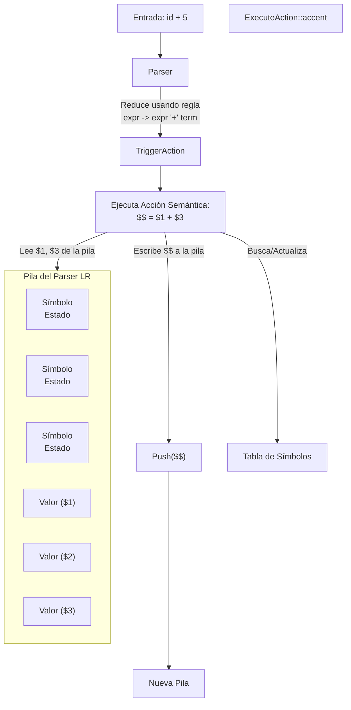

# Compiladores - Análisis dependiente del contexto

## 4.4 Traducción emph{ad-hoc} dirigida por la sintaxis.

---

La **Traducción Ad-hoc Dirigida por la Sintaxis** (o _ad-hoc syntax-directed translation_) es un enfoque práctico e imperativo para realizar el análisis semántico y la generación de código intermedio. Consiste en **incrustar fragmentos de código** (llamados **acciones semánticas**) directamente dentro de las producciones de una gramática. Estas acciones se ejecutan en un orden determinado por el análisis sintáctico y manipulan estructuras de datos globales (como una pila semántica o una tabla de símbolos) para realizar su trabajo.

**Propósito:** Proporcionar un método directo, flexible y fácil de implementar para especificar las reglas semánticas de un lenguaje, evitando la complejidad formal de las gramáticas de atributos puras. Es la base de herramientas clásicas como Yacc, Bison y ANTLR.

### Diferencias con las Gramáticas de Atributos Formales

| Característica     | Gramáticas de Atributos                                            | Traducción Ad-hoc                                                    |
| :----------------- | :----------------------------------------------------------------- | :------------------------------------------------------------------- |
| **Enfoque**        | Declarativo y formal.                                              | Imperativo y práctico.                                               |
| **Especificación** | Reglas semánticas que definen valores de atributos.                | Fragmentos de código (acciones) incrustados en la gramática.         |
| **Evaluación**     | Determinada por el grafo de dependencias de atributos.             | Determinada por el orden del parser (e.g., LR: reduce, LL: predict). |
| **Implementación** | Requiere un evaluador general de atributos o un traverser del AST. | Las acciones son código ejecutable intercalado en el parser.         |
| **Flexibilidad**   | Menos flexible para operaciones complejas o de lado efecto.        | Muy flexible; se puede escribir cualquier código en las acciones.    |

### Implementación Práctica: Acciones Semánticas

Una acción semántica es un bloque de código (en C, Java, Python, etc.) que se coloca dentro de una producción gramatical. Su ejecución está ligada a la aplicación de esa producción durante el parsing.

**Estructura típica en Bison (Yacc):**

```
production: syntax_rule { /* acción semántica */ }
           | another_rule { /* otra acción */ }
           ;
```

Estas acciones suelen manipular:

- Una **pila semántica** para valores calculados (muy común en parsers LR).
- Una **tabla de símbolos** global o por ámbito.
- Variables auxiliares para almacenar estado.
- El **AST** que se está construyendo.

Para acceder a los valores de los componentes de la producción, se usan referencias posicionales como `$1`, `$2`, ..., `$n` (para los elementos del lado derecho) y `$$` (para el resultado del no terminal del lado izquierdo).

**Ejemplo Básico:**

```
expr : expr '+' term { $$ = $1 + $3; } // $$ = valor de la expr, $1 = valor de expr, $3 = valor de term
      ;
term : NUM { $$ = $1; } // El valor de un término numérico es el número itself
      ;
```

En este ejemplo, `$1` y `$3` se refieren a los valores sintetizados por los primeros y terceros símbolos en la producción (`expr` y `term`), y `$$` es el valor que se propagará hacia arriba para este `expr`.

### Ubicación de las Acciones Semánticas

El momento de ejecución de una acción es crucial y depende del tipo de parser:

1.  **Parsers Ascendentes (LR - Yacc/Bison):**
    - Las acciones se ejecutan **cuando la producción se reduce** (al final de reconocer la regla).
    - **Sólo se pueden usar atributos sintetizados.** Los valores se almacenan en la pila del parser.
    - Es el paradigma de **traducción dirigida por sintaxis L-attributed** restringido a atributos sintetizados.

2.  **Parsers Descendentes (LL - ANTLR, Recursivos):**
    - Las acciones se pueden colocar en **cualquier lugar** dentro del cuerpo de una producción (al principio, en el medio, al final).
    - Se pueden simular **atributos heredados** pasando parámetros a las funciones recursivas del parser.
    - Es más flexible y se acerca más al poder de las gramáticas L-attributed.

**Ejemplo de ubicación en un parser descendente (pseudocódigo):**

```
void parseIfStatement() {
    match("if");
    match("(");
    Expression condition = parseExpression(); // Atributo heredado: el contexto actual
    match(")");
    { /* Acción: abrir nuevo ámbito para la condición */ }
    Statement thenBranch = parseStatement();
    { /* Acción: cerrar ámbito, decidir si hay 'else' */ }
    if (lookahead == "else") {
        match("else");
        Statement elseBranch = parseStatement();
    }
    { /* Acción: construir nodo AST if-else */ }
}
```

### Ejemplo: Calculadora con Declaraciones de Variables

Vamos a implementar un pequeño lenguaje que declare variables y realice operaciones. Usaremos un estilo similar a Bison.

**Gramática y Acciones (Simplificado):**

```yacc
%{
// Declaraciones: tabla de símbolos, funciones, etc.
#include <stdio.h>
#include <stdlib.h>
#include <string.h>
#include "tabla_simbolos.h" // Suponiendo su existencia

void yyerror(const char *s);
int yylex();
%}

%union {
    int int_val;
    float float_val;
    char *string_val;
    // Podría tener un puntero a un nodo AST también
}

%token <string_val> ID
%token <int_val> INT_LIT
%token <float_val> FLOAT_LIT
%type <float_val> expr
%type <int_val> declaration

%%

program:
    /* vacío */
    | program statement '\n'
    ;

statement:
    declaration { printf("Declarada variable entera.\n"); }
    | expr      { printf("Resultado: %f\n", $1); } // Acción al reducir 'expr'
    ;

declaration:
    INT ID {
        // Acción: Insertar el ID en la tabla de símbolos como tipo INT
        if (insertar_simbolo($2, ENTERO) != 0) {
            yyerror("Variable ya declarada");
            YYERROR; // Forza un error de parsing
        }
        free($2); // Liberar la string del ID si es necesario
        $$ = 0; // Valor de retorno sintetizado para la declaración
    }
    ;

expr:
    FLOAT_LIT     { $$ = $1; } // Sintetizar el valor del literal
    | ID          {
        // Buscar el ID. Si no existe, error. Si existe, obtener su valor.
        struct simbolo *s = buscar_simbolo($1);
        if (s == NULL) {
            yyerror("Variable no declarada");
            YYERROR;
        }
        // Simplificación: asumimos que su valor numérico está almacenado
        $$ = s->valor_actual;
        free($1);
    }
    | expr '+' expr { $$ = $1 + $3; } // Sintetizar la suma
    | expr '-' expr { $$ = $1 - $3; }
    | '(' expr ')'  { $$ = $2; } // Los paréntesis no cambian el valor
    ;

%%

// Funciones auxiliares (yyerror, main...) irían aquí.
```

- **`$$`:** Representa el valor sintetizado para el no terminal de la izquierda.
- **`$1, $2, $3`:** Representan los valores de los componentes en el lado derecho de la producción.
- Las acciones manejan la tabla de símbolos (`insertar_simbolo`, `buscar_simbolo`), reportan errores y calculan valores.

### Ventajas y Desventajas

| Ventajas                                                                       | Desventajas                                                                                       |
| :----------------------------------------------------------------------------- | :------------------------------------------------------------------------------------------------ |
| (✓) **Sencillez conceptual y de implementación.** Es (intuitivo).              | (X) **Mezcla lógica de parsing y semántica.** Viola el principio de separación de preocupaciones. |
| (✓) **Muy eficiente.** Las acciones se ejecutan inline durante el parsing.     | (X) **Poca mantenibilidad.** La gramática se vuelve densa y difícil de leer.                      |
| (✓) **Ampliamente soportado.** Es el método de herramientas populares.         | (X) **Dependiente del tipo de parser.** Las ubicaciones válidas cambian (LR vs LL).               |
| (✓) **Poder expresivo total.** Puedes escribir cualquier código en una acción. | (X) **Difícil de depurar.** El flujo está ligado al orden de reducción/predicción.                |

### Ejercicios Propuestos

1.  **Conversión de Gramática de Atributos:** La siguiente gramática de atributos calcula el valor de una expresión en binario. Conviértela a una traducción ad-hoc usando acciones semánticas y la notación `$$`, `$1`, etc. Asume una pila semántica.

    ```
    Producción          Regla Semántica
    ------------------------------------
    B -> B₁ '0'        B.val = 2 * B₁.val
    B -> B₁ '1'        B.val = 2 * B₁.val + 1
    B -> '1'           B.val = 1
    ```

2.  **Diseño de Acciones:** Para la producción `If -> 'if' '(' Exp ')' Stm 'else' Stm`, lista las acciones semánticas necesarias y su ubicación probable dentro de la producción para un parser descendente. Considera: verificación de que `Exp` es booleana, y la creación del nodo AST para la sentencia `if`.

3.  **Análisis de Ubicación:** ¿Por qué la siguiente acción semántica colocada en medio de una producción **no** sería posible en un parser LR ascendente estándar como Yacc? ¿Dónde tendría que moverse?

    ```
    statement : 'for' '(' { /* init action */ } exprStmt ';' expr ';' exprStmt ')' statement
    ```

4.  **Implementación Mental:** Escribe en pseudocódigo la función para un parser recursivo descendente que maneje la regla `declaration -> FLOAT ID` del ejemplo anterior, incluyendo las acciones semánticas de inserción en la tabla de símbolos.

### Diagrama: Flujo de una Traducción Ad-hoc

El siguiente diagrama ilustra el flujo de información y control durante la traducción ad-hoc en un parser LR, mostrando la interacción entre la pila de parsing, las acciones semánticas y la tabla de símbolos.



### Referencias

#### Bibliografía Básica

1.  Aho, Lam, Sethi y Ullman. _Compilers: Principles, Techniques, and Tools, 2nd Edition_. Pearson Education, 2007. **(Capítulo 5 - Traducción Dirigida por la Sintaxis, Sección 5.5 - Traducción durante el Análisis Sintáctico)**.
2.  Keith D. Cooper y Linda Torczon. _Engineering a Compiler, 2nd Edition_. Morgan Kaufmann, 2011. **(Capítulo 3 - Parsing, cubre la integración de acciones en parsers recursivos descendentes)**.

#### Bibliografía Complementaria

1.  **Documentación de Bison (GNU Parser Generator):** La fuente definitiva para la implementación práctica con parsers LR. Explica en detalle el uso de `$$`, `$n`, y la ubicación de acciones.
2.  **Documentación de ANTLR:** Muestra el enfoque para parsers LL y cómo usar acciones semánticas y atributos heredados (parámetros) y sintetizados (valores de retorno) en funciones de parser.
