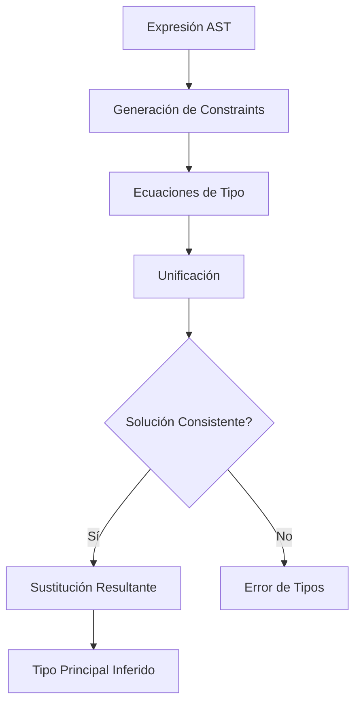
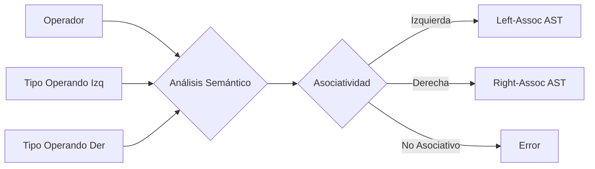

# Compiladores - Análisis dependiente del contexto

## 4.5 Temas avanzados (inferencia de tipos y cambio de asociatividad).

---

### Inferencia de Tipos

#### Algoritmo de Hindley-Milner

El algoritmo de Hindley-Milner (también conocido como algoritmo W) es un método clásico para la inferencia de tipos en lenguajes funcionales. Su poder radica en que puede inferir el tipo más general (**tipo principal**) de una expresión sin necesidad de anotaciones de tipo.

**Definición formal:** Dado un término $e$ y un entorno de tipos $\Gamma$ (que mapea variables a sus tipos), el algoritmo produce una sustitución $S$ y un tipo $\tau$ tal que:

$$ S\Gamma \vdash e : \tau $$

El algoritmo consta de dos fases principales:

1.  **Generación de constraints:** Recorre el AST generando ecuaciones de tipos.
2.  **Unificación:** Resuelve las ecuaciones para encontrar el tipo más general.

**Ejemplo básico:**

```haskell
-- Función identity en Haskell
id x = x
-- El algoritmo inferirá: id :: a -> a
```

#### Unificación y Polimorfismo Paramétrico

La **unificación** es el proceso de encontrar una sustitución $S$ que haga que dos tipos sean iguales:

$$ S(\tau_1) = S(\tau_2) $$

**Algoritmo de unificación** (Robinson, 1965):

```python
def unify(t1, t2, subst):
    if subst is None:
        return None
    elif t1 == t2:
        return subst
    elif is_variable(t1):
        return unify_variable(t1, t2, subst)
    elif is_variable(t2):
        return unify_variable(t2, t1, subst)
    elif is_compound(t1) and is_compound(t2):
        return unify(args(t1), args(t2), unify(constructor(t1), constructor(t2), subst))
    else:
        return None
```

**Polimorfismo paramétrico** permite que funciones operen sobre valores de cualquier tipo:

$$ \text{map} :: (a \rightarrow b) \rightarrow [a] \rightarrow [b] $$

#### Sistema de Tipos de Damas-Hindley-Milner

El sistema extendido incluye:

- **Tipos monomórficos:** $\tau ::= \alpha \mid \text{Int} \mid \text{Bool} \mid \tau_1 \rightarrow \tau_2$
- **Tipos polimórficos:** $\sigma ::= \tau \mid \forall \alpha. \sigma$
- **Regla de generalización:** $\frac{\Gamma \vdash e : \tau \quad \alpha \notin \text{ftv}(\Gamma)}{\Gamma \vdash e : \forall \alpha. \tau}$
- **Regla de instanciación:** $\frac{\Gamma \vdash e : \forall \alpha. \tau}{\Gamma \vdash e : \tau[\alpha := \tau']}$

**Ejemplo de inferencia:**

```haskell
-- Inferencia para función compose
compose f g x = f (g x)
-- Paso a paso:
-- 1. g :: a -> b
-- 2. x :: a
-- 3. g x :: b
-- 4. f :: b -> c
-- 5. f (g x) :: c
-- 6. compose :: (b -> c) -> (a -> b) -> a -> c
```

### Cambio de Asociatividad en Tiempo de Ejecución

#### Problema de la Asociatividad Dinámica

Algunos operadores pueden cambiar su asociatividad según el contexto. El ejemplo clásico es el operador de exponenciación:

- **Matemáticas:** $2^{3^2} = 2^9 = 512$ (asociativo por la derecha)
- **Potencia en Python:** `2 ** 3 ** 2 = 512` (asociativo por la derecha)
- **Otros operadores:** `a ? b ? c` donde `?` podría ser asociativo izquierdo o derecho según tipos

**Solución mediante análisis semántico:**

```python
def check_associativity(operator, left_type, right_type):
    if operator == '**':
        # Exponentación es siempre asociativa derecha
        return 'right'
    elif operator in ['+', '-', '*', '/']:
        # Operadores aritméticos son asociativos izquierdos
        return 'left'
    elif operator in ['==', '!=']:
        # Operadores de comparación pueden necesar verificación
        if left_type == right_type:
            return 'left'
        else:
            raise TypeMismatchError(f"Cannot compare {left_type} and {right_type}")
```

#### Implementación con Gramáticas Atribuidas

Para manejar asociatividad dinámica, necesitamos atributos heredados y sintetizados:

```
Expr ::= Expr_left Op Expr_right
{
    // Verificar compatibilidad de tipos
    if (!is_compatible(Expr_left.type, Expr_right.type)) {
        error("Type mismatch");
    }

    // Determinar asociatividad basado en el operador y tipos
    string assoc = get_associativity(Op.value, Expr_left.type, Expr_right.type);

    if (assoc == "left") {
        Expr.type = result_type(Op.value, Expr_left.type);
    } else if (assoc == "right") {
        Expr.type = result_type(Op.value, Expr_right.type);
    }

    // Propagación de contexto
    Expr_left.inherited_type = expected_type;
    Expr_right.inherited_type = Expr_left.type;
}
```

### Ejercicios Propuestos

1. **Inferencia de Tipos:** Para la siguiente expresión lambda, aplica el algoritmo de Hindley-Milner paso a paso:

   ```haskell
   \f -> \g -> \x -> f (g x)
   ```

2. **Unificación:** Resuelve las siguientes ecuaciones de tipos:
   - $(\alpha \rightarrow \beta) = (\text{Int} \rightarrow \gamma)$
   - $(\alpha \rightarrow \alpha) = (\beta \rightarrow \text{Bool})$
   - $(\alpha \rightarrow \beta) = (\gamma \rightarrow \gamma)$

3. **Asociatividad Dinámica:** Diseña un sistema de tipos que permita que el operador `+` sea:
   - Asociativo izquierdo para números
   - Asociativo derecho para strings (concatenación)
   - No asociativo para mezclas de tipos

4. **Implementación:** Escribe pseudocódigo para una función que determine la asociatividad de operadores basado en:
   - El operador mismo
   - Los tipos de los operandos
   - El contexto de uso

### Diagramas

#### Diagrama de Flujo del Algoritmo de Hindley-Milner



#### Diagrama de Asociatividad Dinámica



### Referencias

#### Bibliografía Básica

1. Aho, Lam, Sethi y Ullman. _Compilers: Principles, Techniques, and Tools, 2nd Edition_. Pearson Education, 2007. **(Capítulo 6 - Análisis de Tipos)**.
2. Pierce, Benjamin C. _Types and Programming Languages_. MIT Press, 2002. **(Capítulo 22 - Inferencia de Tipos)**.

#### Bibliografía Complementaria

1. Milner, Robin. "A theory of type polymorphism in programming". _Journal of Computer and System Sciences_, 1978.
2. Damas, Luis; Milner, Robin. "Principal type-schemes for functional programs". _POPL 1982_.
3. Cardelli, Luca. "Type Systems". _ACM Computing Surveys_, 1996.

#### Recursos Adicionales

1. _"Algorithm W Step by Step"_ - implementación detallada del algoritmo
2. _"Types and Programming Languages"_ - libro de referencia estándar
3. _"Advanced Topics in Types and Programming Languages"_ - para temas más avanzados
