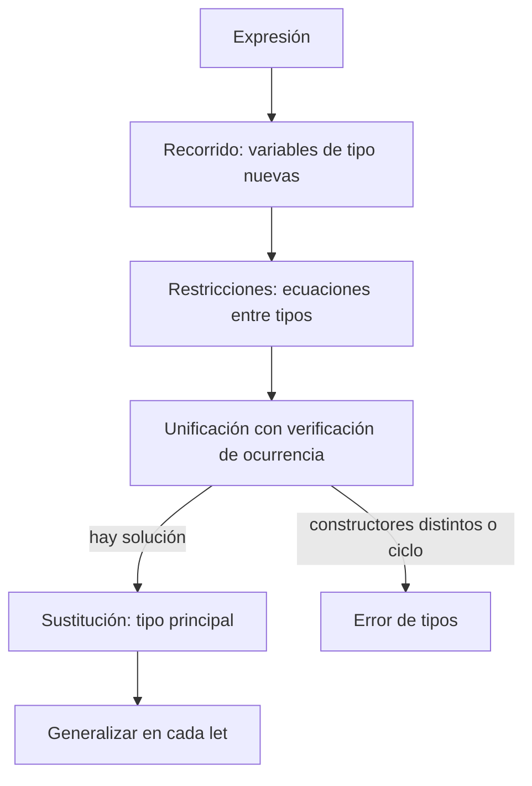

# Compiladores - Análisis dependiente del contexto

## 4.5 Temas avanzados (inferencia de tipos y cambio de asociatividad).

---

Este tema trata dos problemas que van más allá del recorrido simple del árbol. La **inferencia de tipos** deduce los tipos que el programador no escribió, resolviendo restricciones entre tipos con **unificación**; su forma clásica, el sistema de Hindley y Milner de ML y Haskell, infiere el tipo más general de cada expresión, incluido el polimorfismo. El **cambio de asociatividad** aparece al transformar una gramática para el análisis descendente: al eliminar la recursión por la izquierda, la gramática se vuelve recursiva por la derecha y el árbol que sugiere asocia los operadores al revés; la traducción debe corregirlo. El tema presenta ambos con implementaciones completas.

### Tipos y sustituciones

Los tipos **monomórficos** son $\tau ::= \alpha \mid \text{Int} \mid \text{Bool} \mid \tau_1 \to \tau_2,$ donde $\alpha$ es una **variable de tipo**, y los **esquemas** polimórficos son $\sigma ::= \tau \mid \forall \alpha.\, \sigma.$ Una **sustitución** $S$ asigna tipos a variables, y $S(\tau)$ las reemplaza en $\tau.$ Un **unificador** de $\tau_1$ y $\tau_2$ es una sustitución con $S(\tau_1) = S(\tau_2),$ y el **unificador más general** es uno del que todos los demás se obtienen componiendo con otra sustitución.

### Unificación

El algoritmo de Robinson, de 1965, calcula el unificador más general:

1. si los dos tipos son iguales, no hay nada que hacer;
2. si uno es una variable $\alpha,$ se agrega $\alpha := \tau,$ salvo que $\alpha$ **aparezca** en $\tau,$ porque entonces $\alpha = \tau$ no tiene solución finita: es la **verificación de ocurrencia**;
3. si ambos tienen el mismo constructor, como $\to,$ se unifican sus argumentos uno por uno, aplicando la sustitución acumulada;
4. en otro caso, como $\text{Int}$ contra $\text{Bool}$ o contra una flecha, no unifican.

**Teorema.** Si dos tipos son unificables, el algoritmo termina con su unificador más general; si no, termina con un fallo. Con representaciones de grafos compartidos y unión de conjuntos, se implementa en tiempo casi lineal.

### El algoritmo W

El algoritmo **W** de Damas y Milner recorre la expresión asignando variables de tipo nuevas y unificando:

- **variable:** se toma su esquema del entorno y se **instancia**, reemplazando sus variables cuantificadas por variables nuevas;
- **abstracción** $\lambda x.\, e:$ se da a $x$ una variable nueva $\alpha,$ se infiere $e : \tau,$ y el resultado es $\alpha \to \tau;$
- **aplicación** $e_1\, e_2:$ se infieren $\tau_1$ y $\tau_2,$ y con una variable nueva $\beta$ se unifica $\tau_1 = \tau_2 \to \beta;$ el resultado es $\beta;$
- **let** $x = e_1$ **in** $e_2:$ se infiere $e_1 : \tau_1$ y se **generaliza**, cuantificando las variables de $\tau_1$ que no son libres en el entorno; así $x$ es polimórfica dentro de $e_2.$

Las reglas de generalización e instanciación son:

$$\frac{\Gamma \vdash e : \tau \qquad \alpha \notin \text{ftv}(\Gamma)}{\Gamma \vdash e : \forall \alpha.\, \tau} \qquad \frac{\Gamma \vdash e : \forall \alpha.\, \tau}{\Gamma \vdash e : \tau[\alpha := \tau']}$$

**Teorema** de Damas y Milner. Si una expresión tiene algún tipo, W encuentra su **tipo principal**, del que todos los demás son instancias. El polimorfismo solo se introduce en los `let`: un parámetro de una función lambda es monomórfico dentro de ella, y por eso $(\lambda \mathit{id}.\, (\mathit{id}\ 1, \mathit{id}\ \text{true}))\ (\lambda x.\, x)$ no tiene tipo, aunque la versión con `let` sí. El problema de la inferencia es DEXPTIME-completo en el peor caso, por los `let` anidados, pero lineal en la práctica.



### Cambio de asociatividad

La gramática $E \to E - T \mid T$ es recursiva por la izquierda y su árbol asocia la resta por la izquierda. Para el análisis descendente se transforma en $E \to T E',$ $E' \to - T E' \mid \varepsilon,$ que es recursiva por la derecha: si la traducción construye el árbol siguiendo la gramática, `10 - 4 - 3` queda como $10 - (4 - 3) = 9,$ y no como $(10 - 4) - 3 = 3.$ La gramática genera el mismo lenguaje, pero su **estructura** cambió. La corrección es una traducción con un atributo **heredado**: $E'$ recibe el árbol construido hasta ahora, el operando izquierdo acumulado, y cada $- T$ crea el nodo $(\text{acumulado} - T),$ que pasa al siguiente $E'.$ Es lo que hace el ciclo `while` de un descenso recursivo. El cambio inverso también ocurre: para hacer asociativa por la derecha la exponenciación en una gramática LR, se usa recursión por la derecha, que consume más pila.

### Implementación en Python

El programa implementa la unificación de Robinson con verificación de ocurrencia y el algoritmo W con `let` polimórfico, con la traza de las variables y las ecuaciones; resuelve con ellos los ejercicios 1 y 2 y otros casos que muestran el polimorfismo y los errores. Después muestra el cambio de asociatividad con y sin el atributo heredado, e implementa la asociatividad dependiente de los tipos de los ejercicios 3 y 4.

```python
import itertools

# ---------- Tipos, sustituciones y unificación de Robinson con verificación de ocurrencia ----------
class TVar:
    def __init__(self, n): self.n = n
    def __eq__(self, o): return isinstance(o, TVar) and o.n == self.n
    def __hash__(self): return hash(self.n)
    def __repr__(self): return self.n
class TCon:
    def __init__(self, nombre, args=()): self.nombre, self.args = nombre, tuple(args)
    def __eq__(self, o): return isinstance(o, TCon) and (o.nombre, o.args) == (self.nombre, self.args)
    def __hash__(self): return hash((self.nombre, self.args))
    def __repr__(self):
        if self.nombre == "->":
            a, b = self.args; return (f"({a})" if isinstance(a, TCon) and a.nombre == "->" else f"{a}") + f" -> {b}"
        if self.nombre == "*": return f"({self.args[0]}, {self.args[1]})"
        return self.nombre
def flecha(a, b): return TCon("->", (a, b))
INT, BOOL = TCon("Int"), TCon("Bool")
def aplica(s, t):
    if isinstance(t, TVar): return aplica(s, s[t]) if t in s else t
    return TCon(t.nombre, [aplica(s, a) for a in t.args])
def libres(t): return {t} if isinstance(t, TVar) else set().union(*[libres(a) for a in t.args]) if t.args else set()
class ErrorTipos(Exception): pass
def unifica(t1, t2, s, traza=None):
    t1, t2 = aplica(s, t1), aplica(s, t2)
    if traza is not None: traza.append(f"{t1} = {t2}")
    if t1 == t2: return s
    if isinstance(t1, TVar):
        if t1 in libres(t2): raise ErrorTipos(f"verificación de ocurrencia: {t1} aparece en {t2}")
        return {**s, t1: t2}
    if isinstance(t2, TVar): return unifica(t2, t1, s, traza)
    if t1.nombre != t2.nombre or len(t1.args) != len(t2.args): raise ErrorTipos(f"{t1} y {t2} tienen constructores distintos")
    for a, b in zip(t1.args, t2.args): s = unifica(a, b, s, traza)
    return s

# ---------- Algoritmo W de Hindley y Milner, con let polimórfico ----------
class Esquema:
    def __init__(self, vars_, t): self.vars, self.t = vars_, t
class Inferencia:
    def __init__(self): self.cont = itertools.count(); self.traza = []
    def nueva(self): return TVar("t" + str(next(self.cont)))
    def instancia(self, e): return aplica({v: self.nueva() for v in e.vars}, e.t)
    def generaliza(self, entorno, t, s):
        libres_entorno = set().union(*[libres(aplica(s, e.t)) - set(e.vars) for e in entorno.values()]) if entorno else set()
        return Esquema(sorted(libres(t) - libres_entorno, key=lambda v: v.n), t)
    def W(self, entorno, e, s):
        """e: ('var', x) | ('lam', x, cuerpo) | ('app', f, a) | ('let', x, e1, e2) | ('lit', valor) | ('par', a, b)"""
        k = e[0]
        if k == "lit": return s, INT if isinstance(e[1], int) and not isinstance(e[1], bool) else BOOL
        if k == "var":
            if e[1] not in entorno: raise ErrorTipos(f"variable libre {e[1]}")
            t = self.instancia(entorno[e[1]]); self.traza.append(f"{e[1]} : {aplica(s, t)}"); return s, t
        if k == "lam":
            a = self.nueva(); self.traza.append(f"\\{e[1]} : {a}")
            s, tc = self.W({**entorno, e[1]: Esquema([], a)}, e[2], s)
            return s, flecha(a, tc)
        if k == "app":
            s, tf = self.W(entorno, e[1], s); s, ta = self.W(entorno, e[2], s); r = self.nueva()
            self.traza.append(f"aplicación: {aplica(s, tf)} = {aplica(s, ta)} -> {r}")
            s = unifica(tf, flecha(ta, r), s); return s, r
        if k == "let":
            s, t1 = self.W(entorno, e[2], s); esq = self.generaliza(entorno, aplica(s, t1), s)
            self.traza.append(f"let {e[1]} : para todo {esq.vars}. {esq.t}")
            return self.W({**entorno, e[1]: esq}, e[3], s)
        if k == "par":
            s, a = self.W(entorno, e[1], s); s, b = self.W(entorno, e[2], s); return s, TCon("*", (a, b))
    def infiere(self, e, entorno=None):
        s, t = self.W(entorno or {}, e, {}); t = aplica(s, t)
        nombres = {v: TVar(c) for v, c in zip(sorted(libres(t), key=lambda v: int(v.n[1:])), "abcdefgh")}
        return aplica(nombres, t)

# ---------- Ejercicio 1: \f -> \g -> \x -> f (g x) ----------
compose = ("lam", "f", ("lam", "g", ("lam", "x", ("app", ("var", "f"), ("app", ("var", "g"), ("var", "x"))))))
inf = Inferencia(); t = inf.infiere(compose)
print("ejercicio 1: pasos:"); [print("   ", p) for p in inf.traza]
print("   tipo principal:", t)
SUMA = {"suma": Esquema([], flecha(INT, flecha(INT, INT)))}
for nombre, e in [("\\x -> x", ("lam", "x", ("var", "x"))),
                  ("\\f -> \\x -> f (f x)", ("lam", "f", ("lam", "x", ("app", ("var", "f"), ("app", ("var", "f"), ("var", "x")))))),
                  ("let id = \\x -> x in (id 1, id true)", ("let", "id", ("lam", "x", ("var", "x")), ("par", ("app", ("var", "id"), ("lit", 1)), ("app", ("var", "id"), ("lit", True))))),
                  ("(\\id -> (id 1, id true)) (\\x -> x)", ("app", ("lam", "id", ("par", ("app", ("var", "id"), ("lit", 1)), ("app", ("var", "id"), ("lit", True)))), ("lam", "x", ("var", "x")))),
                  ("\\x -> x x", ("lam", "x", ("app", ("var", "x"), ("var", "x")))),
                  ("\\x -> suma x 1", ("lam", "x", ("app", ("app", ("var", "suma"), ("var", "x")), ("lit", 1))))]:
    try: print(f"   {nombre:38} : {Inferencia().infiere(e, SUMA)}")
    except ErrorTipos as err: print(f"   {nombre:38} : error, {err}")

# ---------- Ejercicio 2: unificación ----------
a, b, g = TVar("α"), TVar("β"), TVar("γ")
for t1, t2 in [(flecha(a, b), flecha(INT, g)), (flecha(a, a), flecha(b, BOOL)), (flecha(a, b), flecha(g, g)),
               (a, flecha(a, b)), (flecha(INT, a), flecha(BOOL, a))]:
    traza = []
    try:
        s = unifica(t1, t2, {}, traza)
        print(f"ejercicio 2: {t1} = {t2}:", "{" + ", ".join(f"{v} := {aplica(s, v)}" for v in sorted(s, key=lambda v: v.n)) + "}",
              f"| comprobación: {aplica(s, t1)} = {aplica(s, t2)}")
    except ErrorTipos as err: print(f"ejercicio 2: {t1} = {t2}: no unifican, {err}")

# ---------- Cambio de asociatividad: E -> T E' construye el árbol al revés ----------
def tokens(s): return s.split()
def derecha(t):
    """Traducción ingenua de E -> num E', E' -> - num E' | ε: el árbol asocia por la derecha."""
    if len(t) == 1: return t[0]
    return ("-", t[0], derecha(t[2:]))
def izquierda(t):
    """Con un atributo heredado, el operando izquierdo acumulado: E' recibe el árbol construido hasta ahora."""
    def resto(acum, t):
        if not t: return acum
        return resto(("-", acum, t[1]), t[2:])
    return resto(t[0], t[1:])
def valor(a): return int(a) if isinstance(a, str) else valor(a[1]) - valor(a[2])
e = tokens("10 - 4 - 3")
print("asociatividad: 10 - 4 - 3 ingenua:", derecha(e), "=", valor(derecha(e)), "| con heredado:", izquierda(e), "=", valor(izquierda(e)))

# ---------- Ejercicios 3 y 4: asociatividad según los tipos de los operandos ----------
def tipo_de(x): return "num" if x.lstrip("-").isdigit() else "str" if x.startswith('"') else "?"
def asociatividad(op, tipos, contexto="expresión"):
    if op != "+": return "izquierda"
    if contexto == "constante" and tipos == {"num"}: return "cualquiera"     # se pliega al compilar: el orden no importa
    if tipos == {"num"}: return "izquierda"
    if tipos == {"str"}: return "derecha"
    raise TypeError(f"'+' no es asociativo con operandos de tipos {sorted(tipos)}: se requieren paréntesis")
def reasocia(lista, contexto="expresión"):
    """Primero se analiza la cadena de operandos como una lista; después de conocer los tipos se construye el árbol."""
    ops = lista[0::2]; tipos = {tipo_de(x) for x in ops}
    asoc = asociatividad("+", tipos, contexto)
    if asoc == "derecha":
        arbol = ops[-1]
        for x in reversed(ops[:-1]): arbol = ("+", x, arbol)
    else:
        arbol = ops[0]
        for x in ops[1:]: arbol = ("+", arbol, x)
    return asoc, arbol
for expr in ['1 + 2 + 3', '"a" + "b" + "c"', '1 + "b" + 3']:
    try: print(f"ejercicios 3 y 4: {expr:16} ->", reasocia(expr.split()))
    except TypeError as err: print(f"ejercicios 3 y 4: {expr:16} -> error, {err}")
print("   el resultado no cambia con la asociatividad de una operación asociativa:", "".join(["a", "b", "c"]) == "a" + ("b" + "c") == ("a" + "b") + "c",
      "| pero sí con la resta:", (10 - 4) - 3, "!=", 10 - (4 - 3), "| y con el redondeo:", (0.1 + 0.2) + 0.3, "!=", 0.1 + (0.2 + 0.3))
print("   en un contexto de constantes, 1 + 2 + 3 ->", reasocia("1 + 2 + 3".split(), "constante")[0], "| valor", 1 + 2 + 3)
```

Salida:

```text
ejercicio 1: pasos:
    \f : t0
    \g : t1
    \x : t2
    f : t0
    g : t1
    x : t2
    aplicación: t1 = t2 -> t3
    aplicación: t0 = t3 -> t4
   tipo principal: (b -> c) -> (a -> b) -> a -> c
   \x -> x                                : a -> a
   \f -> \x -> f (f x)                    : (a -> a) -> a -> a
   let id = \x -> x in (id 1, id true)    : (Int, Bool)
   (\id -> (id 1, id true)) (\x -> x)     : error, Int y Bool tienen constructores distintos
   \x -> x x                              : error, verificación de ocurrencia: t0 aparece en t0 -> t1
   \x -> suma x 1                         : Int -> Int
ejercicio 2: α -> β = Int -> γ: {α := Int, β := γ} | comprobación: Int -> γ = Int -> γ
ejercicio 2: α -> α = β -> Bool: {α := Bool, β := Bool} | comprobación: Bool -> Bool = Bool -> Bool
ejercicio 2: α -> β = γ -> γ: {α := γ, β := γ} | comprobación: γ -> γ = γ -> γ
ejercicio 2: α = α -> β: no unifican, verificación de ocurrencia: α aparece en α -> β
ejercicio 2: Int -> α = Bool -> α: no unifican, Int y Bool tienen constructores distintos
asociatividad: 10 - 4 - 3 ingenua: ('-', '10', ('-', '4', '3')) = 9 | con heredado: ('-', ('-', '10', '4'), '3') = 3
ejercicios 3 y 4: 1 + 2 + 3        -> ('izquierda', ('+', ('+', '1', '2'), '3'))
ejercicios 3 y 4: "a" + "b" + "c"  -> ('derecha', ('+', '"a"', ('+', '"b"', '"c"')))
ejercicios 3 y 4: 1 + "b" + 3      -> error, '+' no es asociativo con operandos de tipos ['num', 'str']: se requieren paréntesis
   el resultado no cambia con la asociatividad de una operación asociativa: True | pero sí con la resta: 3 != 9 | y con el redondeo: 0.6000000000000001 != 0.6
   en un contexto de constantes, 1 + 2 + 3 -> cualquiera | valor 6
```

### Ejercicios Propuestos

1. **Inferencia de tipos.** Aplica paso a paso el algoritmo de Hindley y Milner a la expresión `\f -> \g -> \x -> f (g x)`.

2. **Unificación.** Resuelve las ecuaciones de tipos $(\alpha \to \beta) = (\text{Int} \to \gamma),$ $(\alpha \to \alpha) = (\beta \to \text{Bool})$ y $(\alpha \to \beta) = (\gamma \to \gamma).$

3. **Asociatividad según los tipos.** Diseña un sistema de tipos en el que el operador `+` sea asociativo por la izquierda para números, asociativo por la derecha para cadenas, en la concatenación, y no asociativo para mezclas de tipos.

4. **Implementación.** Escribe una función que determine la asociatividad de un operador según el operador, los tipos de sus operandos y el contexto de uso.

### Soluciones

**Ejercicio 1.** El algoritmo asigna variables nuevas a los parámetros, $f : t_0,$ $g : t_1$ y $x : t_2,$ y recorre el cuerpo:

1. en $g\ x,$ unifica $t_1 = t_2 \to t_3$ con una variable nueva $t_3$ para el resultado;
2. en $f\ (g\ x),$ unifica $t_0 = t_3 \to t_4;$
3. el tipo de la expresión es $t_0 \to t_1 \to t_2 \to t_4,$ que con la sustitución es $(t_3 \to t_4) \to (t_2 \to t_3) \to t_2 \to t_4.$

Renombrando, el tipo principal es $(b \to c) \to (a \to b) \to a \to c,$ la composición de funciones, polimórfica en $a,$ $b$ y $c.$ El programa muestra además que $\lambda x.\, x$ es $a \to a;$ que aplicar dos veces una función obliga a que su dominio y su codominio coincidan, $(a \to a) \to a \to a;$ que `let` permite usar la identidad con `Int` y con `Bool`, pero un parámetro lambda no, y que $\lambda x.\, x\ x$ falla por la verificación de ocurrencia, porque $x$ tendría que tener un tipo $t_0 = t_0 \to t_1$ infinito.

**Ejercicio 2.** Los unificadores más generales son:

- $(\alpha \to \beta) = (\text{Int} \to \gamma):$ $\{\alpha := \text{Int},\ \beta := \gamma\},$ que da $\text{Int} \to \gamma;$
- $(\alpha \to \alpha) = (\beta \to \text{Bool}):$ primero $\alpha := \beta,$ y después $\beta = \text{Bool},$ así que $\{\alpha := \text{Bool},\ \beta := \text{Bool}\};$
- $(\alpha \to \beta) = (\gamma \to \gamma):$ $\{\alpha := \gamma,\ \beta := \gamma\};$ también $\{\alpha, \beta, \gamma := \text{Int}\}$ es un unificador, pero menos general, porque se obtiene de este sustituyendo $\gamma.$

Dos ecuaciones sin solución completan el panorama: $\alpha = \alpha \to \beta,$ por la verificación de ocurrencia, y $\text{Int} \to \alpha = \text{Bool} \to \alpha,$ por constructores distintos.

**Ejercicio 3.** La asociatividad la usa el **analizador**, pero los tipos se conocen después; por eso el diseño analiza la cadena de operandos como una **lista plana** y construye el árbol después de la comprobación de tipos:

- si todos los operandos son numéricos, se agrupan por la izquierda, como la suma habitual;
- si todos son cadenas, por la derecha;
- si se mezclan, el operador es **no asociativo**: la expresión es un error de tipos y exige paréntesis.

Las reglas de tipificación son las de siempre, $\text{num} + \text{num} : \text{num}$ y $\text{str} + \text{str} : \text{str},$ y la asociatividad es un atributo de la lista. Como la suma de enteros y la concatenación son operaciones **asociativas**, el valor no cambia con la agrupación, como comprueba el programa; cambia con operaciones no asociativas, como la resta, o con la aritmética de punto flotante, en la que $(0.1 + 0.2) + 0.3 \ne 0.1 + (0.2 + 0.3).$ Swift y Haskell permiten declarar la asociatividad y la precedencia de cada operador, pero no la hacen depender de los tipos.

**Ejercicio 4.** La función `asociatividad` del programa recibe el operador, el conjunto de tipos de los operandos y el contexto: para los operadores distintos de `+` devuelve la asociatividad fija; para `+` aplica las reglas del ejercicio 3, y en un contexto de **constantes**, donde el compilador pliega la expresión al compilar y la suma de enteros es asociativa, devuelve que cualquier orden sirve. La función `reasocia` construye el árbol con la asociatividad elegida.

En el material original, la sección sobre el cambio de asociatividad lo interpretaba como asociatividad que cambia **en tiempo de ejecución**, cuando el tema, como en Cooper y Torczon, trata del cambio de estructura al transformar la gramática para el análisis descendente; la regla de su gramática atribuida asignaba atributos heredados después de usarlos y el tipo del resultado según la asociatividad, que no lo determina. El algoritmo de unificación usaba `unify_variable` sin definirla y no mencionaba la verificación de ocurrencia, y su diagrama hablaba de "constraints" en inglés.

### Referencias

1. Milner, R., A theory of type polymorphism in programming. _Journal of Computer and System Sciences_ 17(3), 1978.
2. Damas, L., and Milner, R., Principal type-schemes for functional programs. _POPL_, 1982.
3. Robinson, J. A., A machine-oriented logic based on the resolution principle. _Journal of the ACM_ 12(1), 1965.
4. Pierce, B. C., _Types and Programming Languages_. MIT Press, 2002. Capítulo 22.
5. Cooper, K. D., and Torczon, L., _Engineering a Compiler_. 3a ed., Morgan Kaufmann, 2022. Sección 4.5.
6. Mairson, H. G., Deciding ML typability is complete for deterministic exponential time. _POPL_, 1990.
