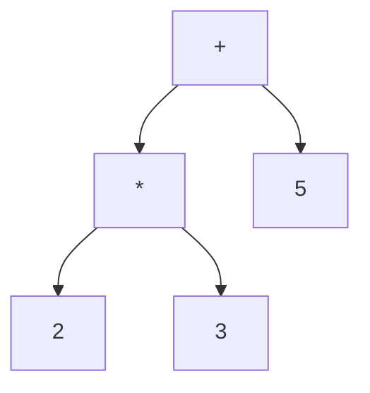
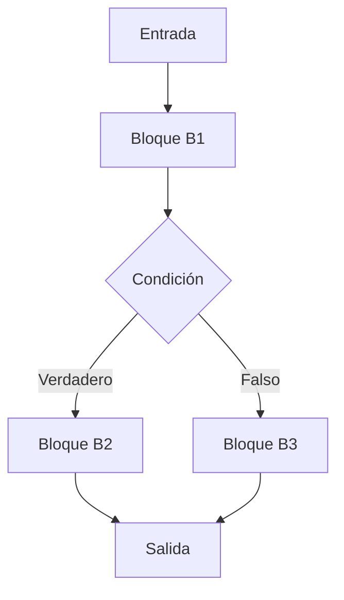

# Compiladores - Representaciones intermedias

## 5.1 Taxonomía de representaciones intermedias.

---

Las representaciones intermedias (RI) son estructuras de datos que capturan la esencia del programa fuente después del análisis y antes de la síntesis. Constituyen el puente crítico entre el front-end y el back-end de un compilador, permitiendo optimizaciones independientes de la máquina fuente y destino.

### Definición y Propósito

Una **representación intermedia (RI)** es una abstracción del programa fuente que facilita:

- La aplicación de optimizaciones
- La retargetabilidad del compilador
- La separación de concerns entre análisis y síntesis

Según Cooper y Torczon (2004), "una buena RI debe ser precisa, capaz de representar el lenguaje fuente de manera completa, y fácil de transformar y manipular".

### Taxonomía de Representaciones Intermedias

#### 1. Representaciones Gráficas

##### Árbol de Sintaxis Abstracta (AST)

Estructura arbórea que captura la estructura jerárquica del programa sin detalles de sintaxis concretos.



**Ejemplo:** Para la expresión `2 * 3 + 5`

```
    +
   / \
  *   5
 / \
2   3
```

##### Grafo Acíclico Dirigido (DAG)

Similar al AST pero comparte subexpresiones comunes, reduciendo redundancias.


**Ejemplo:** Para `a = b * c + d; e = b * c + f;`

- El subárbol `b * c` se comparte

##### Grafo de Flujo de Control (CFG)

Representa el flujo de ejecución entre bloques básicos.



#### 2. Representaciones Lineales

##### Código de Tres Direcciones (TAC)

Instrucciones simples de la forma: `x = y op z`

**Ejemplo:** Para `a = b + c * d`

```
t1 = c * d
a = b + t1
```

##### Código P

Representación de máquina abstracta utilizada en compiladores de Pascal.

#### 3. Representaciones Híbridas

##### Forma Estática Simple (SSA)

Variante del TAC donde cada variable se asigna exactamente una vez.

**Ejemplo:**

```
// Código original
x = 1
y = 2
if (cond) then
    x = 3
else
    y = 4
z = x + y

// Forma SSA
x1 = 1
y1 = 2
if (cond) then
    x2 = 3
    y2 = y1
else
    y3 = 4
    x3 = x1
x4 = φ(x2, x3)  // Función φ
y4 = φ(y2, y3)
z1 = x4 + y4
```

#### 4. Representaciones basadas en Stack

##### Código de Byte

Representación compacta utilizada en máquinas virtuales (Java, .NET).

**Ejemplo:** Para `a + b * c`

```
iload b
iload c
imul
iload a
iadd
istore resultado
```

### Comparación de Representaciones

| Representación | Ventajas                      | Desventajas                    | Uso típico              |
| -------------- | ----------------------------- | ------------------------------ | ----------------------- |
| AST            | Preserva estructura original  | Difícil de optimizar           | Análisis semántico      |
| TAC            | Simple de generar y manipular | Pérdida de estructura original | Optimizaciones locales  |
| SSA            | Optimizaciones potentes       | Complejidad de implementación  | Optimizaciones globales |
| Bytecode       | Compacto, portable            | Menos expresivo                | Máquinas virtuales      |

### Fórmulas y Conceptos Matemáticos

#### Función φ en SSA

La función φ representa la selección de valores en puntos de convergencia del CFG:

$$x_i = \phi(x_{j}, x_{k}, \ldots, x_{n})$$

Donde el valor de $x_i$ depende del camino de ejecución tomado.

#### Medidas de Calidad de RI

- **Costo de construcción:** $T_c(n)$
- **Costo de transformación:** $T_t(n)$
- **Costo de traverso:** $T_r(n)$
- **Expresividad:** $E(R)$

### Ejercicios Propuestos

1. Convierta la siguiente expresión a TAC: `x = (a + b) * (c - d / e)`

2. Transforme el siguiente código a forma SSA:

```c
i = 1
j = 1
while (i < 10) {
    if (j > 5) {
        i = i + 2
    } else {
        j = j + 1
    }
}
```

3. Dibuje el CFG para:

```c
if (x > 0) {
    y = x * 2;
} else {
    y = x + 3;
}
z = y * 4;
```

4. Compare AST vs DAG para la expresión: `(a + b) * c + (a + b) * d`

### Implementación de Ejemplo

```python
class TACGenerator:
    def __init__(self):
        self.temp_count = 0
        self.code = []

    def new_temp(self):
        temp = f"t{self.temp_count}"
        self.temp_count += 1
        return temp

    def generate_binop(self, op, left, right):
        temp = self.new_temp()
        self.code.append(f"{temp} = {left} {op} {right}")
        return temp

# Uso
generator = TACGenerator()
result = generator.generate_binop('*', 'a', 'b')
result = generator.generate_binop('+', result, 'c')
print("\n".join(generator.code))
```

### Referencias

#### Bibliografía Básica

1. Cooper, K. D., & Torczon, L. (2004). _Engineering a Compiler_. Morgan Kaufmann. (Capítulo 5)
2. Aho, A. V., Lam, M. S., Sethi, R., & Ullman, J. D. (2007). _Compilers: Principles, Techniques, and Tools_ (2nd ed.). Pearson Education. (Capítulo 6)
3. Scott, M. L. (2009). _Programming Language Pragmatics_. Morgan Kaufmann. (Capítulo 16)

#### Bibliografía Complementaria

4. Muchnick, S. S. (1997). _Advanced Compiler Design and Implementation_. Morgan Kaufmann.
5. Appel, A. W. (2002). _Modern Compiler Implementation in Java_ (2nd ed.). Cambridge University Press.

#### Recursos Adicionales

- LLVM Intermediate Representation: https://llvm.org/docs/LangRef.html
- GCC Intermediate Representations: https://gcc.gnu.org/onlinedocs/gccint/
