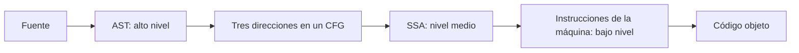
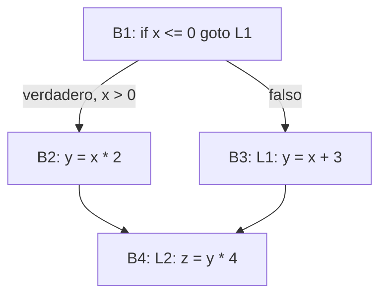

# Compiladores - Representaciones intermedias

## 5.1 Taxonomía de representaciones intermedias.

---

Entre el *front-end*, que entiende el programa, y el *back-end*, que produce el código de una máquina, el compilador trabaja con una o varias **representaciones intermedias**: estructuras de datos que conservan el significado del programa en una forma fácil de analizar y transformar. La elección de la representación determina qué optimizaciones son sencillas, cuánta memoria se usa y qué tan cerca se está del lenguaje fuente o de la máquina. Este tema presenta la taxonomía de las representaciones, por su estructura y por su nivel de abstracción, con un núcleo en Python que construye árboles, DAG, código de tres direcciones, bloques básicos, grafos de flujo de control y la forma SSA, y que se reutiliza en todo el capítulo.

### Clasificación por estructura

- **Gráficas:** el programa es un grafo. El **árbol de sintaxis abstracta** conserva la estructura del fuente; el **grafo dirigido acíclico**, DAG, comparte las subexpresiones iguales; el **grafo de flujo de control**, CFG, tiene un nodo por bloque básico y una arista por cada posible transferencia de control; el **grafo de dependencias** une cada definición con sus usos.
- **Lineales:** el programa es una secuencia de instrucciones de una máquina abstracta. El **código de tres direcciones**, con instrucciones de la forma $x = y \ \text{op}\ z,$ es la de la mayoría de los optimizadores; el **código de pila**, como el *bytecode* de la JVM o el CIL de .NET, tiene operandos implícitos en una pila y es compacto, y el **código de una dirección** es el de las máquinas de acumulador.
- **Híbridas:** combinan ambas, típicamente un CFG cuyos nodos contienen código lineal, como GIMPLE en GCC o LLVM IR.

### Clasificación por nivel de abstracción

- **Alto nivel:** cercana al fuente, con construcciones como ciclos, accesos a arreglos con varios índices o llamadas a métodos virtuales; sirve para las optimizaciones que necesitan esa estructura, como el intercambio de ciclos.
- **Nivel medio:** independiente de la máquina pero explícita: los accesos a arreglos se convierten en aritmética de direcciones y el control en saltos; es el nivel de la mayoría de las optimizaciones.
- **Bajo nivel:** cercana a la máquina, con registros e instrucciones concretas, como el RTL de GCC o el MachineInstr de LLVM; sirve para la selección de instrucciones, la asignación de registros y la planificación.

Un compilador moderno usa varias, y **baja** el programa de una a otra: Clang va del AST de C a LLVM IR y de ahí a MachineInstr; MLIR permite definir cualquier número de niveles intermedios, llamados dialectos.

### Propiedades y la forma SSA

Una propiedad importante de muchas representaciones es la **forma de asignación única estática**, SSA, en la que cada nombre se define en un solo lugar del programa; donde dos caminos con definiciones distintas se juntan, una **función φ** elige el valor según el camino por el que llegó el control. SSA hace explícitas las relaciones entre definiciones y usos, y simplifica muchas optimizaciones; se estudia en el tema 5.4.

| Representación | Ventajas | Desventajas | Uso típico |
| -------------- | -------- | ----------- | ---------- |
| árbol abstracto | cercano al fuente, fácil de construir | redundante; el control no es explícito | análisis semántico, transformaciones de alto nivel |
| DAG | comparte subexpresiones | solo dentro de un bloque | eliminación de subexpresiones comunes, selección de instrucciones |
| tres direcciones | explícito y fácil de reordenar | muchos temporales | optimización |
| pila | compacto y portable | operandos implícitos, difícil de optimizar | distribución, máquinas virtuales |
| CFG con SSA | flujo y definiciones explícitos | construcción y destrucción costosas | optimizadores modernos |



### Implementación en Python

El núcleo de representaciones intermedias, incluido al inicio, analiza un lenguaje pequeño parecido a C con asignaciones, `if`, `while`, `for`, llamadas y expresiones con operadores lógicos de cortocircuito, y construye a partir de él: el árbol abstracto, el DAG por numeración de valores, el código de tres direcciones con código de saltos para las condiciones, los bloques básicos y el CFG, los dominadores y la frontera de dominancia, la forma SSA podada con el algoritmo de Cytron y otros, y un intérprete de código de tres direcciones, con o sin funciones φ, para comprobar que cada transformación conserva el significado.

```python
# ===== Núcleo de representaciones intermedias: AST, DAG, código de tres direcciones, bloques, CFG y SSA =====
import re

# ---------- Analizador de un lenguaje pequeño parecido a C ----------
def lexico(texto):
    return re.findall(r'"[^"]*"|\d+\.\d+|\d+|[A-Za-z_]\w*|\+\+|--|[-+*/]=|==|!=|<=|>=|&&|\|\||[-+*/%<>=!(){};,]', texto) + ["$"]
class Parser:
    def __init__(self, texto): self.t, self.i = lexico(texto), 0
    def mira(self, k=0): return self.t[self.i + k]
    def come(self, x=None):
        v = self.t[self.i]
        if x and v != x: raise SyntaxError(f"se esperaba {x} y llegó {v}")
        self.i += 1; return v
    def programa(self):
        res = []
        while self.mira() != "$": res.append(self.sentencia())
        return ("bloque", res)
    def opcional_pc(self):
        if self.mira() == ";": self.come()
    def sentencia(self):
        x = self.mira()
        if x == "{":
            self.come(); res = []
            while self.mira() != "}": res.append(self.sentencia())
            self.come(); return ("bloque", res)
        if x == "if":
            self.come(); self.come("("); c = self.expr(); self.come(")"); s = self.sentencia(); o = None
            if self.mira() == "else": self.come(); o = self.sentencia()
            return ("if", c, s, o)
        if x == "while":
            self.come(); self.come("("); c = self.expr(); self.come(")"); return ("while", c, self.sentencia())
        if x == "for":
            self.come(); self.come("("); ini = self.simple() if self.mira() != ";" else None; self.come(";")
            c = self.expr() if self.mira() != ";" else ("num", 1); self.come(";")
            paso = self.simple() if self.mira() != ")" else None; self.come(")"); cuerpo = self.sentencia()
            return ("bloque", ([ini] if ini else []) + [("while", c, ("bloque", [cuerpo] + ([paso] if paso else [])))])
        if x == "return":
            self.come(); e = self.expr() if self.mira() not in (";", "}", "$") else None; self.opcional_pc(); return ("return", e)
        s = self.simple(); self.opcional_pc(); return s
    def simple(self):
        if self.mira(1) in ("=", "+=", "-=", "*=", "/=", "++", "--"):
            x = self.come(); op = self.come()
            if op == "=": return ("asig", x, self.expr())
            if op in ("++", "--"): return ("asig", x, ("bin", op[0], ("var", x), ("num", 1)))
            return ("asig", x, ("bin", op[0], ("var", x), self.expr()))
        return ("expr", self.expr())
    NIVELES = [("||",), ("&&",), ("==", "!="), ("<", "<=", ">", ">="), ("+", "-"), ("*", "/", "%")]
    def expr(self, k=0):
        if k == len(self.NIVELES): return self.unario()
        a = self.expr(k + 1)
        while self.mira() in self.NIVELES[k]: op = self.come(); a = ("bin", op, a, self.expr(k + 1))
        return a
    def unario(self):
        if self.mira() in ("-", "!"): op = self.come(); return ("un", op, self.unario())
        x = self.come()
        if x == "(": e = self.expr(); self.come(")"); return e
        if x[0].isdigit(): return ("num", float(x) if "." in x else int(x))
        if x[0] == '"': return ("str", x)
        if self.mira() == "(":
            self.come(); args = []
            while self.mira() != ")":
                args.append(self.expr())
                if self.mira() == ",": self.come()
            self.come(); return ("call", x, args)
        return ("var", x)
def expresion(texto): return Parser(texto).expr()

def texto_ast(n):
    k = n[0]
    if k == "num": return str(n[1])
    if k in ("var", "str"): return n[1]
    if k == "bin": return f"({texto_ast(n[2])} {n[1]} {texto_ast(n[3])})"
    if k == "un": return f"({n[1]}{texto_ast(n[2])})"
    if k == "call": return f"{n[1]}(" + ", ".join(texto_ast(a) for a in n[2]) + ")"
def dibuja_ast(n, pre="   ", ultimo=True, raiz=True):
    k = n[0]
    et = {"num": lambda: str(n[1]), "var": lambda: n[1], "str": lambda: n[1], "bin": lambda: n[1], "un": lambda: n[1], "call": lambda: n[1] + "()"}[k]()
    hijos = [n[2], n[3]] if k == "bin" else [n[2]] if k == "un" else n[2] if k == "call" else []
    lineas = [pre + ("" if raiz else ("└─ " if ultimo else "├─ ")) + et]
    sub = pre + ("" if raiz else ("   " if ultimo else "│  "))
    for i, h in enumerate(hijos): lineas += dibuja_ast(h, sub, i == len(hijos) - 1, False)
    return lineas
def postfija(n):
    k = n[0]
    if k in ("num", "var", "str"): return [str(n[1])]
    if k == "bin": return postfija(n[2]) + postfija(n[3]) + [n[1]]
    if k == "un": return postfija(n[2]) + ["neg" if n[1] == "-" else n[1]]
    if k == "call": return [x for a in n[2] for x in postfija(a)] + [f"{n[1]}/{len(n[2])}"]
def contar_nodos(n):
    k = n[0]
    if k == "bin": return 1 + contar_nodos(n[2]) + contar_nodos(n[3])
    if k == "un": return 1 + contar_nodos(n[2])
    if k == "call": return 1 + sum(contar_nodos(a) for a in n[2])
    return 1

# ---------- DAG por numeración de valores ----------
def dag(asignaciones):
    """asignaciones: lista de (variable o None, AST). Devuelve los nodos únicos y las etiquetas de cada nodo."""
    nodos, tabla, etiquetas, actual = [], {}, {}, {}
    def nodo(clave, texto):
        if clave not in tabla: tabla[clave] = len(nodos); nodos.append(texto)
        return tabla[clave]
    def visita(n):
        k = n[0]
        if k == "num": return nodo(("num", n[1]), str(n[1]))
        if k == "var":
            if n[1] in actual: return actual[n[1]]
            return nodo(("var", n[1]), n[1])
        if k == "bin":
            a, b = visita(n[2]), visita(n[3])
            if n[1] in "+*" and a > b: a, b = b, a                    # conmutatividad
            return nodo(("bin", n[1], a, b), f"{n[1]} n{a} n{b}")
        if k == "un": a = visita(n[2]); return nodo(("un", n[1], a), f"{n[1]} n{a}")
    for x, e in asignaciones:
        k = visita(e)
        if x:
            for v in list(etiquetas):
                if v == x: del etiquetas[v]
            actual[x] = k; etiquetas[x] = k
    return nodos, etiquetas

# ---------- Código de tres direcciones ----------
class GeneradorTAC:
    def __init__(self): self.codigo, self.nt, self.ne = [], 0, 0
    def temp(self): self.nt += 1; return f"t{self.nt}"
    def etiqueta(self): self.ne += 1; return f"L{self.ne}"
    def emite(self, *ins): self.codigo.append(ins)
    REL = {"<": ">=", "<=": ">", ">": "<=", ">=": "<", "==": "!=", "!=": "=="}
    def valor(self, n):
        k = n[0]
        if k == "num": return str(n[1])
        if k in ("var", "str"): return n[1]
        if k == "bin" and n[1] in ("&&", "||") or k == "bin" and n[1] in self.REL or k == "un" and n[1] == "!":
            t = self.temp(); lf, lfin = self.etiqueta(), self.etiqueta()
            self.condicion(n, None, lf); self.emite("asig", t, "1"); self.emite("goto", lfin)
            self.emite("label", lf); self.emite("asig", t, "0"); self.emite("label", lfin); return t
        if k == "bin":
            a = self.valor(n[2]); b = self.valor(n[3]); t = self.temp(); self.emite("bin", t, n[1], a, b); return t
        if k == "un": a = self.valor(n[2]); t = self.temp(); self.emite("un", t, n[1], a); return t
        if k == "call":
            args = [self.valor(a) for a in n[2]]
            for a in args: self.emite("param", a)
            t = self.temp(); self.emite("call", t, n[1], len(args)); return t
    def condicion(self, n, v, f):
        """Código de saltos: salta a v si la condición es verdadera y a f si es falsa; None significa continuar."""
        if n[0] == "bin" and n[1] in self.REL:
            a = self.valor(n[2]); b = self.valor(n[3])
            if v and f: self.emite("if", a, n[1], b, v); self.emite("goto", f)
            elif v: self.emite("if", a, n[1], b, v)
            elif f: self.emite("if", a, self.REL[n[1]], b, f)
        elif n[0] == "bin" and n[1] == "&&":
            fin = None if f else self.etiqueta()
            self.condicion(n[2], None, f or fin); self.condicion(n[3], v, f or fin)
            if fin: self.emite("label", fin)
        elif n[0] == "bin" and n[1] == "||":
            fin = None if v else self.etiqueta()
            self.condicion(n[2], v or fin, None); self.condicion(n[3], v or fin, f)
            if fin: self.emite("label", fin)
        elif n[0] == "un" and n[1] == "!": self.condicion(n[2], f, v)
        else:
            a = self.valor(n)
            if v: self.emite("if", a, "!=", "0", v)
            if f: self.emite("if", a, "==", "0", f) if not v else self.emite("goto", f)
    def sentencia(self, s):
        k = s[0]
        if k == "bloque":
            for x in s[1]: self.sentencia(x)
        elif k == "asig":
            e = s[2]
            if e[0] == "bin" and e[1] not in ("&&", "||") and e[1] not in self.REL:
                a = self.valor(e[2]); b = self.valor(e[3]); self.emite("bin", s[1], e[1], a, b)
            else: self.emite("asig", s[1], self.valor(e))
        elif k == "if":
            lf = self.etiqueta(); self.condicion(s[1], None, lf); self.sentencia(s[2])
            if s[3]:
                lfin = self.etiqueta(); self.emite("goto", lfin); self.emite("label", lf); self.sentencia(s[3]); self.emite("label", lfin)
            else: self.emite("label", lf)
        elif k == "while":
            li, lf = self.etiqueta(), self.etiqueta()
            self.emite("label", li); self.condicion(s[1], None, lf); self.sentencia(s[2]); self.emite("goto", li); self.emite("label", lf)
        elif k == "return": self.emite("ret", self.valor(s[1]) if s[1] else "")
        elif k == "expr":
            e = s[1]
            if e[0] == "call" and e[1] == "print":
                for a in [self.valor(a) for a in e[2]]: self.emite("param", a)
                self.emite("call", None, "print", len(e[2]))
            else: self.valor(e)
def tac(texto):
    g = GeneradorTAC(); g.sentencia(Parser(texto).programa())
    c = g.codigo                                   # mirilla: quita los saltos a la instrucción siguiente
    return [ins for k, ins in enumerate(c) if not (ins[0] == "goto" and k + 1 < len(c) and c[k + 1] == ("label", ins[1]))]
def texto_ins(ins):
    k = ins[0]
    if k == "asig": return f"{ins[1]} = {ins[2]}"
    if k == "bin": return f"{ins[1]} = {ins[3]} {ins[2]} {ins[4]}"
    if k == "un": return f"{ins[1]} = {ins[2]}{ins[3]}"
    if k == "label": return f"{ins[1]}:"
    if k == "goto": return f"goto {ins[1]}"
    if k == "if": return f"if {ins[1]} {ins[2]} {ins[3]} goto {ins[4]}"
    if k == "param": return f"param {ins[1]}"
    if k == "call": return (f"{ins[1]} = " if ins[1] else "") + f"call {ins[2]}, {ins[3]}"
    if k == "ret": return f"return {ins[1]}".strip()
    if k == "phi": return f"{ins[1]} = φ(" + ", ".join(f"{v}" for _, v in sorted(ins[2].items())) + ")"
def listado(codigo, numerado=False):
    return "\n".join(f"   {k + 1:2}: {texto_ins(i)}" if numerado else ("   " + texto_ins(i) if i[0] != "label" else " " + texto_ins(i)) for k, i in enumerate(codigo))

# ---------- Bloques básicos y grafo de flujo de control ----------
def bloques(codigo):
    lideres = {0}
    for k, ins in enumerate(codigo):
        if ins[0] == "label": lideres.add(k)
        if ins[0] in ("goto", "if", "ret") and k + 1 < len(codigo): lideres.add(k + 1)
    orden = sorted(lideres); bs = []
    for j, ini in enumerate(orden):
        fin = orden[j + 1] if j + 1 < len(orden) else len(codigo)
        bs.append(codigo[ini:fin])
    bs = [b for b in bs if b]
    etiqueta_de = {b[0][1]: i for i, b in enumerate(bs) if b[0][0] == "label"}
    suc = {}
    for i, b in enumerate(bs):
        u = b[-1]; s = []
        if u[0] == "goto": s = [etiqueta_de[u[1]]]
        elif u[0] == "if": s = [etiqueta_de[u[4]]] + ([i + 1] if i + 1 < len(bs) else [])
        elif u[0] != "ret" and i + 1 < len(bs): s = [i + 1]
        suc[i] = list(dict.fromkeys(s))
    pred = {i: [j for j in suc if i in suc[j]] for i in suc}
    return bs, suc, pred

def dominadores(n, suc, pred, entrada=0):
    dom = {i: set(range(n)) for i in range(n)}; dom[entrada] = {entrada}; cambio = True
    while cambio:
        cambio = False
        for i in range(n):
            if i == entrada: continue
            nuevo = {i} | (set.intersection(*[dom[p] for p in pred[i]]) if pred[i] else set())
            if nuevo != dom[i]: dom[i] = nuevo; cambio = True
    # el dominador inmediato de i es el dominador estricto cuyo conjunto de dominadores es dom(i) sin i
    idom = {i: next((d for d in dom[i] - {i} if dom[d] == dom[i] - {i}), None) for i in range(n)}
    return dom, idom
def frontera(n, pred, idom):
    df = {i: set() for i in range(n)}
    for b in range(n):
        if len(pred[b]) >= 2:
            for p in pred[b]:
                r = p
                while r is not None and r != idom[b]: df[r].add(b); r = idom[r]
    return df

def definidas(b): return [i[1] for i in b if i[0] in ("asig", "bin", "un") or (i[0] == "call" and i[1])]
def usadas(i):
    k = i[0]
    if k == "asig": return [i[2]]
    if k == "bin": return [i[3], i[4]]
    if k == "un": return [i[3]]
    if k == "if": return [i[1], i[3]]
    if k in ("param", "ret"): return [i[1]]
    if k == "phi": return list(i[2].values())
    return []
def es_variable(x): return isinstance(x, str) and re.fullmatch(r"[A-Za-z_]\w*", x) is not None

def ssa(codigo, podada=True):
    """Construcción de Cytron y otros: funciones φ en la frontera de dominancia iterada y renombrado sobre el árbol de dominadores.
    Con podada=True solo se insertan φ para variables vivas a la entrada del bloque."""
    bs, suc, pred = bloques(codigo); n = len(bs)
    dom, idom = dominadores(n, suc, pred); df = frontera(n, pred, idom)
    vivas_ent = vivas(bs, suc) if podada else None
    variables = sorted({x for b in bs for x in definidas(b)})
    phis = {i: {} for i in range(n)}
    for v in variables:
        trabajo = [i for i in range(n) if v in definidas(bs[i])]; puestos = set()
        while trabajo:
            b = trabajo.pop()
            for d in sorted(df[b]):
                if d in puestos or (podada and v not in vivas_ent[d]): continue
                puestos.add(d); phis[d][v] = {}
                if d not in trabajo: trabajo.append(d)
    contador, pila = {}, {}
    def nuevo(v):
        contador[v] = contador.get(v, 0) + 1; nombre = f"{v}_{contador[v]}"; pila.setdefault(v, []).append(nombre); return nombre
    def actual(x): return pila[x][-1] if es_variable(x) and pila.get(x) else (f"{x}_0" if es_variable(x) and x in variables else x)
    nuevos = {}; nombres_phi = {i: {} for i in range(n)}
    hijos = {i: sorted(j for j in range(n) if idom[j] == i) for i in range(n)}
    def renombra(b):
        empujados = []
        for v in phis[b]: nombres_phi[b][v] = nuevo(v); empujados.append(v)
        res = []
        for ins in bs[b]:
            k = ins[0]
            if k == "asig": a = actual(ins[2]); res.append(("asig", nuevo(ins[1]), a)); empujados.append(ins[1])
            elif k == "bin": a, c = actual(ins[3]), actual(ins[4]); res.append(("bin", nuevo(ins[1]), ins[2], a, c)); empujados.append(ins[1])
            elif k == "un": a = actual(ins[3]); res.append(("un", nuevo(ins[1]), ins[2], a)); empujados.append(ins[1])
            elif k == "if": res.append(("if", actual(ins[1]), ins[2], actual(ins[3]), ins[4]))
            elif k in ("param", "ret"): res.append((k, actual(ins[1])))
            elif k == "call" and ins[1]: res.append(("call", nuevo(ins[1]), ins[2], ins[3])); empujados.append(ins[1])
            else: res.append(ins)
        nuevos[b] = res
        for s in suc[b]:
            for v in phis[s]: phis[s][v][b] = actual(v)
        for h in hijos[b]: renombra(h)
        for v in empujados: pila[v].pop()
    renombra(0)
    resultado = []
    for b in range(n):
        cuerpo = nuevos.get(b, [])
        lab = [cuerpo[0]] if cuerpo and cuerpo[0][0] == "label" else []
        resto = cuerpo[len(lab):]
        resultado.append(lab + [("phi", nombres_phi[b][v], {f"B{p + 1}": x for p, x in phis[b][v].items()}) for v in sorted(phis[b])] + resto)
    return resultado, (bs, suc, pred, idom, df)

def vivas(bs, suc):
    """Variables vivas a la entrada de cada bloque, por análisis hacia atrás de punto fijo."""
    n = len(bs); uso, defi = {}, {}
    for i, b in enumerate(bs):
        u, d = set(), set()
        for ins in b:
            for x in usadas(ins):
                if es_variable(x) and x not in d: u.add(x)
            for x in definidas([ins]): d.add(x)
        uso[i], defi[i] = u, d
    ent = {i: set() for i in range(n)}; cambio = True
    while cambio:
        cambio = False
        for i in reversed(range(n)):
            sal = set().union(*[ent[s] for s in suc[i]]) if suc[i] else set()
            nueva = uso[i] | (sal - defi[i])
            if nueva != ent[i]: ent[i] = nueva; cambio = True
    return ent

# ---------- Intérprete de código de tres direcciones, con o sin φ ----------
OPS = {"+": lambda a, b: a + b, "-": lambda a, b: a - b, "*": lambda a, b: a * b, "/": lambda a, b: a / b if isinstance(a, float) or isinstance(b, float) else int(a / b),
       "%": lambda a, b: a % b, "<": lambda a, b: int(a < b), "<=": lambda a, b: int(a <= b), ">": lambda a, b: int(a > b),
       ">=": lambda a, b: int(a >= b), "==": lambda a, b: int(a == b), "!=": lambda a, b: int(a != b)}
def ejecuta(lista_bloques, entorno, limite=100000, funciones=None):
    """lista_bloques: lista de listas de instrucciones; las φ eligen según el bloque de procedencia."""
    env = dict(entorno); salida = []; params = []; funciones = funciones or {}
    etq = {b[0][1]: i for i, b in enumerate(lista_bloques) if b and b[0][0] == "label"}
    def val(x):
        if isinstance(x, str) and re.fullmatch(r"-?\d+", x): return int(x)
        if isinstance(x, str) and re.fullmatch(r"-?\d+\.\d+", x): return float(x)
        if isinstance(x, str) and x.startswith('"'): return x.strip('"')
        if x in env: return env[x]
        base = re.sub(r"_0$", "", x)
        return env.get(base, 0)
    b, previo, pasos = 0, None, 0
    while b is not None and b < len(lista_bloques):
        siguiente = b + 1
        phis = [i for i in lista_bloques[b] if i[0] == "phi"]
        nuevos = {i[1]: val(i[2].get(f"B{previo + 1}", "0")) for i in phis} if previo is not None else {}
        env.update(nuevos)
        for ins in lista_bloques[b]:
            pasos += 1
            if pasos > limite: raise RuntimeError("demasiados pasos")
            k = ins[0]
            if k == "asig": env[ins[1]] = val(ins[2])
            elif k == "bin": env[ins[1]] = OPS[ins[2]](val(ins[3]), val(ins[4]))
            elif k == "un": env[ins[1]] = -val(ins[3]) if ins[2] == "-" else int(not val(ins[3]))
            elif k == "goto": siguiente = etq[ins[1]]; break
            elif k == "if":
                if OPS[ins[2]](val(ins[1]), val(ins[3])): siguiente = etq[ins[4]]; break
            elif k == "param": params.append(val(ins[1]))
            elif k == "call":
                args, params[:] = params[-ins[3]:] if ins[3] else [], params[:-ins[3]] if ins[3] else params
                if ins[2] == "print": salida.append(" ".join(str(a) for a in args))
                else: env[ins[1]] = funciones[ins[2]](*args)
            elif k == "ret": return env, salida, val(ins[1]) if ins[1] else None
        previo, b = b, siguiente
    return env, salida, None
def muestra_bloques(bs, sangria="   "):
    lineas = []
    for k, b in enumerate(bs):
        lineas.append(f"{sangria}B{k + 1}:")
        for i in b: lineas.append(f"{sangria}  " + ("" if i[0] == "label" else "  ") + texto_ins(i))
    return "\n".join(lineas)

# ---------- Optimización local: numeración de valores, plegado, propagación de copias y código muerto ----------
def es_numero(x): return isinstance(x, str) and re.fullmatch(r"-?\d+(\.\d+)?", x) is not None
def num(x): return float(x) if "." in x else int(x)
def optimiza_bloque(codigo, vivas_salida, pasos=None):
    """Un bloque sin saltos. vivas_salida: variables que se usan después del bloque."""
    pasos = pasos if pasos is not None else []
    valor, tabla, res = {}, {}, []                    # valor: nombre -> operando equivalente; tabla: expresión -> nombre
    def op(x): return valor.get(x, x)
    for ins in codigo:
        if ins[0] == "asig":
            v = op(ins[2]); valor[ins[1]] = v
            for k in [k for k, n in tabla.items() if n == ins[1]]: del tabla[k]
            res.append(("asig", ins[1], v)); continue
        if ins[0] != "bin": res.append(ins); continue
        d, o, a, b = ins[1], ins[2], op(ins[3]), op(ins[4])
        if es_numero(a) and es_numero(b) and o in OPS:
            r = OPS[o](num(a), num(b)); r = str(int(r)) if float(r).is_integer() else str(r)
            pasos.append(f"plegado: {a} {o} {b} = {r}"); valor[d] = r; res.append(("asig", d, r)); continue
        if o in "+*" and str(a) > str(b): a, b = b, a
        if (o == "+" and b == "0") or (o == "*" and b == "1"): valor[d] = a; res.append(("asig", d, a)); pasos.append(f"identidad: {d} = {a}"); continue
        clave = (o, a, b)
        if clave in tabla and op(tabla[clave]) == tabla[clave]:
            pasos.append(f"subexpresión común: {a} {o} {b} ya está en {tabla[clave]}"); valor[d] = tabla[clave]; res.append(("asig", d, tabla[clave])); continue
        valor.pop(d, None)
        for k in [k for k, n in tabla.items() if n == d or d in k[1:]]: del tabla[k]
        tabla[clave] = d; res.append(("bin", d, o, a, b))
    # código muerto: hacia atrás, se conservan las instrucciones cuyo destino se usa después
    vivas_ahora, final = set(vivas_salida), []
    for ins in reversed(res):
        if ins[0] in ("asig", "bin") and ins[1] not in vivas_ahora:
            pasos.append(f"código muerto: {texto_ins(ins)}"); continue
        if ins[0] in ("asig", "bin"): vivas_ahora.discard(ins[1])
        vivas_ahora |= {x for x in usadas(ins) if es_variable(x)}
        final.append(ins)
    return final[::-1]

# ---------- Ejercicio 1: código de tres direcciones ----------
c1 = tac("x = (a + b) * (c - d / e);")
print("ejercicio 1:"); print(listado(c1))
print("   cuádruplos:", [(i[2], i[3], i[4], i[1]) for i in c1])
env, _, _ = ejecuta([c1], {"a": 2, "b": 3, "c": 10, "d": 8, "e": 4}); print("   con a=2, b=3, c=10, d=8, e=4: x =", env["x"], "| Python:", (2 + 3) * (10 - 8 / 4))

# ---------- Ejercicio 2: forma SSA ----------
FUENTE2 = """i = 1
j = 1
while (i < 10) {
    if (j > 5) {
        i = i + 2
    } else {
        j = j + 1
    }
}
print(i, j)"""
c2 = tac(FUENTE2); s2, (bs, suc, pred, idom, df) = ssa(c2)
print("ejercicio 2: bloques y sucesores:", {f"B{i + 1}": [f"B{j + 1}" for j in v] for i, v in suc.items()})
print("   dominador inmediato:", {f"B{i + 1}": (f"B{d + 1}" if d is not None else "-") for i, d in idom.items()})
print("   frontera de dominancia:", {f"B{i + 1}": sorted(f"B{j + 1}" for j in v) for i, v in df.items() if v})
print(muestra_bloques(s2))
print("   ejecución: original", ejecuta(bloques(c2)[0], {})[1], "| SSA", ejecuta(s2, {})[1])

# ---------- Ejercicio 3: grafo de flujo de control ----------
c3 = tac("""if (x > 0) {
    y = x * 2;
} else {
    y = x + 3;
}
z = y * 4;""")
bs3, suc3, pred3 = bloques(c3)
print("ejercicio 3:")
for i, b in enumerate(bs3): print(f"   B{i + 1}: {' ; '.join(texto_ins(x) for x in b):34} -> {[f'B{j + 1}' for j in suc3[i]]}")
for x in (5, -2): print(f"   x = {x}: z =", ejecuta(bs3, {"x": x})[0]["z"])

# ---------- Ejercicio 4: árbol contra DAG ----------
e4 = expresion("(a + b) * c + (a + b) * d")
nodos, _ = dag([("r", e4)])
print("ejercicio 4: árbol de", contar_nodos(e4), "nodos:"); print("\n".join(dibuja_ast(e4)))
print(f"   DAG de {len(nodos)} nodos:", ", ".join(f"n{k}: {t}" for k, t in enumerate(nodos)))
print("   factorizada como (a + b) * (c + d):", contar_nodos(expresion("(a + b) * (c + d)")), "nodos en el árbol")
```

Salida:

```text
ejercicio 1:
   t1 = a + b
   t2 = d / e
   t3 = c - t2
   x = t1 * t3
   cuádruplos: [('+', 'a', 'b', 't1'), ('/', 'd', 'e', 't2'), ('-', 'c', 't2', 't3'), ('*', 't1', 't3', 'x')]
   con a=2, b=3, c=10, d=8, e=4: x = 40 | Python: 40.0
ejercicio 2: bloques y sucesores: {'B1': ['B2'], 'B2': ['B7', 'B3'], 'B3': ['B5', 'B4'], 'B4': ['B6'], 'B5': ['B6'], 'B6': ['B2'], 'B7': []}
   dominador inmediato: {'B1': '-', 'B2': 'B1', 'B3': 'B2', 'B4': 'B3', 'B5': 'B3', 'B6': 'B3', 'B7': 'B2'}
   frontera de dominancia: {'B2': ['B2'], 'B3': ['B2'], 'B4': ['B6'], 'B5': ['B6'], 'B6': ['B2']}
   B1:
       i_1 = 1
       j_1 = 1
   B2:
     L1:
       i_2 = φ(i_1, i_4)
       j_2 = φ(j_1, j_4)
       if i_2 >= 10 goto L2
   B3:
       if j_2 <= 5 goto L3
   B4:
       i_3 = i_2 + 2
       goto L4
   B5:
     L3:
       j_3 = j_2 + 1
   B6:
     L4:
       i_4 = φ(i_3, i_2)
       j_4 = φ(j_2, j_3)
       goto L1
   B7:
     L2:
       param i_2
       param j_2
       call print, 2
   ejecución: original ['11 6'] | SSA ['11 6']
ejercicio 3:
   B1: if x <= 0 goto L1                  -> ['B3', 'B2']
   B2: y = x * 2 ; goto L2                -> ['B4']
   B3: L1: ; y = x + 3                    -> ['B4']
   B4: L2: ; z = y * 4                    -> []
   x = 5: z = 40
   x = -2: z = 4
ejercicio 4: árbol de 11 nodos:
   +
   ├─ *
   │  ├─ +
   │  │  ├─ a
   │  │  └─ b
   │  └─ c
   └─ *
      ├─ +
      │  ├─ a
      │  └─ b
      └─ d
   DAG de 8 nodos: n0: a, n1: b, n2: + n0 n1, n3: c, n4: * n2 n3, n5: d, n6: * n2 n5, n7: + n4 n6
   factorizada como (a + b) * (c + d): 7 nodos en el árbol
```

### Ejercicios Propuestos

1. **Código de tres direcciones.** Convierte a código de tres direcciones la expresión `x = (a + b) * (c - d / e)`.

2. **Forma SSA.** Transforma a la forma SSA el siguiente código:

    ```c
    i = 1
    j = 1
    while (i < 10) {
        if (j > 5) {
            i = i + 2
        } else {
            j = j + 1
        }
    }
    ```

3. **CFG.** Dibuja el grafo de flujo de control de:

    ```c
    if (x > 0) {
        y = x * 2;
    } else {
        y = x + 3;
    }
    z = y * 4;
    ```

4. **Árbol contra DAG.** Compara el árbol y el DAG de la expresión `(a + b) * c + (a + b) * d`.

### Soluciones

**Ejercicio 1.** Respetando la precedencia, primero se calculan `a + b` y `d / e`, después la resta y al final el producto:

```text
t1 = a + b
t2 = d / e
t3 = c - t2
x = t1 * t3
```

El destino del último cálculo es directamente `x`, sin un temporal extra. En cuádruplos, cada instrucción es una tupla de operador, dos operandos y resultado. Con $a = 2,$ $b = 3,$ $c = 10,$ $d = 8$ y $e = 4,$ el intérprete da $x = 40,$ como Python.

**Ejercicio 2.** El generador traduce el ciclo con la condición invertida, `if i >= 10 goto L2`, y el `if` con `if j <= 5 goto L3`. Los bloques son B1, la inicialización; B2, la cabeza del ciclo; B3, la condición del `if`; B4 y B5, las dos ramas; B6, la unión, y B7, la salida. La frontera de dominancia de B4 y B5 es B6, y la de B6 es B2, la cabeza del ciclo, así que las variables `i` y `j`, que se definen en las ramas, necesitan funciones φ en B6 y en B2:

```text
B1:  i_1 = 1;  j_1 = 1
B2:  i_2 = φ(i_1, i_4);  j_2 = φ(j_1, j_4)
     if i_2 >= 10 goto B7
B3:  if j_2 <= 5 goto B5
B4:  i_3 = i_2 + 2;  goto B6
B5:  j_3 = j_2 + 1
B6:  i_4 = φ(i_3, i_2);  j_4 = φ(j_2, j_3);  goto B2
```

En B6, `i_4` vale `i_3` si se llegó por B4 y `i_2` si se llegó por B5, donde `i` no cambió. El intérprete ejecuta el código original y el SSA, y ambos imprimen `11 6`: `j` sube de 1 a 6 y después `i` avanza de 2 en 2 hasta 11.

**Ejercicio 3.** El CFG tiene cuatro bloques: B1 evalúa la condición, con el salto invertido `if x <= 0 goto L1`; B2 es la rama del `then`, que termina con un salto a la unión; B3, la del `else`, y B4, la unión, con `z = y * 4`. B1 tiene dos sucesores y B4 dos predecesores; en SSA, B4 necesitaría $y_3 = \varphi(y_1, y_2).$ Con $x = 5,$ $z = 40,$ y con $x = -2,$ $z = 4.$



**Ejercicio 4.** El árbol tiene 11 nodos, con dos copias de `a + b`, de 3 nodos cada una. En el DAG, la numeración de valores reconoce que la segunda `a + b` es la misma que la primera y reutiliza su nodo, así que tiene 8 nodos: `a`, `b`, `a + b`, `c`, `d`, los dos productos y la suma. Generar código desde el DAG calcula `a + b` una sola vez, la **eliminación de subexpresiones comunes**. Una transformación algebraica, la distributividad, da $(a + b) \cdot (c + d),$ de 7 nodos y una multiplicación menos; el DAG no la descubre solo, porque compara estructura, no álgebra.

En el material original, el diagrama del DAG era idéntico al del árbol, de modo que no mostraba ninguna subexpresión compartida; el ejemplo de SSA insertaba copias como `y2 = y1` en las ramas, que la construcción no necesita, porque la función φ puede tomar directamente $y_1;$ la sigla SSA se traducía como "forma estática simple", cuando significa asignación única estática, y el *bytecode* de ejemplo usaba `iload b`, cuando las instrucciones de la JVM se refieren a las variables locales por número, como `iload_1`. El texto decía "separación de concerns".

### Referencias

1. Cooper, K. D., and Torczon, L., _Engineering a Compiler_. 3a ed., Morgan Kaufmann, 2022. Capítulo 5.
2. Aho, A. V., Lam, M. S., Sethi, R., and Ullman, J. D., _Compilers: Principles, Techniques, and Tools_. 2a ed., Pearson, 2007. Secciones 6.1 y 6.2.
3. Cytron, R., Ferrante, J., Rosen, B. K., Wegman, M. N., and Zadeck, F. K., Efficiently computing static single assignment form and the control dependence graph. _ACM TOPLAS_ 13(4), 1991.
4. Lattner, C., and Adve, V., LLVM: a compilation framework for lifelong program analysis and transformation. _CGO_, 2004.
5. Lattner, C., et al., MLIR: scaling compiler infrastructure for domain specific computation. _CGO_, 2021.
