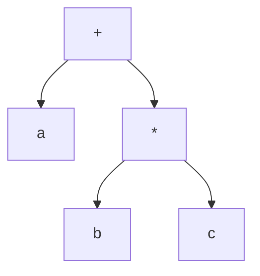
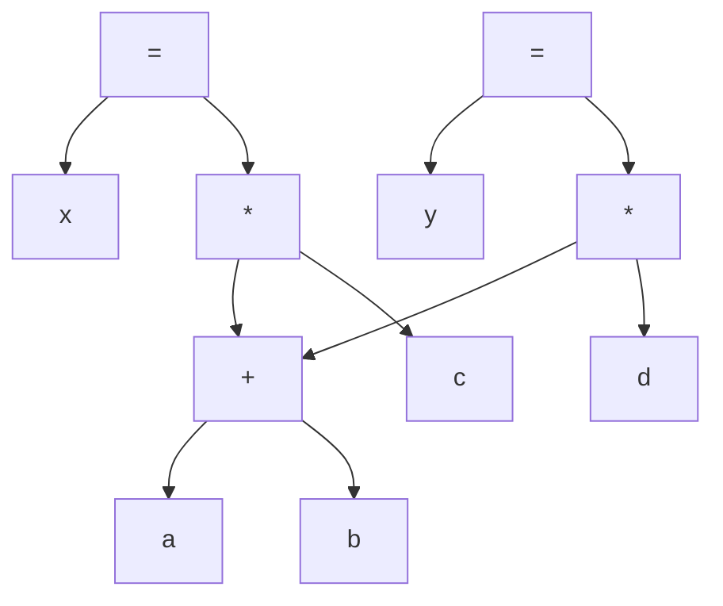
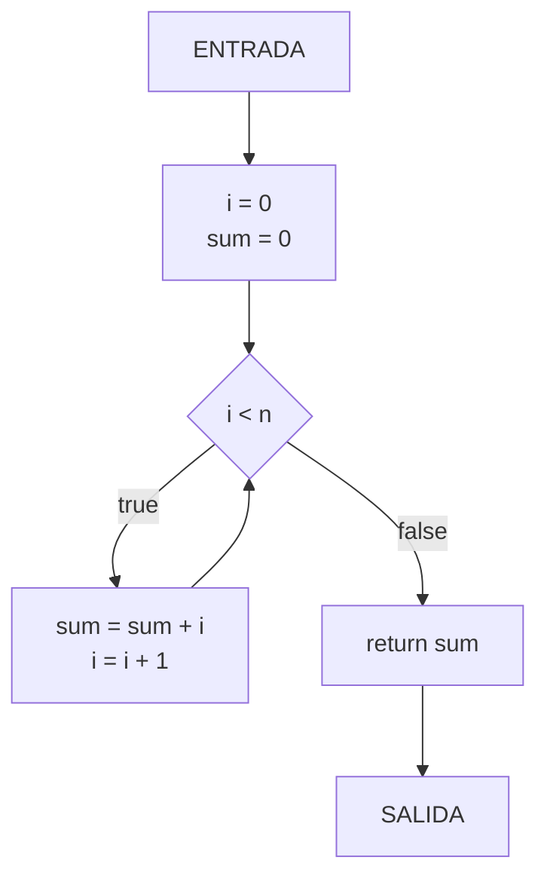
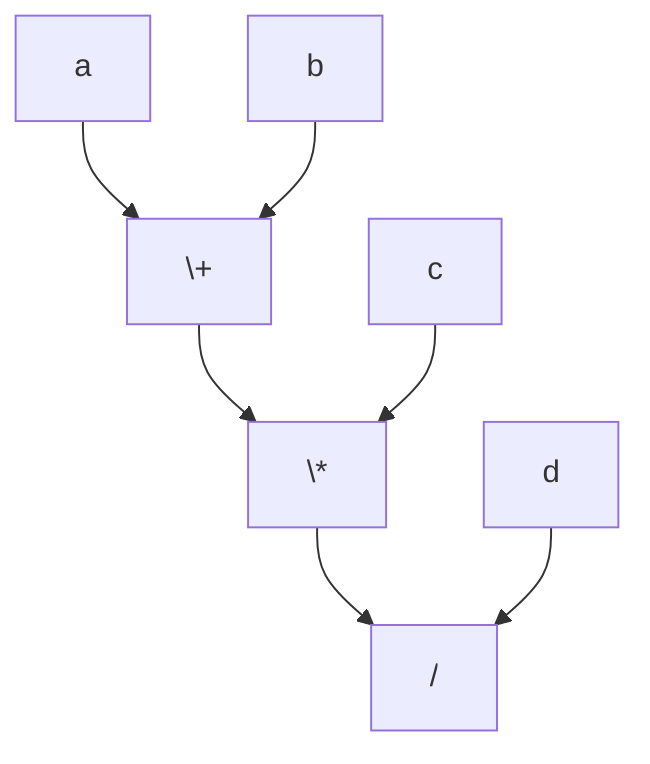

# Compiladores - Representaciones intermedias

## 5.2 Conjuntos de representaciones intermedias gráficas.

---

Las representaciones intermedias gráficas son estructuras de datos no lineales que capturan relaciones complejas entre elementos del programa mediante nodos y aristas. Según Aho et al. (2007), "estas representaciones son particularmente útiles para análisis de flujo de datos y optimizaciones globales".

### Taxonomía de Representaciones Gráficas

#### 1. Árbol de Sintaxis Abstracta (AST)

**Definición:** Estructura arbófica que representa la estructura jerárquica del programa eliminando elementos sintácticos no esenciales.

**Características:**

- Cada nodo representa un constructo del lenguaje
- Los hijos representan componentes del constructo
- Preserva la estructura lógica del programa

**Ejemplo:** Para la expresión `a + b * c`



**Implementación en código:**

```python
class ASTNode:
    def __init__(self, type, value=None):
        self.type = type
        self.value = value
        self.children = []

    def add_child(self, node):
        self.children.append(node)

# Construcción del AST para a + b * c
plus_node = ASTNode('OP', '+')
a_node = ASTNode('ID', 'a')
mult_node = ASTNode('OP', '*')
b_node = ASTNode('ID', 'b')
c_node = ASTNode('ID', 'c')

plus_node.add_child(a_node)
plus_node.add_child(mult_node)
mult_node.add_child(b_node)
mult_node.add_child(c_node)
```

#### 2. Grafo Acíclico Dirigido (DAG)

**Definición:** Similar al AST pero comparte subexpresiones idénticas, reduciendo redundancias.

**Ventaja:** Optimización automática mediante reuso de subexpresiones comunes.

**Ejemplo:** Para `x = (a + b) * c; y = (a + b) * d`



**Propiedad fundamental:**
$$ \text{DAG}(E) \equiv \text{AST}(E) \land \forall \text{subexpresión } S, \text{única instancia} $$

#### 3. Grafo de Flujo de Control (CFG)

**Definición:** Representa el flujo de ejecución entre bloques básicos del programa.

**Componentes:**

- **Nodos:** Bloques básicos
- **Aristas:** Flujo de control entre bloques
- **Nodo inicial:** Punto de entrada
- **Nodos finales:** Puntos de salida

**Ejemplo CFG:**



**Definición formal:** Un CFG es una tupla $(N, E, entry, exit)$ donde:

- $N$: conjunto de nodos (bloques básicos)
- $E \subseteq N \times N$: conjunto de aristas
- $entry \in N$: nodo de entrada
- $exit \in N$: nodo de salida

#### 4. Grafo de Flujo de Datos (DFG)

**Definición:** Representa las dependencias de datos entre operaciones.

**Ejemplo:** Para `t1 = a + b; t2 = t1 * c; t3 = t2 / d`



**Ecuación de dependencia:**
$$ \text{DFG} = (V, E) \text{ donde } (v_i, v_j) \in E \iff v_j \text{ depende de } v_i $$

#### 5. Grafo de Dependencias de Control (CDG)

**Definición:** Muestra qué statements controlan la ejecución de otros.

**Relación:** $a \rightarrow b$ significa que la ejecución de $b$ depende de $a$

### Comparativa de Representaciones Gráficas

| Representación | Complejidad | Uso Principal       | Ventajas             |
| -------------- | ----------- | ------------------- | -------------------- |
| AST            | $O(n)$      | Análisis sintáctico | Estructura clara     |
| DAG            | $O(n)$      | Optimización local  | Elimina redundancias |
| CFG            | $O(n^2)$    | Optimización global | Análisis de flujo    |
| DFG            | $O(n^2)$    | Planificación       | Dependencias data    |
| CDG            | $O(n^2)$    | Paralelización      | Dependencias control |

### Algoritmos de Construcción

#### Algoritmo para construcción de DAG

```python
def build_dag(expression):
    dag = {}
    node_count = 0

    def get_node(value, left=None, right=None):
        nonlocal node_count
        key = (value, left, right)
        if key not in dag:
            node = {
                'id': node_count,
                'value': value,
                'left': left,
                'right': right
            }
            dag[key] = node
            node_count += 1
        return dag[key]

    # Implementación recursiva
    # ... código completo para construir DAG
    return dag
```

#### Algoritmo de identificación de bloques básicos

**Entrada:** Lista de instrucciones de tres direcciones  
**Salida:** Conjunto de bloques básicos

$$ \text{Leader}_1 = \text{primera instrucción} $$
$$ \text{Leader}_2 = \text{any instruction that is the target of a jump} $$
$$ \text{Leader}_3 = \text{any instruction that immediately follows a jump} $$

### Ejercicios Propuestos

1. **Construya el AST** para la expresión: `(a + b) * (c - d / e)`

2. **Genere el DAG** para el siguiente fragmento:

```c
x = a + b
y = a + b
z = x * y
w = z + (a + b)
```

3. **Dibuje el CFG** para:

```c
i = 0;
while (i < 10) {
    if (i % 2 == 0) {
        print("par");
    } else {
        print("impar");
    }
    i++;
}
```

4. **Identifique bloques básicos** en el siguiente código TAC:

```
1: i = 0
2: if i >= 10 goto 8
3: t1 = i * 2
4: j = t1
5: print j
6: i = i + 1
7: goto 2
8: return
```

5. **Construya el DFG** para:

```
t1 = a + b
t2 = t1 * c
t3 = b - d
t4 = t2 / t3
```

### Aplicaciones Prácticas

#### Optimización mediante DAG

**Ejemplo:** Reducción de expresiones comunes

```python
# Antes de optimización
t1 = a + b
t2 = a + b  # Expresión redundante
t3 = t1 * t2

# Después de optimización (usando DAG)
t1 = a + b
t3 = t1 * t1  # Reuso del resultado
```

#### Análisis de Flujo de Datos usando CFG

**Ecuación de reaching definitions:**
$$ IN[B] = \bigcup_{P \in pred(B)} OUT[P] $$
$$ OUT[B] = GEN[B] \cup (IN[B] - KILL[B]) $$

### Referencias Bibliográficas

#### Bibliografía Básica

1. **Aho, A. V., Lam, M. S., Sethi, R., & Ullman, J. D. (2007).** _Compilers: Principles, Techniques, and Tools_ (2nd ed.). Pearson Education. (Capítulo 6 - Representaciones Intermedias)
2. **Cooper, K. D., & Torczon, L. (2004).** _Engineering a Compiler_. Morgan Kaufmann. (Capítulo 5 - Representaciones Intermedias)
3. **Scott, M. L. (2009).** _Programming Language Pragmatics_. Morgan Kaufmann. (Capítulo 16 - Representación Intermedia)

#### Bibliografía Complementaria

4. **Muchnick, S. S. (1997).** _Advanced Compiler Design and Implementation_. Morgan Kaufmann. (Capítulo 4 - Análisis de Flujo de Datos)
5. **Appel, A. W. (2002).** _Modern Compiler Implementation in Java_ (2nd ed.). Cambridge University Press. (Capítulo 6 - Análisis de Flujo de Datos)

#### Recursos Adicionales

- Dragon Book: Capítulo sobre representaciones intermedias
- LLVM IR Documentation: https://llvm.org/docs/LangRef.html
- GCC Intermediate Representations: https://gcc.gnu.org/onlinedocs/gccint/
