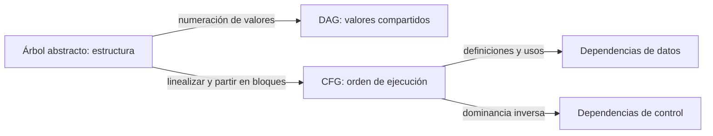
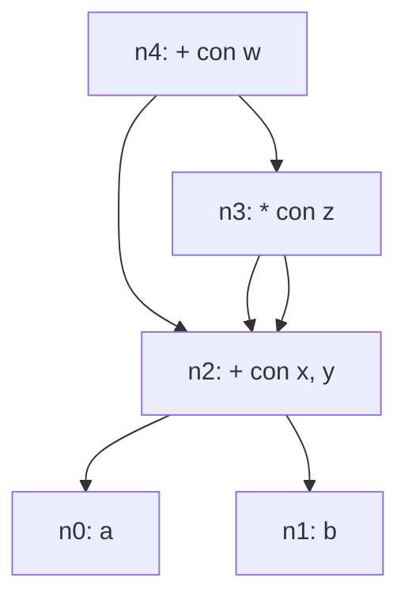
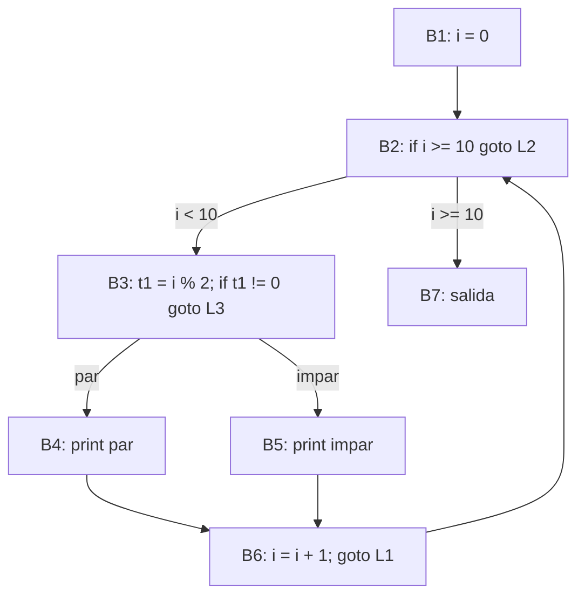

# Compiladores - Representaciones intermedias

## 5.2 Conjuntos de representaciones intermedias gráficas.

---

Las representaciones **gráficas** describen el programa con nodos y aristas: el árbol abstracto, su versión con subexpresiones compartidas, el DAG, el grafo de flujo de control y los grafos de dependencias de datos y de control. Cada una hace explícita una relación distinta, la estructura, la igualdad de valores, el orden de ejecución o la dependencia entre cálculos, y cada análisis u optimización elige la que necesita. Este tema presenta sus definiciones formales, sus algoritmos de construcción y sus usos, con el núcleo de representaciones intermedias del tema 5.1.

### Árbol de sintaxis abstracta

Cada nodo interior es un operador o una construcción del lenguaje, y sus hijos son sus componentes; a diferencia del árbol de análisis, no tiene no terminales intermedios, paréntesis ni palabras reservadas. Su tamaño es lineal en el del programa, y es la representación natural del análisis semántico y de las transformaciones de alto nivel.

### Grafo dirigido acíclico

Un **DAG** para las expresiones de un bloque tiene un nodo por cada **valor distinto**: las hojas son variables con su valor inicial y constantes, y los nodos interiores operadores aplicados a sus hijos; cada nodo lleva la lista de variables que tienen ese valor. Se construye con **numeración de valores**: una tabla de dispersión con clave $(\text{op}, \text{hijo}_1, \text{hijo}_2)$ da el nodo existente si ya se calculó la misma operación sobre los mismos valores, y para los operadores conmutativos se ordenan los hijos. Una asignación a una variable mueve su etiqueta al nodo nuevo, de modo que los usos posteriores ven el valor actualizado. Con la tabla, el DAG de $n$ operaciones se construye en tiempo $O(n)$ esperado. Sirve para eliminar subexpresiones comunes, detectar variables que no se usan y elegir buenas instrucciones.

### Grafo de flujo de control

Un **bloque básico** es una secuencia máxima de instrucciones en la que el control entra solo por la primera y sale solo por la última. Los bloques se forman con los **líderes**: la primera instrucción, el destino de cada salto y la instrucción que sigue a un salto; cada bloque va de un líder al siguiente. El **CFG** es la cuádrupla $(N, E, n_0, n_f),$ con un nodo por bloque, una arista $(B_i, B_j)$ si el control puede pasar del final de $B_i$ al inicio de $B_j,$ por un salto o por continuar, y nodos de entrada y salida. Cada bloque tiene a lo más dos sucesores en el código de tres direcciones, así que $|E| = O(|N|).$

Un bloque $d$ **domina** a $n$ si todo camino de la entrada a $n$ pasa por $d.$ Una arista $n \to h$ en la que $h$ domina a $n$ es una **arista de retroceso**, y define un **ciclo natural** con cabeza $h:$ así se encuentran los ciclos del programa sin mirar el fuente.

### Grafos de dependencias

- **De datos:** una arista de la instrucción que define un valor a cada instrucción que lo usa, dependencia **verdadera** o de lectura después de escritura; las dependencias de **escritura después de lectura** y de **escritura después de escritura** aparecen cuando se reutilizan nombres, y SSA las elimina. Las instrucciones sin camino entre ellas pueden ejecutarse en paralelo, y la longitud del camino más largo, el **camino crítico**, es una cota inferior del tiempo con recursos ilimitados.
- **De control:** $b$ depende del control de $a$ si $a$ decide si $b$ se ejecuta: $a$ tiene un sucesor por el que siempre se llega a $b$ y otro por el que no necesariamente. Se calcula con la frontera de dominancia del grafo inverso. Juntos forman el **grafo de dependencias del programa**, la base de la paralelización y del corte de programas.



### Implementación en Python

El programa usa el núcleo de representaciones intermedias del tema 5.1, incluido al inicio: dibuja el árbol del ejercicio 1, construye el DAG del ejercicio 2 por numeración de valores y comprueba con el intérprete que el código regenerado da los mismos valores, construye el CFG del ejercicio 3 y encuentra su arista de retroceso con los dominadores, aplica el algoritmo de los líderes al listado del ejercicio 4 y calcula los niveles del grafo de dependencias del ejercicio 5.

```python
# ===== Núcleo de representaciones intermedias: AST, DAG, código de tres direcciones, bloques, CFG y SSA =====
import re

# ---------- Analizador de un lenguaje pequeño parecido a C ----------
def lexico(texto):
    return re.findall(r'"[^"]*"|\d+\.\d+|\d+|[A-Za-z_]\w*|\+\+|--|[-+*/]=|==|!=|<=|>=|&&|\|\||[-+*/%<>=!(){};,]', texto) + ["$"]
class Parser:
    def __init__(self, texto): self.t, self.i = lexico(texto), 0
    def mira(self, k=0): return self.t[self.i + k]
    def come(self, x=None):
        v = self.t[self.i]
        if x and v != x: raise SyntaxError(f"se esperaba {x} y llegó {v}")
        self.i += 1; return v
    def programa(self):
        res = []
        while self.mira() != "$": res.append(self.sentencia())
        return ("bloque", res)
    def opcional_pc(self):
        if self.mira() == ";": self.come()
    def sentencia(self):
        x = self.mira()
        if x == "{":
            self.come(); res = []
            while self.mira() != "}": res.append(self.sentencia())
            self.come(); return ("bloque", res)
        if x == "if":
            self.come(); self.come("("); c = self.expr(); self.come(")"); s = self.sentencia(); o = None
            if self.mira() == "else": self.come(); o = self.sentencia()
            return ("if", c, s, o)
        if x == "while":
            self.come(); self.come("("); c = self.expr(); self.come(")"); return ("while", c, self.sentencia())
        if x == "for":
            self.come(); self.come("("); ini = self.simple() if self.mira() != ";" else None; self.come(";")
            c = self.expr() if self.mira() != ";" else ("num", 1); self.come(";")
            paso = self.simple() if self.mira() != ")" else None; self.come(")"); cuerpo = self.sentencia()
            return ("bloque", ([ini] if ini else []) + [("while", c, ("bloque", [cuerpo] + ([paso] if paso else [])))])
        if x == "return":
            self.come(); e = self.expr() if self.mira() not in (";", "}", "$") else None; self.opcional_pc(); return ("return", e)
        s = self.simple(); self.opcional_pc(); return s
    def simple(self):
        if self.mira(1) in ("=", "+=", "-=", "*=", "/=", "++", "--"):
            x = self.come(); op = self.come()
            if op == "=": return ("asig", x, self.expr())
            if op in ("++", "--"): return ("asig", x, ("bin", op[0], ("var", x), ("num", 1)))
            return ("asig", x, ("bin", op[0], ("var", x), self.expr()))
        return ("expr", self.expr())
    NIVELES = [("||",), ("&&",), ("==", "!="), ("<", "<=", ">", ">="), ("+", "-"), ("*", "/", "%")]
    def expr(self, k=0):
        if k == len(self.NIVELES): return self.unario()
        a = self.expr(k + 1)
        while self.mira() in self.NIVELES[k]: op = self.come(); a = ("bin", op, a, self.expr(k + 1))
        return a
    def unario(self):
        if self.mira() in ("-", "!"): op = self.come(); return ("un", op, self.unario())
        x = self.come()
        if x == "(": e = self.expr(); self.come(")"); return e
        if x[0].isdigit(): return ("num", float(x) if "." in x else int(x))
        if x[0] == '"': return ("str", x)
        if self.mira() == "(":
            self.come(); args = []
            while self.mira() != ")":
                args.append(self.expr())
                if self.mira() == ",": self.come()
            self.come(); return ("call", x, args)
        return ("var", x)
def expresion(texto): return Parser(texto).expr()

def texto_ast(n):
    k = n[0]
    if k == "num": return str(n[1])
    if k in ("var", "str"): return n[1]
    if k == "bin": return f"({texto_ast(n[2])} {n[1]} {texto_ast(n[3])})"
    if k == "un": return f"({n[1]}{texto_ast(n[2])})"
    if k == "call": return f"{n[1]}(" + ", ".join(texto_ast(a) for a in n[2]) + ")"
def dibuja_ast(n, pre="   ", ultimo=True, raiz=True):
    k = n[0]
    et = {"num": lambda: str(n[1]), "var": lambda: n[1], "str": lambda: n[1], "bin": lambda: n[1], "un": lambda: n[1], "call": lambda: n[1] + "()"}[k]()
    hijos = [n[2], n[3]] if k == "bin" else [n[2]] if k == "un" else n[2] if k == "call" else []
    lineas = [pre + ("" if raiz else ("└─ " if ultimo else "├─ ")) + et]
    sub = pre + ("" if raiz else ("   " if ultimo else "│  "))
    for i, h in enumerate(hijos): lineas += dibuja_ast(h, sub, i == len(hijos) - 1, False)
    return lineas
def postfija(n):
    k = n[0]
    if k in ("num", "var", "str"): return [str(n[1])]
    if k == "bin": return postfija(n[2]) + postfija(n[3]) + [n[1]]
    if k == "un": return postfija(n[2]) + ["neg" if n[1] == "-" else n[1]]
    if k == "call": return [x for a in n[2] for x in postfija(a)] + [f"{n[1]}/{len(n[2])}"]
def contar_nodos(n):
    k = n[0]
    if k == "bin": return 1 + contar_nodos(n[2]) + contar_nodos(n[3])
    if k == "un": return 1 + contar_nodos(n[2])
    if k == "call": return 1 + sum(contar_nodos(a) for a in n[2])
    return 1

# ---------- DAG por numeración de valores ----------
def dag(asignaciones):
    """asignaciones: lista de (variable o None, AST). Devuelve los nodos únicos y las etiquetas de cada nodo."""
    nodos, tabla, etiquetas, actual = [], {}, {}, {}
    def nodo(clave, texto):
        if clave not in tabla: tabla[clave] = len(nodos); nodos.append(texto)
        return tabla[clave]
    def visita(n):
        k = n[0]
        if k == "num": return nodo(("num", n[1]), str(n[1]))
        if k == "var":
            if n[1] in actual: return actual[n[1]]
            return nodo(("var", n[1]), n[1])
        if k == "bin":
            a, b = visita(n[2]), visita(n[3])
            if n[1] in "+*" and a > b: a, b = b, a                    # conmutatividad
            return nodo(("bin", n[1], a, b), f"{n[1]} n{a} n{b}")
        if k == "un": a = visita(n[2]); return nodo(("un", n[1], a), f"{n[1]} n{a}")
    for x, e in asignaciones:
        k = visita(e)
        if x:
            for v in list(etiquetas):
                if v == x: del etiquetas[v]
            actual[x] = k; etiquetas[x] = k
    return nodos, etiquetas

# ---------- Código de tres direcciones ----------
class GeneradorTAC:
    def __init__(self): self.codigo, self.nt, self.ne = [], 0, 0
    def temp(self): self.nt += 1; return f"t{self.nt}"
    def etiqueta(self): self.ne += 1; return f"L{self.ne}"
    def emite(self, *ins): self.codigo.append(ins)
    REL = {"<": ">=", "<=": ">", ">": "<=", ">=": "<", "==": "!=", "!=": "=="}
    def valor(self, n):
        k = n[0]
        if k == "num": return str(n[1])
        if k in ("var", "str"): return n[1]
        if k == "bin" and n[1] in ("&&", "||") or k == "bin" and n[1] in self.REL or k == "un" and n[1] == "!":
            t = self.temp(); lf, lfin = self.etiqueta(), self.etiqueta()
            self.condicion(n, None, lf); self.emite("asig", t, "1"); self.emite("goto", lfin)
            self.emite("label", lf); self.emite("asig", t, "0"); self.emite("label", lfin); return t
        if k == "bin":
            a = self.valor(n[2]); b = self.valor(n[3]); t = self.temp(); self.emite("bin", t, n[1], a, b); return t
        if k == "un": a = self.valor(n[2]); t = self.temp(); self.emite("un", t, n[1], a); return t
        if k == "call":
            args = [self.valor(a) for a in n[2]]
            for a in args: self.emite("param", a)
            t = self.temp(); self.emite("call", t, n[1], len(args)); return t
    def condicion(self, n, v, f):
        """Código de saltos: salta a v si la condición es verdadera y a f si es falsa; None significa continuar."""
        if n[0] == "bin" and n[1] in self.REL:
            a = self.valor(n[2]); b = self.valor(n[3])
            if v and f: self.emite("if", a, n[1], b, v); self.emite("goto", f)
            elif v: self.emite("if", a, n[1], b, v)
            elif f: self.emite("if", a, self.REL[n[1]], b, f)
        elif n[0] == "bin" and n[1] == "&&":
            fin = None if f else self.etiqueta()
            self.condicion(n[2], None, f or fin); self.condicion(n[3], v, f or fin)
            if fin: self.emite("label", fin)
        elif n[0] == "bin" and n[1] == "||":
            fin = None if v else self.etiqueta()
            self.condicion(n[2], v or fin, None); self.condicion(n[3], v or fin, f)
            if fin: self.emite("label", fin)
        elif n[0] == "un" and n[1] == "!": self.condicion(n[2], f, v)
        else:
            a = self.valor(n)
            if v: self.emite("if", a, "!=", "0", v)
            if f: self.emite("if", a, "==", "0", f) if not v else self.emite("goto", f)
    def sentencia(self, s):
        k = s[0]
        if k == "bloque":
            for x in s[1]: self.sentencia(x)
        elif k == "asig":
            e = s[2]
            if e[0] == "bin" and e[1] not in ("&&", "||") and e[1] not in self.REL:
                a = self.valor(e[2]); b = self.valor(e[3]); self.emite("bin", s[1], e[1], a, b)
            else: self.emite("asig", s[1], self.valor(e))
        elif k == "if":
            lf = self.etiqueta(); self.condicion(s[1], None, lf); self.sentencia(s[2])
            if s[3]:
                lfin = self.etiqueta(); self.emite("goto", lfin); self.emite("label", lf); self.sentencia(s[3]); self.emite("label", lfin)
            else: self.emite("label", lf)
        elif k == "while":
            li, lf = self.etiqueta(), self.etiqueta()
            self.emite("label", li); self.condicion(s[1], None, lf); self.sentencia(s[2]); self.emite("goto", li); self.emite("label", lf)
        elif k == "return": self.emite("ret", self.valor(s[1]) if s[1] else "")
        elif k == "expr":
            e = s[1]
            if e[0] == "call" and e[1] == "print":
                for a in [self.valor(a) for a in e[2]]: self.emite("param", a)
                self.emite("call", None, "print", len(e[2]))
            else: self.valor(e)
def tac(texto):
    g = GeneradorTAC(); g.sentencia(Parser(texto).programa())
    c = g.codigo                                   # mirilla: quita los saltos a la instrucción siguiente
    return [ins for k, ins in enumerate(c) if not (ins[0] == "goto" and k + 1 < len(c) and c[k + 1] == ("label", ins[1]))]
def texto_ins(ins):
    k = ins[0]
    if k == "asig": return f"{ins[1]} = {ins[2]}"
    if k == "bin": return f"{ins[1]} = {ins[3]} {ins[2]} {ins[4]}"
    if k == "un": return f"{ins[1]} = {ins[2]}{ins[3]}"
    if k == "label": return f"{ins[1]}:"
    if k == "goto": return f"goto {ins[1]}"
    if k == "if": return f"if {ins[1]} {ins[2]} {ins[3]} goto {ins[4]}"
    if k == "param": return f"param {ins[1]}"
    if k == "call": return (f"{ins[1]} = " if ins[1] else "") + f"call {ins[2]}, {ins[3]}"
    if k == "ret": return f"return {ins[1]}".strip()
    if k == "phi": return f"{ins[1]} = φ(" + ", ".join(f"{v}" for _, v in sorted(ins[2].items())) + ")"
def listado(codigo, numerado=False):
    return "\n".join(f"   {k + 1:2}: {texto_ins(i)}" if numerado else ("   " + texto_ins(i) if i[0] != "label" else " " + texto_ins(i)) for k, i in enumerate(codigo))

# ---------- Bloques básicos y grafo de flujo de control ----------
def bloques(codigo):
    lideres = {0}
    for k, ins in enumerate(codigo):
        if ins[0] == "label": lideres.add(k)
        if ins[0] in ("goto", "if", "ret") and k + 1 < len(codigo): lideres.add(k + 1)
    orden = sorted(lideres); bs = []
    for j, ini in enumerate(orden):
        fin = orden[j + 1] if j + 1 < len(orden) else len(codigo)
        bs.append(codigo[ini:fin])
    bs = [b for b in bs if b]
    etiqueta_de = {b[0][1]: i for i, b in enumerate(bs) if b[0][0] == "label"}
    suc = {}
    for i, b in enumerate(bs):
        u = b[-1]; s = []
        if u[0] == "goto": s = [etiqueta_de[u[1]]]
        elif u[0] == "if": s = [etiqueta_de[u[4]]] + ([i + 1] if i + 1 < len(bs) else [])
        elif u[0] != "ret" and i + 1 < len(bs): s = [i + 1]
        suc[i] = list(dict.fromkeys(s))
    pred = {i: [j for j in suc if i in suc[j]] for i in suc}
    return bs, suc, pred

def dominadores(n, suc, pred, entrada=0):
    dom = {i: set(range(n)) for i in range(n)}; dom[entrada] = {entrada}; cambio = True
    while cambio:
        cambio = False
        for i in range(n):
            if i == entrada: continue
            nuevo = {i} | (set.intersection(*[dom[p] for p in pred[i]]) if pred[i] else set())
            if nuevo != dom[i]: dom[i] = nuevo; cambio = True
    # el dominador inmediato de i es el dominador estricto cuyo conjunto de dominadores es dom(i) sin i
    idom = {i: next((d for d in dom[i] - {i} if dom[d] == dom[i] - {i}), None) for i in range(n)}
    return dom, idom
def frontera(n, pred, idom):
    df = {i: set() for i in range(n)}
    for b in range(n):
        if len(pred[b]) >= 2:
            for p in pred[b]:
                r = p
                while r is not None and r != idom[b]: df[r].add(b); r = idom[r]
    return df

def definidas(b): return [i[1] for i in b if i[0] in ("asig", "bin", "un") or (i[0] == "call" and i[1])]
def usadas(i):
    k = i[0]
    if k == "asig": return [i[2]]
    if k == "bin": return [i[3], i[4]]
    if k == "un": return [i[3]]
    if k == "if": return [i[1], i[3]]
    if k in ("param", "ret"): return [i[1]]
    if k == "phi": return list(i[2].values())
    return []
def es_variable(x): return isinstance(x, str) and re.fullmatch(r"[A-Za-z_]\w*", x) is not None

def ssa(codigo, podada=True):
    """Construcción de Cytron y otros: funciones φ en la frontera de dominancia iterada y renombrado sobre el árbol de dominadores.
    Con podada=True solo se insertan φ para variables vivas a la entrada del bloque."""
    bs, suc, pred = bloques(codigo); n = len(bs)
    dom, idom = dominadores(n, suc, pred); df = frontera(n, pred, idom)
    vivas_ent = vivas(bs, suc) if podada else None
    variables = sorted({x for b in bs for x in definidas(b)})
    phis = {i: {} for i in range(n)}
    for v in variables:
        trabajo = [i for i in range(n) if v in definidas(bs[i])]; puestos = set()
        while trabajo:
            b = trabajo.pop()
            for d in sorted(df[b]):
                if d in puestos or (podada and v not in vivas_ent[d]): continue
                puestos.add(d); phis[d][v] = {}
                if d not in trabajo: trabajo.append(d)
    contador, pila = {}, {}
    def nuevo(v):
        contador[v] = contador.get(v, 0) + 1; nombre = f"{v}_{contador[v]}"; pila.setdefault(v, []).append(nombre); return nombre
    def actual(x): return pila[x][-1] if es_variable(x) and pila.get(x) else (f"{x}_0" if es_variable(x) and x in variables else x)
    nuevos = {}; nombres_phi = {i: {} for i in range(n)}
    hijos = {i: sorted(j for j in range(n) if idom[j] == i) for i in range(n)}
    def renombra(b):
        empujados = []
        for v in phis[b]: nombres_phi[b][v] = nuevo(v); empujados.append(v)
        res = []
        for ins in bs[b]:
            k = ins[0]
            if k == "asig": a = actual(ins[2]); res.append(("asig", nuevo(ins[1]), a)); empujados.append(ins[1])
            elif k == "bin": a, c = actual(ins[3]), actual(ins[4]); res.append(("bin", nuevo(ins[1]), ins[2], a, c)); empujados.append(ins[1])
            elif k == "un": a = actual(ins[3]); res.append(("un", nuevo(ins[1]), ins[2], a)); empujados.append(ins[1])
            elif k == "if": res.append(("if", actual(ins[1]), ins[2], actual(ins[3]), ins[4]))
            elif k in ("param", "ret"): res.append((k, actual(ins[1])))
            elif k == "call" and ins[1]: res.append(("call", nuevo(ins[1]), ins[2], ins[3])); empujados.append(ins[1])
            else: res.append(ins)
        nuevos[b] = res
        for s in suc[b]:
            for v in phis[s]: phis[s][v][b] = actual(v)
        for h in hijos[b]: renombra(h)
        for v in empujados: pila[v].pop()
    renombra(0)
    resultado = []
    for b in range(n):
        cuerpo = nuevos.get(b, [])
        lab = [cuerpo[0]] if cuerpo and cuerpo[0][0] == "label" else []
        resto = cuerpo[len(lab):]
        resultado.append(lab + [("phi", nombres_phi[b][v], {f"B{p + 1}": x for p, x in phis[b][v].items()}) for v in sorted(phis[b])] + resto)
    return resultado, (bs, suc, pred, idom, df)

def vivas(bs, suc):
    """Variables vivas a la entrada de cada bloque, por análisis hacia atrás de punto fijo."""
    n = len(bs); uso, defi = {}, {}
    for i, b in enumerate(bs):
        u, d = set(), set()
        for ins in b:
            for x in usadas(ins):
                if es_variable(x) and x not in d: u.add(x)
            for x in definidas([ins]): d.add(x)
        uso[i], defi[i] = u, d
    ent = {i: set() for i in range(n)}; cambio = True
    while cambio:
        cambio = False
        for i in reversed(range(n)):
            sal = set().union(*[ent[s] for s in suc[i]]) if suc[i] else set()
            nueva = uso[i] | (sal - defi[i])
            if nueva != ent[i]: ent[i] = nueva; cambio = True
    return ent

# ---------- Intérprete de código de tres direcciones, con o sin φ ----------
OPS = {"+": lambda a, b: a + b, "-": lambda a, b: a - b, "*": lambda a, b: a * b, "/": lambda a, b: a / b if isinstance(a, float) or isinstance(b, float) else int(a / b),
       "%": lambda a, b: a % b, "<": lambda a, b: int(a < b), "<=": lambda a, b: int(a <= b), ">": lambda a, b: int(a > b),
       ">=": lambda a, b: int(a >= b), "==": lambda a, b: int(a == b), "!=": lambda a, b: int(a != b)}
def ejecuta(lista_bloques, entorno, limite=100000, funciones=None):
    """lista_bloques: lista de listas de instrucciones; las φ eligen según el bloque de procedencia."""
    env = dict(entorno); salida = []; params = []; funciones = funciones or {}
    etq = {b[0][1]: i for i, b in enumerate(lista_bloques) if b and b[0][0] == "label"}
    def val(x):
        if isinstance(x, str) and re.fullmatch(r"-?\d+", x): return int(x)
        if isinstance(x, str) and re.fullmatch(r"-?\d+\.\d+", x): return float(x)
        if isinstance(x, str) and x.startswith('"'): return x.strip('"')
        if x in env: return env[x]
        base = re.sub(r"_0$", "", x)
        return env.get(base, 0)
    b, previo, pasos = 0, None, 0
    while b is not None and b < len(lista_bloques):
        siguiente = b + 1
        phis = [i for i in lista_bloques[b] if i[0] == "phi"]
        nuevos = {i[1]: val(i[2].get(f"B{previo + 1}", "0")) for i in phis} if previo is not None else {}
        env.update(nuevos)
        for ins in lista_bloques[b]:
            pasos += 1
            if pasos > limite: raise RuntimeError("demasiados pasos")
            k = ins[0]
            if k == "asig": env[ins[1]] = val(ins[2])
            elif k == "bin": env[ins[1]] = OPS[ins[2]](val(ins[3]), val(ins[4]))
            elif k == "un": env[ins[1]] = -val(ins[3]) if ins[2] == "-" else int(not val(ins[3]))
            elif k == "goto": siguiente = etq[ins[1]]; break
            elif k == "if":
                if OPS[ins[2]](val(ins[1]), val(ins[3])): siguiente = etq[ins[4]]; break
            elif k == "param": params.append(val(ins[1]))
            elif k == "call":
                args, params[:] = params[-ins[3]:] if ins[3] else [], params[:-ins[3]] if ins[3] else params
                if ins[2] == "print": salida.append(" ".join(str(a) for a in args))
                else: env[ins[1]] = funciones[ins[2]](*args)
            elif k == "ret": return env, salida, val(ins[1]) if ins[1] else None
        previo, b = b, siguiente
    return env, salida, None
def muestra_bloques(bs, sangria="   "):
    lineas = []
    for k, b in enumerate(bs):
        lineas.append(f"{sangria}B{k + 1}:")
        for i in b: lineas.append(f"{sangria}  " + ("" if i[0] == "label" else "  ") + texto_ins(i))
    return "\n".join(lineas)

# ---------- Optimización local: numeración de valores, plegado, propagación de copias y código muerto ----------
def es_numero(x): return isinstance(x, str) and re.fullmatch(r"-?\d+(\.\d+)?", x) is not None
def num(x): return float(x) if "." in x else int(x)
def optimiza_bloque(codigo, vivas_salida, pasos=None):
    """Un bloque sin saltos. vivas_salida: variables que se usan después del bloque."""
    pasos = pasos if pasos is not None else []
    valor, tabla, res = {}, {}, []                    # valor: nombre -> operando equivalente; tabla: expresión -> nombre
    def op(x): return valor.get(x, x)
    for ins in codigo:
        if ins[0] == "asig":
            v = op(ins[2]); valor[ins[1]] = v
            for k in [k for k, n in tabla.items() if n == ins[1]]: del tabla[k]
            res.append(("asig", ins[1], v)); continue
        if ins[0] != "bin": res.append(ins); continue
        d, o, a, b = ins[1], ins[2], op(ins[3]), op(ins[4])
        if es_numero(a) and es_numero(b) and o in OPS:
            r = OPS[o](num(a), num(b)); r = str(int(r)) if float(r).is_integer() else str(r)
            pasos.append(f"plegado: {a} {o} {b} = {r}"); valor[d] = r; res.append(("asig", d, r)); continue
        if o in "+*" and str(a) > str(b): a, b = b, a
        if (o == "+" and b == "0") or (o == "*" and b == "1"): valor[d] = a; res.append(("asig", d, a)); pasos.append(f"identidad: {d} = {a}"); continue
        clave = (o, a, b)
        if clave in tabla and op(tabla[clave]) == tabla[clave]:
            pasos.append(f"subexpresión común: {a} {o} {b} ya está en {tabla[clave]}"); valor[d] = tabla[clave]; res.append(("asig", d, tabla[clave])); continue
        valor.pop(d, None)
        for k in [k for k, n in tabla.items() if n == d or d in k[1:]]: del tabla[k]
        tabla[clave] = d; res.append(("bin", d, o, a, b))
    # código muerto: hacia atrás, se conservan las instrucciones cuyo destino se usa después
    vivas_ahora, final = set(vivas_salida), []
    for ins in reversed(res):
        if ins[0] in ("asig", "bin") and ins[1] not in vivas_ahora:
            pasos.append(f"código muerto: {texto_ins(ins)}"); continue
        if ins[0] in ("asig", "bin"): vivas_ahora.discard(ins[1])
        vivas_ahora |= {x for x in usadas(ins) if es_variable(x)}
        final.append(ins)
    return final[::-1]

# ---------- Ejercicio 1: árbol abstracto ----------
e1 = expresion("(a + b) * (c - d / e)")
print("ejercicio 1:", texto_ast(e1), f"({contar_nodos(e1)} nodos)"); print("\n".join(dibuja_ast(e1)))

# ---------- Ejercicio 2: DAG de un bloque ----------
BLOQUE = [("x", "a + b"), ("y", "a + b"), ("z", "x * y"), ("w", "z + (a + b)")]
nodos, etiquetas = dag([(v, expresion(e)) for v, e in BLOQUE])
print("ejercicio 2:", ", ".join(f"n{k}: {t}" for k, t in enumerate(nodos)))
print("   variables que etiquetan cada nodo:", {f"n{k}": sorted(v for v, n in etiquetas.items() if n == k) for k in sorted(set(etiquetas.values()))})
print("   código regenerado desde el DAG: x = a + b ; y = x ; z = x * x ; w = z + x")
env1, _, _ = ejecuta([tac("x = a + b; y = a + b; z = x * y; w = z + (a + b);")], {"a": 2, "b": 5})
env2, _, _ = ejecuta([tac("x = a + b; y = x; z = x * x; w = z + x;")], {"a": 2, "b": 5})
print("   con a = 2 y b = 5:", {v: env1[v] for v in "xyzw"}, "| optimizado:", {v: env2[v] for v in "xyzw"})

# ---------- Ejercicio 3: CFG con un ciclo y un if ----------
c3 = tac("""i = 0;
while (i < 10) {
    if (i % 2 == 0) {
        print("par");
    } else {
        print("impar");
    }
    i++;
}""")
bs, suc, pred = bloques(c3)
print("ejercicio 3:")
for k, b in enumerate(bs): print(f"   B{k + 1}: {' ; '.join(texto_ins(x) for x in b):48} -> {[f'B{j + 1}' for j in suc[k]]}")
dom, idom = dominadores(len(bs), suc, pred)
atras = [(f"B{a + 1}", f"B{b + 1}") for a in suc for b in suc[a] if b in dom[a]]
print("   aristas de retroceso, cuyo destino domina al origen:", atras, "| impresiones:", len(ejecuta(bs, {})[1]))

# ---------- Ejercicio 4: bloques básicos de un listado numerado ----------
LISTADO = """1: i = 0
2: if i >= 10 goto 8
3: t1 = i * 2
4: j = t1
5: print j
6: i = i + 1
7: goto 2
8: return"""
instr = [l.split(": ", 1)[1] for l in LISTADO.splitlines()]
lideres = {1}
for k, ins in enumerate(instr, 1):
    m = re.search(r"goto (\d+)", ins)
    if m:
        lideres.add(int(m.group(1)))                         # el destino de un salto
        if k < len(instr): lideres.add(k + 1)                # la instrucción después de un salto
orden = sorted(lideres); grupos = [list(range(a, (orden[i + 1] if i + 1 < len(orden) else len(instr) + 1))) for i, a in enumerate(orden)]
bloque_de = {n: i for i, g in enumerate(grupos) for n in g}
print("ejercicio 4: líderes", orden)
for i, g in enumerate(grupos):
    ultima = instr[g[-1] - 1]; m = re.search(r"goto (\d+)", ultima); s = []
    if m: s.append(bloque_de[int(m.group(1))])
    if not ultima.startswith("goto") and not ultima.startswith("return") and g[-1] < len(instr): s.append(i + 1)
    print(f"   B{i + 1}: instrucciones {g[0]}-{g[-1]}: {' ; '.join(instr[n - 1] for n in g):55} -> {[f'B{j + 1}' for j in s]}")

# ---------- Ejercicio 5: grafo de dependencias de datos ----------
DFG = ["t1 = a + b", "t2 = t1 * c", "t3 = b - d", "t4 = t2 / t3"]
define = {}; nivel = {}; aristas = []
for k, s in enumerate(DFG):
    destino, expr = s.split(" = "); usos = [x for x in expr.split() if x in define]
    for u in usos: aristas.append(f"{u} -> {destino}")
    nivel[destino] = 1 + max((nivel[u] for u in usos), default=0); define[destino] = k
print("ejercicio 5: aristas", aristas)
print("   nivel de cada operación:", nivel, "| camino crítico:", max(nivel.values()), "pasos con", max(list(nivel.values()).count(v) for v in set(nivel.values())), "unidades")
```

Salida:

```text
ejercicio 1: ((a + b) * (c - (d / e))) (9 nodos)
   *
   ├─ +
   │  ├─ a
   │  └─ b
   └─ -
      ├─ c
      └─ /
         ├─ d
         └─ e
ejercicio 2: n0: a, n1: b, n2: + n0 n1, n3: * n2 n2, n4: + n2 n3
   variables que etiquetan cada nodo: {'n2': ['x', 'y'], 'n3': ['z'], 'n4': ['w']}
   código regenerado desde el DAG: x = a + b ; y = x ; z = x * x ; w = z + x
   con a = 2 y b = 5: {'x': 7, 'y': 7, 'z': 49, 'w': 56} | optimizado: {'x': 7, 'y': 7, 'z': 49, 'w': 56}
ejercicio 3:
   B1: i = 0                                            -> ['B2']
   B2: L1: ; if i >= 10 goto L2                         -> ['B7', 'B3']
   B3: t1 = i % 2 ; if t1 != 0 goto L3                  -> ['B5', 'B4']
   B4: param "par" ; call print, 1 ; goto L4            -> ['B6']
   B5: L3: ; param "impar" ; call print, 1              -> ['B6']
   B6: L4: ; i = i + 1 ; goto L1                        -> ['B2']
   B7: L2:                                              -> []
   aristas de retroceso, cuyo destino domina al origen: [('B6', 'B2')] | impresiones: 10
ejercicio 4: líderes [1, 2, 3, 8]
   B1: instrucciones 1-1: i = 0                                                   -> ['B2']
   B2: instrucciones 2-2: if i >= 10 goto 8                                       -> ['B4', 'B3']
   B3: instrucciones 3-7: t1 = i * 2 ; j = t1 ; print j ; i = i + 1 ; goto 2      -> ['B2']
   B4: instrucciones 8-8: return                                                  -> []
ejercicio 5: aristas ['t1 -> t2', 't2 -> t4', 't3 -> t4']
   nivel de cada operación: {'t1': 1, 't2': 2, 't3': 1, 't4': 3} | camino crítico: 3 pasos con 2 unidades
```

### Ejercicios Propuestos

1. **Árbol abstracto.** Construye el árbol abstracto de la expresión `(a + b) * (c - d / e)`.

2. **DAG.** Genera el DAG del fragmento:

    ```c
    x = a + b
    y = a + b
    z = x * y
    w = z + (a + b)
    ```

3. **CFG.** Dibuja el grafo de flujo de control de:

    ```c
    i = 0;
    while (i < 10) {
        if (i % 2 == 0) {
            print("par");
        } else {
            print("impar");
        }
        i++;
    }
    ```

4. **Bloques básicos.** Identifica los bloques básicos del siguiente código de tres direcciones:

    ```text
    1: i = 0
    2: if i >= 10 goto 8
    3: t1 = i * 2
    4: j = t1
    5: print j
    6: i = i + 1
    7: goto 2
    8: return
    ```

5. **Dependencias de datos.** Construye el grafo de dependencias de datos de:

    ```text
    t1 = a + b
    t2 = t1 * c
    t3 = b - d
    t4 = t2 / t3
    ```

### Soluciones

**Ejercicio 1.** La raíz es el `*`, con `a + b` a la izquierda y `c - d / e` a la derecha, donde la división es hija de la resta por su mayor precedencia. El árbol tiene 9 nodos: cuatro operadores y cinco hojas, sin paréntesis, porque la forma del árbol los representa.

**Ejercicio 2.** El DAG tiene 5 nodos: las hojas `a` y `b`; el nodo `a + b`, etiquetado con `x` e `y`, porque la segunda suma se encuentra en la tabla; el producto, con sus dos aristas al **mismo** nodo, etiquetado con `z`, y la suma final, con `z` y otra vez `a + b`, etiquetada con `w`:



El código regenerado calcula una sola suma: `x = a + b; y = x; z = x * x; w = z + x`, y el intérprete comprueba que da los mismos valores que el original, $x = y = 7,$ $z = 49$ y $w = 56$ con $a = 2$ y $b = 5.$

**Ejercicio 3.** El código de tres direcciones tiene 7 bloques: B1, la inicialización; B2, la cabeza del ciclo con la condición invertida; B3, el cálculo de `i % 2` y la decisión; B4 y B5, las dos impresiones; B6, el incremento con el salto de regreso, y B7, la salida.



La arista B6 → B2 es la única de retroceso, porque B2 domina a B6: define el ciclo natural formado por B2 a B6. El intérprete ejecuta el CFG e imprime 10 veces.

**Ejercicio 4.** Los líderes son la instrucción 1, por ser la primera; la 2, destino del `goto 2`; la 3, que sigue al salto condicional, y la 8, destino del `goto 8` y siguiente al `goto 2`. Los bloques son B1, la instrucción 1; B2, la 2; B3, de la 3 a la 7, y B4, la 8. Las aristas son B1 → B2, B2 → B4 si $i \ge 10,$ B2 → B3 si no, y B3 → B2, la de retroceso. La instrucción 7 no tiene arista a la 8, porque el `goto` es incondicional.

**Ejercicio 5.** Las aristas son `t1 → t2`, `t2 → t4` y `t3 → t4`. `t1` y `t3` no dependen de nada calculado en el bloque, así que están en el nivel 1 y pueden ejecutarse **en paralelo**; `t2` está en el nivel 2 y `t4` en el 3. El camino crítico, `t1 → t2 → t4`, tiene 3 operaciones, de modo que con dos unidades funcionales el bloque se ejecuta en 3 pasos en lugar de 4. La lectura de `b` por `t1` y por `t3` no es una dependencia, porque ninguna de las dos lo modifica.

En el material original, la "propiedad fundamental" del DAG era una fórmula sin significado, $\text{DAG}(E) \equiv \text{AST}(E) \land \ldots;$ la tabla comparativa daba al CFG una complejidad $O(n^2),$ cuando en el código de tres direcciones cada bloque tiene a lo más dos sucesores y el número de aristas es lineal, y el texto tenía erratas como "arbófica" y palabras en inglés, como "statements" y "dependencias data".

### Referencias

1. Aho, A. V., Lam, M. S., Sethi, R., and Ullman, J. D., _Compilers: Principles, Techniques, and Tools_. 2a ed., Pearson, 2007. Secciones 6.1, 8.4 y 8.5.
2. Cooper, K. D., and Torczon, L., _Engineering a Compiler_. 3a ed., Morgan Kaufmann, 2022. Sección 5.2.
3. Ferrante, J., Ottenstein, K. J., and Warren, J. D., The program dependence graph and its use in optimization. _ACM TOPLAS_ 9(3), 1987.
4. Allen, F. E., Control flow analysis. _SIGPLAN Notices_ 5(7), 1970.
5. Muchnick, S. S., _Advanced Compiler Design and Implementation_. Morgan Kaufmann, 1997. Capítulos 7 y 9.
