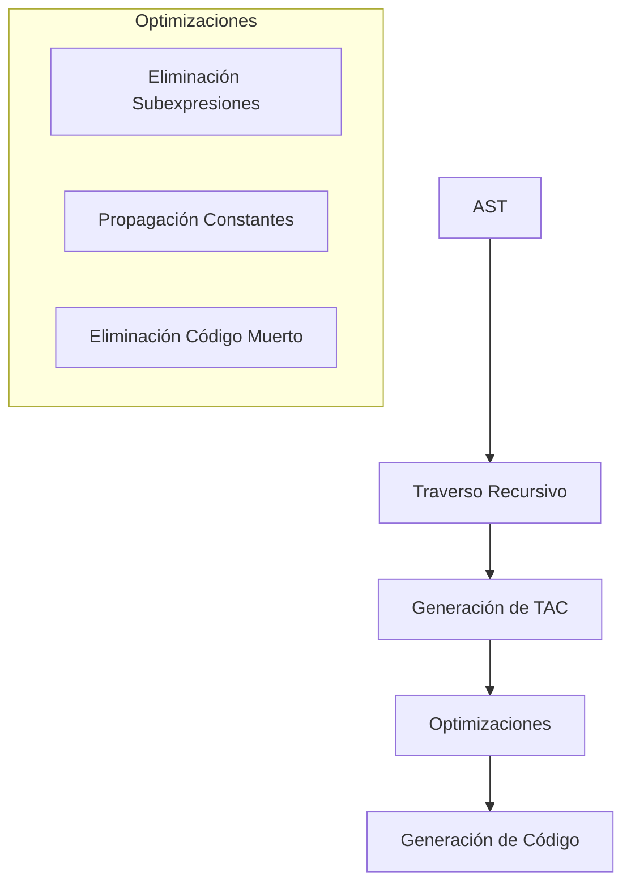

# Compiladores - Representaciones intermedias

## 5.3 Representaciones intermedias lineales.

---

Las representaciones intermedias lineales son secuencias de instrucciones simples que se ejecutan de manera secuencial. Según Cooper y Torczon (2004), "estas representaciones son particularmente útiles para la generación de código y optimizaciones a nivel de instrucciones".

### Definición y Características

**Definición:** Una representación intermedia lineal es una secuencia ordenada de instrucciones simples que preservan el significado del programa original mientras facilitan la transformación y generación de código.

**Características principales:**

- Secuencialidad en la ejecución
- Instrucciones simples y atómicas
- Uso extensivo de temporales
- Fácil traducción a código máquina

### Taxonomía de Representaciones Lineales

#### 1. Código de Tres Direcciones (TAC)

**Definición:** Representación donde cada instrucción tiene a lo sumo dos operandos y un resultado.

**Formato general:**

$$ \text{resultado} = \text{operando}_1\ \text{op}\ \text{operando}_2 $$

**Tipos de instrucciones:**

- Aritméticas: `x = y op z`
- Asignación: `x = y`
- Copia: `x = y`
- Saltos: `goto L`
- Condicionales: `if x relop y goto L`

**Ejemplo:** Conversión de expresión a TAC

```python
# Expresión original: a = (b + c) * d - e / f

# Código de tres direcciones
t1 = b + c
t2 = t1 * d
t3 = e / f
t4 = t2 - t3
a = t4
```

#### 2. Código P

**Definición:** Representación de máquina abstracta desarrollada para compiladores de Pascal.

**Características:**

- Stack-based architecture
- Instrucciones de un operando
- Optimizado para interpretación

**Ejemplo código P:**

```
LDI 5      ; Carga inmediato 5
LDI 3      ; Carga inmediato 3
ADI       ; Suma (5 + 3)
STO x     ; Almacena resultado en x
```

#### 3. Bytecode

**Definición:** Código intermedio compacto para máquinas virtuales.

**Ejemplo Java Bytecode:**

```java
// Código Java: int result = a + b * c;

iload_1     // carga a
iload_2     // carga b
iload_3     // carga c
imul        // b * c
iadd        // a + (b * c)
istore_4    // almacena resultado
```

### Estructura Detallada del Código de Tres Direcciones

#### Formatos de Instrucciones TAC

| Tipo          | Formato               | Ejemplo             |
| ------------- | --------------------- | ------------------- |
| Aritmético    | `x = y op z`          | `t1 = a + b`        |
| Asignación    | `x = y`               | `a = t1`            |
| Copy          | `x = y`               | `t2 = t1`           |
| Unario        | `x = op y`            | `t1 = -a`           |
| Condicional   | `if x relop y goto L` | `if t1 > 0 goto L1` |
| Incondicional | `goto L`              | `goto L2`           |
| Param         | `param x`             | `param a`           |
| Call          | `call f, n`           | `call printf, 1`    |
| Return        | `return x`            | `return result`     |

#### Implementación de Estructuras de Control

**Ejemplo: Sentencia if-else**

```python
# Código original
if (a > b) {
    max = a;
} else {
    max = b;
}

# TAC
L1: if a > b goto L2
    goto L3
L2: max = a
    goto L4
L3: max = b
L4: # continuación
```

**Ejemplo: Bucle while**

```python
# Código original
while (i < n) {
    sum = sum + i;
    i = i + 1;
}

# TAC
L1: if i < n goto L2
    goto L3
L2: sum = sum + i
    i = i + 1
    goto L1
L3: # continuación
```

### Representación de Expresiones Complejas

#### Notación Polaca Inversa (RPN)

**Definición:** Notación donde los operadores siguen a sus operandos.

**Fórmula de conversión:** Para una expresión $E$, la RPN se define recursivamente:

$$ \text{RPN}(E_1\ op\ E_2) = \text{RPN}(E_1)\ \text{RPN}(E_2)\ op $$

$$ \text{RPN}(id) = id $$

**Ejemplo:**

$$ a + b * c \rightarrow a\ b\ c\ *\ + $$

#### Cuádruplos

**Estructura:** (op, arg1, arg2, result)

**Ejemplo:** `t1 = a + b`

$$ (\text{+}, a, b, t1) $$

**Implementación:**

```python
quadruples = [
    ('+', 'a', 'b', 't1'),
    ('*', 't1', 'c', 't2'),
    ('-', 't2', 'd', 'result')
]
```

#### Triplos

**Estructura:** (op, arg1, arg2) donde los resultados se refieren por posición.

**Ejemplo:**

```python
triples = [
    ('+', 'a', 'b'),    # posición 0: t0 = a + b
    ('*', 0, 'c'),      # posición 1: t1 = t0 * c
    ('-', 1, 'd')       # posición 2: result = t1 - d
]
```

### Optimizaciones con Representaciones Lineales

#### Eliminación de Subexpresiones Comunes

**Antes:**

```
t1 = a + b
t2 = a + b  # Redundante
t3 = t1 * t2
```

**Después:**

```
t1 = a + b
t3 = t1 * t1  # Reuso
```

#### Propagación de Constantes

**Antes:**

```
t1 = 5 * 3
t2 = t1 + 2
```

**Después:**

```
t2 = 15 + 2  # 5 * 3 = 15
t2 = 17      # 15 + 2 = 17
```

### Ejercicios Propuestos

#### Ejercicio 1: Conversión a TAC

Convierta a código de tres direcciones:

```c
x = (a + b) * (c - d) / e;
```

#### Ejercicio 2: Estructuras de Control

Genere TAC para:

```c
for (i = 0; i < 10; i++) {
    if (i % 2 == 0) {
        even_sum += i;
    } else {
        odd_sum += i;
    }
}
```

#### Ejercicio 3: Cuádruplos y Triplos

Para la expresión `a * b + c * d - e`:
a) Genere cuádruplos
b) Genere triplos
c) Muestre las diferencias

#### Ejercicio 4: Optimización

Optimice el siguiente código TAC:

```
t1 = 2 * 3
t2 = t1 + 5
t3 = a + b
t4 = a + b
t5 = t3 * t4
```

#### Ejercicio 5: Notación Polaca

Convierta a notación polaca inversa:

```c
(a + b) * (c - d) / (e + f * g)
```

### Implementación Práctica

#### Clase para Generación de TAC

```python
class TACGenerator:
    def __init__(self):
        self.temp_count = 0
        self.label_count = 0
        self.instructions = []

    def new_temp(self):
        temp = f"t{self.temp_count}"
        self.temp_count += 1
        return temp

    def new_label(self):
        label = f"L{self.label_count}"
        self.label_count += 1
        return label

    def generate_binop(self, op, left, right):
        temp = self.new_temp()
        self.instructions.append(f"{temp} = {left} {op} {right}")
        return temp

    def generate_assignment(self, target, source):
        self.instructions.append(f"{target} = {source}")

    def generate_conditional_jump(self, condition, true_label):
        self.instructions.append(f"if {condition} goto {true_label}")

    def generate_jump(self, label):
        self.instructions.append(f"goto {label}")

    def generate_label(self, label):
        self.instructions.append(f"{label}:")

# Ejemplo de uso
generator = TACGenerator()
t1 = generator.generate_binop('+', 'a', 'b')
t2 = generator.generate_binop('*', t1, 'c')
generator.generate_assignment('result', t2)

for instr in generator.instructions:
    print(instr)
```

### Diagrama de Flujo de Generación



### Referencias Bibliográficas

#### Bibliografía Básica

1. **Aho, A. V., Lam, M. S., Sethi, R., & Ullman, J. D. (2007).** _Compilers: Principles, Techniques, and Tools_ (2nd ed.). Pearson Education. (Capítulo 6 - Representaciones Intermedias)
2. **Cooper, K. D., & Torczon, L. (2004).** _Engineering a Compiler_. Morgan Kaufmann. (Capítulo 5 - Representaciones Intermedias)
3. **Scott, M. L. (2009).** _Programming Language Pragmatics_. Morgan Kaufmann. (Capítulo 16 - Representación Intermedia)

#### Bibliografía Complementaria

4. **Muchnick, S. S. (1997).** _Advanced Compiler Design and Implementation_. Morgan Kaufmann. (Capítulo 7 - Generación de Código)
5. **Appel, A. W. (2002).** _Modern Compiler Implementation in Java_ (2nd ed.). Cambridge University Press. (Capítulo 7 - Generación de Código Intermedio)

#### Recursos Adicionales

- Dragon Book: Sección 6.2 - "Three-Address Code"
- LLVM Intermediate Representation: https://llvm.org/docs/LangRef.html
- Java Virtual Machine Specification: https://docs.oracle.com/javase/specs/
