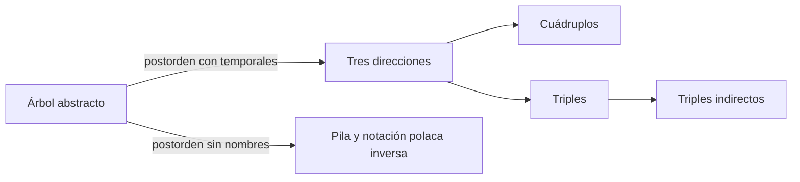

# Compiladores - Representaciones intermedias

## 5.3 Representaciones intermedias lineales.

---

Una representación **lineal** describe el programa como una secuencia de instrucciones de una máquina abstracta, como el lenguaje ensamblador de una computadora ideal: el orden de la secuencia es el de ejecución, salvo donde hay saltos. Es la forma más cercana al código final, fácil de recorrer, reordenar y traducir. Este tema presenta el código de tres direcciones y sus implementaciones, cuádruplos, triples y triples indirectos; la traducción de las estructuras de control; el código de pila y el *bytecode* de la JVM, y la notación polaca inversa, con ejemplos verificados con el intérprete del núcleo de representaciones y con javac.

### Código de tres direcciones

Cada instrucción tiene a lo más un operador y tres direcciones, dos operandos y un resultado, que son nombres, constantes o **temporales** generados por el compilador:

| Clase | Forma | Ejemplo |
| ----- | ----- | ------- |
| binaria | `x = y op z` | `t1 = a + b` |
| unaria | `x = op y` | `t2 = -a` |
| copia | `x = y` | `a = t1` |
| salto incondicional | `goto L` | `goto L2` |
| salto condicional | `if x relop y goto L` | `if i >= 10 goto L2` |
| llamada | `param x` y `x = call f, n` | `param a; t3 = call f, 1` |
| retorno | `return x` | `return t4` |
| arreglos | `x = y[i]` y `x[i] = y` | `t5 = a[t4]` |
| apuntadores | `x = &y`, `x = *y`, `*x = y` | `t6 = *p` |

Una expresión se traduce con un recorrido en postorden: cada nodo interior produce una instrucción cuyo resultado es un temporal nuevo. Las estructuras de control se traducen con **etiquetas** y saltos: un `while` evalúa la condición al inicio y salta a la salida si es falsa, y el cuerpo termina con un salto al inicio; las condiciones con `&&` y `||` se traducen con **código de saltos**, que implementa el cortocircuito sin calcular valores booleanos.

### Cuádruplos, triples y triples indirectos

- **Cuádruplos:** registros de cuatro campos, operador, dos argumentos y resultado. Los temporales tienen nombre, de modo que las instrucciones se pueden mover sin cambiar las referencias.
- **Triples:** registros de tres campos; el resultado de una instrucción es su **posición**, y los argumentos pueden referirse a posiciones, como $(0).$ Ahorran el campo del resultado y los nombres de temporales, pero mover una instrucción obliga a actualizar todas sus referencias.
- **Triples indirectos:** una lista de apuntadores a triples da el orden de ejecución; reordenar es permutar esa lista, y los triples no cambian.

### Código de pila

En una máquina de pila, los operandos son implícitos: `push` apila, las operaciones desapilan sus operandos y apilan el resultado. La traducción de una expresión es su **notación polaca inversa**: el recorrido en postorden del árbol, en el que cada operador sigue a sus operandos. El código es compacto, porque las instrucciones no llevan direcciones, y por eso lo usan las máquinas virtuales pensadas para distribuir el código, como la JVM, la CLR de .NET y WebAssembly; los compiladores JIT lo convierten después a una representación de registros para optimizarlo. En la JVM, `iload_n` carga la variable local $n,$ con formas cortas de un byte para $n \le 3$ y la forma general `iload n` para las demás.



### Implementación en Python

El programa usa el núcleo de representaciones intermedias del tema 5.1, incluido al inicio, al que agrega una optimización local: numeración de valores, plegado de constantes, identidades algebraicas, propagación de copias y eliminación de código muerto. Resuelve los cinco ejercicios, compara el código de pila con el *bytecode* que genera javac 21, y ejecuta cada código con el intérprete para comprobar los resultados.

```python
# ===== Núcleo de representaciones intermedias: AST, DAG, código de tres direcciones, bloques, CFG y SSA =====
import re

# ---------- Analizador de un lenguaje pequeño parecido a C ----------
def lexico(texto):
    return re.findall(r'"[^"]*"|\d+\.\d+|\d+|[A-Za-z_]\w*|\+\+|--|[-+*/]=|==|!=|<=|>=|&&|\|\||[-+*/%<>=!(){};,]', texto) + ["$"]
class Parser:
    def __init__(self, texto): self.t, self.i = lexico(texto), 0
    def mira(self, k=0): return self.t[self.i + k]
    def come(self, x=None):
        v = self.t[self.i]
        if x and v != x: raise SyntaxError(f"se esperaba {x} y llegó {v}")
        self.i += 1; return v
    def programa(self):
        res = []
        while self.mira() != "$": res.append(self.sentencia())
        return ("bloque", res)
    def opcional_pc(self):
        if self.mira() == ";": self.come()
    def sentencia(self):
        x = self.mira()
        if x == "{":
            self.come(); res = []
            while self.mira() != "}": res.append(self.sentencia())
            self.come(); return ("bloque", res)
        if x == "if":
            self.come(); self.come("("); c = self.expr(); self.come(")"); s = self.sentencia(); o = None
            if self.mira() == "else": self.come(); o = self.sentencia()
            return ("if", c, s, o)
        if x == "while":
            self.come(); self.come("("); c = self.expr(); self.come(")"); return ("while", c, self.sentencia())
        if x == "for":
            self.come(); self.come("("); ini = self.simple() if self.mira() != ";" else None; self.come(";")
            c = self.expr() if self.mira() != ";" else ("num", 1); self.come(";")
            paso = self.simple() if self.mira() != ")" else None; self.come(")"); cuerpo = self.sentencia()
            return ("bloque", ([ini] if ini else []) + [("while", c, ("bloque", [cuerpo] + ([paso] if paso else [])))])
        if x == "return":
            self.come(); e = self.expr() if self.mira() not in (";", "}", "$") else None; self.opcional_pc(); return ("return", e)
        s = self.simple(); self.opcional_pc(); return s
    def simple(self):
        if self.mira(1) in ("=", "+=", "-=", "*=", "/=", "++", "--"):
            x = self.come(); op = self.come()
            if op == "=": return ("asig", x, self.expr())
            if op in ("++", "--"): return ("asig", x, ("bin", op[0], ("var", x), ("num", 1)))
            return ("asig", x, ("bin", op[0], ("var", x), self.expr()))
        return ("expr", self.expr())
    NIVELES = [("||",), ("&&",), ("==", "!="), ("<", "<=", ">", ">="), ("+", "-"), ("*", "/", "%")]
    def expr(self, k=0):
        if k == len(self.NIVELES): return self.unario()
        a = self.expr(k + 1)
        while self.mira() in self.NIVELES[k]: op = self.come(); a = ("bin", op, a, self.expr(k + 1))
        return a
    def unario(self):
        if self.mira() in ("-", "!"): op = self.come(); return ("un", op, self.unario())
        x = self.come()
        if x == "(": e = self.expr(); self.come(")"); return e
        if x[0].isdigit(): return ("num", float(x) if "." in x else int(x))
        if x[0] == '"': return ("str", x)
        if self.mira() == "(":
            self.come(); args = []
            while self.mira() != ")":
                args.append(self.expr())
                if self.mira() == ",": self.come()
            self.come(); return ("call", x, args)
        return ("var", x)
def expresion(texto): return Parser(texto).expr()

def texto_ast(n):
    k = n[0]
    if k == "num": return str(n[1])
    if k in ("var", "str"): return n[1]
    if k == "bin": return f"({texto_ast(n[2])} {n[1]} {texto_ast(n[3])})"
    if k == "un": return f"({n[1]}{texto_ast(n[2])})"
    if k == "call": return f"{n[1]}(" + ", ".join(texto_ast(a) for a in n[2]) + ")"
def dibuja_ast(n, pre="   ", ultimo=True, raiz=True):
    k = n[0]
    et = {"num": lambda: str(n[1]), "var": lambda: n[1], "str": lambda: n[1], "bin": lambda: n[1], "un": lambda: n[1], "call": lambda: n[1] + "()"}[k]()
    hijos = [n[2], n[3]] if k == "bin" else [n[2]] if k == "un" else n[2] if k == "call" else []
    lineas = [pre + ("" if raiz else ("└─ " if ultimo else "├─ ")) + et]
    sub = pre + ("" if raiz else ("   " if ultimo else "│  "))
    for i, h in enumerate(hijos): lineas += dibuja_ast(h, sub, i == len(hijos) - 1, False)
    return lineas
def postfija(n):
    k = n[0]
    if k in ("num", "var", "str"): return [str(n[1])]
    if k == "bin": return postfija(n[2]) + postfija(n[3]) + [n[1]]
    if k == "un": return postfija(n[2]) + ["neg" if n[1] == "-" else n[1]]
    if k == "call": return [x for a in n[2] for x in postfija(a)] + [f"{n[1]}/{len(n[2])}"]
def contar_nodos(n):
    k = n[0]
    if k == "bin": return 1 + contar_nodos(n[2]) + contar_nodos(n[3])
    if k == "un": return 1 + contar_nodos(n[2])
    if k == "call": return 1 + sum(contar_nodos(a) for a in n[2])
    return 1

# ---------- DAG por numeración de valores ----------
def dag(asignaciones):
    """asignaciones: lista de (variable o None, AST). Devuelve los nodos únicos y las etiquetas de cada nodo."""
    nodos, tabla, etiquetas, actual = [], {}, {}, {}
    def nodo(clave, texto):
        if clave not in tabla: tabla[clave] = len(nodos); nodos.append(texto)
        return tabla[clave]
    def visita(n):
        k = n[0]
        if k == "num": return nodo(("num", n[1]), str(n[1]))
        if k == "var":
            if n[1] in actual: return actual[n[1]]
            return nodo(("var", n[1]), n[1])
        if k == "bin":
            a, b = visita(n[2]), visita(n[3])
            if n[1] in "+*" and a > b: a, b = b, a                    # conmutatividad
            return nodo(("bin", n[1], a, b), f"{n[1]} n{a} n{b}")
        if k == "un": a = visita(n[2]); return nodo(("un", n[1], a), f"{n[1]} n{a}")
    for x, e in asignaciones:
        k = visita(e)
        if x:
            for v in list(etiquetas):
                if v == x: del etiquetas[v]
            actual[x] = k; etiquetas[x] = k
    return nodos, etiquetas

# ---------- Código de tres direcciones ----------
class GeneradorTAC:
    def __init__(self): self.codigo, self.nt, self.ne = [], 0, 0
    def temp(self): self.nt += 1; return f"t{self.nt}"
    def etiqueta(self): self.ne += 1; return f"L{self.ne}"
    def emite(self, *ins): self.codigo.append(ins)
    REL = {"<": ">=", "<=": ">", ">": "<=", ">=": "<", "==": "!=", "!=": "=="}
    def valor(self, n):
        k = n[0]
        if k == "num": return str(n[1])
        if k in ("var", "str"): return n[1]
        if k == "bin" and n[1] in ("&&", "||") or k == "bin" and n[1] in self.REL or k == "un" and n[1] == "!":
            t = self.temp(); lf, lfin = self.etiqueta(), self.etiqueta()
            self.condicion(n, None, lf); self.emite("asig", t, "1"); self.emite("goto", lfin)
            self.emite("label", lf); self.emite("asig", t, "0"); self.emite("label", lfin); return t
        if k == "bin":
            a = self.valor(n[2]); b = self.valor(n[3]); t = self.temp(); self.emite("bin", t, n[1], a, b); return t
        if k == "un": a = self.valor(n[2]); t = self.temp(); self.emite("un", t, n[1], a); return t
        if k == "call":
            args = [self.valor(a) for a in n[2]]
            for a in args: self.emite("param", a)
            t = self.temp(); self.emite("call", t, n[1], len(args)); return t
    def condicion(self, n, v, f):
        """Código de saltos: salta a v si la condición es verdadera y a f si es falsa; None significa continuar."""
        if n[0] == "bin" and n[1] in self.REL:
            a = self.valor(n[2]); b = self.valor(n[3])
            if v and f: self.emite("if", a, n[1], b, v); self.emite("goto", f)
            elif v: self.emite("if", a, n[1], b, v)
            elif f: self.emite("if", a, self.REL[n[1]], b, f)
        elif n[0] == "bin" and n[1] == "&&":
            fin = None if f else self.etiqueta()
            self.condicion(n[2], None, f or fin); self.condicion(n[3], v, f or fin)
            if fin: self.emite("label", fin)
        elif n[0] == "bin" and n[1] == "||":
            fin = None if v else self.etiqueta()
            self.condicion(n[2], v or fin, None); self.condicion(n[3], v or fin, f)
            if fin: self.emite("label", fin)
        elif n[0] == "un" and n[1] == "!": self.condicion(n[2], f, v)
        else:
            a = self.valor(n)
            if v: self.emite("if", a, "!=", "0", v)
            if f: self.emite("if", a, "==", "0", f) if not v else self.emite("goto", f)
    def sentencia(self, s):
        k = s[0]
        if k == "bloque":
            for x in s[1]: self.sentencia(x)
        elif k == "asig":
            e = s[2]
            if e[0] == "bin" and e[1] not in ("&&", "||") and e[1] not in self.REL:
                a = self.valor(e[2]); b = self.valor(e[3]); self.emite("bin", s[1], e[1], a, b)
            else: self.emite("asig", s[1], self.valor(e))
        elif k == "if":
            lf = self.etiqueta(); self.condicion(s[1], None, lf); self.sentencia(s[2])
            if s[3]:
                lfin = self.etiqueta(); self.emite("goto", lfin); self.emite("label", lf); self.sentencia(s[3]); self.emite("label", lfin)
            else: self.emite("label", lf)
        elif k == "while":
            li, lf = self.etiqueta(), self.etiqueta()
            self.emite("label", li); self.condicion(s[1], None, lf); self.sentencia(s[2]); self.emite("goto", li); self.emite("label", lf)
        elif k == "return": self.emite("ret", self.valor(s[1]) if s[1] else "")
        elif k == "expr":
            e = s[1]
            if e[0] == "call" and e[1] == "print":
                for a in [self.valor(a) for a in e[2]]: self.emite("param", a)
                self.emite("call", None, "print", len(e[2]))
            else: self.valor(e)
def tac(texto):
    g = GeneradorTAC(); g.sentencia(Parser(texto).programa())
    c = g.codigo                                   # mirilla: quita los saltos a la instrucción siguiente
    return [ins for k, ins in enumerate(c) if not (ins[0] == "goto" and k + 1 < len(c) and c[k + 1] == ("label", ins[1]))]
def texto_ins(ins):
    k = ins[0]
    if k == "asig": return f"{ins[1]} = {ins[2]}"
    if k == "bin": return f"{ins[1]} = {ins[3]} {ins[2]} {ins[4]}"
    if k == "un": return f"{ins[1]} = {ins[2]}{ins[3]}"
    if k == "label": return f"{ins[1]}:"
    if k == "goto": return f"goto {ins[1]}"
    if k == "if": return f"if {ins[1]} {ins[2]} {ins[3]} goto {ins[4]}"
    if k == "param": return f"param {ins[1]}"
    if k == "call": return (f"{ins[1]} = " if ins[1] else "") + f"call {ins[2]}, {ins[3]}"
    if k == "ret": return f"return {ins[1]}".strip()
    if k == "phi": return f"{ins[1]} = φ(" + ", ".join(f"{v}" for _, v in sorted(ins[2].items())) + ")"
def listado(codigo, numerado=False):
    return "\n".join(f"   {k + 1:2}: {texto_ins(i)}" if numerado else ("   " + texto_ins(i) if i[0] != "label" else " " + texto_ins(i)) for k, i in enumerate(codigo))

# ---------- Bloques básicos y grafo de flujo de control ----------
def bloques(codigo):
    lideres = {0}
    for k, ins in enumerate(codigo):
        if ins[0] == "label": lideres.add(k)
        if ins[0] in ("goto", "if", "ret") and k + 1 < len(codigo): lideres.add(k + 1)
    orden = sorted(lideres); bs = []
    for j, ini in enumerate(orden):
        fin = orden[j + 1] if j + 1 < len(orden) else len(codigo)
        bs.append(codigo[ini:fin])
    bs = [b for b in bs if b]
    etiqueta_de = {b[0][1]: i for i, b in enumerate(bs) if b[0][0] == "label"}
    suc = {}
    for i, b in enumerate(bs):
        u = b[-1]; s = []
        if u[0] == "goto": s = [etiqueta_de[u[1]]]
        elif u[0] == "if": s = [etiqueta_de[u[4]]] + ([i + 1] if i + 1 < len(bs) else [])
        elif u[0] != "ret" and i + 1 < len(bs): s = [i + 1]
        suc[i] = list(dict.fromkeys(s))
    pred = {i: [j for j in suc if i in suc[j]] for i in suc}
    return bs, suc, pred

def dominadores(n, suc, pred, entrada=0):
    dom = {i: set(range(n)) for i in range(n)}; dom[entrada] = {entrada}; cambio = True
    while cambio:
        cambio = False
        for i in range(n):
            if i == entrada: continue
            nuevo = {i} | (set.intersection(*[dom[p] for p in pred[i]]) if pred[i] else set())
            if nuevo != dom[i]: dom[i] = nuevo; cambio = True
    # el dominador inmediato de i es el dominador estricto cuyo conjunto de dominadores es dom(i) sin i
    idom = {i: next((d for d in dom[i] - {i} if dom[d] == dom[i] - {i}), None) for i in range(n)}
    return dom, idom
def frontera(n, pred, idom):
    df = {i: set() for i in range(n)}
    for b in range(n):
        if len(pred[b]) >= 2:
            for p in pred[b]:
                r = p
                while r is not None and r != idom[b]: df[r].add(b); r = idom[r]
    return df

def definidas(b): return [i[1] for i in b if i[0] in ("asig", "bin", "un") or (i[0] == "call" and i[1])]
def usadas(i):
    k = i[0]
    if k == "asig": return [i[2]]
    if k == "bin": return [i[3], i[4]]
    if k == "un": return [i[3]]
    if k == "if": return [i[1], i[3]]
    if k in ("param", "ret"): return [i[1]]
    if k == "phi": return list(i[2].values())
    return []
def es_variable(x): return isinstance(x, str) and re.fullmatch(r"[A-Za-z_]\w*", x) is not None

def ssa(codigo, podada=True):
    """Construcción de Cytron y otros: funciones φ en la frontera de dominancia iterada y renombrado sobre el árbol de dominadores.
    Con podada=True solo se insertan φ para variables vivas a la entrada del bloque."""
    bs, suc, pred = bloques(codigo); n = len(bs)
    dom, idom = dominadores(n, suc, pred); df = frontera(n, pred, idom)
    vivas_ent = vivas(bs, suc) if podada else None
    variables = sorted({x for b in bs for x in definidas(b)})
    phis = {i: {} for i in range(n)}
    for v in variables:
        trabajo = [i for i in range(n) if v in definidas(bs[i])]; puestos = set()
        while trabajo:
            b = trabajo.pop()
            for d in sorted(df[b]):
                if d in puestos or (podada and v not in vivas_ent[d]): continue
                puestos.add(d); phis[d][v] = {}
                if d not in trabajo: trabajo.append(d)
    contador, pila = {}, {}
    def nuevo(v):
        contador[v] = contador.get(v, 0) + 1; nombre = f"{v}_{contador[v]}"; pila.setdefault(v, []).append(nombre); return nombre
    def actual(x): return pila[x][-1] if es_variable(x) and pila.get(x) else (f"{x}_0" if es_variable(x) and x in variables else x)
    nuevos = {}; nombres_phi = {i: {} for i in range(n)}
    hijos = {i: sorted(j for j in range(n) if idom[j] == i) for i in range(n)}
    def renombra(b):
        empujados = []
        for v in phis[b]: nombres_phi[b][v] = nuevo(v); empujados.append(v)
        res = []
        for ins in bs[b]:
            k = ins[0]
            if k == "asig": a = actual(ins[2]); res.append(("asig", nuevo(ins[1]), a)); empujados.append(ins[1])
            elif k == "bin": a, c = actual(ins[3]), actual(ins[4]); res.append(("bin", nuevo(ins[1]), ins[2], a, c)); empujados.append(ins[1])
            elif k == "un": a = actual(ins[3]); res.append(("un", nuevo(ins[1]), ins[2], a)); empujados.append(ins[1])
            elif k == "if": res.append(("if", actual(ins[1]), ins[2], actual(ins[3]), ins[4]))
            elif k in ("param", "ret"): res.append((k, actual(ins[1])))
            elif k == "call" and ins[1]: res.append(("call", nuevo(ins[1]), ins[2], ins[3])); empujados.append(ins[1])
            else: res.append(ins)
        nuevos[b] = res
        for s in suc[b]:
            for v in phis[s]: phis[s][v][b] = actual(v)
        for h in hijos[b]: renombra(h)
        for v in empujados: pila[v].pop()
    renombra(0)
    resultado = []
    for b in range(n):
        cuerpo = nuevos.get(b, [])
        lab = [cuerpo[0]] if cuerpo and cuerpo[0][0] == "label" else []
        resto = cuerpo[len(lab):]
        resultado.append(lab + [("phi", nombres_phi[b][v], {f"B{p + 1}": x for p, x in phis[b][v].items()}) for v in sorted(phis[b])] + resto)
    return resultado, (bs, suc, pred, idom, df)

def vivas(bs, suc):
    """Variables vivas a la entrada de cada bloque, por análisis hacia atrás de punto fijo."""
    n = len(bs); uso, defi = {}, {}
    for i, b in enumerate(bs):
        u, d = set(), set()
        for ins in b:
            for x in usadas(ins):
                if es_variable(x) and x not in d: u.add(x)
            for x in definidas([ins]): d.add(x)
        uso[i], defi[i] = u, d
    ent = {i: set() for i in range(n)}; cambio = True
    while cambio:
        cambio = False
        for i in reversed(range(n)):
            sal = set().union(*[ent[s] for s in suc[i]]) if suc[i] else set()
            nueva = uso[i] | (sal - defi[i])
            if nueva != ent[i]: ent[i] = nueva; cambio = True
    return ent

# ---------- Intérprete de código de tres direcciones, con o sin φ ----------
OPS = {"+": lambda a, b: a + b, "-": lambda a, b: a - b, "*": lambda a, b: a * b, "/": lambda a, b: a / b if isinstance(a, float) or isinstance(b, float) else int(a / b),
       "%": lambda a, b: a % b, "<": lambda a, b: int(a < b), "<=": lambda a, b: int(a <= b), ">": lambda a, b: int(a > b),
       ">=": lambda a, b: int(a >= b), "==": lambda a, b: int(a == b), "!=": lambda a, b: int(a != b)}
def ejecuta(lista_bloques, entorno, limite=100000, funciones=None):
    """lista_bloques: lista de listas de instrucciones; las φ eligen según el bloque de procedencia."""
    env = dict(entorno); salida = []; params = []; funciones = funciones or {}
    etq = {b[0][1]: i for i, b in enumerate(lista_bloques) if b and b[0][0] == "label"}
    def val(x):
        if isinstance(x, str) and re.fullmatch(r"-?\d+", x): return int(x)
        if isinstance(x, str) and re.fullmatch(r"-?\d+\.\d+", x): return float(x)
        if isinstance(x, str) and x.startswith('"'): return x.strip('"')
        if x in env: return env[x]
        base = re.sub(r"_0$", "", x)
        return env.get(base, 0)
    b, previo, pasos = 0, None, 0
    while b is not None and b < len(lista_bloques):
        siguiente = b + 1
        phis = [i for i in lista_bloques[b] if i[0] == "phi"]
        nuevos = {i[1]: val(i[2].get(f"B{previo + 1}", "0")) for i in phis} if previo is not None else {}
        env.update(nuevos)
        for ins in lista_bloques[b]:
            pasos += 1
            if pasos > limite: raise RuntimeError("demasiados pasos")
            k = ins[0]
            if k == "asig": env[ins[1]] = val(ins[2])
            elif k == "bin": env[ins[1]] = OPS[ins[2]](val(ins[3]), val(ins[4]))
            elif k == "un": env[ins[1]] = -val(ins[3]) if ins[2] == "-" else int(not val(ins[3]))
            elif k == "goto": siguiente = etq[ins[1]]; break
            elif k == "if":
                if OPS[ins[2]](val(ins[1]), val(ins[3])): siguiente = etq[ins[4]]; break
            elif k == "param": params.append(val(ins[1]))
            elif k == "call":
                args, params[:] = params[-ins[3]:] if ins[3] else [], params[:-ins[3]] if ins[3] else params
                if ins[2] == "print": salida.append(" ".join(str(a) for a in args))
                else: env[ins[1]] = funciones[ins[2]](*args)
            elif k == "ret": return env, salida, val(ins[1]) if ins[1] else None
        previo, b = b, siguiente
    return env, salida, None
def muestra_bloques(bs, sangria="   "):
    lineas = []
    for k, b in enumerate(bs):
        lineas.append(f"{sangria}B{k + 1}:")
        for i in b: lineas.append(f"{sangria}  " + ("" if i[0] == "label" else "  ") + texto_ins(i))
    return "\n".join(lineas)

# ---------- Optimización local: numeración de valores, plegado, propagación de copias y código muerto ----------
def es_numero(x): return isinstance(x, str) and re.fullmatch(r"-?\d+(\.\d+)?", x) is not None
def num(x): return float(x) if "." in x else int(x)
def optimiza_bloque(codigo, vivas_salida, pasos=None):
    """Un bloque sin saltos. vivas_salida: variables que se usan después del bloque."""
    pasos = pasos if pasos is not None else []
    valor, tabla, res = {}, {}, []                    # valor: nombre -> operando equivalente; tabla: expresión -> nombre
    def op(x): return valor.get(x, x)
    for ins in codigo:
        if ins[0] == "asig":
            v = op(ins[2]); valor[ins[1]] = v
            for k in [k for k, n in tabla.items() if n == ins[1]]: del tabla[k]
            res.append(("asig", ins[1], v)); continue
        if ins[0] != "bin": res.append(ins); continue
        d, o, a, b = ins[1], ins[2], op(ins[3]), op(ins[4])
        if es_numero(a) and es_numero(b) and o in OPS:
            r = OPS[o](num(a), num(b)); r = str(int(r)) if float(r).is_integer() else str(r)
            pasos.append(f"plegado: {a} {o} {b} = {r}"); valor[d] = r; res.append(("asig", d, r)); continue
        if o in "+*" and str(a) > str(b): a, b = b, a
        if (o == "+" and b == "0") or (o == "*" and b == "1"): valor[d] = a; res.append(("asig", d, a)); pasos.append(f"identidad: {d} = {a}"); continue
        clave = (o, a, b)
        if clave in tabla and op(tabla[clave]) == tabla[clave]:
            pasos.append(f"subexpresión común: {a} {o} {b} ya está en {tabla[clave]}"); valor[d] = tabla[clave]; res.append(("asig", d, tabla[clave])); continue
        valor.pop(d, None)
        for k in [k for k, n in tabla.items() if n == d or d in k[1:]]: del tabla[k]
        tabla[clave] = d; res.append(("bin", d, o, a, b))
    # código muerto: hacia atrás, se conservan las instrucciones cuyo destino se usa después
    vivas_ahora, final = set(vivas_salida), []
    for ins in reversed(res):
        if ins[0] in ("asig", "bin") and ins[1] not in vivas_ahora:
            pasos.append(f"código muerto: {texto_ins(ins)}"); continue
        if ins[0] in ("asig", "bin"): vivas_ahora.discard(ins[1])
        vivas_ahora |= {x for x in usadas(ins) if es_variable(x)}
        final.append(ins)
    return final[::-1]

import subprocess, tempfile, os

# ---------- Ejercicio 1: tres direcciones, pila y bytecode real de la JVM ----------
c1 = tac("x = (a + b) * (c - d) / e;")
print("ejercicio 1:"); print(listado(c1))
print("   código de pila:", " ".join(("push " + x) if x not in "+-*/" else {"+": "add", "-": "sub", "*": "mul", "/": "div"}[x]
                                  for x in postfija(expresion("(a + b) * (c - d) / e"))), "; pop x")
JAVA = "class E { static int f(int a, int b, int c, int d, int e) { int x = (a + b) * (c - d) / e; return x; } }"
with tempfile.TemporaryDirectory() as tmp:
    open(os.path.join(tmp, "E.java"), "w").write(JAVA)
    subprocess.run(["javac", "E.java"], cwd=tmp, capture_output=True)
    r = subprocess.run(["javap", "-c", "E.class"], cwd=tmp, capture_output=True, text=True)
cuerpo = r.stdout.split("static int f(int, int, int, int, int);")[1].split("Code:")[1]
print("   javac 21:", " ; ".join(" ".join(re.sub(r"^\s*\d+: ", "", l).split()) for l in cuerpo.strip().splitlines() if re.match(r"\s*\d+:", l)))

# ---------- Ejercicio 2: for con if-else ----------
c2 = tac("""for (i = 0; i < 10; i++) {
    if (i % 2 == 0) {
        even_sum += i;
    } else {
        odd_sum += i;
    }
}""")
print("ejercicio 2:"); print(listado(c2))
env, _, _ = ejecuta(bloques(c2)[0], {"even_sum": 0, "odd_sum": 0})
print("   ejecución:", {k: env[k] for k in ("i", "even_sum", "odd_sum")}, "| Python:", sum(range(0, 10, 2)), sum(range(1, 10, 2)))

# ---------- Ejercicio 3: cuádruplos, triples y triples indirectos ----------
c3 = tac("r = a * b + c * d - e;")
cuad = [(i[2], i[3], i[4], i[1]) for i in c3]
print("ejercicio 3: cuádruplos:", cuad)
pos = {}; triples = []
for k, (o, a, b, dst) in enumerate(cuad):
    triples.append((o, f"({pos[a]})" if a in pos else a, f"({pos[b]})" if b in pos else b)); pos[dst] = len(triples) - 1
    if not re.fullmatch(r"t\d+", dst): triples.append(("=", dst, f"({len(triples) - 1})"))      # la asignación a una variable es otro triple
print("   triples:", [f"({k}) {t}" for k, t in enumerate(triples)])
print("   triples indirectos: lista de sentencias", list(range(len(triples))), "; reordenar es permutar esa lista, sin tocar las referencias")
print(f"   tamaño: {len(cuad)} cuádruplos de 4 campos = {4 * len(cuad)} | {len(triples)} triples de 3 campos = {3 * len(triples)}")

# ---------- Ejercicio 4: optimización local ----------
c4 = [("bin", "t1", "*", "2", "3"), ("bin", "t2", "+", "t1", "5"), ("bin", "t3", "+", "a", "b"),
      ("bin", "t4", "+", "a", "b"), ("bin", "t5", "*", "t3", "t4")]
pasos = []; o4 = optimiza_bloque(c4, {"t2", "t5"}, pasos)
print("ejercicio 4: pasos:", " | ".join(pasos)); print(listado(o4))
for a, b in [(2, 5), (-1, 4)]:
    e1 = ejecuta([c4], {"a": a, "b": b})[0]; e2 = ejecuta([o4], {"a": a, "b": b})[0]
    print(f"   a={a}, b={b}: original t2={e1['t2']}, t5={e1['t5']} | optimizado t2={e2['t2']}, t5={e2['t5']}")

# ---------- Ejercicio 5: notación polaca inversa ----------
e5 = expresion("(a + b) * (c - d) / (e + f * g)")
rpn = postfija(e5); print("ejercicio 5:", " ".join(rpn))
def evalua_rpn(rpn, v):
    pila = []; maximo = 0
    for x in rpn:
        if x in "+-*/": b, a = pila.pop(), pila.pop(); pila.append(OPS[x](a, b) if x != "/" else a / b)
        else: pila.append(v[x])
        maximo = max(maximo, len(pila))
    return pila[0], maximo
v = dict(a=1, b=3, c=9, d=2, e=1, f=2, g=3)
r, prof = evalua_rpn(rpn, v)
print(f"   con {v}: {r} | Python: {(1 + 3) * (9 - 2) / (1 + 2 * 3)} | profundidad máxima de la pila: {prof}")
```

Salida:

```text
ejercicio 1:
   t1 = a + b
   t2 = c - d
   t3 = t1 * t2
   x = t3 / e
   código de pila: push a push b add push c push d sub mul push e div ; pop x
   javac 21: iload_0 ; iload_1 ; iadd ; iload_2 ; iload_3 ; isub ; imul ; iload 4 ; idiv ; istore 5 ; iload 5 ; ireturn
ejercicio 2:
   i = 0
 L1:
   if i >= 10 goto L2
   t1 = i % 2
   if t1 != 0 goto L3
   even_sum = even_sum + i
   goto L4
 L3:
   odd_sum = odd_sum + i
 L4:
   i = i + 1
   goto L1
 L2:
   ejecución: {'i': 10, 'even_sum': 20, 'odd_sum': 25} | Python: 20 25
ejercicio 3: cuádruplos: [('*', 'a', 'b', 't1'), ('*', 'c', 'd', 't2'), ('+', 't1', 't2', 't3'), ('-', 't3', 'e', 'r')]
   triples: ["(0) ('*', 'a', 'b')", "(1) ('*', 'c', 'd')", "(2) ('+', '(0)', '(1)')", "(3) ('-', '(2)', 'e')", "(4) ('=', 'r', '(3)')"]
   triples indirectos: lista de sentencias [0, 1, 2, 3, 4] ; reordenar es permutar esa lista, sin tocar las referencias
   tamaño: 4 cuádruplos de 4 campos = 16 | 5 triples de 3 campos = 15
ejercicio 4: pasos: plegado: 2 * 3 = 6 | plegado: 6 + 5 = 11 | subexpresión común: a + b ya está en t3 | código muerto: t4 = t3 | código muerto: t1 = 6
   t2 = 11
   t3 = a + b
   t5 = t3 * t3
   a=2, b=5: original t2=11, t5=49 | optimizado t2=11, t5=49
   a=-1, b=4: original t2=11, t5=9 | optimizado t2=11, t5=9
ejercicio 5: a b + c d - * e f g * + /
   con {'a': 1, 'b': 3, 'c': 9, 'd': 2, 'e': 1, 'f': 2, 'g': 3}: 4.0 | Python: 4.0 | profundidad máxima de la pila: 4
```

### Ejercicios Propuestos

1. **Código de tres direcciones.** Convierte a código de tres direcciones `x = (a + b) * (c - d) / e;`.

2. **Estructuras de control.** Genera el código de tres direcciones de:

    ```c
    for (i = 0; i < 10; i++) {
        if (i % 2 == 0) {
            even_sum += i;
        } else {
            odd_sum += i;
        }
    }
    ```

3. **Cuádruplos y triples.** Para la expresión `a * b + c * d - e`, genera los cuádruplos y los triples, y muestra sus diferencias.

4. **Optimización.** Optimiza el siguiente código de tres direcciones:

    ```text
    t1 = 2 * 3
    t2 = t1 + 5
    t3 = a + b
    t4 = a + b
    t5 = t3 * t4
    ```

5. **Notación polaca.** Convierte a notación polaca inversa `(a + b) * (c - d) / (e + f * g)`.

### Soluciones

**Ejercicio 1.** El código es `t1 = a + b; t2 = c - d; t3 = t1 * t2; x = t3 / e`: la multiplicación y la división tienen la misma precedencia y asocian por la izquierda, así que el producto va primero. En código de pila es `push a, push b, add, push c, push d, sub, mul, push e, div`, y javac genera exactamente esa secuencia, con `iload_0` a `iload_3` para los primeros cuatro parámetros e `iload 4` para el quinto, seguida de `istore 5` para `x`.

**Ejercicio 2.** El `for` se traduce como la inicialización seguida de un `while` cuyo cuerpo termina con el incremento:

```text
    i = 0
L1: if i >= 10 goto L2
    t1 = i % 2
    if t1 != 0 goto L3
    even_sum = even_sum + i
    goto L4
L3: odd_sum = odd_sum + i
L4: i = i + 1
    goto L1
L2:
```

Las dos condiciones se invierten para saltar a la parte que se omite. Ejecutado con las sumas en cero, el código da `even_sum = 20` y `odd_sum = 25`, como Python.

**Ejercicio 3.** Los cuádruplos son `(*, a, b, t1)`, `(*, c, d, t2)`, `(+, t1, t2, t3)` y `(-, t3, e, r)`. En triples, los resultados son posiciones: `(0) (*, a, b)`, `(1) (*, c, d)`, `(2) (+, (0), (1))`, `(3) (-, (2), e)` y, para guardar el resultado en una variable, `(4) (=, r, (3))`. Las diferencias:

- los cuádruplos ocupan un campo más por instrucción, 16 campos contra 15, pero sus temporales tienen nombre;
- en los triples, mover la instrucción $(1)$ obliga a cambiar la referencia de $(2);$ con cuádruplos basta moverla;
- los triples indirectos agregan una lista con el orden, `[0, 1, 2, 3, 4]`; un optimizador que reordena solo permuta la lista, y además un mismo triple puede aparecer en ella varias veces.

**Ejercicio 4.** El optimizador hace, en orden: el **plegado** de `2 * 3` en 6 y de `6 + 5` en 11; la eliminación de la **subexpresión común**, porque `t4 = a + b` repite `t3`; la **propagación de copias**, que reemplaza `t4` por `t3` en `t5`, y la eliminación del **código muerto**, `t4 = t3` y `t1 = 6`, que ya nadie usa, suponiendo que después del bloque solo se usan `t2` y `t5`:

```text
t2 = 11
t3 = a + b
t5 = t3 * t3
```

De 5 instrucciones y 5 operaciones se pasa a 3 instrucciones y 2 operaciones, y el intérprete comprueba que ambas versiones dan los mismos valores con dos entradas.

**Ejercicio 5.** La notación polaca inversa es `a b + c d - * e f g * + /`. Se evalúa con una pila: cada operando se apila y cada operador toma los dos últimos. Con los valores del programa da 4.0, como Python, y la pila llega a tener 4 elementos, al apilar `e`, `f` y `g` encima del producto: esa profundidad máxima es la que una máquina de pila debe declarar, como el `max_stack` de los métodos de Java.

En el material original, el ejemplo de *bytecode* terminaba con `istore_4`, que no existe en la JVM, porque las formas cortas solo llegan hasta `istore_3`; la tabla de formatos repetía `x = y` como asignación y como copia; el ejemplo de propagación de constantes asignaba dos veces `t2` en el código resultante, y el texto decía "stack-based architecture" en inglés.

### Referencias

1. Aho, A. V., Lam, M. S., Sethi, R., and Ullman, J. D., _Compilers: Principles, Techniques, and Tools_. 2a ed., Pearson, 2007. Secciones 6.2, 6.4 y 6.6.
2. Cooper, K. D., and Torczon, L., _Engineering a Compiler_. 3a ed., Morgan Kaufmann, 2022. Sección 5.3.
3. Lindholm, T., Yellin, F., Bracha, G., Buckley, A., and Smith, D., _The Java Virtual Machine Specification, Java SE 21 Edition_. Capítulo 6.
4. Haas, A., et al., Bringing the web up to speed with WebAssembly. _PLDI_, 2017.
5. Nori, K. V., et al., _The Pascal P compiler: implementation notes_. ETH Zürich, 1974.
