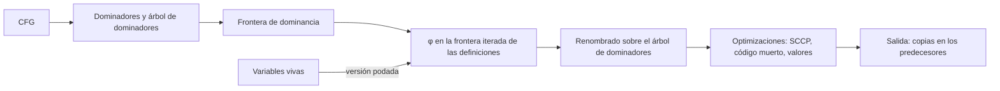

# Compiladores - Representaciones intermedias

## 5.4 Forma de asignación simple estática.

---

En la **forma SSA**, de *static single assignment*, cada nombre se define en exactamente un lugar del programa. Cuando una variable se asigna varias veces, cada asignación crea una **versión** nueva, $x_1, x_2, \ldots,$ y donde se juntan caminos con versiones distintas, una **función φ** elige la versión según el camino por el que llegó el control. Así, cada uso se refiere a una sola definición, y muchas optimizaciones se vuelven sencillas y rápidas. Es la representación de LLVM, GCC, el compilador de Go, HotSpot y V8. Este tema presenta su definición, la construcción con dominadores y frontera de dominancia, las variantes mínima y podada, la propagación de constantes sobre SSA y la salida de SSA.

### Definición

Un programa está en forma SSA si cada variable tiene **una sola definición estática**, aunque esa instrucción se ejecute muchas veces dentro de un ciclo, y cada uso está **dominado** por su definición. En la unión de dos caminos, $x_3 = \varphi(x_1, x_2)$ vale $x_1$ si el control llegó por el primer predecesor y $x_2$ si llegó por el segundo; todas las φ de un bloque se evalúan **simultáneamente** al entrar en él. La φ no es una instrucción de la máquina: es una notación que se elimina al salir de SSA.

### Dónde colocar las funciones φ

Un bloque $d$ **domina** a $n,$ $d \,\text{dom}\, n,$ si todo camino desde la entrada hasta $n$ pasa por $d.$ La **frontera de dominancia** de $d$ es

$$\text{FD}(d) = \{n : d \text{ domina a un predecesor de } n \text{ y } d \text{ no domina estrictamente a } n\}$$

es decir, los primeros bloques a los que llegan caminos que salen de la región dominada por $d.$ Si $d$ define $x,$ en cada bloque de $\text{FD}(d)$ se juntan la definición de $d$ con otras, y hace falta una φ para $x;$ como la φ es a su vez una definición, se repite con la **frontera iterada** $\text{FD}^+.$

**Algoritmo de Cytron, Ferrante, Rosen, Wegman y Zadeck.**

1. Calcular los dominadores, el árbol de dominadores y la frontera de dominancia de cada bloque.
2. Para cada variable $x,$ partir de los bloques que la definen y colocar una φ para $x$ en cada bloque de su frontera de dominancia iterada.
3. **Renombrar** con un recorrido del árbol de dominadores, con una pila de versiones por variable: cada definición apila una versión nueva, cada uso toma la del tope, al terminar un bloque se llenan los argumentos de las φ de sus sucesores, y al salir del bloque se desapilan sus versiones.

La frontera de dominancia se calcula en tiempo casi lineal, y el algoritmo completo es lineal en la práctica.

### Variantes

- **Mínima:** la del algoritmo, con φ en la frontera iterada de las definiciones.
- **Podada:** solo coloca una φ para $x$ si $x$ está **viva** a la entrada del bloque, lo que evita φ inútiles para variables que ya no se usan; requiere el análisis de variables vivas.
- **Semipodada:** omite las variables que solo se usan dentro de un bloque, sin el análisis completo.

### Optimizaciones sobre SSA

Como cada nombre tiene una definición, la información sobre un valor se asocia al nombre y no a cada punto del programa. La **propagación de constantes condicional y dispersa**, de Wegman y Zadeck, usa una retícula de tres niveles, $\top,$ sin información todavía; una constante, y $\bot,$ variable, y propaga a la vez valores y **alcanzabilidad**: solo evalúa los bloques a los que llega alguna arista ejecutable, y una condición constante marca como ejecutable solo una de sus aristas. Una φ toma el ínfimo de los argumentos que llegan por aristas ejecutables. Así encuentra constantes que la propagación simple no encuentra, como una variable que solo se asigna en un camino que siempre se toma. Otras optimizaciones que se simplifican son la eliminación de código muerto, la numeración global de valores y la reducción de fuerza.

### Salida de SSA

Antes de generar código, cada $x_3 = \varphi(x_1, x_2)$ se reemplaza por **copias** $x_3 = x_1$ y $x_3 = x_2$ al final de cada predecesor. Hay que cuidar dos problemas: las **aristas críticas**, de un bloque con varios sucesores a uno con varios predecesores, donde no hay un lugar para la copia y hay que partirlas con un bloque nuevo, y el **problema del intercambio**, cuando varias φ se leen entre sí y las copias deben ordenarse o usar un temporal. Después, el asignador de registros intenta fusionar las copias.



### Implementación en Python

El núcleo de representaciones intermedias del tema 5.1, incluido al inicio, construye la forma SSA podada con el algoritmo de Cytron y otros. El programa agrega la propagación de constantes condicional y dispersa, con la retícula y las aristas ejecutables, y para cada ejercicio construye la forma SSA, la **ejecuta** con el intérprete junto al código original para comprobar que dan los mismos resultados, y propaga las constantes.

```python
# ===== Núcleo de representaciones intermedias: AST, DAG, código de tres direcciones, bloques, CFG y SSA =====
import re

# ---------- Analizador de un lenguaje pequeño parecido a C ----------
def lexico(texto):
    return re.findall(r'"[^"]*"|\d+\.\d+|\d+|[A-Za-z_]\w*|\+\+|--|[-+*/]=|==|!=|<=|>=|&&|\|\||[-+*/%<>=!(){};,]', texto) + ["$"]
class Parser:
    def __init__(self, texto): self.t, self.i = lexico(texto), 0
    def mira(self, k=0): return self.t[self.i + k]
    def come(self, x=None):
        v = self.t[self.i]
        if x and v != x: raise SyntaxError(f"se esperaba {x} y llegó {v}")
        self.i += 1; return v
    def programa(self):
        res = []
        while self.mira() != "$": res.append(self.sentencia())
        return ("bloque", res)
    def opcional_pc(self):
        if self.mira() == ";": self.come()
    def sentencia(self):
        x = self.mira()
        if x == "{":
            self.come(); res = []
            while self.mira() != "}": res.append(self.sentencia())
            self.come(); return ("bloque", res)
        if x == "if":
            self.come(); self.come("("); c = self.expr(); self.come(")"); s = self.sentencia(); o = None
            if self.mira() == "else": self.come(); o = self.sentencia()
            return ("if", c, s, o)
        if x == "while":
            self.come(); self.come("("); c = self.expr(); self.come(")"); return ("while", c, self.sentencia())
        if x == "for":
            self.come(); self.come("("); ini = self.simple() if self.mira() != ";" else None; self.come(";")
            c = self.expr() if self.mira() != ";" else ("num", 1); self.come(";")
            paso = self.simple() if self.mira() != ")" else None; self.come(")"); cuerpo = self.sentencia()
            return ("bloque", ([ini] if ini else []) + [("while", c, ("bloque", [cuerpo] + ([paso] if paso else [])))])
        if x == "return":
            self.come(); e = self.expr() if self.mira() not in (";", "}", "$") else None; self.opcional_pc(); return ("return", e)
        s = self.simple(); self.opcional_pc(); return s
    def simple(self):
        if self.mira(1) in ("=", "+=", "-=", "*=", "/=", "++", "--"):
            x = self.come(); op = self.come()
            if op == "=": return ("asig", x, self.expr())
            if op in ("++", "--"): return ("asig", x, ("bin", op[0], ("var", x), ("num", 1)))
            return ("asig", x, ("bin", op[0], ("var", x), self.expr()))
        return ("expr", self.expr())
    NIVELES = [("||",), ("&&",), ("==", "!="), ("<", "<=", ">", ">="), ("+", "-"), ("*", "/", "%")]
    def expr(self, k=0):
        if k == len(self.NIVELES): return self.unario()
        a = self.expr(k + 1)
        while self.mira() in self.NIVELES[k]: op = self.come(); a = ("bin", op, a, self.expr(k + 1))
        return a
    def unario(self):
        if self.mira() in ("-", "!"): op = self.come(); return ("un", op, self.unario())
        x = self.come()
        if x == "(": e = self.expr(); self.come(")"); return e
        if x[0].isdigit(): return ("num", float(x) if "." in x else int(x))
        if x[0] == '"': return ("str", x)
        if self.mira() == "(":
            self.come(); args = []
            while self.mira() != ")":
                args.append(self.expr())
                if self.mira() == ",": self.come()
            self.come(); return ("call", x, args)
        return ("var", x)
def expresion(texto): return Parser(texto).expr()

def texto_ast(n):
    k = n[0]
    if k == "num": return str(n[1])
    if k in ("var", "str"): return n[1]
    if k == "bin": return f"({texto_ast(n[2])} {n[1]} {texto_ast(n[3])})"
    if k == "un": return f"({n[1]}{texto_ast(n[2])})"
    if k == "call": return f"{n[1]}(" + ", ".join(texto_ast(a) for a in n[2]) + ")"
def dibuja_ast(n, pre="   ", ultimo=True, raiz=True):
    k = n[0]
    et = {"num": lambda: str(n[1]), "var": lambda: n[1], "str": lambda: n[1], "bin": lambda: n[1], "un": lambda: n[1], "call": lambda: n[1] + "()"}[k]()
    hijos = [n[2], n[3]] if k == "bin" else [n[2]] if k == "un" else n[2] if k == "call" else []
    lineas = [pre + ("" if raiz else ("└─ " if ultimo else "├─ ")) + et]
    sub = pre + ("" if raiz else ("   " if ultimo else "│  "))
    for i, h in enumerate(hijos): lineas += dibuja_ast(h, sub, i == len(hijos) - 1, False)
    return lineas
def postfija(n):
    k = n[0]
    if k in ("num", "var", "str"): return [str(n[1])]
    if k == "bin": return postfija(n[2]) + postfija(n[3]) + [n[1]]
    if k == "un": return postfija(n[2]) + ["neg" if n[1] == "-" else n[1]]
    if k == "call": return [x for a in n[2] for x in postfija(a)] + [f"{n[1]}/{len(n[2])}"]
def contar_nodos(n):
    k = n[0]
    if k == "bin": return 1 + contar_nodos(n[2]) + contar_nodos(n[3])
    if k == "un": return 1 + contar_nodos(n[2])
    if k == "call": return 1 + sum(contar_nodos(a) for a in n[2])
    return 1

# ---------- DAG por numeración de valores ----------
def dag(asignaciones):
    """asignaciones: lista de (variable o None, AST). Devuelve los nodos únicos y las etiquetas de cada nodo."""
    nodos, tabla, etiquetas, actual = [], {}, {}, {}
    def nodo(clave, texto):
        if clave not in tabla: tabla[clave] = len(nodos); nodos.append(texto)
        return tabla[clave]
    def visita(n):
        k = n[0]
        if k == "num": return nodo(("num", n[1]), str(n[1]))
        if k == "var":
            if n[1] in actual: return actual[n[1]]
            return nodo(("var", n[1]), n[1])
        if k == "bin":
            a, b = visita(n[2]), visita(n[3])
            if n[1] in "+*" and a > b: a, b = b, a                    # conmutatividad
            return nodo(("bin", n[1], a, b), f"{n[1]} n{a} n{b}")
        if k == "un": a = visita(n[2]); return nodo(("un", n[1], a), f"{n[1]} n{a}")
    for x, e in asignaciones:
        k = visita(e)
        if x:
            for v in list(etiquetas):
                if v == x: del etiquetas[v]
            actual[x] = k; etiquetas[x] = k
    return nodos, etiquetas

# ---------- Código de tres direcciones ----------
class GeneradorTAC:
    def __init__(self): self.codigo, self.nt, self.ne = [], 0, 0
    def temp(self): self.nt += 1; return f"t{self.nt}"
    def etiqueta(self): self.ne += 1; return f"L{self.ne}"
    def emite(self, *ins): self.codigo.append(ins)
    REL = {"<": ">=", "<=": ">", ">": "<=", ">=": "<", "==": "!=", "!=": "=="}
    def valor(self, n):
        k = n[0]
        if k == "num": return str(n[1])
        if k in ("var", "str"): return n[1]
        if k == "bin" and n[1] in ("&&", "||") or k == "bin" and n[1] in self.REL or k == "un" and n[1] == "!":
            t = self.temp(); lf, lfin = self.etiqueta(), self.etiqueta()
            self.condicion(n, None, lf); self.emite("asig", t, "1"); self.emite("goto", lfin)
            self.emite("label", lf); self.emite("asig", t, "0"); self.emite("label", lfin); return t
        if k == "bin":
            a = self.valor(n[2]); b = self.valor(n[3]); t = self.temp(); self.emite("bin", t, n[1], a, b); return t
        if k == "un": a = self.valor(n[2]); t = self.temp(); self.emite("un", t, n[1], a); return t
        if k == "call":
            args = [self.valor(a) for a in n[2]]
            for a in args: self.emite("param", a)
            t = self.temp(); self.emite("call", t, n[1], len(args)); return t
    def condicion(self, n, v, f):
        """Código de saltos: salta a v si la condición es verdadera y a f si es falsa; None significa continuar."""
        if n[0] == "bin" and n[1] in self.REL:
            a = self.valor(n[2]); b = self.valor(n[3])
            if v and f: self.emite("if", a, n[1], b, v); self.emite("goto", f)
            elif v: self.emite("if", a, n[1], b, v)
            elif f: self.emite("if", a, self.REL[n[1]], b, f)
        elif n[0] == "bin" and n[1] == "&&":
            fin = None if f else self.etiqueta()
            self.condicion(n[2], None, f or fin); self.condicion(n[3], v, f or fin)
            if fin: self.emite("label", fin)
        elif n[0] == "bin" and n[1] == "||":
            fin = None if v else self.etiqueta()
            self.condicion(n[2], v or fin, None); self.condicion(n[3], v or fin, f)
            if fin: self.emite("label", fin)
        elif n[0] == "un" and n[1] == "!": self.condicion(n[2], f, v)
        else:
            a = self.valor(n)
            if v: self.emite("if", a, "!=", "0", v)
            if f: self.emite("if", a, "==", "0", f) if not v else self.emite("goto", f)
    def sentencia(self, s):
        k = s[0]
        if k == "bloque":
            for x in s[1]: self.sentencia(x)
        elif k == "asig":
            e = s[2]
            if e[0] == "bin" and e[1] not in ("&&", "||") and e[1] not in self.REL:
                a = self.valor(e[2]); b = self.valor(e[3]); self.emite("bin", s[1], e[1], a, b)
            else: self.emite("asig", s[1], self.valor(e))
        elif k == "if":
            lf = self.etiqueta(); self.condicion(s[1], None, lf); self.sentencia(s[2])
            if s[3]:
                lfin = self.etiqueta(); self.emite("goto", lfin); self.emite("label", lf); self.sentencia(s[3]); self.emite("label", lfin)
            else: self.emite("label", lf)
        elif k == "while":
            li, lf = self.etiqueta(), self.etiqueta()
            self.emite("label", li); self.condicion(s[1], None, lf); self.sentencia(s[2]); self.emite("goto", li); self.emite("label", lf)
        elif k == "return": self.emite("ret", self.valor(s[1]) if s[1] else "")
        elif k == "expr":
            e = s[1]
            if e[0] == "call" and e[1] == "print":
                for a in [self.valor(a) for a in e[2]]: self.emite("param", a)
                self.emite("call", None, "print", len(e[2]))
            else: self.valor(e)
def tac(texto):
    g = GeneradorTAC(); g.sentencia(Parser(texto).programa())
    c = g.codigo                                   # mirilla: quita los saltos a la instrucción siguiente
    return [ins for k, ins in enumerate(c) if not (ins[0] == "goto" and k + 1 < len(c) and c[k + 1] == ("label", ins[1]))]
def texto_ins(ins):
    k = ins[0]
    if k == "asig": return f"{ins[1]} = {ins[2]}"
    if k == "bin": return f"{ins[1]} = {ins[3]} {ins[2]} {ins[4]}"
    if k == "un": return f"{ins[1]} = {ins[2]}{ins[3]}"
    if k == "label": return f"{ins[1]}:"
    if k == "goto": return f"goto {ins[1]}"
    if k == "if": return f"if {ins[1]} {ins[2]} {ins[3]} goto {ins[4]}"
    if k == "param": return f"param {ins[1]}"
    if k == "call": return (f"{ins[1]} = " if ins[1] else "") + f"call {ins[2]}, {ins[3]}"
    if k == "ret": return f"return {ins[1]}".strip()
    if k == "phi": return f"{ins[1]} = φ(" + ", ".join(f"{v}" for _, v in sorted(ins[2].items())) + ")"
def listado(codigo, numerado=False):
    return "\n".join(f"   {k + 1:2}: {texto_ins(i)}" if numerado else ("   " + texto_ins(i) if i[0] != "label" else " " + texto_ins(i)) for k, i in enumerate(codigo))

# ---------- Bloques básicos y grafo de flujo de control ----------
def bloques(codigo):
    lideres = {0}
    for k, ins in enumerate(codigo):
        if ins[0] == "label": lideres.add(k)
        if ins[0] in ("goto", "if", "ret") and k + 1 < len(codigo): lideres.add(k + 1)
    orden = sorted(lideres); bs = []
    for j, ini in enumerate(orden):
        fin = orden[j + 1] if j + 1 < len(orden) else len(codigo)
        bs.append(codigo[ini:fin])
    bs = [b for b in bs if b]
    etiqueta_de = {b[0][1]: i for i, b in enumerate(bs) if b[0][0] == "label"}
    suc = {}
    for i, b in enumerate(bs):
        u = b[-1]; s = []
        if u[0] == "goto": s = [etiqueta_de[u[1]]]
        elif u[0] == "if": s = [etiqueta_de[u[4]]] + ([i + 1] if i + 1 < len(bs) else [])
        elif u[0] != "ret" and i + 1 < len(bs): s = [i + 1]
        suc[i] = list(dict.fromkeys(s))
    pred = {i: [j for j in suc if i in suc[j]] for i in suc}
    return bs, suc, pred

def dominadores(n, suc, pred, entrada=0):
    dom = {i: set(range(n)) for i in range(n)}; dom[entrada] = {entrada}; cambio = True
    while cambio:
        cambio = False
        for i in range(n):
            if i == entrada: continue
            nuevo = {i} | (set.intersection(*[dom[p] for p in pred[i]]) if pred[i] else set())
            if nuevo != dom[i]: dom[i] = nuevo; cambio = True
    # el dominador inmediato de i es el dominador estricto cuyo conjunto de dominadores es dom(i) sin i
    idom = {i: next((d for d in dom[i] - {i} if dom[d] == dom[i] - {i}), None) for i in range(n)}
    return dom, idom
def frontera(n, pred, idom):
    df = {i: set() for i in range(n)}
    for b in range(n):
        if len(pred[b]) >= 2:
            for p in pred[b]:
                r = p
                while r is not None and r != idom[b]: df[r].add(b); r = idom[r]
    return df

def definidas(b): return [i[1] for i in b if i[0] in ("asig", "bin", "un") or (i[0] == "call" and i[1])]
def usadas(i):
    k = i[0]
    if k == "asig": return [i[2]]
    if k == "bin": return [i[3], i[4]]
    if k == "un": return [i[3]]
    if k == "if": return [i[1], i[3]]
    if k in ("param", "ret"): return [i[1]]
    if k == "phi": return list(i[2].values())
    return []
def es_variable(x): return isinstance(x, str) and re.fullmatch(r"[A-Za-z_]\w*", x) is not None

def ssa(codigo, podada=True):
    """Construcción de Cytron y otros: funciones φ en la frontera de dominancia iterada y renombrado sobre el árbol de dominadores.
    Con podada=True solo se insertan φ para variables vivas a la entrada del bloque."""
    bs, suc, pred = bloques(codigo); n = len(bs)
    dom, idom = dominadores(n, suc, pred); df = frontera(n, pred, idom)
    vivas_ent = vivas(bs, suc) if podada else None
    variables = sorted({x for b in bs for x in definidas(b)})
    phis = {i: {} for i in range(n)}
    for v in variables:
        trabajo = [i for i in range(n) if v in definidas(bs[i])]; puestos = set()
        while trabajo:
            b = trabajo.pop()
            for d in sorted(df[b]):
                if d in puestos or (podada and v not in vivas_ent[d]): continue
                puestos.add(d); phis[d][v] = {}
                if d not in trabajo: trabajo.append(d)
    contador, pila = {}, {}
    def nuevo(v):
        contador[v] = contador.get(v, 0) + 1; nombre = f"{v}_{contador[v]}"; pila.setdefault(v, []).append(nombre); return nombre
    def actual(x): return pila[x][-1] if es_variable(x) and pila.get(x) else (f"{x}_0" if es_variable(x) and x in variables else x)
    nuevos = {}; nombres_phi = {i: {} for i in range(n)}
    hijos = {i: sorted(j for j in range(n) if idom[j] == i) for i in range(n)}
    def renombra(b):
        empujados = []
        for v in phis[b]: nombres_phi[b][v] = nuevo(v); empujados.append(v)
        res = []
        for ins in bs[b]:
            k = ins[0]
            if k == "asig": a = actual(ins[2]); res.append(("asig", nuevo(ins[1]), a)); empujados.append(ins[1])
            elif k == "bin": a, c = actual(ins[3]), actual(ins[4]); res.append(("bin", nuevo(ins[1]), ins[2], a, c)); empujados.append(ins[1])
            elif k == "un": a = actual(ins[3]); res.append(("un", nuevo(ins[1]), ins[2], a)); empujados.append(ins[1])
            elif k == "if": res.append(("if", actual(ins[1]), ins[2], actual(ins[3]), ins[4]))
            elif k in ("param", "ret"): res.append((k, actual(ins[1])))
            elif k == "call" and ins[1]: res.append(("call", nuevo(ins[1]), ins[2], ins[3])); empujados.append(ins[1])
            else: res.append(ins)
        nuevos[b] = res
        for s in suc[b]:
            for v in phis[s]: phis[s][v][b] = actual(v)
        for h in hijos[b]: renombra(h)
        for v in empujados: pila[v].pop()
    renombra(0)
    resultado = []
    for b in range(n):
        cuerpo = nuevos.get(b, [])
        lab = [cuerpo[0]] if cuerpo and cuerpo[0][0] == "label" else []
        resto = cuerpo[len(lab):]
        resultado.append(lab + [("phi", nombres_phi[b][v], {f"B{p + 1}": x for p, x in phis[b][v].items()}) for v in sorted(phis[b])] + resto)
    return resultado, (bs, suc, pred, idom, df)

def vivas(bs, suc):
    """Variables vivas a la entrada de cada bloque, por análisis hacia atrás de punto fijo."""
    n = len(bs); uso, defi = {}, {}
    for i, b in enumerate(bs):
        u, d = set(), set()
        for ins in b:
            for x in usadas(ins):
                if es_variable(x) and x not in d: u.add(x)
            for x in definidas([ins]): d.add(x)
        uso[i], defi[i] = u, d
    ent = {i: set() for i in range(n)}; cambio = True
    while cambio:
        cambio = False
        for i in reversed(range(n)):
            sal = set().union(*[ent[s] for s in suc[i]]) if suc[i] else set()
            nueva = uso[i] | (sal - defi[i])
            if nueva != ent[i]: ent[i] = nueva; cambio = True
    return ent

# ---------- Intérprete de código de tres direcciones, con o sin φ ----------
OPS = {"+": lambda a, b: a + b, "-": lambda a, b: a - b, "*": lambda a, b: a * b, "/": lambda a, b: a / b if isinstance(a, float) or isinstance(b, float) else int(a / b),
       "%": lambda a, b: a % b, "<": lambda a, b: int(a < b), "<=": lambda a, b: int(a <= b), ">": lambda a, b: int(a > b),
       ">=": lambda a, b: int(a >= b), "==": lambda a, b: int(a == b), "!=": lambda a, b: int(a != b)}
def ejecuta(lista_bloques, entorno, limite=100000, funciones=None):
    """lista_bloques: lista de listas de instrucciones; las φ eligen según el bloque de procedencia."""
    env = dict(entorno); salida = []; params = []; funciones = funciones or {}
    etq = {b[0][1]: i for i, b in enumerate(lista_bloques) if b and b[0][0] == "label"}
    def val(x):
        if isinstance(x, str) and re.fullmatch(r"-?\d+", x): return int(x)
        if isinstance(x, str) and re.fullmatch(r"-?\d+\.\d+", x): return float(x)
        if isinstance(x, str) and x.startswith('"'): return x.strip('"')
        if x in env: return env[x]
        base = re.sub(r"_0$", "", x)
        return env.get(base, 0)
    b, previo, pasos = 0, None, 0
    while b is not None and b < len(lista_bloques):
        siguiente = b + 1
        phis = [i for i in lista_bloques[b] if i[0] == "phi"]
        nuevos = {i[1]: val(i[2].get(f"B{previo + 1}", "0")) for i in phis} if previo is not None else {}
        env.update(nuevos)
        for ins in lista_bloques[b]:
            pasos += 1
            if pasos > limite: raise RuntimeError("demasiados pasos")
            k = ins[0]
            if k == "asig": env[ins[1]] = val(ins[2])
            elif k == "bin": env[ins[1]] = OPS[ins[2]](val(ins[3]), val(ins[4]))
            elif k == "un": env[ins[1]] = -val(ins[3]) if ins[2] == "-" else int(not val(ins[3]))
            elif k == "goto": siguiente = etq[ins[1]]; break
            elif k == "if":
                if OPS[ins[2]](val(ins[1]), val(ins[3])): siguiente = etq[ins[4]]; break
            elif k == "param": params.append(val(ins[1]))
            elif k == "call":
                args, params[:] = params[-ins[3]:] if ins[3] else [], params[:-ins[3]] if ins[3] else params
                if ins[2] == "print": salida.append(" ".join(str(a) for a in args))
                else: env[ins[1]] = funciones[ins[2]](*args)
            elif k == "ret": return env, salida, val(ins[1]) if ins[1] else None
        previo, b = b, siguiente
    return env, salida, None
def muestra_bloques(bs, sangria="   "):
    lineas = []
    for k, b in enumerate(bs):
        lineas.append(f"{sangria}B{k + 1}:")
        for i in b: lineas.append(f"{sangria}  " + ("" if i[0] == "label" else "  ") + texto_ins(i))
    return "\n".join(lineas)

# ---------- Optimización local: numeración de valores, plegado, propagación de copias y código muerto ----------
def es_numero(x): return isinstance(x, str) and re.fullmatch(r"-?\d+(\.\d+)?", x) is not None
def num(x): return float(x) if "." in x else int(x)
def optimiza_bloque(codigo, vivas_salida, pasos=None):
    """Un bloque sin saltos. vivas_salida: variables que se usan después del bloque."""
    pasos = pasos if pasos is not None else []
    valor, tabla, res = {}, {}, []                    # valor: nombre -> operando equivalente; tabla: expresión -> nombre
    def op(x): return valor.get(x, x)
    for ins in codigo:
        if ins[0] == "asig":
            v = op(ins[2]); valor[ins[1]] = v
            for k in [k for k, n in tabla.items() if n == ins[1]]: del tabla[k]
            res.append(("asig", ins[1], v)); continue
        if ins[0] != "bin": res.append(ins); continue
        d, o, a, b = ins[1], ins[2], op(ins[3]), op(ins[4])
        if es_numero(a) and es_numero(b) and o in OPS:
            r = OPS[o](num(a), num(b)); r = str(int(r)) if float(r).is_integer() else str(r)
            pasos.append(f"plegado: {a} {o} {b} = {r}"); valor[d] = r; res.append(("asig", d, r)); continue
        if o in "+*" and str(a) > str(b): a, b = b, a
        if (o == "+" and b == "0") or (o == "*" and b == "1"): valor[d] = a; res.append(("asig", d, a)); pasos.append(f"identidad: {d} = {a}"); continue
        clave = (o, a, b)
        if clave in tabla and op(tabla[clave]) == tabla[clave]:
            pasos.append(f"subexpresión común: {a} {o} {b} ya está en {tabla[clave]}"); valor[d] = tabla[clave]; res.append(("asig", d, tabla[clave])); continue
        valor.pop(d, None)
        for k in [k for k, n in tabla.items() if n == d or d in k[1:]]: del tabla[k]
        tabla[clave] = d; res.append(("bin", d, o, a, b))
    # código muerto: hacia atrás, se conservan las instrucciones cuyo destino se usa después
    vivas_ahora, final = set(vivas_salida), []
    for ins in reversed(res):
        if ins[0] in ("asig", "bin") and ins[1] not in vivas_ahora:
            pasos.append(f"código muerto: {texto_ins(ins)}"); continue
        if ins[0] in ("asig", "bin"): vivas_ahora.discard(ins[1])
        vivas_ahora |= {x for x in usadas(ins) if es_variable(x)}
        final.append(ins)
    return final[::-1]

ARRIBA, ABAJO = "⊤", "⊥"
def sccp(bs, suc):
    """Propagación de constantes condicional y dispersa de Wegman y Zadeck, en su versión iterativa sobre los bloques.
    Retícula: ⊤ (sin información), una constante, ⊥ (varía). Solo se evalúan los bloques alcanzables."""
    val = {}; ejec = {0}; aristas = set()
    def v(x):
        if es_numero(x): return num(x)
        if not es_variable(x): return ABAJO
        return val.get(x, ABAJO if (x.endswith("_0") or "_" not in x) else ARRIBA)
    def reune(a, b):
        if a == ARRIBA: return b
        if b == ARRIBA: return a
        return a if a == b else ABAJO
    cambio = True
    while cambio:
        cambio = False
        for b in sorted(ejec):
            for ins in bs[b]:
                k = ins[0]; nuevo = None
                if k == "phi":
                    nuevo = ARRIBA
                    for p, x in ins[2].items():
                        if (int(p[1:]) - 1, b) in aristas: nuevo = reune(nuevo, v(x))
                elif k == "asig": nuevo = v(ins[2])
                elif k == "bin":
                    a, c = v(ins[3]), v(ins[4])
                    nuevo = ABAJO if ABAJO in (a, c) else ARRIBA if ARRIBA in (a, c) else OPS[ins[2]](a, c)
                if nuevo is not None and val.get(ins[1], ARRIBA) != nuevo:
                    val[ins[1]] = nuevo; cambio = True
            u = bs[b][-1] if bs[b] else ("nop",)
            destinos = suc[b]
            if u[0] == "if":
                a, c = v(u[1]), v(u[3])
                if ARRIBA in (a, c): destinos = []
                elif ABAJO not in (a, c):
                    salta = OPS[u[2]](a, c); destinos = [suc[b][0]] if salta else suc[b][1:]
            for d in destinos:
                if (b, d) not in aristas: aristas.add((b, d)); cambio = True
                if d not in ejec: ejec.add(d); cambio = True
    return val, ejec, aristas
def informe(fuente, entradas=None, vivas_finales=None):
    c = tac(fuente); s, (bs, suc, pred, idom, df) = ssa(c)
    val, ejec, aristas = sccp(s, suc)
    informe.no_ejecutables = sorted(f"B{a + 1} -> B{b + 1}" for a in suc for b in suc[a] if (a, b) not in aristas)
    constantes = {k: v for k, v in sorted(val.items()) if v not in (ARRIBA, ABAJO)}
    return c, s, suc, df, val, constantes, sorted(set(range(len(s))) - ejec)

# ---------- Ejercicio 1 ----------
F1 = """x = 5;
y = x + 1;
if (z > 0) {
    x = y * 2;
} else {
    x = y / 2;
}
w = x + 3;"""
c, s, suc, df, val, const, muertos = informe(F1)
print("ejercicio 1:"); print(muestra_bloques(s))
print("   constantes:", const, "| x_4 y w_1:", val.get("x_4"), val.get("w_1"))
for z in (1, -1): print(f"   z = {z}: w =", ejecuta(bloques(c)[0], {"z": z})[0]["w"], "| SSA:", ejecuta(s, {"z": z})[0]["w_1"])

# ---------- Ejercicio 2 ----------
F2 = """i = 0;
j = 1;
while (i < n) {
    if (i % 2 == 0) {
        j = j * 2;
    } else {
        j = j + 1;
    }
    i = i + 1;
}
print(i, j);"""
c2 = tac(F2); s2, (bs2, suc2, pred2, idom2, df2) = ssa(c2)
print("ejercicio 2:"); print(muestra_bloques(s2))
print("   frontera de dominancia:", {f"B{i + 1}": sorted(f"B{j + 1}" for j in v) for i, v in df2.items() if v})
for n in (0, 1, 5): print(f"   n = {n}:", ejecuta(bloques(c2)[0], {"n": n})[1], ejecuta(s2, {"n": n})[1])

# ---------- Ejercicio 3: ¿dónde se necesitan funciones φ? ----------
F3 = """a = 1;
b = 2;
if (x > y) {
    a = 3;
    c = 4;
} else {
    b = 5;
    c = 6;
}
d = a + b + c;"""
c3 = tac(F3); s3, info = ssa(c3); s3n, _ = ssa(c3, podada=False)
print("ejercicio 3: φ en SSA podada:", [texto_ins(i) for b in s3 for i in b if i[0] == "phi"])
print("   φ en SSA mínima:", len([1 for b in s3n for i in b if i[0] == "phi"]), "| la temporal t1 = a + b no necesita φ")

# ---------- Ejercicio 4: optimización con propagación de constantes ----------
F4 = """x = 5;
y = x + 2;
z = y * 3;
if (z > 20) {
    w = x + 1;
}
print(w);"""
c, s, suc, df, val, const, muertos = informe(F4)
print("ejercicio 4: constantes:", const, "| aristas que nunca se ejecutan:", informe.no_ejecutables, "| bloques inalcanzables:", [f"B{b + 1}" for b in muertos])
print("   resultado: el if siempre se toma; queda print(6)")

# ---------- Ejercicio 5: ¿qué valores se propagan? ----------
F5 = """a = 10;
b = a + 5;
if (cond) {
    a = 20;
    c = a + b;
} else {
    a = 30;
    c = a + b;
}
d = a + c;"""
c, s, suc, df, val, const, muertos = informe(F5)
print("ejercicio 5:", " | ".join(f"B{k + 1}: " + "; ".join(texto_ins(i) for i in b if i[0] != "label") for k, b in enumerate(s)))
print("   constantes:", const, "| no constantes:", sorted(k for k, v in val.items() if v == ABAJO))
print("   d según cond:", {cnd: ejecuta(s, {"cond": cnd})[0]["d_1"] for cnd in (1, 0)})
```

Salida:

```text
ejercicio 1:
   B1:
       x_1 = 5
       y_1 = x_1 + 1
       if z <= 0 goto L1
   B2:
       x_2 = y_1 * 2
       goto L2
   B3:
     L1:
       x_3 = y_1 / 2
   B4:
     L2:
       x_4 = φ(x_2, x_3)
       w_1 = x_4 + 3
   constantes: {'x_1': 5, 'x_2': 12, 'x_3': 3, 'y_1': 6} | x_4 y w_1: ⊥ ⊥
   z = 1: w = 15 | SSA: 15
   z = -1: w = 6 | SSA: 6
ejercicio 2:
   B1:
       i_1 = 0
       j_1 = 1
   B2:
     L1:
       i_2 = φ(i_1, i_3)
       j_2 = φ(j_1, j_5)
       if i_2 >= n goto L2
   B3:
       t1_1 = i_2 % 2
       if t1_1 != 0 goto L3
   B4:
       j_3 = j_2 * 2
       goto L4
   B5:
     L3:
       j_4 = j_2 + 1
   B6:
     L4:
       j_5 = φ(j_3, j_4)
       i_3 = i_2 + 1
       goto L1
   B7:
     L2:
       param i_2
       param j_2
       call print, 2
   frontera de dominancia: {'B2': ['B2'], 'B3': ['B2'], 'B4': ['B6'], 'B5': ['B6'], 'B6': ['B2']}
   n = 0: ['0 1'] ['0 1']
   n = 1: ['1 2'] ['1 2']
   n = 5: ['5 14'] ['5 14']
ejercicio 3: φ en SSA podada: ['a_3 = φ(a_2, a_1)', 'b_3 = φ(b_1, b_2)', 'c_3 = φ(c_1, c_2)']
   φ en SSA mínima: 3 | la temporal t1 = a + b no necesita φ
ejercicio 4: constantes: {'w_1': 6, 'w_2': 6, 'x_1': 5, 'y_1': 7, 'z_1': 21} | aristas que nunca se ejecutan: ['B1 -> B3'] | bloques inalcanzables: []
   resultado: el if siempre se toma; queda print(6)
ejercicio 5: B1: a_1 = 10; b_1 = a_1 + 5; if cond == 0 goto L1 | B2: a_2 = 20; c_1 = a_2 + b_1; goto L2 | B3: a_3 = 30; c_2 = a_3 + b_1 | B4: a_4 = φ(a_2, a_3); c_3 = φ(c_1, c_2); d_1 = a_4 + c_3
   constantes: {'a_1': 10, 'a_2': 20, 'a_3': 30, 'b_1': 15, 'c_1': 35, 'c_2': 45} | no constantes: ['a_4', 'c_3', 'd_1']
   d según cond: {1: 55, 0: 75}
```

### Ejercicios Propuestos

1. **Conversión básica.** Convierte a forma SSA:

    ```c
    x = 5;
    y = x + 1;
    if (z > 0) {
        x = y * 2;
    } else {
        x = y / 2;
    }
    w = x + 3;
    ```

2. **Ciclos.** Convierte a forma SSA el ciclo:

    ```c
    i = 0;
    j = 1;
    while (i < n) {
        if (i % 2 == 0) {
            j = j * 2;
        } else {
            j = j + 1;
        }
        i = i + 1;
    }
    ```

3. **Funciones φ.** Identifica dónde se necesitan funciones φ en:

    ```c
    a = 1;
    b = 2;
    if (x > y) {
        a = 3;
        c = 4;
    } else {
        b = 5;
        c = 6;
    }
    d = a + b + c;
    ```

4. **Optimización.** Optimiza el código SSA:

    ```c
    x₁ = 5;
    y₁ = x₁ + 2;
    z₁ = y₁ * 3;
    if (z₁ > 20) {
        w₁ = x₁ + 1;
    }
    ```

5. **Propagación.** Determina qué valores pueden propagarse en el código SSA:

    ```c
    a₁ = 10;
    b₁ = a₁ + 5;
    if (cond) {
        a₂ = 20;
        c₁ = a₂ + b₁;
    } else {
        a₃ = 30;
        c₂ = a₃ + b₁;
    }
    a₄ = φ(a₂, a₃);
    c₃ = φ(c₁, c₂);
    d₁ = a₄ + c₃;
    ```

### Soluciones

**Ejercicio 1.** Las ramas definen $x_2 = y_1 \cdot 2$ y $x_3 = y_1 / 2,$ y la unión necesita $x_4 = \varphi(x_2, x_3),$ con $w_1 = x_4 + 3.$ La variable $y$ solo se define una vez y no necesita φ, como tampoco $w.$ La propagación de constantes encuentra $x_1 = 5,$ $y_1 = 6,$ $x_2 = 12$ y $x_3 = 3,$ pero $x_4$ es $\bot$ porque depende de $z,$ que no se conoce; aun así, $w$ solo puede valer 15 o 6, como confirma el intérprete para $z = 1$ y $z = -1.$

**Ejercicio 2.** El ciclo necesita φ en su cabeza para $i$ y $j,$ que cambian dentro, y en la unión del `if` para $j:$

```text
B2:  i_2 = φ(i_1, i_3);  j_2 = φ(j_1, j_5);  if i_2 >= n goto B7
B3:  t1 = i_2 % 2;  if t1 != 0 goto B5
B4:  j_3 = j_2 * 2
B5:  j_4 = j_2 + 1
B6:  j_5 = φ(j_3, j_4);  i_3 = i_2 + 1;  goto B2
```

La frontera de dominancia de las ramas B4 y B5 es B6, y la de B6 es B2. $i$ no necesita φ en B6, porque no se define en las ramas. Con $n = 0,$ 1 y 5, el código original y el SSA imprimen lo mismo; con $n = 5,$ $j$ pasa por 2, 3, 6, 7 y 14.

**Ejercicio 3.** Se necesitan tres φ en el bloque de la unión: $a_3 = \varphi(a_2, a_1),$ porque $a$ se redefine solo en el `then`; $b_3 = \varphi(b_1, b_2),$ porque se redefine solo en el `else`, y $c_3 = \varphi(c_1, c_2),$ porque se define en ambas ramas. Las φ de $a$ y $b$ tienen como uno de sus argumentos la versión anterior al `if`. El temporal de `a + b` no necesita φ, porque se define después de la unión.

**Ejercicio 4.** La propagación da $x_1 = 5,$ $y_1 = 7$ y $z_1 = 21,$ así que la condición $z_1 > 20$ es **siempre verdadera**: la propagación condicional marca como ejecutable solo la arista hacia el `then` y nunca la que lo salta, y $w_1 = 6.$ Además, la φ de la unión, $w_2 = \varphi(w_1, w_0),$ vale 6, porque su argumento $w_0,$ la `w` sin definir, llega por una arista que nunca se ejecuta; una propagación que no considerara la alcanzabilidad la daría por desconocida. El código se reduce a usar la constante 6, y las asignaciones a $x,$ $y$ y $z$ son código muerto si no se usan después.

**Ejercicio 5.** Se propagan $a_1 = 10,$ $b_1 = 15,$ $a_2 = 20,$ $a_3 = 30,$ $c_1 = 35$ y $c_2 = 45.$ No se propagan $a_4,$ $c_3$ ni $d_1,$ porque `cond` no se conoce y las φ reciben valores distintos por cada camino: $d_1$ vale 55 o 75. Las dos φ están **correlacionadas**, porque ambas eligen la rama del mismo `if`, pero la propagación de constantes trata cada una por separado; una optimización que lo aprovecharía es duplicar el bloque de la unión en cada rama, lo que permitiría calcular $d$ como constante en cada una.

En el material original, el nombre de la forma se traducía como "asignación simple estática", cuando *single* significa única; el ejemplo de conversión insertaba la copia `y₃ = y₁` en la rama del `else`, que la construcción no necesita, porque la φ puede tomar $y_1$ directamente, y el diagrama hacía lo mismo; la frontera de dominancia se definía como "los nodos donde el flujo se reúne", que no es la definición, y el texto usaba palabras en inglés como "entry" y "join points".

### Referencias

1. Cytron, R., Ferrante, J., Rosen, B. K., Wegman, M. N., and Zadeck, F. K., Efficiently computing static single assignment form and the control dependence graph. _ACM TOPLAS_ 13(4), 1991.
2. Wegman, M. N., and Zadeck, F. K., Constant propagation with conditional branches. _ACM TOPLAS_ 13(2), 1991.
3. Cooper, K. D., Harvey, T. J., and Kennedy, K., A simple, fast dominance algorithm. _Software: Practice and Experience_ 4, 2001.
4. Briggs, P., Cooper, K. D., Harvey, T. J., and Simpson, L. T., Practical improvements to the construction and destruction of static single assignment form. _Software: Practice and Experience_ 28(8), 1998.
5. Rastello, F., and Bouchez Tichadou, F., eds., _SSA-based Compiler Design_. Springer, 2022.
