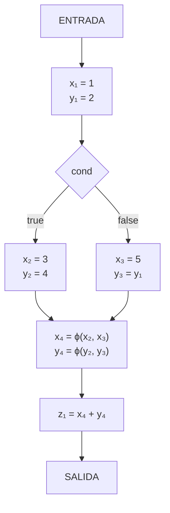

# Compiladores - Representaciones intermedias

## 5.4 Forma de asignación simple estática.

---

La **Forma de Asignación Simple Estática (Static Single Assignment - SSA)** es una representación intermedia donde cada variable se asigna exactamente una vez. Según Cooper y Torczon (2004), "SSA simplifica muchos algoritmos de optimización al hacer explícitas las definiciones y usos de variables".

### Definición Formal

**Definición:** Una representación está en SSA si:

1. Cada variable se define (asigna) exactamente una vez
2. Cada uso de una variable se refiere a exactamente una definición

**Propiedad clave:**
$$ \forall v \in V, |defs(v)| = 1 \land \forall u \in uses(v), u \text{ refiere a } defs(v) $$

### Conceptos Fundamentales

#### Función Φ (Phi)

**Definición:** Función especial que selecciona valores en puntos de convergencia del flujo de control.

**Formato:**
$$ x_n = \phi(x_1, x_2, \ldots, x_k) $$

**Semántica:** El valor de $x_n$ depende del camino de ejecución tomado para llegar al punto phi.

#### Versiones de Variables

En SSA, cada asignación crea una nueva versión de la variable:

- `x₁`, `x₂`, `x₃`, ... representan diferentes versiones de `x`

### Construcción de SSA

#### Algoritmo de Conversión a SSA

1. **Insertar funciones Φ** en puntos de reunión (join points)
2. **Renombrar variables** para asegurar asignación única
3. **Resolver flujo de control** con funciones phi

#### Dominadores y Puntos de Reunión

**Definición:** Un nodo $d$ domina a un nodo $n$ si todo camino desde el entry a $n$ pasa por $d$.

**Frontera de dominancia:** Conjunto de nodos donde el flujo de control se reúne.

### Ejemplo de Conversión a SSA

#### Código Original

```c
x = 1;
y = 2;
if (cond) {
    x = 3;
    y = 4;
} else {
    x = 5;
}
z = x + y;
```

#### Conversión a SSA

```c
x₁ = 1;
y₁ = 2;
if (cond) {
    x₂ = 3;
    y₂ = 4;
} else {
    x₃ = 5;
    y₃ = y₁;  // Versión explícita
}
x₄ = ϕ(x₂, x₃);  // Función phi para x
y₄ = ϕ(y₂, y₃);  // Función phi para y
z₁ = x₄ + y₄;
```

### Implementación de Funciones Φ

#### Representación de Phi Functions

```python
class PhiFunction:
    def __init__(self, variable, versions):
        self.variable = variable
        self.versions = versions  # Lista de versiones según paths
        self.result_version = None

    def __str__(self):
        versions_str = ', '.join(self.versions)
        return f"{self.variable}_{self.result_version} = ϕ({versions_str})"
```

#### Algoritmo de Inserción de Phi

```python
def insert_phi_functions(cfg, def_sites):
    phi_nodes = {}
    for block in cfg.blocks:
        for var in def_sites:
            if len(def_sites[var]) > 1:
                # Insertar phi function en puntos de reunión
                join_points = find_join_points(cfg, def_sites[var])
                for join in join_points:
                    if join not in phi_nodes:
                        phi_nodes[join] = []
                    phi_nodes[join].append(PhiFunction(var, []))
    return phi_nodes
```

### Ventajas de SSA

#### Optimizaciones Facilitadas por SSA

1. **Propagación de Constantes**

   ```c
   x₁ = 5;        // Constante conocida
   y₁ = x₁ + 2;   // y₁ = 7 (propagación)
   ```

2. **Eliminación de Código Muerto**

   ```c
   x₁ = computation();  // Definición
   // ... ningún uso de x₁ ...
   // x₁ puede eliminarse
   ```

3. **Eliminación de Subexpresiones Comunes**

#### Análisis Simplificado

**Ecuación de reaching definitions en SSA:**
$$ \text{Cada uso refiere a exactamente una definición} $$

**No necesidad de:**
$$ IN[B] = \bigcup_{P \in pred(B)} OUT[P] $$

### Ejemplos Detallados

#### Ejemplo 1: Bucle Simple

**Código Original:**

```c
i = 0;
while (i < 10) {
    sum = sum + i;
    i = i + 1;
}
```

**SSA Form:**

```c
i₁ = 0;
sum₁ = initial_value;
L1: i₂ = ϕ(i₁, i₃);
    sum₂ = ϕ(sum₁, sum₃);
    if i₂ >= 10 goto L2;
    sum₃ = sum₂ + i₂;
    i₃ = i₂ + 1;
    goto L1;
L2: // continuación
```

#### Ejemplo 2: Múltiples Paths

**Código Original:**

```c
if (a > b) {
    x = a;
} else {
    x = b;
}
y = x * 2;
```

**SSA Form:**

```c
if (a > b) {
    x₁ = a;
} else {
    x₂ = b;
}
x₃ = ϕ(x₁, x₂);
y₁ = x₃ * 2;
```

### Algoritmos Clave en SSA

#### Algoritmo de Renombrado

```python
def rename_variables(block, stack, cfg):
    # Procesar phi functions primero
    for phi in block.phi_functions:
        new_version = next_version(phi.variable)
        phi.result_version = new_version
        stack[phi.variable].append(new_version)

    # Renombrar instrucciones regulares
    for instr in block.instructions:
        for i, operand in enumerate(instr.operands):
            if operand in stack:
                instr.operands[i] = f"{operand}_{stack[operand][-1]}"

        if instr.has_dest():
            new_version = next_version(instr.dest_var)
            instr.dest_var = f"{instr.dest_var}_{new_version}"
            stack[instr.dest_var].append(new_version)

    # Procesar hijos en el árbol de dominancia
    for child in cfg.get_dominance_children(block):
        rename_variables(child, stack.copy(), cfg)
```

### Ejercicios Propuestos

#### Ejercicio 1: Conversión Básica

Convierta a forma SSA:

```c
x = 5;
y = x + 1;
if (z > 0) {
    x = y * 2;
} else {
    x = y / 2;
}
w = x + 3;
```

#### Ejercicio 2: Bucles y SSA

Convierta el siguiente bucle a SSA:

```c
i = 0;
j = 1;
while (i < n) {
    if (i % 2 == 0) {
        j = j * 2;
    } else {
        j = j + 1;
    }
    i = i + 1;
}
```

#### Ejercicio 3: Funciones Phi

Identifique dónde se necesitan funciones phi:

```c
a = 1;
b = 2;
if (x > y) {
    a = 3;
    c = 4;
} else {
    b = 5;
    c = 6;
}
d = a + b + c;
```

#### Ejercicio 4: Optimización con SSA

Optimice el código SSA:

```c
x₁ = 5;
y₁ = x₁ + 2;      // ¿Puede optimizarse?
z₁ = y₁ * 3;      // ¿Puede optimizarse?
if (z₁ > 20) {
    w₁ = x₁ + 1;  // ¿Puede optimizarse?
}
```

#### Ejercicio 5: Análisis de Flujo

Para el siguiente código SSA, determine los valores que pueden propagarse:

```c
a₁ = 10;
b₁ = a₁ + 5;
if (cond) {
    a₂ = 20;
    c₁ = a₂ + b₁;
} else {
    a₃ = 30;
    c₂ = a₃ + b₁;
}
a₄ = ϕ(a₂, a₃);
c₃ = ϕ(c₁, c₂);
d₁ = a₄ + c₃;
```

### Diagramas de Flujo de Control en SSA



### Implementación Práctica

#### Clase para Generación SSA

```python
class SSAGenerator:
    def __init__(self):
        self.versions = {}
        self.phi_functions = []
        self.current_block = None

    def new_version(self, var):
        if var not in self.versions:
            self.versions[var] = 0
        self.versions[var] += 1
        return f"{var}_{self.versions[var]}"

    def add_phi(self, block, var, predecessors):
        phi_versions = []
        for pred in predecessors:
            # Obtener última versión de var en cada predecessor
            last_version = self.get_last_version(pred, var)
            phi_versions.append(last_version)

        result_version = self.new_version(var)
        phi_func = PhiFunction(var, phi_versions, result_version)
        block.add_phi(phi_func)
        return result_version

    def get_last_version(self, block, var):
        # Implementar lógica para encontrar última versión
        # en el bloque dado
        pass

# Ejemplo de uso
generator = SSAGenerator()
x1 = generator.new_version('x')  # x_1
y1 = generator.new_version('y')  # y_1
```

### Referencias Bibliográficas

#### Bibliografía Básica

1. **Cooper, K. D., & Torczon, L. (2004).** _Engineering a Compiler_. Morgan Kaufmann. (Capítulo 9 - Static Single Assignment Form)
2. **Aho, A. V., Lam, M. S., Sethi, R., & Ullman, J. D. (2007).** _Compilers: Principles, Techniques, and Tools_ (2nd ed.). Pearson Education. (Sección 6.2.4 - Static Single Assignment Form)

#### Bibliografía Complementaria

3. **Muchnick, S. S. (1997).** _Advanced Compiler Design and Implementation_. Morgan Kaufmann. (Capítulo 8 - Static Single Assignment Form)
4. **Appel, A. W. (2002).** _Modern Compiler Implementation in Java_ (2nd ed.). Cambridge University Press. (Capítulo 19 - Static Single Assignment Form)

#### Publicaciones Seminales

5. **Cytron, R., et al. (1991).** "Efficiently Computing Static Single Assignment Form and the Control Dependence Graph"
6. **Briggs, P., et al. (1998).** "Practical Improvements to the Construction and Destruction of Static Single Assignment Form"

#### Recursos Adicionales

- LLVM SSA Documentation: https://llvm.org/docs/SSA.html
- GCC SSA Implementation: https://gcc.gnu.org/onlinedocs/gccint/SSA.html
- "SSA-based Compiler Design" book series
