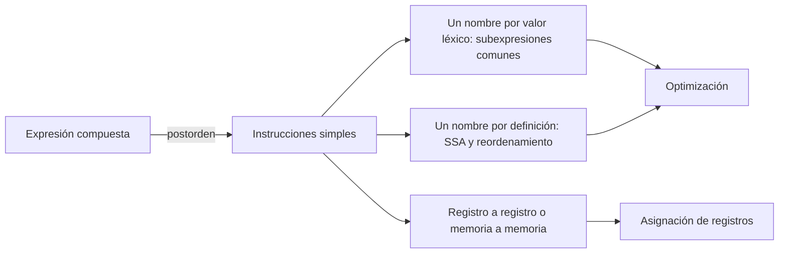

# Compiladores - Representaciones intermedias

## 5.5 Transformación de valores a nombres.

---

Al traducir a una representación lineal, el compilador debe decidir **qué nombre** recibe cada valor que el programa calcula: los de las variables del fuente, temporales nuevos o ambos. Esa decisión, la correspondencia entre valores y nombres, parece un detalle, pero determina qué redundancias puede ver el optimizador, cuántos registros hacen falta y qué tan fácil es mover el código. Este tema presenta la transformación de valores a nombres, las disciplinas de nombres, el modelo de memoria que suponen, y su efecto en la optimización y el paralelismo.

### La transformación

Cada operación de una expresión compuesta produce un **valor**, y la transformación le da un **nombre**, un temporal, de modo que cada instrucción tenga operandos simples:

$$e_1 \ \text{op}\ e_2 \ \longmapsto\ \text{código de } e_1;\ \ \text{código de } e_2;\ \ t = n_1 \ \text{op}\ n_2$$

donde $n_1$ y $n_2$ son los nombres de los valores de $e_1$ y $e_2,$ y $t$ es un nombre nuevo. Se implementa con un recorrido en postorden que **devuelve** el nombre del valor de cada subexpresión y **agrega** sus instrucciones a una lista; las variables y las constantes son su propio nombre. Las llamadas evalúan sus argumentos, los pasan con `param` y nombran el resultado.

### Disciplinas de nombres

- **Un nombre por valor léxico:** cada expresión textual distinta, como `a + b`, recibe siempre el mismo temporal. Si el valor no cambió entre dos apariciones, el segundo cálculo es redundante, y el optimizador lo descubre comparando nombres. Es la disciplina que supone la eliminación clásica de subexpresiones comunes.
- **Un nombre por valor calculado:** cada instrucción define un nombre nuevo, como en SSA. Los nombres no se reutilizan, de modo que no hay dependencias falsas y las instrucciones se pueden reordenar libremente.
- **Nombres del fuente:** reutilizar las variables del programa para los resultados intermedios ahorra nombres, pero oculta información: si `a` se reasigna, ya no es posible saber que un `a + b` anterior y uno posterior son distintos solo por el nombre.

El caso clásico es `a = b + c; b = a - d; c = b + c; d = a - d`: los dos `b + c` **no** son el mismo valor, porque `b` cambió, y los dos `a - d` **sí** lo son. La numeración de valores, que nombra los valores y no las expresiones, lo distingue: los nombres del fuente no bastan.

### Modelo de memoria

La correspondencia también depende de dónde viven los valores:

- **registro a registro:** todo valor que pueda estar en un registro recibe un nombre virtual, sin límite de cantidad, y solo los valores que lo requieren, como los arreglos o las variables cuya dirección se toma, viven en memoria. El asignador de registros decide después cuáles caben en los registros reales. Es el modelo de LLVM y GCC;
- **memoria a memoria:** todos los valores viven en memoria y las instrucciones operan sobre direcciones; los registros son un detalle del *back-end*. Es más simple, pero oculta las oportunidades de optimización que dependen de saber que un valor no cambia.



### Dependencias y paralelismo

Con un nombre por valor calculado, solo quedan las dependencias **verdaderas**, de un valor a sus usos: dos instrucciones sin camino de dependencias entre ellas pueden ejecutarse en cualquier orden o en paralelo. Reutilizar nombres crea dependencias **falsas**, de escritura después de lectura y de escritura después de escritura, que el hardware elimina con el **renombrado de registros**, haciendo en tiempo de ejecución la misma transformación.

### Implementación en Python

El programa implementa la transformación de valores a nombres sobre el árbol abstracto del núcleo de representaciones intermedias, incluido al inicio, y resuelve los cinco ejercicios: transforma las expresiones, ejecuta el código con el intérprete y compara con Python; traduce la expresión booleana como valores y como código de saltos y comprueba las 64 combinaciones; nombra los resultados de llamadas anidadas; optimiza dos sentencias con el optimizador local del tema 5.3, y calcula los niveles de dependencia. Al final muestra el caso clásico de los nombres del fuente contra la numeración de valores.

```python
# ===== Núcleo de representaciones intermedias: AST, DAG, código de tres direcciones, bloques, CFG y SSA =====
import re

# ---------- Analizador de un lenguaje pequeño parecido a C ----------
def lexico(texto):
    return re.findall(r'"[^"]*"|\d+\.\d+|\d+|[A-Za-z_]\w*|\+\+|--|[-+*/]=|==|!=|<=|>=|&&|\|\||[-+*/%<>=!(){};,]', texto) + ["$"]
class Parser:
    def __init__(self, texto): self.t, self.i = lexico(texto), 0
    def mira(self, k=0): return self.t[self.i + k]
    def come(self, x=None):
        v = self.t[self.i]
        if x and v != x: raise SyntaxError(f"se esperaba {x} y llegó {v}")
        self.i += 1; return v
    def programa(self):
        res = []
        while self.mira() != "$": res.append(self.sentencia())
        return ("bloque", res)
    def opcional_pc(self):
        if self.mira() == ";": self.come()
    def sentencia(self):
        x = self.mira()
        if x == "{":
            self.come(); res = []
            while self.mira() != "}": res.append(self.sentencia())
            self.come(); return ("bloque", res)
        if x == "if":
            self.come(); self.come("("); c = self.expr(); self.come(")"); s = self.sentencia(); o = None
            if self.mira() == "else": self.come(); o = self.sentencia()
            return ("if", c, s, o)
        if x == "while":
            self.come(); self.come("("); c = self.expr(); self.come(")"); return ("while", c, self.sentencia())
        if x == "for":
            self.come(); self.come("("); ini = self.simple() if self.mira() != ";" else None; self.come(";")
            c = self.expr() if self.mira() != ";" else ("num", 1); self.come(";")
            paso = self.simple() if self.mira() != ")" else None; self.come(")"); cuerpo = self.sentencia()
            return ("bloque", ([ini] if ini else []) + [("while", c, ("bloque", [cuerpo] + ([paso] if paso else [])))])
        if x == "return":
            self.come(); e = self.expr() if self.mira() not in (";", "}", "$") else None; self.opcional_pc(); return ("return", e)
        s = self.simple(); self.opcional_pc(); return s
    def simple(self):
        if self.mira(1) in ("=", "+=", "-=", "*=", "/=", "++", "--"):
            x = self.come(); op = self.come()
            if op == "=": return ("asig", x, self.expr())
            if op in ("++", "--"): return ("asig", x, ("bin", op[0], ("var", x), ("num", 1)))
            return ("asig", x, ("bin", op[0], ("var", x), self.expr()))
        return ("expr", self.expr())
    NIVELES = [("||",), ("&&",), ("==", "!="), ("<", "<=", ">", ">="), ("+", "-"), ("*", "/", "%")]
    def expr(self, k=0):
        if k == len(self.NIVELES): return self.unario()
        a = self.expr(k + 1)
        while self.mira() in self.NIVELES[k]: op = self.come(); a = ("bin", op, a, self.expr(k + 1))
        return a
    def unario(self):
        if self.mira() in ("-", "!"): op = self.come(); return ("un", op, self.unario())
        x = self.come()
        if x == "(": e = self.expr(); self.come(")"); return e
        if x[0].isdigit(): return ("num", float(x) if "." in x else int(x))
        if x[0] == '"': return ("str", x)
        if self.mira() == "(":
            self.come(); args = []
            while self.mira() != ")":
                args.append(self.expr())
                if self.mira() == ",": self.come()
            self.come(); return ("call", x, args)
        return ("var", x)
def expresion(texto): return Parser(texto).expr()

def texto_ast(n):
    k = n[0]
    if k == "num": return str(n[1])
    if k in ("var", "str"): return n[1]
    if k == "bin": return f"({texto_ast(n[2])} {n[1]} {texto_ast(n[3])})"
    if k == "un": return f"({n[1]}{texto_ast(n[2])})"
    if k == "call": return f"{n[1]}(" + ", ".join(texto_ast(a) for a in n[2]) + ")"
def dibuja_ast(n, pre="   ", ultimo=True, raiz=True):
    k = n[0]
    et = {"num": lambda: str(n[1]), "var": lambda: n[1], "str": lambda: n[1], "bin": lambda: n[1], "un": lambda: n[1], "call": lambda: n[1] + "()"}[k]()
    hijos = [n[2], n[3]] if k == "bin" else [n[2]] if k == "un" else n[2] if k == "call" else []
    lineas = [pre + ("" if raiz else ("└─ " if ultimo else "├─ ")) + et]
    sub = pre + ("" if raiz else ("   " if ultimo else "│  "))
    for i, h in enumerate(hijos): lineas += dibuja_ast(h, sub, i == len(hijos) - 1, False)
    return lineas
def postfija(n):
    k = n[0]
    if k in ("num", "var", "str"): return [str(n[1])]
    if k == "bin": return postfija(n[2]) + postfija(n[3]) + [n[1]]
    if k == "un": return postfija(n[2]) + ["neg" if n[1] == "-" else n[1]]
    if k == "call": return [x for a in n[2] for x in postfija(a)] + [f"{n[1]}/{len(n[2])}"]
def contar_nodos(n):
    k = n[0]
    if k == "bin": return 1 + contar_nodos(n[2]) + contar_nodos(n[3])
    if k == "un": return 1 + contar_nodos(n[2])
    if k == "call": return 1 + sum(contar_nodos(a) for a in n[2])
    return 1

# ---------- DAG por numeración de valores ----------
def dag(asignaciones):
    """asignaciones: lista de (variable o None, AST). Devuelve los nodos únicos y las etiquetas de cada nodo."""
    nodos, tabla, etiquetas, actual = [], {}, {}, {}
    def nodo(clave, texto):
        if clave not in tabla: tabla[clave] = len(nodos); nodos.append(texto)
        return tabla[clave]
    def visita(n):
        k = n[0]
        if k == "num": return nodo(("num", n[1]), str(n[1]))
        if k == "var":
            if n[1] in actual: return actual[n[1]]
            return nodo(("var", n[1]), n[1])
        if k == "bin":
            a, b = visita(n[2]), visita(n[3])
            if n[1] in "+*" and a > b: a, b = b, a                    # conmutatividad
            return nodo(("bin", n[1], a, b), f"{n[1]} n{a} n{b}")
        if k == "un": a = visita(n[2]); return nodo(("un", n[1], a), f"{n[1]} n{a}")
    for x, e in asignaciones:
        k = visita(e)
        if x:
            for v in list(etiquetas):
                if v == x: del etiquetas[v]
            actual[x] = k; etiquetas[x] = k
    return nodos, etiquetas

# ---------- Código de tres direcciones ----------
class GeneradorTAC:
    def __init__(self): self.codigo, self.nt, self.ne = [], 0, 0
    def temp(self): self.nt += 1; return f"t{self.nt}"
    def etiqueta(self): self.ne += 1; return f"L{self.ne}"
    def emite(self, *ins): self.codigo.append(ins)
    REL = {"<": ">=", "<=": ">", ">": "<=", ">=": "<", "==": "!=", "!=": "=="}
    def valor(self, n):
        k = n[0]
        if k == "num": return str(n[1])
        if k in ("var", "str"): return n[1]
        if k == "bin" and n[1] in ("&&", "||") or k == "bin" and n[1] in self.REL or k == "un" and n[1] == "!":
            t = self.temp(); lf, lfin = self.etiqueta(), self.etiqueta()
            self.condicion(n, None, lf); self.emite("asig", t, "1"); self.emite("goto", lfin)
            self.emite("label", lf); self.emite("asig", t, "0"); self.emite("label", lfin); return t
        if k == "bin":
            a = self.valor(n[2]); b = self.valor(n[3]); t = self.temp(); self.emite("bin", t, n[1], a, b); return t
        if k == "un": a = self.valor(n[2]); t = self.temp(); self.emite("un", t, n[1], a); return t
        if k == "call":
            args = [self.valor(a) for a in n[2]]
            for a in args: self.emite("param", a)
            t = self.temp(); self.emite("call", t, n[1], len(args)); return t
    def condicion(self, n, v, f):
        """Código de saltos: salta a v si la condición es verdadera y a f si es falsa; None significa continuar."""
        if n[0] == "bin" and n[1] in self.REL:
            a = self.valor(n[2]); b = self.valor(n[3])
            if v and f: self.emite("if", a, n[1], b, v); self.emite("goto", f)
            elif v: self.emite("if", a, n[1], b, v)
            elif f: self.emite("if", a, self.REL[n[1]], b, f)
        elif n[0] == "bin" and n[1] == "&&":
            fin = None if f else self.etiqueta()
            self.condicion(n[2], None, f or fin); self.condicion(n[3], v, f or fin)
            if fin: self.emite("label", fin)
        elif n[0] == "bin" and n[1] == "||":
            fin = None if v else self.etiqueta()
            self.condicion(n[2], v or fin, None); self.condicion(n[3], v or fin, f)
            if fin: self.emite("label", fin)
        elif n[0] == "un" and n[1] == "!": self.condicion(n[2], f, v)
        else:
            a = self.valor(n)
            if v: self.emite("if", a, "!=", "0", v)
            if f: self.emite("if", a, "==", "0", f) if not v else self.emite("goto", f)
    def sentencia(self, s):
        k = s[0]
        if k == "bloque":
            for x in s[1]: self.sentencia(x)
        elif k == "asig":
            e = s[2]
            if e[0] == "bin" and e[1] not in ("&&", "||") and e[1] not in self.REL:
                a = self.valor(e[2]); b = self.valor(e[3]); self.emite("bin", s[1], e[1], a, b)
            else: self.emite("asig", s[1], self.valor(e))
        elif k == "if":
            lf = self.etiqueta(); self.condicion(s[1], None, lf); self.sentencia(s[2])
            if s[3]:
                lfin = self.etiqueta(); self.emite("goto", lfin); self.emite("label", lf); self.sentencia(s[3]); self.emite("label", lfin)
            else: self.emite("label", lf)
        elif k == "while":
            li, lf = self.etiqueta(), self.etiqueta()
            self.emite("label", li); self.condicion(s[1], None, lf); self.sentencia(s[2]); self.emite("goto", li); self.emite("label", lf)
        elif k == "return": self.emite("ret", self.valor(s[1]) if s[1] else "")
        elif k == "expr":
            e = s[1]
            if e[0] == "call" and e[1] == "print":
                for a in [self.valor(a) for a in e[2]]: self.emite("param", a)
                self.emite("call", None, "print", len(e[2]))
            else: self.valor(e)
def tac(texto):
    g = GeneradorTAC(); g.sentencia(Parser(texto).programa())
    c = g.codigo                                   # mirilla: quita los saltos a la instrucción siguiente
    return [ins for k, ins in enumerate(c) if not (ins[0] == "goto" and k + 1 < len(c) and c[k + 1] == ("label", ins[1]))]
def texto_ins(ins):
    k = ins[0]
    if k == "asig": return f"{ins[1]} = {ins[2]}"
    if k == "bin": return f"{ins[1]} = {ins[3]} {ins[2]} {ins[4]}"
    if k == "un": return f"{ins[1]} = {ins[2]}{ins[3]}"
    if k == "label": return f"{ins[1]}:"
    if k == "goto": return f"goto {ins[1]}"
    if k == "if": return f"if {ins[1]} {ins[2]} {ins[3]} goto {ins[4]}"
    if k == "param": return f"param {ins[1]}"
    if k == "call": return (f"{ins[1]} = " if ins[1] else "") + f"call {ins[2]}, {ins[3]}"
    if k == "ret": return f"return {ins[1]}".strip()
    if k == "phi": return f"{ins[1]} = φ(" + ", ".join(f"{v}" for _, v in sorted(ins[2].items())) + ")"
def listado(codigo, numerado=False):
    return "\n".join(f"   {k + 1:2}: {texto_ins(i)}" if numerado else ("   " + texto_ins(i) if i[0] != "label" else " " + texto_ins(i)) for k, i in enumerate(codigo))

# ---------- Bloques básicos y grafo de flujo de control ----------
def bloques(codigo):
    lideres = {0}
    for k, ins in enumerate(codigo):
        if ins[0] == "label": lideres.add(k)
        if ins[0] in ("goto", "if", "ret") and k + 1 < len(codigo): lideres.add(k + 1)
    orden = sorted(lideres); bs = []
    for j, ini in enumerate(orden):
        fin = orden[j + 1] if j + 1 < len(orden) else len(codigo)
        bs.append(codigo[ini:fin])
    bs = [b for b in bs if b]
    etiqueta_de = {b[0][1]: i for i, b in enumerate(bs) if b[0][0] == "label"}
    suc = {}
    for i, b in enumerate(bs):
        u = b[-1]; s = []
        if u[0] == "goto": s = [etiqueta_de[u[1]]]
        elif u[0] == "if": s = [etiqueta_de[u[4]]] + ([i + 1] if i + 1 < len(bs) else [])
        elif u[0] != "ret" and i + 1 < len(bs): s = [i + 1]
        suc[i] = list(dict.fromkeys(s))
    pred = {i: [j for j in suc if i in suc[j]] for i in suc}
    return bs, suc, pred

def dominadores(n, suc, pred, entrada=0):
    dom = {i: set(range(n)) for i in range(n)}; dom[entrada] = {entrada}; cambio = True
    while cambio:
        cambio = False
        for i in range(n):
            if i == entrada: continue
            nuevo = {i} | (set.intersection(*[dom[p] for p in pred[i]]) if pred[i] else set())
            if nuevo != dom[i]: dom[i] = nuevo; cambio = True
    # el dominador inmediato de i es el dominador estricto cuyo conjunto de dominadores es dom(i) sin i
    idom = {i: next((d for d in dom[i] - {i} if dom[d] == dom[i] - {i}), None) for i in range(n)}
    return dom, idom
def frontera(n, pred, idom):
    df = {i: set() for i in range(n)}
    for b in range(n):
        if len(pred[b]) >= 2:
            for p in pred[b]:
                r = p
                while r is not None and r != idom[b]: df[r].add(b); r = idom[r]
    return df

def definidas(b): return [i[1] for i in b if i[0] in ("asig", "bin", "un") or (i[0] == "call" and i[1])]
def usadas(i):
    k = i[0]
    if k == "asig": return [i[2]]
    if k == "bin": return [i[3], i[4]]
    if k == "un": return [i[3]]
    if k == "if": return [i[1], i[3]]
    if k in ("param", "ret"): return [i[1]]
    if k == "phi": return list(i[2].values())
    return []
def es_variable(x): return isinstance(x, str) and re.fullmatch(r"[A-Za-z_]\w*", x) is not None

def ssa(codigo, podada=True):
    """Construcción de Cytron y otros: funciones φ en la frontera de dominancia iterada y renombrado sobre el árbol de dominadores.
    Con podada=True solo se insertan φ para variables vivas a la entrada del bloque."""
    bs, suc, pred = bloques(codigo); n = len(bs)
    dom, idom = dominadores(n, suc, pred); df = frontera(n, pred, idom)
    vivas_ent = vivas(bs, suc) if podada else None
    variables = sorted({x for b in bs for x in definidas(b)})
    phis = {i: {} for i in range(n)}
    for v in variables:
        trabajo = [i for i in range(n) if v in definidas(bs[i])]; puestos = set()
        while trabajo:
            b = trabajo.pop()
            for d in sorted(df[b]):
                if d in puestos or (podada and v not in vivas_ent[d]): continue
                puestos.add(d); phis[d][v] = {}
                if d not in trabajo: trabajo.append(d)
    contador, pila = {}, {}
    def nuevo(v):
        contador[v] = contador.get(v, 0) + 1; nombre = f"{v}_{contador[v]}"; pila.setdefault(v, []).append(nombre); return nombre
    def actual(x): return pila[x][-1] if es_variable(x) and pila.get(x) else (f"{x}_0" if es_variable(x) and x in variables else x)
    nuevos = {}; nombres_phi = {i: {} for i in range(n)}
    hijos = {i: sorted(j for j in range(n) if idom[j] == i) for i in range(n)}
    def renombra(b):
        empujados = []
        for v in phis[b]: nombres_phi[b][v] = nuevo(v); empujados.append(v)
        res = []
        for ins in bs[b]:
            k = ins[0]
            if k == "asig": a = actual(ins[2]); res.append(("asig", nuevo(ins[1]), a)); empujados.append(ins[1])
            elif k == "bin": a, c = actual(ins[3]), actual(ins[4]); res.append(("bin", nuevo(ins[1]), ins[2], a, c)); empujados.append(ins[1])
            elif k == "un": a = actual(ins[3]); res.append(("un", nuevo(ins[1]), ins[2], a)); empujados.append(ins[1])
            elif k == "if": res.append(("if", actual(ins[1]), ins[2], actual(ins[3]), ins[4]))
            elif k in ("param", "ret"): res.append((k, actual(ins[1])))
            elif k == "call" and ins[1]: res.append(("call", nuevo(ins[1]), ins[2], ins[3])); empujados.append(ins[1])
            else: res.append(ins)
        nuevos[b] = res
        for s in suc[b]:
            for v in phis[s]: phis[s][v][b] = actual(v)
        for h in hijos[b]: renombra(h)
        for v in empujados: pila[v].pop()
    renombra(0)
    resultado = []
    for b in range(n):
        cuerpo = nuevos.get(b, [])
        lab = [cuerpo[0]] if cuerpo and cuerpo[0][0] == "label" else []
        resto = cuerpo[len(lab):]
        resultado.append(lab + [("phi", nombres_phi[b][v], {f"B{p + 1}": x for p, x in phis[b][v].items()}) for v in sorted(phis[b])] + resto)
    return resultado, (bs, suc, pred, idom, df)

def vivas(bs, suc):
    """Variables vivas a la entrada de cada bloque, por análisis hacia atrás de punto fijo."""
    n = len(bs); uso, defi = {}, {}
    for i, b in enumerate(bs):
        u, d = set(), set()
        for ins in b:
            for x in usadas(ins):
                if es_variable(x) and x not in d: u.add(x)
            for x in definidas([ins]): d.add(x)
        uso[i], defi[i] = u, d
    ent = {i: set() for i in range(n)}; cambio = True
    while cambio:
        cambio = False
        for i in reversed(range(n)):
            sal = set().union(*[ent[s] for s in suc[i]]) if suc[i] else set()
            nueva = uso[i] | (sal - defi[i])
            if nueva != ent[i]: ent[i] = nueva; cambio = True
    return ent

# ---------- Intérprete de código de tres direcciones, con o sin φ ----------
OPS = {"+": lambda a, b: a + b, "-": lambda a, b: a - b, "*": lambda a, b: a * b, "/": lambda a, b: a / b if isinstance(a, float) or isinstance(b, float) else int(a / b),
       "%": lambda a, b: a % b, "<": lambda a, b: int(a < b), "<=": lambda a, b: int(a <= b), ">": lambda a, b: int(a > b),
       ">=": lambda a, b: int(a >= b), "==": lambda a, b: int(a == b), "!=": lambda a, b: int(a != b)}
def ejecuta(lista_bloques, entorno, limite=100000, funciones=None):
    """lista_bloques: lista de listas de instrucciones; las φ eligen según el bloque de procedencia."""
    env = dict(entorno); salida = []; params = []; funciones = funciones or {}
    etq = {b[0][1]: i for i, b in enumerate(lista_bloques) if b and b[0][0] == "label"}
    def val(x):
        if isinstance(x, str) and re.fullmatch(r"-?\d+", x): return int(x)
        if isinstance(x, str) and re.fullmatch(r"-?\d+\.\d+", x): return float(x)
        if isinstance(x, str) and x.startswith('"'): return x.strip('"')
        if x in env: return env[x]
        base = re.sub(r"_0$", "", x)
        return env.get(base, 0)
    b, previo, pasos = 0, None, 0
    while b is not None and b < len(lista_bloques):
        siguiente = b + 1
        phis = [i for i in lista_bloques[b] if i[0] == "phi"]
        nuevos = {i[1]: val(i[2].get(f"B{previo + 1}", "0")) for i in phis} if previo is not None else {}
        env.update(nuevos)
        for ins in lista_bloques[b]:
            pasos += 1
            if pasos > limite: raise RuntimeError("demasiados pasos")
            k = ins[0]
            if k == "asig": env[ins[1]] = val(ins[2])
            elif k == "bin": env[ins[1]] = OPS[ins[2]](val(ins[3]), val(ins[4]))
            elif k == "un": env[ins[1]] = -val(ins[3]) if ins[2] == "-" else int(not val(ins[3]))
            elif k == "goto": siguiente = etq[ins[1]]; break
            elif k == "if":
                if OPS[ins[2]](val(ins[1]), val(ins[3])): siguiente = etq[ins[4]]; break
            elif k == "param": params.append(val(ins[1]))
            elif k == "call":
                args, params[:] = params[-ins[3]:] if ins[3] else [], params[:-ins[3]] if ins[3] else params
                if ins[2] == "print": salida.append(" ".join(str(a) for a in args))
                else: env[ins[1]] = funciones[ins[2]](*args)
            elif k == "ret": return env, salida, val(ins[1]) if ins[1] else None
        previo, b = b, siguiente
    return env, salida, None
def muestra_bloques(bs, sangria="   "):
    lineas = []
    for k, b in enumerate(bs):
        lineas.append(f"{sangria}B{k + 1}:")
        for i in b: lineas.append(f"{sangria}  " + ("" if i[0] == "label" else "  ") + texto_ins(i))
    return "\n".join(lineas)

# ---------- Optimización local: numeración de valores, plegado, propagación de copias y código muerto ----------
def es_numero(x): return isinstance(x, str) and re.fullmatch(r"-?\d+(\.\d+)?", x) is not None
def num(x): return float(x) if "." in x else int(x)
def optimiza_bloque(codigo, vivas_salida, pasos=None):
    """Un bloque sin saltos. vivas_salida: variables que se usan después del bloque."""
    pasos = pasos if pasos is not None else []
    valor, tabla, res = {}, {}, []                    # valor: nombre -> operando equivalente; tabla: expresión -> nombre
    def op(x): return valor.get(x, x)
    for ins in codigo:
        if ins[0] == "asig":
            v = op(ins[2]); valor[ins[1]] = v
            for k in [k for k, n in tabla.items() if n == ins[1]]: del tabla[k]
            res.append(("asig", ins[1], v)); continue
        if ins[0] != "bin": res.append(ins); continue
        d, o, a, b = ins[1], ins[2], op(ins[3]), op(ins[4])
        if es_numero(a) and es_numero(b) and o in OPS:
            r = OPS[o](num(a), num(b)); r = str(int(r)) if float(r).is_integer() else str(r)
            pasos.append(f"plegado: {a} {o} {b} = {r}"); valor[d] = r; res.append(("asig", d, r)); continue
        if o in "+*" and str(a) > str(b): a, b = b, a
        if (o == "+" and b == "0") or (o == "*" and b == "1"): valor[d] = a; res.append(("asig", d, a)); pasos.append(f"identidad: {d} = {a}"); continue
        clave = (o, a, b)
        if clave in tabla and op(tabla[clave]) == tabla[clave]:
            pasos.append(f"subexpresión común: {a} {o} {b} ya está en {tabla[clave]}"); valor[d] = tabla[clave]; res.append(("asig", d, tabla[clave])); continue
        valor.pop(d, None)
        for k in [k for k, n in tabla.items() if n == d or d in k[1:]]: del tabla[k]
        tabla[clave] = d; res.append(("bin", d, o, a, b))
    # código muerto: hacia atrás, se conservan las instrucciones cuyo destino se usa después
    vivas_ahora, final = set(vivas_salida), []
    for ins in reversed(res):
        if ins[0] in ("asig", "bin") and ins[1] not in vivas_ahora:
            pasos.append(f"código muerto: {texto_ins(ins)}"); continue
        if ins[0] in ("asig", "bin"): vivas_ahora.discard(ins[1])
        vivas_ahora |= {x for x in usadas(ins) if es_variable(x)}
        final.append(ins)
    return final[::-1]

import itertools, math
OPS["&&"] = lambda a, b: int(bool(a) and bool(b)); OPS["||"] = lambda a, b: int(bool(a) or bool(b))
def a_nombres(e, codigo, cont):
    """Transformación de valores a nombres: cada valor calculado recibe un temporal nuevo; devuelve el nombre del valor."""
    k = e[0]
    if k == "num": return str(e[1])
    if k == "var": return e[1]
    if k == "bin":
        a = a_nombres(e[2], codigo, cont); b = a_nombres(e[3], codigo, cont)
        cont[0] += 1; t = f"t{cont[0]}"; codigo.append(("bin", t, e[1], a, b)); return t
    if k == "un":
        a = a_nombres(e[2], codigo, cont); cont[0] += 1; t = f"t{cont[0]}"; codigo.append(("un", t, e[1], a)); return t
    if k == "call":
        args = [a_nombres(x, codigo, cont) for x in e[2]]
        for x in args: codigo.append(("param", x))
        cont[0] += 1; t = f"t{cont[0]}"; codigo.append(("call", t, e[1], len(args))); return t
def transforma(asignacion):
    destino, expr = asignacion.split("=", 1); codigo = []; cont = [0]
    r = a_nombres(expresion(expr), codigo, cont); codigo.append(("asig", destino.strip(), r)); return codigo

# ---------- Ejercicio 1 ----------
c1 = transforma("z = (x * y) + (a / b) * (c - d)")
print("ejercicio 1:"); print(listado(c1))
v = dict(x=3, y=4, a=8, b=2, c=7, d=5)
print("   con", v, ": z =", ejecuta([c1], v)[0]["z"], "| Python:", (3 * 4) + (8 // 2) * (7 - 5))

# ---------- Ejercicio 2: expresión booleana como valores y como saltos ----------
FUENTE2 = "condition = (a > b) && (c < d) || (e == f)"
c2v = transforma(FUENTE2); c2s = tac(FUENTE2 + ";")
print("ejercicio 2, como valores:"); print(listado(c2v))
print("   como código de saltos, con cortocircuito:"); print(listado(c2s))
iguales = 0
for a, b, c, d, e, f in itertools.product([0, 1], repeat=6):
    env = dict(a=a, b=b, c=c, d=d, e=e, f=f)
    iguales += ejecuta([c2v], env)[0]["condition"] == ejecuta(bloques(c2s)[0], env)[0]["condition"] == int((a > b and c < d) or e == f)
print("   iguales a Python en las", iguales, "de 64 combinaciones")

# ---------- Ejercicio 3: llamadas anidadas ----------
c3 = transforma("result = sqrt(pow(x, 2) + pow(y, 2))")
print("ejercicio 3:"); print(listado(c3))
print("   con x = 3, y = 4: result =", ejecuta([c3], {"x": 3, "y": 4}, funciones={"sqrt": math.sqrt, "pow": pow})[0]["result"])

# ---------- Ejercicio 4: transformar y optimizar ----------
c4 = [ins for ins in transforma("x = (5 * 3) + (2 * a)")]
c4 += [tuple(f"u{x[1:]}" if isinstance(x, str) and re.fullmatch(r"t\d+", x) else x for x in ins) for ins in transforma("y = (5 * 3) + (3 * b)")]
print("ejercicio 4, transformado:"); print(listado(c4))
pasos = []; o4 = optimiza_bloque(c4, {"x", "y"}, pasos)
print("   pasos:", " | ".join(pasos)); print(listado(o4))
for a, b in [(1, 2), (-3, 7)]:
    print(f"   a={a}, b={b}:", {k: ejecuta([c4], {"a": a, "b": b})[0][k] for k in "xy"}, {k: ejecuta([o4], {"a": a, "b": b})[0][k] for k in "xy"})

# ---------- Ejercicio 5: dependencias y paralelismo ----------
C5 = [("bin", "t1", "+", "a", "b"), ("bin", "t2", "*", "t1", "c"), ("bin", "t3", "*", "d", "e"), ("bin", "t4", "+", "t2", "t3")]
nivel, deps = {}, {}
for ins in C5:
    deps[ins[1]] = [x for x in (ins[3], ins[4]) if x in nivel]
    nivel[ins[1]] = 1 + max((nivel[x] for x in deps[ins[1]]), default=0)
print("ejercicio 5: dependencias:", deps, "| niveles:", {n: sorted(k for k in nivel if nivel[k] == n) for n in sorted(set(nivel.values()))})

# ---------- El nombre de los valores importa: dos formas de nombrar el mismo cálculo ----------
FUENTE = [("bin", "a", "+", "b", "c"), ("bin", "b", "-", "a", "d"), ("bin", "c", "+", "b", "c"), ("bin", "d", "-", "a", "d")]
pasos = []; optimiza_bloque(FUENTE, {"a", "b", "c", "d"}, pasos)
print("nombres del fuente: redundancias encontradas:", [p for p in pasos if "común" in p] or "ninguna")
nodos, etiquetas = dag([("a", expresion("b + c")), ("b", expresion("a - d")), ("c", expresion("b + c")), ("d", expresion("a - d"))])
print("   numeración de valores:", ", ".join(f"n{k}: {t}" for k, t in enumerate(nodos)), "| etiquetas:", etiquetas)
```

Salida:

```text
ejercicio 1:
   t1 = x * y
   t2 = a / b
   t3 = c - d
   t4 = t2 * t3
   t5 = t1 + t4
   z = t5
   con {'x': 3, 'y': 4, 'a': 8, 'b': 2, 'c': 7, 'd': 5} : z = 20 | Python: 20
ejercicio 2, como valores:
   t1 = a > b
   t2 = c < d
   t3 = t1 && t2
   t4 = e == f
   t5 = t3 || t4
   condition = t5
   como código de saltos, con cortocircuito:
   if a <= b goto L4
   if c < d goto L3
 L4:
   if e == f goto L3
   goto L1
 L3:
   t1 = 1
   goto L2
 L1:
   t1 = 0
 L2:
   condition = t1
   iguales a Python en las 64 de 64 combinaciones
ejercicio 3:
   param x
   param 2
   t1 = call pow, 2
   param y
   param 2
   t2 = call pow, 2
   t3 = t1 + t2
   param t3
   t4 = call sqrt, 1
   result = t4
   con x = 3, y = 4: result = 5.0
ejercicio 4, transformado:
   t1 = 5 * 3
   t2 = 2 * a
   t3 = t1 + t2
   x = t3
   u1 = 5 * 3
   u2 = 3 * b
   u3 = u1 + u2
   y = u3
   pasos: plegado: 5 * 3 = 15 | plegado: 5 * 3 = 15 | código muerto: u1 = 15 | código muerto: t1 = 15
   t2 = 2 * a
   t3 = 15 + t2
   x = t3
   u2 = 3 * b
   u3 = 15 + u2
   y = u3
   a=1, b=2: {'x': 17, 'y': 21} {'x': 17, 'y': 21}
   a=-3, b=7: {'x': 9, 'y': 36} {'x': 9, 'y': 36}
ejercicio 5: dependencias: {'t1': [], 't2': ['t1'], 't3': [], 't4': ['t2', 't3']} | niveles: {1: ['t1', 't3'], 2: ['t2'], 3: ['t4']}
nombres del fuente: redundancias encontradas: ['subexpresión común: a - d ya está en b']
   numeración de valores: n0: b, n1: c, n2: + n0 n1, n3: d, n4: - n2 n3, n5: + n1 n4 | etiquetas: {'a': 2, 'b': 4, 'c': 5, 'd': 4}
```

### Ejercicios Propuestos

1. **Transformación básica.** Transforma `z = (x * y) + (a / b) * (c - d);` asignando un nombre a cada valor.

2. **Expresiones booleanas.** Transforma `condition = (a > b) && (c < d) || (e == f);`.

3. **Llamadas anidadas.** Transforma `result = sqrt(pow(x, 2) + pow(y, 2));`.

4. **Optimización.** Transforma y optimiza:

    ```c
    x = (5 * 3) + (2 * a);
    y = (5 * 3) + (3 * b);
    ```

5. **Dependencias.** Para el código transformado

    ```text
    t1 = a + b
    t2 = t1 * c
    t3 = d * e
    t4 = t2 + t3
    ```

    identifica las dependencias de datos y determina qué operaciones pueden ejecutarse en paralelo.

### Soluciones

**Ejercicio 1.** El recorrido en postorden nombra `x * y` como `t1`, `a / b` como `t2`, `c - d` como `t3`, su producto como `t4` y la suma como `t5`, que se copia en `z`. Con los valores del programa, $z = 12 + 4 \cdot 2 = 20.$ La copia final desaparece si el último valor se nombra directamente `z`, como hace el generador del tema 5.1.

**Ejercicio 2.** Como **valores**, cada comparación y cada operador lógico producen un temporal: `t1 = a > b`, `t2 = c < d`, `t3 = t1 && t2`, `t4 = e == f` y `t5 = t3 || t4`. Como **código de saltos**, no se calculan valores intermedios: si `a <= b` se salta directamente a evaluar `e == f`, sin evaluar `c < d`, el **cortocircuito** que exige C, y solo al final se materializa el 1 o el 0. Las dos versiones dan el mismo resultado que Python en las 64 combinaciones, porque las comparaciones no tienen efectos secundarios; si un operando fuera una llamada con efectos, solo la versión con saltos sería correcta.

**Ejercicio 3.** Las llamadas se evalúan de adentro hacia afuera: `pow(x, 2)` y `pow(y, 2)` reciben sus argumentos con `param` y nombran sus resultados `t1` y `t2`; la suma es `t3`, que se pasa a `sqrt`, cuyo resultado `t4` se copia en `result`. Con $x = 3$ e $y = 4,$ el intérprete da 5.0. Una llamada es una barrera para el optimizador: si `pow` pudiera tener efectos secundarios, las dos llamadas no podrían fusionarse aunque tengan los mismos argumentos; si se sabe que es **pura**, sí.

**Ejercicio 4.** Con temporales distintos para cada sentencia, el optimizador **pliega** los dos `5 * 3` en 15 y elimina sus asignaciones como código muerto, y quedan `x = 15 + 2a` y `y = 15 + 3b`, con 4 operaciones en lugar de 6. Con un solo nombre por el valor léxico `5 * 3`, la segunda sería una subexpresión común aun sin plegar constantes. La multiplicación por 2 puede reducirse a una suma, `a + a`, o a un desplazamiento, una **reducción de fuerza** que hace el *back-end*.

**Ejercicio 5.** Las dependencias son `t1 → t2`, `t2 → t4` y `t3 → t4`. `t1` y `t3` no dependen entre sí y pueden ejecutarse **en paralelo**, en el primer nivel; `t2` va en el segundo y `t4` en el tercero. Con dos unidades, el bloque tarda 3 pasos en lugar de 4. Como cada valor tiene su propio nombre, no hay dependencias falsas: si `t3` se llamara `t1`, la escritura de `t3` tendría que esperar a que `t2` leyera el `t1` anterior.

En el material original, la función recursiva `value_to_name` devolvía dos valores en el caso base y tres en el recursivo, lo que produce un error al desempacar, y solo devolvía la última instrucción, de modo que perdía las de las subexpresiones; la "propiedad fundamental" $\forall v \in \text{Valores}, \exists! n \in \text{Nombres} \mid n = v$ no tiene un significado preciso, y el texto mezclaba "value to name" en inglés.

### Referencias

1. Cooper, K. D., and Torczon, L., _Engineering a Compiler_. 3a ed., Morgan Kaufmann, 2022. Sección 5.4.
2. Aho, A. V., Lam, M. S., Sethi, R., and Ullman, J. D., _Compilers: Principles, Techniques, and Tools_. 2a ed., Pearson, 2007. Secciones 6.2 y 8.5.
3. Briggs, P., Cooper, K. D., and Simpson, L. T., Value numbering. _Software: Practice and Experience_ 27(6), 1997.
4. Hennessy, J. L., and Patterson, D. A., _Computer Architecture: A Quantitative Approach_. 6a ed., Morgan Kaufmann, 2017. Sección 3.4, renombrado de registros.
