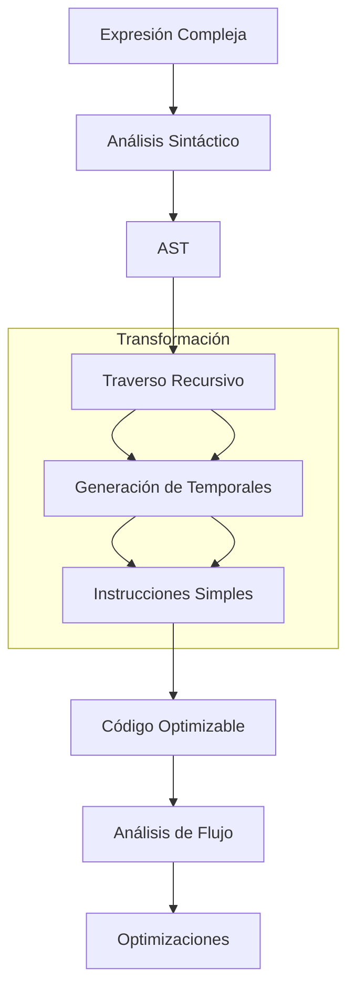

# Compiladores - Representaciones intermedias

## 5.5 Transformación de valores a nombres.

---

La **Transformación de Valores a Nombres** (Value to Name Transformation) es una técnica de representación intermedia que convierte expresiones y valores en asignaciones explícitas a variables temporales. Según Cooper y Torczon (2004), "esta transformación simplifica el análisis de flujo de datos y facilita las optimizaciones".

### Definición Formal

**Definición:** Una transformación que asigna un nombre único (variable temporal) a cada valor computado en el programa, haciendo explícitas todas las operaciones intermedias.

**Propiedad fundamental:**
$$ \forall v \in \text{Valores}, \exists! n \in \text{Nombres} \mid n = v $$

### Conceptos Fundamentales

#### Principio de Correspondencia

Cada expresión compuesta se descompone en una secuencia de operaciones simples, cada una asignada a una variable temporal:

$$ e_1\ op\ e_2 \rightarrow t_1 = e_1;\ t_2 = e_2;\ t_3 = t_1\ op\ t_2 $$

#### Ventajas de la Transformación

1. **Simplificación del análisis** de flujo de datos
2. **Facilita la reordenación** de instrucciones
3. **Hace explícitas** las dependencias de datos
4. **Permite optimizaciones** más agresivas

### Algoritmo de Transformación

#### Algoritmo Recursivo

```python
def value_to_name(expression, temp_counter=0):
    if is_atomic(expression):
        return expression, temp_counter

    # Procesar subexpresiones recursivamente
    left, temp_counter = value_to_name(expression.left, temp_counter)
    right, temp_counter = value_to_name(expression.right, temp_counter)

    # Generar temporal para esta operación
    temp_var = f"t{temp_counter}"
    temp_counter += 1

    # Crear instrucción de asignación
    instruction = f"{temp_var} = {left} {expression.op} {right}"

    return temp_var, temp_counter, instruction
```

#### Ejemplo de Transformación

**Expresión original:**
$$ (a + b) * (c - d) $$

**Transformación a valores como nombres:**

```
t1 = a + b
t2 = c - d
t3 = t1 * t2
```

### Aplicación en Diferentes Contextos

#### Expresiones Aritméticas

**Entrada:**

```c
result = (x * y) + (z / w) - 5;
```

**Salida transformada:**

```
t1 = x * y
t2 = z / w
t3 = t1 + t2
t4 = t3 - 5
result = t4
```

#### Expresiones con Llamadas a Funciones

**Entrada:**

```c
z = f(x + y, g(a, b));
```

**Salida transformada:**

```
t1 = x + y
t2 = g(a, b)
t3 = f(t1, t2)
z = t3
```

### Implementación Práctica

#### Clase para Transformación Value-to-Name

```python
class ValueToNameTransformer:
    def __init__(self):
        self.temp_count = 0
        self.instructions = []

    def new_temp(self):
        temp = f"t{self.temp_count}"
        self.temp_count += 1
        return temp

    def transform_expression(self, expr):
        if isinstance(expr, BinaryExpr):
            left_temp = self.transform_expression(expr.left)
            right_temp = self.transform_expression(expr.right)
            result_temp = self.new_temp()
            self.instructions.append(
                f"{result_temp} = {left_temp} {expr.op} {right_temp}"
            )
            return result_temp

        elif isinstance(expr, UnaryExpr):
            operand_temp = self.transform_expression(expr.operand)
            result_temp = self.new_temp()
            self.instructions.append(
                f"{result_temp} = {expr.op} {operand_temp}"
            )
            return result_temp

        else:  # Variable o constante
            return str(expr)

    def transform_assignment(self, target, expression):
        value_temp = self.transform_expression(expression)
        self.instructions.append(f"{target} = {value_temp}")
        return self.instructions
```

### Relación con Otras Representaciones

#### Conexión con Three-Address Code (TAC)

La transformación value-to-name produce naturalmente código de tres direcciones:

**Expresión:** `a + b * c`

**TAC resultante:**

```
t1 = b * c
t2 = a + t1
```

#### Conexión con SSA Form

La transformación prepara el código para la conversión a SSA:

**Antes:**

```c
x = a + b;
y = x * 2;
x = x + 1;
```

**Después value-to-name:**

```
t1 = a + b
x = t1
t2 = x * 2
y = t2
t3 = x + 1
x = t3
```

**SSA resultante:**

```
t1 = a + b
x1 = t1
t2 = x1 * 2
y1 = t2
t3 = x1 + 1
x2 = t3
```

### Optimizaciones Habilitadas

#### Eliminación de Subexpresiones Comunes

**Antes:**

```c
x = (a + b) * c;
y = (a + b) * d;
```

**Después value-to-name:**

```
t1 = a + b
t2 = t1 * c
x = t2
t3 = t1 * d  # Reuso de t1
y = t3
```

#### Propagación de Constantes

**Antes:**

```c
z = (5 * 3) + (2 * 4);
```

**Después value-to-name:**

```
t1 = 5 * 3  # 15
t2 = 2 * 4  # 8
t3 = t1 + t2  # 23
z = t3
```

**Después optimización:**

```
z = 23
```

### Ejemplos Detallados

#### Ejemplo 1: Expresión Compleja

**Entrada:**

```c
result = a * b + c * d / e - f;
```

**Transformación paso a paso:**

```
t1 = a * b
t2 = c * d
t3 = t2 / e
t4 = t1 + t3
t5 = t4 - f
result = t5
```

#### Ejemplo 2: Expresiones Anidadas

**Entrada:**

```c
x = (a > b) ? (c + d) : (e - f);
```

**Transformación:**

```
t1 = a > b
t2 = c + d
t3 = e - f
t4 = t1 ? t2 : t3
x = t4
```

### Ejercicios Propuestos

#### Ejercicio 1: Transformación Básica

Convierta a forma value-to-name:

```c
z = (x * y) + (a / b) * (c - d);
```

#### Ejercicio 2: Expresiones Booleanas

Transforme:

```c
condition = (a > b) && (c < d) || (e == f);
```

#### Ejercicio 3: Llamadas Anidadas

Convierta:

```c
result = sqrt(pow(x, 2) + pow(y, 2));
```

#### Ejercicio 4: Optimización

Aplique value-to-name y optimice:

```c
x = (5 * 3) + (2 * a);
y = (5 * 3) + (3 * b);
```

#### Ejercicio 5: Análisis de Dependencias

Para el código transformado:

```
t1 = a + b
t2 = t1 * c
t3 = d * e
t4 = t2 + t3
```

Identifique las dependencias de datos y determine qué operaciones pueden ejecutarse en paralelo.

### Diagrama de Proceso de Transformación



### Implementación Completa

#### Transformador con Soporte para Diferentes Tipos

```python
class ValueToNameTransformer:
    def __init__(self):
        self.temp_count = 0
        self.instructions = []
        self.current_temp = None

    def new_temp(self):
        temp = f"t{self.temp_count}"
        self.temp_count += 1
        return temp

    def visit_binary_expr(self, expr):
        left = self.visit(expr.left)
        right = self.visit(expr.right)
        result = self.new_temp()
        self.instructions.append(f"{result} = {left} {expr.op} {right}")
        return result

    def visit_unary_expr(self, expr):
        operand = self.visit(expr.operand)
        result = self.new_temp()
        self.instructions.append(f"{result} = {expr.op} {operand}")
        return result

    def visit_call_expr(self, expr):
        args = [self.visit(arg) for arg in expr.args]
        result = self.new_temp()
        args_str = ', '.join(args)
        self.instructions.append(f"{result} = {expr.func_name}({args_str})")
        return result

    def visit_literal(self, expr):
        return str(expr.value)

    def visit_variable(self, expr):
        return expr.name

    def visit(self, expr):
        method_name = f'visit_{type(expr).__name__.lower()}'
        method = getattr(self, method_name, None)
        if method:
            return method(expr)
        raise Exception(f"No visitor for {type(expr).__name__}")

    def transform(self, expression):
        result_temp = self.visit(expression)
        return self.instructions, result_temp
```

### Aplicaciones en Compiladores Modernos

#### Uso en LLVM IR

LLVM utiliza naturalmente el concepto de value-to-name:

```llvm
; LLVM IR example
%t1 = mul i32 %a, %b
%t2 = add i32 %t1, %c
%result = sub i32 %t2, %d
```

#### Uso en GCC

GCC's GIMPLE representation también sigue este principio:

```c
// GIMPLE example
t1 = a * b;
t2 = t1 + c;
result = t2;
```

### Referencias Bibliográficas

#### Bibliografía Básica

1. **Cooper, K. D., & Torczon, L. (2004).** _Engineering a Compiler_. Morgan Kaufmann. (Capítulo 5 - Intermediate Representations)
2. **Aho, A. V., Lam, M. S., Sethi, R., & Ullman, J. D. (2007).** _Compilers: Principles, Techniques, and Tools_ (2nd ed.). Pearson Education. (Sección 6.2 - Three-Address Code)

#### Bibliografía Complementaria

3. **Muchnick, S. S. (1997).** _Advanced Compiler Design and Implementation_. Morgan Kaufmann. (Capítulo 7 - Intermediate Representations)
4. **Appel, A. W. (2002).** _Modern Compiler Implementation in Java_ (2nd ed.). Cambridge University Press. (Capítulo 6 - Intermediate Representation)

#### Publicaciones Técnicas

5. **Cytron, R., et al. (1991).** "Efficiently Computing Static Single Assignment Form and the Control Dependence Graph"
6. **Briggs, P., et al. (1998).** "Practical Improvements to the Construction and Destruction of Static Single Assignment Form"

#### Recursos Adicionales

- LLVM Language Reference Manual: https://llvm.org/docs/LangRef.html
- GCC GIMPLE Representation: https://gcc.gnu.org/onlinedocs/gccint/GIMPLE.html
- "Value Numbering" techniques in compiler optimization literature
