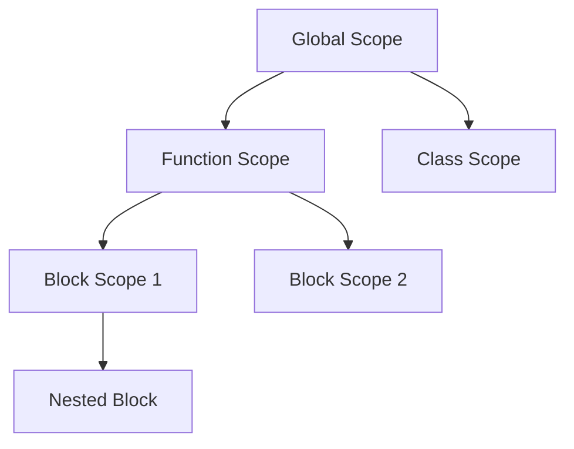
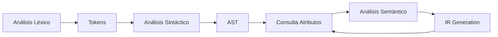

# Compiladores - Representaciones intermedias

## 5.6 Tablas de símbolos.

---

Las **tablas de símbolos** son estructuras de datos fundamentales en los compiladores que almacenan información sobre los identificadores utilizados en el programa fuente. Según Aho et al. (2007), "la tabla de símbolos es el componente que conecta las fases de análisis y síntesis del compilador".

### Definición Formal

**Definición:** Una tabla de símbolos es una estructura de datos que mantiene una correspondencia entre identificadores y sus atributos:

$$ \text{SymbolTable} : \text{Identifier} \rightarrow \text{Attributes} $$

**Propósito principal:** Proporcionar acceso eficiente a la información semántica de los identificadores durante la compilación.

### Estructura de una Entrada de Tabla de Símbolos

#### Atributos Básicos de un Símbolo

Cada entrada en la tabla de símbolos contiene:

$$ \text{SymbolEntry} = \lbrace \text{name}, \text{type}, \text{scope}, \text{memory\_location}, \text{flags}, \ldots \rbrace $$

#### Atributos Específicos por Tipo

**Para variables:**

- Tipo de dato
- Desplazamiento en memoria
- Dimensión (para arreglos)
- Clase de almacenamiento

**Para funciones:**

- Tipo de retorno
- Lista de parámetros
- Convención de llamada
- Número de parámetros

**Para tipos:**

- Estructura del tipo
- Tamaño en memoria
- Alineación

### Implementación de Tablas de Símbolos

#### Estructuras de Datos Comunes

**Hash Tables:** Proporcionan acceso $O(1)$ en promedio
**Árboles Binarios:** Mantienen orden lexicográfico
**Tablas Jerárquicas:** Para manejo de ámbitos

#### Implementación con Hash Table

```python
class SymbolTable:
    def __init__(self, parent=None):
        self.symbols = {}
        self.parent = parent  # Para scope nesting
        self.level = 0 if parent is None else parent.level + 1

    def insert(self, name, symbol_type, attributes=None):
        if name in self.symbols:
            raise ValueError(f"Symbol {name} already defined in this scope")

        symbol_entry = {
            'name': name,
            'type': symbol_type,
            'attributes': attributes or {},
            'level': self.level
        }
        self.symbols[name] = symbol_entry
        return symbol_entry

    def lookup(self, name, current_scope_only=False):
        # Buscar en scope actual
        if name in self.symbols:
            return self.symbols[name]

        # Buscar en scopes padres si está permitido
        if not current_scope_only and self.parent:
            return self.parent.lookup(name)

        return None  # Símbolo no encontrado

    def enter_scope(self):
        return SymbolTable(parent=self)

    def exit_scope(self):
        return self.parent if self.parent else self
```

### Manejo de Ámbitos (Scoping)

#### Modelo de Tablas Anidadas



#### Algoritmo de Búsqueda con Scope Nesting

$$ \text{lookup}(name) = \begin{cases}  \text{current\_scope}[name] & \text{if exists} \\\ \text{parent.lookup}(name) & \text{otherwise} \\\ \text{null} & \text{if not found in any scope} \end{cases} $$

### Tipos de Información Almacenada

#### Atributos para Diferentes Constructos

**Variable simple:**

```python
{
    'name': 'counter',
    'type': 'int',
    'size': 4,
    'offset': 16,
    'storage': 'auto'
}
```

**Arreglo:**

```python
{
    'name': 'matrix',
    'type': 'array',
    'base_type': 'float',
    'dimensions': [10, 10],
    'size': 400,
    'offset': 24
}
```

**Función:**

```python
{
    'name': 'calculate',
    'return_type': 'double',
    'parameters': [
        {'name': 'x', 'type': 'int'},
        {'name': 'y', 'type': 'float'}
    ],
    'local_vars': 3,
    'total_size': 32
}
```

### Operaciones sobre Tablas de Símbolos

#### Operaciones Básicas

1. **Insert(s, attributes):** Añade nuevo símbolo
2. **Lookup(s):** Busca símbolo en todos los ámbitos
3. **Delete(s):** Elimina símbolo del ámbito actual
4. **EnterScope():** Crea nuevo ámbito
5. **ExitScope():** Abandona ámbito actual

#### Complejidad Computacional

| Operación | Hash Table | Árbol Binario | Lista Enlazada |
| --------- | ---------- | ------------- | -------------- |
| Insert    | $O(1)$     | $O(\log n)$   | $O(n)$         |
| Lookup    | $O(1)$     | $O(\log n)$   | $O(n)$         |
| Delete    | $O(1)$     | $O(\log n)$   | $O(n)$         |

### Ejemplos Prácticos

#### Ejemplo 1: Programa Simple en C

**Código fuente:**

```c
int global = 10;

void function(int param) {
    int local = 20;
    {
        int nested = 30;
    }
}
```

**Tabla de símbolos resultante:**

```python
global_scope = {
    'global': {'type': 'int', 'offset': 0, 'storage': 'global'},
    'function': {'type': 'function', 'return_type': 'void'}
}

function_scope = {
    'param': {'type': 'int', 'offset': 0, 'storage': 'parameter'},
    'local': {'type': 'int', 'offset': 4, 'storage': 'auto'}
}

nested_scope = {
    'nested': {'type': 'int', 'offset': 8, 'storage': 'auto'}
}
```

#### Ejemplo 2: Manejo de Tipos Complejos

```c
struct Point {
    float x;
    float y;
};

Point centers[10];
```

**Entradas correspondientes:**

```python
# Entrada para el tipo struct
struct_entry = {
    'name': 'Point',
    'kind': 'struct',
    'fields': {
        'x': {'type': 'float', 'offset': 0},
        'y': {'type': 'float', 'offset': 4}
    },
    'size': 8
}

# Entrada para la variable
array_entry = {
    'name': 'centers',
    'type': 'array',
    'base_type': 'Point',
    'dimensions': [10],
    'size': 80,
    'offset': 16
}
```

### Integración con Representaciones Intermedias

#### Uso durante la Generación de Código

Las tablas de símbolos proporcionan información crítica para la generación de código intermedio:

```python
def generate_code_for_assignment(target, expression, symbol_table):
    target_info = symbol_table.lookup(target)
    expr_type = infer_type(expression, symbol_table)

    if target_info['type'] != expr_type:
        # Insertar conversión de tipo si es necesario
        temp = new_temp()
        emit_conversion(expr_type, target_info['type'], temp)
        emit_assignment(target, temp)
    else:
        emit_assignment(target, expression)
```

#### Resolución de Referencias Cruzadas



### Ejercicios Propuestos

#### Ejercicio 1: Diseño de Tabla de Símbolos

Diseñe la estructura de la tabla de símbolos para el siguiente código:

```c
const int MAX = 100;
float data[MAX];

void process(int count) {
    static int calls = 0;
    float temp[count];
    calls++;
}
```

#### Ejercicio 2: Implementación de Scope Nesting

Implemente una tabla de símbolos con nesting de ámbitos que soporte:

- Inserción y búsqueda en scope actual
- Búsqueda en scopes padres
- Manejo de shadowing de variables

#### Ejercicio 3: Resolución de Símbolos

Para el siguiente código, trace la búsqueda de símbolos:

```c
int x = 1;

void outer() {
    int x = 2;
    {
        int x = 3;
        printf("%d", x);
    }
}
```

#### Ejercicio 4: Tipos Complejos

Diseñe las entradas para:

```c
typedef struct {
    int id;
    char name[50];
    float scores[10];
} Student;

Student classroom[30];
```

#### Ejercicio 5: Optimización de Accesos

Proponga optimizaciones para acelerar las operaciones de:

- Búsqueda en scopes profundamente anidados
- Inserción masiva de símbolos
- Verificación de tipos en expresiones complejas

### Técnicas de Optimización

#### Caching de Búsquedas Frecuentes

```python
class OptimizedSymbolTable(SymbolTable):
    def __init__(self, parent=None):
        super().__init__(parent)
        self.cache = {}  # Cache para búsquedas frecuentes

    def lookup(self, name, current_scope_only=False):
        # Verificar cache primero
        cache_key = (name, current_scope_only)
        if cache_key in self.cache:
            return self.cache[cache_key]

        # Búsqueda normal
        result = super().lookup(name, current_scope_only)

        # Almacenar en cache si es frecuente
        if result and not current_scope_only:
            self.cache[cache_key] = result

        return result
```

#### Tablas de Símbolos Distribuidas

Para grandes codebases, usar múltiples tablas especializadas:

```python
class DistributedSymbolTable:
    def __init__(self):
        self.global_symbols = SymbolTable()
        self.function_symbols = {}  # Por función
        self.type_symbols = SymbolTable()  # Solo tipos
        self.constant_symbols = SymbolTable()  # Solo constantes
```

### Referencias Bibliográficas

#### Bibliografía Básica

1. **Aho, A. V., Lam, M. S., Sethi, R., & Ullman, J. D. (2007).** _Compilers: Principles, Techniques, and Tools_ (2nd ed.). Pearson Education. (Capítulo 2.7 - Symbol Tables)
2. **Cooper, K. D., & Torczon, L. (2004).** _Engineering a Compiler_. Morgan Kaufmann. (Capítulo 5 - Symbol Tables)

#### Bibliografía Complementaria

3. **Appel, A. W. (2002).** _Modern Compiler Implementation in Java_ (2nd ed.). Cambridge University Press. (Capítulo 5 - Semantic Analysis)
4. **Grune, D., et al. (2000).** _Modern Compiler Design_. John Wiley & Sons. (Capítulo 4 - Symbol Handling)

#### Recursos Adicionales

- GCC Symbol Table Implementation: https://gcc.gnu.org/onlinedocs/gccint/Symbols.html
- LLVM Symbol Table Design: https://llvm.org/docs/ProgrammersManual.html#the-symboltable-class
- "Efficient Symbol Table Organization" in Compiler Construction literature
