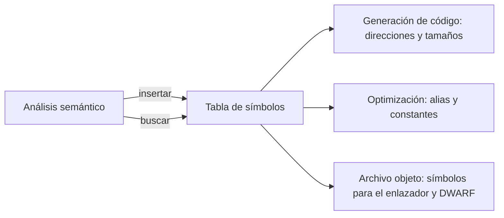

# Compiladores - Representaciones intermedias

## 5.6 Tablas de símbolos.

---

La **tabla de símbolos** es la estructura que acompaña a todas las representaciones intermedias: guarda lo que el compilador sabe de cada nombre del programa, su clase, su tipo, su ámbito, su almacenamiento y su dirección, para que cualquier fase lo consulte en tiempo constante. La construye el análisis semántico, la usan el generador de código intermedio y el *back-end*, y parte de ella termina en el archivo objeto como la tabla de símbolos del enlazador y la información de depuración. Este tema presenta qué se guarda, cómo se implementan las tablas y los ámbitos, cómo se representan los tipos compuestos con su disposición en memoria, y cómo hacer eficientes las operaciones, comparando cada respuesta con lo que hace gcc.

### Qué se guarda

| Atributo | Para qué sirve |
| -------- | -------------- |
| nombre | la clave de búsqueda; en C++ también el nombre **decorado** que ve el enlazador |
| clase | variable, constante, parámetro, función, tipo, campo, etiqueta |
| tipo | una expresión de tipo, con sus constructores: arreglos, registros, apuntadores, funciones |
| ámbito | dónde es visible el nombre |
| almacenamiento | estático, en la pila, en el montículo o en un registro; define la duración |
| dirección | desplazamiento en el registro de activación o etiqueta en el segmento de datos |
| tamaño y alineación | para calcular las direcciones de los campos y de los elementos |
| otros | valor de las constantes, número y tipos de los parámetros, si se toma la dirección, línea de la declaración |

El **ámbito** y la **duración** son independientes: una variable `static` local tiene ámbito de función pero duración de todo el programa.

### Implementación

La tabla debe insertar y buscar muy rápido, porque cada uso de un nombre implica una búsqueda. Las opciones son:

- **tabla de dispersión:** inserción y búsqueda en $O(1)$ **esperado**, con una buena función de dispersión y factor de carga acotado; en el peor caso, $O(n).$ Es la opción de casi todos los compiladores;
- **árbol de búsqueda balanceado:** $O(\log n)$ garantizado y recorrido en orden, útil para listados;
- **lista:** $O(n)$ por búsqueda; solo sirve para tablas pequeñas.

Para los **ámbitos anidados** hay dos esquemas:

1. **pila de tablas:** una tabla por ámbito; buscar recorre la pila del tope a la base, en $O(d)$ sondeos con $d$ niveles, y cerrar un ámbito es desapilar su tabla;
2. **tabla única con pilas por nombre:** una sola tabla de dispersión en la que cada nombre tiene la pila de sus declaraciones visibles, más una lista por ámbito de los nombres que declaró; buscar es un sondeo, y cerrar un ámbito desapila esas declaraciones, en tiempo proporcional a lo que declaró. Es el esquema clásico de los compiladores de un solo pase.

Insertar debe detectar la **redeclaración** en el mismo ámbito y puede advertir el **ocultamiento** de una declaración exterior.



### Tipos compuestos y disposición en memoria

Un registro guarda la lista de sus campos con su tipo y su **desplazamiento**, calculado con las reglas de **alineación** de la plataforma: cada campo empieza en un múltiplo de su alineación, y el tamaño total se redondea al múltiplo de la mayor alineación de sus campos, para que los elementos de un arreglo de registros también queden alineados. En x86-64, `int` y `float` ocupan 4 bytes y se alinean a 4, y `char` a 1. Un arreglo guarda su tipo de elemento y sus dimensiones; su tamaño es el producto, y la dirección de `a[i]` es $\text{base} + i \cdot \text{tamaño del elemento}.$ Un `typedef` agrega un nombre de la clase **tipo** que apunta a la misma expresión de tipo.

### Implementación en Python

El programa compila con gcc 13 el código del ejercicio 1 y lista los símbolos del objeto con `nm`; implementa los dos esquemas de ámbitos y comprueba que dan las mismas respuestas; traza la búsqueda del ejercicio 3 y la compara con la ejecución real; calcula la disposición del registro del ejercicio 4 y la verifica con `offsetof` y `sizeof`, y para el ejercicio 5 cuenta los sondeos de cada esquema y muestra el error de una caché de búsquedas sin invalidación.

```python
import os, re, subprocess, tempfile
TMP = tempfile.mkdtemp()
def compila_y_corre(fuente, nombre="p"):
    open(os.path.join(TMP, nombre + ".c"), "w").write(fuente)
    r = subprocess.run(["gcc", "-std=c11", "-O0", "-c", nombre + ".c", "-o", nombre + ".o"], cwd=TMP, capture_output=True, text=True,
                       env={**os.environ, "LC_ALL": "C"})
    return r

# ---------- Ejercicio 1: entradas de la tabla y lo que gcc pone en el objeto ----------
E1 = '''const int MAX = 100;
float data[MAX];
void process(int count) {
    static int calls = 0;
    float temp[count];
    temp[0] = 0;
    calls++;
}
'''
r = compila_y_corre(E1, "e1")
print("ejercicio 1: gcc:", re.sub(r"^\S+:\d+:\d+: ", "", r.stderr.strip().splitlines()[0]) if r.returncode else "compila")
E1b = E1.replace("const int MAX = 100;", "#define MAX 100\nconst int LIMITE = 100;")
compila_y_corre(E1b, "e1b")
nm = subprocess.run(["nm", "e1b.o"], cwd=TMP, capture_output=True, text=True).stdout
print("   símbolos definidos con #define MAX:", sorted(" ".join(l.split()[-2:]) for l in nm.splitlines() if l.split()[-2] != "U"))
TABLA1 = [("MAX", "constante", "const int", "global", "valor 100; en C no es una expresión constante entera"),
          ("data", "variable", "array(100, float)", "global", "400 bytes en .bss, estática"),
          ("process", "función", "int -> void", "global", "en .text"),
          ("count", "parámetro", "int", "process", "en el registro edi o la pila"),
          ("calls", "variable", "int", "process", "almacenamiento estático en .data o .bss; visible solo en process"),
          ("temp", "variable", "array(count, float)", "process", "tamaño en ejecución, 4 * count bytes en la pila")]
for e in TABLA1: print(f"   {e[0]:8} {e[1]:10} {e[2]:20} {e[3]:8} {e[4]}")

# ---------- Ejercicio 2: dos implementaciones de ámbitos anidados ----------
class PilaDeTablas:
    def __init__(self): self.pila = [{}]; self.sondeos = 0
    def entra(self): self.pila.append({})
    def sale(self): self.pila.pop()
    def inserta(self, n, info):
        if n in self.pila[-1]: return f"error: '{n}' ya declarado en este ámbito"
        aviso = f"aviso: '{n}' oculta una declaración exterior" if any(n in t for t in self.pila[:-1]) else None
        self.pila[-1][n] = info; return aviso
    def busca(self, n):
        for nivel in range(len(self.pila) - 1, -1, -1):
            self.sondeos += 1
            if n in self.pila[nivel]: return nivel, self.pila[nivel][n]
        return None
class TablaUnica:
    """Una sola tabla de dispersión; cada nombre tiene una pila de declaraciones, y cada ámbito la lista de lo que declaró."""
    def __init__(self): self.tabla, self.ambitos, self.sondeos = {}, [[]], 0
    def entra(self): self.ambitos.append([])
    def sale(self):
        for n in self.ambitos.pop():
            self.tabla[n].pop()
            if not self.tabla[n]: del self.tabla[n]
    def inserta(self, n, info):
        pila = self.tabla.setdefault(n, [])
        if pila and pila[-1][0] == len(self.ambitos) - 1: return f"error: '{n}' ya declarado en este ámbito"
        aviso = f"aviso: '{n}' oculta una declaración exterior" if pila else None
        pila.append((len(self.ambitos) - 1, info)); self.ambitos[-1].append(n); return aviso
    def busca(self, n):
        self.sondeos += 1
        return self.tabla[n][-1] if n in self.tabla else None
for T in (PilaDeTablas, TablaUnica):
    t = T(); res = [t.inserta("x", "int global"), t.inserta("y", "int global")]; t.entra()
    res += [t.inserta("x", "float local"), t.inserta("x", "char")]; dentro = (t.busca("x"), t.busca("y")); t.sale()
    print(f"ejercicio 2: {T.__name__:13} mensajes {[m for m in res if m]} | dentro: {dentro} | fuera: {t.busca('x')}")

# ---------- Ejercicio 3: traza de la búsqueda ----------
E3 = '''#include <stdio.h>
int x = 1;
void outer(void) {
    int x = 2;
    {
        int x = 3;
        printf("%d\\n", x);
    }
    printf("%d\\n", x);
}
int main(void) { outer(); printf("%d\\n", x); return 0; }
'''
open(os.path.join(TMP, "e3.c"), "w").write(E3)
subprocess.run(["gcc", "-o", "e3", "e3.c"], cwd=TMP)
salida = subprocess.run(["./e3"], cwd=TMP, capture_output=True, text=True).stdout.split()
t = PilaDeTablas(); t.inserta("x", "int, valor 1"); t.inserta("outer", "función"); t.entra(); t.inserta("x", "int, valor 2"); t.entra(); t.inserta("x", "int, valor 3")
nombres = ["global", "outer", "bloque"]
traza = [f"nivel {k} ({nombres[k]}): {'encontrado ' + t.pila[k]['x'] if 'x' in t.pila[k] else 'no está'}" for k in range(len(t.pila) - 1, -1, -1)]
print("ejercicio 3: búsqueda de x en el printf interior:", traza[0], "| se detiene en el primer nivel")
print("   gcc imprime:", salida, "| todas las declaraciones en la pila:", [k for k in range(3) if "x" in t.pila[k]])

# ---------- Ejercicio 4: tipos compuestos, desplazamientos y alineación ----------
TAM = {"int": (4, 4), "char": (1, 1), "float": (4, 4)}
def disposicion(campos):
    desp, alin_max, res = 0, 1, []
    for nombre, tipo, n in campos:
        tam, alin = TAM[tipo]
        desp = (desp + alin - 1) // alin * alin; res.append((nombre, desp, tam * n)); desp += tam * n; alin_max = max(alin_max, alin)
    total = (desp + alin_max - 1) // alin_max * alin_max
    return res, total, alin_max
campos, total, alin = disposicion([("id", "int", 1), ("name", "char", 50), ("scores", "float", 10)])
print("ejercicio 4: Student:", campos, f"tamaño {total}, alineación {alin}; classroom: {30 * total} bytes")
E4 = '''#include <stdio.h>
#include <stddef.h>
typedef struct { int id; char name[50]; float scores[10]; } Student;
Student classroom[30];
int main(void) { printf("%zu %zu %zu %zu %zu\\n", offsetof(Student, id), offsetof(Student, name), offsetof(Student, scores), sizeof(Student), sizeof classroom); return 0; }
'''
open(os.path.join(TMP, "e4.c"), "w").write(E4); subprocess.run(["gcc", "-o", "e4", "e4.c"], cwd=TMP)
print("   gcc en x86-64: id, name, scores, sizeof, sizeof classroom =", subprocess.run(["./e4"], cwd=TMP, capture_output=True, text=True).stdout.split())

# ---------- Ejercicio 5: costo de las búsquedas, caché y su invalidación ----------
for T in (PilaDeTablas, TablaUnica):
    t = T(); t.inserta("g", "global")
    for _ in range(50): t.entra()
    for _ in range(1000): t.busca("g")
    print(f"ejercicio 5: {T.__name__:13} 1000 búsquedas de un global con 50 ámbitos abiertos: {t.sondeos} sondeos")
class ConCache(PilaDeTablas):
    def __init__(self, invalida): super().__init__(); self.cache, self.invalida = {}, invalida
    def inserta(self, n, info):
        if self.invalida: self.cache.pop(n, None)
        return super().inserta(n, info)
    def sale(self):
        if self.invalida: self.cache.clear()
        super().sale()
    def busca(self, n):
        if n not in self.cache: self.cache[n] = super().busca(n)
        return self.cache[n]
for invalida in (False, True):
    t = ConCache(invalida); t.inserta("x", "global"); t.entra(); antes = t.busca("x"); t.inserta("x", "local"); despues = t.busca("x")
    print(f"   caché {'con' if invalida else 'sin'} invalidación: antes {antes}, después de declarar una x local {despues}")
```

Salida, con gcc 13 en x86-64:

```text
ejercicio 1: gcc: error: variably modified 'data' at file scope
   símbolos definidos con #define MAX: ['B data', 'R LIMITE', 'T process', 'b calls.0']
   MAX      constante  const int            global   valor 100; en C no es una expresión constante entera
   data     variable   array(100, float)    global   400 bytes en .bss, estática
   process  función    int -> void          global   en .text
   count    parámetro  int                  process  en el registro edi o la pila
   calls    variable   int                  process  almacenamiento estático en .data o .bss; visible solo en process
   temp     variable   array(count, float)  process  tamaño en ejecución, 4 * count bytes en la pila
ejercicio 2: PilaDeTablas  mensajes ["aviso: 'x' oculta una declaración exterior", "error: 'x' ya declarado en este ámbito"] | dentro: ((1, 'float local'), (0, 'int global')) | fuera: (0, 'int global')
ejercicio 2: TablaUnica    mensajes ["aviso: 'x' oculta una declaración exterior", "error: 'x' ya declarado en este ámbito"] | dentro: ((1, 'float local'), (0, 'int global')) | fuera: (0, 'int global')
ejercicio 3: búsqueda de x en el printf interior: nivel 2 (bloque): encontrado int, valor 3 | se detiene en el primer nivel
   gcc imprime: ['3', '2', '1'] | todas las declaraciones en la pila: [0, 1, 2]
ejercicio 4: Student: [('id', 0, 4), ('name', 4, 50), ('scores', 56, 40)] tamaño 96, alineación 4; classroom: 2880 bytes
   gcc en x86-64: id, name, scores, sizeof, sizeof classroom = ['0', '4', '56', '96', '2880']
ejercicio 5: PilaDeTablas  1000 búsquedas de un global con 50 ámbitos abiertos: 51000 sondeos
ejercicio 5: TablaUnica    1000 búsquedas de un global con 50 ámbitos abiertos: 1000 sondeos
   caché sin invalidación: antes (0, 'global'), después de declarar una x local (0, 'global')
   caché con invalidación: antes (0, 'global'), después de declarar una x local (1, 'local')
```

### Ejercicios Propuestos

1. **Diseño.** Diseña la estructura de la tabla de símbolos para el código:

    ```c
    const int MAX = 100;
    float data[MAX];
    void process(int count) {
        static int calls = 0;
        float temp[count];
        calls++;
    }
    ```

2. **Ámbitos anidados.** Implementa una tabla de símbolos con ámbitos anidados que permita insertar y buscar en el ámbito actual, buscar en los ámbitos exteriores y manejar el ocultamiento de variables.

3. **Resolución.** Traza la búsqueda de los símbolos en el código:

    ```c
    int x = 1;
    void outer() {
        int x = 2;
        {
            int x = 3;
            printf("%d", x);
        }
    }
    ```

4. **Tipos compuestos.** Diseña las entradas para:

    ```c
    typedef struct {
        int id;
        char name[50];
        float scores[10];
    } Student;
    Student classroom[30];
    ```

5. **Optimización.** Propón optimizaciones para la búsqueda en ámbitos profundamente anidados, la inserción masiva de símbolos y la verificación de tipos en expresiones complejas.

### Soluciones

**Ejercicio 1.** Primero, el código **no es C válido**: en C, una variable `const int` no es una expresión constante entera, así que `float data[MAX]` en el ámbito global sería un arreglo de tamaño variable, que solo se permite en ámbitos de bloque; gcc lo rechaza con "variably modified 'data' at file scope". En C++ sí es válido, y en C se escribe `#define MAX 100` o `enum { MAX = 100 }`. Con esa corrección, las entradas son las de la tabla del programa: `MAX` como constante, que con `#define` ni siquiera llega a la tabla de símbolos; `data` como arreglo global de 100 `float`, 400 bytes en `.bss`, porque no tiene inicializador; `process` como función $\text{int} \to \text{void};$ `count` como parámetro; `calls` con ámbito de `process` pero **almacenamiento estático**, y `temp` como arreglo de tamaño variable, que se reserva en la pila al ejecutar. `nm` confirma la distinción entre ámbito y duración: `data` aparece como símbolo global en `.bss`, `B`; `process` en `.text`, `T`; una constante global con valor, como `LIMITE`, en `.rodata`, `R`, y `calls` como símbolo **local** del objeto, `b`, con un nombre cambiado, `calls.0`, para que no choque con otra `calls` estática de otra función. `count` y `temp` no aparecen, porque viven en la pila.

**Ejercicio 2.** Las dos implementaciones del programa, la pila de tablas y la tabla única con pilas por nombre, dan las mismas respuestas: al declarar `x` dentro del bloque advierten que oculta a la global; al declararla otra vez en el mismo bloque reportan el error; dentro del bloque, `x` es la local y `y` la global, y al salir, `x` vuelve a ser la global.

**Ejercicio 3.** Al llegar al `printf` interior hay tres ámbitos abiertos, el global con `x = 1`, el de `outer` con `x = 2` y el del bloque con `x = 3`. La búsqueda empieza en el ámbito del bloque, encuentra `x` y **se detiene**: no consulta los otros dos. El programa imprime 3. Si se agrega un `printf` después del bloque, el ámbito interior ya se cerró y se imprime 2, y desde `main`, 1, como confirma la ejecución real.

**Ejercicio 4.** Hay tres entradas. El tipo, `Student`, de clase **tipo**, con una expresión de registro sin etiqueta y sus campos: `id`, `int`, desplazamiento 0; `name`, arreglo de 50 `char`, desplazamiento 4, y `scores`, arreglo de 10 `float`, desplazamiento **56**, no 54, porque un `float` se alinea a 4 y se agregan 2 bytes de relleno. El tamaño es 96 bytes, con alineación 4. La variable `classroom` es un arreglo de 30 `Student`, de 2 880 bytes, y la dirección de `classroom[i].scores[j]` es $\text{base} + 96 i + 56 + 4 j.$ gcc da exactamente esos desplazamientos y tamaños.

**Ejercicio 5.** Para la **búsqueda profunda**, la tabla única con pilas por nombre hace un solo sondeo por búsqueda, contra uno por nivel de la pila de tablas: con 50 ámbitos abiertos, 1 000 búsquedas de un global cuestan 1 000 sondeos en lugar de 51 000. Una **caché** de búsquedas también ayuda, pero debe **invalidarse** al declarar un nombre que la caché contiene y al cerrar un ámbito: sin invalidación, después de declarar una `x` local, la caché sigue devolviendo la global, un error de resolución. Para la **inserción masiva**, conviene reservar la tabla con el tamaño esperado, para evitar redimensionarla varias veces, e **internar** las cadenas de los nombres al analizarlas, de modo que la tabla compare apuntadores y no cadenas. Para la **verificación de tipos**, conviene representar los tipos de forma **canónica**, construyendo cada expresión de tipo una sola vez con numeración de valores, de modo que la equivalencia estructural sea una comparación de apuntadores, y guardar en cada nodo del árbol el tipo ya calculado para no recalcularlo.

En el material original, el ejemplo de tipos compuestos declaraba `Point centers[10];`, que en C requiere `struct Point` o un `typedef`; la caché de búsquedas nunca se invalidaba, con el error que muestra el programa; la tabla de complejidad daba $O(1)$ a la tabla de dispersión sin aclarar que es el caso esperado y $O(\log n)$ al árbol sin aclarar que debe estar balanceado, y el texto usaba palabras en inglés como "scope nesting" y "codebases".

### Referencias

1. Cooper, K. D., and Torczon, L., _Engineering a Compiler_. 3a ed., Morgan Kaufmann, 2022. Sección 5.5.
2. Aho, A. V., Lam, M. S., Sethi, R., and Ullman, J. D., _Compilers: Principles, Techniques, and Tools_. 2a ed., Pearson, 2007. Secciones 2.7 y 6.3.
3. ISO/IEC 9899:2018, _Programming languages — C_. Secciones 6.6, expresiones constantes, y 6.7.6.2, arreglos de tamaño variable.
4. Matz, M., Hubička, J., Jaeger, A., and Mitchell, M., _System V Application Binary Interface, AMD64 Architecture Processor Supplement_. Sección 3.1, tipos y alineación.
5. Fischer, C. N., Cytron, R. K., and LeBlanc, R. J., _Crafting a Compiler_. Pearson, 2010. Capítulo 8.
