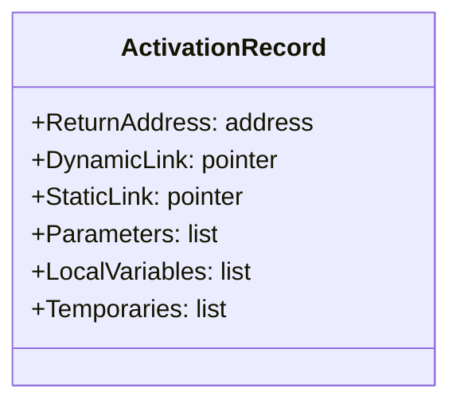

# Compiladores - La abstracción de procedimiento

## 6.1 Aspectos importantes.

---

La abstracción de procedimiento es un concepto fundamental en el diseño de compiladores que permite encapsular fragmentos de código reutilizables. Esta guía se enfoca en los aspectos importantes de esta abstracción, cruciales para la implementación eficiente de lenguajes de programación.

### Definición de Abstracción de Procedimiento

La abstracción de procedimiento es un mecanismo que permite agrupar un conjunto de instrucciones bajo un nombre único, facilitando su reutilización y organización. Según Aho et al. (2007), "un procedimiento es una abstracción que encapsula una secuencia de acciones que pueden ser invocadas desde múltiples puntos en un programa".

### Aspectos Importantes de la Abstracción de Procedimiento

#### Gestión de Memoria y Activación de Procedimientos

Cada invocación a un procedimiento requiere la creación de un registro de activación (stack frame) que contiene:

- Parámetros formales
- Variables locales
- Dirección de retorno
- Valor de retorno (para funciones)
- Enlace de control (puntero al frame del llamador)

El registro de activación se puede representar como:

$$ \text{FrameSize} = \text{Params} + \text{Locals} + \text{ControlLinks} + \text{ReturnInfo} $$

#### Convenciones de Llamada

Las convenciones de llamada (calling conventions) definen cómo se pasan los parámetros y se gestiona la pila:

```assembly
; Ejemplo de convención cdecl en x86
push param3
push param2
push param1
call procedure
add esp, 12  ; Limpiar parámetros de la pila
```

#### Paso de Parámetros

Existen varios métodos para pasar parámetros:

1. **Por valor**: Se pasa una copia del valor
2. **Por referencia**: Se pasa la dirección del dato
3. **Por nombre**: Se pasa una expresión sin evaluar (thunk)
4. **Por resultado**: El parámetro se usa solo para retornar valores

#### Ámbito y Visibilidad

Los procedimientos crean nuevos ámbitos léxicos. La resolución de referencias sigue reglas de scoping:

- **Scoping estático**: Las referencias se resuelven según la estructura del código
- **Scoping dinámico**: Las referencias se resuelven según el flujo de ejecución

### Implementación de Procedimientos

#### Estructura del Registro de Activación



#### Código de Ejemplo: Generación de Código para Llamadas

```c
// Ejemplo en C
int suma(int a, int b) {
    int resultado = a + b;
    return resultado;
}

int main() {
    int x = 5, y = 3;
    int z = suma(x, y);
    return 0;
}
```

El compilador genera código para gestionar los registros de activación:

```assembly
; Pseudocódigo assembly para la llamada
main:
    push y          ; Segundo parámetro
    push x          ; Primer parámetro
    call suma       ; Llamada al procedimiento
    add esp, 8      ; Limpiar parámetros
    mov z, eax      ; Guardar resultado

suma:
    push ebp        ; Guardar frame pointer anterior
    mov ebp, esp    ; Establecer nuevo frame pointer
    sub esp, 4      ; Espacio para variable local 'resultado'
    mov eax, [ebp+8]; Cargar parámetro a
    add eax, [ebp+12]; Sumar parámetro b
    mov [ebp-4], eax; Guardar en variable local
    mov eax, [ebp-4]; Preparar valor de retorno
    mov esp, ebp    ; Restaurar stack pointer
    pop ebp         ; Restaurar frame pointer
    ret             ; Retornar
```

#### Fórmulas para Cálculo de Desplazamientos

Los desplazamientos dentro del registro de activación se calculan como:

$$ \text{Desplazamiento}\_{\text{param\_i}} = \text{FP} + 4 + 4 \times i $$

$$ \text{Desplazamiento}\_{\text{local\_j}} = \text{FP} - 4 - 4 \times j $$

Donde FP es el frame pointer y asumimos palabras de 4 bytes.

### Ejercicios Propuestos

1. **Análisis de Registros de Activación**: Dado el siguiente código, dibuje la pila de ejecución en el punto marcado:

```pascal
procedure A(x: integer);
var y: integer;
    procedure B(z: integer);
    var w: integer;
    begin
        w := x + y + z;  // Punto de análisis
    end;
begin
    y := 2;
    B(3);
end;
```

2. **Generación de Código**: Escriba el código assembly para una función recursiva que calcule el factorial de un número, mostrando cómo se gestionan las llamadas recursivas.

3. **Scoping Estático vs. Dinámico**: Analice el siguiente código y determine la salida bajo scoping estático y dinámico:

```python
x = 10
def exterior():
    x = 20
    def interior():
        print(x)
    interior()
exterior()
```

4. **Optimización de Cola**: Transforme la siguiente función recursiva a una forma tail-recursive y explique cómo esto afecta el uso de la pila:

```scheme
(define (suma-lista lst)
  (if (null? lst)
      0
      (+ (car lst) (suma-lista (cdr lst)))))
```

### Técnicas de Optimización

#### Inline Expansion

Sustitución de la llamada a procedimiento por el cuerpo del mismo:

$$ \text{Costo}\_{\text{llamada}} > \text{Beneficio}\_{\text{inline}} $$

#### Tail Call Optimization

Reutilización del frame actual para llamadas en posición de cola:

```scheme
; Antes de optimización
(define (factorial n)
  (if (= n 0)
      1
      (* n (factorial (- n 1)))))

; Después de optimización (tail-recursive)
(define (factorial n acc)
  (if (= n 0)
      acc
      (factorial (- n 1) (* n acc))))
```

### Referencias

#### Bibliografía Básica

1. Aho, A. V., Lam, M. S., Sethi, R., & Ullman, J. D. (2007). Compilers: Principles, Techniques, and Tools (2nd ed.). Pearson Education. (Capítulo 7: Run-Time Environments)

2. Cooper, K. D., & Torczon, L. (2004). Engineering a Compiler. Morgan Kaufmann. (Capítulo 6: Procedure Abstraction)

3. Scott, M. L. (2009). Programming Language Pragmatics. Morgan Kaufmann. (Capítulo 3: Names, Scopes, and Bindings)

#### Bibliografía Complementaria

1. Grune, D., Bal, H. E., Jacobs, C. J. H., & Langendoen, K. G. (2000). Modern Compiler Design. John Wiley & Sons. (Capítulo 7: Procedures and Functions)

2. Wilhelm, R., & Maurer, D. (1995). Compiler Design. Addison-Wesley. (Capítulo 7: Runtime Organization)

### Conclusión

La abstracción de procedimiento es esencial en el diseño de compiladores, requiriendo una cuidadosa gestión de la memoria, convenciones de llamada y mecanismos de paso de parámetros. Su implementación eficiente impacta directamente en el rendimiento de los programas compilados y permite optimizaciones significativas como la expansión inline y la optimización de llamadas en cola.

### Recursos Adicionales

- [Compilers: Principles, Techniques, and Tools (Dragon Book) Companion Site](https://www.pearson.com/us/higher-education/program/Aho-Compilers-Principles-Techniques-and-Tools-2nd-Edition/PGM167067.html)
- [Engineering a Compiler Resources](https://www.cs.rice.edu/~keith/Errata.html)
- [Modern Compiler Design Implementation](https://www.cs.vu.nl/~dick/MCD.html)
