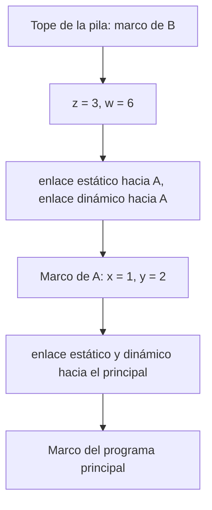

# Compiladores - La abstracción de procedimiento

## 6.1 Aspectos importantes.

---

El **procedimiento** es la abstracción central de los lenguajes de programación: permite escribir un fragmento una vez y usarlo muchas veces, con sus propios nombres, sin conocer el código que lo llama. Para el compilador, esa abstracción tiene tres caras que debe implementar: la **abstracción de control**, llamar y regresar al punto correcto; el **espacio de nombres**, que cada invocación tenga sus propias variables y vea las del ámbito correcto, y la **interfaz externa**, que procedimientos compilados por separado, incluso en otros lenguajes, puedan llamarse entre sí. Este tema presenta esos aspectos, el registro de activación, el alcance estático y dinámico y la recursión, con un simulador de registros de activación y el código que genera gcc.

### Tres funciones de un procedimiento

1. **Control:** la llamada transfiere el control al procedimiento y guarda la **dirección de retorno**; el retorno regresa a ella. Como las llamadas se anidan en orden de pila, la última en empezar es la primera en terminar, y basta una **pila** para gestionarlas.
2. **Nombres:** cada **activación** tiene su propio espacio para sus parámetros y variables locales, de modo que la recursión funciona; además, el procedimiento puede ver nombres de los ámbitos que lo rodean.
3. **Interfaz:** una **convención de llamada** fija dónde van los argumentos, quién guarda qué registros y dónde queda el valor de retorno, para que el que llama y el llamado, compilados por separado, se entiendan.

### El registro de activación

Cada activación tiene un **registro de activación**, o marco, en la pila, con:

| Campo | Contenido |
| ----- | --------- |
| parámetros | los argumentos, si no van en registros |
| dirección de retorno | dónde continuar en el que llama |
| enlace dinámico | el marco del que llama, para restaurarlo al regresar |
| enlace estático o *display* | el marco del ámbito léxico que lo contiene, en lenguajes con procedimientos anidados |
| registros guardados | los que el procedimiento usa y debe preservar |
| variables locales y temporales | los datos de esta activación |

El código de la llamada se divide en cuatro partes: la **secuencia previa** del que llama, que evalúa y coloca los argumentos y salta; el **prólogo** del llamado, que crea su marco; el **epílogo**, que lo destruye y regresa, y la **secuencia posterior** del que llama, que recoge el resultado.



### Alcance estático y dinámico

Con **alcance estático**, o léxico, un nombre se refiere a la declaración del bloque más interno que lo **contiene en el texto**; se resuelve al compilar, y en ejecución se sigue el **enlace estático**, que apunta al marco del procedimiento que contiene textualmente al actual. Con **alcance dinámico**, se refiere a la declaración más reciente **en ejecución**, y se sigue el enlace dinámico. Casi todos los lenguajes actuales usan alcance estático; el dinámico sobrevive en bash, en las variables especiales de Common Lisp y en Emacs Lisp por omisión.

### Recursión y llamadas de cola

Una llamada está en **posición de cola** si su resultado es el resultado del que llama, sin más cálculos después. El marco del que llama ya no se necesita, y la llamada puede **reutilizarlo**: es un salto, no una llamada, y la recursión de cola usa espacio constante. Scheme exige esta optimización; C y C++ la permiten y gcc y Clang la aplican con optimización, y Python y Java no la hacen. Una recursión que no es de cola, como $n \cdot f(n - 1),$ puede transformarse en una de cola con un **acumulador**, cuando la operación pendiente es asociativa.

### Implementación en Python

El programa implementa un simulador de procedimientos con registros de activación, enlaces estáticos y dinámicos, y búsqueda de nombres con alcance estático o dinámico, que se reutiliza en el capítulo. Con él resuelve los ejercicios 1 y 3, y compara el ejercicio 3 con Python y bash reales; para los ejercicios 2 y 4 compila con gcc 13 y analiza el ensamblador generado.

```python
# ===== Núcleo de procedimientos: registros de activación con enlaces estáticos y dinámicos, y utilidades para gcc =====
import os, re, subprocess, tempfile

class Proc:
    """Un procedimiento con parámetros, variables locales, procedimientos anidados y un cuerpo de sentencias:
    ('asig', x, e) ('llama', f, [args]) ('imprime', e) ('punto', etiqueta) ('si', e, [then], [else]) ('ret', e)
    Las expresiones son enteros, nombres o tuplas (op, a, b)."""
    def __init__(self, nombre, params=(), locales=(), anidados=(), cuerpo=()):
        self.nombre, self.params, self.locales, self.anidados, self.cuerpo = nombre, list(params), list(locales), list(anidados), list(cuerpo)
        self.padre = None
        for p in self.anidados: p.padre = self
    def nivel(self): return 0 if self.padre is None else self.padre.nivel() + 1

class Retorno(Exception):
    def __init__(self, v): self.v = v

class Maquina:
    def __init__(self, principal, alcance="estatico"):
        self.principal, self.alcance = principal, alcance
        self.pila, self.salida, self.fotos, self.max_prof, self.recorridos = [], [], {}, 0, []
    # --- registros de activación ---
    def activa(self, proc, args, enlace_estatico):
        marco = {"proc": proc, "vars": dict(zip(proc.params, args)), "ed": len(self.pila) - 1 if self.pila else None, "ee": enlace_estatico}
        for v in proc.locales: marco["vars"].setdefault(v, None)
        self.pila.append(marco); self.max_prof = max(self.max_prof, len(self.pila))
    def busca_marco(self, nombre):
        """Alcance estático: sigue los enlaces estáticos; dinámico: sigue los dinámicos. Cuenta los saltos."""
        k = len(self.pila) - 1; saltos = 0
        while k is not None:
            if nombre in self.pila[k]["vars"]: self.recorridos.append((nombre, saltos)); return k
            k = self.pila[k]["ee"] if self.alcance == "estatico" else self.pila[k]["ed"]; saltos += 1
        raise NameError(nombre)
    def valor(self, e):
        if isinstance(e, int): return e
        if isinstance(e, str): return self.pila[self.busca_marco(e)]["vars"][e]
        op, a, b = e; x, y = self.valor(a), self.valor(b)
        return {"+": x + y, "-": x - y, "*": x * y, "/": x // y, "<": int(x < y), "<=": int(x <= y), "==": int(x == y), ">": int(x > y)}[op]
    def procedimiento(self, nombre):
        """El nombre del procedimiento se resuelve léxicamente: devuelve el procedimiento y el marco de su padre."""
        k = len(self.pila) - 1
        while k is not None:
            p = self.pila[k]["proc"]
            for h in p.anidados:
                if h.nombre == nombre: return h, k
            if p.nombre == nombre and self.pila[k]["ee"] is not None:
                return p, self.pila[k]["ee"]
            k = self.pila[k]["ee"]
        raise NameError(nombre)
    def llama(self, nombre, args):
        proc, padre = self.procedimiento(nombre)
        self.activa(proc, [self.valor(a) for a in args], padre)
        try: self.ejecuta(proc.cuerpo); r = None
        except Retorno as ret: r = ret.v
        self.pila.pop(); return r
    def ejecuta(self, sentencias):
        for s in sentencias:
            k = s[0]
            if k == "asig": self.pila[self.busca_marco(s[1])]["vars"][s[1]] = self.valor(s[2])
            elif k == "llama": self.llama(s[1], s[2])
            elif k == "imprime": self.salida.append(self.valor(s[1]))
            elif k == "punto": self.fotos[s[1]] = self.foto()
            elif k == "si": self.ejecuta(s[2] if self.valor(s[1]) else s[3])
            elif k == "ret": raise Retorno(self.valor(s[1]))
            elif k == "asigllama": self.pila[self.busca_marco(s[1])]["vars"][s[1]] = self.llama(s[2], s[3])
    def corre(self, args=()):
        self.activa(self.principal, list(args), None); self.ejecuta(self.principal.cuerpo); return self
    def foto(self):
        lineas = []
        for k in range(len(self.pila) - 1, -1, -1):
            m = self.pila[k]
            ee = "-" if m["ee"] is None else self.pila[m["ee"]]["proc"].nombre
            ed = "-" if m["ed"] is None else self.pila[m["ed"]]["proc"].nombre
            lineas.append(f"{m['proc'].nombre}: {m['vars']}, enlace estático -> {ee}, enlace dinámico -> {ed}")
        return lineas

# ---------- gcc: compilar, extraer el ensamblador de una función y ejecutar ----------
TMP = tempfile.mkdtemp()
ENV = {**os.environ, "LC_ALL": "C"}
def ensamblador(fuente, opt="-O0", extra=()):
    ruta = os.path.join(TMP, "f.c"); open(ruta, "w").write(fuente)
    r = subprocess.run(["gcc", opt, "-S", "-masm=intel", "-fno-asynchronous-unwind-tables", "-fcf-protection=none", "-fno-stack-protector",
                        *extra, "-o", "-", "f.c"], cwd=TMP, capture_output=True, text=True, env=ENV)
    if r.returncode: raise RuntimeError(r.stderr)
    return r.stdout
def funcion(asm, nombre):
    """Las instrucciones de una función, sin directivas, con los espacios normalizados."""
    lineas, dentro = [], False
    for l in asm.splitlines():
        if re.match(rf"^{re.escape(nombre)}:", l): dentro = True; continue
        if dentro:
            if re.match(r"^\s*\.(size|cfi_endproc)", l) or (re.match(r"^[A-Za-z_]\w*:", l)): break
            if re.match(r"^\s*\.", l) and not re.match(r"^\.L\w+:", l): continue
            lineas.append(" ".join(l.split()))
    return [l for l in lineas if l]
def ejecuta_c(fuente, entrada=None, opt="-O2", extra=()):
    ruta = os.path.join(TMP, "p.c"); open(ruta, "w").write(fuente)
    r = subprocess.run(["gcc", opt, *extra, "-o", "p", "p.c"], cwd=TMP, capture_output=True, text=True, env=ENV)
    if r.returncode: raise RuntimeError(r.stderr)
    return subprocess.run(["./p"], cwd=TMP, input=entrada, capture_output=True, text=True).stdout
def n_instrucciones(f): return sum(1 for l in f if not l.endswith(":"))

# ---------- Ejercicio 1: la pila en el punto de análisis ----------
B = Proc("B", ["z"], ["w"], cuerpo=[("asig", "w", ("+", ("+", "x", "y"), "z")), ("punto", "análisis")])
A = Proc("A", ["x"], ["y"], [B], [("asig", "y", 2), ("llama", "B", [3])])
PRINCIPAL = Proc("principal", anidados=[A], cuerpo=[("llama", "A", [1])])
m = Maquina(PRINCIPAL).corre()
print("ejercicio 1: pila en el punto de análisis, del tope a la base, con A(1):"); [print("   ", l) for l in m.fotos["análisis"]]
print("   saltos por los enlaces estáticos para cada nombre de w := x + y + z:", m.recorridos[1:5])

# ---------- Ejercicio 2: factorial recursivo en ensamblador ----------
FACT = "long fact(long n) { if (n <= 1) return 1; return n * fact(n - 1); }"
for opt in ("-O0", "-O2"):
    f = funcion(ensamblador(FACT, opt), "fact")
    print(f"ejercicio 2: gcc {opt}: {n_instrucciones(f)} instrucciones, llamadas recursivas: {sum('call' in l for l in f)}"); print("   " + " | ".join(f))
print("   fact(20) =", ejecuta_c(FACT + '\n#include <stdio.h>\nint main(void) { printf("%ld\\n", fact(20)); return 0; }', opt="-O0").strip())

# ---------- Ejercicio 3: alcance estático contra dinámico ----------
def programa(variante):
    interior = Proc("interior", cuerpo=[("imprime", "x")])
    if variante == "enunciado":
        exterior = Proc("exterior", locales=["x"], anidados=[interior], cuerpo=[("asig", "x", 20), ("llama", "interior", [])])
        return Proc("principal", locales=["x"], anidados=[exterior], cuerpo=[("asig", "x", 10), ("llama", "exterior", [])])
    exterior = Proc("exterior", locales=["x"], cuerpo=[("asig", "x", 20), ("llama", "interior", [])])
    return Proc("principal", locales=["x"], anidados=[interior, exterior], cuerpo=[("asig", "x", 10), ("llama", "exterior", [])])
for variante in ("enunciado", "interior fuera de exterior"):
    res = {a: Maquina(programa(variante), a).corre().salida for a in ("estatico", "dinamico")}
    print(f"ejercicio 3: {variante:28} estático {res['estatico']}, dinámico {res['dinamico']}")
PY = "x = 10\ndef interior():\n    print(x)\ndef exterior():\n    x = 20\n    interior()\nexterior()\n"
BASH = "x=10\ninterior() { echo $x; }\nexterior() { local x=20; interior; }\nexterior\n"
py = subprocess.run(["python3", "-c", PY], capture_output=True, text=True).stdout.strip()
sh = subprocess.run(["bash", "-c", BASH], capture_output=True, text=True).stdout.strip()
print(f"   la segunda variante en Python, de alcance estático: {py}; en bash, de alcance dinámico: {sh}")

# ---------- Ejercicio 4: recursión de cola ----------
SUMA = """struct nodo { int v; struct nodo *sig; };
int suma(struct nodo *l) { return l == 0 ? 0 : l->v + suma(l->sig); }
int suma_ac(struct nodo *l, int ac) { return l == 0 ? ac : suma_ac(l->sig, ac + l->v); }
"""
for opt in ("-O1", "-O2"):
    asm = ensamblador(SUMA, opt)
    print(f"ejercicio 4: gcc {opt}: llamadas en suma {sum('call' in l for l in funcion(asm, 'suma'))}, en suma_ac {sum('call' in l for l in funcion(asm, 'suma_ac'))}")
print("   suma_ac con -O2:", " | ".join(funcion(ensamblador(SUMA, "-O2"), "suma_ac")))
import sys
def suma_lista(l): return 0 if not l else l[0] + suma_lista(l[1:])
def suma_cola(l, ac=0): return ac if not l else suma_cola(l[1:], ac + l[0])
for f in (suma_lista, suma_cola):
    try: f(list(range(5000))); r = "bien"
    except RecursionError: r = "RecursionError"
    print(f"   Python, {f.__name__} con 5000 elementos y límite {sys.getrecursionlimit()}: {r}")
```

Salida, con gcc 13 en x86-64:

```text
ejercicio 1: pila en el punto de análisis, del tope a la base, con A(1):
    B: {'z': 3, 'w': 6}, enlace estático -> A, enlace dinámico -> A
    A: {'x': 1, 'y': 2}, enlace estático -> principal, enlace dinámico -> principal
    principal: {}, enlace estático -> -, enlace dinámico -> -
   saltos por los enlaces estáticos para cada nombre de w := x + y + z: [('x', 1), ('y', 1), ('z', 0), ('w', 0)]
ejercicio 2: gcc -O0: 15 instrucciones, llamadas recursivas: 1
   push rbp | mov rbp, rsp | sub rsp, 16 | mov QWORD PTR -8[rbp], rdi | cmp QWORD PTR -8[rbp], 1 | jg .L2 | mov eax, 1 | jmp .L3 | .L2: | mov rax, QWORD PTR -8[rbp] | sub rax, 1 | mov rdi, rax | call fact | imul rax, QWORD PTR -8[rbp] | .L3: | leave | ret
ejercicio 2: gcc -O2: 9 instrucciones, llamadas recursivas: 0
   mov eax, 1 | cmp rdi, 1 | jle .L1 | .L2: | mov rdx, rdi | sub rdi, 1 | imul rax, rdx | cmp rdi, 1 | jne .L2 | .L1: | ret
   fact(20) = 2432902008176640000
ejercicio 3: enunciado                    estático [20], dinámico [20]
ejercicio 3: interior fuera de exterior   estático [10], dinámico [20]
   la segunda variante en Python, de alcance estático: 10; en bash, de alcance dinámico: 20
ejercicio 4: gcc -O1: llamadas en suma 1, en suma_ac 1
ejercicio 4: gcc -O2: llamadas en suma 0, en suma_ac 0
   suma_ac con -O2: mov eax, esi | test rdi, rdi | je .L8 | .L9: | add eax, DWORD PTR [rdi] | mov rdi, QWORD PTR 8[rdi] | test rdi, rdi | jne .L9 | .L8: | ret
   Python, suma_lista con 5000 elementos y límite 1000: RecursionError
   Python, suma_cola con 5000 elementos y límite 1000: RecursionError
```

### Ejercicios Propuestos

1. **Registros de activación.** Dibuja la pila de ejecución en el punto marcado:

    ```pascal
    procedure A(x: integer);
    var y: integer;
        procedure B(z: integer);
        var w: integer;
        begin
            w := x + y + z  { punto de análisis }
        end;
    begin
        y := 2;
        B(3)
    end;
    ```

2. **Generación de código.** Escribe el código ensamblador de una función recursiva que calcule el factorial, mostrando cómo se gestionan las llamadas recursivas.

3. **Alcance estático contra dinámico.** Determina la salida del siguiente código con alcance estático y con alcance dinámico:

    ```python
    x = 10
    def exterior():
        x = 20
        def interior():
            print(x)
        interior()
    exterior()
    ```

4. **Recursión de cola.** Transforma la siguiente función en una con recursión de cola y explica cómo afecta al uso de la pila:

    ```scheme
    (define (suma-lista lst)
      (if (null? lst)
          0
          (+ (car lst) (suma-lista (cdr lst)))))
    ```

### Soluciones

**Ejercicio 1.** Con una llamada `A(1)`, en el punto de análisis hay tres marcos. En el tope, el de `B`, con `z = 3` y `w = 6`, cuyo enlace estático apunta a `A`, porque `B` está declarado dentro de `A`, y cuyo enlace dinámico también, porque `A` lo llamó. Debajo, el de `A`, con `x = 1` y `y = 2`, enlazado al programa principal. Para calcular `w := x + y + z`, `z` y `w` están en el marco actual, a cero saltos, y `x` y `y` a **un salto** por el enlace estático; el compilador conoce esas distancias al compilar, porque son la diferencia de profundidad léxica entre el uso y la declaración.

**Ejercicio 2.** Sin optimizar, gcc genera 15 instrucciones: el prólogo `push rbp; mov rbp, rsp; sub rsp, 16` crea el marco y guarda `n`, que llega en `rdi`, en la pila; si $n \le 1$ devuelve 1 en `rax`; si no, calcula $n - 1$ en `rdi`, hace `call fact`, que apila la dirección de retorno, y al regresar multiplica `rax` por el `n` guardado en **su** marco; `leave; ret` destruye el marco y regresa. Cada nivel de la recursión tiene su propio `n` en su marco, y la pila crece 32 bytes por nivel. Con `-O2`, gcc elimina la recursión: introduce un acumulador, porque la multiplicación es asociativa, y genera un ciclo de 9 instrucciones sin ninguna llamada. El programa calcula $20! = 2\,432\,902\,008\,176\,640\,000.$

**Ejercicio 3.** En el código del enunciado, ambos alcances imprimen **20**: `interior` está dentro de `exterior`, y además la llama `exterior`, así que el `x` más cercano es el mismo por los dos caminos. Para que difieran, `interior` debe definirse fuera de `exterior`: entonces el alcance estático imprime **10**, la `x` global, que es la que rodea textualmente a `interior`, y el dinámico **20**, la `x` de `exterior`, la activación más reciente que la declara. El simulador lo confirma, y también los lenguajes reales: Python, de alcance estático, imprime 10, y bash, con `local`, que tiene alcance dinámico, imprime 20.

**Ejercicio 4.** La versión con recursión de cola usa un acumulador:

```scheme
(define (suma-lista lst)
  (define (iter lst ac)
    (if (null? lst)
        ac
        (iter (cdr lst) (+ ac (car lst)))))
  (iter lst 0))
```

En la original, después de la llamada recursiva falta sumar `(car lst)`, así que cada nivel debe conservar su marco: la pila crece linealmente con la lista. En la nueva, la llamada a `iter` es lo último que se hace, y Scheme, que exige la eliminación de las llamadas de cola, reutiliza el marco: el espacio es constante. En C, gcc con `-O1` todavía hace la llamada en ambas versiones, y con `-O2` las convierte en un ciclo, incluida la que no es de cola, porque la suma es asociativa. Python no elimina las llamadas de cola: ambas versiones fallan con `RecursionError` para una lista de 5 000 elementos.

En el material original, la fórmula de la expansión en línea, $\text{Costo}_{\text{llamada}} > \text{Beneficio}_{\text{inline}},$ comparaba magnitudes que no corresponden, porque la expansión conviene cuando el ahorro de la llamada supera el costo del código duplicado; se escribía con `\_`, que muestra la barra, y el código Pascal del ejercicio 1 usaba un comentario `//`, que Pascal no admite. El ejercicio 3 no producía salidas distintas con los dos alcances.

### Referencias

1. Cooper, K. D., and Torczon, L., _Engineering a Compiler_. 3a ed., Morgan Kaufmann, 2022. Capítulo 6.
2. Aho, A. V., Lam, M. S., Sethi, R., and Ullman, J. D., _Compilers: Principles, Techniques, and Tools_. 2a ed., Pearson, 2007. Secciones 7.1 a 7.3.
3. Scott, M. L., _Programming Language Pragmatics_. 4a ed., Morgan Kaufmann, 2016. Capítulos 3 y 9.
4. Steele, G. L., Debunking the "expensive procedure call" myth, or procedure call implementations considered harmful. _ACM Annual Conference_, 1977.
5. Kelsey, R., Clinger, W., and Rees, J., eds., Revised⁵ report on the algorithmic language Scheme. _Higher-Order and Symbolic Computation_ 11(1), 1998.
