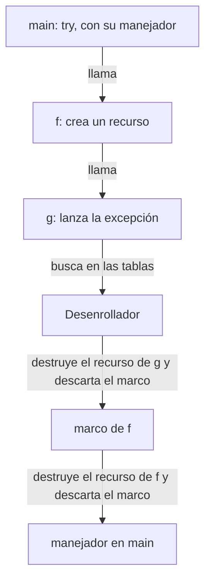

# Compiladores - La abstracción de procedimiento

## 6.2 Abstracción de control de flujo.

---

Una llamada a un procedimiento es una transferencia de control con la promesa de regresar: el procedimiento llamado se ejecuta como si fuera una sola instrucción del que llama, y al terminar el control vuelve justo después de la llamada, con el estado del que llama intacto. Este tema presenta cómo se implementa esa abstracción: la secuencia de llamada y de retorno, quién guarda los registros, el costo de una llamada, las llamadas de cola, y las transferencias no locales, como las excepciones, que rompen la disciplina de pila, con el código real que generan gcc y g++.

### La secuencia de llamada

Una llamada se reparte entre el que llama y el llamado:

1. **secuencia previa**, en el que llama: evalúa los argumentos y los coloca donde dice la convención, en registros o en la pila; guarda los registros que el llamado puede destruir y que él necesita, los **guardados por el que llama**, y ejecuta `call`, que apila la dirección de retorno y salta;
2. **prólogo**, en el llamado: guarda el apuntador de marco anterior, el **enlace dinámico**, y establece el nuevo; reserva espacio para las variables locales y guarda los registros **guardados por el llamado** que vaya a usar;
3. **epílogo**, en el llamado: coloca el resultado en el registro de retorno, restaura los registros guardados y el marco anterior, y ejecuta `ret`, que salta a la dirección de retorno;
4. **secuencia posterior**, en el que llama: libera el espacio de los argumentos, si estaban en la pila, y restaura sus registros.

Repartir así el trabajo permite que el código del prólogo y del epílogo aparezca una sola vez por procedimiento, y no en cada llamada.

### El costo de una llamada

El costo directo es el de esas cuatro secuencias, más los efectos indirectos: los registros que deben guardarse, la pérdida de información del optimizador, que no sabe qué hace el llamado, y los saltos, que el procesador predice bien con su pila de direcciones de retorno. Los compiladores lo reducen con:

- **paso de argumentos en registros**, que en x86-64 lleva los primeros seis enteros en `rdi`, `rsi`, `rdx`, `rcx`, `r8` y `r9`;
- **procedimientos hoja**, que no llaman a nadie y pueden omitir el marco;
- **expansión en línea**, que elimina la llamada a cambio de código más grande; conviene cuando el ahorro, más las optimizaciones que habilita, supera el costo del crecimiento;
- **eliminación de las llamadas de cola**, que reemplaza un `call` seguido de `ret` por un salto.

### Transferencias no locales

Una **excepción** termina varias activaciones a la vez: el control pasa del punto donde se lanza al **manejador** más cercano en la cadena dinámica, y todos los marcos intermedios se descartan, ejecutando sus destructores o sus bloques `finally`. Hay dos implementaciones:

- **pila de manejadores**, como `setjmp` y `longjmp` en C: al entrar a un `try` se guarda el estado, el apuntador de pila, el de marco y la dirección de continuación, y al lanzar se restaura, de un salto. Es simple, pero cada `try` cuesta aunque no ocurra ninguna excepción, y no ejecuta destructores;
- **tablas de desenrollado**, de **costo cero**, como en C++ y Java: el compilador genera, aparte del código, tablas que dicen, para cada rango de direcciones, cómo restaurar el marco y qué manejadores o limpiezas hay. Si no hay excepciones, no se ejecuta nada extra; al lanzar, el **desenrollador** recorre la pila con las tablas, primero buscando un manejador y después ejecutando las limpiezas hasta él. En Linux, las tablas son `.eh_frame` y `.gcc_except_table`, y lanzar llama a `__cxa_throw`.

Otras transferencias no locales son las **corrutinas** y los **generadores**, cuyo marco sobrevive a la suspensión y por eso no puede estar en la pila, y las **continuaciones** de Scheme.



### Implementación en Python

El programa usa el simulador de procedimientos y las utilidades de compilación del tema 6.1, incluidos al inicio. Compara la secuencia de llamada de gcc 13 en x86 de 32 y de 64 bits y evalúa el modelo de costo del ejercicio 1; prueba en Python la recursión, la recursión de cola y un trampolín para el ejercicio 2; simula el desenrollado de la pila y ejecuta excepciones reales en C, con `setjmp` y `longjmp`, y en C++ con g++ 13 para el ejercicio 3, y traza los enlaces del ejercicio 4.

```python
# ===== Núcleo de procedimientos: registros de activación con enlaces estáticos y dinámicos, y utilidades para gcc =====
import os, re, subprocess, tempfile

class Proc:
    """Un procedimiento con parámetros, variables locales, procedimientos anidados y un cuerpo de sentencias:
    ('asig', x, e) ('llama', f, [args]) ('imprime', e) ('punto', etiqueta) ('si', e, [then], [else]) ('ret', e)
    Las expresiones son enteros, nombres o tuplas (op, a, b)."""
    def __init__(self, nombre, params=(), locales=(), anidados=(), cuerpo=()):
        self.nombre, self.params, self.locales, self.anidados, self.cuerpo = nombre, list(params), list(locales), list(anidados), list(cuerpo)
        self.padre = None
        for p in self.anidados: p.padre = self
    def nivel(self): return 0 if self.padre is None else self.padre.nivel() + 1

class Retorno(Exception):
    def __init__(self, v): self.v = v

class Maquina:
    def __init__(self, principal, alcance="estatico"):
        self.principal, self.alcance = principal, alcance
        self.pila, self.salida, self.fotos, self.max_prof, self.recorridos = [], [], {}, 0, []
    # --- registros de activación ---
    def activa(self, proc, args, enlace_estatico):
        marco = {"proc": proc, "vars": dict(zip(proc.params, args)), "ed": len(self.pila) - 1 if self.pila else None, "ee": enlace_estatico}
        for v in proc.locales: marco["vars"].setdefault(v, None)
        self.pila.append(marco); self.max_prof = max(self.max_prof, len(self.pila))
    def busca_marco(self, nombre):
        """Alcance estático: sigue los enlaces estáticos; dinámico: sigue los dinámicos. Cuenta los saltos."""
        k = len(self.pila) - 1; saltos = 0
        while k is not None:
            if nombre in self.pila[k]["vars"]: self.recorridos.append((nombre, saltos)); return k
            k = self.pila[k]["ee"] if self.alcance == "estatico" else self.pila[k]["ed"]; saltos += 1
        raise NameError(nombre)
    def valor(self, e):
        if isinstance(e, int): return e
        if isinstance(e, str): return self.pila[self.busca_marco(e)]["vars"][e]
        op, a, b = e; x, y = self.valor(a), self.valor(b)
        return {"+": x + y, "-": x - y, "*": x * y, "/": x // y, "<": int(x < y), "<=": int(x <= y), "==": int(x == y), ">": int(x > y)}[op]
    def procedimiento(self, nombre):
        """El nombre del procedimiento se resuelve léxicamente: devuelve el procedimiento y el marco de su padre."""
        k = len(self.pila) - 1
        while k is not None:
            p = self.pila[k]["proc"]
            for h in p.anidados:
                if h.nombre == nombre: return h, k
            if p.nombre == nombre and self.pila[k]["ee"] is not None:
                return p, self.pila[k]["ee"]
            k = self.pila[k]["ee"]
        raise NameError(nombre)
    def llama(self, nombre, args):
        proc, padre = self.procedimiento(nombre)
        self.activa(proc, [self.valor(a) for a in args], padre)
        try: self.ejecuta(proc.cuerpo); r = None
        except Retorno as ret: r = ret.v
        self.pila.pop(); return r
    def ejecuta(self, sentencias):
        for s in sentencias:
            k = s[0]
            if k == "asig": self.pila[self.busca_marco(s[1])]["vars"][s[1]] = self.valor(s[2])
            elif k == "llama": self.llama(s[1], s[2])
            elif k == "imprime": self.salida.append(self.valor(s[1]))
            elif k == "punto": self.fotos[s[1]] = self.foto()
            elif k == "si": self.ejecuta(s[2] if self.valor(s[1]) else s[3])
            elif k == "ret": raise Retorno(self.valor(s[1]))
            elif k == "asigllama": self.pila[self.busca_marco(s[1])]["vars"][s[1]] = self.llama(s[2], s[3])
    def corre(self, args=()):
        self.activa(self.principal, list(args), None); self.ejecuta(self.principal.cuerpo); return self
    def foto(self):
        lineas = []
        for k in range(len(self.pila) - 1, -1, -1):
            m = self.pila[k]
            ee = "-" if m["ee"] is None else self.pila[m["ee"]]["proc"].nombre
            ed = "-" if m["ed"] is None else self.pila[m["ed"]]["proc"].nombre
            lineas.append(f"{m['proc'].nombre}: {m['vars']}, enlace estático -> {ee}, enlace dinámico -> {ed}")
        return lineas

# ---------- gcc: compilar, extraer el ensamblador de una función y ejecutar ----------
TMP = tempfile.mkdtemp()
ENV = {**os.environ, "LC_ALL": "C"}
def ensamblador(fuente, opt="-O0", extra=()):
    ruta = os.path.join(TMP, "f.c"); open(ruta, "w").write(fuente)
    r = subprocess.run(["gcc", opt, "-S", "-masm=intel", "-fno-asynchronous-unwind-tables", "-fcf-protection=none", "-fno-stack-protector",
                        *extra, "-o", "-", "f.c"], cwd=TMP, capture_output=True, text=True, env=ENV)
    if r.returncode: raise RuntimeError(r.stderr)
    return r.stdout
def funcion(asm, nombre):
    """Las instrucciones de una función, sin directivas, con los espacios normalizados."""
    lineas, dentro = [], False
    for l in asm.splitlines():
        if re.match(rf"^{re.escape(nombre)}:", l): dentro = True; continue
        if dentro:
            if re.match(r"^\s*\.(size|cfi_endproc)", l) or (re.match(r"^[A-Za-z_]\w*:", l)): break
            if re.match(r"^\s*\.", l) and not re.match(r"^\.L\w+:", l): continue
            lineas.append(" ".join(l.split()))
    return [l for l in lineas if l]
def ejecuta_c(fuente, entrada=None, opt="-O2", extra=()):
    ruta = os.path.join(TMP, "p.c"); open(ruta, "w").write(fuente)
    r = subprocess.run(["gcc", opt, *extra, "-o", "p", "p.c"], cwd=TMP, capture_output=True, text=True, env=ENV)
    if r.returncode: raise RuntimeError(r.stderr)
    return subprocess.run(["./p"], cwd=TMP, input=entrada, capture_output=True, text=True).stdout
def n_instrucciones(f): return sum(1 for l in f if not l.endswith(":"))

import sys

# ---------- Ejercicio 1: costo de una llamada con 4 parámetros ----------
CUATRO = "int f(int a, int b, int c, int d) { return a + b + c + d; }\nint g(void) { return f(1, 2, 3, 4); }"
for bits, extra in (("32", ("-m32", "-fno-pic")), ("64", ())):
    asm = ensamblador(CUATRO, "-O0", extra)
    print(f"ejercicio 1: x86-{bits}, g:", " | ".join(funcion(asm, "g")))
modelo = {"4 push de argumentos": 4 * 2, "call": 3, "creación del marco": 5, "destrucción del marco": 5, "ret": 3, "4 pop de argumentos": 4 * 2}
print("   modelo del enunciado:", modelo, "total", sum(modelo.values()), "ciclos")
print("   con add esp, 16 en lugar de 4 pop, como en el código de gcc de 32 bits:", sum(modelo.values()) - 8 + 1, "ciclos, si la suma cuesta 1")

# ---------- Ejercicio 2: recursión de cola en Python, que no la elimina ----------
def suma_lista(l): return 0 if not l else l[0] + suma_lista(l[1:])
def suma_cola(l, i=0, ac=0): return ac if i == len(l) else suma_cola(l, i + 1, ac + l[i])
def suma_ciclo(l):
    ac = 0
    for x in l: ac += x
    return ac
def suma_trampolin(l):
    """Cada paso devuelve la siguiente llamada sin hacerla; el ciclo del trampolín las ejecuta con la pila constante."""
    def paso(i, ac): return ac if i == len(l) else (lambda: paso(i + 1, ac + l[i]))
    r = paso(0, 0)
    while callable(r): r = r()
    return r
datos = list(range(1, 100001))
for f in (suma_lista, suma_cola, suma_ciclo, suma_trampolin):
    try: r = f(datos)
    except RecursionError: r = "RecursionError"
    print(f"ejercicio 2: {f.__name__:14} con 100000 elementos: {r}")
print("   además, suma_lista copia la lista en cada nivel con l[1:]: O(n^2) en tiempo")

# ---------- Ejercicio 3: excepciones, con una simulación del desenrollado y con C y C++ reales ----------
class Simulador:
    def __init__(self): self.pila, self.manejadores, self.traza = [], [], []
    def llama(self, nombre, cuerpo):
        self.pila.append(nombre); self.traza.append(f"entra {nombre}, pila {self.pila}")
        try: cuerpo(self)
        except LookupError:
            self.pila.pop(); self.traza.append(f"desenrolla {nombre}"); raise
        self.pila.pop(); self.traza.append(f"sale {nombre}")
    def intenta(self, cuerpo, tipo, manejador):
        self.manejadores.append((len(self.pila), tipo)); marca = len(self.manejadores)
        try: cuerpo(self)
        except LookupError as e:
            prof, t = self.manejadores[marca - 1]
            del self.manejadores[marca - 1:]
            manejador(self, e); return
        self.manejadores.pop()
    def lanza(self, e):
        self.traza.append(f"lanza {e!r} en {self.pila[-1]}; manejador más cercano a profundidad {self.manejadores[-1][0]}"); raise e
s = Simulador()
s.llama("main", lambda s: s.intenta(lambda s: s.llama("f", lambda s: s.llama("g", lambda s: s.lanza(KeyError("clave")))),
                                     "LookupError", lambda s, e: s.traza.append(f"maneja {e!r} en {s.pila[-1]}")))
print("ejercicio 3: simulación:", " | ".join(s.traza))
SJ = r'''#include <stdio.h>
#include <setjmp.h>
static jmp_buf punto;
static void g(int n) { printf("g(%d)\n", n); if (n == 3) longjmp(punto, 42); g(n + 1); printf("nunca\n"); }
int main(void) {
    int r = setjmp(punto);
    if (r == 0) { g(1); printf("sin excepción\n"); }
    else printf("excepción %d: la pila de g se descartó de un salto\n", r);
    return 0;
}'''
print("   C con setjmp y longjmp:", ejecuta_c(SJ).strip().replace("\n", " | "))
CPP = r'''#include <cstdio>
#include <stdexcept>
struct Recurso { const char *n; Recurso(const char *n) : n(n) {} ~Recurso() { std::printf("destruye %s\n", n); } };
void g() { Recurso r("de g"); throw std::runtime_error("falla en g"); }
void f() { Recurso r("de f"); g(); }
int main() { try { f(); } catch (const std::exception &e) { std::printf("atrapada: %s\n", e.what()); } }
'''
open(os.path.join(TMP, "e.cpp"), "w").write(CPP)
subprocess.run(["g++", "-O2", "-o", "e", "e.cpp"], cwd=TMP, env=ENV)
print("   C++:", subprocess.run(["./e"], cwd=TMP, capture_output=True, text=True).stdout.strip().replace("\n", " | "))
asm = subprocess.run(["g++", "-O2", "-S", "-o", "-", "e.cpp"], cwd=TMP, capture_output=True, text=True, env=ENV).stdout
print("   en el ensamblador de g++: tabla .gcc_except_table:", ".gcc_except_table" in asm, "| llama a __cxa_throw:", "__cxa_throw" in asm,
      "| a _Unwind_Resume:", "_Unwind_Resume" in asm)

# ---------- Ejercicio 4: enlaces estáticos y dinámicos ----------
B = Proc("B", locales=["z"], cuerpo=[("asig", "z", ("+", "x", "y")), ("punto", "B"), ("imprime", "z")])
A = Proc("A", locales=["y"], anidados=[B], cuerpo=[("asig", "y", 2), ("llama", "B", [])])
MAIN = Proc("Main", locales=["x"], anidados=[A], cuerpo=[("asig", "x", 1), ("llama", "A", [])])
m = Maquina(MAIN).corre()
print("ejercicio 4: salida", m.salida, "| pila dentro de B:"); [print("   ", l) for l in m.fotos["B"]]
```

Salida:

```text
ejercicio 1: x86-32, g: push ebp | mov ebp, esp | push 4 | push 3 | push 2 | push 1 | call f | add esp, 16 | leave | ret
ejercicio 1: x86-64, g: push rbp | mov rbp, rsp | mov ecx, 4 | mov edx, 3 | mov esi, 2 | mov edi, 1 | call f | pop rbp | ret
   modelo del enunciado: {'4 push de argumentos': 8, 'call': 3, 'creación del marco': 5, 'destrucción del marco': 5, 'ret': 3, '4 pop de argumentos': 8} total 32 ciclos
   con add esp, 16 en lugar de 4 pop, como en el código de gcc de 32 bits: 25 ciclos, si la suma cuesta 1
ejercicio 2: suma_lista     con 100000 elementos: RecursionError
ejercicio 2: suma_cola      con 100000 elementos: RecursionError
ejercicio 2: suma_ciclo     con 100000 elementos: 5000050000
ejercicio 2: suma_trampolin con 100000 elementos: 5000050000
   además, suma_lista copia la lista en cada nivel con l[1:]: O(n^2) en tiempo
ejercicio 3: simulación: entra main, pila ['main'] | entra f, pila ['main', 'f'] | entra g, pila ['main', 'f', 'g'] | lanza KeyError('clave') en g; manejador más cercano a profundidad 1 | desenrolla g | desenrolla f | maneja KeyError('clave') en main | sale main
   C con setjmp y longjmp: g(1) | g(2) | g(3) | excepción 42: la pila de g se descartó de un salto
   C++: destruye de g | destruye de f | atrapada: falla en g
   en el ensamblador de g++: tabla .gcc_except_table: True | llama a __cxa_throw: True | a _Unwind_Resume: True
ejercicio 4: salida [3] | pila dentro de B:
    B: {'z': 3}, enlace estático -> A, enlace dinámico -> A
    A: {'y': 2}, enlace estático -> Main, enlace dinámico -> Main
    Main: {'x': 1}, enlace estático -> -, enlace dinámico -> -
```

### Ejercicios Propuestos

1. **Costo.** Calcula el costo en ciclos de reloj de una llamada a un procedimiento con 4 parámetros en x86, suponiendo 2 ciclos por cada `push` o `pop`, 3 ciclos por `call` y por `ret`, y 5 ciclos por la creación y por la destrucción del marco.

2. **Recursión de cola.** Convierte la siguiente función a una con recursión de cola:

    ```python
    def suma_lista(lista):
        if not lista:
            return 0
        return lista[0] + suma_lista(lista[1:])
    ```

3. **Excepciones.** Diseña el mecanismo de manejo de excepciones de un lenguaje simple, mostrando cómo se manipula la pila y se transfiere el control.

4. **Enlaces.** Traza la pila de ejecución, con los enlaces estáticos y dinámicos, del programa:

    ```pascal
    program Main;
    var x: integer;
    procedure A;
    var y: integer;
        procedure B;
        var z: integer;
        begin
            z := x + y;
            writeln(z)
        end;
    begin
        y := 2;
        B
    end;
    begin
        x := 1;
        A
    end.
    ```

### Soluciones

**Ejercicio 1.** En x86 de 32 bits, con la convención de C, gcc genera para la llamada `push 4`, `push 3`, `push 2`, `push 1`, `call f` y `add esp, 16`. Con el modelo del enunciado:

| Paso | Ciclos |
| ---- | ------ |
| 4 `push` de los argumentos | 8 |
| `call` | 3 |
| creación del marco, `push ebp; mov ebp, esp` | 5 |
| destrucción del marco | 5 |
| `ret` | 3 |
| 4 `pop` de los argumentos | 8 |
| **total** | **32** |

gcc no hace los 4 `pop`: libera los argumentos con un solo `add esp, 16`, y con un ciclo para la suma el total es 25. En x86-64, los cuatro argumentos van en registros, `edi`, `esi`, `edx` y `ecx`, sin ningún acceso a memoria, y con optimización `f` ni siquiera crea un marco. El modelo es una simplificación: en los procesadores actuales, `push` y `pop` se ejecutan en paralelo con otras instrucciones gracias al motor de pila, y el costo real de una llamada bien predicha es de unos pocos ciclos.

**Ejercicio 2.** La versión con recursión de cola lleva un índice y un acumulador:

```python
def suma_cola(lista, i=0, ac=0):
    return ac if i == len(lista) else suma_cola(lista, i + 1, ac + lista[i])
```

Además evita la copia `lista[1:]`, que hace la original cuadrática. Pero **Python no elimina las llamadas de cola**, por decisión de diseño, para conservar trazas de error completas: con 100 000 elementos, ambas versiones fallan con `RecursionError`. En Python hay que convertirla en un **ciclo**, que es exactamente lo que haría un compilador con la llamada de cola, o usar un **trampolín**, en el que cada paso devuelve la siguiente llamada en lugar de hacerla y un ciclo externo las ejecuta. Ambos suman los 100 000 elementos.

**Ejercicio 3.** Un diseño con **tablas de desenrollado**:

1. el compilador asigna a cada `try` el rango de direcciones que protege y genera una tabla con, para cada rango, los tipos que atrapa y la dirección del manejador; para cada procedimiento, una entrada que dice cómo restaurar el marco del que llama;
2. `throw` crea el objeto de la excepción en el montículo, porque los marcos van a desaparecer, y llama al desenrollador;
3. el desenrollador recorre la cadena dinámica con las tablas buscando un manejador cuyo tipo coincida; si no hay ninguno, el programa termina;
4. después recorre otra vez los marcos hasta el del manejador, ejecutando los destructores y los `finally` de cada uno, y descartándolos;
5. salta al manejador con el apuntador de pila del marco que lo contiene.

La simulación del programa muestra los pasos: `g` lanza, el manejador más cercano está en `main`, y se desenrollan `g` y `f`. En C, `setjmp` y `longjmp` implementan la versión con una pila de manejadores: la llamada recursiva `g(3)` regresa directamente al `setjmp`, sin pasar por los marcos de `g(2)` y `g(1)`. En C++, g++ genera la tabla `.gcc_except_table`, llama a `__cxa_throw`, y los destructores de los recursos de `g` y de `f` se ejecutan en orden antes de llegar al manejador.

**Ejercicio 4.** El programa imprime 3. Dentro de `B` hay tres marcos: `B`, con `z = 3`; `A`, con `y = 2`, y `Main`, con `x = 1`. El enlace estático de `B` apunta a `A`, que lo contiene textualmente, y el de `A` a `Main`; los enlaces dinámicos coinciden, porque cada procedimiento fue llamado por el que lo contiene. Para `z := x + y`, el código de `B` sigue un enlace estático para llegar a `y` y dos para llegar a `x`. Los enlaces serían distintos si, por ejemplo, `B` fuera llamado desde otro procedimiento anidado en `A`: el estático seguiría apuntando a `A`, y el dinámico al que llama.

En el material original, el modelo de costo calculaba la llamada como $n \cdot t_{\text{push}},$ sin contar el `call`, que aparecía solo en el retorno; la fórmula del beneficio de la expansión en línea restaba un tiempo de llamada y una "penalización por tamaño" de código, que no se miden en las mismas unidades, y el texto usaba palabras en inglés como "space complexity" y "overhead".

### Referencias

1. Cooper, K. D., and Torczon, L., _Engineering a Compiler_. 3a ed., Morgan Kaufmann, 2022. Secciones 6.2 y 6.5.
2. Aho, A. V., Lam, M. S., Sethi, R., and Ullman, J. D., _Compilers: Principles, Techniques, and Tools_. 2a ed., Pearson, 2007. Sección 7.2.
3. _Itanium C++ ABI: Exception Handling_. CodeSourcery y otros, 2001, adoptada por g++ y Clang.
4. Ramsey, N., and Peyton Jones, S., A single intermediate language that supports multiple implementations of exceptions. _PLDI_, 2000.
5. Fog, A., _Instruction tables_. Technical University of Denmark, 2022.
