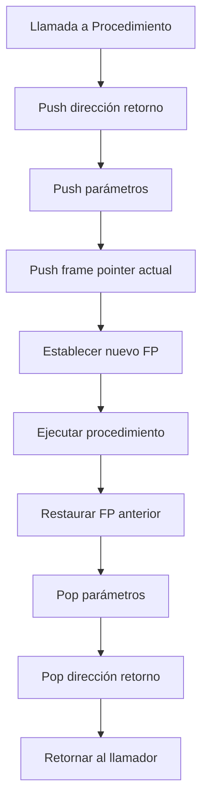

# Compiladores - La abstracción de procedimiento

## 6.2 Abstracción de control de flujo.

---

La abstracción de control de flujo es un componente crítico de la abstracción de procedimiento que determina cómo se gestiona la ejecución del programa. Esta guía explora los mecanismos que permiten a los procedimientos alterar y controlar el flujo de ejecución.

### Definición de Abstracción de Control de Flujo

La abstracción de control de flujo se refiere a los mecanismos que permiten a un procedimiento modificar la secuencia normal de ejecución, incluyendo llamadas, retornos, y manejo de excepciones. Según Cooper y Torczon (2004), "el control de flujo define cómo las acciones se componen en el tiempo y cómo se transfiere el control entre diferentes partes del programa".

### Mecanismos Fundamentales de Control de Flujo

#### Llamadas a Procedimientos

La llamada a procedimiento implica:

- Transferencia de control al código del procedimiento
- Paso de parámetros
- Almacenamiento del contexto de ejecución
- Creación de un nuevo entorno léxico

$$ \text{Costo}\_{llamada} = T\_{setup} + T\_{\text{ejecución}} + T\_{\text{cleanup}} $$

#### Retorno de Procedimientos

El retorno debe:

- Restaurar el contexto anterior
- Liberar recursos del frame actual
- Transferir el control al punto de llamada
- Devolver valores (si aplica)

#### Saltos No Locales

Mecanismos que permiten transferir control fuera del flujo normal:

- Excepciones y manejo de errores
- Continuaciones
- Gotos no locales (setjmp/longjmp en C)

### Implementación de Estructuras de Control

#### Gestión de la Pila de Ejecución



#### Convenciones de Llamada Comunes

**CDECL** (C Declaration):

```assembly
; Caller responsibilities
push param_n
...
push param_1
call function
add esp, n*4  ; Cleanup stack

; Callee responsibilities
push ebp
mov ebp, esp
; ... function body ...
mov esp, ebp
pop ebp
ret
```

**STDCALL**:

```assembly
; Callee cleans up parameters
ret n*4
```

### Ejemplos de Implementación

#### Manejo de Excepciones

```java
// Ejemplo de estructura try-catch
try {
    procedimientoPeligroso();
} catch (Exception e) {
    manejarError(e);
} finally {
    limpiarRecursos();
}
```

Implementación a nivel de compilador:

```c
// Estructura equivalente en C con setjmp/longjmp
jmp_buf env;

void procedimientoPeligroso() {
    if (error_condicion) {
        longjmp(env, 1);
    }
}

int main() {
    if (setjmp(env) == 0) {
        procedimientoPeligroso();
    } else {
        manejarError();
    }
    limpiarRecursos();
}
```

#### Tail Call Optimization

Transformación de recursión a iteración:

**Antes de optimización:**

```scheme
(define (factorial n)
  (if (= n 0)
      1
      (* n (factorial (- n 1)))))
```

**Después de optimización:**

```scheme
(define (factorial n acc)
  (if (= n 0)
      acc
      (factorial (- n 1) (* n acc))))
```

### Fórmulas y Cálculos

#### Overhead de Llamadas a Procedimiento

El overhead total de una llamada se calcula como:

$$ T_{\text{overhead}} = T_{\text{call}} + T_{\text{return}} + T_{\text{stack management}} $$

Donde:

- $T_{\text{call}} = n_{\text{params}} \times t_{\text{push}}$
- $T_{\text{return}} = t_{\text{ret}} + n_{\text{params}} \times t_{\text{pop}}$
- $T_{\text{stack management}} = t_{\text{frame setup}} + t_{\text{frame teardown}}$

#### Eficiencia de Tail Recursion

Para una función tail-recursive:

$$ \text{Space complexity} = O(1) $$
$$ \text{Time complexity} = O(n) $$

Mientras que para recursión normal:

$$ \text{Space complexity} = O(n) $$
$$ \text{Time complexity} = O(n) $$

### Ejercicios Propuestos

1. **Análisis de Overhead**: Calcule el overhead en ciclos de reloj para una llamada a procedimiento con 4 parámetros en arquitectura x86, asumiendo:
   - 2 ciclos por push/pop
   - 3 ciclos para call/ret
   - 5 ciclos para frame setup/teardown

2. **Transformación Tail-Recursive**: Convierta la siguiente función a forma tail-recursive:

```python
def suma_lista(lista):
    if not lista:
        return 0
    return lista[0] + suma_lista(lista[1:])
```

3. **Implementación de Excepciones**: Diseñe el mecanismo de manejo de excepciones para un lenguaje simple, mostrando cómo se manipula la pila y se transfiere el control.

4. **Análisis de Scoping**: Para el siguiente código, trace la pila de ejecución y muestre los enlaces estáticos y dinámicos:

```pascal
program Main;
var x: integer;

procedure A;
var y: integer;

    procedure B;
    var z: integer;
    begin
        z := x + y;
        writeln(z);
    end;

begin
    y := 2;
    B;
end;

begin
    x := 1;
    A;
end.
```

### Optimizaciones de Control de Flujo

#### Inline Expansion

Sustitución de llamadas por el cuerpo del procedimiento:

$$ \text{Beneficio} = T_{\text{call overhead}} - T_{\text{code size penalty}} $$

#### Loop Invariant Code Motion

Extracción de código invariante de bucles:

```java
// Antes
for (int i = 0; i < n; i++) {
    resultado = funcionCostosa() * i;
}

// Después
int temp = funcionCostosa();
for (int i = 0; i < n; i++) {
    resultado = temp * i;
}
```

### Referencias

#### Bibliografía Básica

1. Cooper, K. D., & Torczon, L. (2004). _Engineering a Compiler_. Morgan Kaufmann. (Capítulo 6: Procedure Abstraction)

2. Aho, A. V., Lam, M. S., Sethi, R., & Ullman, J. D. (2007). _Compilers: Principles, Techniques, and Tools_ (2nd ed.). Pearson Education. (Capítulo 7: Run-Time Environments)

3. Scott, M. L. (2009). _Programming Language Pragmatics_. Morgan Kaufmann. (Capítulo 6: Control Flow)

#### Bibliografía Complementaria

1. Grune, D., Bal, H. E., Jacobs, C. J. H., & Langendoen, K. G. (2000). _Modern Compiler Design_. John Wiley & Sons. (Capítulo 7: Procedures and Functions)

2. Wilhelm, R., & Maurer, D. (1995). _Compiler Design_. Addison-Wesley. (Capítulo 8: Code Generation)

### Casos de Estudio

#### Implementación en Diferentes Paradigmas

**Programación Funcional** (Scheme):

```scheme
; Continuations como mecanismo de control
(call/cc
  (lambda (exit)
    (for-each (lambda (x)
                (if (negative? x)
                    (exit x)))
              '(1 2 3 -4 5 6))))
```

**Programación Orientada a Objetos** (Java):

```java
// Manejo de excepciones
public void processFile(String filename) throws IOException {
    try (BufferedReader br = new BufferedReader(new FileReader(filename))) {
        String line;
        while ((line = br.readLine()) != null) {
            processLine(line);
        }
    } catch (FileNotFoundException e) {
        throw new CustomException("File not found", e);
    }
}
```

### Conclusión

La abstracción de control de flujo es esencial para implementar procedimientos eficientes y expresivos. Los compiladores modernos emplean diversas técnicas para optimizar las transferencias de control, reducir overhead y proporcionar mecanismos avanzados como excepciones y continuaciones. El entendimiento de estos conceptos es crucial para el diseño de lenguajes de programación y compiladores eficientes.

### Recursos Adicionales

- [Compilers: Principles, Techniques, and Tools Companion Website](https://www.pearson.com/us/higher-education/program/Aho-Compilers-Principles-Techniques-and-Tools-2nd-Edition/PGM167067.html)
- [Modern Compiler Implementation Resources](https://www.cs.princeton.edu/~appel/modern/)
- [GCC Optimization Options](https://gcc.gnu.org/onlinedocs/gcc/Optimize-Options.html)
