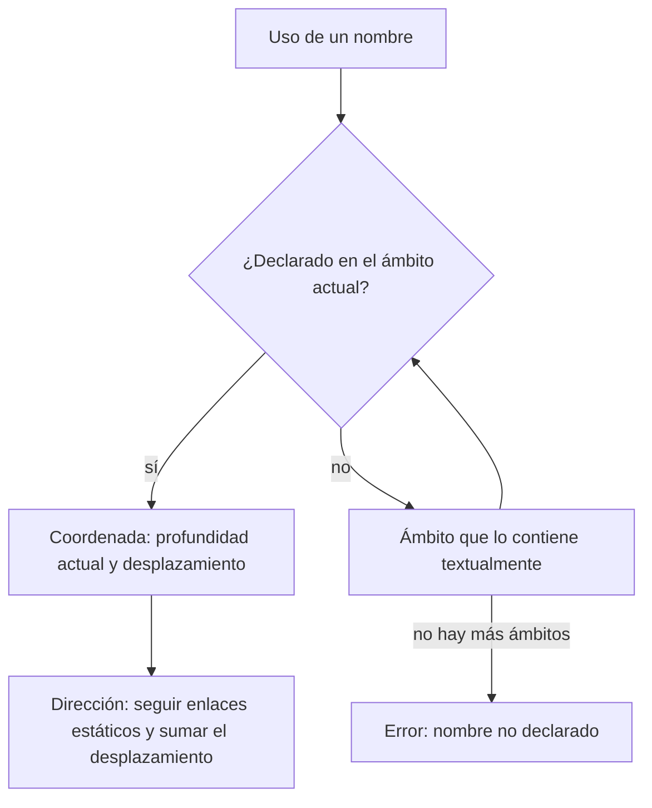

# Compiladores - La abstracción de procedimiento

## 6.3 Espacio de nombres.

---

Cada procedimiento crea un **espacio de nombres** propio: sus parámetros y variables locales son visibles dentro de él y no chocan con los de otros procedimientos, y cada activación tiene su propia copia de ellos. El compilador debe decidir, para cada uso de un nombre, a qué declaración se refiere, y asignar a cada nombre un lugar en memoria con una dirección calculable. Este tema presenta las reglas de alcance léxico y dinámico, los ámbitos de los lenguajes reales, como los de Python y los espacios de nombres de C++, la tabla de símbolos con tipos, la disposición de las variables en el registro de activación y la decoración de nombres para el enlazador.

### Alcance léxico

Con alcance léxico, la declaración de un nombre es la del bloque más interno que lo **contiene en el texto**. Para cada nombre, el compilador calcula su **coordenada estática** $\langle d, o \rangle:$ la profundidad léxica $d$ del procedimiento que lo declara y su desplazamiento $o$ en el registro de activación. Un uso a profundidad $p$ de un nombre declarado a profundidad $d$ sigue $p - d$ enlaces estáticos y suma $o.$ Las reglas varían por lenguaje:

- **C:** ámbitos de archivo, de función y de bloque, sin funciones anidadas; los nombres de las variables locales viven solo en su bloque.
- **Pascal, Ada, Scheme:** procedimientos anidados, que requieren enlaces estáticos o *display*.
- **Python:** la regla LEGB, local, de las funciones que la encierran, global e integrada; un nombre asignado en una función es local a ella en **toda** la función, salvo que se declare `global` o `nonlocal`, y las funciones interiores capturan las variables exteriores en **celdas**.
- **C++, C#, Java:** además de los bloques, los **espacios de nombres** y las clases, que agrupan nombres y se recorren con calificación, como `geo::area`.

### Alcance dinámico

Con alcance dinámico, un nombre se refiere a la declaración **más reciente en ejecución**, que se encuentra siguiendo la cadena dinámica o con una tabla global en la que cada activación apila sus declaraciones y las retira al terminar, el **ligado superficial**. Es fácil de implementar en un intérprete, pero un procedimiento puede cambiar de significado según quién lo llame, y por eso casi ningún lenguaje lo usa por omisión.

### Disposición en el registro de activación

Las variables locales se colocan en el marco con desplazamientos fijos respecto al apuntador de marco: cada una se alinea a su alineación natural, y el tamaño total se redondea a la alineación que pide la convención, 16 bytes en x86-64 antes de cada `call`. El orden lo elige el compilador: el de declaración es el más simple, pero agrupar por tamaño reduce el relleno, y los compiladores con protección de pila colocan los arreglos junto al **canario** para que un desbordamiento lo destruya antes de alcanzar la dirección de retorno. Las variables de tamaño variable, como los arreglos de longitud variable de C, se ubican a través de un apuntador guardado en el marco.

### Decoración de nombres

El enlazador solo conoce nombres planos. En lenguajes con espacios de nombres, sobrecarga o clases, el compilador **decora** cada nombre con su contexto y su tipo: en el ABI de Itanium que usan g++ y Clang, `geo::area(double)` se convierte en `_ZN3geo4areaEd`, con `N...E` para el nombre calificado, la longitud de cada componente y `d` para el parámetro `double`. Así, dos funciones `area` en espacios de nombres distintos o con parámetros distintos no chocan. `extern "C"` desactiva la decoración para enlazar con C.



### Implementación en Python

El programa implementa una tabla de símbolos con ámbitos anidados y tipos compuestos, con su tamaño y alineación, para el ejercicio 1; usa el módulo `symtable`, que expone las tablas del propio compilador de Python, para el ejercicio 2; compara la disposición de libro con la que elige gcc 13, leyendo el ensamblador, para el ejercicio 3; usa el simulador de procedimientos del tema 6.1, incluido al inicio, junto con Python y bash, para el ejercicio 4, y muestra la decoración de nombres de g++ con `nm` y `c++filt`.

```python
# ===== Núcleo de procedimientos: registros de activación con enlaces estáticos y dinámicos, y utilidades para gcc =====
import os, re, subprocess, tempfile

class Proc:
    """Un procedimiento con parámetros, variables locales, procedimientos anidados y un cuerpo de sentencias:
    ('asig', x, e) ('llama', f, [args]) ('imprime', e) ('punto', etiqueta) ('si', e, [then], [else]) ('ret', e)
    Las expresiones son enteros, nombres o tuplas (op, a, b)."""
    def __init__(self, nombre, params=(), locales=(), anidados=(), cuerpo=()):
        self.nombre, self.params, self.locales, self.anidados, self.cuerpo = nombre, list(params), list(locales), list(anidados), list(cuerpo)
        self.padre = None
        for p in self.anidados: p.padre = self
    def nivel(self): return 0 if self.padre is None else self.padre.nivel() + 1

class Retorno(Exception):
    def __init__(self, v): self.v = v

class Maquina:
    def __init__(self, principal, alcance="estatico"):
        self.principal, self.alcance = principal, alcance
        self.pila, self.salida, self.fotos, self.max_prof, self.recorridos = [], [], {}, 0, []
    # --- registros de activación ---
    def activa(self, proc, args, enlace_estatico):
        marco = {"proc": proc, "vars": dict(zip(proc.params, args)), "ed": len(self.pila) - 1 if self.pila else None, "ee": enlace_estatico}
        for v in proc.locales: marco["vars"].setdefault(v, None)
        self.pila.append(marco); self.max_prof = max(self.max_prof, len(self.pila))
    def busca_marco(self, nombre):
        """Alcance estático: sigue los enlaces estáticos; dinámico: sigue los dinámicos. Cuenta los saltos."""
        k = len(self.pila) - 1; saltos = 0
        while k is not None:
            if nombre in self.pila[k]["vars"]: self.recorridos.append((nombre, saltos)); return k
            k = self.pila[k]["ee"] if self.alcance == "estatico" else self.pila[k]["ed"]; saltos += 1
        raise NameError(nombre)
    def valor(self, e):
        if isinstance(e, int): return e
        if isinstance(e, str): return self.pila[self.busca_marco(e)]["vars"][e]
        op, a, b = e; x, y = self.valor(a), self.valor(b)
        return {"+": x + y, "-": x - y, "*": x * y, "/": x // y, "<": int(x < y), "<=": int(x <= y), "==": int(x == y), ">": int(x > y)}[op]
    def procedimiento(self, nombre):
        """El nombre del procedimiento se resuelve léxicamente: devuelve el procedimiento y el marco de su padre."""
        k = len(self.pila) - 1
        while k is not None:
            p = self.pila[k]["proc"]
            for h in p.anidados:
                if h.nombre == nombre: return h, k
            if p.nombre == nombre and self.pila[k]["ee"] is not None:
                return p, self.pila[k]["ee"]
            k = self.pila[k]["ee"]
        raise NameError(nombre)
    def llama(self, nombre, args):
        proc, padre = self.procedimiento(nombre)
        self.activa(proc, [self.valor(a) for a in args], padre)
        try: self.ejecuta(proc.cuerpo); r = None
        except Retorno as ret: r = ret.v
        self.pila.pop(); return r
    def ejecuta(self, sentencias):
        for s in sentencias:
            k = s[0]
            if k == "asig": self.pila[self.busca_marco(s[1])]["vars"][s[1]] = self.valor(s[2])
            elif k == "llama": self.llama(s[1], s[2])
            elif k == "imprime": self.salida.append(self.valor(s[1]))
            elif k == "punto": self.fotos[s[1]] = self.foto()
            elif k == "si": self.ejecuta(s[2] if self.valor(s[1]) else s[3])
            elif k == "ret": raise Retorno(self.valor(s[1]))
            elif k == "asigllama": self.pila[self.busca_marco(s[1])]["vars"][s[1]] = self.llama(s[2], s[3])
    def corre(self, args=()):
        self.activa(self.principal, list(args), None); self.ejecuta(self.principal.cuerpo); return self
    def foto(self):
        lineas = []
        for k in range(len(self.pila) - 1, -1, -1):
            m = self.pila[k]
            ee = "-" if m["ee"] is None else self.pila[m["ee"]]["proc"].nombre
            ed = "-" if m["ed"] is None else self.pila[m["ed"]]["proc"].nombre
            lineas.append(f"{m['proc'].nombre}: {m['vars']}, enlace estático -> {ee}, enlace dinámico -> {ed}")
        return lineas

# ---------- gcc: compilar, extraer el ensamblador de una función y ejecutar ----------
TMP = tempfile.mkdtemp()
ENV = {**os.environ, "LC_ALL": "C"}
def ensamblador(fuente, opt="-O0", extra=()):
    ruta = os.path.join(TMP, "f.c"); open(ruta, "w").write(fuente)
    r = subprocess.run(["gcc", opt, "-S", "-masm=intel", "-fno-asynchronous-unwind-tables", "-fcf-protection=none", "-fno-stack-protector",
                        *extra, "-o", "-", "f.c"], cwd=TMP, capture_output=True, text=True, env=ENV)
    if r.returncode: raise RuntimeError(r.stderr)
    return r.stdout
def funcion(asm, nombre):
    """Las instrucciones de una función, sin directivas, con los espacios normalizados."""
    lineas, dentro = [], False
    for l in asm.splitlines():
        if re.match(rf"^{re.escape(nombre)}:", l): dentro = True; continue
        if dentro:
            if re.match(r"^\s*\.(size|cfi_endproc)", l) or (re.match(r"^[A-Za-z_]\w*:", l)): break
            if re.match(r"^\s*\.", l) and not re.match(r"^\.L\w+:", l): continue
            lineas.append(" ".join(l.split()))
    return [l for l in lineas if l]
def ejecuta_c(fuente, entrada=None, opt="-O2", extra=()):
    ruta = os.path.join(TMP, "p.c"); open(ruta, "w").write(fuente)
    r = subprocess.run(["gcc", opt, *extra, "-o", "p", "p.c"], cwd=TMP, capture_output=True, text=True, env=ENV)
    if r.returncode: raise RuntimeError(r.stderr)
    return subprocess.run(["./p"], cwd=TMP, input=entrada, capture_output=True, text=True).stdout
def n_instrucciones(f): return sum(1 for l in f if not l.endswith(":"))

import symtable

# ---------- Ejercicio 1: tabla de símbolos con alcance estático y tipos ----------
TAM = {"int": (4, 4), "float": (4, 4), "double": (8, 8), "char": (1, 1)}
def tam_alin(t):
    if isinstance(t, str): return TAM[t]
    if t[0] == "arreglo": tam, al = tam_alin(t[2]); return t[1] * tam, al
    if t[0] == "registro":
        d, al = 0, 1
        for _, ct in t[1]:
            tc, ac = tam_alin(ct); d = (d + ac - 1) // ac * ac + tc; al = max(al, ac)
        return (d + al - 1) // al * al, al
    if t[0] == "funcion": return 0, 1
def texto_tipo(t):
    if isinstance(t, str): return t
    if t[0] == "arreglo": return f"{texto_tipo(t[2])}[{t[1]}]"
    if t[0] == "registro": return "struct {" + "; ".join(f"{texto_tipo(c)} {n}" for n, c in t[1]) + "}"
    if t[0] == "funcion": return f"{texto_tipo(t[2])}({', '.join(texto_tipo(p) for p in t[1])})"
class Tabla:
    def __init__(self): self.ambitos = [("global", {})]
    def entra(self, nombre): self.ambitos.append((nombre, {}))
    def sale(self): return self.ambitos.pop()
    def declara(self, nombre, tipo, clase="variable"):
        if nombre in self.ambitos[-1][1]: raise NameError(f"'{nombre}' redeclarado en {self.ambitos[-1][0]}")
        tam, al = tam_alin(tipo); self.ambitos[-1][1][nombre] = {"tipo": tipo, "clase": clase, "tamaño": tam, "alineación": al}
    def busca(self, nombre):
        for prof, (amb, t) in enumerate(reversed(self.ambitos)):
            if nombre in t: return amb, prof, t[nombre]
        raise NameError(f"'{nombre}' no declarado")
t = Tabla()
t.declara("Punto", ("registro", [("x", "double"), ("y", "double")]), "tipo")
t.declara("area", ("funcion", ["double", "double"], "double"), "función")
t.entra("area"); t.declara("base", "double", "parámetro"); t.declara("datos", ("arreglo", 8, "int"))
t.entra("bloque"); t.declara("base", "int")
for n in ("base", "datos", "Punto", "area"):
    amb, prof, e = t.busca(n); print(f"ejercicio 1: {n:6} -> ámbito {amb}, {prof} niveles arriba, {e['clase']} {texto_tipo(e['tipo'])}, {e['tamaño']} bytes")
try: t.declara("base", "char")
except NameError as e: print("   ", e)
t.sale(); print("    al salir del bloque, base es", texto_tipo(t.busca("base")[2]["tipo"]))

# ---------- Ejercicio 2: ámbitos de Python según su propio compilador ----------
CODIGO = "x = 1\ndef outer():\n    y = 2\n    def inner():\n        z = 3\n        print(x + y + z)\n    inner()\nouter()\n"
def recorre(tabla, prof=0):
    simbolos = {s.get_name(): ("local" if s.is_local() else "libre, de un ámbito que lo rodea" if s.is_free() else
                               "global" if s.is_global() else "celda") + (", capturado por una función interior" if s.is_local() and tabla.get_type() != "module" and any(s.get_name() in h.get_frees() for h in tabla.get_children() if h.get_type() == "function") else "")
                for s in tabla.get_symbols()}
    print(f"ejercicio 2: {'   ' * prof}{tabla.get_type()} {tabla.get_name()}: {simbolos}")
    for h in tabla.get_children(): recorre(h, prof + 1)
recorre(symtable.symtable(CODIGO, "ej2", "exec"))
print("   salida:", subprocess.run(["python3", "-c", CODIGO], capture_output=True, text=True).stdout.strip())

# ---------- Ejercicio 3: desplazamientos en el marco ----------
C3 = """void usa(void *, ...);
void funcion(int a, float b) {
    int c;
    double d[10];
    struct { int x; float y; } e;
    usa(&a, &b, &c, d, &e);
}"""
def marco_libro(vars_):
    """Disposición de libro: cada variable debajo de la anterior, alineada, con desplazamientos negativos respecto al marco."""
    d, res = 0, {}
    for n, t in vars_:
        tam, al = tam_alin(t); d = (d + tam + al - 1) // al * al; res[n] = -d
    return res, d
libro, total = marco_libro([("a", "int"), ("b", "float"), ("c", "int"), ("d", ("arreglo", 10, "double")),
                            ("e", ("registro", [("x", "int"), ("y", "float")]))])
print("ejercicio 3: en orden de declaración:", libro, f"tamaño {total}, redondeado a 16: {(total + 15) // 16 * 16}")
f = funcion(ensamblador(C3, "-O0"), "funcion")
guardados = {re.search(r"PTR (-\d+)\[rbp\], (\w+)", l).group(2): int(re.search(r"PTR (-\d+)", l).group(1)) for l in f if re.search(r"PTR -\d+\[rbp\], (edi|xmm0)", l)}
regs = {}
for l in f:                                        # sigue los lea y mov hasta la llamada para saber qué dirección va en cada argumento
    m1 = re.match(r"lea (\w+), (-\d+)\[rbp\]", l); m2 = re.match(r"mov (\w+), (\w+)$", l)
    if m1: regs[m1.group(1)] = int(m1.group(2))
    elif m2 and m2.group(2) in regs: regs[m2.group(1)] = regs[m2.group(2)]
    if l.startswith("call"): break
reales = dict(zip("abcde", [regs[r] for r in ("rdi", "rsi", "rdx", "rcx", "r8")]))
print("   gcc -O0:", reales, "| reserva:", next(l for l in f if "rsp, " in l and ("sub" in l or "add" in l)))

# ---------- Ejercicio 4: un programa que distingue los dos alcances ----------
def prog():
    muestra = Proc("muestra", cuerpo=[("imprime", "n")])
    prueba = Proc("prueba", locales=["n"], cuerpo=[("asig", "n", 2), ("llama", "muestra", [])])
    return Proc("principal", locales=["n"], anidados=[muestra, prueba], cuerpo=[("asig", "n", 1), ("llama", "muestra", []), ("llama", "prueba", [])])
print("ejercicio 4: estático", Maquina(prog(), "estatico").corre().salida, "| dinámico", Maquina(prog(), "dinamico").corre().salida)
PY = "n = 1\ndef muestra(): print(n)\ndef prueba():\n    n = 2\n    muestra()\nmuestra(); prueba()\n"
SH = "n=1\nmuestra() { echo $n; }\nprueba() { local n=2; muestra; }\nmuestra; prueba\n"
print("   Python:", subprocess.run(["python3", "-c", PY], capture_output=True, text=True).stdout.split(),
      "| bash:", subprocess.run(["bash", "-c", SH], capture_output=True, text=True).stdout.split())

# ---------- Espacios de nombres de C++ y decoración de nombres ----------
CPP = "namespace geo { double area(double r) { return 3.14159 * r * r; } int area(int l) { return l * l; } }\nnamespace fin { double area(double x) { return x; } }\n"
open(os.path.join(TMP, "n.cpp"), "w").write(CPP)
subprocess.run(["g++", "-c", "n.cpp", "-o", "n.o"], cwd=TMP, env=ENV)
nm = subprocess.run(["nm", "n.o"], cwd=TMP, capture_output=True, text=True).stdout.split()
nombres = sorted(x for x in nm if x.startswith("_Z"))
demang = subprocess.run(["c++filt"] + nombres, capture_output=True, text=True).stdout.split("\n")[:-1]
print("decoración en g++:", dict(zip(nombres, demang)))
```

Salida:

```text
ejercicio 1: base   -> ámbito bloque, 0 niveles arriba, variable int, 4 bytes
ejercicio 1: datos  -> ámbito area, 1 niveles arriba, variable int[8], 32 bytes
ejercicio 1: Punto  -> ámbito global, 2 niveles arriba, tipo struct {double x; double y}, 16 bytes
ejercicio 1: area   -> ámbito global, 2 niveles arriba, función double(double, double), 0 bytes
    'base' redeclarado en bloque
    al salir del bloque, base es double
ejercicio 2: module top: {'x': 'local', 'outer': 'local'}
ejercicio 2:    function outer: {'y': 'local, capturado por una función interior', 'inner': 'local'}
ejercicio 2:       function inner: {'z': 'local', 'print': 'global', 'x': 'global', 'y': 'libre, de un ámbito que lo rodea'}
   salida: 6
ejercicio 3: en orden de declaración: {'a': -4, 'b': -8, 'c': -12, 'd': -96, 'e': -104} tamaño 104, redondeado a 16: 112
   gcc -O0: {'a': -116, 'b': -120, 'c': -4, 'd': -96, 'e': -104} | reserva: add rsp, -128
ejercicio 4: estático [1, 1] | dinámico [1, 2]
   Python: ['1', '1'] | bash: ['1', '2']
decoración en g++: {'_ZN3fin4areaEd': 'fin::area(double)', '_ZN3geo4areaEd': 'geo::area(double)', '_ZN3geo4areaEi': 'geo::area(int)'}
```

### Ejercicios Propuestos

1. **Tabla de símbolos.** Implementa una tabla de símbolos con alcance estático que permita insertar y buscar símbolos, ámbitos anidados y distintos tipos de datos.

2. **Resolución.** Muestra la pila de ámbitos y resuelve las referencias del código:

    ```python
    x = 1
    def outer():
        y = 2
        def inner():
            z = 3
            print(x + y + z)
        inner()
    outer()
    ```

3. **Desplazamientos.** Calcula los desplazamientos de todas las variables en:

    ```c
    void funcion(int a, float b) {
        int c;
        double d[10];
        struct { int x; float y; } e;
    }
    ```

4. **Alcance dinámico contra estático.** Escribe un programa que produzca resultados distintos con alcance estático y con alcance dinámico.

### Soluciones

**Ejercicio 1.** La tabla del programa es una pila de ámbitos; cada entrada guarda la clase, el tipo como expresión de tipo, el tamaño y la alineación, calculados recursivamente para los arreglos y los registros con relleno. La búsqueda devuelve el ámbito y la **distancia** en niveles, que es la parte de la coordenada estática que necesita el generador de código. En el ejemplo, dentro del bloque, `base` es el `int` del bloque, que oculta al parámetro `double`; `datos` está un nivel arriba y `Punto` y `area` dos. Redeclarar `base` en el mismo bloque es un error, y al salir del bloque `base` vuelve a ser el parámetro.

**Ejercicio 2.** El compilador de Python construye tres tablas: la del módulo, con `x` y `outer`; la de `outer`, con `y` e `inner`, donde `y` es local pero **capturada** por una función interior, por lo que vive en una celda, y la de `inner`, con `z` local, `y` como variable **libre**, que se toma de la celda de `outer`, y `x` y `print` como globales, que se buscan en el módulo y en los integrados. Durante la ejecución de `print(x + y + z)`, la pila de ámbitos es `inner`, `outer`, módulo e integrados, y la suma es $1 + 2 + 3 = 6.$

**Ejercicio 3.** En x86-64, `a` y `b` llegan en los registros `edi` y `xmm0`; sin optimizar, gcc los guarda en el marco para tener una dirección. Con la disposición de libro, en orden de declaración y alineando cada variable:

| Variable | Tamaño | Alineación | Libro | gcc 13 `-O0` |
| -------- | ------ | ---------- | ----- | ------------ |
| `a` | 4 | 4 | $-4$ | $-116$ |
| `b` | 4 | 4 | $-8$ | $-120$ |
| `c` | 4 | 4 | $-12$ | $-4$ |
| `d` | 80 | 8 | $-96$ | $-96$ |
| `e` | 8 | 4 | $-104$ | $-104$ |

con un total de 104 bytes, 112 al redondear a 16. gcc coloca primero las variables locales y después las copias de los parámetros, y reserva 128 bytes, $120$ redondeados a 16, para que la pila quede alineada al llamar a `usa`. Ambas disposiciones son válidas: el estándar no fija el orden, y lo único que importa es que cada desplazamiento sea fijo y conocido al compilar.

**Ejercicio 4.** En el programa del simulador, `muestra` imprime `n`, y se llama una vez desde el programa principal y otra desde `prueba`, que declara su propia `n = 2`. Con alcance **estático**, ambas llamadas imprimen 1, la `n` global que rodea textualmente a `muestra`; con alcance **dinámico**, la segunda imprime 2, la `n` de `prueba`, que es la activación más reciente que la declara. Python, de alcance estático, imprime `1 1`, y bash, cuyo `local` tiene alcance dinámico, imprime `1 2`.

En el material original, la clase llamada "tabla de dispersión jerárquica eficiente" buscaba recorriendo todos los ámbitos, en tiempo proporcional a la profundidad, sin ninguna mejora respecto a la pila de tablas; la decoración de nombres aparecía como una técnica de **compactación** de los espacios de nombres, cuando su propósito es distinguir nombres iguales para el enlazador, y el texto usaba palabras en inglés como "namespace folding" y "dead symbol elimination".

### Referencias

1. Cooper, K. D., and Torczon, L., _Engineering a Compiler_. 3a ed., Morgan Kaufmann, 2022. Sección 6.3.
2. Aho, A. V., Lam, M. S., Sethi, R., and Ullman, J. D., _Compilers: Principles, Techniques, and Tools_. 2a ed., Pearson, 2007. Secciones 1.6 y 7.3.
3. Python Software Foundation, _symtable — Access to the compiler's symbol tables_ y _Execution model_, documentación de Python 3.13.
4. _Itanium C++ ABI_, sección 5.1, decoración de nombres.
5. Free Software Foundation, _Bash Reference Manual_, sección 3.3, funciones de la shell y variables locales.
