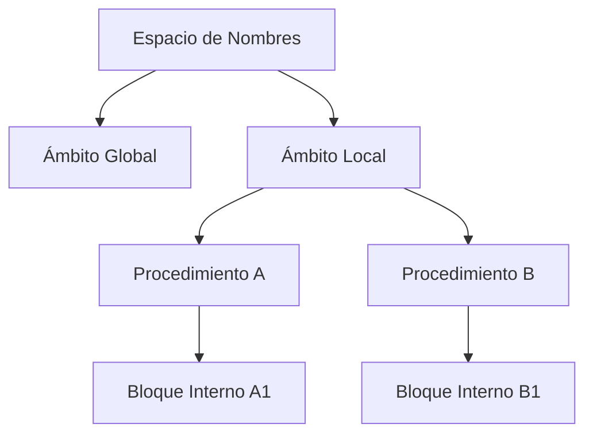

# Compiladores - La abstracción de procedimiento

## 6.3 Espacio de nombres.

---

El espacio de nombres es un concepto fundamental en la abstracción de procedimiento que gestiona la vinculación entre identificadores y las entidades que representan. Esta guía explora cómo los compiladores organizan y gestionan los nombres dentro de los procedimientos.

### Definición de Espacio de Nombres

Un espacio de nombres es un contexto que contiene un conjunto de nombres únicos y las entidades a las que se refieren. Según Scott (2009), "un espacio de nombres es una colección de bindings entre nombres y objetos, con reglas que determinan cuándo los nombres son visibles y cómo se resuelven las referencias".

### Componentes del Espacio de Nombres

#### Tabla de Símbolos

Estructura de datos que almacena información sobre identificadores:

$$ \text{TablaSímbolos} = \langle \text{nombre, tipo, ámbito, dirección,} \ldots \rangle $$

#### Ámbito (Scope)

Región del programa donde un nombre es visible y puede ser referenciado.



### Tipos de Espacios de Nombres

#### Espacios de Nombres Estáticos

Se resuelven en tiempo de compilación:

- Variables globales
- Funciones y procedimientos
- Clases y tipos

#### Espacios de Nombres Dinámicos

Se resuelven en tiempo de ejecución:

- Variables locales
- Parámetros de procedimiento
- Variables de bloque

### Implementación de Tablas de Símbolos

#### Estructura de Datos

```python
class SymbolTable:
    def __init__(self):
        self.scopes = [{}]  # Pila de ámbitos
        self.current_scope = 0

    def enter_scope(self):
        self.scopes.append({})
        self.current_scope += 1

    def exit_scope(self):
        if self.current_scope > 0:
            self.scopes.pop()
            self.current_scope -= 1

    def add_symbol(self, name, symbol_info):
        self.scopes[-1][name] = symbol_info

    def lookup(self, name):
        # Búsqueda desde el ámbito actual hacia afuera
        for i in range(len(self.scopes)-1, -1, -1):
            if name in self.scopes[i]:
                return self.scopes[i][name]
        return None
```

#### Ejemplo de Uso

```java
// Ejemplo de espacios de nombres anidados
public class Ejemplo {
    private int global = 10;  // Ámbito de clase

    public void metodo(int parametro) {  // Ámbito de método
        int local = 20;  // Ámbito local

        if (condicion) {
            int bloque = 30;  // Ámbito de bloque
            System.out.println(global + parametro + local + bloque);
        }
    }
}
```

### Reglas de Scoping

#### Scoping Estático (Léxico)

Las referencias se resuelven según la estructura del código fuente:

$$ \text{Ámbito}(x) = \text{bloque más interno que contiene la declaración de } x $$

#### Scoping Dinámico

Las referencias se resuelven según el flujo de ejecución:

$$ \text{Ámbito}(x) = \text{procedimiento activo más reciente que declara } x $$

### Gestión de Memoria y Espacios de Nombres

#### Registro de Activación

Estructura que contiene el espacio de nombres local de un procedimiento:

$$ \text{RegistroActivación} = \begin{Bmatrix} \begin{array}{ll} \text{Parámetros} & \\\ \text{Variables locales} & \\\ \text{Dirección de retorno} & \\\ \text{Enlace de control} & \\\ \text{Enlace de acceso} & \\\ \end{array} \end{Bmatrix} $$

#### Cálculo de Desplazamientos

Para variables locales en un registro de activación:

$$ \text{Desplazamiento}(v) = \text{FP} + \sum\_{i=1}^{k} \text{tamaño}(\text{parámetro}\_{i}) + \sum\_{j=1}^{m} \text{tamaño}(\text{local}\_{j}) $$

### Ejemplos de Implementación

#### Resolución de Nombres en Scoping Estático

```pascal
program EjemploScoping;
var x: integer;

procedure A;
var y: integer;

    procedure B;
    var z: integer;
    begin
        z := x + y;  // x: global, y: en A, z: local
        writeln(z);
    end;

begin
    y := 2;
    B;
end;

begin
    x := 1;
    A;
end.
```

#### Implementación con Enlaces Estáticos

```c
// Estructura para enlaces estáticos
typedef struct activation_record {
    void* static_link;  // Enlace al ámbito padre
    void* dynamic_link; // Enlace al llamador
    int return_address;
    // Variables locales y parámetros
} activation_record;

// Búsqueda con enlace estático
void* find_variable(activation_record* current, int depth, int offset) {
    while (depth > 0) {
        current = current->static_link;
        depth--;
    }
    return current + offset;
}
```

### Fórmulas y Cálculos

#### Complejidad de Búsqueda

Para una tabla de símbolos con $n$ ámbitos y $m$ símbolos por ámbito:

- **Búsqueda lineal**: $O(n \times m)$
- **Tabla hash por ámbito**: $O(n)$
- **Árbol balanceado**: $O(n \times \log m)$

#### Overhead de Gestión de Ámbitos

$$ T_{\text{gestión}} = T_{\text{entrada}} + T_{\text{salida}} + T_{\text{búsqueda}} $$

### Ejercicios Propuestos

1. **Implementación de Tabla de Símbolos**: Implemente una tabla de símbolos con scoping estático que soporte:
   - Inserción y búsqueda de símbolos
   - Ámbitos anidados
   - Diferentes tipos de datos

2. **Análisis de Scoping**: Para el siguiente código, muestre la pila de ámbitos y resuelva las referencias:

```python
x = 1
def outer():
    y = 2
    def inner():
        z = 3
        print(x + y + z)
    inner()
outer()
```

3. **Cálculo de Desplazamientos**: Calcule los desplazamientos para todas las variables en:

```c
void funcion(int a, float b) {
    int c;
    double d[10];
    struct { int x; float y; } e;
}
```

4. **Scoping Dinámico vs Estático**: Escriba un programa que produzca diferentes resultados bajo scoping estático y dinámico.

### Optimizaciones

#### Hash Tables Jerárquicas

```python
class EfficientSymbolTable:
    def __init__(self):
        self.global_scope = {}
        self.scope_stack = [self.global_scope]

    def enter_scope(self):
        new_scope = {}
        self.scope_stack.append(new_scope)

    def exit_scope(self):
        self.scope_stack.pop()

    def add_symbol(self, name, info):
        self.scope_stack[-1][name] = info

    def lookup(self, name):
        for scope in reversed(self.scope_stack):
            if name in scope:
                return scope[name]
        return None
```

#### Compactación de Espacios de Nombres

Técnicas para reducir el overhead:

- **Name mangling** para evitar colisiones
- **Namespace folding** en ámbitos no superpuestos
- **Dead symbol elimination**

### Referencias

#### Bibliografía Básica

1. **Aho, A. V., et al. (2007)**: _Compilers: Principles, Techniques, and Tools_ (Capítulo 2.7: Symbol Tables)
2. **Cooper, K. D., & Torczon, L. (2004)**: _Engineering a Compiler_ (Capítulo 5.5: Symbol Tables)
3. **Scott, M. L. (2009)**: _Programming Language Pragmatics_ (Capítulo 3: Names, Scopes, and Bindings)

#### Bibliografía Complementaria

1. **Grune, D., et al. (2000)**: _Modern Compiler Design_ (Capítulo 4.1: Symbol Tables)
2. **Wilhelm, R., & Maurer, D. (1995)**: _Compiler Design_ (Capítulo 4: Symbol Management)

### Casos de Estudio

#### Espacios de Nombres en Diferentes Lenguajes

**C++**:

```cpp
namespace Math {
    const double PI = 3.14159;
    double sqrt(double x) { /* implementation */ }
}

// Uso
double circle_area(double r) {
    return Math::PI * Math::sqrt(r);
}
```

**JavaScript** (scoping de función):

```javascript
function outer() {
  var x = 10;
  function inner() {
    var y = 20;
    console.log(x + y); // Closure captura x
  }
  return inner;
}
```

### Conclusión

La gestión eficiente de espacios de nombres es crucial para la implementación de abstracciones de procedimiento. Los compiladores modernos emplean estructuras de datos sofisticadas y algoritmos de búsqueda optimizados para manejar la resolución de nombres en contextos estáticos y dinámicos. El entendimiento de estos mecanismos es esencial para el diseño de lenguajes de programación y la implementación de compiladores eficientes.

### Recursos Adicionales

- [GCC Symbol Table Implementation](https://gcc.gnu.org/onlinedocs/gccint/Symbol-Tables.html)
- [LLVM Source Code: SymbolTableTraits.h](https://llvm.org/doxygen/SymbolTableListTraits_8h_source.html)
- [Compilers: Principles and Practice](https://www.cs.rice.edu/~keith/ECC/)
