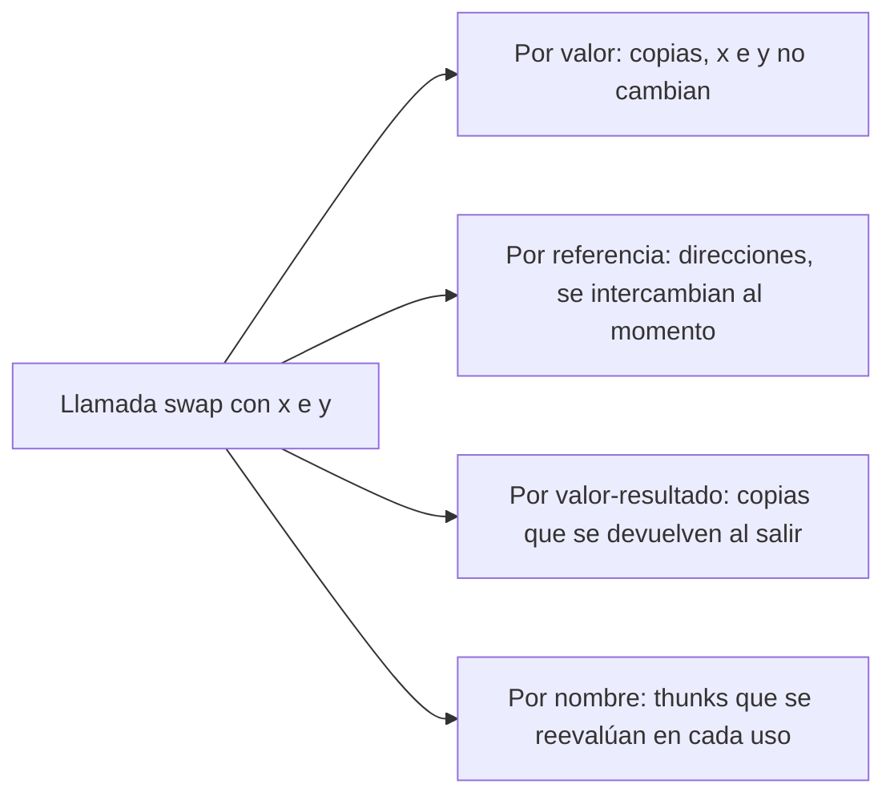

# Compiladores - La abstracción de procedimiento

## 6.4 Comunicación de valores entre procedimientos.

---

Un procedimiento recibe información del que lo llama por sus **parámetros** y le devuelve información por su **valor de retorno**, por los parámetros que modifica y por las variables globales. La regla que relaciona cada **argumento** de la llamada con su **parámetro formal** es el mecanismo de paso, y de ella depende qué ve el procedimiento cuando el argumento cambia, qué ve el que llama cuando el parámetro cambia, y cuánto cuesta la llamada. Este tema presenta los mecanismos clásicos, por valor, por referencia, por valor-resultado, por nombre y por necesidad, sus diferencias con alias y efectos secundarios, su implementación con temporales y *thunks*, y su costo en el código real de gcc.

### Los mecanismos

| Mecanismo | Qué recibe el parámetro | Efecto de asignarlo | Lenguajes |
| --------- | ----------------------- | ------------------- | --------- |
| por valor | una copia del valor del argumento | ninguno fuera del procedimiento | C, Java para los tipos primitivos, Python para las referencias a objetos |
| por referencia | la dirección del argumento | modifica el argumento inmediatamente | parámetros `var` de Pascal, `&` de C++, `ref` de C# |
| por valor-resultado | una copia, que se copia de regreso al terminar | modifica el argumento al regresar | parámetros `in out` de Ada para tipos escalares, Fortran en algunas implementaciones |
| por nombre | una expresión sin evaluar, que se reevalúa en cada uso | evalúa la dirección del argumento y la modifica | ALGOL 60 |
| por necesidad | una expresión que se evalúa la primera vez y se memoriza | normalmente no se permite | Haskell |

Python y Java pasan por valor una **referencia** al objeto: el procedimiento puede modificar el objeto, pero no hacer que la variable del que llama apunte a otro.

### Implementación

- **Por valor:** el que llama evalúa el argumento y coloca el valor en un registro o en la pila.
- **Por referencia:** coloca la **dirección** del argumento; si el argumento no tiene dirección, como `x + 1` o una constante, se evalúa en un temporal y se pasa la dirección del temporal. Cada uso del parámetro es un acceso indirecto.
- **Por valor-resultado:** al entrar, se copia el valor, y al salir, la copia se escribe de regreso en las direcciones calculadas **al entrar**. Sin alias equivale a la referencia; con alias, el resultado depende del orden de las copias de regreso.
- **Por nombre:** el que llama pasa un ***thunk***, un procedimiento sin parámetros con su entorno, que calcula el valor o la dirección del argumento en el contexto del que llama; cada uso del parámetro lo invoca. Es poderoso, como muestra el **dispositivo de Jensen**, pero costoso y difícil de razonar: un `swap` correcto por nombre no puede escribirse en general.
- **Por necesidad:** el *thunk* guarda su resultado después de la primera evaluación, de modo que el argumento se evalúa a lo más una vez.

Los valores de retorno pequeños van en registros, como `rax` en x86-64; los grandes, en un espacio que reserva el que llama y cuya dirección pasa como parámetro oculto.



### Implementación en Python

El programa implementa un intérprete con memoria explícita en el que el mismo procedimiento puede llamarse con cinco mecanismos, con temporales para los argumentos sin dirección y *thunks* para el paso por nombre y por necesidad. Con él resuelve los ejercicios 1, 2 y 4, con los ejemplos clásicos de alias y el dispositivo de Jensen; implementa en C el valor-resultado a mano, y para el ejercicio 3 compila con gcc 13 las llamadas con estructuras y enteros por valor y por referencia, con las utilidades del tema 6.1 incluidas al inicio.

```python
# ===== Núcleo de procedimientos: registros de activación con enlaces estáticos y dinámicos, y utilidades para gcc =====
import os, re, subprocess, tempfile

class Proc:
    """Un procedimiento con parámetros, variables locales, procedimientos anidados y un cuerpo de sentencias:
    ('asig', x, e) ('llama', f, [args]) ('imprime', e) ('punto', etiqueta) ('si', e, [then], [else]) ('ret', e)
    Las expresiones son enteros, nombres o tuplas (op, a, b)."""
    def __init__(self, nombre, params=(), locales=(), anidados=(), cuerpo=()):
        self.nombre, self.params, self.locales, self.anidados, self.cuerpo = nombre, list(params), list(locales), list(anidados), list(cuerpo)
        self.padre = None
        for p in self.anidados: p.padre = self
    def nivel(self): return 0 if self.padre is None else self.padre.nivel() + 1

class Retorno(Exception):
    def __init__(self, v): self.v = v

class Maquina:
    def __init__(self, principal, alcance="estatico"):
        self.principal, self.alcance = principal, alcance
        self.pila, self.salida, self.fotos, self.max_prof, self.recorridos = [], [], {}, 0, []
    # --- registros de activación ---
    def activa(self, proc, args, enlace_estatico):
        marco = {"proc": proc, "vars": dict(zip(proc.params, args)), "ed": len(self.pila) - 1 if self.pila else None, "ee": enlace_estatico}
        for v in proc.locales: marco["vars"].setdefault(v, None)
        self.pila.append(marco); self.max_prof = max(self.max_prof, len(self.pila))
    def busca_marco(self, nombre):
        """Alcance estático: sigue los enlaces estáticos; dinámico: sigue los dinámicos. Cuenta los saltos."""
        k = len(self.pila) - 1; saltos = 0
        while k is not None:
            if nombre in self.pila[k]["vars"]: self.recorridos.append((nombre, saltos)); return k
            k = self.pila[k]["ee"] if self.alcance == "estatico" else self.pila[k]["ed"]; saltos += 1
        raise NameError(nombre)
    def valor(self, e):
        if isinstance(e, int): return e
        if isinstance(e, str): return self.pila[self.busca_marco(e)]["vars"][e]
        op, a, b = e; x, y = self.valor(a), self.valor(b)
        return {"+": x + y, "-": x - y, "*": x * y, "/": x // y, "<": int(x < y), "<=": int(x <= y), "==": int(x == y), ">": int(x > y)}[op]
    def procedimiento(self, nombre):
        """El nombre del procedimiento se resuelve léxicamente: devuelve el procedimiento y el marco de su padre."""
        k = len(self.pila) - 1
        while k is not None:
            p = self.pila[k]["proc"]
            for h in p.anidados:
                if h.nombre == nombre: return h, k
            if p.nombre == nombre and self.pila[k]["ee"] is not None:
                return p, self.pila[k]["ee"]
            k = self.pila[k]["ee"]
        raise NameError(nombre)
    def llama(self, nombre, args):
        proc, padre = self.procedimiento(nombre)
        self.activa(proc, [self.valor(a) for a in args], padre)
        try: self.ejecuta(proc.cuerpo); r = None
        except Retorno as ret: r = ret.v
        self.pila.pop(); return r
    def ejecuta(self, sentencias):
        for s in sentencias:
            k = s[0]
            if k == "asig": self.pila[self.busca_marco(s[1])]["vars"][s[1]] = self.valor(s[2])
            elif k == "llama": self.llama(s[1], s[2])
            elif k == "imprime": self.salida.append(self.valor(s[1]))
            elif k == "punto": self.fotos[s[1]] = self.foto()
            elif k == "si": self.ejecuta(s[2] if self.valor(s[1]) else s[3])
            elif k == "ret": raise Retorno(self.valor(s[1]))
            elif k == "asigllama": self.pila[self.busca_marco(s[1])]["vars"][s[1]] = self.llama(s[2], s[3])
    def corre(self, args=()):
        self.activa(self.principal, list(args), None); self.ejecuta(self.principal.cuerpo); return self
    def foto(self):
        lineas = []
        for k in range(len(self.pila) - 1, -1, -1):
            m = self.pila[k]
            ee = "-" if m["ee"] is None else self.pila[m["ee"]]["proc"].nombre
            ed = "-" if m["ed"] is None else self.pila[m["ed"]]["proc"].nombre
            lineas.append(f"{m['proc'].nombre}: {m['vars']}, enlace estático -> {ee}, enlace dinámico -> {ed}")
        return lineas

# ---------- gcc: compilar, extraer el ensamblador de una función y ejecutar ----------
TMP = tempfile.mkdtemp()
ENV = {**os.environ, "LC_ALL": "C"}
def ensamblador(fuente, opt="-O0", extra=()):
    ruta = os.path.join(TMP, "f.c"); open(ruta, "w").write(fuente)
    r = subprocess.run(["gcc", opt, "-S", "-masm=intel", "-fno-asynchronous-unwind-tables", "-fcf-protection=none", "-fno-stack-protector",
                        *extra, "-o", "-", "f.c"], cwd=TMP, capture_output=True, text=True, env=ENV)
    if r.returncode: raise RuntimeError(r.stderr)
    return r.stdout
def funcion(asm, nombre):
    """Las instrucciones de una función, sin directivas, con los espacios normalizados."""
    lineas, dentro = [], False
    for l in asm.splitlines():
        if re.match(rf"^{re.escape(nombre)}:", l): dentro = True; continue
        if dentro:
            if re.match(r"^\s*\.(size|cfi_endproc)", l) or (re.match(r"^[A-Za-z_]\w*:", l)): break
            if re.match(r"^\s*\.", l) and not re.match(r"^\.L\w+:", l): continue
            lineas.append(" ".join(l.split()))
    return [l for l in lineas if l]
def ejecuta_c(fuente, entrada=None, opt="-O2", extra=()):
    ruta = os.path.join(TMP, "p.c"); open(ruta, "w").write(fuente)
    r = subprocess.run(["gcc", opt, *extra, "-o", "p", "p.c"], cwd=TMP, capture_output=True, text=True, env=ENV)
    if r.returncode: raise RuntimeError(r.stderr)
    return subprocess.run(["./p"], cwd=TMP, input=entrada, capture_output=True, text=True).stdout
def n_instrucciones(f): return sum(1 for l in f if not l.endswith(":"))

# ---------- Un intérprete con cinco mecanismos de paso de parámetros ----------
class Memoria:
    def __init__(self): self.celdas = []
    def nueva(self, v): self.celdas.append(v); return len(self.celdas) - 1
class Thunk:
    """Una expresión diferida con su entorno: se evalúa en cada uso (por nombre) o una vez (por necesidad)."""
    def __init__(self, maquina, expr, entorno, memoriza): self.m, self.e, self.env, self.memo, self.hecho = maquina, expr, entorno, memoriza, False
    def lee(self):
        self.m.evaluaciones += 1
        if self.memo and self.hecho: self.m.evaluaciones -= 1; return self.valor
        self.valor = self.m.valor(self.e, self.env); self.hecho = True; return self.valor
    def direccion(self): return self.m.direccion(self.e, self.env)
class Interprete:
    def __init__(self, procs, mecanismo):
        self.procs, self.mec, self.mem, self.globales, self.evaluaciones = procs, mecanismo, Memoria(), {}, 0
    def declara(self, nombre, valor):
        if isinstance(valor, list): base = len(self.mem.celdas); [self.mem.nueva(v) for v in valor]; self.globales[nombre] = ("arreglo", base)
        else: self.globales[nombre] = self.mem.nueva(valor)
    def busca(self, nombre, env): return env[nombre] if nombre in env else self.globales[nombre]
    def direccion(self, e, env):
        if isinstance(e, int) or (isinstance(e, tuple) and e[0] != "idx"):
            return self.mem.nueva(self.valor(e, env))          # un argumento que no es una variable: temporal, como en Fortran
        if isinstance(e, str):
            b = self.busca(e, env)
            return b.direccion() if isinstance(b, Thunk) else b
        _, a, i = e; base = self.busca(a, env)[1]; return base + self.valor(i, env)       # ('idx', arreglo, índice)
    def valor(self, e, env):
        if isinstance(e, int): return e
        if isinstance(e, str):
            b = self.busca(e, env); return b.lee() if isinstance(b, Thunk) else self.mem.celdas[b]
        if e[0] == "idx": return self.mem.celdas[self.direccion(e, env)]
        op, a, b = e; x, y = self.valor(a, env), self.valor(b, env)
        return {"+": x + y, "-": x - y, "*": x * y, "<=": int(x <= y)}[op]
    def ejecuta(self, sentencias, env):
        for s in sentencias:
            if s[0] == "asig": self.mem.celdas[self.direccion(s[1], env)] = self.valor(s[2], env)
            elif s[0] == "llama": self.llama(s[1], s[2], env)
            elif s[0] == "mientras":
                while self.valor(s[1], env): self.ejecuta(s[2], env)
    def llama(self, nombre, args, env_llamador):
        params, locales, cuerpo = self.procs[nombre]; env, copias = {}, []
        for p, a in zip(params, args):
            if self.mec == "valor": env[p] = self.mem.nueva(self.valor(a, env_llamador))
            elif self.mec == "referencia": env[p] = self.direccion(a, env_llamador)
            elif self.mec == "valor-resultado":
                destino = self.direccion(a, env_llamador); env[p] = self.mem.nueva(self.mem.celdas[destino]); copias.append((env[p], destino))
            else: env[p] = Thunk(self, a, env_llamador, memoriza=self.mec == "necesidad")
        for l in locales: env[l] = self.mem.nueva(0)
        self.ejecuta(cuerpo, env)
        for celda, destino in copias: self.mem.celdas[destino] = self.mem.celdas[celda]   # copia de regreso, en orden
    def lee(self, nombre):
        b = self.globales[nombre]
        return self.mem.celdas[b[1]:b[1] + 3] if isinstance(b, tuple) else self.mem.celdas[b]
MECANISMOS = ("valor", "referencia", "valor-resultado", "nombre")
SWAP = {"swap": (["a", "b"], ["temp"], [("asig", "temp", "a"), ("asig", "a", "b"), ("asig", "b", "temp")])}

# ---------- Ejercicio 1: swap(x, y) con cada mecanismo ----------
for mec in MECANISMOS:
    it = Interprete(SWAP, mec); it.declara("x", 1); it.declara("y", 2); it.llama("swap", ["x", "y"], {})
    print(f"ejercicio 1: {mec:16} x = {it.lee('x')}, y = {it.lee('y')}")
for mec in ("referencia", "nombre"):
    it = Interprete(SWAP, mec); it.declara("i", 0); it.declara("v", [2, 5, 7]); it.llama("swap", ["i", ("idx", "v", "i")], {})
    print(f"   swap(i, v[i]) con i = 0 y v = [2, 5, 7], por {mec:10}: i = {it.lee('i')}, v = {it.lee('v')}")

# ---------- Ejercicio 2: valor-resultado contra referencia con alias ----------
P = {"p": (["a", "b"], [], [("asig", "a", ("+", "a", 1)), ("asig", "b", ("*", "b", 10))])}
for mec in ("valor", "referencia", "valor-resultado"):
    it = Interprete(P, mec); it.declara("x", 5); it.llama("p", ["x", "x"], {})
    print(f"ejercicio 2: p(x, x) con x = 5 y a := a + 1; b := b * 10, por {mec:16} x = {it.lee('x')}")
C_VR = r'''#include <stdio.h>
/* valor-resultado a mano: el llamado trabaja con copias y el que llama las devuelve al terminar */
static void p_cuerpo(int *a, int *b) { *a = *a + 1; *b = *b * 10; }
static void p_valor_resultado(int *dir_a, int *dir_b) {
    int copia_a = *dir_a, copia_b = *dir_b;   /* entrada: copiar los valores */
    p_cuerpo(&copia_a, &copia_b);
    *dir_a = copia_a; *dir_b = copia_b;       /* salida: copiar de regreso, en orden de los parámetros */
}
int main(void) { int x = 5; p_valor_resultado(&x, &x); printf("%d\n", x); int y = 5; p_cuerpo(&y, &y); printf("%d\n", y); return 0; }
'''
print("   en C, valor-resultado a mano y referencia:", ejecuta_c(C_VR).split())

# ---------- Ejercicio 3: costo de pasar 4 enteros y una estructura de 100 bytes ----------
C3 = r'''struct grande { char datos[100]; };
__attribute__((noinline)) int por_valor(struct grande g) { return g.datos[0] + g.datos[99]; }
__attribute__((noinline)) int por_ref(const struct grande *g) { return g->datos[0] + g->datos[99]; }
__attribute__((noinline)) int cuatro(int a, int b, int c, int d) { return a + b + c + d; }
__attribute__((noinline)) int cuatro_ref(const int *a, const int *b, const int *c, const int *d) { return *a + *b + *c + *d; }
struct grande G; int A, B, C, D;
int llama_valor(void) { return por_valor(G); }
int llama_ref(void) { return por_ref(&G); }
int llama_cuatro(void) { return cuatro(A, B, C, D); }
int llama_cuatro_ref(void) { return cuatro_ref(&A, &B, &C, &D); }
'''
asm = ensamblador(C3, "-O2")
for f in ("llama_valor", "llama_ref", "llama_cuatro", "llama_cuatro_ref", "cuatro", "cuatro_ref"):
    ins = funcion(asm, f); acc = sum(bool(re.search(r"\[|PTR", l)) and not l.startswith("lea") for l in ins)
    print(f"ejercicio 3: {f:17} {n_instrucciones(ins):2} instrucciones, {acc:2} con acceso a memoria: {' | '.join(ins)[:150]}")

# ---------- Ejercicio 4: paso por nombre con thunks y el dispositivo de Jensen ----------
SUMA = {"suma": (["i", "inf", "sup", "termino", "total"], [], [
    ("asig", "total", 0), ("asig", "i", "inf"),
    ("mientras", ("<=", "i", "sup"), [("asig", "total", ("+", "total", "termino")), ("asig", "i", ("+", "i", 1))])])}
for mec in ("valor", "referencia", "nombre"):
    it = Interprete(SUMA, mec); it.declara("k", 0); it.declara("r", 0)
    it.llama("suma", ["k", 1, 10, ("*", "k", "k"), "r"], {})
    print(f"ejercicio 4: suma(k, 1, 10, k * k, r) por {mec:10} r = {it.lee("r")}, evaluaciones de thunks: {it.evaluaciones}")
DOBLE = {"doble": (["e", "r"], [], [("asig", "r", ("+", "e", "e"))])}
for mec in ("nombre", "necesidad"):
    it = Interprete(DOBLE, mec); it.declara("q", 7); it.declara("s", 0)
    it.llama("doble", [("*", "q", "q"), "s"], {})
    print(f"   doble(q * q, s) por {mec:9}: s = {it.lee('s')}, evaluaciones del argumento: {it.evaluaciones}")
```

Salida, con gcc 13 `-O2` en x86-64:

```text
ejercicio 1: valor            x = 1, y = 2
ejercicio 1: referencia       x = 2, y = 1
ejercicio 1: valor-resultado  x = 2, y = 1
ejercicio 1: nombre           x = 2, y = 1
   swap(i, v[i]) con i = 0 y v = [2, 5, 7], por referencia: i = 2, v = [0, 5, 7]
   swap(i, v[i]) con i = 0 y v = [2, 5, 7], por nombre    : i = 2, v = [2, 5, 0]
ejercicio 2: p(x, x) con x = 5 y a := a + 1; b := b * 10, por valor            x = 5
ejercicio 2: p(x, x) con x = 5 y a := a + 1; b := b * 10, por referencia       x = 60
ejercicio 2: p(x, x) con x = 5 y a := a + 1; b := b * 10, por valor-resultado  x = 50
   en C, valor-resultado a mano y referencia: ['50', '60']
ejercicio 3: llama_valor       18 instrucciones, 14 con acceso a memoria: sub rsp, 112 | mov eax, DWORD PTR G[rip+96] | movdqa xmm0, XMMWORD PTR G[rip] | movdqa xmm1, XMMWORD PTR G[rip+16] | movdqa xmm2, XMMWORD PTR G[rip+32
ejercicio 3: llama_ref          2 instrucciones,  0 con acceso a memoria: lea rdi, G[rip] | jmp por_ref
ejercicio 3: llama_cuatro       5 instrucciones,  4 con acceso a memoria: mov ecx, DWORD PTR D[rip] | mov edx, DWORD PTR C[rip] | mov esi, DWORD PTR B[rip] | mov edi, DWORD PTR A[rip] | jmp cuatro
ejercicio 3: llama_cuatro_ref   5 instrucciones,  0 con acceso a memoria: lea rcx, D[rip] | lea rdx, C[rip] | lea rsi, B[rip] | lea rdi, A[rip] | jmp cuatro_ref
ejercicio 3: cuatro             4 instrucciones,  0 con acceso a memoria: add edi, esi | add edi, edx | lea eax, [rdi+rcx] | ret
ejercicio 3: cuatro_ref         5 instrucciones,  4 con acceso a memoria: mov eax, DWORD PTR [rsi] | add eax, DWORD PTR [rdi] | add eax, DWORD PTR [rdx] | add eax, DWORD PTR [rcx] | ret
ejercicio 4: suma(k, 1, 10, k * k, r) por valor      r = 0, evaluaciones de thunks: 0
ejercicio 4: suma(k, 1, 10, k * k, r) por referencia r = 0, evaluaciones de thunks: 0
ejercicio 4: suma(k, 1, 10, k * k, r) por nombre     r = 385, evaluaciones de thunks: 53
   doble(q * q, s) por nombre   : s = 98, evaluaciones del argumento: 2
   doble(q * q, s) por necesidad: s = 98, evaluaciones del argumento: 1
```

### Ejercicios Propuestos

1. **Comportamiento.** Predice los valores de `x` y `y` después de la llamada con cada mecanismo de paso:

    ```c
    void swap(int a, int b) {
        int temp = a;
        a = b;
        b = temp;
    }
    int main() {
        int x = 1, y = 2;
        swap(x, y);
    }
    ```

2. **Valor-resultado.** Implementa el mecanismo de valor-resultado en un pseudocódigo de bajo nivel.

3. **Costo.** Calcula el costo de pasar 4 enteros, y una estructura de 100 bytes, por valor y por referencia.

4. **Thunks.** Diseña el mecanismo de *thunks* para el paso por nombre, mostrando cómo se evalúan las expresiones diferidas.

### Soluciones

**Ejercicio 1.** Por **valor**, `x = 1` y `y = 2`: el procedimiento intercambia sus copias, y C, que solo pasa por valor, se comporta así; para intercambiar hay que pasar apuntadores. Por **referencia**, por **valor-resultado** y por **nombre**, `x = 2` y `y = 1`. Pero el paso por nombre falla con `swap(i, v[i])`: con `i = 0` y `v = [2, 5, 7]`, primero `temp := i` da 0 y `i := v[i]` da `i = 2`; después `v[i] := temp` **reevalúa** `v[i]` con el nuevo `i` y escribe en `v[2]`, de modo que queda `v = [2, 5, 0]` en lugar de `v = [0, 5, 7]`. Por referencia, las direcciones se calcularon al entrar y el intercambio es correcto.

**Ejercicio 2.** El valor-resultado se implementa con copias en la entrada y en la salida:

```text
entrada:  dir_a := &argumento_1;  dir_b := &argumento_2   ; direcciones calculadas al entrar
          copia_a := *dir_a;      copia_b := *dir_b
cuerpo:   usa copia_a y copia_b como variables locales
salida:   *dir_a := copia_a;      *dir_b := copia_b       ; en el orden de los parámetros
```

La diferencia con la referencia aparece con **alias**. Con `p(x, x)`, donde el cuerpo hace `a := a + 1; b := b * 10` y $x = 5:$ por referencia, `a` y `b` son la misma celda, así que $x = (5 + 1) \cdot 10 = 60;$ por valor-resultado, las copias son independientes, $a = 6$ y $b = 50,$ y al salir se copia primero `a` y después `b`, de modo que gana la última: $x = 50.$ El programa en C con el valor-resultado escrito a mano da lo mismo. Ada declara ilegales o erróneos los programas cuyo resultado dependa de esa diferencia.

**Ejercicio 3.** Con gcc `-O2`:

| Llamada | Instrucciones del que llama | Accesos a memoria |
| ------- | --------------------------- | ----------------- |
| 4 enteros por valor | 5: cuatro cargas en registros y el salto | 4 en el que llama, ninguno en el llamado |
| 4 enteros por referencia | 5: cuatro `lea` de direcciones | ninguno en el que llama, 4 en el llamado |
| estructura de 100 bytes por valor | 18: reserva 112 bytes de pila y copia la estructura con registros SSE de 16 bytes | 14 |
| estructura por referencia | 2: un `lea` y el salto | ninguno en el que llama |

Para los enteros, la diferencia es pequeña: por valor se cargan en el que llama, y por referencia en el llamado, con un acceso indirecto por cada uso. Para la estructura, la copia por valor cuesta unas 14 instrucciones de memoria y 112 bytes de pila en cada llamada, y por referencia es constante; por eso las estructuras grandes se pasan con `const struct T *`, o `const T &` en C++, que además le promete al llamado que no la modifica. En x86-64, las estructuras de hasta 16 bytes de enteros sí viajan en registros.

**Ejercicio 4.** Para cada argumento, el compilador genera un ***thunk***: un pequeño procedimiento con un apuntador al marco del que llama, que calcula el valor del argumento, o su dirección si se asigna al parámetro. Cada uso del parámetro es una llamada al *thunk*. Con el **dispositivo de Jensen**, `suma(k, 1, 10, k * k, r)` recibe `k` y `k * k` por nombre; cada vez que el ciclo asigna `i`, cambia `k`, y cada uso de `termino` reevalúa `k * k`, así que $r = \sum_{k=1}^{10} k^2 = 385,$ con 53 evaluaciones de *thunks*. Por valor o por referencia, `k * k` se evalúa una sola vez, al llamar, y el resultado es 0. Por **necesidad**, el *thunk* memoriza su valor: en `doble(q * q, s)`, que usa dos veces su parámetro, el paso por nombre evalúa `q * q` dos veces y por necesidad una, con el mismo resultado, 98, porque la expresión no tiene efectos secundarios.

En el material original, la fórmula del beneficio de la expansión en línea restaba un tiempo de comunicación y un "incremento del tamaño del código", que no se miden en las mismas unidades, y el ejercicio 3 se titulaba "Overhead Calculation", en inglés, y pedía ciclos de reloj sin dar ningún modelo de costo.

### Referencias

1. Cooper, K. D., and Torczon, L., _Engineering a Compiler_. 3a ed., Morgan Kaufmann, 2022. Sección 6.4.
2. Aho, A. V., Lam, M. S., Sethi, R., and Ullman, J. D., _Compilers: Principles, Techniques, and Tools_. 2a ed., Pearson, 2007. Sección 1.6.6.
3. Naur, P., ed., Revised report on the algorithmic language ALGOL 60. _Communications of the ACM_ 6(1), 1963.
4. Ingerman, P. Z., Thunks: a way of compiling procedure statements with some comments on procedure declarations. _Communications of the ACM_ 4(1), 1961.
5. Matz, M., et al., _System V Application Binary Interface, AMD64 Architecture Processor Supplement_. Sección 3.2.3, paso de parámetros.
