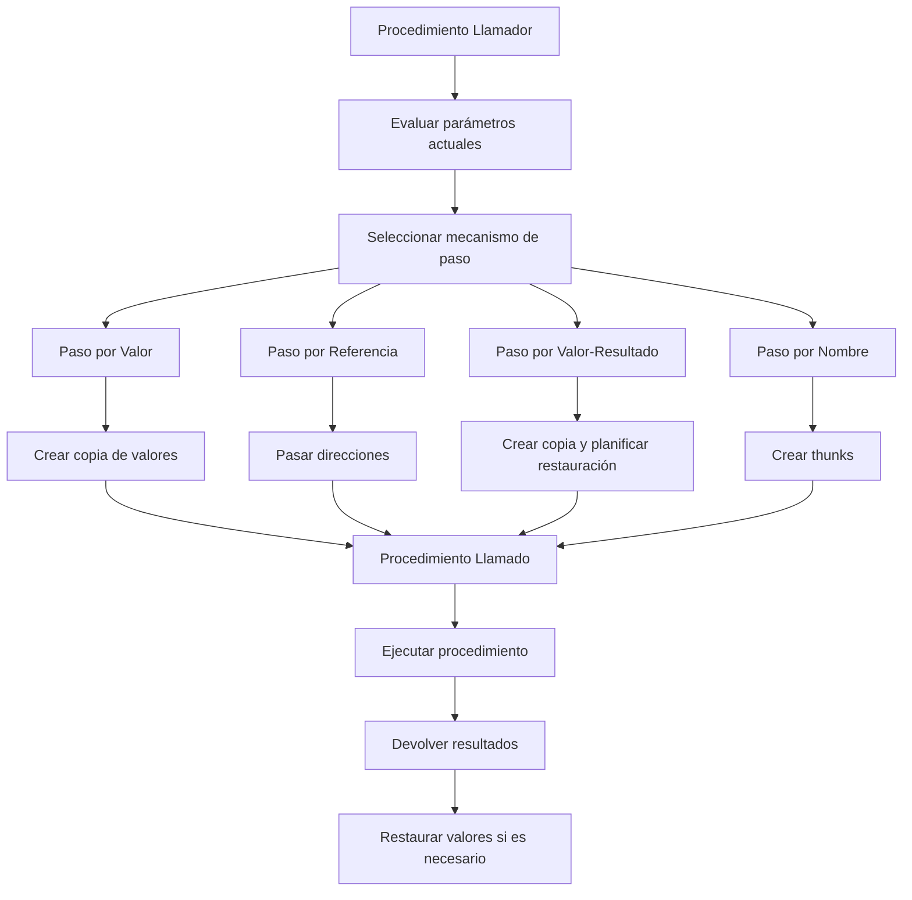

# Compiladores - La abstracción de procedimiento

## 6.4 Comunicación de valores entre procedimientos.

---

La comunicación de valores entre procedimientos es un aspecto fundamental de la abstracción de procedimiento que determina cómo se transfieren datos entre diferentes contextos de ejecución. Esta guía explora los mecanismos, implementaciones y optimizaciones relacionadas con el intercambio de información entre procedimientos.

### Definición y Conceptos Clave

#### Comunicación de Valores

Según Aho et al. (2007), "la comunicación de valores entre procedimientos se refiere a los mecanismos mediante los cuales los datos fluyen desde el procedimiento llamador al procedimiento llamado y viceversa, incluyendo el paso de parámetros y el retorno de resultados".

#### Registro de Activación

Estructura que contiene toda la información necesaria para la ejecución de un procedimiento:

$$ \text{RegistroActivación} = \begin{Bmatrix} \begin{array}{ll} \text{Parámetros} & \\\ \text{Variables locales} & \\\ \text{Dirección de retorno} & \\\ \text{Enlace de control} & \\\ \text{Enlace de acceso} & \\\ \text{Valor de retorno} & \\\ \end{array} \end{Bmatrix} $$

### Mecanismos de Paso de Parámetros

#### Paso por Valor (Call by Value)

Se pasa una copia del valor actual del parámetro:

$$ \text{Valor}\_{formal} = \text{copia}(\text{Valor}\_{actual}) $$

**Ventajas**: Seguro, evita efectos secundarios  
**Desventajas**: Overhead de copia, no permite modificación del original

#### Paso por Referencia (Call by Reference)

Se pasa la dirección de memoria del parámetro:

$$ \text{Dirección\_formal} = \& (\text{Variable\_actual}) $$

**Ventajas**: Eficiente, permite modificación  
**Desventajas**: Puede causar aliasing, menos seguro

#### Paso por Valor-Resultado (Copy-Restore)

Combina paso por valor y restauración del valor:

$$ \text{Valor}\_{formal} = \text{copia}(\text{Valor}\_{actual}) $$
$$ \text{Valor}\_{actual} = \text{copia}(\text{Valor}\_{formal}) \text{ al retornar} $$

#### Paso por Nombre (Call by Name)

Se pasa una expresión sin evaluar (thunk):

$$ \text{Thunk}\_{formal} = \lambda() \rightarrow \text{Expresión}\_{actual} $$

### Implementación de Mecanismos de Paso

#### Diagrama de Flujo de Comunicación



#### Código de Ejemplo

```c
// Paso por valor
void por_valor(int x) {
    x = x + 1;  // No afecta al original
}

// Paso por referencia
void por_referencia(int *x) {
    *x = *x + 1;  // Modifica el original
}

// Paso por valor-resultado
void por_valor_resultado(int *x) {
    *x = *x + 1;  // Trabaja con copia, pero restaura
}

int main() {
    int a = 5;
    por_valor(a);          // a sigue siendo 5
    por_referencia(&a);    // a ahora es 6
    return 0;
}
```

### Convenciones de Llamada

#### CDECL (Convención C)

```assembly
; Caller responsibilities
push param3
push param2
push param1
call function
add esp, 12  ; Cleanup stack

; Callee responsibilities
push ebp
mov ebp, esp
; ... function body ...
pop ebp
ret
```

#### STDCALL

```assembly
; Callee cleans up parameters
ret 12  ; Return and cleanup 12 bytes
```

### Fórmulas y Cálculos

#### Overhead de Comunicación

El overhead total de comunicación se calcula como:

$$ T_{\text{comunicación}} = T_{\text{paso}} + T_{\text{retorno}} + T_{\text{limpieza}} $$

Donde:

- $T_{\text{paso}} = n \times (t_{\text{evaluación}} + t_{\text{copia}})$
- $T_{\text{retorno}} = t_{\text{copia resultado}}$
- $T_{\text{limpieza}} = t_{\text{liberación recursos}}$

#### Costo de Diferentes Mecanismos

| Mecanismo       | Costo Paso         | Costo Retorno      | Seguridad |
| --------------- | ------------------ | ------------------ | --------- |
| Por Valor       | $O(\text{tamaño})$ | $O(1)$             | Alta      |
| Por Referencia  | $O(1)$             | $O(1)$             | Media     |
| Valor-Resultado | $O(\text{tamaño})$ | $O(\text{tamaño})$ | Alta      |
| Por Nombre      | $O(1)$             | $O(1)$             | Baja      |

### Ejemplos Avanzados

#### Paso de Parámetros en Diferentes Lenguajes

**Java** (solo paso por valor):

```java
void modificarLista(List<String> lista) {
    lista.add("nuevo");  // Modifica el objeto original
    lista = new ArrayList<>();  // No afecta al original
}
```

**Python** (paso por asignación):

```python
def modificar(a, b):
    a.append(1)  # Modifica la lista original
    b = 20       # No afecta al original

x = [0]
y = 10
modificar(x, y)
```

#### Implementación de Thunks para Paso por Nombre

```scheme
; Paso por nombre en Scheme
(define (pasar-por-nombre thunk)
  (display (thunk))  ; Evaluar cuando se necesita
)

(pasar-por-nombre (lambda () (+ 2 3)))  ; Pasar expresión
```

### Ejercicios Propuestos

1. **Análisis de Comportamiento**: Para cada mecanismo de paso, prediga el resultado:

```c
void swap(int a, int b) {
    int temp = a;
    a = b;
    b = temp;
}

int main() {
    int x = 1, y = 2;
    swap(x, y);
    // ¿Valores de x e y?
}
```

2. **Implementación de Valor-Resultado**: Implemente el mecanismo de valor-resultado en un pseudocódigo de bajo nivel.

3. **Overhead Calculation**: Calcule el overhead en ciclos de reloj para pasar:
   - 4 integers por valor vs por referencia
   - 1 estructura de 100 bytes por valor vs por referencia

4. **Diseño de Thunks**: Diseñe el mecanismo de thunks para paso por nombre, mostrando cómo se evalúan las expresiones diferidas.

### Optimizaciones

#### Eliminación de Copias Innecesarias

```c
// Antes de optimización
void process_large_struct(struct BigData data) {
    // Trabaja con copia
}

// Después de optimización
void process_large_struct(const struct BigData *data) {
    // Trabaja con referencia constante
}
```

#### Inline Expansion para Reducir Comunicación

$$ \text{Beneficio} = T_{\text{overhead comunicación}} - T_{\text{incremento tamaño código}} $$

### Referencias

#### Bibliografía Básica

1. **Aho, A. V., et al. (2007)**: _Compilers: Principles, Techniques, and Tools_ (Capítulo 1.6: Parameter Passing)
2. **Cooper, K. D., & Torczon, L. (2004)**: _Engineering a Compiler_ (Capítulo 6.3: Parameter Passing Mechanisms)
3. **Scott, M. L. (2009)**: _Programming Language Pragmatics_ (Capítulo 8.3: Parameter Passing)

#### Bibliografía Complementaria

1. **Grune, D., et al. (2000)**: _Modern Compiler Design_ (Capítulo 7.2: Parameter Passing)
2. **Wilhelm, R., & Maurer, D. (1995)**: _Compiler Design_ (Capítulo 7: Parameter Handling)

### Casos de Estudio

#### Comunicación en Lenguajes Modernos

**Rust** (ownership system):

```rust
fn take_ownership(s: String) -> String {
    s  // Transfiere propiedad
}

fn borrow_reference(s: &String) {
    // Presta referencia inmutable
}

fn main() {
    let data = String::from("hello");
    let result = take_ownership(data);  // data se mueve
    // data ya no es usable aquí
    borrow_reference(&result);  // Préstamo inmutable
}
```

**Swift** (copy-on-write):

```swift
func modifyArray(_ arr: inout [Int]) {
    arr.append(5)  // Copia solo si es necesario
}

var numbers = [1, 2, 3]
modifyArray(&numbers)
```

### Conclusión

La comunicación de valores entre procedimientos es un aspecto crítico del diseño de compiladores que afecta significativamente el rendimiento, la seguridad y la semántica de los programas. Los diferentes mecanismos de paso ofrecen trade-offs entre eficiencia y seguridad, y su implementación requiere un cuidadoso diseño de las convenciones de llamada y gestión de memoria.

### Recursos Adicionales

- [GCC Calling Conventions](https://gcc.gnu.org/onlinedocs/gcc/Calling-Conventions.html)
- [LLVM Parameter Passing](https://llvm.org/docs/LangRef.html#parameter-attributes)
- [Compilers: Parameter Passing Techniques](https://www.cs.cornell.edu/courses/cs412/2008SP/lectures/lec09.pdf)
