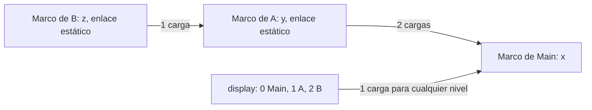

# Compiladores - La abstracción de procedimiento

## 6.5 Establecimiento de la direccionabilidad.

---

Para generar una instrucción que lea o escriba una variable, el compilador necesita una **dirección** que el código pueda calcular en ejecución: una base, conocida en un registro o calculable con pocas instrucciones, más un desplazamiento fijo. Establecer esa direccionabilidad es fácil para las variables globales, que tienen una etiqueta, y para las locales del procedimiento actual, que están a un desplazamiento del apuntador de marco; requiere más trabajo para las variables de procedimientos que lo rodean, en los lenguajes con anidamiento. Este tema presenta las clases de almacenamiento, los desplazamientos en el marco, los enlaces estáticos y el *display*, y la promoción de variables a registros, comparando con lo que hace gcc.

### Clases de almacenamiento y sus bases

| Clase | Dónde vive | Base de la dirección |
| ----- | ---------- | -------------------- |
| global o estática | segmento de datos, `.data` o `.bss` | una etiqueta; en código independiente de la posición, relativa al contador de programa, como `G[rip]` |
| local del procedimiento actual | marco en la pila | el apuntador de marco, `rbp`, o el de pila, `rsp` |
| local de un procedimiento que lo rodea | marco de otra activación | el marco al que se llega por enlaces estáticos o con el *display* |
| dinámica | montículo | un apuntador guardado en otra variable |

La dirección de una variable local es $\text{fp} + \text{desplazamiento},$ con un desplazamiento que el compilador fija al construir el marco: los parámetros que llegan por la pila tienen desplazamientos positivos, por encima de la dirección de retorno, y las locales negativos. Si el marco tiene tamaño fijo, el compilador puede usar $\text{sp}$ como base y liberar $\text{fp}$ como registro general, con `-fomit-frame-pointer`, que gcc activa al optimizar.

### Variables de ámbitos exteriores

Con procedimientos anidados, una variable con coordenada estática $\langle d, o \rangle,$ usada desde un procedimiento de profundidad $p,$ está en el marco de la activación más reciente del procedimiento de profundidad $d$ que rodea al actual. Hay dos formas de encontrar ese marco:

- **enlaces estáticos:** cada marco guarda la dirección del marco del procedimiento que lo contiene textualmente; se siguen $p - d$ enlaces, cada uno una carga de memoria. Al llamar a un procedimiento de profundidad $q$ desde uno de profundidad $p,$ el enlace estático se obtiene siguiendo $p - q + 1$ enlaces desde el marco del que llama;
- ***display*:** un arreglo global con un apuntador por profundidad léxica, $\text{display}[d],$ al marco más reciente de esa profundidad; cualquier variable está a una carga, a cambio de guardar y restaurar una entrada del *display* en cada llamada.

En la práctica, los anidamientos son poco profundos y los enlaces estáticos son lo más común; GCC los implementa para las funciones anidadas de C, con trampolines si se toma su dirección.



### Promoción a registros

El acceso más rápido es no acceder a memoria: el optimizador mantiene en **registros** las variables escalares cuya dirección no se toma y que no pueden ser modificadas por otro camino, y solo las guarda en el marco si se queda sin registros. `volatile` lo impide, porque obliga a leer y escribir la memoria en cada uso; tomar la dirección de una variable lo dificulta, porque puede haber **alias**. Las mismas ideas se aplican a las direcciones calculadas: la dirección de `v[i]` en un ciclo se convierte en un apuntador que avanza, una reducción de fuerza.

### Implementación en Python

El programa calcula los desplazamientos de libro del ejercicio 1 y los compara con los de gcc 13 en 32 y 64 bits, leyendo del ensamblador qué dirección se pasa por cada argumento; implementa una pila simulada palabra por palabra con enlaces estáticos y dinámicos, y la función del ejercicio 2, que llega al marco objetivo contando las cargas, para dibujar la pila del ejercicio 3, y para el ejercicio 4 compara los accesos a memoria de un ciclo con y sin optimización y con `volatile`. Usa las utilidades de compilación del tema 6.1, incluidas al inicio.

```python
# ===== Núcleo de procedimientos: registros de activación con enlaces estáticos y dinámicos, y utilidades para gcc =====
import os, re, subprocess, tempfile

class Proc:
    """Un procedimiento con parámetros, variables locales, procedimientos anidados y un cuerpo de sentencias:
    ('asig', x, e) ('llama', f, [args]) ('imprime', e) ('punto', etiqueta) ('si', e, [then], [else]) ('ret', e)
    Las expresiones son enteros, nombres o tuplas (op, a, b)."""
    def __init__(self, nombre, params=(), locales=(), anidados=(), cuerpo=()):
        self.nombre, self.params, self.locales, self.anidados, self.cuerpo = nombre, list(params), list(locales), list(anidados), list(cuerpo)
        self.padre = None
        for p in self.anidados: p.padre = self
    def nivel(self): return 0 if self.padre is None else self.padre.nivel() + 1

class Retorno(Exception):
    def __init__(self, v): self.v = v

class Maquina:
    def __init__(self, principal, alcance="estatico"):
        self.principal, self.alcance = principal, alcance
        self.pila, self.salida, self.fotos, self.max_prof, self.recorridos = [], [], {}, 0, []
    # --- registros de activación ---
    def activa(self, proc, args, enlace_estatico):
        marco = {"proc": proc, "vars": dict(zip(proc.params, args)), "ed": len(self.pila) - 1 if self.pila else None, "ee": enlace_estatico}
        for v in proc.locales: marco["vars"].setdefault(v, None)
        self.pila.append(marco); self.max_prof = max(self.max_prof, len(self.pila))
    def busca_marco(self, nombre):
        """Alcance estático: sigue los enlaces estáticos; dinámico: sigue los dinámicos. Cuenta los saltos."""
        k = len(self.pila) - 1; saltos = 0
        while k is not None:
            if nombre in self.pila[k]["vars"]: self.recorridos.append((nombre, saltos)); return k
            k = self.pila[k]["ee"] if self.alcance == "estatico" else self.pila[k]["ed"]; saltos += 1
        raise NameError(nombre)
    def valor(self, e):
        if isinstance(e, int): return e
        if isinstance(e, str): return self.pila[self.busca_marco(e)]["vars"][e]
        op, a, b = e; x, y = self.valor(a), self.valor(b)
        return {"+": x + y, "-": x - y, "*": x * y, "/": x // y, "<": int(x < y), "<=": int(x <= y), "==": int(x == y), ">": int(x > y)}[op]
    def procedimiento(self, nombre):
        """El nombre del procedimiento se resuelve léxicamente: devuelve el procedimiento y el marco de su padre."""
        k = len(self.pila) - 1
        while k is not None:
            p = self.pila[k]["proc"]
            for h in p.anidados:
                if h.nombre == nombre: return h, k
            if p.nombre == nombre and self.pila[k]["ee"] is not None:
                return p, self.pila[k]["ee"]
            k = self.pila[k]["ee"]
        raise NameError(nombre)
    def llama(self, nombre, args):
        proc, padre = self.procedimiento(nombre)
        self.activa(proc, [self.valor(a) for a in args], padre)
        try: self.ejecuta(proc.cuerpo); r = None
        except Retorno as ret: r = ret.v
        self.pila.pop(); return r
    def ejecuta(self, sentencias):
        for s in sentencias:
            k = s[0]
            if k == "asig": self.pila[self.busca_marco(s[1])]["vars"][s[1]] = self.valor(s[2])
            elif k == "llama": self.llama(s[1], s[2])
            elif k == "imprime": self.salida.append(self.valor(s[1]))
            elif k == "punto": self.fotos[s[1]] = self.foto()
            elif k == "si": self.ejecuta(s[2] if self.valor(s[1]) else s[3])
            elif k == "ret": raise Retorno(self.valor(s[1]))
            elif k == "asigllama": self.pila[self.busca_marco(s[1])]["vars"][s[1]] = self.llama(s[2], s[3])
    def corre(self, args=()):
        self.activa(self.principal, list(args), None); self.ejecuta(self.principal.cuerpo); return self
    def foto(self):
        lineas = []
        for k in range(len(self.pila) - 1, -1, -1):
            m = self.pila[k]
            ee = "-" if m["ee"] is None else self.pila[m["ee"]]["proc"].nombre
            ed = "-" if m["ed"] is None else self.pila[m["ed"]]["proc"].nombre
            lineas.append(f"{m['proc'].nombre}: {m['vars']}, enlace estático -> {ee}, enlace dinámico -> {ed}")
        return lineas

# ---------- gcc: compilar, extraer el ensamblador de una función y ejecutar ----------
TMP = tempfile.mkdtemp()
ENV = {**os.environ, "LC_ALL": "C"}
def ensamblador(fuente, opt="-O0", extra=()):
    ruta = os.path.join(TMP, "f.c"); open(ruta, "w").write(fuente)
    r = subprocess.run(["gcc", opt, "-S", "-masm=intel", "-fno-asynchronous-unwind-tables", "-fcf-protection=none", "-fno-stack-protector",
                        *extra, "-o", "-", "f.c"], cwd=TMP, capture_output=True, text=True, env=ENV)
    if r.returncode: raise RuntimeError(r.stderr)
    return r.stdout
def funcion(asm, nombre):
    """Las instrucciones de una función, sin directivas, con los espacios normalizados."""
    lineas, dentro = [], False
    for l in asm.splitlines():
        if re.match(rf"^{re.escape(nombre)}:", l): dentro = True; continue
        if dentro:
            if re.match(r"^\s*\.(size|cfi_endproc)", l) or (re.match(r"^[A-Za-z_]\w*:", l)): break
            if re.match(r"^\s*\.", l) and not re.match(r"^\.L\w+:", l): continue
            lineas.append(" ".join(l.split()))
    return [l for l in lineas if l]
def ejecuta_c(fuente, entrada=None, opt="-O2", extra=()):
    ruta = os.path.join(TMP, "p.c"); open(ruta, "w").write(fuente)
    r = subprocess.run(["gcc", opt, *extra, "-o", "p", "p.c"], cwd=TMP, capture_output=True, text=True, env=ENV)
    if r.returncode: raise RuntimeError(r.stderr)
    return subprocess.run(["./p"], cwd=TMP, input=entrada, capture_output=True, text=True).stdout
def n_instrucciones(f): return sum(1 for l in f if not l.endswith(":"))

# ---------- Ejercicio 1: desplazamientos de parámetros y locales ----------
TAM = {"int": (4, 4), "double": (8, 8), "char": (1, 1), "float": (4, 4)}
def layout(vars_):
    d, res = 0, {}
    for n, tam, al in vars_: d = (d + tam + al - 1) // al * al; res[n] = -d
    return res
params32, d = {}, 8                                    # en x86 de 32 bits: [ebp] = ebp anterior, [ebp+4] = retorno
for n, t in [("a", "int"), ("b", "double"), ("c", "char")]:
    params32[n] = d; d += max(4, TAM[t][0])            # cada argumento ocupa múltiplos de 4 bytes en la pila
locales = layout([("x", 4, 4), ("y", 20, 4), ("z", 16, 8)])
print("ejercicio 1, de libro con la convención de C de 32 bits: parámetros", params32, "| locales", locales)
C1 = """void usa(void *, ...);
void ejemplo(int a, double b, char c) {
    int x;
    float y[5];
    struct { int p; double q; } z;
    usa(&a, &b, &c, &x, y, &z);
}"""
def direcciones(f, regs_arg):
    regs = {}
    for l in f:
        m1 = re.match(r"lea (\w+), (-?\d+)\[[re]bp\]", l) or re.match(r"lea (\w+), \[[re]bp(-\d+)\]", l)
        m2 = re.match(r"mov (\w+), (\w+)$", l)
        if m1: regs[m1.group(1)] = int(m1.group(2))
        elif m2 and m2.group(2) in regs: regs[m2.group(1)] = regs[m2.group(2)]
        if l.startswith("call"): break
    return [regs.get(r) for r in regs_arg]
f64 = funcion(ensamblador(C1, "-O0"), "ejemplo")
print("   gcc 13 x86-64:", dict(zip("abcxyz", direcciones(f64, ["rdi", "rsi", "rdx", "rcx", "r8", "r9"]))), "|", next(l for l in f64 if "rsp, " in l and ("sub" in l or "add" in l)))
f32 = funcion(ensamblador(C1, "-O0", ("-m32", "-fno-pic")), "ejemplo")
empujados = [int(re.search(r"\[ebp([+-]\d+)\]", f32[k - 1]).group(1)) for k, l in enumerate(f32) if l == "push eax" and f32[k - 1].startswith("lea")]
print("   gcc 13 x86-32:", dict(zip("abcxyz", reversed(empujados))), "| lee b de", sorted({int(x) for l in f32 for x in re.findall(r"\[ebp\+(1[26])\]", l)}),
      "y c de", sorted({int(x) for l in f32 for x in re.findall(r"\[ebp\+(20)\]", l)}))

# ---------- Ejercicios 2 y 3: enlaces estáticos sobre una pila simulada ----------
class Pila:
    """Memoria por palabras. Marco: [fp] = enlace dinámico, [fp+1] = enlace estático, [fp+2...] = variables."""
    def __init__(self): self.mem, self.fp, self.nombres = [], None, {}
    def entra(self, proc, enlace_estatico, variables):
        base = len(self.mem); self.mem += [self.fp, enlace_estatico] + [0] * len(variables)
        self.nombres[base] = (proc, variables); self.fp = base; return base
    def sale(self): base = self.fp; self.fp = self.mem[base]; del self.mem[base:]; del self.nombres[base]
    def marco_objetivo(self, fp, saltos, cargas):
        """Ejercicio 2: sigue 'saltos' enlaces estáticos desde fp; cada salto es una carga de memoria."""
        for _ in range(saltos): fp = self.mem[fp + 1]; cargas.append(fp)
        return fp
    def dir(self, coordenada, profundidad_actual):
        nivel, desp = coordenada; cargas = []
        return self.marco_objetivo(self.fp, profundidad_actual - nivel, cargas) + 2 + desp, cargas
p = Pila()
main = p.entra("Main", None, ["x"]); p.mem[main + 2] = 1           # x := 1
a = p.entra("A", main, ["y"]); p.mem[a + 2] = 2                    # y := 2; el enlace estático de A es Main
b = p.entra("B", a, ["z"])                                         # el enlace estático de B es A
COORD = {"x": (0, 0), "y": (1, 0), "z": (2, 0)}                    # (profundidad léxica, desplazamiento)
dx, cx = p.dir(COORD["x"], 2); dy, cy = p.dir(COORD["y"], 2); dz, _ = p.dir(COORD["z"], 2)
p.mem[dz] = p.mem[dx] + p.mem[dy]
print("ejercicio 2: dirección de x desde B:", dx, "con cargas en", cx, "| de y:", dy, "con", cy, "| de z:", dz)
print("ejercicio 3: memoria, palabra por palabra:")
for base, (proc, vs) in sorted(p.nombres.items(), reverse=True):
    print(f"   {proc}: fp = {base}, [fp] enlace dinámico = {p.mem[base]}, [fp+1] enlace estático = {p.mem[base + 1]}, "
          + ", ".join(f"{v} = {p.mem[base + 2 + k]}" for k, v in enumerate(vs)))
display = {0: main, 1: a, 2: b}
print("   con un display, cada variable está a una carga: display =", display, "| x en", display[0] + 2, ", y en", display[1] + 2)

# ---------- Ejercicio 4: variables en registros ----------
C4 = """int suma(const int *v, int n) {
    int total = 0;
    for (int i = 0; i < n; i++) total += v[i];
    return total;
}
int suma_volatil(const int *v, int n) {
    volatile int total = 0;
    for (int i = 0; i < n; i++) total += v[i];
    return total;
}"""
for opt in ("-O0", "-O1"):
    asm = ensamblador(C4, opt)
    for nombre in ("suma", "suma_volatil"):
        f = funcion(asm, nombre)
        pila = sum(bool(re.search(r"\[(rbp|rsp)", l)) or bool(re.search(r"-\d+\[rbp\]|\d*\[rsp\]", l)) for l in f)
        print(f"ejercicio 4: gcc {opt} {nombre:13} {n_instrucciones(f):2} instrucciones, {pila:2} accesos a la pila")
print("   ciclo de suma con -O1:", " | ".join(l for l in funcion(ensamblador(C4, "-O1"), "suma")))
```

Salida:

```text
ejercicio 1, de libro con la convención de C de 32 bits: parámetros {'a': 8, 'b': 12, 'c': 20} | locales {'x': -4, 'y': -24, 'z': -40}
   gcc 13 x86-64: {'a': -52, 'b': -64, 'c': -56, 'x': -4, 'y': -32, 'z': -48} | sub rsp, 64
   gcc 13 x86-32: {'a': 8, 'b': -64, 'c': -68, 'x': -12, 'y': -32, 'z': -44} | lee b de [12, 16] y c de [20]
ejercicio 2: dirección de x desde B: 2 con cargas en [3, 0] | de y: 5 con [3] | de z: 8
ejercicio 3: memoria, palabra por palabra:
   B: fp = 6, [fp] enlace dinámico = 3, [fp+1] enlace estático = 3, z = 3
   A: fp = 3, [fp] enlace dinámico = 0, [fp+1] enlace estático = 0, y = 2
   Main: fp = 0, [fp] enlace dinámico = None, [fp+1] enlace estático = None, x = 1
   con un display, cada variable está a una carga: display = {0: 0, 1: 3, 2: 6} | x en 2 , y en 5
ejercicio 4: gcc -O0 suma          21 instrucciones, 11 accesos a la pila
ejercicio 4: gcc -O0 suma_volatil  23 instrucciones, 12 accesos a la pila
ejercicio 4: gcc -O1 suma          14 instrucciones,  0 accesos a la pila
ejercicio 4: gcc -O1 suma_volatil  14 instrucciones,  4 accesos a la pila
   ciclo de suma con -O1: test esi, esi | jle .L4 | mov rax, rdi | movsx rsi, esi | lea rcx, [rdi+rsi*4] | mov edx, 0 | .L3: | add edx, DWORD PTR [rax] | add rax, 4 | cmp rax, rcx | jne .L3 | .L1: | mov eax, edx | ret | .L4: | mov edx, 0 | jmp .L1
```

### Ejercicios Propuestos

1. **Desplazamientos.** Calcula los desplazamientos de todos los parámetros y variables locales de:

    ```c
    void ejemplo(int a, double b, char c) {
        int x;
        float y[5];
        struct { int p; double q; } z;
    }
    ```

2. **Enlaces estáticos.** Implementa una función que, dado el apuntador de marco actual y una diferencia de niveles de anidamiento, devuelva el apuntador de marco del ámbito objetivo.

3. **Pila.** Dibuja la pila de ejecución con los enlaces estáticos y dinámicos para:

    ```pascal
    program Main;
    var x: integer;
    procedure A;
    var y: integer;
        procedure B;
        var z: integer;
        begin
            z := x + y
        end;
    begin
        y := 2;
        B
    end;
    begin
        x := 1;
        A
    end.
    ```

4. **Registros.** Diseña un esquema para acelerar el acceso a las variables usadas con frecuencia mediante registros.

### Soluciones

**Ejercicio 1.** Con la convención de C de 32 bits, `ebp` apunta al `ebp` anterior y `ebp+4` a la dirección de retorno, así que los parámetros empiezan en $+8:$ `a` en $+8,$ `b`, de 8 bytes, en $+12,$ y `c`, que ocupa una palabra de 4 bytes en la pila, en $+20.$ Las locales, en orden de declaración y alineadas: `x` en $-4;$ `y`, de 20 bytes, en $-24,$ y `z`, una estructura de 16 bytes alineada a 8, con `p` en 0 y `q` en 8 por la alineación del `double`, en $-40.$ gcc confirma los desplazamientos de los parámetros: lee `b` de $+12$ y $+16$ y `c` de $+20;$ como el programa toma sus direcciones, copia `b` y `c` a locales, y ordena las locales de otra forma, `x` en $-12,$ `y` en $-32$ y `z` en $-44.$ En x86-64 no hay parámetros en la pila: llegan en `edi`, `xmm0` y `esi`, y gcc sin optimizar los guarda debajo de las locales, en $-52,$ $-64$ y $-56,$ dentro de un marco de 64 bytes.

**Ejercicio 2.** La función recibe el `fp` actual y la diferencia de niveles $k = p - d,$ y sigue $k$ veces el enlace estático, que en la pila simulada está en la palabra $\text{fp} + 1:$

```text
marco_objetivo(fp, k):
    repetir k veces: fp := memoria[fp + 1]
    devolver fp
```

Desde `B`, de profundidad 2, la dirección de `x`, de profundidad 0, requiere dos cargas, la de `y` una, y `z` está en el marco actual. El código para `z := x + y` es, por tanto: cargar el enlace de `B`, el marco de `A`, sumar el desplazamiento de `y` y leerla; cargar el enlace de `A`, el marco de `Main`, y leer `x`; sumar y guardar en $\text{fp} + 2.$

**Ejercicio 3.** La pila simulada tiene tres marcos, del tope a la base: `B` en la palabra 6, con enlace dinámico y estático al marco de `A`, en la 3, y `z = 3`; `A`, con ambos enlaces al marco de `Main`, en la 0, y `y = 2`, y `Main`, sin enlaces, con `x = 1`. Los enlaces coinciden porque cada procedimiento lo llama el que lo contiene. Con un *display*, `display[0]`, `display[1]` y `display[2]` apuntan a los marcos de `Main`, `A` y `B`, y `x` y `y` están cada una a una carga.

**Ejercicio 4.** El esquema es el que aplica cualquier optimizador:

1. identificar las variables **promovibles**: escalares locales cuya dirección no se toma y que no son `volatile`;
2. asignarles registros virtuales, sin límite, y dejar que el **asignador de registros** decida cuáles caben en los registros reales según su uso, ponderado por la profundidad de los ciclos;
3. para las que no caben, guardarlas en el marco y cargarlas solo donde se usan;
4. para las variables globales o con alias, promoverlas a un registro dentro de un ciclo si el análisis demuestra que nadie más las modifica allí, y escribirlas al salir.

En el ejemplo, sin optimizar, la función `suma` hace 11 accesos a la pila, porque `total` e `i` se leen y escriben en el marco en cada vuelta; con `-O1`, ninguno: `total` vive en `edx` y el índice se convirtió en un apuntador que avanza. Con `volatile int total`, gcc debe conservar 4 accesos a la pila aun optimizando.

En el material original, la fórmula de la eliminación del apuntador de marco, $\text{SP} + \text{desplazamiento constante} = \text{dirección},$ omitía que solo es válida cuando el marco tiene tamaño fijo durante todo el procedimiento, y la sección de "Global Common Subexpression Elimination" mostraba la reutilización de una dirección dentro de un bloque, que es una optimización local, con el título en inglés.

### Referencias

1. Cooper, K. D., and Torczon, L., _Engineering a Compiler_. 3a ed., Morgan Kaufmann, 2022. Sección 6.4.3.
2. Aho, A. V., Lam, M. S., Sethi, R., and Ullman, J. D., _Compilers: Principles, Techniques, and Tools_. 2a ed., Pearson, 2007. Sección 7.3.
3. Matz, M., et al., _System V Application Binary Interface, AMD64 Architecture Processor Supplement_. Sección 3.2.
4. _System V Application Binary Interface, Intel386 Architecture Processor Supplement_, 4a ed., 1997. Capítulo 3.
5. Free Software Foundation, _Using the GNU Compiler Collection_, sección sobre funciones anidadas.
