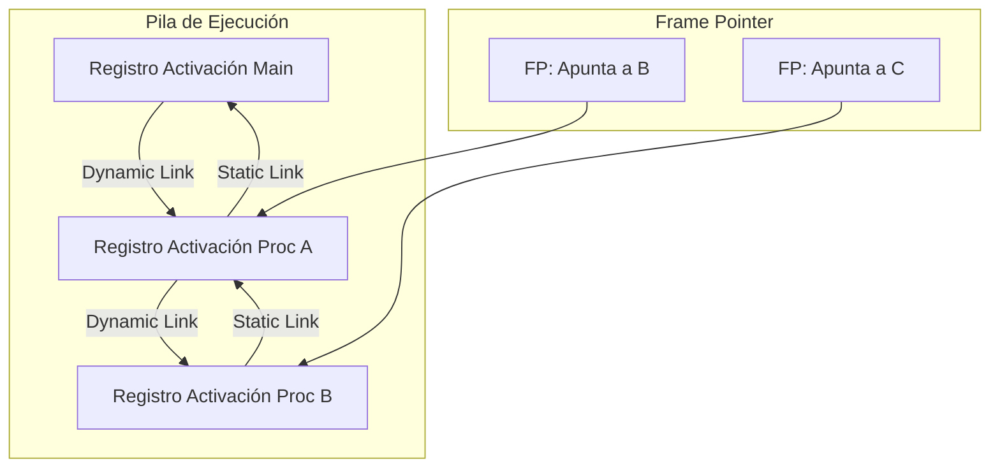

# Compiladores - La abstracción de procedimiento

## 6.5 Establecimiento de la direccionabilidad.

---

El establecimiento de la direccionabilidad es un aspecto fundamental de la abstracción de procedimiento que permite acceder a variables y parámetros dentro de diferentes contextos de ejecución. Esta guía explora los mecanismos que hacen posible la referencia a datos en registros de activación.

### Definición y Conceptos Clave

#### Direccionabilidad

Según Cooper y Torczon (2004), "la direccionabilidad se refiere a la capacidad de un procedimiento para acceder a sus variables locales, parámetros y variables no locales a través de direcciones de memoria o offsets predecibles".

#### Registro de Activación (Stack Frame)

Estructura de memoria que contiene el estado de un procedimiento:

$$ \text{RegistroActivación} = \begin{Bmatrix} \begin{array}{ll} \text{Parámetros} & \\\ \text{Variables locales} & \\\ \text{Dirección de retorno} & \\\ \text{Enlace de control} & \\\ \text{Enlace de acceso} & \\\ \text{Temporales} & \\\ \end{array} \end{Bmatrix} $$

### Mecanismos de Direccionabilidad

#### Frame Pointer (FP) y Stack Pointer (SP)

Registros especiales que gestionan el acceso a la pila:

- **FP**: Apunta al inicio del registro de activación actual
- **SP**: Apunta al tope de la pila

#### Cálculo de Desplazamientos

Para una variable en el registro de activación:

$$ \text{Dirección}(variable) = FP + \text{offset} $$

Donde el offset se calcula como:

$$ \text{offset} = \text{base} + \sum_{i=1}^{n} \text{tamaño}(\text{elemento}_i) $$

### Enlaces de Acceso

#### Enlace Estático (Static Link)

Puntero al registro de activación del ámbito léxico padre:

$$ \text{StaticLink} = \text{FP}_{\text{padre}} $$

#### Enlace Dinámico (Dynamic Link)

Puntero al registro de activación del llamador:

$$ \text{DynamicLink} = \text{FP}_{\text{llamador}} $$

### Implementación de Direccionabilidad

#### Diagrama de Registros de Activación



#### Código de Ejemplo: Acceso a Variables

```assembly
; Ejemplo en x86 assembly
section .text

procedimiento:
    push ebp           ; Guardar FP anterior
    mov ebp, esp       ; Establecer nuevo FP
    sub esp, 8         ; Espacio para variables locales

    ; Acceso a parámetros
    mov eax, [ebp+8]   ; Primer parámetro
    mov ebx, [ebp+12]  ; Segundo parámetro

    ; Acceso a variables locales
    mov [ebp-4], eax   ; Variable local 1
    mov [ebp-8], ebx   ; Variable local 2

    mov esp, ebp       ; Restaurar SP
    pop ebp            ; Restaurar FP
    ret

main:
    push 20           ; Segundo parámetro
    push 10           ; Primer parámetro
    call procedimiento
    add esp, 8        ; Limpiar parámetros
```

### Fórmulas y Cálculos

#### Cálculo de Offsets

Para un procedimiento con $n$ parámetros y $m$ variables locales:

$$ \text{Offset}\_{\text{parámetro}\_k} = 8 + 4 \times (n - k) $$

$$ \text{Offset}\_{\text{local}\_j} = -4 \times j $$

#### Tamaño del Registro de Activación

$$ \text{TamañoFrame} = 4 \times (\text{Params} + \text{Locals} + \text{Temporals} + 2) $$

Donde los +2 representan FP y dirección de retorno.

### Estrategias de Direccionabilidad

#### Direccionabilidad Absoluta vs Relativa

**Absoluta**:

$$ \text{Dirección} = \text{dirección base} + \text{offset} $$

**Relativa**:

$$ \text{Dirección} = \text{registro base} + \text{offset} $$

#### Acceso a Variables No Locales

Para acceder a una variable en el ámbito $k$ niveles arriba:

```c
activation_record* current = current_frame;
for (int i = 0; i < k; i++) {
    current = current->static_link;
}
return current + offset;
```

### Ejemplos de Implementación

#### Implementación de Enlaces Estáticos

```c
typedef struct activation_record {
    void* static_link;    // Enlace al ámbito padre
    void* dynamic_link;   // Enlace al llamador
    int return_address;
    int parameters[MAX_PARAMS];
    int locals[MAX_LOCALS];
} ar_t;

// Función para acceder a variable no local
int* access_non_local(ar_t* current, int levels, int offset) {
    ar_t* target = current;
    for (int i = 0; i < levels; i++) {
        target = (ar_t*)target->static_link;
    }
    return (int*)((char*)target + offset);
}
```

#### Ejemplo con Múltiples Ámbitos

```pascal
program Ejemplo;
var x: integer;

procedure A;
var y: integer;

    procedure B;
    var z: integer;
    begin
        z := x + y;  // x: 2 niveles, y: 1 nivel
    end;

begin
    y := 10;
    B;
end;

begin
    x := 5;
    A;
end.
```

### Ejercicios Propuestos

1. **Cálculo de Offsets**: Para el siguiente procedimiento, calcule los offsets de todos los parámetros y variables locales:

```c
void ejemplo(int a, double b, char c) {
    int x;
    float y[5];
    struct { int p; double q; } z;
}
```

2. **Implementación de Static Links**: Implemente una función que, dado el FP actual y un nivel de nesting, retorne el FP del ámbito objetivo.

3. **Análisis de Pila**: Dibuje la pila de ejecución y muestre los enlaces estáticos y dinámicos para:

```pascal
program Main;
var x: integer;

procedure A;
var y: integer;

    procedure B;
    var z: integer;
    begin
        z := x + y;
    end;

begin
    y := 2;
    B;
end;

begin
    x := 1;
    A;
end.
```

4. **Optimización de Accesos**: Diseñe un esquema para optimizar el acceso a variables frecuentemente usadas mediante registros.

### Optimizaciones

#### Registro de Frame Pointer

Eliminación del FP cuando es posible:

$$ \text{SP} + \text{offset constante} = \text{dirección variable} $$

#### Global Common Subexpression Elimination

Reuso de direcciones calculadas:

```c
// Antes
int* ptr1 = &array[i];
int* ptr2 = &array[i];

// Después
int* temp = &array[i];
int* ptr1 = temp;
int* ptr2 = temp;
```

### Referencias

#### Bibliografía Básica

1. **Cooper, K. D., & Torczon, L. (2004)**: _Engineering a Compiler_ (Capítulo 6.4: Establishing Addressability)
2. **Aho, A. V., et al. (2007)**: _Compilers: Principles, Techniques, and Tools_ (Capítulo 7.2: Stack Allocation of Space)
3. **Scott, M. L. (2009)**: _Programming Language Pragmatics_ (Capítulo 3.4: Addressability)

#### Bibliografía Complementaria

1. **Grune, D., et al. (2000)**: _Modern Compiler Design_ (Capítulo 7.3: Address Calculation)
2. **Wilhelm, R., & Maurer, D. (1995)**: _Compiler Design_ (Capítulo 7.2: Addressing Modes)

### Casos de Estudio

#### Direccionabilidad en Diferentes Arquitecturas

**x86** (Base-pointer addressing):

```assembly
mov eax, [ebp-4]    ; Variable local
mov ebx, [ebp+8]    ; Parámetro
```

**ARM** (Multiple addressing modes):

```assembly
ldr r0, [fp, #-4]   ; Variable local
ldr r1, [fp, #8]    ; Parámetro
```

#### Implementación en Compiladores Modernos

**LLVM** (GetElementPtr instruction):

```llvm
; Calcula dirección de elemento en estructura
%ptr = getelementptr inbounds %struct.Data, %struct.Data* %data, i32 0, i32 2
```

### Conclusión

El establecimiento de la direccionabilidad es crucial para la implementación eficiente de la abstracción de procedimiento. Los mecanismos de enlaces estáticos y dinámicos, junto con el cálculo preciso de offsets, permiten el acceso seguro y eficiente a variables en diferentes contextos de ejecución. Las optimizaciones modernas continúan mejorando estos mecanismos para maximizar el rendimiento.

### Recursos Adicionales

- [GCC Stack Frame Layout](https://gcc.gnu.org/onlinedocs/gccint/Stack-Frame.html)
- [LLVM Addressing Modes](https://llvm.org/docs/LangRef.html#addressing-modes)
- [ARM Procedure Call Standard](https://developer.arm.com/documentation/ihi0042/latest/)
