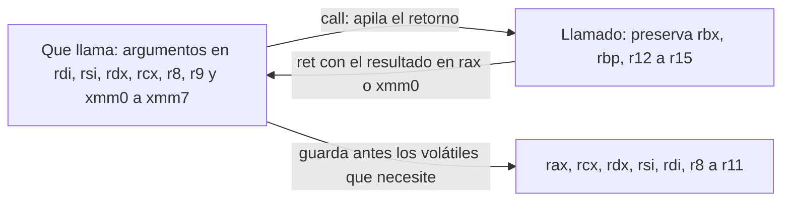

# Compiladores - La abstracción de procedimiento

## 6.6 Ligado estandarizado.

---

Para que un procedimiento compilado por un compilador pueda llamar a otro compilado por otro compilador, en otro momento o en otro lenguaje, ambos deben seguir el mismo **contrato**: dónde van los argumentos, dónde queda el resultado, qué registros se preservan, quién libera el espacio de los argumentos, cómo se alinea la pila y cómo se representan los tipos. Ese contrato es la **convención de llamada**, parte de la **interfaz binaria de aplicaciones**, ABI, de cada plataforma. Este tema presenta las partes de una convención, las convenciones históricas de x86 de 32 bits, la de System V para x86-64 y las de los RISC, con el código real que generan gcc y Clang.

### Qué fija una convención de llamada

1. **Argumentos:** cuáles van en registros y en qué orden, y cuáles en la pila, en qué orden y con qué alineación.
2. **Resultado:** el registro donde queda, como `eax`, `rax` o `a0`, y cómo se devuelven las estructuras grandes, con un apuntador oculto.
3. **Registros:** cuáles son **volátiles**, que el llamado puede destruir y el que llama debe guardar si los necesita, y cuáles **preservados**, que el llamado debe restaurar si los usa.
4. **Limpieza:** quién retira los argumentos de la pila, el que llama o el llamado.
5. **Pila:** su alineación en el momento de la llamada, 16 bytes en x86-64, y zonas especiales, como la **zona roja** de 128 bytes debajo de `rsp` que las funciones hoja pueden usar sin reservarla.

El reparto entre registros volátiles y preservados es un compromiso: un registro volátil es gratis para el llamado y caro para el que llama si necesita conservar un valor a través de la llamada, y uno preservado es lo contrario.

### Convenciones de x86 de 32 bits

| Convención | Argumentos | Limpieza | Uso |
| ---------- | ---------- | -------- | --- |
| `cdecl` | todos en la pila, de derecha a izquierda | el que llama, con `add esp, n` | la de C en Unix y Windows; permite funciones con número variable de argumentos, como `printf` |
| `stdcall` | en la pila, de derecha a izquierda | el llamado, con `ret n` | la API de Win32; código algo más compacto, pero sin número variable de argumentos |
| `fastcall` | los dos primeros en `ecx` y `edx`, el resto en la pila | el llamado | funciones pequeñas muy llamadas |

En las tres, el resultado queda en `eax`, `eax`, `ecx` y `edx` son volátiles, y `ebx`, `esi`, `edi` y `ebp` preservados.

### System V para x86-64

Los primeros seis argumentos enteros o apuntadores van en `rdi`, `rsi`, `rdx`, `rcx`, `r8` y `r9`, y los primeros ocho de punto flotante en `xmm0` a `xmm7`; el resto en la pila. El resultado va en `rax`, o en `xmm0`. Son preservados `rbx`, `rbp` y `r12` a `r15`, y la pila debe estar alineada a 16 bytes en cada `call`. Windows x64 usa otra convención, con cuatro registros, `rcx`, `rdx`, `r8` y `r9`, y 32 bytes de **espacio de sombra** que el que llama reserva siempre.



### Implementación en Python

El programa compila con gcc 13 en x86 de 32 bits las tres convenciones, con los atributos `cdecl`, `stdcall` y `fastcall`, y envolturas que convierten entre ellas; obtiene los desplazamientos de los parámetros de una función con tipos mezclados en 32 y 64 bits, y compila con Clang 18 para dos procesadores RISC de 16 registros, RISC-V RV32E y ARM de 32 bits, para analizar sus convenciones. Usa las utilidades de compilación del tema 6.1, incluidas al inicio.

```python
# ===== Núcleo de procedimientos: registros de activación con enlaces estáticos y dinámicos, y utilidades para gcc =====
import os, re, subprocess, tempfile

class Proc:
    """Un procedimiento con parámetros, variables locales, procedimientos anidados y un cuerpo de sentencias:
    ('asig', x, e) ('llama', f, [args]) ('imprime', e) ('punto', etiqueta) ('si', e, [then], [else]) ('ret', e)
    Las expresiones son enteros, nombres o tuplas (op, a, b)."""
    def __init__(self, nombre, params=(), locales=(), anidados=(), cuerpo=()):
        self.nombre, self.params, self.locales, self.anidados, self.cuerpo = nombre, list(params), list(locales), list(anidados), list(cuerpo)
        self.padre = None
        for p in self.anidados: p.padre = self
    def nivel(self): return 0 if self.padre is None else self.padre.nivel() + 1

class Retorno(Exception):
    def __init__(self, v): self.v = v

class Maquina:
    def __init__(self, principal, alcance="estatico"):
        self.principal, self.alcance = principal, alcance
        self.pila, self.salida, self.fotos, self.max_prof, self.recorridos = [], [], {}, 0, []
    # --- registros de activación ---
    def activa(self, proc, args, enlace_estatico):
        marco = {"proc": proc, "vars": dict(zip(proc.params, args)), "ed": len(self.pila) - 1 if self.pila else None, "ee": enlace_estatico}
        for v in proc.locales: marco["vars"].setdefault(v, None)
        self.pila.append(marco); self.max_prof = max(self.max_prof, len(self.pila))
    def busca_marco(self, nombre):
        """Alcance estático: sigue los enlaces estáticos; dinámico: sigue los dinámicos. Cuenta los saltos."""
        k = len(self.pila) - 1; saltos = 0
        while k is not None:
            if nombre in self.pila[k]["vars"]: self.recorridos.append((nombre, saltos)); return k
            k = self.pila[k]["ee"] if self.alcance == "estatico" else self.pila[k]["ed"]; saltos += 1
        raise NameError(nombre)
    def valor(self, e):
        if isinstance(e, int): return e
        if isinstance(e, str): return self.pila[self.busca_marco(e)]["vars"][e]
        op, a, b = e; x, y = self.valor(a), self.valor(b)
        return {"+": x + y, "-": x - y, "*": x * y, "/": x // y, "<": int(x < y), "<=": int(x <= y), "==": int(x == y), ">": int(x > y)}[op]
    def procedimiento(self, nombre):
        """El nombre del procedimiento se resuelve léxicamente: devuelve el procedimiento y el marco de su padre."""
        k = len(self.pila) - 1
        while k is not None:
            p = self.pila[k]["proc"]
            for h in p.anidados:
                if h.nombre == nombre: return h, k
            if p.nombre == nombre and self.pila[k]["ee"] is not None:
                return p, self.pila[k]["ee"]
            k = self.pila[k]["ee"]
        raise NameError(nombre)
    def llama(self, nombre, args):
        proc, padre = self.procedimiento(nombre)
        self.activa(proc, [self.valor(a) for a in args], padre)
        try: self.ejecuta(proc.cuerpo); r = None
        except Retorno as ret: r = ret.v
        self.pila.pop(); return r
    def ejecuta(self, sentencias):
        for s in sentencias:
            k = s[0]
            if k == "asig": self.pila[self.busca_marco(s[1])]["vars"][s[1]] = self.valor(s[2])
            elif k == "llama": self.llama(s[1], s[2])
            elif k == "imprime": self.salida.append(self.valor(s[1]))
            elif k == "punto": self.fotos[s[1]] = self.foto()
            elif k == "si": self.ejecuta(s[2] if self.valor(s[1]) else s[3])
            elif k == "ret": raise Retorno(self.valor(s[1]))
            elif k == "asigllama": self.pila[self.busca_marco(s[1])]["vars"][s[1]] = self.llama(s[2], s[3])
    def corre(self, args=()):
        self.activa(self.principal, list(args), None); self.ejecuta(self.principal.cuerpo); return self
    def foto(self):
        lineas = []
        for k in range(len(self.pila) - 1, -1, -1):
            m = self.pila[k]
            ee = "-" if m["ee"] is None else self.pila[m["ee"]]["proc"].nombre
            ed = "-" if m["ed"] is None else self.pila[m["ed"]]["proc"].nombre
            lineas.append(f"{m['proc'].nombre}: {m['vars']}, enlace estático -> {ee}, enlace dinámico -> {ed}")
        return lineas

# ---------- gcc: compilar, extraer el ensamblador de una función y ejecutar ----------
TMP = tempfile.mkdtemp()
ENV = {**os.environ, "LC_ALL": "C"}
def ensamblador(fuente, opt="-O0", extra=()):
    ruta = os.path.join(TMP, "f.c"); open(ruta, "w").write(fuente)
    r = subprocess.run(["gcc", opt, "-S", "-masm=intel", "-fno-asynchronous-unwind-tables", "-fcf-protection=none", "-fno-stack-protector",
                        *extra, "-o", "-", "f.c"], cwd=TMP, capture_output=True, text=True, env=ENV)
    if r.returncode: raise RuntimeError(r.stderr)
    return r.stdout
def funcion(asm, nombre):
    """Las instrucciones de una función, sin directivas, con los espacios normalizados."""
    lineas, dentro = [], False
    for l in asm.splitlines():
        if re.match(rf"^{re.escape(nombre)}:", l): dentro = True; continue
        if dentro:
            if re.match(r"^\s*\.(size|cfi_endproc)", l) or (re.match(r"^[A-Za-z_]\w*:", l)): break
            if re.match(r"^\s*\.", l) and not re.match(r"^\.L\w+:", l): continue
            lineas.append(" ".join(l.split()))
    return [l for l in lineas if l]
def ejecuta_c(fuente, entrada=None, opt="-O2", extra=()):
    ruta = os.path.join(TMP, "p.c"); open(ruta, "w").write(fuente)
    r = subprocess.run(["gcc", opt, *extra, "-o", "p", "p.c"], cwd=TMP, capture_output=True, text=True, env=ENV)
    if r.returncode: raise RuntimeError(r.stderr)
    return subprocess.run(["./p"], cwd=TMP, input=entrada, capture_output=True, text=True).stdout
def n_instrucciones(f): return sum(1 for l in f if not l.endswith(":"))

def clang_asm(fuente, objetivo, comentario):
    open(os.path.join(TMP, "r.c"), "w").write(fuente)
    r = subprocess.run(["clang", *objetivo, "-O2", "-S", "-o", "-", "r.c"], cwd=TMP, capture_output=True, text=True, env=ENV)
    return [" ".join(re.sub(rf"\s*{comentario}.*$", "", l).split()) for l in r.stdout.splitlines()]
def cuerpo(lineas, nombre):
    res, dentro = [], False
    for l in lineas:
        if l == f"{nombre}:": dentro = True; continue
        if dentro and (l.startswith(".size") or l.startswith(".Lfunc_end")): break
        if dentro and l and not l.startswith("."): res.append(l)
    return res
M32 = ("-m32", "-fno-pic")

# ---------- Ejercicio 1: cdecl, stdcall y fastcall en x86 de 32 bits ----------
C1 = """#define F(conv, n) __attribute__((noinline, conv)) int n(int a, int b, int c) { return a * b + c; }
F(cdecl, f_cdecl) F(stdcall, f_stdcall) F(fastcall, f_fastcall)
int llama(void) { return f_cdecl(1, 2, 3) + f_stdcall(4, 5, 6) + f_fastcall(7, 8, 9); }"""
asm = ensamblador(C1, "-O2", M32)
for f in ("f_cdecl", "f_stdcall", "f_fastcall", "llama"):
    print(f"ejercicio 1: {f:10}", " | ".join(funcion(asm, f)))

# ---------- Ejercicio 2: envolturas entre convenciones ----------
C2 = """__attribute__((noinline, cdecl)) int biblioteca(int a, int b);
/* una biblioteca cdecl usada desde código que espera stdcall, como una función de Windows */
__attribute__((stdcall)) int envoltura_std(int a, int b) { return biblioteca(a, b); }
/* y una fastcall que reenvía a la cdecl */
__attribute__((fastcall)) int envoltura_fast(int a, int b) { return biblioteca(a, b); }"""
asm2 = ensamblador(C2, "-O2", M32)
for f in ("envoltura_std", "envoltura_fast"): print(f"ejercicio 2: {f:14}", " | ".join(funcion(asm2, f)))

# ---------- Ejercicio 3: desplazamientos con cuatro parámetros de tipos distintos ----------
C3 = """void usa(void *, ...);
void ejemplo(int a, double b, char c, short d) {
    int x;
    float y;
    double z[3];
    usa(&a, &b, &c, &d, &x, &y, z);
}"""
f32 = funcion(ensamblador(C3, "-O0", M32), "ejemplo")
empujados = [int(re.search(r"\[ebp([+-]\d+)\]", f32[k - 1]).group(1)) for k, l in enumerate(f32) if l == "push eax" and f32[k - 1].startswith("lea")]
leidos = sorted({int(x) for l in f32 for x in re.findall(r"\[ebp\+(\d+)\]", l)})
print("ejercicio 3: gcc x86-32, dirección pasada para cada nombre:", dict(zip(["a", "b", "c", "d", "x", "y", "z"], reversed(empujados))), "| parámetros leídos de", leidos)
f64 = funcion(ensamblador(C3, "-O0"), "ejemplo")
antes = f64[:next(k for k, l in enumerate(f64) if l.startswith("lea"))]
print("   gcc x86-64, los parámetros llegan en registros y se guardan en el marco:", " | ".join(l for l in antes if not re.match(r"(push rbp|mov rbp, rsp|sub rsp)", l)))

# ---------- Ejercicio 4: un RISC de 16 registros ----------
C4 = """int g(int);
int f(int a, int b, int c, int d, int e, int f6, int h) { return g(a + b) + c + d + e + f6 + h; }
int hoja(int a, int b) { return a * b + 1; }"""
for nombre, objetivo, com in (("RISC-V RV32EM, 16 registros", ["--target=riscv32", "-march=rv32em", "-mabi=ilp32e"], "#"),
                              ("ARM de 32 bits, 16 registros", ["--target=armv7a-none-eabi"], "@")):
    l = clang_asm(C4, objetivo, com)
    print(f"ejercicio 4: {nombre}: f con 7 parámetros:", " | ".join(cuerpo(l, "f")))
    print(f"   hoja:", " | ".join(cuerpo(l, "hoja")))
```

Salida:

```text
ejercicio 1: f_cdecl    mov eax, DWORD PTR [esp+8] | imul eax, DWORD PTR [esp+4] | add eax, DWORD PTR [esp+12] | ret
ejercicio 1: f_stdcall  mov eax, DWORD PTR [esp+8] | imul eax, DWORD PTR [esp+4] | add eax, DWORD PTR [esp+12] | ret 12
ejercicio 1: f_fastcall imul ecx, edx | mov eax, DWORD PTR [esp+4] | add eax, ecx | ret 4
ejercicio 1: llama      push ebx | mov edx, 8 | mov ecx, 7 | push 3 | push 2 | push 1 | call f_cdecl | add esp, 12 | push 6 | mov ebx, eax | push 5 | push 4 | call f_stdcall | push 9 | add ebx, eax | call f_fastcall | add eax, ebx | pop ebx | ret
ejercicio 2: envoltura_std  sub esp, 20 | push DWORD PTR [esp+28] | push DWORD PTR [esp+28] | call biblioteca | add esp, 28 | ret 8
ejercicio 2: envoltura_fast sub esp, 20 | push edx | push ecx | call biblioteca | add esp, 28 | ret
ejercicio 3: gcc x86-32, dirección pasada para cada nombre: {'a': 8, 'b': -48, 'c': -52, 'd': -56, 'x': -12, 'y': -16, 'z': -40} | parámetros leídos de [8, 12, 16, 20, 24]
   gcc x86-64, los parámetros llegan en registros y se guardan en el marco: mov DWORD PTR -36[rbp], edi | movsd QWORD PTR -48[rbp], xmm0 | mov ecx, esi | mov eax, edx | mov edx, ecx | mov BYTE PTR -40[rbp], dl | mov WORD PTR -52[rbp], ax
ejercicio 4: RISC-V RV32EM, 16 registros: f con 7 parámetros: addi sp, sp, -24 | sw ra, 20(sp) | sw s0, 16(sp) | sw s1, 12(sp) | lw t0, 24(sp) | sw t0, 8(sp) | sw a5, 4(sp) | sw a4, 0(sp) | mv s0, a3 | mv s1, a2 | add a0, a1, a0 | call g | add s0, s0, s1 | lw a1, 4(sp) | lw a2, 0(sp) | add a1, a2, a1 | add a1, s0, a1 | add a0, a1, a0 | lw a1, 8(sp) | add a0, a0, a1 | lw ra, 20(sp) | lw s0, 16(sp) | lw s1, 12(sp) | addi sp, sp, 24 | ret
   hoja: mul a0, a1, a0 | addi a0, a0, 1 | ret
ejercicio 4: ARM de 32 bits, 16 registros: f con 7 parámetros: push {r4, r5, r11, lr} | add r11, sp, #8 | add r0, r1, r0 | mov r4, r3 | mov r5, r2 | bl g | ldr r2, [r11, #8] | add r1, r4, r5 | add r1, r1, r2 | ldr r2, [r11, #12] | add r1, r1, r2 | ldr r2, [r11, #16] | add r1, r1, r2 | add r0, r1, r0 | pop {r4, r5, r11, pc}
   hoja: mul r0, r1, r0 | add r0, r0, #1 | bx lr
```

### Ejercicios Propuestos

1. **Convenciones.** Compara las convenciones `cdecl`, `stdcall` y `fastcall` en costo de llamada, uso de registros y compatibilidad.

2. **Envolturas.** Escribe envolturas para convertir entre distintas convenciones de llamada.

3. **Desplazamientos.** Calcula los desplazamientos de todos los elementos de la función:

    ```c
    void ejemplo(int a, double b, char c, short d) {
        int x;
        float y;
        double z[3];
    }
    ```

4. **Diseño.** Diseña una convención de llamada optimizada para un procesador RISC con 16 registros.

### Soluciones

**Ejercicio 1.** El código de gcc muestra las diferencias. Las funciones `cdecl` y `stdcall` leen sus tres argumentos de la pila, en `[esp+4]`, `[esp+8]` y `[esp+12]`; la primera termina con `ret` y el que llama hace `add esp, 12`, y la segunda con `ret 12`, que retira los argumentos al regresar. La `fastcall` recibe `a` y `b` en `ecx` y `edx`, multiplica sin tocar la memoria, lee solo `c` de la pila y termina con `ret 4`.

| | `cdecl` | `stdcall` | `fastcall` |
| - | ------- | --------- | ---------- |
| instrucciones por llamada con 3 argumentos | 3 `push`, `call`, `add` | 3 `push`, `call` | 2 `mov`, 1 `push`, `call` |
| accesos a memoria del llamado | 3 | 3 | 1 |
| número variable de argumentos | sí | no | no |
| compatibilidad | la de C en todos los compiladores | la de Win32; los nombres se decoran como `_f@12` | varía entre compiladores, por eso es poco portable |

Con muchas llamadas, `stdcall` ahorra un `add` por llamada en el código del que llama, y `fastcall` ahorra accesos a memoria; ninguna importa en x86-64, donde todas se unifican en la de la plataforma.

**Ejercicio 2.** Una envoltura es una función con la convención de destino que llama a la de origen. Para usar una función `cdecl` donde se espera una `stdcall`, la envoltura vuelve a apilar sus dos argumentos, llama, retira los que apiló con `add esp` y regresa con `ret 8`, para que el que la llamó no tenga que limpiar. Para usar la `cdecl` donde se espera una `fastcall`, la envoltura apila `ecx` y `edx`, que es donde llegaron los argumentos, llama y regresa con `ret`, porque no había nada en la pila. gcc genera ambas a partir de una línea de C con el atributo correspondiente; el `sub esp, 20` mantiene la alineación de 16 bytes que gcc conserva también en 32 bits.

**Ejercicio 3.** En **x86 de 32 bits**, cada argumento ocupa un múltiplo de 4 bytes en la pila: `a` en $+8,$ `b` en $+12$ a $+19,$ `c` en $+20,$ promovido a una palabra, y `d` en $+24;$ gcc lee exactamente esas posiciones. Las locales, en orden de declaración y alineadas: `x` en $-4,$ `y` en $-8$ y `z`, de 24 bytes alineados a 8, en $-32;$ gcc las ordena a su manera, `x` en $-12,$ `y` en $-16$ y `z` en $-40,$ y como el programa toma las direcciones de los parámetros, los copia a locales. En **x86-64**, los cuatro llegan en registros, `a` en `edi`, `b` en `xmm0`, `c` en `esi` y `d` en `edx`, y gcc sin optimizar los guarda en el marco con instrucciones del tamaño de cada tipo, `DWORD`, `QWORD`, `BYTE` y `WORD`.

**Ejercicio 4.** Una convención razonable para 16 registros, que coincide en lo esencial con las de **RISC-V RV32E** y **ARM**, dos RISC reales de 16 registros:

| Registros | Uso | RV32E | ARM |
| --------- | --- | ----- | --- |
| 1 | cero o contador de programa | `x0`, siempre cero | `r15`, el contador de programa |
| 1 | apuntador de pila | `sp` | `r13` |
| 1 | dirección de retorno | `ra` | `lr`, `r14` |
| 4 a 6 | argumentos y resultado, volátiles | `a0` a `a5` | `r0` a `r3` |
| 2 a 8 | preservados | `s0` y `s1` | `r4` a `r11` |
| el resto | temporales volátiles | `t0` a `t2` | `r12` |

Los principios son: pasar en registros tantos argumentos como sea frecuente, porque la mayoría de las funciones tienen pocos; guardar la dirección de retorno en un **registro**, de modo que las funciones **hoja** no toquen la memoria; y repartir los registros restantes entre volátiles y preservados. El código de Clang lo muestra: en ambas arquitecturas, la función hoja `a * b + 1` son tres instrucciones sin ningún acceso a memoria. La función con siete argumentos recibe seis en `a0` a `a5` en RV32E y solo cuatro en `r0` a `r3` en ARM, y el resto en la pila; como llama a `g`, guarda la dirección de retorno y usa registros preservados, `s0` y `s1` o `r4` y `r5`, para los valores que necesita después de la llamada. Con solo dos registros preservados, RV32E tiene que guardar más valores en la pila que ARM, un ejemplo del compromiso entre los dos tipos de registros.

En el material original, el ejemplo de procedimiento hoja hacía `add eax, [esp+4]` sin haber cargado `eax`, de modo que sumaba a un valor indefinido; la "eficiencia" del paso por registros, $n_{\text{registros}} / n_{\text{parámetros}} \times 100\%,$ supera el 100% cuando hay más registros que parámetros y no mide nada, y las reglas aparecían escritas en inglés dentro de fórmulas, como "Caller cleans stack".

### Referencias

1. Cooper, K. D., and Torczon, L., _Engineering a Compiler_. 3a ed., Morgan Kaufmann, 2022. Sección 6.5.
2. Matz, M., Hubička, J., Jaeger, A., and Mitchell, M., _System V Application Binary Interface, AMD64 Architecture Processor Supplement_, versión 1.0.
3. RISC-V International, _RISC-V ABIs Specification_, versión 1.0, 2022. Sección sobre ILP32E.
4. Arm Limited, _Procedure Call Standard for the Arm Architecture_, AAPCS32.
5. Fog, A., _Calling conventions for different C++ compilers and operating systems_. Technical University of Denmark, 2023.
6. Microsoft, _x64 calling convention_, documentación de Visual C++.
