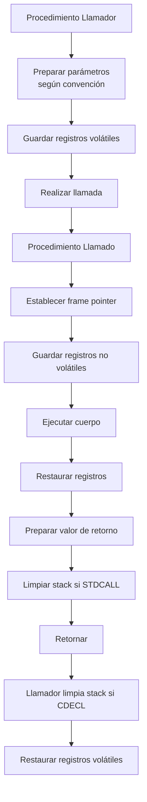

# Compiladores - La abstracción de procedimiento

## 6.6 Ligado estandarizado.

---

El ligado estandarizado (standardized binding) es un concepto fundamental en la implementación de la abstracción de procedimiento que establece convenciones uniformes para la gestión de recursos y la comunicación entre procedimientos. Esta guía explora los mecanismos y convenciones que permiten la interoperabilidad y consistencia en los compiladores.

### Definición y Conceptos Clave

#### Ligado Estandarizado

Según Aho et al. (2007), "el ligado estandarizado se refiere al conjunto de convenciones y protocolos que establecen cómo se gestionan los recursos, se pasan parámetros y se mantiene la consistencia en las interfaces entre procedimientos, tanto dentro de un mismo módulo como entre módulos diferentes".

#### Convenciones de Llamada (Calling Conventions)

Conjunto de reglas que definen:

- Cómo se pasan los parámetros
- Cómo se gestionan los registros
- Cómo se maneja la pila
- Cómo se devuelven los valores

### Componentes del Ligado Estandarizado

#### Registro de Activación Estándar

Estructura uniforme para todos los procedimientos:

$$ \text{RegistroActivación} = \begin{Bmatrix} \begin{array}{ll} \text{Parámetros} & \text{(N bytes)} \\\ \text{Dirección de retorno} & \text{(4 bytes)} \\\ \text{FP anterior} & \text{(4 bytes)} \\\ \text{Variables locales} & \text{(M bytes)} \\\ \text{Temporales} & \text{(K bytes)} \\\ \end{array} \end{Bmatrix} $$

#### Convenciones de Paso de Parámetros

**CDECL** (Convention C):

$$ \text{Caller cleans stack} $$

**STDCALL**:

$$ \text{Callee cleans stack} $$

**FASTCALL**:

$$ \text{First 2 params in registers} $$

### Implementación de Convenciones Estándar

#### Diagrama de Ligado Estandarizado



#### Código de Ejemplo: Implementación CDECL

```c
// Convención CDECL en C
int __cdecl suma(int a, int b) {
    return a + b;
}

// Assembly generado
_suma:
    push ebp
    mov ebp, esp
    mov eax, [ebp+8]    ; Primer parámetro
    add eax, [ebp+12]   ; Segundo parámetro
    pop ebp
    ret                 ; Caller cleans stack

; Llamada
push 20
push 10
call _suma
add esp, 8             ; Caller cleans stack
```

### Fórmulas y Cálculos

#### Cálculo de Offsets Estándar

Para arquitectura de 32 bits:

$$ \text{Offset}\_{\text{parámetro}\_n} = 4 \times (n + 1) $$

$$ \text{Offset}\_{\text{local}\_m} = -4 \times m $$

#### Overhead de Llamada

$$ T_{\text{overhead}} = T_{\text{setup}} + T_{\text{call}} + T_{\text{cleanup}} $$

Donde:

- $T_{\text{setup}} = n_{\text{params}} \times t_{\text{push}}$
- $T_{\text{call}} = t_{\text{call instruction}}$
- $T_{\text{cleanup}} = n_{\text{params}} \times t_{\text{pop}}$

### Convenciones de Registros

#### Registros Volátiles vs No Volátiles

**Volátiles** (Caller-save):

- Pueden ser modificados por el callee
- Caller debe guardarlos antes de la llamada

**No Volátiles** (Callee-save):

- Callee debe preservar sus valores
- Deben ser restaurados antes del retorno

#### Ejemplo x86 Register Convention

```assembly
; Caller-save: eax, ecx, edx
; Callee-save: ebx, esi, edi, ebp

procedimiento:
    push ebx        ; Guardar callee-save
    push esi
    ; ... uso de registros ...
    pop esi         ; Restaurar callee-save
    pop ebx
    ret
```

### Ejemplos de Implementación

#### Implementación Multiplataforma

```c
// Macros para diferentes convenciones
#ifdef _WIN32
    #define CALL_CONV __stdcall
#else
    #define CALL_CONV __attribute__((cdecl))
#endif

int CALL_CONV funcion_estandar(int a, int b);
```

#### Convención para Estructuras

```c
// Paso de estructuras por valor
struct Punto { int x; int y; };

// Convención: pasar por referencia oculta
void usar_punto(struct Punto p);

// Assembly equivalente
void usar_punto(void* hidden_ptr);
```

### Ejercicios Propuestos

1. **Análisis de Convenciones**: Compare las convenciones CDECL, STDCALL y FASTCALL en términos de:
   - Overhead de llamada
   - Uso de registros
   - Compatibilidad

2. **Implementación de Wrappers**: Escriba wrappers para convertir entre diferentes convenciones de llamada.

3. **Cálculo de Offsets**: Para la siguiente función, calcule los offsets de todos los elementos:

```c
void ejemplo(int a, double b, char c, short d) {
    int x;
    float y;
    double z[3];
}
```

4. **Optimización de Llamadas**: Diseñe una convención optimizada para un procesador RISC con 16 registros.

### Optimizaciones

#### Leaf Procedure Optimization

Optimización para procedimientos que no llaman a otros:

```assembly
; Sin establecer frame pointer
leaf_procedure:
    add eax, [esp+4]  ; Acceder parámetro directamente
    ret
```

#### Register Parameter Passing

$$ \text{Eficiencia} = \frac{n\_{\text{registros}}}{n\_{\text{parámetros}}} \times 100\% $$

### Estándares y Especificaciones

#### ABI (Application Binary Interface)

Especificación que define:

- Alineación de datos
- Convenciones de llamada
- Formato de objetos binarios
- Manejo de excepciones

#### Ejemplo System V ABI

```c
// Linux x86-64 ABI
// Primeros 6 parámetros en registros: RDI, RSI, RDX, RCX, R8, R9
// Resto en pila
void funcion(int a, int b, int c, int d, int e, int f, int g);
```

### Referencias

#### Bibliografía Básica

1. **Aho, A. V., et al. (2007)**: _Compilers: Principles, Techniques, and Tools_ (Capítulo 7.3: Calling Conventions)
2. **Cooper, K. D., & Torczon, L. (2004)**: _Engineering a Compiler_ (Capítulo 6.5: Standardized Bindings)
3. **Scott, M. L. (2009)**: _Programming Language Pragmatics_ (Capítulo 8.2: Calling Sequences)

#### Bibliografía Complementaria

1. **Grune, D., et al. (2000)**: _Modern Compiler Design_ (Capítulo 7.4: Standard Linkages)
2. **Wilhelm, R., & Maurer, D. (1995)**: _Compiler Design_ (Capítulo 8.3: Binding Standards)

### Casos de Estudio

#### Convenciones en Diferentes Arquitecturas

**x86-64 System V ABI**:

```assembly
; Primeros 6 parámetros en registros
mov rdi, param1
mov rsi, param2
mov rdx, param3
mov rcx, param4
mov r8, param5
mov r9, param6
call function
```

**ARM AAPCS**:

```assembly
; Primeros 4 parámetros en registros
mov r0, param1
mov r1, param2
mov r2, param3
mov r3, param4
bl function
```

#### Interoperabilidad entre Lenguajes

```c
// Exportar función para uso desde otros lenguajes
extern "C" __declspec(dllexport)
int __stdcall funcion_exportada(int a, int b) {
    return a + b;
}
```

### Conclusión

El ligado estandarizado es esencial para la interoperabilidad, portabilidad y eficiencia en la implementación de la abstracción de procedimiento. Las convenciones bien definidas permiten la comunicación consistente entre procedimientos, optimizaciones del compilador y la integración de código de diferentes fuentes. El entendimiento de estos estándares es crucial para el diseño de compiladores y sistemas software robustos.

### Recursos Adicionales

- [System V ABI Specification](https://refspecs.linuxfoundation.org/elf/x86_64-abi-0.99.pdf)
- [Microsoft x64 Calling Convention](https://docs.microsoft.com/en-us/cpp/build/x64-calling-convention)
- [ARM AAPCS Documentation](https://developer.arm.com/documentation/ihi0042/latest/)
