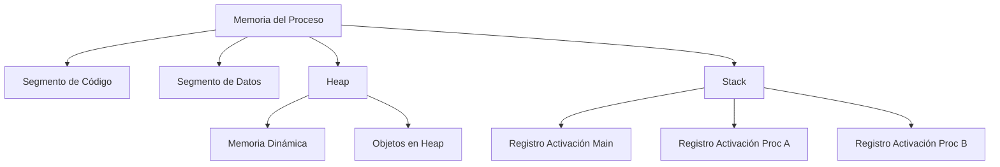

# Compiladores - La abstracción de procedimiento

## 6.7 Manejo de la memoria.

---

El manejo de la memoria es un aspecto crítico de la abstracción de procedimiento que determina cómo se asignan, organizan y liberan los recursos de memoria durante la ejecución de procedimientos. Esta guía explora las estrategias, estructuras y técnicas para la gestión eficiente de memoria.

### Definición y Conceptos Clave

#### Manejo de Memoria en Procedimientos

Según Aho et al. (2007), "el manejo de memoria en la abstracción de procedimiento se refiere a las técnicas y estrategias para asignar y gestionar el espacio de memoria requerido por los registros de activación, variables locales, parámetros y estructuras de datos temporales durante la ejecución de procedimientos".

#### Registro de Activación (Stack Frame)

Estructura de memoria que contiene el estado de ejecución de un procedimiento:

$$
\text{RegistroActivación} = \begin{Bmatrix} \begin{array}{ll} \text{Parámetros} & \\\ \text{Dirección de retorno} & \\\ \text{FP anterior} & \\\ \text{Variables locales} & \\\ \text{Temporales} & \\\ \text{Enlaces de acceso} & \\\ \end{array} \end{Bmatrix}
$$

### Estructuras de Memoria para Procedimientos

#### Segmentos de Memoria



#### Pila de Ejecución (Call Stack)

Estructura LIFO que gestiona los registros de activación:

$$ \text{StackPointer} = \text{StackBase} + \sum_{i=1}^{n} \text{TamañoFrame}_i $$

### Estrategias de Gestión de Memoria

#### Asignación Estática

Memoria asignada en tiempo de compilación:

$$ \text{Dirección}\_{\text{variable}} = \text{Dirección}\_{\text{base}} + \text{offset}\_{\text{fijo}} $$

#### Asignación en Pila

Memoria gestionada automáticamente mediante LIFO:

$$ \text{SP}\_{\text{nuevo}} = \text{SP}\_{\text{actual}} - \text{TamañoFrame} $$

#### Asignación en Heap

Memoria gestionada manualmente o mediante GC:

$$ \text{HeapPointer} = \text{HeapBase} + \sum \text{asignaciones} - \sum \text{liberaciones} $$

### Implementación de Registros de Activación

#### Estructura del Frame

```c
typedef struct activation_record {
    void* return_address;     // Dirección de retorno
    void* dynamic_link;       // Enlace al frame llamador
    void* static_link;        // Enlace al ámbito léxico padre
    int* parameters;          // Parámetros formales
    int* local_variables;     // Variables locales
    int* temporaries;         // Temporales
} activation_record;
```

#### Cálculo de Desplazamientos

Para arquitectura de 32 bits:

$$ \text{Offset}\_{\text{parámetro}\_k} = 8 + 4 \times k $$

$$ \text{Offset}\_{\text{local}\_j} = -4 \times j $$

$$ \text{Offset}\_{\text{temporal}\_m} = -4 \times (j + m) $$

### Gestión de Memoria Dinámica

#### Algoritmos de Asignación

**First-Fit**:

$$ \text{Seleccionar el primer bloque libre suficiente} $$

**Best-Fit**:

$$ \text{Seleccionar el bloque libre más pequeño suficiente} $$

**Worst-Fit**:

$$ \text{Seleccionar el bloque libre más grande} $$

#### Fragmentación

**Fragmentación Externa**:

$$ \text{Memoria libre distribuida en bloques pequeños} $$

**Fragmentación Interna**:

$$ \text{Memoria asignada pero no utilizada dentro de bloques} $$

### Ejemplos de Implementación

#### Gestión de Pila en x86

```assembly
; Prologo de procedimiento
procedure:
    push ebp           ; Guardar frame pointer anterior
    mov ebp, esp       ; Establecer nuevo frame pointer
    sub esp, 16        ; Reservar espacio para locales

    ; Epilogo
    mov esp, ebp       ; Restaurar stack pointer
    pop ebp            ; Restaurar frame pointer
    ret                ; Retornar
```

#### Implementación de Heap Simple

```c
typedef struct heap_block {
    size_t size;
    int free;
    struct heap_block* next;
} heap_block;

void* heap_base = NULL;

void* malloc(size_t size) {
    heap_block* block = find_free_block(size);
    if (!block) {
        block = request_space(size);
    }
    block->free = 0;
    return (void*)(block + 1);
}
```

### Fórmulas y Cálculos

#### Tamaño de Registro de Activación

$$ \text{TamañoFrame} = 4 \times (\text{nParams} + \text{nLocals} + \text{nTemps} + 3) $$

Donde +3 incluye: dirección retorno, FP anterior, enlace estático.

#### Overhead de Gestión de Memoria

$$ T_{\text{memoria}} = T_{\text{asignación}} + T_{\text{liberación}} + T_{\text{fragmentación}} $$

### Ejercicios Propuestos

1. **Cálculo de Offsets**: Para el procedimiento:

```c
void ejemplo(int a, double b, char c, short d) {
    int x;
    float y[4];
    struct { int p; double q; } z;
}
```

Calcule los offsets de todos los elementos y el tamaño total del frame.

2. **Simulación de Pila**: Simule la pila de ejecución para:

```pascal
program Main;
var x: integer;

procedure A;
var y: integer;

    procedure B;
    var z: integer;
    begin
        z := x + y;
    end;

begin
    y := 2;
    B;
end;

begin
    x := 1;
    A;
end.
```

3. **Implementación de malloc**: Implemente un allocator simple con estrategia first-fit.

4. **Análisis de Fragmentación**: Para un heap de 1024 bytes, calcule la fragmentación después de:
   - alloc(256), alloc(128), free(256), alloc(64), alloc(128)

### Optimizaciones

#### Stack Frame Omission

Eliminación de frames para procedimientos hoja:

$$ \text{Optimización} = \frac{T_{\text{frame setup}} + T_{\text{frame teardown}}}{T_{\text{execution}}} $$

#### Register Allocation

Maximizar el uso de registros para reducir accesos a memoria:

$$ \text{Registers}\_{\text{disponibles}} = \text{Registers}\_{\text{totales}} - \text{Registers}\_{\text{reservados}} $$

### Referencias

#### Bibliografía Básica

1. **Aho, A. V., et al. (2007)**: _Compilers: Principles, Techniques, and Tools_ (Capítulo 7.1-7.3: Run-Time Environments)
2. **Cooper, K. D., & Torczon, L. (2004)**: _Engineering a Compiler_ (Capítulo 6.6: Memory Management)
3. **Scott, M. L. (2009)**: _Programming Language Pragmatics_ (Capítulo 3.2: Memory Management)

#### Bibliografía Complementaria

1. **Grune, D., et al. (2000)**: _Modern Compiler Design_ (Capítulo 7.5: Memory Management)
2. **Wilhelm, R., & Maurer, D. (1995)**: _Compiler Design_ (Capítulo 9: Memory Management)

### Casos de Estudio

#### Gestión de Memoria en Diferentes Lenguajes

**C** (manual memory management):

```c
void proceso() {
    int stack_var;                    // Stack
    static int static_var;            // Data segment
    int* heap_var = malloc(sizeof(int)); // Heap
    free(heap_var);                   // Liberación manual
}
```

**Java** (garbage collection):

```java
void process() {
    int stackVar;                    // Stack
    static int staticVar;            // Method area
    Integer heapVar = new Integer(42); // Heap (GC managed)
}
```

#### Técnicas de Garbage Collection

**Reference Counting**:

$$ \text{RC}_{\text{object}} = \text{número de referencias} $$

**Mark-and-Sweep**:

$$ \text{Memoria liberada} = \text{objetos no marcados} $$

**Generational GC**:

$$ \text{Probabilidad de supervivencia} \propto \frac{1}{\text{edad}} $$

### Conclusión

El manejo de memoria en la abstracción de procedimiento es fundamental para la eficiencia y corrección de los programas compilados. Las estrategias de gestión de pila, heap y memoria estática, junto con las técnicas de optimización, permiten un uso eficiente de los recursos de memoria. El entendimiento de estos mecanismos es crucial para el diseño de compiladores y sistemas de tiempo de ejecución.

### Recursos Adicionales

- [GCC Stack Frame Documentation](https://gcc.gnu.org/onlinedocs/gccint/Stack-Frame.html)
- [Doug Lea's malloc Implementation](http://gee.cs.oswego.edu/dl/html/malloc.html)
- [Java Garbage Collection Tuning](https://docs.oracle.com/javase/8/docs/technotes/guides/vm/gctuning/)
