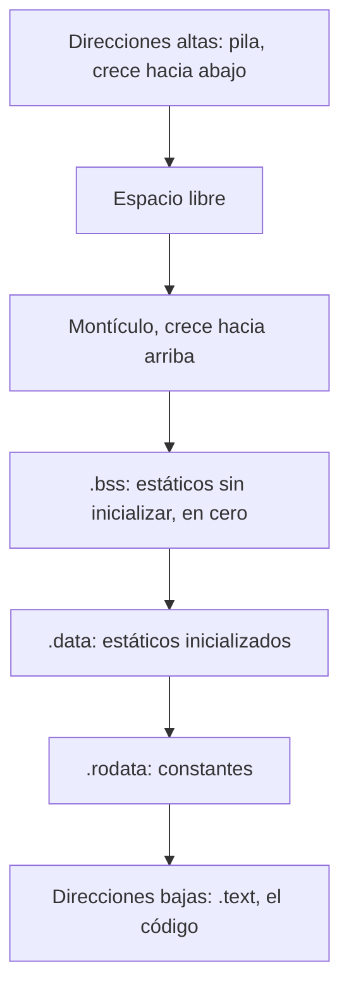

# Compiladores - La abstracción de procedimiento

## 6.7 Manejo de la memoria.

---

Un programa en ejecución organiza su memoria en zonas con políticas distintas: el **código** y los **datos estáticos**, cuyo tamaño se conoce al compilar; la **pila**, que crece y decrece con las llamadas, y el **montículo**, para los datos cuya vida no sigue el orden de las llamadas. El compilador decide en qué zona vive cada valor y genera el código que la administra: el marco de cada procedimiento en la pila, y las llamadas al asignador o la cooperación con el recolector de basura en el montículo. Este tema presenta la organización de la memoria, el marco en la pila, los asignadores del montículo con sus estrategias y su fragmentación, y la recolección de basura.

### Organización de la memoria



- **Estática:** variables globales, `static` y constantes; su dirección se fija al enlazar y viven todo el programa.
- **Pila:** los registros de activación; reservar y liberar cuesta una suma al apuntador de pila, pero los datos mueren al regresar el procedimiento.
- **Montículo:** los datos que sobreviven a quien los creó, o cuyo tamaño solo se conoce en ejecución; los administra un **asignador**, con liberación explícita, como `malloc` y `free`, o automática, con un **recolector de basura**.

### El marco en la pila

El marco de un procedimiento tiene, desde la dirección más alta: los argumentos que no caben en registros, la dirección de retorno, el apuntador de marco anterior, los registros preservados, las variables locales y los temporales, y el espacio para los argumentos de las llamadas que hace. Su tamaño se calcula al compilar sumando los tamaños con su alineación y redondeando a la alineación de la convención; los objetos de tamaño variable se reservan en ejecución con `alloca` o como arreglos de longitud variable.

### Asignadores del montículo

Un asignador mantiene una lista de **bloques libres**. Al pedir $n$ bytes busca un bloque suficiente, lo **divide** si sobra espacio y devuelve una parte; al liberar, devuelve el bloque a la lista y lo **fusiona** con sus vecinos libres. Las estrategias de búsqueda son:

- **primer ajuste:** el primer bloque suficiente; rápido, pero tiende a dejar bloques pequeños al inicio;
- **mejor ajuste:** el más pequeño suficiente; deja menos desperdicio por asignación, pero bloques sobrantes diminutos;
- **siguiente ajuste:** el primero a partir de donde terminó la búsqueda anterior;
- **listas segregadas** por clase de tamaño y el **sistema de compañeros**, con bloques de potencias de dos que se dividen y fusionan por mitades; son los que usan los asignadores reales, como el de glibc, jemalloc o mimalloc.

Cada bloque lleva una **cabecera** con su tamaño y su estado, y se redondea a la alineación que exige la plataforma, 16 bytes en x86-64. La **fragmentación interna** es el espacio desperdiciado dentro de los bloques asignados por ese redondeo; la **externa**, la memoria libre partida en bloques demasiado pequeños para atender una petición, que se mide como $1 - \frac{\text{bloque libre más grande}}{\text{memoria libre total}}.$

### Recolección de basura

Un objeto es **basura** si ningún camino de referencias desde las **raíces**, las variables globales, la pila y los registros, llega a él. Las técnicas son:

- **conteo de referencias:** cada objeto cuenta las referencias que apuntan a él y se libera cuando llega a cero; es incremental, pero no libera los **ciclos**, como dos objetos que se apuntan entre sí. CPython lo usa y lo complementa con un detector de ciclos;
- **marcar y barrer:** desde las raíces se marcan los objetos alcanzables, y después se libera todo lo no marcado;
- **copia:** los objetos vivos se copian a otra zona, compactándolos, y la zona anterior se libera completa;
- **generacional:** se basa en la **hipótesis generacional**, que la mayoría de los objetos mueren jóvenes; los nuevos van a una generación joven que se recolecta a menudo, y los que sobreviven varias recolecciones pasan a una vieja que se recolecta rara vez. Lo usan la JVM, .NET y V8.

El compilador coopera con el recolector: genera **mapas de la pila** que dicen en qué posiciones hay referencias, puntos seguros donde el recolector puede detener el programa, y **barreras de escritura** que registran las referencias de objetos viejos a jóvenes.

### Implementación en Python

El programa compila con gcc 13 el procedimiento del ejercicio 1 y compara sus desplazamientos y el tamaño del marco con los de libro; simula la pila de x86 de 32 bits, palabra por palabra, para el ejercicio 2; implementa un asignador con primer y mejor ajuste, cabeceras, alineación, división y fusión para los ejercicios 3 y 4, y muestra un ciclo que el conteo de referencias de CPython no libera y que su detector de ciclos sí.

```python
# ===== Núcleo de procedimientos: registros de activación con enlaces estáticos y dinámicos, y utilidades para gcc =====
import os, re, subprocess, tempfile

class Proc:
    """Un procedimiento con parámetros, variables locales, procedimientos anidados y un cuerpo de sentencias:
    ('asig', x, e) ('llama', f, [args]) ('imprime', e) ('punto', etiqueta) ('si', e, [then], [else]) ('ret', e)
    Las expresiones son enteros, nombres o tuplas (op, a, b)."""
    def __init__(self, nombre, params=(), locales=(), anidados=(), cuerpo=()):
        self.nombre, self.params, self.locales, self.anidados, self.cuerpo = nombre, list(params), list(locales), list(anidados), list(cuerpo)
        self.padre = None
        for p in self.anidados: p.padre = self
    def nivel(self): return 0 if self.padre is None else self.padre.nivel() + 1

class Retorno(Exception):
    def __init__(self, v): self.v = v

class Maquina:
    def __init__(self, principal, alcance="estatico"):
        self.principal, self.alcance = principal, alcance
        self.pila, self.salida, self.fotos, self.max_prof, self.recorridos = [], [], {}, 0, []
    # --- registros de activación ---
    def activa(self, proc, args, enlace_estatico):
        marco = {"proc": proc, "vars": dict(zip(proc.params, args)), "ed": len(self.pila) - 1 if self.pila else None, "ee": enlace_estatico}
        for v in proc.locales: marco["vars"].setdefault(v, None)
        self.pila.append(marco); self.max_prof = max(self.max_prof, len(self.pila))
    def busca_marco(self, nombre):
        """Alcance estático: sigue los enlaces estáticos; dinámico: sigue los dinámicos. Cuenta los saltos."""
        k = len(self.pila) - 1; saltos = 0
        while k is not None:
            if nombre in self.pila[k]["vars"]: self.recorridos.append((nombre, saltos)); return k
            k = self.pila[k]["ee"] if self.alcance == "estatico" else self.pila[k]["ed"]; saltos += 1
        raise NameError(nombre)
    def valor(self, e):
        if isinstance(e, int): return e
        if isinstance(e, str): return self.pila[self.busca_marco(e)]["vars"][e]
        op, a, b = e; x, y = self.valor(a), self.valor(b)
        return {"+": x + y, "-": x - y, "*": x * y, "/": x // y, "<": int(x < y), "<=": int(x <= y), "==": int(x == y), ">": int(x > y)}[op]
    def procedimiento(self, nombre):
        """El nombre del procedimiento se resuelve léxicamente: devuelve el procedimiento y el marco de su padre."""
        k = len(self.pila) - 1
        while k is not None:
            p = self.pila[k]["proc"]
            for h in p.anidados:
                if h.nombre == nombre: return h, k
            if p.nombre == nombre and self.pila[k]["ee"] is not None:
                return p, self.pila[k]["ee"]
            k = self.pila[k]["ee"]
        raise NameError(nombre)
    def llama(self, nombre, args):
        proc, padre = self.procedimiento(nombre)
        self.activa(proc, [self.valor(a) for a in args], padre)
        try: self.ejecuta(proc.cuerpo); r = None
        except Retorno as ret: r = ret.v
        self.pila.pop(); return r
    def ejecuta(self, sentencias):
        for s in sentencias:
            k = s[0]
            if k == "asig": self.pila[self.busca_marco(s[1])]["vars"][s[1]] = self.valor(s[2])
            elif k == "llama": self.llama(s[1], s[2])
            elif k == "imprime": self.salida.append(self.valor(s[1]))
            elif k == "punto": self.fotos[s[1]] = self.foto()
            elif k == "si": self.ejecuta(s[2] if self.valor(s[1]) else s[3])
            elif k == "ret": raise Retorno(self.valor(s[1]))
            elif k == "asigllama": self.pila[self.busca_marco(s[1])]["vars"][s[1]] = self.llama(s[2], s[3])
    def corre(self, args=()):
        self.activa(self.principal, list(args), None); self.ejecuta(self.principal.cuerpo); return self
    def foto(self):
        lineas = []
        for k in range(len(self.pila) - 1, -1, -1):
            m = self.pila[k]
            ee = "-" if m["ee"] is None else self.pila[m["ee"]]["proc"].nombre
            ed = "-" if m["ed"] is None else self.pila[m["ed"]]["proc"].nombre
            lineas.append(f"{m['proc'].nombre}: {m['vars']}, enlace estático -> {ee}, enlace dinámico -> {ed}")
        return lineas

# ---------- gcc: compilar, extraer el ensamblador de una función y ejecutar ----------
TMP = tempfile.mkdtemp()
ENV = {**os.environ, "LC_ALL": "C"}
def ensamblador(fuente, opt="-O0", extra=()):
    ruta = os.path.join(TMP, "f.c"); open(ruta, "w").write(fuente)
    r = subprocess.run(["gcc", opt, "-S", "-masm=intel", "-fno-asynchronous-unwind-tables", "-fcf-protection=none", "-fno-stack-protector",
                        *extra, "-o", "-", "f.c"], cwd=TMP, capture_output=True, text=True, env=ENV)
    if r.returncode: raise RuntimeError(r.stderr)
    return r.stdout
def funcion(asm, nombre):
    """Las instrucciones de una función, sin directivas, con los espacios normalizados."""
    lineas, dentro = [], False
    for l in asm.splitlines():
        if re.match(rf"^{re.escape(nombre)}:", l): dentro = True; continue
        if dentro:
            if re.match(r"^\s*\.(size|cfi_endproc)", l) or (re.match(r"^[A-Za-z_]\w*:", l)): break
            if re.match(r"^\s*\.", l) and not re.match(r"^\.L\w+:", l): continue
            lineas.append(" ".join(l.split()))
    return [l for l in lineas if l]
def ejecuta_c(fuente, entrada=None, opt="-O2", extra=()):
    ruta = os.path.join(TMP, "p.c"); open(ruta, "w").write(fuente)
    r = subprocess.run(["gcc", opt, *extra, "-o", "p", "p.c"], cwd=TMP, capture_output=True, text=True, env=ENV)
    if r.returncode: raise RuntimeError(r.stderr)
    return subprocess.run(["./p"], cwd=TMP, input=entrada, capture_output=True, text=True).stdout
def n_instrucciones(f): return sum(1 for l in f if not l.endswith(":"))

import gc, weakref

# ---------- Ejercicio 1: desplazamientos y tamaño del marco ----------
C1 = """void usa(void *, ...);
void ejemplo(int a, double b, char c, short d) {
    int x;
    float y[4];
    struct { int p; double q; } z;
    usa(&a, &b, &c, &d, &x, y, &z);
}"""
def libro(vars_):
    d, res = 0, {}
    for n, tam, al in vars_: d = (d + tam + al - 1) // al * al; res[n] = -d
    return res, d
loc, tot = libro([("x", 4, 4), ("y", 16, 4), ("z", 16, 8)])
print("ejercicio 1, de libro: parámetros en 32 bits {'a': 8, 'b': 12, 'c': 20, 'd': 24} | locales", loc, f"| {tot} bytes de locales")
f32 = funcion(ensamblador(C1, "-O0", ("-m32", "-fno-pic")), "ejemplo")
empujados = [int(re.search(r"\[ebp([+-]\d+)\]", f32[k - 1]).group(1)) for k, l in enumerate(f32) if l == "push eax" and f32[k - 1].startswith("lea")]
print("   gcc x86-32:", dict(zip("abcdxyz", reversed(empujados))), "|", next(l for l in f32 if l.startswith("sub esp")), "| marco completo con ebp y retorno:",
      int(next(l for l in f32 if l.startswith("sub esp")).split(", ")[1]) + 8, "bytes")
f64 = funcion(ensamblador(C1, "-O0"), "ejemplo")
print("   gcc x86-64:", next(l for l in f64 if "rsp, " in l and ("sub" in l or "add" in l)))

# ---------- Ejercicio 2: la pila de x86 de 32 bits, byte por byte ----------
class PilaX86:
    """La pila crece hacia direcciones menores; cada marco: retorno, ebp anterior, enlace estático, variables."""
    def __init__(self, tope=0x1000): self.esp, self.ebp, self.mem, self.marcos = tope, tope, {}, []
    def push(self, v, que): self.esp -= 4; self.mem[self.esp] = (v, que)
    def llama(self, proc, enlace_estatico, variables, retorno):
        self.push(retorno, "dirección de retorno"); self.push(self.ebp, "ebp anterior: enlace dinámico")
        self.ebp = self.esp; self.push(enlace_estatico, "enlace estático")
        for v in variables: self.push(0, v)
        self.marcos.append((proc, self.ebp))
        return self.ebp
    def var(self, ebp, k): return ebp - 8 - 4 * k
p = PilaX86()
ebp_main = p.llama("Main", 0, ["x"], 0x8000); p.mem[p.var(ebp_main, 0)] = (1, "x")
ebp_a = p.llama("A", ebp_main, ["y"], 0x8010); p.mem[p.var(ebp_a, 0)] = (2, "y")
ebp_b = p.llama("B", ebp_a, ["z"], 0x8020)
sl_b = p.mem[ebp_b - 4][0]; sl_a = p.mem[sl_b - 4][0]
p.mem[p.var(ebp_b, 0)] = (p.mem[p.var(sl_a, 0)][0] + p.mem[p.var(sl_b, 0)][0], "z")
print("ejercicio 2: memoria de la pila, de la dirección mayor a la menor:")
for d in sorted(p.mem, reverse=True):
    v, que = p.mem[d]; marco = next(n for n, e in reversed(p.marcos) if d < e + 8)
    texto = f"{v:#06x}" if que.startswith(("dirección", "ebp", "enlace")) and v else ("ninguno" if que.startswith("enlace") else str(v))
    print(f"   {d:#06x}: {texto:7} {que} de {marco}")
print(f"   esp = {p.esp:#06x}, ebp = {p.ebp:#06x}")

# ---------- Ejercicios 3 y 4: asignador con primer ajuste, división y fusión ----------
class Monticulo:
    def __init__(self, tam, estrategia="primer", cabecera=0, alin=1):
        self.libres = [(0, tam)]; self.ocupados = {}; self.tam = tam; self.estr = estrategia; self.cab = cabecera; self.alin = alin; self.pedido = {}
    def alloc(self, n):
        bruto = (n + self.cab + self.alin - 1) // self.alin * self.alin
        candidatos = [(i, b) for i, b in enumerate(self.libres) if b[1] >= bruto]
        if not candidatos: return None
        i, (ini, t) = candidatos[0] if self.estr == "primer" else min(candidatos, key=lambda c: (c[1][1], c[1][0]))
        if t == bruto: self.libres.pop(i)
        else: self.libres[i] = (ini + bruto, t - bruto)            # división del bloque
        self.ocupados[ini] = bruto; self.pedido[ini] = n; return ini
    def free(self, ini):
        t = self.ocupados.pop(ini); self.pedido.pop(ini)
        self.libres.append((ini, t)); self.libres.sort()
        fusion = []
        for b in self.libres:                                         # fusión de bloques vecinos
            if fusion and fusion[-1][0] + fusion[-1][1] == b[0]: fusion[-1] = (fusion[-1][0], fusion[-1][1] + b[1])
            else: fusion.append(b)
        self.libres = fusion
    def informe(self):
        libre = sum(t for _, t in self.libres); mayor = max((t for _, t in self.libres), default=0)
        interna = sum(self.ocupados[k] - self.pedido[k] for k in self.ocupados)
        return {"libres": self.libres, "libre total": libre, "mayor bloque": mayor,
                "fragmentación externa": f"{100 * (1 - mayor / libre):.1f}%" if libre else "0%", "interna": interna}
def secuencia(h):
    A = h.alloc(256); B = h.alloc(128); h.free(A); C = h.alloc(64); D = h.alloc(128)
    return {"A": A, "B": B, "C": C, "D": D}
for estr, cab, alin in (("primer", 0, 1), ("mejor", 0, 1), ("primer", 8, 16)):
    h = Monticulo(1024, estr, cab, alin); pos = secuencia(h)
    print(f"ejercicios 3 y 4: ajuste {estr}, cabecera {cab}, alineación {alin}: posiciones {pos} | {h.informe()}")
for estr in ("primer", "mejor"):
    h = Monticulo(400, estr); x1, x2, x3, x4 = h.alloc(100), h.alloc(50), h.alloc(60), h.alloc(50); h.free(x1); h.free(x3)
    print(f"   huecos de 100 y 60; alloc(50) con ajuste {estr}: en {h.alloc(50)}; después alloc(100): en {h.alloc(100)}")
h = Monticulo(1024); bloques = [h.alloc(100) for _ in range(10)]
for b in bloques[::2]: h.free(b)
print("   10 bloques de 100 y se liberan los pares:", h.informe(), "| alloc(200):", h.alloc(200))

# ---------- Recolección de basura: el ciclo que el conteo de referencias no libera ----------
class Nodo: pass
gc.disable()
a, b = Nodo(), Nodo(); a.otro, b.otro = b, a; vigia = weakref.ref(a)
del a, b
print("recolección: tras borrar las dos referencias al ciclo, sigue vivo:", vigia() is not None)
gc.collect(); print("   después de gc.collect(), que detecta ciclos:", vigia() is not None); gc.enable()
open(os.path.join(TMP, "P.java"), "w").write("class P { void process() { static int x; } }")
err = subprocess.run(["javac", "-d", TMP, os.path.join(TMP, "P.java")], capture_output=True, text=True).stderr
print("   javac con 'static int' dentro de un método:", next((re.sub(r"^\S+:\d+: ", "", l) for l in err.splitlines() if "error" in l), "acepta"))
```

Salida:

```text
ejercicio 1, de libro: parámetros en 32 bits {'a': 8, 'b': 12, 'c': 20, 'd': 24} | locales {'x': -4, 'y': -20, 'z': -40} | 40 bytes de locales
   gcc x86-32: {'a': 8, 'b': -48, 'c': -52, 'd': -56, 'x': -12, 'y': -28, 'z': -40} | sub esp, 56 | marco completo con ebp y retorno: 64 bytes
   gcc x86-64: sub rsp, 80
ejercicio 2: memoria de la pila, de la dirección mayor a la menor:
   0x0ffc: 0x8000  dirección de retorno de Main
   0x0ff8: 0x1000  ebp anterior: enlace dinámico de Main
   0x0ff4: ninguno enlace estático de Main
   0x0ff0: 1       x de Main
   0x0fec: 0x8010  dirección de retorno de A
   0x0fe8: 0x0ff8  ebp anterior: enlace dinámico de A
   0x0fe4: 0x0ff8  enlace estático de A
   0x0fe0: 2       y de A
   0x0fdc: 0x8020  dirección de retorno de B
   0x0fd8: 0x0fe8  ebp anterior: enlace dinámico de B
   0x0fd4: 0x0fe8  enlace estático de B
   0x0fd0: 3       z de B
   esp = 0x0fd0, ebp = 0x0fd8
ejercicios 3 y 4: ajuste primer, cabecera 0, alineación 1: posiciones {'A': 0, 'B': 256, 'C': 0, 'D': 64} | {'libres': [(192, 64), (384, 640)], 'libre total': 704, 'mayor bloque': 640, 'fragmentación externa': '9.1%', 'interna': 0}
ejercicios 3 y 4: ajuste mejor, cabecera 0, alineación 1: posiciones {'A': 0, 'B': 256, 'C': 0, 'D': 64} | {'libres': [(192, 64), (384, 640)], 'libre total': 704, 'mayor bloque': 640, 'fragmentación externa': '9.1%', 'interna': 0}
ejercicios 3 y 4: ajuste primer, cabecera 8, alineación 16: posiciones {'A': 0, 'B': 272, 'C': 0, 'D': 80} | {'libres': [(224, 48), (416, 608)], 'libre total': 656, 'mayor bloque': 608, 'fragmentación externa': '7.3%', 'interna': 48}
   huecos de 100 y 60; alloc(50) con ajuste primer: en 0; después alloc(100): en 260
   huecos de 100 y 60; alloc(50) con ajuste mejor: en 150; después alloc(100): en 0
   10 bloques de 100 y se liberan los pares: {'libres': [(0, 100), (200, 100), (400, 100), (600, 100), (800, 100), (1000, 24)], 'libre total': 524, 'mayor bloque': 100, 'fragmentación externa': '80.9%', 'interna': 0} | alloc(200): None
recolección: tras borrar las dos referencias al ciclo, sigue vivo: True
   después de gc.collect(), que detecta ciclos: False
   javac con 'static int' dentro de un método: error: illegal start of expression
```

### Ejercicios Propuestos

1. **Desplazamientos.** Calcula los desplazamientos de todos los elementos y el tamaño total del marco del procedimiento:

    ```c
    void ejemplo(int a, double b, char c, short d) {
        int x;
        float y[4];
        struct { int p; double q; } z;
    }
    ```

2. **Pila.** Simula la pila de ejecución del programa:

    ```pascal
    program Main;
    var x: integer;
    procedure A;
    var y: integer;
        procedure B;
        var z: integer;
        begin
            z := x + y
        end;
    begin
        y := 2;
        B
    end;
    begin
        x := 1;
        A
    end.
    ```

3. **Asignador.** Implementa un asignador simple con la estrategia de primer ajuste.

4. **Fragmentación.** Para un montículo de 1 024 bytes, calcula la fragmentación después de `alloc(256)`, `alloc(128)`, `free` del primer bloque, `alloc(64)` y `alloc(128)`.

### Soluciones

**Ejercicio 1.** En x86 de 32 bits, los parámetros están en $+8,$ $+12,$ $+20$ y $+24,$ por encima de la dirección de retorno, en $+4,$ y el `ebp` anterior, en 0. Las locales, alineadas en orden de declaración, quedan en $-4,$ $-20$ y $-40,$ con 40 bytes. gcc, que además copia `b`, `c` y `d` a locales porque se toman sus direcciones, reserva `sub esp, 56`; con el `ebp` guardado y la dirección de retorno, el marco completo ocupa 64 bytes, un múltiplo de 16. En x86-64 no hay parámetros en la pila, y gcc reserva 80 bytes, incluidas las copias de los cuatro parámetros que llegan en registros.

**Ejercicio 2.** La pila simulada empieza en la dirección `0x1000` y cada llamada apila la dirección de retorno, el `ebp` anterior, que es el enlace dinámico, el enlace estático y las variables. En `B`, `ebp = 0x0fd8` y `esp = 0x0fd0`; el enlace estático de `B`, en `0x0fd4`, apunta al marco de `A`, en `0x0fe8`, y el de `A`, al de `Main`. Para `z := x + y`, el código carga el enlace estático de `B`, lee `y` en el marco de `A`, carga el enlace estático de `A`, lee `x` en el de `Main`, y guarda $1 + 2 = 3$ en `0x0fd0`. Al regresar, cada `leave` restaura `esp` y `ebp` con el enlace dinámico, y cada `ret` toma su dirección de retorno.

**Ejercicio 3.** El asignador del programa mantiene la lista de bloques libres ordenada por dirección. `alloc` redondea el tamaño, con la cabecera y la alineación, busca el primer bloque suficiente, o el más pequeño con mejor ajuste, y lo **divide**, dejando el resto en la lista; `free` devuelve el bloque y lo **fusiona** con los vecinos contiguos. La diferencia entre las estrategias aparece con huecos de 100 y 60 bytes: para `alloc(50)`, el primer ajuste usa el hueco de 100 y después un `alloc(100)` debe ir al final, mientras que el mejor ajuste usa el de 60 y el hueco de 100 queda disponible.

**Ejercicio 4.** Sin cabeceras ni alineación: `A` en 0, `B` en 256; al liberar `A` queda un hueco de 256 en 0; `C`, de 64, va en 0 y deja un hueco de 192 en 64; `D`, de 128, va en 64 y deja un hueco de 64 en 192. Quedan libres 704 bytes en dos bloques, de 64 y de 640, y la fragmentación externa es $1 - 640/704 \approx 9.1\%.$ El mejor ajuste da lo mismo en esta secuencia. Con cabeceras de 8 bytes y alineación a 16, cada bloque crece, los libres son 656 bytes en bloques de 48 y 608, con 7.3% de fragmentación externa, y aparecen 48 bytes de fragmentación **interna** por el redondeo. Un caso peor: 10 bloques de 100 bytes de los que se liberan los alternos dejan 524 bytes libres, pero ninguna petición de 200 puede atenderse, con 80.9% de fragmentación externa.

En el material original, el ejemplo de Java declaraba `static int staticVar;` dentro de un método, que javac rechaza porque las variables locales no pueden ser estáticas; usaba `new Integer(42)`, obsoleto, y escribía la recolección generacional con la fórmula $\text{probabilidad de supervivencia} \propto 1 / \text{edad},$ cuando la hipótesis generacional dice lo contrario: la mayoría de los objetos jóvenes mueren pronto y los que sobreviven tienden a vivir mucho. El ejemplo de x86 mezclaba declaraciones de C dentro de un bloque de ensamblador.

### Referencias

1. Cooper, K. D., and Torczon, L., _Engineering a Compiler_. 3a ed., Morgan Kaufmann, 2022. Sección 6.6.
2. Aho, A. V., Lam, M. S., Sethi, R., and Ullman, J. D., _Compilers: Principles, Techniques, and Tools_. 2a ed., Pearson, 2007. Secciones 7.4 a 7.8.
3. Wilson, P. R., Johnstone, M. S., Neely, M., and Boles, D., Dynamic storage allocation: a survey and critical review. _International Workshop on Memory Management_, 1995.
4. Jones, R., Hosking, A., and Moss, E., _The Garbage Collection Handbook_. 2a ed., CRC Press, 2023.
5. Ungar, D., Generation scavenging: a non-disruptive high performance storage reclamation algorithm. _SDE 1_, 1984.
6. Knuth, D. E., _The Art of Computer Programming, Volume 1_. 3a ed., Addison-Wesley, 1997. Sección 2.5.
