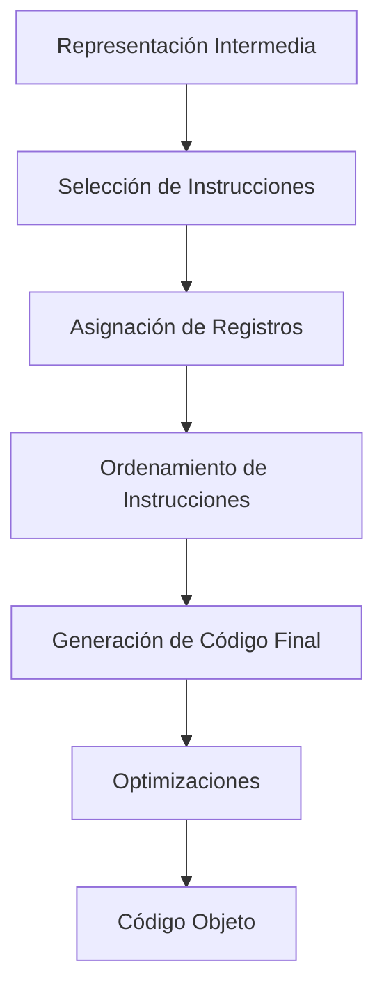

# Compiladores - Estructura del código generado

## 7.1 Importancia del tema.

---

La estructura del código generado es una fase crucial en el proceso de compilación, donde el compilador transforma la representación intermedia del programa fuente en código objeto o código máquina. Según Cooper y Torczon (2004), esta fase determina en gran medida la eficiencia, portabilidad y corrección del programa ejecutable final.

### Definición

La **estructura del código generado** se refiere a la organización y formato del código de salida producido por el compilador, que puede ser:

- Código máquina nativo
- Código ensamblador
- Código intermedio para una máquina virtual (ej. Bytecode de Java)
- Código fuente en otro lenguaje

### Funciones y Fórmulas Relevantés

#### Medidas de Calidad del Código

La calidad del código generado se evalúa mediante métricas como:

**Tamaño del código:**

$$S = \sum_{i=1}^{n} s_i$$

donde $s_i$ es el tamaño de cada instrucción generada.

**Costo de ejecución:**

$$C = \sum_{i=1}^{n} c_i \times f_i$$

donde $c_i$ es el costo de la instrucción $i$ y $f_i$ es su frecuencia de ejecución.

#### Secuencia de Instrucciones Típica

La generación de código para una operación aritmética sigue el patrón:

$$a = b + c \times d$$

se traduce típicamente como:

```
LOAD R1, c
MUL R1, d
LOAD R2, b
ADD R2, R1
STORE R2, a
```

### Importancia del Tema

#### 1. Impacto en el Rendimiento

El código generado determina directamente la eficiencia del programa ejecutable. Según Aho et al. (2007), una buena generación de código puede mejorar el rendimiento hasta en un 500% compared to un código mal generado.

```assembly
; Código optimizado
MOV AX, 5
ADD AX, BX
; vs código no optimizado
PUSH 5
PUSH BX
POP AX
POP BX
ADD AX, BX
```

#### 2. Portabilidad entre Plataformas

La estructura del código generado debe adaptarse a diferentes arquitecturas:

- Conjuntos de instrucciones diferentes
- Registros disponibles
- Convenciones de llamada a funciones

#### 3. Uso Eficiente de Recursos

Un buen generador de código optimiza el uso de:

- Registros del procesador
- Memoria
- Ciclos de CPU

#### 4. Corrección y Confiabilidad

El código generado debe ser semánticamente equivalente al programa fuente y ejecutarse sin errores.

### Diagrama de Proceso de Generación de Código



### Ejemplo Práctico

**Código fuente:**

```c
int factorial(int n) {
    if (n <= 1) return 1;
    return n * factorial(n-1);
}
```

**Código generado (x86 assembly):**

```assembly
factorial:
    push    ebp
    mov     ebp, esp
    sub     esp, 16
    cmp     DWORD PTR [ebp+8], 1
    jg      .L2
    mov     eax, 1
    jmp     .L3
.L2:
    mov     eax, DWORD PTR [ebp+8]
    sub     eax, 1
    mov     DWORD PTR [esp], eax
    call    factorial
    imul    eax, DWORD PTR [ebp+8]
.L3:
    leave
    ret
```

### Ejercicios Propuestos

1. **Generación de código para expresión aritmética:**
   Dada la expresión: `x = (a + b) * c - d / e`
   Genere el código ensamblador para una arquitectura de tres direcciones.

2. **Análisis de eficiencia:**
   Compare estos dos fragmentos de código y determine cuál es más eficiente:

   **Fragmento A:**

   ```assembly
   MOV R1, a
   ADD R1, b
   MOV R2, c
   MUL R1, R2
   ```

   **Fragmento B:**

   ```assembly
   LOAD R1, a
   LOAD R2, b
   ADD R3, R1, R2
   LOAD R4, c
   MUL R5, R3, R4
   ```

3. **Optimización de registros:**
   Dado el siguiente código intermedio:
   ```
   t1 = a + b
   t2 = t1 * c
   t3 = t2 - d
   t4 = t3 / e
   x = t4
   ```
   Asigne registros minimizando el número de transferencias de memoria.

### Técnicas Avanzadas

#### Asignación de Registros mediante Graph Coloring

La asignación óptima de registros se modela como un problema de coloreado de grafos, donde:

- Los nodos representan variables temporales
- Las aristas representan interferencias (vidas simultáneas)

**Fórmula de interferencia:**
Dos variables $v_i$ y $v_j$ interfieren si:

$$live(v_i) \cap live(v_j) \neq \emptyset$$

### Referencias

#### Bibliografía Básica

1. Cooper, K. D., & Torczon, L. (2004). _Engineering a Compiler_. Morgan Kaufmann. (Capítulo 10: Instruction Selection)
2. Scott, M. L. (2009). _Programming Language Pragmatics_. Morgan Kaufmann. (Capítulo 16: Code Generation)
3. Aho, A. V., Lam, M. S., Sethi, R., & Ullman, J. D. (2007). _Compilers: Principles, Techniques, and Tools_ (2nd ed.). Pearson Education. (Capítulo 8: Code Generation)

#### Bibliografía Complementaria

4. Aho, A. V., & Ullman, J. D. (1972). _The Theory of Parsing, Translation and Compiling_ (Vol. 1). Prentice Hall.
5. Grune, D., Bal, H. E., Jacobs, C. J. H., & Langendoen, K. G. (2000). _Modern Compiler Design_. John Wiley & Sons.

### Conclusión

La importancia de la estructura del código generado radica en su impacto directo sobre el rendimiento, portabilidad y eficiencia del software compilado. Un compilador con un buen generador de código puede producir ejecutables significativamente más rápidos y con menor consumo de recursos, lo que es crítico en aplicaciones de alto rendimiento y sistemas embebidos con limitaciones de hardware.
