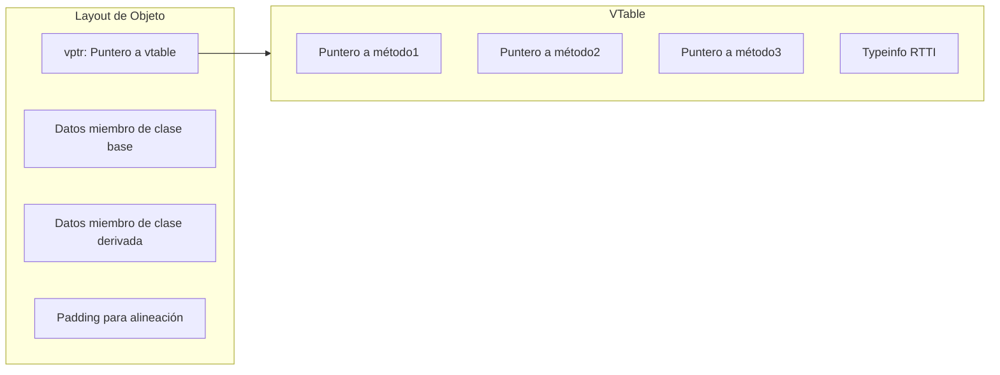
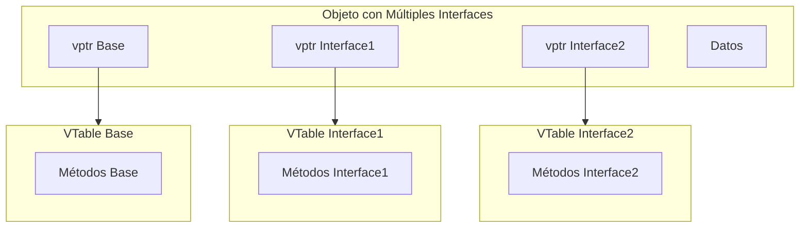
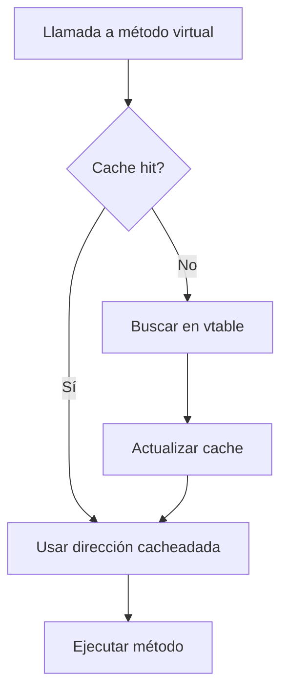

# Compiladores - Estructura del código generado

## 7.10 Implementación en lenguajes orientados a objetos.

---

La implementación de características de lenguajes orientados a objetos (OOP) requiere estrategias específicas en la generación de código. Según Scott (2009), "la eficiente implementación de OOP involucra mecanismos complejos para herencia, polimorfismo y encapsulamiento que impactan significativamente el diseño del compilador".

### Definición

La **programación orientada a objetos** se implementa mediante estructuras de datos y convenciones de llamada que soportan:

- **Encapsulamiento**: Ocultamiento de implementación
- **Herencia**: Relación is-a entre clases
- **Polimorfismo**: Múltiples formas mediante interfaces comunes
- **Dynamic dispatch**: Resolución dinámica de métodos

### Estructuras Fundamentales

#### Layout de Objetos en Memoria

**Estructura básica de objeto:**



#### Cálculo de Offsets

$$ offset(member) = sizeof(vptr) + \sum\_{i=1}^{n-1} sizeof(base\\_class\\_i\\_members) + offset\\_in\\_class$$

### Herencia y VTables

#### Herencia Simple

```c++
class Base {
public:
    virtual void vfunc1();
    virtual void vfunc2();
    int data1;
};

class Derived : public Base {
public:
    virtual void vfunc1() override;
    virtual void vfunc3();
    int data2;
};
```

**VTable layout:**

```
Base VTable:
    [0] Base::vfunc1
    [1] Base::vfunc2

Derived VTable:
    [0] Derived::vfunc1  // Override
    [1] Base::vfunc2     // Inherited
    [2] Derived::vfunc3  // New
```

#### Herencia Múltiple

$$address\\_adjustment = offset\\_between\\_bases$$

**Thunk code para ajuste de this pointer:**

```assembly
; Thunk para ajustar this pointer
adjusted_method:
    add ecx, offset_adjustment
    jmp actual_method
```

### Dynamic Dispatch

#### Resolución de Métodos Virtuales

$$method\\_address = vtable[base\\_offset + method\\_index]$$

**Código C++:**

```c++
Base* obj = new Derived();
obj->vfunc1();  // Dynamic dispatch
```

**Código x86:**

```assembly
mov eax, [obj]        ; Cargar vptr
mov edx, [eax]        ; Cargar dirección de vfunc1
call edx              ; Llamada indirecta
```

#### Costo de Dynamic Dispatch

$$dispatch\\_cost = 2 memory\\_accesses + indirect\\_call$$

### Implementación de Características OOP

#### Constructores y Destructores

**Orden de inicialización:**

1. Base classes (en orden de herencia)
2. Member objects (en orden de declaración)
3. Cuerpo del constructor

**Código del constructor:**

```assembly
Derived_ctor:
    call Base_ctor     ; Constructor de base
    ; Inicializar miembros
    mov [this + offset], value
    ; Cuerpo del constructor
    ret
```

#### Interfaces y Clases Abstractas

**Implementación mediante vtable doble:**



### Optimizaciones

#### Devirtualization

**Cuando el tipo es conocido estáticamente:**

```c++
Derived obj;
obj.vfunc1();  // Llamada directa, no virtual
```

**Código optimizado:**

```assembly
call Derived_vfunc1  ; Llamada directa
```

#### Inline Caching

Cache de métodos frecuentemente llamados:

$$cache\\_hit\\_rate = \frac{hits}{hits + misses}$$

#### Thin Pointers vs Fat Pointers

**Trade-off espacio/tiempo:**

- **Thin**: Solo vptr (menos espacio)
- **Fat**: vptr + typeinfo (más información)

### Ejemplos Prácticos

#### Ejemplo 1: Herencia Simple

**Código C++:**

```c++
class Animal {
public:
    virtual void speak() = 0;
    int age;
};

class Dog : public Animal {
public:
    virtual void speak() override { cout << "Woof!"; }
    int breed;
};

Animal* pet = new Dog();
pet->speak();
```

**Código generado:**

```assembly
; Creación del objeto
push 12             ; sizeof(Dog)
call operator new
mov [eax], Dog_vtable  ; Inicializar vptr
mov [eax+4], 0      ; age = 0
mov [eax+8], 0      ; breed = 0

; Llamada virtual
mov ecx, [pet]      ; this pointer
mov edx, [ecx]      ; vptr
call [edx]          ; speak()
```

#### Ejemplo 2: Herencia Múltiple

**Código C++:**

```c++
class A { virtual void fa(); };
class B { virtual void fb(); };
class C : public A, public B {};

C* obj = new C();
B* b = obj;  // Adjust pointer
b->fb();
```

**Ajuste de puntero:**

```assembly
mov eax, [obj]
add eax, 8          ; Adjust for B subobject
mov [b], eax
```

### Ejercicios Propuestos

1. **Diseño de VTable:**
   Para la jerarquía:

   ```c++
   class A { virtual void f(); virtual void g(); };
   class B : public A { virtual void f() override; virtual void h(); };
   class C : public B { virtual void g() override; };
   ```

   Diseñe las vtables para cada clase.

2. **Cálculo de offsets:**
   Dadas las clases:

   ```c++
   class Base { int a; double b; };
   class Derived : public Base { char c; int d; };
   ```

   Calcule los offsets de miembros y el tamaño total con alineamiento de 8 bytes.

3. **Optimización de devirtualization:**
   Identifique oportunidades de devirtualization en:

   ```c++
   void process(Animal* a) {
       if (auto* d = dynamic_cast<Dog*>(a)) {
           d->bark();
       }
       a->speak();
   }
   ```

4. **Implementación de interfaces:**
   Diseñe el layout para:
   ```c++
   class IReader { virtual void read() = 0; };
   class IWriter { virtual void write() = 0; };
   class File : public IReader, public IWriter {};
   ```

### Manejo de Tipos en Tiempo de Ejecución (RTTI)

#### Type Information

```c++
struct type_info {
    const char* name;
    size_t size;
    type_info* base_class;
    // ... más información
};
```

#### Dynamic Cast

$$dynamic\\_cast\\_cost = O(depth\\_of\\_inheritance)$$

### Diagrama de Resolución de Métodos



### Fórmulas y Métricas

#### Overhead de OOP

$$oop\\_overhead = vtable\\_size + vptr\\_size + padding\\_bytes + runtime\\_type\\_info$$

#### Eficiencia de Dynamic Dispatch

$$dispatch\\_efficiency = \frac{direct\\_calls}{total\\_calls}$$

#### Costo de Herencia Múltiple

$$multiple\\_inheritance\\_cost = additional\\_vtables + adjustment\\_thunks$$

### Referencias

#### Bibliografía Básica

1. Aho, A. V., Lam, M. S., Sethi, R., & Ullman, J. D. (2007). _Compilers: Principles, Techniques, and Tools_ (Capítulo 6: Intermediate-Code Generation)
2. Cooper, K. D., & Torczon, L. (2004). _Engineering a Compiler_ (Capítulo 7: Object-Oriented Features)
3. Scott, M. L. (2009). _Programming Language Pragmatics_ (Capítulo 9: Data Abstraction and Object Orientation)

#### Bibliografía Complementaria

4. Grune, D., et al. (2000). _Modern Compiler Design_ (Capítulo 8: Object-Oriented Languages)
5. Wilhelm, R., & Maurer, D. (1995). _Compiler Design_ (Capítulo 11: OOP Implementation)

### Conclusión

La implementación de lenguajes orientados a objetos requiere estrategias sofisticadas de generación de código para soportar eficientemente herencia, polimorfismo y dynamic dispatch. El uso de vtables, ajuste de punteros en herencia múltiple, y mecanismos de RTTI introduce overhead que debe ser minimizado mediante optimizaciones como devirtualization e inline caching. El compilador debe balancear la flexibilidad del modelo OOP con la eficiencia de ejecución, considerando trade-offs entre espacio de memoria y velocidad de acceso. Las implementaciones modernas emplean técnicas avanzadas para reducir el costo de las características OOP mientras mantienen la semántica correcta del lenguaje.
