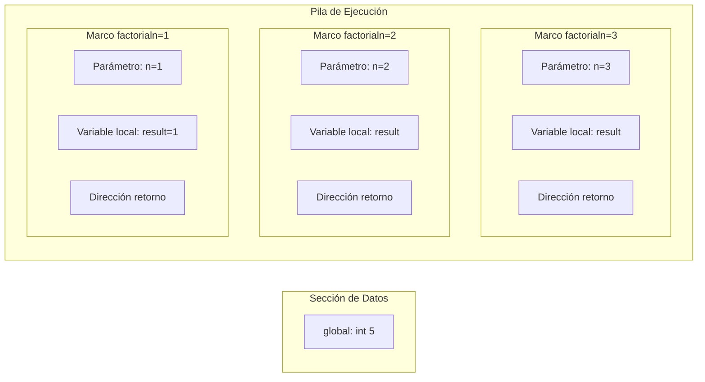

# Compiladores - Estructura del código generado

## 7.2 Asignación de espacios de almacenamiento.

---

La asignación de espacios de almacenamiento es un aspecto fundamental en la generación de código que determina cómo y dónde se almacenan los datos durante la ejecución del programa. Según Aho et al. (2007), esta fase "determina la disposición en memoria de los datos objeto que corresponden a los identificadores del programa fuente".

### Definición

La **asignación de espacios de almacenamiento** se refiere al proceso de determinar la ubicación en memoria de las variables, constantes, estructuras de datos y información de control durante la ejecución del programa. Incluye:

- Asignación de memoria estática y dinámica
- Distribución de registros del procesador
- Gestión de la pila de ejecución (stack)
- Administración del montículo (heap)

### Modelos de Almacenamiento

#### 1. Almacenamiento Estático

Asignación fija de memoria durante la compilación:

$$address(v) = base\_address + offset_v$$

**Ejemplo: Variables globales en C**

```c
int global_var; // Almacenamiento estático
static int static_var; // Almacenamiento estático
```

#### 2. Almacenamiento en Pila (Stack)

Gestión automática de variables locales y información de procedimientos:

$$stack\_pointer = stack\_pointer - frame\_size$$

**Estructura de un registro de activación:**


#### 3. Almacenamiento en Montículo (Heap)

Asignación dinámica de memoria durante la ejecución:

$$heap\_pointer = heap\_pointer + requested\_size$$

### Fórmulas y Cálculos

#### Cálculo de Desplazamientos

Para un registro de activación, el desplazamiento de cada variable se calcula como:

$$\Delta_i = \sum_{j=1}^{i-1} size(v_j)$$

**Ejemplo:** Para variables `int a; double b; char c;`:

$$\Delta_a = 0, \Delta_b = 4, \Delta_c = 12$$

#### Alineación de Memoria

La dirección alineada se calcula como:

$$aligned\_address = \lceil \frac{address}{alignment} \rceil \times alignment$$

### Estrategias de Asignación

#### 1. Asignación de Registros

Según Cooper y Torczon (2004), la asignación óptima de registros sigue:

**Fórmula de prioridad:**

$$priority(r) = \sum_{i=1}^{n} \frac{use\_count(i)}{distance(i)}$$

#### 2. Asignación de Variables Globales

```c
// Ejemplo de secciones de memoria
int global_init = 10;    // .data (inicializada)
int global_uninit;       // .bss (no inicializada)
const int global_const = 20; // .rodata (solo lectura)
```

#### 3. Asignación de Arrays y Estructuras

**Cálculo de dirección de elemento de array:**

$$address[i] = base\_address + i \times element\_size$$

**Para arrays multidimensionales:**

$$address[i][j] = base\_address + (i \times col\_size + j) \times element\_size$$

### Ejemplo Práctico

**Código fuente:**

```c
int global = 5;

int factorial(int n) {
    int result = 1;
    if (n > 1) {
        result = n * factorial(n-1);
    }
    return result;
}
```

**Asignación de memoria:**



### Ejercicios Propuestos

1. **Cálculo de desplazamientos:**
   Dada la siguiente declaración de estructura en C:

   ```c
   struct Example {
       char a;     // 1 byte
       int b;      // 4 bytes
       double c;   // 8 bytes
       short d;    // 2 bytes
   };
   ```

   Calcule los desplazamientos de cada campo considerando alineamiento de 8 bytes.

2. **Asignación de registros:**
   Para el siguiente fragmento de código:

   ```c
   int a = 10, b = 20, c = 30;
   int result = a * b + c * a - b / c;
   ```

   Asigne registros minimizando accesos a memoria.

3. **Gestión de pila:**
   Analice el siguiente código y determine el layout del registro de activación:
   ```c
   void function(int x, int y) {
       int local1 = x + y;
       double local2 = x * y;
       char local3 = 'A';
       if (x > y) {
           int temp = x - y;
           local2 = temp * 2.0;
       }
   }
   ```

### Técnicas de Optimización

#### 1. Reutilización de Espacio de Pila

Las variables con ámbitos no superpuestos pueden compartir espacio:

$$shared\_offset = max(offset_1, offset_2)$$

#### 2. Registros de Propósito Especial

Uso de registros específicos para funciones particulares:

- Registro de pila (SP)
- Registro de base (BP)
- Registro de resultados

### Implementación en Compiladores

#### Algoritmo de Asignación Básica

```python
def assign_storage(symbol_table):
    current_offset = 0
    for symbol in symbol_table:
        if symbol.type == 'variable':
            size = get_size(symbol.datatype)
            alignment = get_alignment(symbol.datatype)
            # Alinear el offset actual
            current_offset = (current_offset + alignment - 1) // alignment * alignment
            symbol.offset = current_offset
            current_offset += size
    return current_offset  # Tamaño total del frame
```

### Referencias

#### Bibliografía Básica

1. Aho, A. V., Lam, M. S., Sethi, R., & Ullman, J. D. (2007). _Compilers: Principles, Techniques, and Tools_ (Capítulo 7: Run-Time Environments)
2. Cooper, K. D., & Torczon, L. (2004). _Engineering a Compiler_ (Capítulo 5: The Memory Hierarchy)
3. Scott, M. L. (2009). _Programming Language Pragmatics_ (Capítulo 3: Names, Scopes, and Bindings)

#### Bibliografía Complementaria

4. Grune, D., et al. (2000). _Modern Compiler Design_ (Capítulo 6: Memory Management)
5. Wilhelm, R., & Maurer, D. (1995). _Compiler Design_ (Capítulo 4: Storage Organization)

### Conclusión

La asignación de espacios de almacenamiento es crítica para la eficiencia del código generado. Una buena estrategia de asignación puede mejorar significativamente el rendimiento mediante la reducción de accesos a memoria, optimización del uso de registros y minimización de la fragmentación. El compilador debe balancear entre almacenamiento estático, en pila y en montículo según las necesidades específicas de cada variable y estructura de datos.
