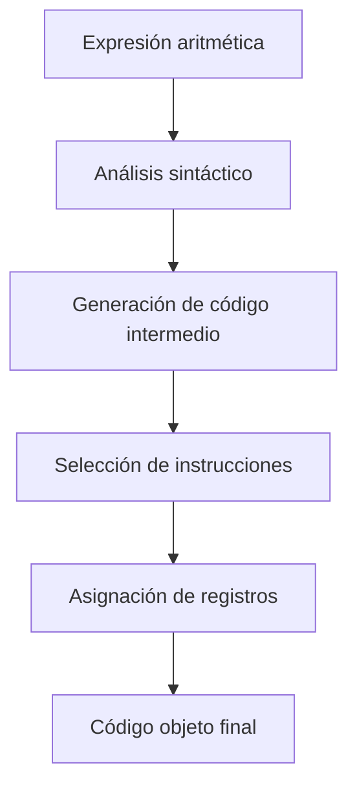
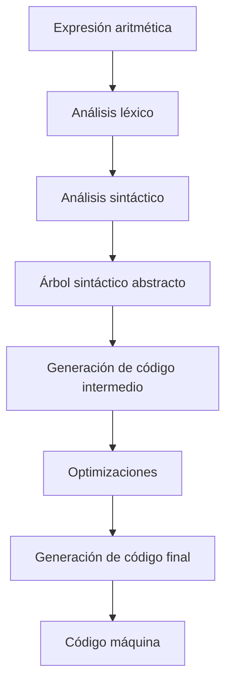

# Compiladores - Estructura del código generado

## 7.3 Operadores aritméticos.

---

La generación de código para operadores aritméticos es fundamental en el proceso de compilación, ya que constituye la base de la mayoría de las operaciones en programas de computadora. Según Aho et al. (2007), "la traducción correcta y eficiente de expresiones aritméticas es crucial para el rendimiento del código ejecutable".

### Definición

Los **operadores aritméticos** son elementos del lenguaje de programación que permiten realizar operaciones matemáticas sobre operandos. En la generación de código, se traducen a instrucciones de la máquina objetivo que manipulan registros y posiciones de memoria.

### Clasificación de Operadores Aritméticos

#### Operadores Básicos

- **Adición**: $+$
- **Sustracción**: $-$
- **Multiplicación**: $\times$ o $*$
- **División**: $/$ o $\div$
- **Módulo**: $\%$

#### Operadores Complejos

- **Incremento**: $++$
- **Decremento**: $--$
- **Asignación compuesta**: $+=$, $-=$ , $*=$, $/=$

### Representación Intermedia

#### Notación Polaca Inversa (RPN)

$$a + b \times c \rightarrow a\;b\;c\;\times\;+$$

#### Código de Tres Direcciones

$$t_1 = b \times c$$
$$t_2 = a + t_1$$

### Generación de Código para Expresiones Aritméticas

#### Secuencia General de Generación



#### Ejemplo de Traducción

**Expresión fuente:**

```c
result = a + b * c - d / e;
```

**Código de tres direcciones:**

```
t1 = b * c
t2 = a + t1
t3 = d / e
t4 = t2 - t3
result = t4
```

### Instrucciones de Máquina Típicas

#### Arquitectura x86

```assembly
; Addition
ADD dest, src

; Subtraction
SUB dest, src

; Multiplication
MUL operand    ; Unsigned
IMUL operand   ; Signed

; Division
DIV divisor    ; Unsigned
IDIV divisor   ; Signed
```

#### Arquitectura ARM

```assembly
; Basic arithmetic
ADD Rd, Rn, Operand2
SUB Rd, Rn, Operand2
MUL Rd, Rn, Rm
SDIV Rd, Rn, Rm    ; Signed division
UDIV Rd, Rn, Rm    ; Unsigned division
```

### Consideraciones de Generación de Código

#### Precedencia de Operadores

$$a + b \times c \equiv a + (b \times c)$$

#### Asociatividad

$$a - b - c \equiv (a - b) - c$$

#### Tratamiento de Tipos de Datos

**Conversión de tipos:**
$$int + float \rightarrow float$$
$$char + int \rightarrow int$$

**Fórmula de conversión:**
$$resultado = operando\_1 + \text{conversión}(operando\_2)$$

### Optimizaciones en Operadores Aritméticos

#### Constant Folding

$$3 + 5 \times 2 \rightarrow 13$$

#### Strength Reduction

$$a \times 2 \rightarrow a + a$$
$$a \times 8 \rightarrow a \ll 3$$

#### Common Subexpression Elimination

$$a = b + c; d = b + c; \rightarrow t = b + c; a = t; d = t;$$

### Ejemplos Prácticos

#### Ejemplo 1: Expresión Simple

**Código C:**

```c
int x = a + b * c;
```

**Código ensamblador x86:**

```assembly
mov eax, [b]     ; Load b
imul eax, [c]    ; b * c
add eax, [a]     ; + a
mov [x], eax     ; Store result
```

#### Ejemplo 2: Expresión Compleja

**Código C:**

```c
float y = (a + b) * (c - d) / e;
```

**Código de tres direcciones:**

```
t1 = a + b
t2 = c - d
t3 = t1 * t2
t4 = t3 / e
y = t4
```

### Manejo de Errores y Condiciones Especiales

#### División por Cero

```assembly
; Check for zero divisor
cmp [divisor], 0
je division_error
```

#### Desbordamiento Aritmético

```assembly
; Check for overflow
jo overflow_error
```

#### Operaciones con Punto Flotante

```assembly
; Floating point operations
FLD dword [a]    ; Load float
FADD dword [b]   ; Add float
FSTP dword [result] ; Store result
```

### Ejercicios Propuestos

1. **Generación de código para expresión:**
   Dada la expresión: `x = (a + b) * c - d / e + f % g`
   Genere el código de tres direcciones y el correspondiente código ensamblador x86.

2. **Optimización de expresión:**
   Optimice la siguiente expresión aplicando las técnicas aprendidas:

   ```c
   int result = (a * 4) + (b * 2) - (c * 8) + (a * 4);
   ```

3. **Manejo de tipos mixtos:**
   Para la expresión: `float result = int_var * 2.5 + char_var / 3`
   Genere el código considerando las conversiones de tipos necesarias.

4. **Análisis de precedencia:**
   Dada la expresión: `a + b * c == d - e / f`
   Determine el orden de evaluación y genere el código de tres direcciones.

### Diagrama de Procesamiento de Expresiones



### Fórmulas Matemáticas Relevantes

#### Cálculo de Direcciones de Arrays

Para un array unidimensional:

$$address[i] = base\_address + i \times element\_size$$

Para arrays multidimensionales:

$$address[i][j] = base\_address + (i \times col\_size + j) \times element\_size$$

#### Operaciones con Punto Flotante

Precisión simple (32 bits):

$$value = (-1)^s \times 2^{e-127} \times 1.m$$

Precisión doble (64 bits):

$$value = (-1)^s \times 2^{e-1023} \times 1.m$$

### Referencias

#### Bibliografía Básica

1. Aho, A. V., Lam, M. S., Sethi, R., & Ullman, J. D. (2007). _Compilers: Principles, Techniques, and Tools_ (Capítulo 6: Intermediate-Code Generation)
2. Cooper, K. D., & Torczon, L. (2004). _Engineering a Compiler_ (Capítulo 7: Code Shape)
3. Scott, M. L. (2009). _Programming Language Pragmatics_ (Capítulo 5: Target Machine Architecture)

#### Bibliografía Complementaria

4. Grune, D., et al. (2000). _Modern Compiler Design_ (Capítulo 4: Processing Expressions)
5. Wilhelm, R., & Maurer, D. (1995). _Compiler Design_ (Capítulo 6: Code Generation)

### Conclusión

La generación de código para operadores aritméticos es un componente esencial de los compiladores que requiere un profundo entendimiento de la arquitectura objetivo, las reglas de precedencia y asociatividad, y las técnicas de optimización. Una implementación eficiente puede mejorar significativamente el rendimiento del código ejecutable, especialmente en aplicaciones con intensivas operaciones matemáticas. El compilador debe manejar adecuadamente los diferentes tipos de datos, las conversiones entre ellos y las condiciones especiales como divisiones por cero y desbordamientos aritméticos.
